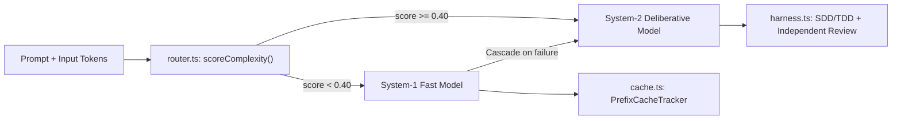

# Basic Code — Implementation Guide

## 1. Folder Structure

```text
Basic Code/
├── AGENTS.md                   # Machine-readable repo contract (< 150 lines)
├── package.json                # tsx + typescript scripts (start, benchmark, test, typecheck)
├── tsconfig.json               # Strict TypeScript configuration
├── src/
│   ├── router.ts               # System-1/System-2 profiles, complexity scorer, 20-query benchmark
│   ├── cache.ts                # Causal prompt-prefix KV cache tracker & cost math
│   ├── harness.ts              # SDD/TDD Red-Green-Review loop + reward-hacking guard
│   ├── index.ts                # Combined runnable demo
│   └── release-gate.test.ts    # 5 automated release-gate assertions (node:test)
└── implementations guide/
    └── 01_Overview.md          # This guide
```

## 2. Request & Verification Flow



## 3. Commands

```bash
npm install
npm run typecheck
npm start
npm test
```

