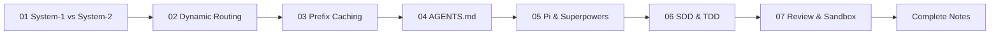

# Lecture 08 — Chapter Index

**Model Routing & Agent Harness Velocity (`AGENTS.md`, `Pi`, SDD/TDD)**
Phase 2 · Application Layer & Harness Velocity · 🟡 Intermediate · **7 chapters**

> Source of truth for topics, goal, build task and gate: **[../roadmap-v1.md](../roadmap-v1.md)** → *"Lecture 08"*.
> Source mapping: `FDE S01 & S02`.

---

## 📚 Chapters

| # | Chapter | One-line summary | File |
| :---: | :--- | :--- | :--- |
| 01 | **Fast vs. Deliberative Reasoning Models** | System-1 vs. System-2 cognition, thinking-token latency/cost physics, provider budgets (`reasoning_effort`, `budget_tokens`, `thinkingBudget`), workload matrix | [01_Fast_vs_Deliberative_Reasoning_Models.md](./notes/01_Fast_vs_Deliberative_Reasoning_Models.md) |
| 02 | **Dynamic Complexity-Based Model Routing** | Rule-based, semantic, classifier, and cascade routers; complexity scoring; confidence escalation; proving $\ge 40\%$ cost reduction | [02_Dynamic_Complexity_Based_Model_Routing.md](./notes/02_Dynamic_Complexity_Based_Model_Routing.md) |
| 03 | **Prompt Prefix Caching & Cost Engineering** | Causal KV-cache reuse, static-before-dynamic ordering, one-byte invalidation, OpenAI/Anthropic/Gemini mechanics, break-even math | [03_Prompt_Prefix_Caching_and_Cost_Engineering.md](./notes/03_Prompt_Prefix_Caching_and_Cost_Engineering.md) |
| 04 | **AGENTS.md & Repository Context Standards** | Machine-readable repo contracts, `< 150`-line root `AGENTS.md`, hierarchical scoping, progressive context loading, compound engineering | [04_AGENTS_md_and_Repository_Context_Standards.md](./notes/04_AGENTS_md_and_Repository_Context_Standards.md) |
| 05 | **Pi Harness & Superpowers Composable Workflows** | Minimalist 4-tool core (`read`, `write`, `edit`, `bash`), composable `SKILL.md` pipelines, single-context vs. subagent dispatch | [05_Pi_Harness_and_Superpowers_Composable_Workflows.md](./notes/05_Pi_Harness_and_Superpowers_Composable_Workflows.md) |
| 06 | **Spec-Driven (SDD) & Test-Driven (TDD) Agent Velocity** | Executable specs, Red-Green-Refactor for AI agents, verify-RED-first rule, preventing reward hacking and test tampering | [06_Spec_Driven_and_Test_Driven_Agent_Velocity.md](./notes/06_Spec_Driven_and_Test_Driven_Agent_Velocity.md) |
| 07 | **Independent Automated Review & Sandboxed Execution** | Fresh-context System-2 reviewer, two-stage deterministic + semantic gates, `git worktree` vs. container vs. microVM isolation | [07_Independent_Automated_Review_and_Sandboxed_Execution.md](./notes/07_Independent_Automated_Review_and_Sandboxed_Execution.md) |

---

## 📄 Complete notes

A single consolidated document with the executive summary, architecture diagram, terminology & formula cheat sheet, misconceptions, and self-check questions:

👉 **[Lecture_08_Complete_Notes.md](./notes/Lecture_08_Complete_Notes.md)**

---

## 🔗 Related

- **[./code](./code)** — runnable TypeScript Model Router + Prompt Cache + SDD/TDD Harness demo & release gate tests
- **[./Assignment/task.md](./Assignment/task.md)** — hands-on assignment & release gate checklist
- **[./README.md](./README.md)** — lecture objectives, phase, level, source mapping and checklist
- **[../roadmap-v1.md](../roadmap-v1.md)** — complete topic list, goal, build task and completion gate

---

## 🧭 Reading order

