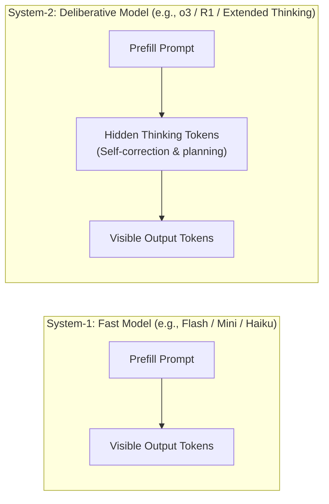

# Chapter 01 — Fast vs. Deliberative Reasoning Models

> **Lecture 08 · Chapter 01 of 07** · Level: 🟡 Intermediate · Phase 2 — Application Layer & Harness Velocity
> **Source:** `FDE S01 & S02` · **Roadmap Reference:** [`roadmap-v1.md`](../../roadmap-v1.md#lecture-08--model-routing--agent-harness-velocity-agentsmd-pi-sddtdd)
> **Cross-reference:** Builds on [Lecture 04 · Chapter 10](../../Lecture%2004%20-%20LLM%20APIs%20and%20Multi-SDK/notes/10_Reasoning_Models_and_Prompt_Prefix_Caching.md) (API primitives) and operationalizes them for **model routing**.
> **Roadmap topics:** System-1 vs. System-2 reasoning models · thinking-token budgets · latency/cost physics · provider controls (`reasoning_effort`, `budget_tokens`, `thinkingBudget`) · workload classification.

---

## 01.0 What this chapter is for

In [Lecture 04](../../Lecture%2004%20-%20LLM%20APIs%20and%20Multi-SDK/), every LLM call was treated as a single-speed operation: send a prompt, stream visible tokens, pay for input and output. In production AI engineering, **sending every request to the smartest model is an architectural anti-pattern** — it destroys latency SLAs and inflates unit costs by **10×–30×**.

By the end of this chapter you should be able to:

1. Contrast **System-1 (fast)** models with **System-2 (deliberative)** reasoning models at the token-generation and cost-physics level.
2. Calculate total wall-clock latency and total dollar cost when hidden **thinking tokens** are billed at output rates.
3. Configure and bound **thinking-token budgets** across OpenAI, Anthropic, and Gemini so deliberative models never blow up your timeout budget.
4. Classify real-world engineering workloads into System-1 vs. System-2 tiers using a deterministic decision matrix.

---

## 01.1 System-1 vs. System-2 cognition in LLMs

Borrowing Daniel Kahneman's dual-process theory of human cognition:

| Dimension | System-1 (Fast / Non-Reasoning) | System-2 (Deliberative / Reasoning) |
| :--- | :--- | :--- |
| **Representative models** | `gpt-4o-mini`, `claude-3-5-haiku`, `gemini-2.5-flash` (`thinkingBudget: 0`) | `o3` / `o4-mini`, `claude-3-7-sonnet` / `claude-4` (extended thinking), `deepseek-r1`, `gemini-2.5-pro` |
| **Execution path** | Prompt prefill $\rightarrow$ immediate visible decode | Prompt prefill $\rightarrow$ hidden chain-of-thought (`reasoning_tokens`) $\rightarrow$ visible decode |
| **Strengths** | Classification, extraction, formatting, boilerplate code, RAG synthesis | Multi-file refactoring, formal logic, constraint satisfaction, root-cause debugging |
| **Failure mode** | Jumps to plausible-sounding wrong conclusions on multi-step constraints | Overthinks trivial tasks ("analysis paralysis"), causing 10s–60s timeouts |
| **Typical TTFT** | 200 ms – 800 ms | 2,000 ms – 30,000+ ms (user sees nothing while thinking tokens decode) |
| **Relative cost** | **1× baseline** (\$0.10 – \$0.60 / 1M input) | **10× – 30× baseline** (\$2.00 – \$15.00+ / 1M input; thinking billed as output) |



> [!IMPORTANT]
> **Thinking tokens are decode tokens.** Even though the user does not see the internal reasoning trace (or sees only a redacted summary), the GPU still executes sequential autoregressive decode steps for every thinking token — and **providers bill every thinking token at the `output_tokens` rate** (typically 3×–5× higher than `input_tokens`).

---

## 01.2 Latency and cost physics of thinking tokens

Because transformer decoding is **memory-bandwidth bound** (each generated token requires reading model weights from HBM), total request latency is dominated by the sum of hidden and visible output tokens:

$$\text{Total Latency} \approx \text{TTFT}_{\text{prefill}} + \left(N_{\text{thinking}} + N_{\text{visible}}\right) \times \text{ITL}$$

where $\text{ITL}$ is the Inter-Token Latency (typically 10–35 ms/token depending on model size and serving load).

Similarly, total request cost is:

$$\text{Cost}_{\text{total}} = \frac{N_{\text{input}}}{10^6} \cdot P_{\text{in}} + \frac{N_{\text{thinking}} + N_{\text{visible}}}{10^6} \cdot P_{\text{out}}$$

### Worked example: Why unbounded System-2 kills unit economics

Suppose a customer-support triage pipeline processes **50,000 requests/day**, each with `1,200` input tokens and `80` visible output tokens:

| Configuration | Model Tier | $N_{\text{thinking}}$ | $P_{\text{in}}$ / $P_{\text{out}}$ (per 1M) | Cost per 50k reqs | p95 Latency |
| :--- | :--- | :---: | :---: | :---: | :---: |
| **System-1 only** | Fast (`$0.15 / $0.60`) | `0` | `$0.15` / `$0.60` | **\$11.40 / day** | ~0.9 s |
| **Unbounded System-2** | Reasoning (`$3.00 / $15.00`) | `2,500` (avg) | `$3.00` / `$15.00` | **\$2,115.00 / day** | ~38.0 s |
| **Bounded + Routed (80/20)** | 80% Fast, 20% Capped S2 (`N=800`) | `800` (on 20%) | Mixed | **\$291.12 / day** | ~1.2 s (fast path) |

Notice the **185× cost explosion** between System-1 and unbounded System-2 — and why **routing + thinking budgets** is mandatory before shipping reasoning models to production.

---

## 01.3 Bounding thinking-token budgets across providers

Every major frontier provider exposes a knob to cap how long the model is allowed to deliberate before emitting an answer. Never leave this parameter at its unbounded default in latency-sensitive paths.

| Provider | API Parameter | Values / Semantics | Production Guardrail |
| :--- | :--- | :--- | :--- |
| **OpenAI** | `reasoning_effort` | `"low"` \| `"medium"` \| `"high"` | Default to `"low"` for routing/triage; reserve `"high"` for offline verification or hard coding tasks. |
| **Anthropic** | `thinking: { type: "enabled", budget_tokens: N }` | Integer `N >= 1024`; `max_tokens` must be strictly `> budget_tokens` | Set `budget_tokens: 2048` for medium tasks, `8192+` for architectural planning. |
| **Google Gemini** | `thinkingConfig: { thinkingBudget: N }` | `0` disables thinking on Flash; `N > 0` caps internal thought tokens | Explicitly set `thinkingBudget: 0` when using `gemini-2.5-flash` as a pure System-1 router/classifier. |

```typescript
// Example: Bounding thinking tokens per provider tier
interface ThinkingBudgetPolicy {
  tier: "system1" | "system2_light" | "system2_deep";
  openaiEffort?: "low" | "medium" | "high";
  anthropicBudgetTokens?: number;
  geminiThinkingBudget: number;
}

const POLICIES: Record<ThinkingBudgetPolicy["tier"], ThinkingBudgetPolicy> = {
  system1:       { tier: "system1",       geminiThinkingBudget: 0 },
  system2_light: { tier: "system2_light", openaiEffort: "low",  anthropicBudgetTokens: 1024, geminiThinkingBudget: 1024 },
  system2_deep:  { tier: "system2_deep",  openaiEffort: "high", anthropicBudgetTokens: 8192, geminiThinkingBudget: 8192 },
};
```

> [!TIP]
> **Always set `max_tokens` / `maxOutputTokens` above the thinking budget.** If `budget_tokens == max_tokens`, the model can exhaust the entire token allowance during hidden reasoning and return an empty visible response.

---

## 01.4 Workload classification: When to use which tier

Use this decision matrix when designing a multi-tier application or coding harness:

| Workload Characteristic | Recommended Tier | Why |
| :--- | :--- | :--- |
| Single-step intent classification, JSON extraction, PII redaction | **System-1** | Pattern matching over local context; reasoning adds latency without accuracy gain. |
| Summarization, translation, boilerplate CRUD generation | **System-1** | Deterministic transformation of provided text/types. |
| Multi-step SQL / API planning with 4+ constraints | **System-2 (Light)** | Needs brief verification pass to avoid off-by-one or schema errors. |
| Root-cause debugging across multiple files, concurrency bugs | **System-2 (Deep)** | Requires hypothesis generation, mental simulation, and backtracking. |
| Spec-to-architecture design & security threat modeling | **System-2 (Deep)** | Errors here compound downstream; higher upfront token cost saves days of rework. |

---

## 01.5 Key takeaways

1. **System-1 vs. System-2 is an engineering trade-off, not a quality hierarchy.** Fast models win on latency, cost, and throughput for well-scoped tasks; deliberative models win on multi-constraint reasoning.
2. **Thinking tokens are hidden decode tokens billed as output.** Unbounded reasoning destroys both p95 latency and unit economics.
3. **Always enforce thinking budgets** (`reasoning_effort`, `budget_tokens`, `thinkingBudget`) and keep `max_tokens` strictly larger than the thinking budget.
4. **Never route 100% of traffic to System-2.** Pair fast and deliberative models with a dynamic router (Chapter 02) and prompt prefix caching (Chapter 03).

---

**Next:** [Chapter 02 — Dynamic Complexity-Based Model Routing](./02_Dynamic_Complexity_Based_Model_Routing.md)

