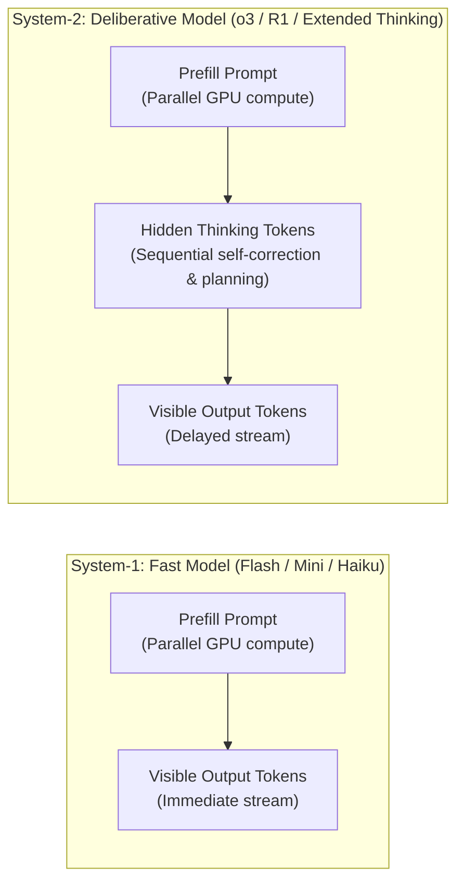
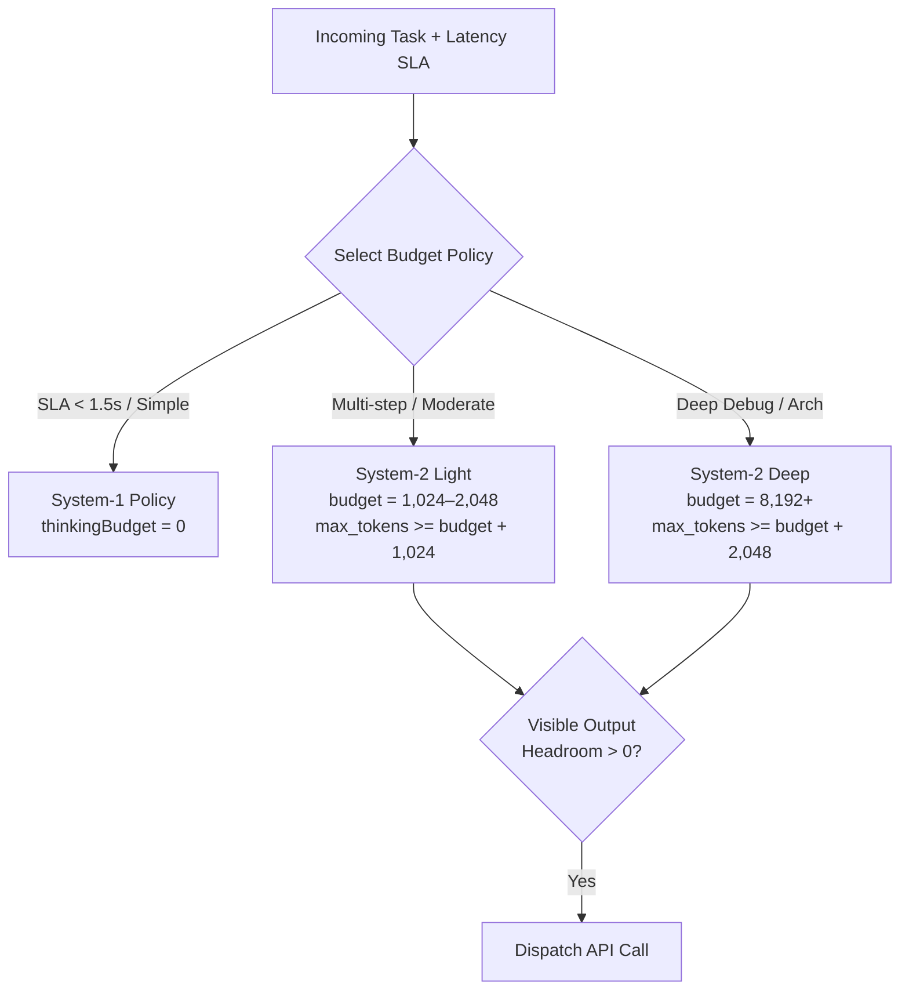

# Chapter 01 — Fast vs. Deliberative Reasoning Models

> **Lecture 08 · Chapter 01 of 07** · Level: 🟡 Intermediate · Phase 2 — Application Layer & Harness Velocity
> **Source:** `FDE S01 & S02` · **Roadmap Reference:** [`roadmap-v1.md`](../../roadmap-v1.md#lecture-08--model-routing--agent-harness-velocity-agentsmd-pi-sddtdd)
> **Cross-reference:** Builds on [Lecture 04 · Chapter 10](../../Lecture%2004%20-%20LLM%20APIs%20and%20Multi-SDK/notes/10_Reasoning_Models_and_Prompt_Prefix_Caching.md) (API primitives) and operationalizes them for **model routing**.
> **Roadmap topics:** System-1 vs. System-2 reasoning models · thinking-token budgets · latency/cost physics · provider controls (`reasoning_effort`, `budget_tokens`, `thinkingBudget`) · workload classification.

---

## 01.0 What this chapter is for

In [Lecture 04](../../Lecture%2004%20-%20LLM%20APIs%20and%20Multi-SDK/), every LLM call was treated as a single-speed operation: send a prompt, stream visible tokens, and pay for input and output. In production AI engineering, **sending every request to the smartest reasoning model is an architectural anti-pattern** — it destroys interactive latency SLAs and inflates unit costs by **10×–30×** (and often **100×+** when hidden thinking tokens run unbounded).

Think of model tiers like hiring specialists in an engineering org: you do not convene a 3-hour architecture review board to rename a CSS class, and you do not ask an intern to sign off on a distributed consensus protocol. You match the **cognitive budget** to the **problem's constraint density**.

By the end of this chapter you should be able to:

1. Contrast **System-1 (fast)** models with **System-2 (deliberative)** reasoning models at the token-generation and memory-bandwidth level.
2. Calculate total wall-clock latency and total dollar cost when hidden **thinking tokens** are billed at output rates.
3. Configure and bound **thinking-token budgets** across OpenAI, Anthropic, and Google Gemini so deliberative models never exhaust `max_tokens` or blow up your timeout budget.
4. Diagnose the **analysis-paralysis** and **empty-visible-output** failure modes of reasoning models.
5. Classify real-world engineering workloads into System-1 vs. System-2 tiers using a deterministic decision matrix.

---

## 01.1 System-1 vs. System-2 cognition in LLMs

Borrowing Daniel Kahneman's dual-process theory of human cognition, modern frontier LLMs split cleanly into two operational profiles:

| Dimension | System-1 (Fast / Non-Reasoning) | System-2 (Deliberative / Reasoning) |
| :--- | :--- | :--- |
| **Representative models** | `gpt-4o-mini`, `claude-3-5-haiku`, `gemini-2.5-flash` (`thinkingBudget: 0`) | `o3` / `o4-mini`, `claude-3-7-sonnet` / `claude-4` (extended thinking), `deepseek-r1`, `gemini-2.5-pro` |
| **Execution path** | Prompt prefill $\rightarrow$ immediate visible decode | Prompt prefill $\rightarrow$ hidden chain-of-thought (`reasoning_tokens`) $\rightarrow$ visible decode |
| **Strengths** | Classification, extraction, formatting, boilerplate code, RAG synthesis | Multi-file refactoring, formal logic, constraint satisfaction, root-cause debugging |
| **Failure mode** | Jumps to plausible-sounding wrong conclusions on multi-step constraints | Overthinks trivial tasks ("analysis paralysis"), causing 10s–60s timeouts |
| **Typical TTFT** | `200 ms – 800 ms` | `2,000 ms – 30,000+ ms` (user sees nothing while thinking tokens decode) |
| **Relative cost** | **1× baseline** (`$0.10 – $0.60` / 1M input) | **10× – 30× baseline** (`$2.00 – $15.00+` / 1M input; thinking billed as output) |



> [!IMPORTANT]
> **Thinking tokens are decode tokens.** Even though the user does not see the internal reasoning trace (or sees only a redacted summary), the GPU still executes sequential autoregressive decode steps for every thinking token — and **providers bill every thinking token at the `output_tokens` rate** (typically 3×–5× higher than `input_tokens`).

---

## 01.2 Latency and cost physics of thinking tokens

Why are thinking tokens so expensive in both **time** and **money**? Because transformer inference has two completely different hardware bottlenecks:

1. **Prefill (Prompt Processing):** Parallelizable matrix-matrix multiplication over all input tokens at once. Compute-bound, fast (`10,000+` tokens/sec).
2. **Decode (Token Generation):** Sequential, one token at a time. Each token requires reading the entire model's weights and KV cache from GPU High Bandwidth Memory (HBM). **Memory-bandwidth bound** (`30–120` tokens/sec).

Both hidden thinking tokens ($N_{\text{thinking}}$) and visible answer tokens ($N_{\text{visible}}$) go through the slow **decode** phase:

$$\text{Total Latency} \approx \text{TTFT}_{\text{prefill}} + \left(N_{\text{thinking}} + N_{\text{visible}}\right) \times \text{ITL}$$

where $\text{ITL}$ is the Inter-Token Latency (typically `10–35 ms/token` depending on model size and serving load). Note that from the user's perspective, **perceived Time to First Visible Token** is $\text{TTFT}_{\text{prefill}} + N_{\text{thinking}} \times \text{ITL}$!

Total dollar cost for a single call is:

$$\text{Cost}_{\text{total}} = \frac{N_{\text{input}}}{10^6} \cdot P_{\text{in}} + \frac{N_{\text{thinking}} + N_{\text{visible}}}{10^6} \cdot P_{\text{out}}$$

### Worked example: Why unbounded System-2 kills unit economics

Suppose a customer-support triage pipeline processes **50,000 requests/day**, each with `1,200` input tokens and `80` visible output tokens. Assume $\text{TTFT}_{\text{prefill}} = 300\text{ ms}$ and $\text{ITL} = 15\text{ ms/token}$ on System-2 (`$3.00 / $15.00` per 1M) vs. $\text{ITL} = 8\text{ ms/token}$ on System-1 (`$0.15 / $0.60` per 1M):

- **System-1 only (`N_thinking = 0`):**
  - Per-request cost: $\frac{1200}{10^6}(0.15) + \frac{80}{10^6}(0.60) = \$0.00018 + \$0.000048 = \$0.000228$.
  - 50,000 requests/day: **\$11.40 / day**.
  - Latency: $300\text{ ms} + 80 \times 8\text{ ms} = \mathbf{0.94\text{ s}}$.
- **Unbounded System-2 (`N_thinking = 2,500` avg):**
  - Per-request cost: $\frac{1200}{10^6}(3.00) + \frac{2500 + 80}{10^6}(15.00) = \$0.0036 + \$0.0387 = \$0.0423$.
  - 50,000 requests/day: **\$2,115.00 / day** (**185× more expensive!**).
  - Latency: $300\text{ ms} + 2580 \times 15\text{ ms} = \mathbf{39.0\text{ s}}$ (37.8 s of dead silence before token 1!).
- **Bounded + Routed (80% System-1, 20% Capped System-2 with `N_thinking <= 800`):**
  - System-1 slice (`40,000` reqs): $40{,}000 \times \$0.000228 = \$9.12$.
  - System-2 slice (`10,000` reqs, `800` thinking + `80` visible = `$0.0168`/req): $10{,}000 \times \$0.0168 = \$168.00$.
  - Total: **\$177.12 / day** (**91.6% cheaper** than unbounded System-2, with sub-second fast path).

| Configuration | Model Tier | $N_{\text{thinking}}$ | $P_{\text{in}}$ / $P_{\text{out}}$ (per 1M) | Cost per 50k reqs | Typical Latency |
| :--- | :--- | :---: | :---: | :---: | :---: |
| **System-1 only** | Fast (`$0.15 / $0.60`) | `0` | `$0.15` / `$0.60` | **\$11.40 / day** | `~0.9 s` |
| **Unbounded System-2** | Reasoning (`$3.00 / $15.00`) | `2,500` (avg) | `$3.00` / `$15.00` | **\$2,115.00 / day** | `~39.0 s` |
| **Bounded + Routed (80/20)** | 80% Fast, 20% Capped S2 (`N=800`) | `800` (on 20%) | Mixed | **\$177.12 / day** | `~0.9 s` (fast) / `~13.5 s` (deep) |

---

## 01.3 Bounding thinking-token budgets across providers

Every major frontier provider exposes a knob to cap how long the model is allowed to deliberate before emitting an answer. Never leave this parameter at its unbounded default in latency-sensitive paths.

| Provider | API Parameter | Values / Semantics | Production Guardrail |
| :--- | :--- | :--- | :--- |
| **OpenAI** | `reasoning_effort` | `"low"` \| `"medium"` \| `"high"` | Default to `"low"` for routing/triage; reserve `"high"` for offline verification or hard coding tasks. |
| **Anthropic** | `thinking: { type: "enabled", budget_tokens: N }` | Integer `N >= 1024`; `max_tokens` must be strictly `> budget_tokens` | Set `budget_tokens: 2048` for medium tasks, `8192+` for architectural planning. |
| **Google Gemini** | `thinkingConfig: { thinkingBudget: N }` | `0` disables thinking on Flash; `N > 0` caps internal thought tokens | Explicitly set `thinkingBudget: 0` when using `gemini-2.5-flash` as a pure System-1 router/classifier. |



```typescript
// Production-safe thinking-budget policy & headroom validator
export type ReasoningTier = "system1" | "system2_light" | "system2_deep";

export interface ProviderBudgetConfig {
  tier: ReasoningTier;
  openaiEffort?: "low" | "medium" | "high";
  anthropicBudgetTokens?: number;
  geminiThinkingBudget: number;
  minVisibleReserve: number;
}

export const BUDGET_POLICIES: Record<ReasoningTier, ProviderBudgetConfig> = {
  system1:       { tier: "system1",       geminiThinkingBudget: 0,    minVisibleReserve: 512 },
  system2_light: { tier: "system2_light", openaiEffort: "low",  anthropicBudgetTokens: 1024, geminiThinkingBudget: 1024, minVisibleReserve: 1024 },
  system2_deep:  { tier: "system2_deep",  openaiEffort: "high", anthropicBudgetTokens: 8192, geminiThinkingBudget: 8192, minVisibleReserve: 2048 },
};

export function computeSafeMaxTokens(tier: ReasoningTier): number {
  const p = BUDGET_POLICIES[tier];
  const thinkingCap = p.anthropicBudgetTokens ?? p.geminiThinkingBudget;
  return thinkingCap + p.minVisibleReserve;
}
```

> [!TIP]
> **Always set `max_tokens` / `maxOutputTokens` strictly above the thinking budget.** If `budget_tokens == max_tokens`, the model can exhaust the entire token allowance during hidden reasoning and return `stop_reason: "max_tokens"` with **zero visible characters**.

---

## 01.4 Workload classification & where System-2 breaks

Use this decision matrix when designing a multi-tier application or coding harness:

| Workload Characteristic | Recommended Tier | Why |
| :--- | :--- | :--- |
| Single-step intent classification, JSON extraction, PII redaction | **System-1** | Pattern matching over local context; reasoning adds latency without accuracy gain. |
| Summarization, translation, boilerplate CRUD generation | **System-1** | Deterministic transformation of provided text/types. |
| Multi-step SQL / API planning with 4+ constraints | **System-2 (Light)** | Needs brief verification pass to avoid off-by-one or schema errors. |
| Root-cause debugging across multiple files, concurrency bugs | **System-2 (Deep)** | Requires hypothesis generation, mental simulation, and backtracking. |
| Spec-to-architecture design & security threat modeling | **System-2 (Deep)** | Errors here compound downstream; higher upfront token cost saves days of rework. |

### Traps: Where System-2 models break in production

| Trap | What It Looks Like | Why It Breaks |
| :--- | :--- | :--- |
| **Overthinking trivial prompts** | Asking `o3` to classify `"refund"` vs `"billing"` | Model invents edge-case interpretations and occasionally flips the obvious label while burning 1,500 thinking tokens. |
| **Streaming UI freeze** | User sees a blank spinner for 18 seconds | Thinking tokens decode before visible tokens; without reasoning summaries or progress events, users assume the app crashed. |
| **Silent `max_tokens` truncation** | API returns `200 OK` with `content: ""` | `max_tokens` was set too close to `budget_tokens`, leaving zero tokens for the visible answer. |

---

## 01.5 Common mistakes

| # | Common Mistake | Why It Hurts | What To Do Instead |
| :---: | :--- | :--- | :--- |
| 1 | **Defaulting every endpoint to a System-2 model** | 10×–185× higher cost and 10s–40s latency on simple requests | Route simple extraction/classification to System-1 and reserve System-2 for high-constraint tasks. |
| 2 | **Forgetting that thinking tokens bill as `output_tokens`** | Monthly bills are 3×–5× higher than input-token estimates | Always budget `N_thinking + N_visible` at `P_out` in unit-economics models. |
| 3 | **Setting `max_tokens` equal to `budget_tokens`** | Model spends all tokens thinking and returns an empty string | Always enforce `max_tokens >= thinking_budget + minVisibleReserve`. |
| 4 | **Leaving `gemini-2.5-flash` thinking at default for routing** | Adds 500–2,000 ms of hidden reasoning to a `< 50 ms` router | Explicitly pass `thinkingBudget: 0` when using Flash as a pure System-1 classifier. |
| 5 | **No streaming status indicator during thinking** | Users refresh or retry during 15s of hidden decode, doubling load | Emit `"Thinking..."` status heartbeats or stream provider reasoning summaries. |

---

## 01.6 Key takeaways

1. **System-1 vs. System-2 is an engineering trade-off, not a quality hierarchy.** Fast models win on latency, cost, and throughput for well-scoped tasks; deliberative models win on multi-constraint reasoning.
2. **Thinking tokens are hidden decode tokens billed as output.** Unbounded reasoning destroys both p95 latency and unit economics.
3. **Always enforce thinking budgets** (`reasoning_effort`, `budget_tokens`, `thinkingBudget`) and keep `max_tokens` strictly larger than the thinking budget.
4. **Never route 100% of traffic to System-2.** Pair fast and deliberative models with a dynamic router (Chapter 02) and prompt prefix caching (Chapter 03).

---

**Next:** [Chapter 02 — Dynamic Complexity-Based Model Routing](./02_Dynamic_Complexity_Based_Model_Routing.md)
