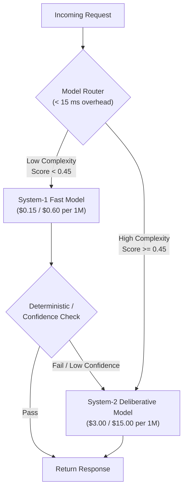
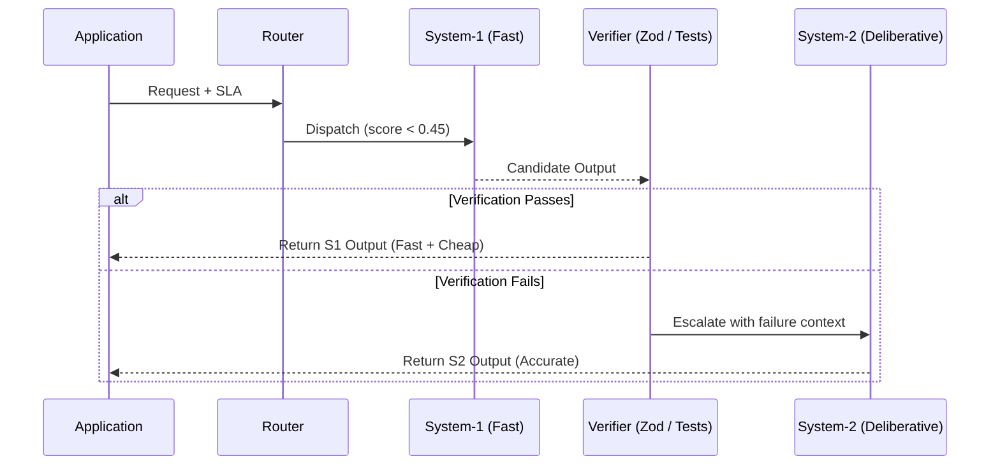

# Chapter 02 — Dynamic Complexity-Based Model Routing

> **Lecture 08 · Chapter 02 of 07** · Level: 🟡 Intermediate · Phase 2 — Application Layer & Harness Velocity
> **Source:** `FDE S01` · **Roadmap Reference:** [`roadmap-v1.md`](../../roadmap-v1.md#lecture-08--model-routing--agent-harness-velocity-agentsmd-pi-sddtdd)
> **Roadmap topics:** Rule-based, classifier-based, and semantic routers · complexity scoring · fallback cascades · confidence-based escalation · cost-reduction math ($\ge 40\%$ target).

---

## 02.0 What this chapter is for

Once you have a **System-1 (fast)** model and a **System-2 (deliberative)** model, the immediate architectural question is: *who decides which model handles an incoming request?*

If a human hardcodes one model per endpoint, simple queries overpay and edge-case queries underperform. A **dynamic model router** inspects each request in `< 15 ms` and dispatches it to the cheapest model tier capable of meeting the accuracy bar.

By the end of this chapter you should be able to:

1. Compare the four routing architectures: **rule-based**, **embedding/semantic**, **lightweight classifier**, and **cascading escalation**.
2. Design a deterministic **complexity scorer** using structural and linguistic signals.
3. Implement **confidence-based fallback cascades** (try System-1, verify deterministically, escalate to System-2 only on failure).
4. Prove mathematically how an 80/20 or 70/30 routing split achieves **$\ge 40\%$ cost reduction** without accuracy regression.

---

## 02.1 The four routing architectures



| Router Type | How It Works | Latency Overhead | Pros | Cons |
| :--- | :--- | :---: | :--- | :--- |
| **1. Rule-Based Heuristic** | Regex, token count, keyword/AST signals, tool count | `< 1 ms` | Zero external calls, 100% deterministic, easy to debug | Brittle on paraphrased complex requests |
| **2. Semantic / Embedding** | Cosine similarity against labeled "simple" vs "complex" exemplar centroids | `5–15 ms` | Captures semantic intent without brittle keywords | Requires curated exemplar set; threshold tuning needed |
| **3. Classifier / Tiny LLM** | Fine-tuned BERT/DeBERTa or 0.5B–3B classifier predicting `tier` | `10–40 ms` | Highest upfront routing accuracy | Extra model to host/maintain |
| **4. Cascade (Speculative)** | Always try System-1 first; run validator (JSON schema, tests, logprob); escalate on failure | `0 ms` on hit; `S1 + S2` on miss | **Zero accuracy regression** when validator is exact | Doubles latency on escalated requests |

> [!TIP]
> **Production best practice:** Combine **#1 (Rule-Based)** for obvious System-2 triggers (e.g., multi-file diffs, stack traces, explicit reasoning keywords) with **#4 (Cascade)** for ambiguous middle-ground requests where System-1 usually succeeds and a cheap validator can catch misses.

---

## 02.2 Designing a complexity scorer

A production complexity router computes a normalized score $C(x) \in [0, 1]$ from cheap, observable features of the prompt and session state:

| Signal Category | Example Features | Weight Direction |
| :--- | :--- | :--- |
| **Lexical & Structural** | Prompt length (tokens), presence of code blocks / stack traces, nested constraints ("must", "except", "and also") | $+\Delta$ |
| **Task Intent** | Keywords: `refactor`, `debug`, `prove`, `race condition`, `architecture`, `migrate` vs `summarize`, `format`, `extract`, `translate` | $+\Delta$ / $-\Delta$ |
| **Tool & Context State** | Number of available tools (`> 5`), conversation turn depth (`> 6`), prior tool failure in session | $+\Delta$ |
| **SLA / User Tier** | Interactive autocomplete (`latency_budget < 500ms`) vs background batch job | Caps max tier |

```typescript
export interface RoutingFeatures {
  tokenCount: number;
  hasCodeOrStackTrace: boolean;
  constraintCount: number;       // e.g. "must", "without", "only if"
  multiStepVerbs: number;        // e.g. "debug", "refactor", "compare", "prove"
  priorAttemptFailed: boolean;
}

export function scoreComplexity(f: RoutingFeatures): number {
  let score = 0;
  if (f.tokenCount > 1500) score += 0.25;
  else if (f.tokenCount > 500) score += 0.10;

  if (f.hasCodeOrStackTrace) score += 0.25;
  score += Math.min(0.25, f.constraintCount * 0.08);
  score += Math.min(0.30, f.multiStepVerbs * 0.15);
  if (f.priorAttemptFailed) score += 0.40;

  return Math.min(1, Number(score.toFixed(3)));
}
```

---

## 02.3 Fallback cascades and confidence escalation

Routing upfront is a *prediction*; cascading is a *guarantee*. In a **cascade**, you send the request to System-1 first and inspect the result with a **zero-LLM or ultra-cheap verifier**:

1. **Schema / Type Validator (Zod):** If System-1 emits invalid JSON or violates a Zod schema after 1 repair attempt, escalate to System-2.
2. **Test / Compiler Gate (Coding Agents):** If System-1's patch fails `tsc` or unit tests, escalate to System-2 with the compiler error attached.
3. **Self-Reported Confidence / Logprobs:** If average token log-probability on key decision tokens drops below a calibrated threshold (e.g. `exp(avg_logprob) < 0.72`), escalate to System-2.
4. **Circuit Breaker:** Never escalate more than once per request (`max_escalations = 1`) to prevent infinite retry loops.



---

## 02.4 Cost-reduction math: Proving the $\ge 40\%$ release gate

Let $C_1$ be the average cost of a System-1 call, $C_2$ be the average cost of a System-2 call, and $\alpha \in [0, 1]$ be the fraction of requests handled by System-1 without escalation.

If the baseline sends 100% of requests to System-2, baseline cost is $C_{\text{base}} = C_2$. With routing:

$$C_{\text{routed}} = \alpha \cdot C_1 + (1 - \alpha) \cdot C_2 + C_{\text{router}}$$

Assuming $C_{\text{router}} \approx 0$ (rule-based or local classifier), the fractional savings are:

$$\text{Savings} = 1 - \frac{C_{\text{routed}}}{C_2} = \alpha \left(1 - \frac{C_1}{C_2}\right)$$

Since typically $C_1 / C_2 \approx 0.05$ (fast models are ~20× cheaper than deliberative models):

- Even if only **$\alpha = 50\%$** of traffic stays on System-1: $\text{Savings} = 0.50 \times (1 - 0.05) = \mathbf{47.5\%} \ge 40\%$.
- At a realistic **$\alpha = 70\%$** split (with 5% cascade overhead): $\text{Savings} \approx \mathbf{66\%}$.

> [!NOTE]
> **Why accuracy stays flat or improves:** Easy queries do not benefit from 3,000 thinking tokens — in fact, deliberative models occasionally over-complicate simple extraction tasks. Routing keeps System-2 focused on the 20%–35% of queries that genuinely require multi-step reasoning.

---

## 02.5 Key takeaways

1. **Rule-based + Cascade** is the highest-ROI starting architecture: near-zero routing latency and deterministic escalation on failure.
2. **Always pair cascades with an objective verifier** (Zod schema, unit test, SQL syntax check, or calibrated logprobs).
3. **Measure both cost savings and accuracy parity** on a fixed mixed-complexity benchmark (e.g., 20+ labeled queries) before tuning your threshold.

---

**Next:** [Chapter 03 — Prompt Prefix Caching & Cost Engineering](./03_Prompt_Prefix_Caching_and_Cost_Engineering.md)

