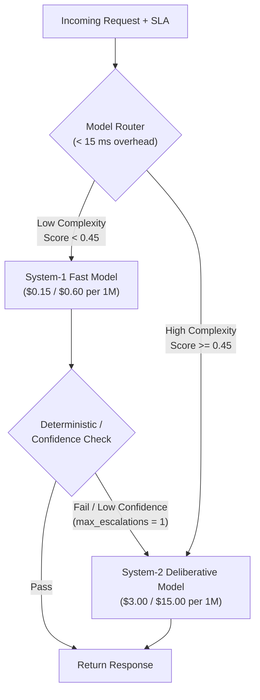
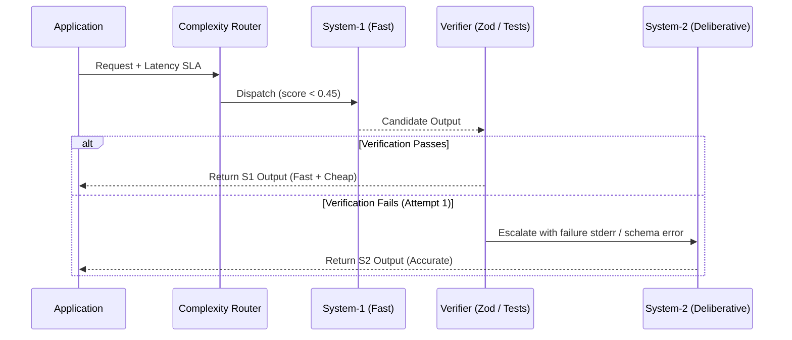

# Chapter 02 — Dynamic Complexity-Based Model Routing

> **Lecture 08 · Chapter 02 of 07** · Level: 🟡 Intermediate · Phase 2 — Application Layer & Harness Velocity
> **Source:** `FDE S01` · **Roadmap Reference:** [`roadmap-v1.md`](../../roadmap-v1.md#lecture-08--model-routing--agent-harness-velocity-agentsmd-pi-sddtdd)
> **Roadmap topics:** Rule-based, classifier-based, and semantic routers · complexity scoring · fallback cascades · confidence-based escalation · cost-reduction math ($\ge 40\%$ target).

---

## 02.0 What this chapter is for

Once you have a **System-1 (fast)** model and a **System-2 (deliberative)** model, the immediate architectural question is: *who decides which model handles an incoming request?*

If a human hardcodes one model per endpoint, simple queries overpay and edge-case queries underperform. A **dynamic model router** inspects each request in `< 15 ms` and dispatches it to the cheapest model tier capable of meeting the accuracy bar — escalating to System-2 only when complexity or verification failure demands it.

By the end of this chapter you should be able to:

1. Compare the four routing architectures: **rule-based**, **embedding/semantic**, **lightweight classifier**, and **cascading escalation**.
2. Design a deterministic **complexity scorer** using structural, lexical, and session-state signals.
3. Implement **confidence-based fallback cascades** (try System-1, verify deterministically, escalate to System-2 only on failure).
4. Prove mathematically how an 80/20 or 70/30 routing split achieves **$\ge 40\%$ cost reduction** without accuracy regression.
5. Guard against routing failure modes such as **cascade ping-pong** and **SLA violation on escalated paths**.

---

## 02.1 The four routing architectures



| Router Type | How It Works | Latency Overhead | Pros | Cons |
| :--- | :--- | :---: | :--- | :--- |
| **1. Rule-Based Heuristic** | Regex, token count, keyword/AST signals, tool count | `< 1 ms` | Zero external calls, 100% deterministic, easy to debug | Brittle on paraphrased complex requests |
| **2. Semantic / Embedding** | Cosine similarity against labeled "simple" vs "complex" exemplar centroids | `5–15 ms` | Captures semantic intent without brittle keywords | Requires curated exemplar set; threshold tuning needed |
| **3. Classifier / Tiny LLM** | Fine-tuned BERT/DeBERTa or 0.5B–3B classifier predicting `tier` | `10–40 ms` | Highest upfront routing accuracy | Extra model to host/maintain |
| **4. Cascade (Speculative)** | Always try System-1 first; run validator (JSON schema, tests, logprob); escalate on failure | `0 ms` on hit; `S1 + S2` on miss | **Zero accuracy regression** when validator is exact | Doubles tail latency on escalated requests |

> [!TIP]
> **Production best practice:** Combine **#1 (Rule-Based)** for obvious System-2 triggers (e.g., multi-file diffs, stack traces, prior failed attempts) with **#4 (Cascade)** for ambiguous middle-ground requests where System-1 usually succeeds and a cheap validator catches misses.

---

## 02.2 Designing a complexity scorer

A production complexity router computes a normalized score $C(x) \in [0, 1]$ from cheap, observable features of the prompt and session state before spending a single inference token:

| Signal Category | Example Features | Weight Direction |
| :--- | :--- | :---: |
| **Lexical & Structural** | Prompt length (tokens), presence of code blocks / stack traces, nested constraints ("must", "except", "only if") | $+\Delta$ |
| **Task Intent** | Verbs: `refactor`, `debug`, `prove`, `race condition`, `migrate` vs. `summarize`, `format`, `extract`, `translate` | $+\Delta$ / $-\Delta$ |
| **Tool & Context State** | Number of available tools (`> 5`), conversation turn depth (`> 6`), prior tool failure in session | $+\Delta$ |
| **SLA / User Tier** | Interactive autocomplete (`latency_budget < 500ms`) vs. background batch job | Caps max tier |

```typescript
export interface RoutingFeatures {
  tokenCount: number;
  hasCodeOrStackTrace: boolean;
  constraintCount: number;       // e.g. "must", "without", "only if"
  multiStepVerbs: number;        // e.g. "debug", "refactor", "compare", "prove"
  priorAttemptFailed: boolean;
  latencyBudgetMs: number;
}

export type RouteDecision = {
  tier: "system1" | "system2";
  score: number;
  reason: string;
};

export function routeRequest(f: RoutingFeatures, threshold = 0.45): RouteDecision {
  let score = 0;
  if (f.tokenCount > 1500) score += 0.25;
  else if (f.tokenCount > 500) score += 0.10;

  if (f.hasCodeOrStackTrace) score += 0.25;
  score += Math.min(0.25, f.constraintCount * 0.08);
  score += Math.min(0.30, f.multiStepVerbs * 0.15);
  if (f.priorAttemptFailed) score += 0.40;

  const normalized = Math.min(1, Number(score.toFixed(3)));

  // Hard SLA override: never dispatch System-2 if caller requires < 1,000 ms
  if (f.latencyBudgetMs < 1000) {
    return { tier: "system1", score: normalized, reason: "sla_latency_cap" };
  }
  return normalized >= threshold
    ? { tier: "system2", score: normalized, reason: "complexity_threshold_exceeded" }
    : { tier: "system1", score: normalized, reason: "fast_path" };
}
```

---

## 02.3 Fallback cascades and confidence escalation

Routing upfront is a *prediction*; cascading is a *guarantee*. In a **cascade**, you send the request to System-1 first and inspect the result with a **zero-LLM or ultra-cheap verifier**:

1. **Schema / Type Validator (Zod):** If System-1 emits invalid JSON or violates a Zod schema after 1 repair attempt, escalate to System-2.
2. **Test / Compiler Gate (Coding Agents):** If System-1's patch fails `tsc` or unit tests, escalate to System-2 with the compiler error attached.
3. **Self-Reported Confidence / Logprobs:** If average token log-probability on key decision tokens drops below a calibrated threshold (e.g., `exp(avg_logprob) < 0.72`), escalate to System-2.
4. **Circuit Breaker:** Never escalate more than once per request (`max_escalations = 1`) to prevent infinite retry loops.



---

## 02.4 Cost-reduction math: Proving the $\ge 40\%$ release gate

Let $C_1$ be the average cost of a System-1 call, $C_2$ be the average cost of a System-2 call, $\alpha \in [0, 1]$ be the fraction of requests routed to System-1, and $\beta \in [0, 1]$ be the fraction of System-1 calls that fail verification and cascade to System-2.

If the baseline sends 100% of requests to System-2, baseline cost is $C_{\text{base}} = C_2$. With routing + cascading:

$$C_{\text{routed}} = \alpha \cdot C_1 + \big((1 - \alpha) + \alpha \cdot \beta\big) \cdot C_2 + C_{\text{router}}$$

Assuming $C_{\text{router}} \approx 0$ (rule-based or local classifier) and $C_1 / C_2 \approx 0.05$ (fast models are ~20× cheaper than deliberative models):

$$\text{Savings} = 1 - \frac{C_{\text{routed}}}{C_2} = \alpha\left(1 - \beta - \frac{C_1}{C_2}\right)$$

### Worked example: Checking the $\ge 40\%$ gate under real cascade miss rates

Suppose $C_1 = \$0.001$, $C_2 = \$0.020$ ($C_1 / C_2 = 0.05$), and we evaluate two operating points:
- **Conservative split ($\alpha = 55\%$, cascade miss rate $\beta = 10\%$):**
  $$\text{Savings} = 0.55 \times (1 - 0.10 - 0.05) = 0.55 \times 0.85 = \mathbf{46.75\%} \ge 40\%$$
- **Typical split ($\alpha = 70\%$, cascade miss rate $\beta = 8\%$):**
  $$\text{Savings} = 0.70 \times (1 - 0.08 - 0.05) = 0.70 \times 0.87 = \mathbf{60.90\%}$$

> [!NOTE]
> **Why accuracy stays flat or improves:** Easy queries do not benefit from 3,000 thinking tokens — in fact, deliberative models occasionally over-complicate simple extraction tasks. Routing keeps System-2 focused on the 20%–35% of queries that genuinely require multi-step reasoning.

### Traps: Where dynamic routing breaks

| Trap | What Happens | Mitigation |
| :--- | :--- | :--- |
| **No objective verifier on cascade** | System-1 hallucinates a fluent wrong answer; cascade never triggers | Only use cascades when you have a deterministic oracle (Zod, `tsc`, SQL parser, unit tests). |
| **Cascading breaks prefix cache** | Escalating from System-1 to System-2 with a different system prompt misses cache | Keep the static prefix identical across tiers so System-2 only pays for the new failure context. |
| **Unbounded threshold drift** | Threshold set to `0.85` to chase cost savings; cascade rate $\beta$ spikes to `50%` | Track **effective cost** (including cascade misses) and **p95 tail latency** together. |

---

## 02.5 Common mistakes

| # | Common Mistake | Why It Hurts | What To Do Instead |
| :---: | :--- | :--- | :--- |
| 1 | **Using an LLM to route to an LLM without measuring overhead** | Adding a 400 ms LLM router call wipes out System-1's latency advantage | Use `< 1 ms` rule-based scoring or `< 15 ms` local embeddings/classifiers. |
| 2 | **Cascading on subjective tasks without an oracle** | Confident-sounding System-1 hallucinations pass silently | Route subjective/open-ended high-stakes tasks upfront via complexity score. |
| 3 | **Allowing multiple cascade hops (`max_escalations > 1`)** | Doubles/triples tail latency and risks retry storms | Cap at `max_escalations = 1` per request. |
| 4 | **Ignoring `priorAttemptFailed` in session state** | Agent retries the same failing System-1 model 4 times in a loop | Add a heavy weight (`+0.40`) when the previous turn failed verification. |
| 5 | **Evaluating router accuracy on synthetic "easy" queries only** | Overestimates $\alpha$ and hides accuracy regression on hard edge cases | Evaluate on a fixed mixed-complexity benchmark (easy + medium + adversarial hard). |

---

## 02.6 Key takeaways

1. **Rule-based + Cascade** is the highest-ROI starting architecture: near-zero routing latency and deterministic escalation on failure.
2. **Always pair cascades with an objective verifier** (Zod schema, unit test, SQL syntax check, or calibrated logprobs).
3. **Include cascade miss rate ($\beta$) in your cost math** — high miss rates erase routing savings and hurt tail latency.
4. **Measure both cost savings ($\ge 40\%$) and accuracy parity** on a fixed mixed-complexity benchmark before tuning your threshold.

---

**Next:** [Chapter 03 — Prompt Prefix Caching & Cost Engineering](./03_Prompt_Prefix_Caching_and_Cost_Engineering.md)
