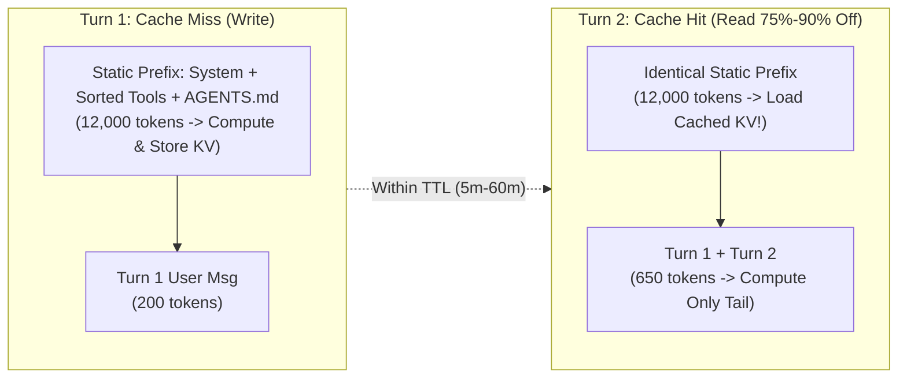
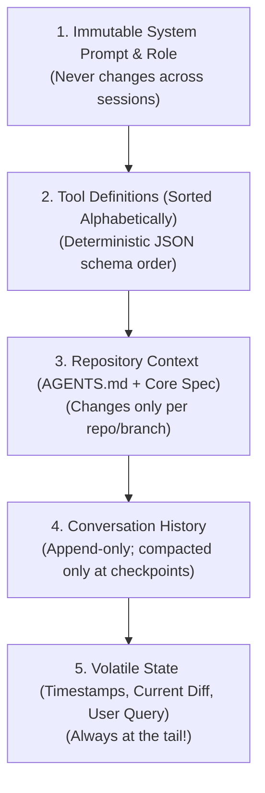

# Chapter 03 — Prompt Prefix Caching & Cost Engineering

> **Lecture 08 · Chapter 03 of 07** · Level: 🟡 Intermediate · Phase 2 — Application Layer & Harness Velocity
> **Source:** `FDE S01` · **Roadmap Reference:** [`roadmap-v1.md`](../../roadmap-v1.md#lecture-08--model-routing--agent-harness-velocity-agentsmd-pi-sddtdd)
> **Cross-reference:** Extends [Lecture 04 · Chapter 10](../../Lecture%2004%20-%20LLM%20APIs%20and%20Multi-SDK/notes/10_Reasoning_Models_and_Prompt_Prefix_Caching.md) into **agentic harness engineering**.
> **Roadmap topics:** Causal KV-cache reuse · static prefix ordering · cache breakpoints · TTLs · OpenAI vs Anthropic vs Gemini caching mechanics · cache hit/miss cost math.

---

## 03.0 What this chapter is for

Agentic coding harnesses and multi-turn workflows repeatedly send the **same** 5,000–30,000 tokens on every turn: system instructions, `AGENTS.md` rules, tool JSON schemas, and repository file trees. Re-computing the transformer Key/Value (KV) matrices for that identical prefix on every turn wastes GPU compute, inflates Time to First Token (TTFT), and burns 75%–90% of your input token budget unnecessarily.

**Prompt prefix caching** turns that repeated prefill into a near-free memory lookup — *provided* your harness structures messages in strict static-before-dynamic order.

By the end of this chapter you should be able to:

1. Explain **why** prompt prefix caching works at the transformer KV-cache level (and why a single mutated character invalidates the entire suffix).
2. Structure prompts using **strict static-before-dynamic ordering** to sustain `> 85%` cache hit rates in multi-turn agents.
3. Configure cache breakpoints and TTLs across **OpenAI**, **Anthropic**, and **Google Gemini**.
4. Calculate exact **cache-write, cache-read, and break-even** economics.
5. Diagnose silent **cache-busting bugs** in production telemetry.

---

## 03.1 Why prefix caching works: Causal KV reuse

In a decoder-only transformer, causal self-attention means token $t$ can only attend to tokens $1 \dots t$:

$$\text{Attention}(Q_t, K_{1:t}, V_{1:t}) = \text{softmax}\!\left(\frac{Q_t K_{1:t}^T}{\sqrt{d_k}}\right) V_{1:t}$$

Therefore, the Key ($K_i$) and Value ($V_i$) tensors for any prefix token $i$ depend **only** on tokens $1 \dots i$. If two requests share an identical token prefix of length $P$, the provider can skip prefill computation for all $P$ tokens by loading the cached $K_{1:P}, V_{1:P}$ tensors from GPU/host memory.



> [!WARNING]
> **One-byte invalidation rule:** Changing a single character (such as a `Date.now()` timestamp or a re-ordered tool key) at token position `50` invalidates the KV cache for **all tokens from `50` to the end of the prompt**. Always place volatile data at the **very end** of the message array.

---

## 03.2 Static-before-dynamic prompt ordering

To achieve `> 85%` cache hit rates in an agent harness, enforce this strict layer order from least volatile (top) to most volatile (bottom):



```typescript
// Deterministic prompt builder that preserves prefix cache hits
export interface PromptParts {
  systemPrompt: string;
  tools: Array<{ name: string; schema: Record<string, unknown> }>;
  repoContext: string;       // AGENTS.md + spec.md
  history: Array<{ role: "user" | "assistant"; content: string }>;
  volatileTail: { timestampIso: string; gitDiff: string; userQuery: string };
}

export function buildCacheFriendlyMessages(parts: PromptParts) {
  // Sort tools deterministically by name so JSON serialization never shifts
  const sortedTools = [...parts.tools].sort((a, b) => a.name.localeCompare(b.name));

  return {
    system: `${parts.systemPrompt}\n\n## Tools\n${JSON.stringify(sortedTools)}\n\n## Repo\n${parts.repoContext}`,
    messages: [
      ...parts.history,
      {
        role: "user" as const,
        content: `[Timestamp: ${parts.volatileTail.timestampIso}]\n\n${parts.volatileTail.gitDiff}\n\n${parts.volatileTail.userQuery}`,
      },
    ],
  };
}
```

### Traps: Common cache-busting bugs to avoid

| Trap | Why It Breaks Caching | Fix |
| :--- | :--- | :--- |
| **Injecting `Current time: 2026-11-26T12:00:05Z` in system prompt** | Mutates token ~20 on every request, busting 100% of the prefix | Move timestamps into the final user message or a tool output. |
| **Non-deterministic tool registration** | `Object.keys()` or dynamic plugin loading reorders tool schemas | Sort tool definitions deterministically by `name`. |
| **Pruning/summarizing middle messages on every turn** | Rewrites prefix hashes on every single turn | Compact history only at explicit token-budget checkpoints (e.g., every 20 turns). |
| **Prefix shorter than provider minimum** | Prompts under `1,024` tokens are silently never cached | Consolidate static `AGENTS.md` + tool schemas above `1,024` tokens. |

---

## 03.3 Provider comparison: OpenAI, Anthropic, and Gemini

| Feature | OpenAI | Anthropic | Google Gemini |
| :--- | :--- | :--- | :--- |
| **Activation** | **Automatic** for prompts `>= 1,024` tokens (128-token increments) | **Explicit** `cache_control: { type: "ephemeral" }` breakpoints (up to 4) | **Implicit** (automatic) + **Explicit** `cachedContent` API |
| **Minimum prefix** | `1,024` tokens | `1,024` tokens (Sonnet/Opus) · `2,048`–`4,096` (Haiku) | `1,024`–`2,048` tokens (explicit) |
| **Cache write surcharge** | `0%` (standard input price) | `+25%` (5-min TTL) or `+100%` (1-hr TTL) | Standard input price + small storage fee/hr (explicit) |
| **Cache read discount** | **50%–75% off** (`cached_tokens` in usage) | **90% off** (`cache_read_input_tokens`) | **75%–90% off** (`cachedContentTokenCount`) |
| **Default TTL** | ~5–10 min inactivity (up to 1 hr off-peak) | 5 min (refreshed on each hit); optional 1-hr TTL | 1 hr default (configurable for explicit caches) |

> [!TIP]
> **Place Anthropic `cache_control` breakpoints at natural stability boundaries:** Put one breakpoint after `tools + systemPrompt + AGENTS.md`, and a second sliding breakpoint on the latest stable turn in `history` so multi-turn agent loops cache both the static harness and the growing conversation!

---

## 03.4 Cache hit/miss cost math

Suppose an agent session sends a `10,000`-token static prefix (`AGENTS.md` + 12 tool schemas) across **10 turns** in a 4-minute coding session, with `500` new dynamic tokens per turn. Let $P_{\text{in}} = \$3.00 / 1\text{M}$ (Anthropic-style pricing: write $= 1.25 \times P_{\text{in}} = \$3.75/1\text{M}$, read $= 0.10 \times P_{\text{in}} = \$0.30/1\text{M}$).

- **Without caching:**
  $$\text{Cost}_{\text{no-cache}} = 10 \times \frac{10{,}000 + 500}{10^6} \times \$3.00 = \$0.3150$$

- **With prefix caching (1 write on Turn 1, 9 reads on Turns 2–10):**
  $$\text{Turn 1 (Write)} = \frac{10{,}000}{10^6} \times \$3.75 + \frac{500}{10^6} \times \$3.00 = \$0.0375 + \$0.0015 = \$0.0390$$
  $$\text{Turns 2–10 (Reads)} = 9 \times \left(\frac{10{,}000}{10^6} \times \$0.30 + \frac{500}{10^6} \times \$3.00\right) = 9 \times \$0.0045 = \$0.0405$$
  $$\text{Total Cost}_{\text{cached}} = \$0.0390 + \$0.0405 = \$0.0795 \quad (\mathbf{74.8\%\text{ savings!}})$$

### Break-even rule for explicit cache writes

When a provider charges a `+25%` write surcharge ($1.25\times$) and gives a `90%` read discount ($0.10\times$), caching pays for itself after $k$ reuses when:

$$1.25 + 0.10 \cdot k < 1 + k \implies 0.25 < 0.90 \cdot k \implies k \ge 1\text{ reuse}$$

**Even a single cache hit within the 5-minute TTL window makes explicit caching net-profitable.** If you opt for a 1-hour TTL (`2.0×` write surcharge), break-even is $2.0 + 0.10 \cdot k < 1 + k \implies k \ge 2$ reuses.

---

## 03.5 Common mistakes

| # | Common Mistake | Why It Hurts | What To Do Instead |
| :---: | :--- | :--- | :--- |
| 1 | **Putting timestamps, request IDs, or user names in the system prompt** | Invalidates 100% of the KV cache on every request | Move all per-request/per-user metadata to the tail of the messages array. |
| 2 | **Leaving tool definitions unsorted** | Different map iteration order changes JSON bytes and busts cache | Sort tools alphabetically by `name` before serializing. |
| 3 | **Not logging `cached_tokens` / `cache_read_input_tokens`** | Cache-busting regressions go unnoticed for weeks while bills spike | Emit `cacheHitRate = cachedTokens / totalInputTokens` in every LLM trace. |
| 4 | **Enabling 1-hr TTL for one-shot batch jobs** | Pays `2.0×` write surcharge with zero reuse | Use 5-min TTL for interactive sessions; reserve 1-hr TTL for long-lived worker pools. |
| 5 | **Summarizing history on every turn** | Rewrites the middle of the prompt, invalidating downstream tokens | Append-only history; compact only at fixed token checkpoints. |

---

## 03.6 Key takeaways

1. **Order prompts from least volatile to most volatile:** System prompt $\rightarrow$ sorted tools $\rightarrow$ `AGENTS.md` $\rightarrow$ append-only history $\rightarrow$ current user input/timestamps.
2. **One mutated character invalidates the entire suffix** of the KV cache from that token position onward.
3. **Monitor `cached_tokens` / `cache_read_input_tokens` in telemetry.** A sudden drop in cache hit rate almost always means someone injected dynamic data into the prefix.
4. **Combine routing + caching:** Keep each model tier's prefix stable so both your System-1 and System-2 pools maintain warm KV caches.

---

**Next:** [Chapter 04 — AGENTS.md & Repository Context Standards](./04_AGENTS_md_and_Repository_Context_Standards.md)
