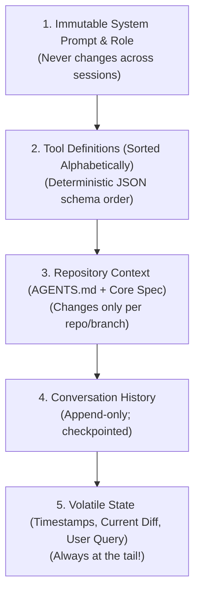

# Chapter 03 — Prompt Prefix Caching & Cost Engineering

> **Lecture 08 · Chapter 03 of 07** · Level: 🟡 Intermediate · Phase 2 — Application Layer & Harness Velocity
> **Source:** `FDE S01` · **Roadmap Reference:** [`roadmap-v1.md`](../../roadmap-v1.md#lecture-08--model-routing--agent-harness-velocity-agentsmd-pi-sddtdd)
> **Cross-reference:** Extends [Lecture 04 · Chapter 10](../../Lecture%2004%20-%20LLM%20APIs%20and%20Multi-SDK/notes/10_Reasoning_Models_and_Prompt_Prefix_Caching.md) into **agentic harness engineering**.
> **Roadmap topics:** Causal KV-cache reuse · static prefix ordering · cache breakpoints · TTLs · OpenAI vs Anthropic vs Gemini caching mechanics · cache hit/miss cost math.

---

## 03.0 What this chapter is for

Agentic coding harnesses and multi-turn workflows repeatedly send the **same** 5,000–30,000 tokens on every turn: system instructions, `AGENTS.md` rules, tool JSON schemas, and repository file trees. Re-computing the transformer Key/Value (KV) matrices for that identical prefix on every turn wastes GPU compute, inflates Time to First Token (TTFT), and burns input budget.

By the end of this chapter you should be able to:

1. Explain **why** prompt prefix caching works at the transformer KV-cache level (and why a single mutated character invalidates the suffix).
2. Structure prompts using **strict static-before-dynamic ordering** to maximize cache hit rates (`> 85%` in multi-turn agents).
3. Configure cache breakpoints and TTLs across **OpenAI**, **Anthropic**, and **Google Gemini**.
4. Calculate exact **cache-write, cache-read, and break-even** economics.

---

## 03.1 Why prefix caching works: Causal KV reuse

In a decoder-only transformer, causal self-attention means token $t$ can only attend to tokens $1 \dots t$:

$$\text{Attention}(Q_t, K_{1:t}, V_{1:t}) = \text{softmax}\!\left(\frac{Q_t K_{1:t}^T}{\sqrt{d_k}}\right) V_{1:t}$$

Therefore, the Key ($K_i$) and Value ($V_i$) tensors for any prefix token $i$ depend **only** on tokens $1 \dots i$. If two requests share an identical token prefix of length $P$, the provider can skip prefill computation for all $P$ tokens by loading the cached $K_{1:P}, V_{1:P}$ tensors from GPU/host memory.

```text
Request 1: [ System Prompt + Tools + AGENTS.md ] + [ Turn 1 User Msg ]
           |<--------- 12,000 tokens --------->|   |<-- 200 tokens ->|
                    CACHE WRITE (Miss)

Request 2: [ System Prompt + Tools + AGENTS.md ] + [ Turn 1 + Turn 2 ]
           |<--------- 12,000 tokens --------->|   |<-- 650 tokens ->|
                    CACHE READ (Hit! 75%-90% off)
```

> [!WARNING]
> **One-byte invalidation rule:** Changing a single character (such as a `Date.now()` timestamp or a re-ordered tool key) at token position `50` invalidates the KV cache for **all tokens from `50` to the end of the prompt**. Always place volatile data at the **very end** of the message array.

---

## 03.2 Static-before-dynamic prompt ordering

To achieve `> 85%` cache hit rates in an agent harness, enforce this strict layer order:



### Common cache-busting bugs to avoid

| Bug | Why It Breaks Caching | Fix |
| :--- | :--- | :--- |
| Injecting `Current time: 2026-11-26T12:00:05Z` in the system prompt | Mutates token ~20 on every request | Move timestamps into the final user message or a tool output. |
| Non-deterministic tool registration (`Object.keys()` from unordered maps) | Reorders tool schemas between runs | Sort tool definitions deterministically by `name`. |
| Dynamically pruning/summarizing middle messages on every turn | Rewrites prefix hashes every turn | Compact history only at explicit token-budget checkpoints (e.g., every 20 turns). |

---

## 03.3 Provider comparison: OpenAI, Anthropic, and Gemini

| Feature | OpenAI | Anthropic | Google Gemini |
| :--- | :--- | :--- | :--- |
| **Activation** | **Automatic** for prompts `>= 1,024` tokens (128-token increments) | **Explicit** `cache_control: { type: "ephemeral" }` breakpoints (up to 4) | **Implicit** (automatic) + **Explicit** `cachedContent` API |
| **Minimum prefix** | `1,024` tokens | `1,024` tokens (Sonnet/Opus) · `2,048`–`4,096` (Haiku) | `1,024`–`2,048` tokens (explicit) |
| **Cache write surcharge** | `0%` (standard input price) | `+25%` (5-min TTL) or `+100%` (1-hr TTL) | Standard input price + small storage fee/hr (explicit) |
| **Cache read discount** | **50%–75% off** (`cached_tokens` in usage) | **90% off** (`cache_read_input_tokens`) | **75%–90% off** (`cachedContentTokenCount`) |
| **Default TTL** | ~5–10 min inactivity (up to 1 hr off-peak) | 5 min (refreshed on each hit); optional 1-hr TTL | 1 hr default (configurable for explicit caches) |

---

## 03.4 Cache hit/miss cost math

Suppose an agent session sends a `10,000`-token static prefix (`AGENTS.md` + 12 tool schemas) across **10 turns** in a 4-minute coding session, with `500` new dynamic tokens per turn. Let $P_{\text{in}} = \$3.00 / 1\text{M}$ (Anthropic-style pricing: write $= 1.25 \times P_{\text{in}}$, read $= 0.10 \times P_{\text{in}}$).

- **Without caching:**
  $$\text{Cost}_{\text{no-cache}} = 10 \times \frac{10{,}000 + 500}{10^6} \times \$3.00 = \$0.3150$$

- **With prefix caching (1 write on Turn 1, 9 reads on Turns 2–10):**
  $$\text{Turn 1 (Write)} = \frac{10{,}000}{10^6} \times (\$3.00 \times 1.25) + \frac{500}{10^6} \times \$3.00 = \$0.0375 + \$0.0015 = \$0.0390$$
  $$\text{Turns 2–10 (Reads)} = 9 \times \left(\frac{10{,}000}{10^6} \times \$0.30 + \frac{500}{10^6} \times \$3.00\right) = 9 \times \$0.0045 = \$0.0405$$
  $$\text{Total Cost}_{\text{cached}} = \$0.0390 + \$0.0405 = \$0.0795 \quad (\mathbf{74.8\%\text{ savings!}})$$

### Break-even rule for explicit cache writes

When a provider charges a `+25%` write surcharge ($1.25\times$) and gives a `90%` read discount ($0.10\times$), caching pays for itself as soon as:

$$1.25 + 0.10 \cdot k < 1 + k \implies 0.25 < 0.90 \cdot k \implies k \ge 1\text{ reuse}$$

**Even a single cache hit within the TTL window makes explicit caching net-profitable!**

---

## 03.5 Key takeaways

1. **Order prompts from least volatile to most volatile:** System prompt $\rightarrow$ sorted tools $\rightarrow$ `AGENTS.md` $\rightarrow$ history $\rightarrow$ current user input/timestamps.
2. **Monitor `cached_tokens` / `cache_read_input_tokens` in telemetry.** A sudden drop in cache hit rate usually means someone injected a timestamp or reordered a JSON object in the prefix.
3. **Combine routing + caching:** Keep each model tier's prefix stable so both your System-1 and System-2 pools maintain warm KV caches.

---

**Next:** [Chapter 04 — AGENTS.md & Repository Context Standards](./04_AGENTS_md_and_Repository_Context_Standards.md)

