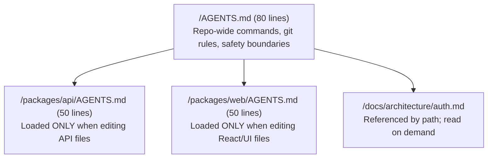

# Chapter 04 — AGENTS.md & Repository Context Standards

> **Lecture 08 · Chapter 04 of 07** · Level: 🟡 Intermediate · Phase 2 — Application Layer & Harness Velocity
> **Source:** `FDE S02` · **Roadmap Reference:** [`roadmap-v1.md`](../../roadmap-v1.md#lecture-08--model-routing--agent-harness-velocity-agentsmd-pi-sddtdd)
> **External Standard:** [agents.md](https://agents.md/)
> **Roadmap topics:** `AGENTS.md` open standard · machine-readable repository contracts · hierarchical directory scoping · progressive context loading · preventing context bloat ("lost in the middle").

---

## 04.0 What this chapter is for

Why do AI coding agents repeatedly make the same mistakes in a repository — using `npm` instead of `pnpm`, importing deprecated helpers, or skipping integration tests? Because **the repository's operational contract lives in tribal knowledge, not in a machine-readable file.**

`AGENTS.md` is the open standard for giving coding agents a predictable, concise, version-controlled briefing at the root (and subdirectories) of a project — a `README.md` written specifically for agents rather than humans.

By the end of this chapter you should be able to:

1. Explain the **`AGENTS.md` open standard** and how it differs from `README.md`.
2. Author a high-signal `AGENTS.md` covering build/test commands, architecture invariants, code style, and forbidden actions.
3. Apply **hierarchical scoping** and **progressive context loading** so agents read only the context relevant to the directory they are editing.
4. Measure and prevent **context bloat** that degrades reasoning accuracy and wastes tokens.

---

## 04.1 `README.md` vs. `AGENTS.md`

| Dimension | `README.md` (For Humans) | `AGENTS.md` (For Coding Agents) |
| :--- | :--- | :--- |
| **Audience** | Developers evaluating or onboarding to the project | Autonomous coding harnesses (`Pi`, Claude Code, Codex, Cursor, Antigravity) |
| **Tone & Content** | Narrative overview, badges, screenshots, installation prose | Imperative commands, exact file paths, invariants, test/lint gates, do-not-touch rules |
| **Target Length** | As long as needed for human comprehension | **Concise (`< 150` lines at root)** — every extra line competes for attention |
| **Update Cadence** | Updated on major releases | Updated whenever an agent makes a repeatable mistake ("compound engineering") |

---

## 04.2 Anatomy of a production-grade `AGENTS.md`

A strong `AGENTS.md` answers five operational questions in under 150 lines:

1. **Setup & Verification Commands:** Exact commands to install, typecheck, lint, and run targeted vs. full tests.
2. **Architecture & Directory Map:** Where domain logic, API routes, schemas, and tests live.
3. **Non-Negotiable Invariants:** Rules the agent must never violate (e.g., *"All DB writes must use tenant-scoped transactions"*, *"Never use `any`"*).
4. **Code Style & Patterns:** Preferred libraries (e.g., `zod` for validation, `vitest` for tests), naming conventions, and error-handling patterns.
5. **Boundaries & Safety:** Files/directories that require human approval before editing (migrations, `.env`, CI workflows, auth middleware).

```markdown
# AGENTS.md — Model Router Service

## Commands
- Install: `npm ci`
- Typecheck: `npm run typecheck`
- Test (single file): `npx tsx --test src/router.test.ts`
- Release Gate: `npm run gate`

## Architecture
- `src/router.ts`: Complexity scoring + System-1/System-2 dispatch.
- `src/cache.ts`: Prefix-cache simulator & cost tracker.
- `src/harness.ts`: SDD/TDD verification loop.

## Invariants
- Never log raw API keys or PII.
- Every router decision must emit `{ tier, complexityScore, estimatedCostUsd }`.
- Keep system prompt + sorted tool schemas at the top of every message array (prefix caching).

## Boundaries
- Do NOT modify `tests/release-gate.test.ts` to make a failing patch pass.
```

---

## 04.3 Progressive context loading & hierarchical scoping

Dumping a 2,000-line `AGENTS.md` into the root directory causes **context bloat**:

- **Attention dilution ("Lost in the Middle"):** Critical constraints buried in a wall of text are ignored.
- **Token waste:** Every turn pays to prefill irrelevant frontend rules when the agent is only editing a SQL migration.

The solution is **hierarchical `AGENTS.md` + progressive disclosure**:



1. **Root `AGENTS.md`:** Always loaded (and **prompt-prefix cached**!). Contains only universal rules.
2. **Subdirectory `AGENTS.md`:** Loaded progressively *only* when the agent reads or edits files inside that subtree.
3. **Pointer-based deep docs:** Instead of pasting a 400-line database schema into `AGENTS.md`, write: *"For billing state transitions, read `docs/billing-state-machine.md` before editing `src/billing/`."*

---

## 04.4 Worked Example: Before vs. After `AGENTS.md`

Consider a monorepo using **`pnpm`**, **`node:test`**, and strict Zod validation:

| Scenario | What Happens Without `AGENTS.md` | What Happens With `AGENTS.md` |
| :--- | :--- | :--- |
| **Running Tests** | Agent guesses `npm test` or `npx jest`, crashes on ESM imports, burns 3 turns debugging Jest config | Agent reads `Test: pnpm --filter api test` and runs the exact command on Turn 1 |
| **Adding an Endpoint** | Agent writes manual `if (!req.body.email)` checks instead of the repo's `zod` middleware | Agent sees *"All routes must validate input with `src/middleware/validate.ts`"* and matches the codebase on the first try |
| **Editing Protected Files** | Agent modifies a generated SQL migration or weakens a release-gate test | Agent obeys `Boundaries: Never edit migrations/ or release-gate.test.ts` |

### Common `AGENTS.md` Anti-Patterns vs. Fixes

| Anti-Pattern | Why It Hurts Agent Accuracy | Fix |
| :--- | :--- | :--- |
| **2,000-line `AGENTS.md` novel** | Triggers "Lost in the Middle"; wastes thousands of tokens per turn | Keep root `< 150` lines; move subsystem rules to subdirectory `AGENTS.md` files |
| **Stale commands** (`yarn test` when repo moved to `pnpm`) | Agent loops endlessly trying a broken command | Test every command in `AGENTS.md` in CI or during onboarding |
| **Vague platitudes** (*"Write clean, modular code"*) | Zero actionable signal for an LLM | Write concrete rules (*"Keep functions < 40 lines; use early returns; no `any`"*) |

---

## 04.5 The "Compound Engineering" feedback loop

Treat every agent mistake as a **missing rule in `AGENTS.md`**, not a one-off prompt annoyance:

1. Agent makes a mistake (e.g., uses `jest` instead of `node:test`, or forgets `--noEmit`).
2. You fix it *and* add a single crisp bullet to `AGENTS.md` (or a subdirectory `AGENTS.md`).
3. Every future agent run — and every teammate's agent — inherits that lesson automatically.

---

## 04.5 Key takeaways

1. **`AGENTS.md` is the machine-readable contract** between your codebase and any AI coding harness.
2. **Keep root `AGENTS.md` lean (`< 150` lines)** so it fits cleanly inside the cached static prefix without diluting attention.
3. **Use hierarchical `AGENTS.md` files and explicit file pointers** for progressive context loading.
4. **Update `AGENTS.md` whenever an agent fails a convention** — turning one-off fixes into permanent harness velocity.

---

**Next:** [Chapter 05 — Pi Harness & Superpowers Composable Workflows](./05_Pi_Harness_and_Superpowers_Composable_Workflows.md)

