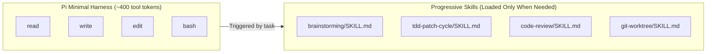
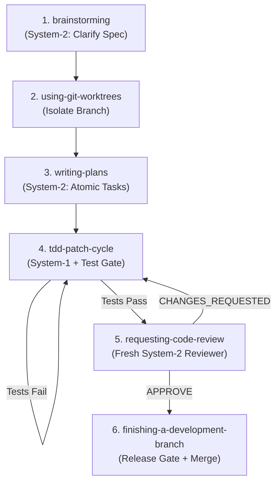

# Chapter 05 — Pi Harness & Superpowers Composable Workflows

> **Lecture 08 · Chapter 05 of 07** · Level: 🟡 Intermediate · Phase 2 — Application Layer & Harness Velocity
> **Source:** `FDE S02` · **Roadmap Reference:** [`roadmap-v1.md`](../../roadmap-v1.md#lecture-08--model-routing--agent-harness-velocity-agentsmd-pi-sddtdd)
> **Roadmap topics:** Minimalist coding harnesses (`Pi`) · four core primitives (`read`, `write`, `edit`, `bash`) · composable workflow skills (`Superpowers`) · skill chaining · subagent isolation vs. monolithic prompts.

---

## 05.0 What this chapter is for

Recall the core equation from [Lecture 13](../../Lecture%2013%20-%20LangChain%20LangGraph%20LangSmith/notes/02_What_is_an_AI_Agent_Model_and_Harness.md):

$$\text{Agent} = \text{Model} + \text{Harness}$$

Many teams assume that making an agent smarter requires stuffing 40 specialized tools and 10,000 tokens of framework boilerplate into the context window. In practice, **bloated harnesses slow models down, break prefix caching, and increase tool-selection errors.**

The **`Pi` coding harness** and **`Superpowers`** workflow methodology demonstrate the opposite philosophy: **a tiny, deterministic core harness paired with composable, on-demand workflow skills.**

By the end of this chapter you should be able to:

1. Explain the **`Pi` minimalist harness philosophy** and why four primitives (`read`, `write`, `edit`, `bash`) cover 95% of software engineering.
2. Quantify the **token and prefix-cache savings** of a 4-tool core vs. a 35-tool bloated harness.
3. Design **composable workflow skills (`Superpowers`)** that load progressively into the agent's context only when triggered.
4. Chain skills into deterministic engineering pipelines (`brainstorm` $\rightarrow$ `write-plan` $\rightarrow$ `execute-plan` $\rightarrow$ `verify`) and route each phase to the right model tier.
5. Decide when to use **single-context skill chaining** vs. **isolated subagent dispatch**.

---

## 05.1 The `Pi` minimalist coding harness

`Pi` (and similar minimal terminal harnesses) strips the agent runtime down to the bare essentials:

| Component | What `Pi` Provides | Why Minimalism Wins |
| :--- | :--- | :--- |
| **1. Core Toolset** | `read`, `write`, `edit`, `bash` | Only 4 JSON schemas in the static prefix (`~400` tokens total vs. `6,000+` tokens for 30 tools). |
| **2. Context Loader** | Automatic `AGENTS.md` discovery (global + project + subdir) | Keeps repo rules consistent without hardcoding them in the harness binary. |
| **3. Extension / Skill Hook** | Loads `SKILL.md` playbooks on demand | Capabilities scale infinitely on disk without bloating every turn's prompt. |
| **4. Session & Compaction** | Tree-structured session history + explicit compaction | Prevents context rot on long debugging sessions. |



> [!IMPORTANT]
> **Why `bash` replaces 20 bespoke tools (Token Math):**
> Suppose a bloated harness registers 35 JSON tool schemas (`~200` tokens each = **`7,000` tokens** in every turn's prompt). Over a 15-turn debugging loop, you pay to prefill `7,000 × 15 = 105,000` schema tokens — and the model still confuses `git_diff_staged` with `git_diff_files`!
> With `Pi`'s 4 primitives (`read`, `write`, `edit`, `bash`), tool schemas take only **`~400` tokens** (`400 × 15 = 6,000` tokens — **94.3% fewer schema tokens**) and the model uses standard POSIX/CLI commands (`git`, `rg`, `jq`, `npm`) it already mastered during pretraining.

---

## 05.2 `Superpowers`: Composable engineering workflows

**Superpowers** is a library of structured, composable `SKILL.md` workflows layered on top of a coding harness. Instead of asking an LLM *"build feature X"* in one unstructured prompt, Superpowers enforces a **repeatable engineering state machine**:

| Skill Phase | What It Enforces | Output Artifact | Recommended Tier |
| :--- | :--- | :--- | :---: |
| **1. `brainstorming`** | Socratic clarification of edge cases, constraints, and non-goals *before* writing code | Approved design spec (`docs/plans/<feature>-spec.md`) | **System-2** |
| **2. `using-git-worktrees`** | Isolates work in a fresh branch/worktree so `main` stays clean | Clean isolated workspace | **System-1** |
| **3. `writing-plans`** | Breaks the spec into 2–5 minute atomic tasks with exact file paths and test commands | Executable step-by-step plan | **System-2** |
| **4. `subagent-driven-development` / `tdd`** | Dispatches each task with strict Red $\rightarrow$ Green $\rightarrow$ Refactor verification | Passing unit + integration tests | **System-1 + Escalation** |
| **5. `requesting-code-review`** | Independent reviewer checks diff against spec & `AGENTS.md` invariants | Review verdict (`APPROVE` / `CHANGES_REQUESTED`) | **System-2 (Fresh)** |
| **6. `finishing-a-development-branch`** | Runs full release gate, cleans up worktree, prepares PR/merge | Verified commit | **System-1** |



### Why composability beats monolithic "god prompts"

If you put all 6 phases into one 4,000-word system prompt, the model rushes straight to writing code and skips verification. By **packaging each phase as a small, focused skill** with an explicit exit gate (e.g., *"Do not write implementation code until the user approves the spec"*), the harness guarantees discipline at every step.

---

## 05.3 Skill structure & progressive loading

A composable skill follows a lightweight markdown contract:

```markdown
---
name: tdd-patch-cycle
description: Enforce Red-Green-Refactor when implementing a spec task.
---

# TDD Patch Cycle

## Preconditions
- A written spec or task requirement exists.

## Procedure
1. **RED:** Write a failing test in `*.test.ts` that asserts the new behavior.
2. Run the test command and **observe the failure** (if it passes immediately, the test is wrong).
3. **GREEN:** Write the minimal implementation to make the test pass.
4. **REFACTOR:** Clean up duplication while keeping all tests green.
5. **GATE:** Run `npm run typecheck && npm test` before reporting completion.
```

```typescript
// Progressive skill loader: keep core prefix tiny, load SKILL.md only on phase entry
export interface SkillDefinition {
  name: string;
  description: string;
  instructions: string;
}

export function buildPhasePrompt(
  corePrefix: string,
  activeSkill: SkillDefinition,
  taskInput: string
): { system: string; user: string } {
  return {
    system: corePrefix, // Static: 4 Pi tools + root AGENTS.md (100% prefix cached!)
    user: `## Active Skill: ${activeSkill.name}\n${activeSkill.instructions}\n\n## Task\n${taskInput}`,
  };
}
```

> [!TIP]
> **Put active skill instructions in the dynamic `user` message (or after the cached static prefix)** rather than mutating the top-level `system` prompt on every phase transition. That way, all 6 phases share the exact same warm KV cache for tools and `AGENTS.md`!

---

## 05.4 Single-context chaining vs. isolated subagent dispatch

| Pattern | How It Works | When to Use | Risk |
| :--- | :--- | :--- | :--- |
| **Single-Context Skill Chaining** | Same conversation loads `brainstorming` $\rightarrow$ `writing-plans` $\rightarrow$ `tdd` sequentially | Small features (`1–3` files) where shared exploration context helps | Context rot after 20+ turns; author bias during review |
| **Isolated Subagent Dispatch** | Coordinator dispatches each atomic plan task (and code review) to a **fresh subagent** with only the spec + task | Multi-file features, parallel tasks, and **independent code review** | Slight cold-start overhead if static prefix isn't shared |

### Traps: Where composable harnesses break

| Trap | What Happens | Fix |
| :--- | :--- | :--- |
| **Skipping the skill exit gate** | Agent reads `brainstorming`, skips approval, and edits files immediately | Enforce hard exit gates (*"Stop and wait for approval; do not call `edit` or `write`"*) or restrict tools per phase. |
| **Loading all 15 skills at startup** | Bloats static prefix by 12,000 tokens; model confuses rules across phases | Keep only skill *names + 1-line descriptions* in index; load full `SKILL.md` on demand. |

---

## 05.5 Common mistakes

| # | Common Mistake | Why It Hurts | What To Do Instead |
| :---: | :--- | :--- | :--- |
| 1 | **Adding custom JSON tools for every CLI command (`git_status`, `npm_test`)** | Bloats tool schemas by 5,000+ tokens and hurts tool-selection accuracy | Use `bash` for CLI/POSIX tools and keep core tools to `read`, `write`, `edit`, `bash`. |
| 2 | **Writing a 3,000-word monolithic "do everything" prompt** | Model skips planning/testing steps and rushes to code generation | Split into small, single-phase `SKILL.md` workflows with explicit exit gates. |
| 3 | **Using the same conversation for authoring and code review** | Author agent rationalizes its own shortcuts ("confirmation bias") | Dispatch `requesting-code-review` to a fresh, isolated System-2 subagent. |
| 4 | **Mutating the system prompt on every skill switch** | Busts prompt prefix caching at every phase boundary | Keep `tools + AGENTS.md` static at the top; inject active `SKILL.md` in the task message. |

---

## 05.6 Key takeaways

1. **Keep the harness small (`read`, `write`, `edit`, `bash`).** Tool-schema minimalism maximizes prefix cache hits and reduces tool-calling errors.
2. **Externalize workflows into composable skills (`Superpowers`).** Load only the active phase's instructions into context.
3. **Pair skill phases with model tiers:** Use System-2 for planning and independent review; use System-1 + deterministic test gates for fast implementation loops.
4. **Isolate subagents for independent tasks and reviews** so context rot and author bias never leak across boundaries.

---

**Next:** [Chapter 06 — Spec-Driven (SDD) & Test-Driven (TDD) Agent Velocity](./06_Spec_Driven_and_Test_Driven_Agent_Velocity.md)
