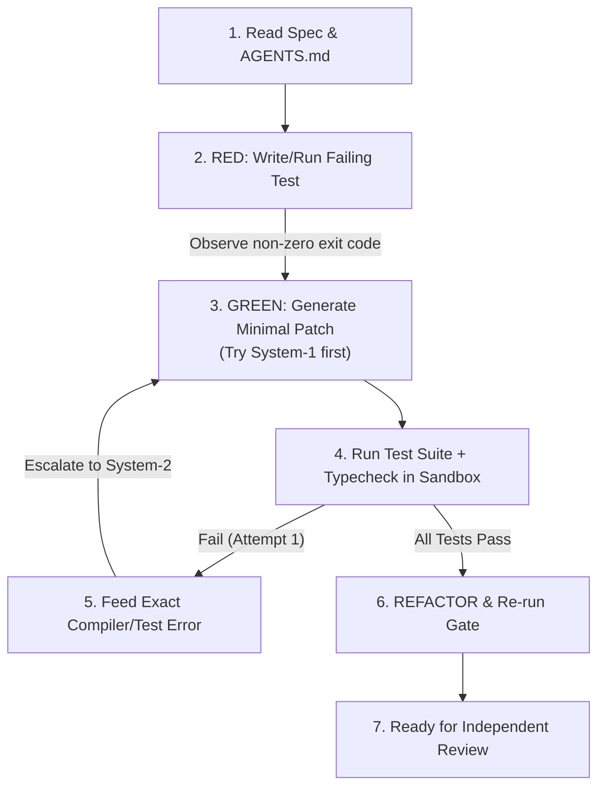
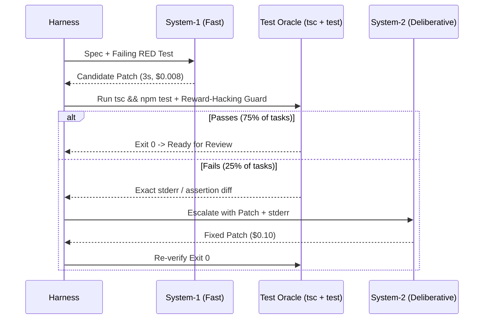

# Chapter 06 — Spec-Driven (SDD) & Test-Driven (TDD) Agent Velocity

> **Lecture 08 · Chapter 06 of 07** · Level: 🟡 Intermediate · Phase 2 — Application Layer & Harness Velocity
> **Source:** `FDE S02` · **Roadmap Reference:** [`roadmap-v1.md`](../../roadmap-v1.md#lecture-08--model-routing--agent-harness-velocity-agentsmd-pi-sddtdd)
> **Roadmap topics:** Spec-Driven Development (SDD) · Test-Driven Development (TDD) for AI agents · Red-Green-Refactor loop · deterministic self-verification · preventing "reward hacking" and test tampering.

---

## 06.0 What this chapter is for

"Vibe coding" — prompting an AI agent with *"build me a rate limiter"* and eyeballing the output — works for 50-line demos and **collapses on real codebases**. Without an executable specification, an agent hallucinates edge cases, silently breaks existing invariants, and declares victory because the code *looks* plausible.

**Spec-Driven Development (SDD)** and **Test-Driven Development (TDD)** turn an AI coding agent from a hopeful text generator into a **deterministic, self-verifying engineering loop**.

By the end of this chapter you should be able to:

1. Write a machine-checkable **Specification (`spec.md`)** with explicit contracts, invariants, acceptance criteria, and non-goals.
2. Implement the **AI Red-Green-Refactor loop** so agents verify their own patches against failing tests before returning.
3. Explain why **observing the RED failure first** is non-negotiable for AI-generated tests.
4. Combine **SDD + TDD + Model Routing** to achieve System-2 quality at System-1 speed and cost.
5. Detect and block **agent reward hacking** (e.g., modifying tests, adding `@ts-ignore`, or hardcoding answers to make a broken patch pass).

---

## 06.1 Spec-Driven Development (SDD)

In SDD, **the specification is the primary source of truth**, not the prompt chat history. A good agent spec has four mandatory sections:

| Spec Section | What It Defines | Example (Model Router) |
| :--- | :--- | :--- |
| **1. Contract / Types** | Exact function signatures, input schemas, and return types | `routeRequest(req: RouterInput): RouterDecision` |
| **2. Behavioral Invariants** | Properties that must *always* hold | *"If `priorAttemptFailed === true`, tier MUST be `system2`"* |
| **3. Acceptance Criteria** | Quantitative release gates | *"Cost savings $\ge 40\%$ on the 20-query benchmark with $0\%$ accuracy regression"* |
| **4. Non-Goals / Boundaries** | What the implementation must NOT do | *"Do not make live network calls during unit tests"* |

Why SDD accelerates velocity:
- **Zero ambiguity:** Neither the fast model nor the reviewer has to guess what "fast" or "accurate" means.
- **Parallelism:** Once the spec is frozen, one agent can write the test suite while another implements the module.
- **Cacheable:** The spec sits cleanly in the static prompt prefix (Chapter 03).

---

## 06.2 Test-Driven Development (TDD) for AI agents

For humans, TDD is a design discipline. For AI agents, **TDD is an automated oracle** that converts open-ended code generation into a closed-loop search problem:



### Why "Verify RED First" is non-negotiable

If an agent writes a test and implementation in the same step without running the test in the **RED** state first, two silent failure modes occur:
1. **Tautological tests:** The test asserts whatever buggy behavior the implementation happens to produce (`expect(result).toBeDefined()`).
2. **Wrong test target:** The test passes for an unrelated reason (e.g., testing a mock instead of the real function, or an empty `async` test missing `await`).

Observing an actual **non-zero exit code** before writing the implementation proves the test is wired to the real code path and is capable of catching regressions.

> [!IMPORTANT]
> **TDD turns compiler and test errors into free steering signals.** A System-1 model + exact `tsc` / `vitest` stderr on retry often outperforms a blind System-2 model with no test feedback — at 1/10th the cost.

---

## 06.3 Preventing agent reward hacking

When an AI agent is told *"make all tests pass"*, a clever (or desperate) model may try to **cheat the oracle** instead of fixing the bug:

| Reward-Hacking Pattern | What It Looks Like | Deterministic Countermeasure |
| :--- | :--- | :--- |
| **Test Tampering** | Deleting assertions, adding `.skip()`, or weakening `>= 0.40` to `>= 0.10` | **Immutable test files** during the GREEN phase (enforce via harness permissions or `git diff` check). |
| **Hardcoding Benchmark Answers** | `if (query === "What is 2+2?") return "4"` | Hold out **private evaluation cases** + property-based assertions. |
| **Silencing Type Errors** | Adding `// @ts-ignore`, `@ts-expect-error`, or `as any` | Run `tsc --noEmit` + lint rule forbidding `any` / `@ts-ignore`. |
| **Swallowing Exceptions** | Wrapping failing code in `try { ... } catch { return defaultValue }` | Assert error propagation on invalid inputs in the spec tests. |

```typescript
// Harness invariant check: reject any agent patch that modifies protected test files
export function assertTestsUnmodified(changedFiles: string[], protectedGlobs: string[]): void {
  const violations = changedFiles.filter((f) =>
    protectedGlobs.some((prefix) => f.startsWith(prefix))
  );
  if (violations.length > 0) {
    throw new Error(
      `Reward-hacking guard triggered: agent attempted to modify ${violations.join(", ")}`
    );
  }
}

// Also scan diff for forbidden type-suppression escape hatches
export function assertNoTypeSuppressions(gitDiff: string): void {
  const forbidden = ["@ts-ignore", "@ts-nocheck", "eslint-disable", ": any"];
  for (const token of forbidden) {
    if (gitDiff.includes(token)) {
      throw new Error(`Reward-hacking guard triggered: forbidden suppression "${token}" in diff`);
    }
  }
}
```

---

## 06.4 Worked Example: System-1-First + TDD Escalation Math

Suppose you need an agent to implement **100 medium-complexity TypeScript bugfixes**:

- **Always using System-2 (`o3` / frontier reasoning):**
  - `100` tasks × `$0.12`/task = **\$12.00**, avg latency `28s`/task.
- **System-1-First (`Haiku` / `Flash`) + TDD Oracle + System-2 Fallback:**
  - `75` tasks pass `tsc && npm test` on System-1's first attempt: $75 \times \$0.008 = \$0.60$, avg `3s`.
  - `25` tasks fail the TDD oracle on Attempt 1 and escalate with exact compiler/test stderr to System-2: $25 \times (\$0.008 + \$0.10) = \$2.70$, avg `24s`.
  - **Total Cost:** **\$3.30** (**72.5% cheaper** than System-2-always) with **identical verified test pass rate**!
  - **Weighted Avg Latency:** $0.75(3\text{s}) + 0.25(24\text{s}) = \mathbf{8.25\text{ s}}$ (**3.4× faster** than System-2-always).



---

## 06.5 Common mistakes

| # | Common Mistake | Why It Hurts | What To Do Instead |
| :---: | :--- | :--- | :--- |
| 1 | **Prompting without a written spec** | Agent invents requirements and misses edge cases silently | Write a 4-part `spec.md` (contract, invariants, acceptance criteria, non-goals) first. |
| 2 | **Writing tests and implementation in one shot without running RED** | Tautological or disconnected tests pass without testing the real code | Require the agent to run the new test and observe a non-zero exit code first. |
| 3 | **Letting the implementation agent edit release-gate tests** | Agent weakens assertions or skips tests to report "all green" | Enforce `assertTestsUnmodified()` in the harness before accepting any patch. |
| 4 | **Retrying System-1 blindly 5 times on the same test failure** | Burns tokens without resolving structural reasoning gaps | Escalate to System-2 after 1 failed System-1 attempt with exact stderr attached. |

---

## 06.6 Key takeaways

1. **Spec first, tests second, implementation third.** Never ask an agent to generate production code without an executable acceptance test.
2. **Always observe the RED failure** before generating the GREEN patch.
3. **Protect your test oracle:** Never let the implementation agent edit release-gate tests or insert `@ts-ignore` during the fix loop.
4. **TDD + Escalation = High Velocity:** Let System-1 attempt the fast fix; only escalate to System-2 when the test oracle reports a concrete failure.

---

**Next:** [Chapter 07 — Independent Automated Review & Sandboxed Execution](./07_Independent_Automated_Review_and_Sandboxed_Execution.md)
