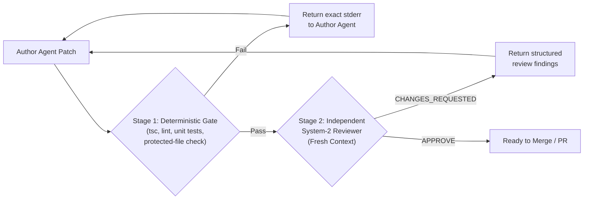

# Chapter 07 — Independent Automated Review & Sandboxed Execution

> **Lecture 08 · Chapter 07 of 07** · Level: 🟡 Intermediate · Phase 2 — Application Layer & Harness Velocity
> **Source:** `FDE S02` · **Roadmap Reference:** [`roadmap-v1.md`](../../roadmap-v1.md#lecture-08--model-routing--agent-harness-velocity-agentsmd-pi-sddtdd)
> **Roadmap topics:** Independent reviewer agents · author bias vs. fresh-context review · deterministic + semantic review gates · sandboxed execution (`git worktree`, containers, microVMs) · blast-radius containment.

---

## 07.0 What this chapter is for

Even when an agent's patch passes unit tests, **self-review in the same conversation context is unreliable**. The author agent has "anchored" on its own assumptions and rationalizes shortcuts (*"I skipped edge case X because it seemed unlikely"*).

To ship AI-generated code at high velocity without sacrificing production reliability, you need two final layers in your harness:
1. **An independent automated review loop** (a fresh-context reviewer + deterministic linters/typecheckers).
2. **Sandboxed execution** so untrusted agent commands (`bash`, package installs, test runs) cannot corrupt your host machine, exfiltrate secrets, or destroy `main`.

By the end of this chapter you should be able to:

1. Explain why **author-context self-review fails** and how an **independent reviewer agent** eliminates confirmation bias.
2. Design a **two-stage review gate** (deterministic checks first, semantic LLM review second).
3. Choose the right **sandbox isolation boundary** (`git worktree` vs. Docker container vs. microVM) for a coding agent.
4. Wire the complete **Model Routing + `AGENTS.md` + SDD/TDD + Review + Sandbox** pipeline end to end.

---

## 07.1 Independent automated review loops

An **independent reviewer** is a separate model invocation that receives **only**:
- The **Spec** (`spec.md`) and **`AGENTS.md`** invariants
- The **Git Diff** (the proposed patch)
- The **Test & Typecheck Output** (proof that deterministic checks ran)

It **does not** receive the author agent's 30-turn conversation history or justifications.



### Why two stages?

- **Stage 1 (Deterministic, \$0):** Never pay an LLM to find a syntax error, missing import, or failing unit test. Run `tsc --noEmit`, `eslint`, and `npm test` first. If Stage 1 fails, bounce immediately back to the author.
- **Stage 2 (Semantic, System-2):** Only after Stage 1 is 100% green does the independent System-2 reviewer inspect the diff for **spec drift, security flaws, hidden reward hacking, and `AGENTS.md` violations**.

### Why Author-Context Self-Review Fails (Concrete Example)
Suppose an author agent spends 12 turns debugging a race condition in a rate limiter and finally gets tests passing by adding a `100 ms` `setTimeout` sleep. If you ask that *same* conversation *"Review your diff for bugs"*, it remembers its struggle and rationalizes: *"The 100ms delay was necessary for timing."*
A **fresh-context System-2 reviewer** sees *only* the spec, `AGENTS.md`, and the git diff—and immediately flags a `blocker`: *"Flaky `setTimeout` in production path violates deterministic concurrency spec; use atomic counter instead."*

### Structured review output contract

Force the reviewer to emit a typed verdict rather than prose:

```typescript
export interface ReviewVerdict {
  approved: boolean;
  findings: Array<{
    severity: "blocker" | "warning" | "nit";
    file: string;
    rule: string;
    message: string;
  }>;
}
```

Any `"blocker"` finding automatically rejects the patch and triggers another TDD fix iteration (up to `maxIterations`, e.g., `3`, before escalating to a human).

---

## 07.2 Sandboxed execution & blast-radius containment

Because a coding harness gives the model a `bash` tool, **every agent run is executing untrusted, dynamically generated code**. Never run autonomous loops directly on your primary working tree or with access to production credentials.

| Isolation Layer | What It Protects Against | Trade-off | Best For |
| :--- | :--- | :--- | :--- |
| **`git worktree` / Branch** | Corrupting `main` or concurrent agents overwriting each other's files | Shares host filesystem & network | Local trusted repos with human-supervised runs |
| **Docker / DevContainer** | Host filesystem damage, global package pollution, accidental `rm -rf ~` | ~1–2 s startup; shares host kernel | CI runners, untrusted dependencies, reproducible test suites |
| **MicroVM (Firecracker / E2B / Cloudflare Sandbox)** | Kernel escapes, lateral network movement, secret exfiltration | Higher infra complexity | Multi-tenant SaaS coding agents & arbitrary user code |

### Minimum sandbox hygiene checklist

1. **Filesystem scope:** Mount only the repository worktree; never mount `~/.ssh`, `~/.aws`, or `.env.production`.
2. **Network egress:** Disable outbound internet during test execution (`--network=none`) so a malicious or hallucinated dependency cannot exfiltrate environment variables.
3. **Resource caps:** Enforce CPU, memory, and **wall-clock command timeouts** (e.g., `30s` per test run) so an infinite `while (true)` loop cannot hang the harness.
4. **Ephemeral cleanup:** Destroy or reset the sandbox on failure; promote only the verified git diff.

---

## 07.3 Putting it all together: The complete Lecture 08 architecture

Every piece of Lecture 08 locks together into one high-velocity, cost-controlled engineering loop:

1. **Static Prefix (`AGENTS.md` + `Pi` 4-tool core + Spec)** $\rightarrow$ Warm KV cache (`75%–90%` input discount).
2. **Dynamic Router** $\rightarrow$ Dispatches easy tasks to **System-1** and hard tasks/reviews to **System-2** (`>= 40%` cost savings).
3. **SDD + TDD Loop** $\rightarrow$ Writes/verifies failing test first, generates minimal patch inside a **Sandbox**, escalates on failure.
4. **Independent Review Loop** $\rightarrow$ Deterministic gate + fresh-context System-2 reviewer approve the diff before merge.

---

## 07.4 Key takeaways

1. **Never trust self-review in the same context.** Use a fresh-context System-2 reviewer that sees only the spec, `AGENTS.md`, diff, and test output.
2. **Run deterministic gates before LLM review** so you never spend reasoning tokens on compiler errors.
3. **Sandbox every `bash` execution** with scoped filesystem mounts, network restrictions, and strict timeouts.

---

**Next:** [Lecture 08 — Complete Notes (Master Consolidation)](./Lecture_08_Complete_Notes.md)

