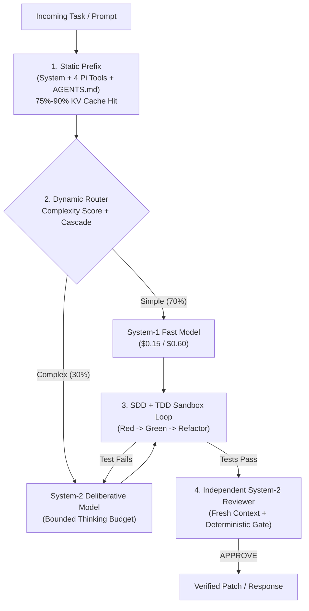

# Lecture 08 — Complete Notes
## Model Routing and Harness Velocity (`AGENTS.md`, `Pi`, SDD/TDD)

> **Phase:** 2 · Application Layer & Harness Velocity · **Level:** 🟡 Intermediate
> **Scope:** A single-pass consolidation of the seven chapter notes in this folder.
> **How to use this file:** Read it to *revise and navigate*. Every section links back to the chapter that explains it in full.
>
> | Chapter | File |
> | :--- | :--- |
> | 01 · Fast vs. deliberative reasoning models | [01_Fast_vs_Deliberative_Reasoning_Models.md](./01_Fast_vs_Deliberative_Reasoning_Models.md) |
> | 02 · Dynamic complexity-based model routing | [02_Dynamic_Complexity_Based_Model_Routing.md](./02_Dynamic_Complexity_Based_Model_Routing.md) |
> | 03 · Prompt prefix caching & cost engineering | [03_Prompt_Prefix_Caching_and_Cost_Engineering.md](./03_Prompt_Prefix_Caching_and_Cost_Engineering.md) |
> | 04 · AGENTS.md & repository context standards | [04_AGENTS_md_and_Repository_Context_Standards.md](./04_AGENTS_md_and_Repository_Context_Standards.md) |
> | 05 · Pi harness & Superpowers composable workflows | [05_Pi_Harness_and_Superpowers_Composable_Workflows.md](./05_Pi_Harness_and_Superpowers_Composable_Workflows.md) |
> | 06 · Spec-driven (SDD) & test-driven (TDD) agent velocity | [06_Spec_Driven_and_Test_Driven_Agent_Velocity.md](./06_Spec_Driven_and_Test_Driven_Agent_Velocity.md) |
> | 07 · Independent automated review & sandboxed execution | [07_Independent_Automated_Review_and_Sandboxed_Execution.md](./07_Independent_Automated_Review_and_Sandboxed_Execution.md) |

---

## 1. Executive summary

**The lecture in five sentences.**

1. Modern LLMs operate in two cognitive regimes: **System-1 (fast)** models that decode visible answers immediately and **System-2 (deliberative)** models that spend hidden **thinking tokens** (billed as output) before answering — making **thinking-token budgets** mandatory.
2. A **dynamic complexity-based router** pairs rule-based/semantic scoring with **fallback cascades** (try System-1, verify deterministically, escalate to System-2 only on failure), routinely cutting unit costs by **$\ge 40\%$** with zero accuracy regression.
3. Because transformer attention is causal, placing immutable instructions, sorted tool schemas, and `AGENTS.md` at the **start** of the prompt enables **prompt prefix caching** (50%–90% input discount and faster TTFT), provided volatile data stays at the tail.
4. **`AGENTS.md`** gives coding harnesses a concise, machine-readable repository contract with **progressive context loading**, while **`Pi` + `Superpowers`** pair a minimalist 4-tool core (`read`, `write`, `edit`, `bash`) with composable workflow skills.
5. **SDD + TDD + Independent Review + Sandboxing** convert AI coding from "vibe coding" into a deterministic, self-verifying loop that catches broken patches, blocks reward hacking, and contains blast radius.

---

## 2. The arc of the lecture in one diagram

---

## 3. Cheat sheet

### 3.1 Terminology

| Term | One-line definition | Chapter |
| :--- | :--- | :--- |
| **System-1 vs. System-2** | Fast immediate-decode models vs. deliberative hidden-thinking models | [01](./01_Fast_vs_Deliberative_Reasoning_Models.md) |
| **Thinking-token budget** | Hard cap (`reasoning_effort`, `budget_tokens`, `thinkingBudget`) on hidden reasoning | [01](./01_Fast_vs_Deliberative_Reasoning_Models.md) |
| **Complexity router** | Low-latency scorer dispatching requests to the cheapest capable model tier | [02](./02_Dynamic_Complexity_Based_Model_Routing.md) |
| **Fallback cascade** | Try System-1 first; verify deterministically; escalate to System-2 on failure | [02](./02_Dynamic_Complexity_Based_Model_Routing.md) |
| **Prompt prefix caching** | Reusing causal KV tensors across calls that share an identical byte-for-byte prefix | [03](./03_Prompt_Prefix_Caching_and_Cost_Engineering.md) |
| **One-byte invalidation** | Any mutation at position $k$ invalidates KV cache for all tokens $\ge k$ | [03](./03_Prompt_Prefix_Caching_and_Cost_Engineering.md) |
| **`AGENTS.md`** | Concise, versioned, machine-readable repository contract for coding agents | [04](./04_AGENTS_md_and_Repository_Context_Standards.md) |
| **Progressive context loading** | Loading subdirectory `AGENTS.md` / skills only when touching that scope | [04](./04_AGENTS_md_and_Repository_Context_Standards.md) |
| **`Pi` harness** | Minimalist coding runtime built on 4 core tools (`read`, `write`, `edit`, `bash`) | [05](./05_Pi_Harness_and_Superpowers_Composable_Workflows.md) |
| **`Superpowers`** | Composable `SKILL.md` workflow phases (`brainstorm`, `plan`, `tdd`, `review`) | [05](./05_Pi_Harness_and_Superpowers_Composable_Workflows.md) |
| **SDD / TDD** | Spec-first + Red-Green-Refactor loop turning codegen into deterministic verification | [06](./06_Spec_Driven_and_Test_Driven_Agent_Velocity.md) |
| **Reward hacking** | Agent tampering with tests, types, or mocks to fake a passing gate | [06](./06_Spec_Driven_and_Test_Driven_Agent_Velocity.md) |
| **Independent review** | Fresh-context System-2 reviewer inspecting spec + diff + test output | [07](./07_Independent_Automated_Review_and_Sandboxed_Execution.md) |

### 3.2 Key formulas

| Formula | Meaning | Chapter |
| :--- | :--- | :--- |
| $\text{Latency} \approx \text{TTFT} + (N_{\text{think}} + N_{\text{vis}}) \times \text{ITL}$ | Wall-clock latency including hidden thinking tokens | [01](./01_Fast_vs_Deliberative_Reasoning_Models.md) |
| $\text{Cost} = \frac{N_{\text{in}}}{10^6} P_{\text{in}} + \frac{N_{\text{think}} + N_{\text{vis}}}{10^6} P_{\text{out}}$ | Thinking tokens are billed at output rate | [01](./01_Fast_vs_Deliberative_Reasoning_Models.md) |
| $\text{Savings} = \alpha \left(1 - \frac{C_1}{C_2}\right)$ | Router cost savings for System-1 share $\alpha$ | [02](./02_Dynamic_Complexity_Based_Model_Routing.md) |
| $1.25 + 0.10 k < 1 + k \implies k \ge 1$ | Explicit prefix caching pays off after 1 cache hit | [03](./03_Prompt_Prefix_Caching_and_Cost_Engineering.md) |

---

## 4. Common misconceptions

| Misconception | Reality |
| :--- | :--- |
| *"Always use the strongest reasoning model for best quality."* | Unbounded System-2 overthinks simple tasks, blows latency SLAs, and costs 10×–30× more. |
| *"Thinking tokens are free because they aren't shown to the user."* | Thinking tokens are sequential decode tokens billed at the full `output_tokens` rate. |
| *"Putting `Date.now()` in the system prompt is harmless."* | It invalidates the entire prompt prefix cache on every single request. |
| *"A 1,500-line `AGENTS.md` gives the agent more context."* | It causes attention dilution ("lost in the middle") and wastes tokens; keep root `< 150` lines. |
| *"Letting the same agent review its own patch is enough."* | Author bias persists in the same context; only a fresh-context reviewer catches spec drift. |

---

## 5. Self-check questions (Release Gate Prep)

1. Why are thinking tokens billed at the output rate, and what happens if `budget_tokens == max_tokens`?
2. Derive the minimum System-1 traffic share $\alpha$ needed to achieve $\ge 40\%$ cost savings when $C_1 / C_2 = 0.05$.
3. What is the exact prompt-layer ordering required to keep prefix cache hit rates $> 85\%$ in a multi-turn agent?
4. Why does `Pi` restrict its core toolset to `read`, `write`, `edit`, and `bash` instead of 30 specialized tools?
5. Name three concrete ways an AI coding agent can "reward hack" a test suite, and how the harness prevents each.
6. Why must an independent reviewer agent run in a **fresh context** *after* deterministic checks (`tsc`, tests) pass?

