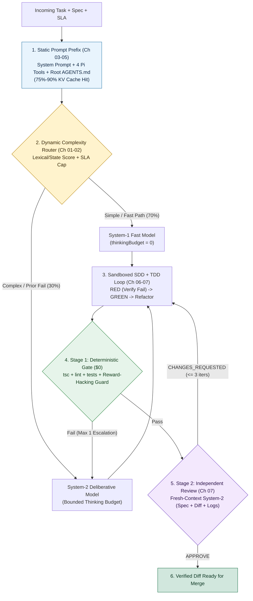

# Lecture 08 — Complete Notes
## Model Routing and Harness Velocity (`AGENTS.md`, `Pi`, SDD/TDD)

> **Phase:** 2 · Application Layer & Harness Velocity · **Level:** 🟡 Intermediate
> **Scope:** Master revision guide consolidating all seven chapters of Lecture 08.
> **Thesis:** Production AI velocity comes not from throwing unbounded frontier reasoning models at every prompt, but from pairing **complexity-based model routing**, **prefix-cache-aligned prompts**, **lean repository contracts (`AGENTS.md`)**, **minimalist composable harnesses (`Pi` + `Superpowers`)**, and **deterministic SDD/TDD + independent review gates**.

---

## 1. Executive Summary

**The lecture in five sentences:**

1. Frontier LLMs operate in two cognitive regimes — **System-1 (fast)** immediate-decode models and **System-2 (deliberative)** hidden-thinking models whose `reasoning_tokens` bill at full `output_tokens` rates — making explicit **thinking-token budgets** mandatory.
2. A **dynamic complexity-based router** pairs `< 1 ms` rule-based/semantic scoring with **fallback cascades** (try System-1 first, verify deterministically, escalate to System-2 at most once on failure), cutting unit costs by **$\ge 40\%$** with zero accuracy regression.
3. Because transformer attention is causal, placing immutable instructions, alphabetically sorted tool schemas, and `AGENTS.md` at the **start** of the prompt enables **prompt prefix caching** (50%–90% input discount and faster TTFT), while keeping volatile state at the tail.
4. **`AGENTS.md`** gives coding agents a concise (`< 150` lines at root), versioned repository contract with **progressive context loading**, while **`Pi` + `Superpowers`** pair a 4-tool core (`read`, `write`, `edit`, `bash`) with on-demand `SKILL.md` phases.
5. **SDD + TDD + Independent Review + Sandboxing** convert AI coding from fragile "vibe coding" into a self-verifying loop that observes RED failures first, blocks reward hacking, eliminates author bias, and contains blast radius.

### Chapter Index

| Chapter | Topic | Core Focus | File |
| :---: | :--- | :--- | :--- |
| **01** | Fast vs. Deliberative Models | System-1 vs. System-2 cognition, latency/cost physics, thinking budgets | [01_Fast_vs_Deliberative_Reasoning_Models.md](./01_Fast_vs_Deliberative_Reasoning_Models.md) |
| **02** | Dynamic Model Routing | Complexity scoring, 4 router types, fallback cascades, $\ge 40\%$ savings math | [02_Dynamic_Complexity_Based_Model_Routing.md](./02_Dynamic_Complexity_Based_Model_Routing.md) |
| **03** | Prompt Prefix Caching | Causal KV reuse, static-before-dynamic ordering, provider TTLs & break-even | [03_Prompt_Prefix_Caching_and_Cost_Engineering.md](./03_Prompt_Prefix_Caching_and_Cost_Engineering.md) |
| **04** | `AGENTS.md` Standards | Machine-readable repo contracts, hierarchical scoping, compound engineering | [04_AGENTS_md_and_Repository_Context_Standards.md](./04_AGENTS_md_and_Repository_Context_Standards.md) |
| **05** | `Pi` & `Superpowers` | 4-tool minimalist harness, progressive `SKILL.md` workflows, subagent isolation | [05_Pi_Harness_and_Superpowers_Composable_Workflows.md](./05_Pi_Harness_and_Superpowers_Composable_Workflows.md) |
| **06** | SDD & TDD Velocity | Spec-first contracts, Red-Green-Refactor oracle, blocking reward hacking | [06_Spec_Driven_and_Test_Driven_Agent_Velocity.md](./06_Spec_Driven_and_Test_Driven_Agent_Velocity.md) |
| **07** | Independent Review & Sandboxes | Two-stage review gate, fresh-context System-2 reviewer, container/microVM isolation | [07_Independent_Automated_Review_and_Sandboxed_Execution.md](./07_Independent_Automated_Review_and_Sandboxed_Execution.md) |

---

## 2. Master Architecture Diagram

---

## 3. Chapter-by-Chapter Short Revision Notes

### 3.1 Chapter 01 — Fast vs. Deliberative Reasoning Models

Frontier LLMs split into **System-1** (immediate visible decode: `gpt-4o-mini`, `claude-3-5-haiku`, `gemini-2.5-flash` with `thinkingBudget: 0`) and **System-2** (hidden chain-of-thought before visible decode: `o3`, `claude-3-7-sonnet` extended thinking, `deepseek-r1`, `gemini-2.5-pro`). Because hidden thinking tokens go through sequential memory-bandwidth-bound decode (`30–120` tok/s vs. `10,000+` tok/s prefill), providers bill them at the full `output_tokens` rate and users see dead silence until thinking finishes. Unbounded System-2 on 50k triage requests/day costs `$2,115/day` (`39s` latency) vs. `$11.40/day` (`0.94s`) on System-1 or `$177.12/day` with an 80/20 bounded split.

- **Latency & Cost:** $\text{Latency} \approx \text{TTFT} + (N_{\text{think}} + N_{\text{vis}}) \times \text{ITL}$; $\text{Cost} = \frac{N_{\text{in}}}{10^6}P_{\text{in}} + \frac{N_{\text{think}}+N_{\text{vis}}}{10^6}P_{\text{out}}$.
- **Provider Knobs:** OpenAI `reasoning_effort` (`"low" | "medium" | "high"`), Anthropic `thinking.budget_tokens` (`>= 1024`), Gemini `thinkingConfig.thinkingBudget` (`0` disables thinking on Flash).
- **Headroom Rule:** Always enforce `max_tokens >= thinking_budget + minVisibleReserve` so the model never returns an empty visible string.

> 📖 **Need depth?** Read [Chapter 01 — Fast vs. Deliberative Reasoning Models](./01_Fast_vs_Deliberative_Reasoning_Models.md)

### 3.2 Chapter 02 — Dynamic Complexity-Based Model Routing

A dynamic router inspects each request in `< 15 ms` and dispatches it to the cheapest capable tier using four patterns: **rule-based heuristics** (`< 1 ms`), **semantic/embedding similarity** (`5–15 ms`), **tiny classifiers** (`10–40 ms`), and **speculative fallback cascades**. In production, combine rule-based upfront triggers (token count, code/stack traces, constraint count, `priorAttemptFailed: +0.40`, hard SLA `< 1,000 ms` cap) with a **fallback cascade**: try System-1 first, verify with a deterministic oracle (Zod, `tsc`, unit tests, or calibrated logprobs), and escalate to System-2 at most once (`max_escalations = 1`).

- **Savings Formula:** $\text{Savings} = \alpha\left(1 - \beta - \frac{C_1}{C_2}\right)$ where $\alpha$ is System-1 share and $\beta$ is cascade miss rate. With $C_1/C_2 = 0.05$, $\alpha = 70\%$, $\beta = 8\%$, savings hit **60.9%** ($\ge 40\%$ gate).
- **Guardrails:** Never cascade on subjective tasks without an oracle, and keep static prefixes identical across tiers so escalation does not bust the KV cache.

> 📖 **Need depth?** Read [Chapter 02 — Dynamic Complexity-Based Model Routing](./02_Dynamic_Complexity_Based_Model_Routing.md)

### 3.3 Chapter 03 — Prompt Prefix Caching & Cost Engineering

In causal self-attention, $K_i$ and $V_i$ for prefix token $i$ depend only on tokens $1 \dots i$, allowing providers to reuse cached KV tensors across turns. However, the **one-byte invalidation rule** means any mutation at position $k$ (like `Date.now()` or unsorted tool keys) invalidates the entire suffix $\ge k$. Enforce strict **static-before-dynamic ordering**: (1) immutable system prompt, (2) alphabetically sorted tool schemas, (3) `AGENTS.md` + core spec, (4) append-only history, (5) volatile timestamps/diffs/user query at the very tail.

| Provider | Activation | Minimum Prefix | Write Surcharge | Read Discount |
| :--- | :--- | :---: | :---: | :---: |
| **OpenAI** | Automatic | `1,024` tokens | `0%` | `50%–75%` off |
| **Anthropic** | Explicit `cache_control` (up to 4) | `1,024–4,096` tokens | `+25%` (5m) / `+100%` (1h) | `90%` off |
| **Gemini** | Implicit + explicit `cachedContent` | `1,024–2,048` tokens | Standard + storage | `75%–90%` off |

- **Break-even:** $1.25 + 0.10k < 1 + k \implies k \ge 1$ reuse makes 5-minute explicit caching profitable (74.8% savings over a 10-turn session).

> 📖 **Need depth?** Read [Chapter 03 — Prompt Prefix Caching & Cost Engineering](./03_Prompt_Prefix_Caching_and_Cost_Engineering.md)

### 3.4 Chapter 04 — `AGENTS.md` & Repository Context Standards

`AGENTS.md` is the open standard for a concise, machine-readable repository contract (unlike human-oriented `README.md`). A root `AGENTS.md` should stay **under 150 lines** and cover five essentials: copy-pasteable build/test commands, directory architecture map, non-negotiable invariants, code style patterns, and forbidden boundaries. Dumping 2,000 lines (`~24,000` tokens) into the root causes **attention dilution ("lost in the middle")** and burns `360,000` prefill tokens over 15 turns.

- **Progressive Context Loading:** Keep universal rules in root `AGENTS.md` (prefix-cached), put subsystem rules in subdirectory `AGENTS.md` files loaded only when editing that subtree (cutting prefill tokens by 93.3%), and reference deep docs by path.
- **Compound Engineering:** Treat every repeatable agent mistake as a missing 1–2 line rule in `AGENTS.md` so future sessions inherit the fix permanently.

> 📖 **Need depth?** Read [Chapter 04 — AGENTS.md & Repository Context Standards](./04_AGENTS_md_and_Repository_Context_Standards.md)

### 3.5 Chapter 05 — `Pi` Harness & `Superpowers` Composable Workflows

Because $\text{Agent} = \text{Model} + \text{Harness}$, bloated frameworks with 35+ bespoke JSON tool schemas (`~7,000` tokens/turn) waste context, hurt tool selection, and break caching. **`Pi`** strips the runtime to 4 core tools (`read`, `write`, `edit`, `bash`, `~400` tokens total — 94.3% fewer schema tokens) and relies on POSIX CLI tools (`git`, `rg`, `jq`) that models already know. **`Superpowers`** layers composable `SKILL.md` phases loaded on demand in the dynamic user message so the static prefix stays 100% cached:

- **Pipeline:** `brainstorming` (System-2) $\rightarrow$ `using-git-worktrees` $\rightarrow$ `writing-plans` (System-2) $\rightarrow$ `tdd-patch-cycle` (System-1 + escalation) $\rightarrow$ `requesting-code-review` (fresh System-2) $\rightarrow$ `finishing-a-development-branch`.
- **Isolation Rule:** Use single-context skill chaining for small 1–3 file features; dispatch **isolated subagents** for parallel plan tasks and fresh-context code review.

> 📖 **Need depth?** Read [Chapter 05 — Pi Harness & Superpowers Composable Workflows](./05_Pi_Harness_and_Superpowers_Composable_Workflows.md)

### 3.6 Chapter 06 — Spec-Driven (SDD) & Test-Driven (TDD) Agent Velocity

"Vibe coding" collapses on real codebases; **SDD + TDD** turn codegen into a deterministic closed-loop search. Start with a 4-part `spec.md` (Contract/Types, Behavioral Invariants, Quantitative Acceptance Criteria, Non-Goals). Then run **Red-Green-Refactor**: write a test and **observe the RED non-zero exit code first** (proving the test isn't tautological or disconnected), generate the minimal GREEN patch on System-1, and escalate to System-2 with exact `tsc`/test `stderr` only on failure (cutting 100-bugfix cost by 72.5% and latency by 3.4×).

- **Anti-Reward-Hacking Guards:** Enforce `assertTestsUnmodified()` so agents cannot delete assertions or add `.skip()`, run `assertNoTypeSuppressions()` to block `@ts-ignore` / `as any`, and hold out private eval cases.

> 📖 **Need depth?** Read [Chapter 06 — Spec-Driven (SDD) & Test-Driven (TDD) Agent Velocity](./06_Spec_Driven_and_Test_Driven_Agent_Velocity.md)

### 3.7 Chapter 07 — Independent Automated Review & Sandboxed Execution

Author-context self-review fails due to **confirmation bias** — the model rationalizes shortcuts (like `100ms` `setTimeout` hacks) from its own 30-turn struggle. Replace it with a **two-stage review gate**: Stage 1 runs `$0` deterministic checks (`tsc`, `eslint`, unit tests, protected-file check); only when Stage 1 is green does Stage 2 invoke a **fresh-context System-2 reviewer** seeing *only* `spec.md`, `AGENTS.md`, the git diff, and test output, returning a typed `ReviewVerdict` (`blocker | warning | nit`, capped at `maxIterations = 3`).

- **Blast-Radius Containment:** `git worktree` prevents branch collisions but is **not** a security boundary (`~/.ssh` and `.env` remain exposed). Run untrusted `bash` loops inside Docker containers (`--network=none`, scoped mounts, `30s` timeouts) or microVMs (Firecracker / E2B / Cloudflare Sandbox).

> 📖 **Need depth?** Read [Chapter 07 — Independent Automated Review & Sandboxed Execution](./07_Independent_Automated_Review_and_Sandboxed_Execution.md)

---

## 4. Cheat Sheet & Common Traps

### 4.1 High-Yield Formulas & Thresholds

| Metric / Rule | Formula or Threshold | Purpose |
| :--- | :--- | :--- |
| **Safe `max_tokens`** | `max_tokens >= thinking_budget + minVisibleReserve` | Prevents empty visible output |
| **Routing Savings** | $\text{Savings} = \alpha(1 - \beta - C_1/C_2) \ge 0.40$ | Proves $\ge 40\%$ cost reduction |
| **Cache Break-Even** | $k \ge 1$ reuse (5-min TTL, `+25%` write, `90%` read off) | Justifies explicit cache writes |
| **Root `AGENTS.md`** | `< 150` lines; exact copy-pasteable commands | Prevents attention dilution |
| **Review Loop Cap** | `maxIterations = 3`; block only on `"blocker"` | Prevents infinite nitpick loops |

### 4.2 Common Traps

| Trap | Why It Breaks Production | Fix |
| :--- | :--- | :--- |
| **Defaulting to System-2 everywhere** | 10×–185× cost, 30s+ blank spinners, overthinking simple labels | Route simple tasks to System-1 (`thinkingBudget: 0`); cap System-2 budgets. |
| **Putting `Date.now()` or unsorted tools in system prompt** | One-byte invalidation busts 100% of KV prefix cache | Sort tools alphabetically; move all volatile state to the tail user message. |
| **Writing tests + code without observing RED** | Tautological or disconnected tests pass on broken code | Require a real non-zero test exit code before writing implementation. |
| **Letting the implementation agent edit tests** | Agent weakens assertions or inserts `@ts-ignore` (reward hacking) | Enforce `assertTestsUnmodified()` and `assertNoTypeSuppressions()`. |
| **Treating `git worktree` as a security sandbox** | Agent `bash` commands can still read `~/.ssh` or `curl` secrets | Use network-isolated containers (`--network=none`) or microVMs. |

---

## 5. Self-Check Questions (Release Gate Prep)

1. Why are hidden thinking tokens billed at the `output_tokens` rate, and what failure occurs if `budget_tokens == max_tokens`?
2. Derive the System-1 traffic share $\alpha$ required for $\ge 40\%$ savings when $C_1 / C_2 = 0.05$ and cascade miss rate $\beta = 10\%$.
3. What is the exact 5-layer prompt ordering needed to sustain $> 85\%$ prefix cache hit rates across multi-turn agent loops?
4. Why does `Pi` restrict its core toolset to `read`, `write`, `edit`, and `bash` instead of 35 specialized JSON tools, and where should active `SKILL.md` text be injected?
5. Why is observing a **RED** test failure mandatory before generating a **GREEN** patch, and how do you block agent reward hacking?
6. Why must an independent System-2 reviewer run in a **fresh context** *after* Stage 1 deterministic checks pass, and why is `git worktree` insufficient for security isolation?
