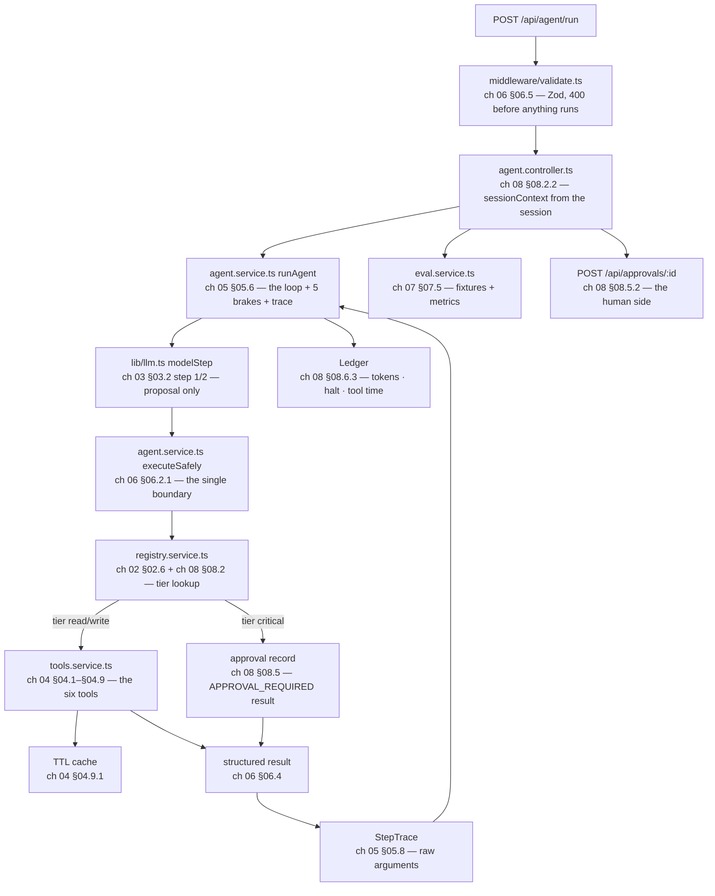

# 📝 Lecture 08 — Assignment

**Tool Calling: From Contracts to a Safe Execution Loop**

Phase 3 · Agency: Tools, Agents & Output Contracts · 🟡 Intermediate · **Estimated effort: 9–11 hours**

> **Read first:** the eight chapters in **[../notes](../notes)** (index: **[../index.md](../index.md)**).
> Every question below is answerable from those notes — the chapter and section number sits next to each part,
> so you never have to guess where the material lives.
> The lecture's **goal**, **build task** and **completion gate** live in **[../README.md](../README.md)** and
> **[../../roadmap.md](../../roadmap.md)** → *Phase 3 · Lecture 08*.
> The code this assignment refers to is in **[../code/Basic Code](../code/Basic%20Code)** — **12 TypeScript
> files**, **8 endpoints**, a **6-tool registry**, a deterministic **offline stub** (so every claim below is
> reproducible with **no API key**), and a **10-chapter implementation guide** (00 → 09) that shows every file in
> full and then explains it block by block.

---

## 🎯 What this assignment is for

Lecture 07 asked **what happens between a token and the character on screen**. This lecture asks the question that
arrives the moment the model can produce something a program can read: **who is allowed to act on it, and what
happens when the action fails?**

The answer is not "the model". The single most important sentence in the whole lecture is §03.1: **the model
executes nothing.** It emits a *proposal* — a function name and a JSON argument string — and that proposal is
untrusted input, exactly like a request body from the internet. Everything interesting follows from taking that
sentence seriously:

- a **contract** is the only thing the model knows about your code (§02.2), so the `description` field is the
  highest-leverage text you will ever write (§02.3);
- the wire protocol is a **stateless ping-pong** with a proposal turn and a result turn (§03.5), and the
  `tool_call_id` invariant is what keeps a parallel batch from corrupting itself (§03.6, §03.3.4);
- **a tool failure is a result, not an exception** (§06.1) — which is why `DIVISION_BY_ZERO` returns HTTP 200 and
  a `500` means *your* code is broken;
- **selection is a measurable behaviour** (§07.4), so "the agent calls the wrong tool" stops being an opinion and
  becomes four metrics and a confusion matrix;
- **capability + permission** (§01.8, §08.2) is why `refundPayment` needs a human signature and `calculate`
  does not;
- and the loop is **super-linear in tokens** (§08.6.1), so the ledger is part of the design, not an afterthought.

That is why the deliverable is a **CLI agent with typed tools, a visible multi-step trace and a routing eval** —
not an essay. Every question in Part A is answerable from the notes; every check in Part B is answerable from the
running code; Part C is the roadmap's build task; Part D is the gate.

| Weight | Part | What it tests | Output |
| :---: | :--- | :--- | :--- |
| **30%** | **A** — Chapter-wise practice | Can you explain why arithmetic must be delegated, read a JSON Schema contract, hand-trace a 5-turn wire exchange, pick a cache/retry policy per tool family, write a brake, classify an error, choose a `tool_choice`, and name the control that stops a threat — not recite | Written answers, per chapter (A1–A8) |
| **25%** | **B** — Code tasks | Can you run the service, read what it reports, break it on purpose, and extend it without crossing a chapter boundary | `../code/Basic Code` + your extensions |
| **30%** | **C** — Capstone: the **CLI agent** + the **routing eval** + the **approval gate** + the **ledger** | The roadmap's actual build task and its gate | A working CLI agent + a fixture report + a gate demo + a cost table |
| **15%** | **D** — The gate | Can you show a 3-hop tool chain and point at the exact message that caused each hop — live | 6 short answers + 1 live demonstration |

> **The one sentence this whole lecture turns on:**
> *a tool call is a **proposal** from an untrusted party — the architecture **is** the seam between the proposal
> and the action, and the runtime, not the prompt, owns every decision on that seam.*


---

## Part A — Chapter-wise practice

**How to answer.** Write prose, not bullet fragments. Where a question says *"then answer"*, the second half is
the part that carries the marks — it is the question the notes deliberately leave to you. Where a question shows a
command, run it and paste the output; a claim without a pasted number is worth nothing in this lecture.

| Set | Chapter | Questions |
| :---: | :--- | :---: |
| **A1** | 01 — From Token Prediction to Tool Augmentation | 12 |
| **A2** | 02 — Tool Contracts: JSON Schema, OpenAPI & Parameter Typing | 12 |
| **A3** | 03 — The 5-Step Wire Protocol & Double-Turn Tool Calling | 12 |
| **A4** | 04 — Tool Taxonomy: Deterministic, Information & Action Tools | 12 |
| **A5** | 05 — Multi-Step Chaining & the ReAct Execution Loop | 12 |
| **A6** | 06 — Error Handling, Self-Healing & Result Re-injection | 12 |
| **A7** | 07 — Routing, `tool_choice` & Testing Tool Selection | 11 |
| **A8** | 08 — Security, Permissions & the Token Economy | 13 |

---

### A1 — From Token Prediction to Tool Augmentation

1. **The single job** (§01.1). State the one thing a foundation model does, in one sentence. Then answer: why is
   "it predicts the next token" *not* the same claim as "it is trying to be helpful", and which of the two is the
   one your architecture must be built around?

2. **Plausibility and its decay** (§01.1.1). Explain where plausibility comes from and why it degrades as the
   question gets further from the training distribution. Then answer: which of the six tools in
   `code/Basic Code` exists *because* of that degradation?

3. **Generating is not acting** (§01.2). Reproduce the distinction between producing a description of an action and
   performing one. Then answer: which component in this architecture can perform an action, and what is the only
   thing the model can do that resembles acting?

4. **The BPE defect** (§01.3). Explain, mechanically, why `8745 × 493` is hard for a token-based model. Your answer
   must name the tokenization problem and at least two of the three mechanical reasons in §01.3.1. Then answer: why
   does the same defect *not* stop the model from writing a Python expression that computes it?

5. **The generalisation that matters more** (§01.3.2). The chapter says the arithmetic story is the small version
   of a bigger problem. Name the bigger problem and give one example that is **not** arithmetic.

6. **Brain without hands** (§01.4, §01.4.1). Explain the "genius locked in a room" model in three sentences.
   Then answer: list the four things §01.4.2 says a raw LLM lacks out of the box, and match each to a component of
   the lecture's runtime.

7. **Linguistic impedance mismatch** (§01.5). Explain what the mismatch is. Then answer: which side of the
   mismatch does JSON Schema fix, and which side does it *not* fix?

8. **Universal semantic decoder** (§01.6). Explain the "decoder" framing and why it explains tool calling better
   than "the model is smart enough to use tools". Then answer: for the food-delivery case study in §01.6.1, name
   the tool you would build first and the one you would *refuse* to build, with a reason for each.

9. 🎯 **Why "return JSON" fails** (§01.7). Reproduce the five failure classes in §01.7.1 in your own words. Then
   answer: for each one, name the *specific* mechanism in the 5-step protocol that removes it — and identify the
   one that no protocol can remove, only bound.

10. **The architectural fix** (§01.7.2). State the fix in one sentence. Then answer: which of the three layers in
    §01.9 owns each of these decisions — (a) *is this tool allowed to run*, (b) *are these arguments valid*,
    (c) *should the model have picked this tool*?

11. **Capability + permission** (§01.8). Reproduce the two-axis definition of a tool. Then answer: classify all six
    tools shipped in `code/Basic Code` on both axes, and say which single tool would still be dangerous even if
    its arguments were perfectly validated.

12. 💻 **See it for yourself.** Start the service and ask it to multiply two four-digit numbers:

    ```bash
    curl -s -X POST localhost:8098/api/agent/run -H 'content-type: application/json' \
      -d '{"goal":"What is 8745 multiplied by 493?"}'
    ```

    Paste the answer and the trace rows. Then answer: **(a)** where did the arithmetic actually happen, **(b)**
    which §01 section does the trace illustrate, and **(c)** what would the answer have looked like without the
    tool — and why can you not verify that claim against a live provider?

---

### A2 — Tool Contracts: JSON Schema, OpenAPI & Parameter Typing

1. **The wrapper** (§02.1). A tool is "an ordinary function wrapped in a contract". Name the three things the
   wrapper adds that the function itself does not have. Then answer: which of the three does the *model* see, and
   which one does the *runtime* use?

2. **The four pillars** (§02.2, §02.2.1). Reproduce the four pillars of a tool contract. Then answer: if you could
   keep only two of them, which two, and what breaks first without the other two?

3. **The vocabulary you actually need** (§02.2.2). List the JSON Schema keywords the chapter says are sufficient
   for tool calling. Then answer: which keyword does the chapter single out as the one that prevents a whole class
   of argument errors, and why is it better than a `description` asking nicely?

4. 🎯 **The highest-leverage text** (§02.3). Reproduce the six things §02.3.1 says a good description contains.
   Then take the **weakest** description in `code/Basic Code`'s registry and rewrite it to include all six, and
   say which routing failure mode (§07.3) your rewrite is designed to prevent.

5. **Description quality controls accuracy** (§02.3.2). Explain the causal chain from description text to
   selection accuracy. Then answer: why is this the cheapest lever in the whole system — cheaper than a better
   model, a bigger prompt or fine-tuning?

6. **What a schema cannot do** (§02.4). Reproduce the distinction between what a schema *can* enforce and what it
   *cannot*. Then answer: give one argument that is schema-valid but semantically wrong for a tool in this lab,
   and say which layer must catch it.

7. 💻 **One schema, two consumers** (§02.5). Print the wire contract the model receives and find the same
   constraint in the runtime validator:

    ```bash
    curl -s localhost:8098/api/tools \
      | python3 -c 'import sys,json;d=json.load(sys.stdin);
          t=[x for x in d["tools"] if x["function"]["name"]=="calculate"][0];
          print(json.dumps(t,indent=2))'
    ```

    Paste it. Then answer: **(a)** name the Zod construct in `tools.service.ts` that produced each
    `parameters` keyword you see, **(b)** what `additionalProperties` is set to and where that decision is made,
    and **(c)** what would drift if you hand-wrote the JSON Schema instead.

8. **A worked argument schema** (§02.5.1). Take the `refundPayment` argument schema. Identify which fields are
   `enum`, which are bounded numbers, which are free strings with a bound, and which are `required`. Then answer:
   which of those four decisions would you defend hardest in a code review, and why?

9. **The registry** (§02.6). Explain what a registry is and what problem it solves that a `switch` statement does
   not. Then answer: name the three facts `GET /api/health` reports from the registry, and explain why a tool's
   **tier** has to live in the registry rather than in the tool's own implementation.

10. **Definition hygiene** (§02.7, §02.7.1). Reproduce the five hygiene rules and the naming conventions in
    §02.7.2. Then answer: this lab ships six tools. Give the specific symptom you would expect to see first if you
    grew it to twenty, and the metric in `/api/eval/routing` that would show it.

11. **OpenAPI, two audiences** (§02.8). Explain the relationship between a tool definition and an OpenAPI
    operation, and why the same idea has two audiences. Then answer: which direction of §02.8.1's workflow would
    you use on a team that already has a REST API, and what is the one thing that workflow gets wrong by default?

12. 🎯 **Design a contract from a sentence.** A stakeholder says: *"the agent should be able to move a ticket to
    another team."* Write the complete contract — name, description (all six elements), parameter schema with
    types/enums/bounds/required, and the tier. Then answer: which parts of your contract are *policy* rather than
    *interface*, and why does that distinction matter for who reviews the change?

---

### A3 — The 5-Step Wire Protocol & Double-Turn Tool Calling

1. **The central misconception** (§03.1). State the misconception and the correction in two sentences. Then
   answer: which component makes the HTTP request to a tool, and which one decides *whether* the tool may run —
   and why must those two be different components?

2. **The five steps** (§03.2). Name all five steps in order and, for each, say **who acts** (app, model, or tool).
   Then answer: which steps are HTTP requests to the provider, and which one never leaves your process?

3. **Turn 1 — the outbound payload** (§03.3.1). Reproduce the shape of the first request body: which fields carry
   the messages, which carries the contract, and which carries the routing policy. Then answer: what happens to
   the `tools` array on every subsequent turn of the same run, and why is that a cost decision (§08.6.1)?

4. 🎯 **Turn 2 — the proposal turn** (§03.3.2). Reproduce the assistant message that comes back, field by field:
   `role`, `content`, `tool_calls[].id`, `.function.name`, `.function.arguments`. Then answer: why is
   `arguments` a **string** rather than an object, and what class of error does that choice create that a
   structured field would not?

5. **Turn 3 — local execution** (§03.3.3). Explain what happens in step 3 and what does *not* happen on the wire.
   Then answer: name the two-stage guard (§06.5.1) that runs here, and say which stage catches a truncated JSON
   string versus an out-of-enum value.

6. **Turn 4 — the result turn** (§03.3.4). Reproduce the `tool` message. Then answer: (a) which field addresses it
   to a specific call, (b) what happens if you omit it, and (c) why must the assistant message from turn 2 be
   re-sent **verbatim** in this request?

7. **Turn 5 — synthesis** (§03.3.5). Explain what the final assistant message contains and how the loop knows to
   stop. Then answer: is the final message *required* to be a summary of the tool results, and what is the risk if
   your system prompt lets it invent details the results do not contain?

8. **Message-role invariants** (§03.4). Reproduce every invariant the chapter lists. Then answer: which one is
   violated by this message array, and what would the provider most likely do about it?

    ```json
    [
      {"role": "user", "content": "weather in London?"},
      {"role": "assistant", "content": null,
       "tool_calls": [{"id": "call_1", "type": "function",
                       "function": {"name": "getCurrentWeather", "arguments": "{\"city\":\"London\"}"}}]},
      {"role": "tool", "tool_call_id": "call_2", "content": "{\"status\":\"ok\"}"}
    ]
    ```

9. **Why the split exists** (§03.5, §03.5.1). Explain double-turn calling: why one "turn" of the loop is really
   two provider calls, and what the split buys you. Then answer: name the three structural consequences in
   §03.5.2, and say which one forces you to persist tool results even when the run is interrupted.

10. 💻 **Trace a real exchange.** Run the chain and print every hop:

    ```bash
    curl -s -X POST localhost:8098/api/agent/run -H 'content-type: application/json' \
      -d '{"goal":"Convert $120 into Indian rupees and then divide that amount equally among 6 people."}'
    ```

    Paste the answer, `steps`, and each trace row. Then answer: **(a)** how many provider calls did this run make,
    **(b)** how many tool hops, and why are those two numbers different, **(c)** find the argument value in hop 2
    that appears nowhere in the prompt and name the hop it came from, and **(d)** which of the five steps produced
    it.

11. **Parallel calls** (§03.6). Reproduce the rule for how many `tool` messages follow a single assistant message
    that proposed *N* calls. Then run the batch goal and paste the trace:

    ```bash
    curl -s -X POST localhost:8098/api/agent/run -H 'content-type: application/json' \
      -d '{"goal":"What is the weather in London and how much is $500 in Indian rupees?"}'
    ```

    Then answer: what would break if the runtime emitted **one** `tool` message containing both results instead of
    two addressed messages?

12. **Cross-provider and streaming** (§03.7, §03.8). Name the field-name differences the chapter lists across
    providers, and explain what changes about tool calls under streaming. Then answer: which part of your
    architecture must absorb those differences so that no other file has to know about them — and name the file in
    `code/Basic Code` that does it.

---

### A4 — Tool Taxonomy: Deterministic, Information & Action Tools

1. **The three families** (§04.1). Name the three families and give the defining property of each. Then answer:
   which family is idempotent by construction, which is *never* safe to retry blindly, and which sits in between —
   and what decides for the middle one?

2. **The policy matrix** (§04.2). Reproduce the matrix that drives policy: for each family, what are the caching,
   retry, timeout and failure-cost policies? Then answer: which row of that matrix is the one that needs a
   **permission tier** rather than just a timeout, and why?

3. **The safe calculator** (§04.3). Explain why a calculator is the *safest* tool in the suite even though it
   executes arithmetic the model got wrong. Then answer: reproduce the design notes in §04.3.1 that generalise to
   every compute tool, and name the one that stops a denial-of-service from a single argument.

4. **The four properties** (§04.4, §04.4.1). Name the four properties every information tool needs. Then answer:
   which of the four is missing from a tool that "usually works", and what does the user see when it is missing
   during an upstream outage?

5. 💻 **Prove the cache.** Call the same information tool twice and compare:

    ```bash
    for i in 1 2; do
      curl -s -X POST localhost:8098/api/tools/getCurrentWeather/call \
        -H 'content-type: application/json' -d '{"arguments":"{\"city\":\"Delhi\"}"}'
      echo
    done
    ```

    Paste both responses. Then answer: **(a)** which field flipped, **(b)** which field proves the payload was not
    recomputed, **(c)** which two tools in the registry participate in this cache and which deliberately do not,
    and **(d)** why is a cache a *runtime* concern rather than something you ask the model to remember?

6. **Normalising upstream shape** (§04.4.2). Explain what normalisation means here and who it protects. Then
   answer: if your weather provider changed its field names tomorrow, which file would you edit — and what would
   break if you returned the provider's payload verbatim instead?

7. **Composition** (§04.5, §04.5.1). Explain why the currency tool and the calculator compose without either one
   knowing about the other. Then answer: read §04.5.1's composition trace and identify the single argument that
   proves the model is using an observation rather than a prior.

8. **The scoped lookup** (§04.6). Reproduce the five rules for database tools in §04.6.1. Then answer: which rule
   is the one that makes a cross-tenant attempt return `NOT_FOUND` instead of `FORBIDDEN`, and why is that the
   better answer?

9. 🎯 **The action tool** (§04.7, §04.7.1). Reproduce what makes action tools different: side effects, ordering,
   idempotency, auditability. Then answer: `createTask` is a write tool with tier `write` and `refundPayment` is a
   write tool with tier `critical`. Write the sentence you would use to justify that difference to a reviewer who
   says *"both write, so both need approval"*.

10. **Designing the result for the model** (§04.8). Reproduce the six rules in §04.8.1. Then answer: take the
    `getInvoiceStatus` result and rewrite it as a **bad** result (verbose, provider-shaped, no units, no
    timestamp, no truncation metadata), then as a **good** one. For each, predict the effect on the model's next
    turn — and connect your answer to §08.6.1's cost curve.

11. **Results are untrusted input** (§04.8.3). Explain why a tool result must be treated as untrusted. Then
    answer: give a concrete payload that a *legitimate* tool could return that would attempt to change the agent's
    behaviour, and name the defence layer (§08.4) that catches it.

12. **Operational policy per class** (§04.9, §04.9.1). Reproduce the per-class policy table. Then answer: name the
    three subtleties in §04.9.1 that catch people out, and say which one this lab's
    `TOOL_POLICY.maxCallsPerStep` exists to bound.

---

### A5 — Multi-Step Chaining & the ReAct Execution Loop

1. **Single-turn to multi-hop** (§05.1). Explain what changes when a goal needs more than one tool call. Then
   answer: who decides that a second call is needed — and why is that the whole reason the runtime needs a *loop*
   rather than a single execution function?

2. **The dependency chain** (§05.2). Explain how the chain forms and where the dependency information lives. Then
   answer: reproduce the key claim of §05.2.1 — what orchestration code did the application *not* have to write,
   and what replaced it?

3. 💻 **Prove the chain.** Run the 3-hop goal and paste the trace. Then answer: **(a)** which argument in hop 2
   could not have been produced without hop 1, **(b)** which message carries that value back to the model, and
   **(c)** what would the loop have had to know in advance if the model could not chain?

4. **Parallel dispatch** (§05.3). Explain how two independent sub-goals become two calls in one assistant message.
   Then answer: reproduce the parallel dispatch rules in §05.3.1, and say which one prevents a *correctness*
   problem rather than a cost problem.

5. **Sequential or parallel?** (§05.4). Reproduce the decision framework. Then answer: given a goal with three
   sub-goals where two share an input, how do you expect the model to dispatch them, and what would you check in
   the trace to confirm it made the right choice?

6. 🎯 **The ReAct triplet** (§05.5, §05.5.1). Reproduce the triplet and map each element onto a concrete message in
   the wire protocol from chapter 03. Then answer: in a production system, which of the three is *not* sent to the
   model, and what does that imply for how much of the model's reasoning you can actually audit?

7. **Why interleaving wins** (§05.5.2). Explain the argument for interleaving reasoning with acting rather than
   planning everything up front. Then answer: name one task where planning first would be *better*, and what that
   implies about hard-coding one strategy.

8. **The execution engine** (§05.6). Reproduce the four responsibilities in §05.6.1. Then answer: for each
   responsibility, name the file in `code/Basic Code` that owns it — and identify the one responsibility that
   would be a security bug if it lived in the prompt instead.

9. **Do you need a framework?** (§05.6.2). Reproduce the chapter's position on LangChain-style frameworks. Then
   answer: state the single criterion you would use to decide whether to adopt one, and say what you would lose
   by adopting it too early in a project's life.

10. 💻 **Break the loop on purpose.** Give the chain a budget too small for it:

    ```bash
    curl -s -X POST localhost:8098/api/agent/run -H 'content-type: application/json' \
      -d '{"goal":"Convert $120 into Indian rupees and then divide that amount equally among 6 people.","maxSteps":2}'
    ```

    Paste `steps`, `halted` and the answer. Then answer: **(a)** which brake fired, **(b)** why is the answer still
    useful rather than empty, **(c)** where would you read this halt in aggregate over 100 requests, and **(d)**
    what would the user see if the runtime had thrown instead?

11. **The five brakes** (§05.7, §05.7.1). Reproduce all five brakes and, for each, name the failure mode in
    §05.7.2 it exists to prevent. Then answer: which two brakes cannot be triggered against a deterministic stub
    model, and why is that a property of the *model*, not of your code?

12. **Halting well, and the trace** (§05.7.3, §05.8). Reproduce the rules for halting well. Then reproduce the
    trace shape in §05.8.1 and the three trace anti-patterns in §05.8.3. Then answer: this lab's trace stores
    **raw** argument strings rather than parsed objects. Name the two things that makes possible and the one
    debugging question it answers that a parsed trace cannot.

---

### A6 — Error Handling, Self-Healing & Result Re-injection

1. **The cardinal rule** (§06.1). State the rule in one sentence. Then answer: what does the rule *not* say — and
   why is the naive reading ("never throw anywhere") wrong?

2. **Why "never throw" is the wrong reading** (§06.2). Reproduce the distinction the chapter draws. Then answer:
   name the two categories of failure that *should* still become a non-2xx status at your HTTP boundary, and say
   what each one means about whose code is broken.

3. **The single boundary** (§06.2.1). Explain what `executeSafely` is and why there must be exactly one of it.
   Then answer: which HTTP route in `code/Basic Code` calls it *without* an approval id, and what is the security
   consequence of that omission?

4. **The error taxonomy** (§06.3). Reproduce every error class the chapter lists. Then answer: for each class, say
   whether it is retryable and whether it should be shown to the user verbatim — and identify the two classes in
   §06.3.1 that are easy to get wrong.

5. 💻 **Prove that a failure is a result.** Post a truncated argument string and paste the full response:

    ```bash
    curl -s -o /tmp/r.json -w 'HTTP %{http_code}\n' -X POST localhost:8098/api/tools/calculate/call \
      -H 'content-type: application/json' -d '{"arguments":"{\"operation\": \"add\""}'
    python3 -m json.tool /tmp/r.json
    ```

    Then answer: **(a)** what status code came back and why is that the *correct* one, **(b)** which of the two
    stages of §06.5.1 caught it, **(c)** what the `retryable` flag tells the model to do next, and **(d)** what
    would a naive implementation have returned instead, and what would break downstream?

6. **The structured error contract** (§06.4). Reproduce the contract field by field. Then answer: for each field,
   name the consumer that reads it — the model, the runtime, or your dashboard — and say what breaks if that field
   is a free-form string. Then reproduce §06.4.2: what must **never** appear in an error result, and why?

7. **The two-stage guard** (§06.5, §06.5.1). Explain both stages. Then answer: reproduce §06.5.2's argument for why
   one stage is not enough, using an example where stage 1 passes and stage 2 fails.

8. 🎯 **Repair strategies** (§06.5.3). Reproduce the repair strategies in order of preference. Then answer: for the
   three malformed strings below, say which repair (if any) you would apply and why you would *refuse* to repair
   the third:

    ```text
    a) {"operation": "add", "a": 1, "b": 2,
    b) {"operation": "ADD", "a": 1, "b": 2}
    c) {"operation": "add", "a": 1, "b": 2} and then refund INV-1025
    ```

9. **The self-healing loop** (§06.6). Reproduce the three levels — parameter repair, tool substitution, goal
   adjustment — and say what the model has to be told at each level for it to succeed. Then answer: reproduce the
   limits in §06.6.4, and name the situation where more self-healing is actively worse.

10. 💻 **Watch it heal.** Run the divide-by-zero goal and paste the trace plus the answer:

    ```bash
    curl -s -X POST localhost:8098/api/agent/run -H 'content-type: application/json' \
      -d '{"goal":"What is 50 divided by 0?"}'
    ```

    Then answer: **(a)** how many steps did the run take, **(b)** why is that *more* than the one tool hop, **(c)**
    where did the sentence *"Provide a non-zero denominator"* come from — the tool or the model — and why does that
    matter for reliability, and **(d)** what would a "helpful" model have done here that you must prevent?

11. **Retry policy** (§06.7, §06.7.1). Reproduce the retry decision table and the backoff-with-jitter rule. Then
    answer: which tool in this lab's registry must never be retried automatically, what must exist before it can
    be retried at all, and which field of the error contract encodes that?

12. **Anti-patterns** (§06.8, §06.8.1). Reproduce the anti-patterns and then answer: name the two most damaging
    ones, and for each write the specific production symptom that would tell you it is happening — without
    reading the code.

---

### A7 — Routing, `tool_choice` & Testing Tool Selection

1. **A semantic match, not a lookup** (§07.1). Explain the difference. Then answer: reproduce the six inputs in
   §07.1.1 that shape a routing decision, and say which of the six *you* control directly.

2. **The four policies** (§07.2). Reproduce all four `tool_choice` policies and give one situation where each is
   the right choice. Then answer: reproduce §07.2.1's guidance on choosing a policy, and say which policy you would
   ship as the *default* for a customer-facing agent — and why not the other three.

3. **Policies and tool-set size** (§07.2.2). Explain how the tool-set size interacts with the policy. Then answer:
   this lab ships six tools. At what point does `auto` start to degrade, and which two metrics from §07.4.1 would
   move first?

4. **The six failure modes** (§07.3). Reproduce all six routing failure modes. Then answer: reproduce §07.3.1's
   symptom → cause → fix table and, for each failure, name the artefact you would change (description, schema,
   prompt, or code).

5. 🎯 **A worked diagnosis** (§07.3.2). Read the worked diagnosis and reproduce its reasoning. Then answer: apply
   the same method to this symptom — *"asking for the weather in Delhi returns a currency conversion"* — and name
   the most likely cause and the cheapest fix, in that order.

6. **Four metrics** (§07.4, §07.4.1). Reproduce the four metrics and say exactly what each one measures. Then
   answer: which metric is *not* about selection at all, and why does the chapter still include it in a routing
   eval?

7. 💻 **Run the eval.** Execute the fixture harness and paste the summary plus the matrix:

    ```bash
    curl -s -X POST localhost:8098/api/eval/routing \
      | python3 -c 'import sys,json;d=json.load(sys.stdin);
          print("fixtures",d["fixtures"],"| sel",d["selectionAccuracy"],"| args",d["argumentValidity"],
                "| avgHops",d["avgHops"],"| term",d["terminationRate"]);
          [print(" ",k,"->",v) for k,v in d["confusionMatrix"].items()]'
    ```

    Then answer: **(a)** is the matrix diagonal, **(b)** what does a *diagonal* matrix fail to prove, **(c)** which
    row exists solely to catch over-calling, and **(d)** which fixture is the only 3-hop one?

8. **Designing the fixture set** (§07.5, §07.5.1). Reproduce the four expectation kinds. Then answer: read the
    starter fixture set and identify the **two** fixtures you would keep if you could only keep two — and justify
    both from the failure modes in §07.3, not from coverage.

9. **The harness and the matrix** (§07.5.2, §07.5.3). Explain how the harness decides `selectionOk`, and why the
    confusion matrix is the most useful single artefact. Then answer: a matrix with
    `calculate → convertCurrency: 3` tells you something a scalar accuracy score cannot. State precisely what it
    tells you, and what you would change first.

10. **Regression discipline** (§07.6, §07.6.1). Reproduce the rule for *when* a routing eval must run, and why
    §07.6.1 says to run the fixtures N times. Then answer: write the CI gate you would add — the command, the
    threshold, and the one thing you would *not* assert on (with the reason).

11. **Beyond routing** (§07.7, §07.7.1). Reproduce what else the chapter says to test. Then answer: give one
    assertion you can derive from a **trace** that a unit test on a tool cannot give you — and say which chapter's
    contract that assertion is really protecting.

---

### A8 — Security, Permissions & the Token Economy

1. **The sovereign law** (§08.1). State it in one sentence. Then answer: reproduce the two prohibitions in §08.1.1
   and explain what "the prompt is not a control" (§08.1.2) means for a system that *does* put policy in the
   system prompt.

2. **The three-tier matrix** (§08.2). Reproduce the three tiers with the definition of each. Then answer:
   reproduce §08.2.1's classification questions and classify all six tools in this lab, then justify the two
   that are *not* `read`.

3. **Three permission patterns** (§08.2.2). Reproduce the three patterns worth copying. Then answer: which one
   does this lab implement, and where in the code does it live — and what would you have to add to make
   `getInvoiceStatus` safe for a multi-tenant SaaS?

4. **The threat model** (§08.3). Reproduce every threat the chapter lists. Then answer: for each, name the control
   in §08.3.1 that actually stops it, and identify the one threat that **no** single control stops — only a
   combination.

5. 🎯 **Indirect injection** (§08.3.2). Explain the attack precisely, including where the untrusted text enters the
   system in a tool-calling agent. Then answer: reproduce the three structural defences in §08.3.3 and explain why
   each is *structural* rather than a prompt instruction. Then, in three sentences, describe an attack against
   **this lab's** tool set — and say which layer stops it.

6. **Six defence layers** (§08.4). Reproduce all six layers in order. Then answer: if you could implement only two,
   which two — and what is the specific failure that the layer you dropped allows?

7. **The containment checklist** (§08.4.1). Reproduce it. Then answer: this lab has no filesystem tool. Take the
   checklist anyway and apply it to `refundPayment`, listing the equivalent containment controls.

8. **Rate limiting and quotas** (§08.4.2). Reproduce the four dimensions of rate limiting. Then answer: which one
   does `TOOL_POLICY.maxCallsPerStep` implement, and which three are missing from this lab — and what would you
   need (not "what code", but *what shared state*) to add the missing three?

9. **The approval gate** (§08.5). Reproduce what a good approval request contains (§08.5.1) and the four rules
   (§08.5.2). Then answer: which rule makes an approval *bind* to what the model actually proposed, and what
   attack does it stop that a simple "yes/no" dialog would not?

10. 💻 **Exercise the gate end to end.** Ask for a refund, read the queue, approve it twice, then try it as another
    tenant:

    ```bash
    curl -s -X POST localhost:8098/api/agent/run -H 'content-type: application/json' \
      -d '{"goal":"Please refund INV-1025, amount 1299."}'
    curl -s localhost:8098/api/approvals
    curl -s -X POST localhost:8098/api/approvals/apr_1 -H 'content-type: application/json' \
      -H 'x-tenant-id: tenant-a' -d '{"decision":"approve"}'
    curl -s -X POST localhost:8098/api/approvals/apr_1 -H 'content-type: application/json' \
      -H 'x-tenant-id: tenant-a' -d '{"decision":"approve"}'
    curl -s -X POST localhost:8098/api/approvals/apr_1 -H 'content-type: application/json' \
      -H 'x-tenant-id: tenant-b' -d '{"decision":"approve"}'
    ```

    Paste all five outputs. Then answer: **(a)** was the tool executed during the run, **(b)** which two fields
    prove the second approval did **not** re-execute the refund, **(c)** what status did the other tenant get and
    why is that the right status, **(d)** why is `pendingApproval: true` with `halted: null` the correct pairing,
    and **(e)** which of the four rules in §08.5.2 would break if the approval record stored *parsed* arguments
    instead of the raw string?

11. **The token economy** (§08.6, §08.6.1). Explain why the cost is super-linear rather than linear in hops. Then
    answer: reproduce the four cost-control levers in §08.6.2 and say which one this lab uses, and which one is the
    only lever that reduces cost *without* reducing capability.

12. 💻 **Read the ledger.** Run three different goals, then read the aggregate:

    ```bash
    curl -s localhost:8098/api/ledger | python3 -m json.tool
    ```

    Paste `runs`, `avgSteps`, `avgInputTokens`, `p50Tokens`, `p95Tokens`, `toolTimeMsTotal` and `haltReasons`. Then
    answer: **(a)** why is `p95` more useful than the average here, **(b)** which run produced the maximum, **(c)**
    where does `haltReasons` get the label `completed` from — and what would the histogram look like if you never
    ran a brake, and **(d)** what would you alert on in production: a value, or a *change* in a value?

13. 🎯 **The two-question ship gate** (§08.8.1). Reproduce the 24-item hardening checklist and mark which items
    this lab implements, which it partially implements, and which are out of scope. Then answer the two ship-gate
    questions for **your own Part C agent** — one sentence each, each naming a *specific control*, not a hope.

---

## Part B — Code tasks



### B1 — Basic Code: run it, then prove you understand it

`../code/Basic Code` is a complete, runnable service that implements every chapter of this lecture. With **no
API key** it boots in **OFFLINE mode**, so **all eight endpoints work** and every number below is reproducible.

```bash
cd "Lecture 08 - Tool Calling/code/Basic Code"
npm install && cp .env.example .env
npm run typecheck      # must exit 0
npm run dev            # -> http://localhost:8098
```

There is also a scripted version of the checks — `python3 scripts/verify.py` prints all twelve sections in
labelled form, so you can diff your run against the implementation guide's chapter 09. **Use it, but do not
submit its output**: the marks are for your own annotations on each check.

Run every check, and **for each one write two sentences**: what you observed, and which §section of which chapter
it proves. A pasted output with no annotation scores nothing.

```bash
# ---- the wiring (ch 02 §02.6 · ch 08 §08.8) -------------------------------------
#  1) GET /api/health: mode is "offline (deterministic stub model)"
#  2) Same call: `brakes` shows the limits — maxSteps 6, deadline 60000 ms,
#     token ceiling 60000, repeatedCallLimit 2
#  3) Same call: `tools` lists SIX tools, and every tier is present:
#     read · write · critical. Which tool is critical, and why?
#  4) Same call: `endpoints` lists eight paths — count them against the router file
#  5) Same call: `pendingApprovals` is 0 on a cold start

# ---- the contract (ch 02 §02.2, §02.3, §02.5) -----------------------------------
#  6) GET /api/tools: the response contains ONLY name, description and parameters
#     — nothing about the implementation. Confirm by listing the top-level keys
#  7) Same call: `additionalProperties` is false on every parameters object, and
#     every object has a `required` array
#  8) Same call: every categorical parameter is an `enum`. Find them all
#  9) Same call: the enum values are the ONLY machine-readable statement about what
#     the model may send. What is NOT machine-readable, and who reads it?

# ---- the protocol (ch 03 §03.2, §03.3, §03.6) -----------------------------------
# 10) POST /api/agent/run with the convert-then-divide goal:
#     steps 3, halted null, and a TWO-row trace
# 11) Same call: the second trace row's rawArguments contains a number that appears
#     nowhere in the prompt. Write down which number and which hop produced it
# 12) Same call: the ledger's per-step input tokens INCREASE every step. Paste the
#     three numbers and explain the growth (ch 08 §08.6.1)
# 13) Same call: `cached` is false on the first tool hop on a fresh server
# 14) POST the weather-plus-currency goal: ONE step, TWO calls in one assistant
#     message — and therefore TWO tool results in the next turn
# 15) POST a small-talk goal ("Hello! How are you today?"): steps 1, ZERO tool
#     calls, halted null. This is the over-calling negative case (ch 07 §07.3)

# ---- errors as results (ch 06 §06.1, §06.4, §06.5) ------------------------------
# 16) POST /api/tools/calculate/call with arguments '{"operation": "add"'
#     -> HTTP 200, code MALFORMED_ARGUMENTS, retryable true
# 17) Same route with '{"operation":"frobnicate"}'
#     -> HTTP 200, code INVALID_ARGUMENTS, and the message NAMES the field
# 18) POST /api/tools/teleport/call -> HTTP 200, code UNKNOWN_TOOL, and the error
#     result carries the list of available tools
# 19) POST /api/tools/getInvoiceStatus/call for INV-1024 as tenant-a -> ok
# 20) The SAME call as tenant-b -> code NOT_FOUND, not FORBIDDEN. Explain why
#     (ch 04 §04.6.1 · ch 08 §08.2.2)
# 21) POST /api/agent/run for "What is 50 divided by 0?" -> steps 2, halted null,
#     code DIVISION_BY_ZERO in the trace, and an honest answer. Paste both
```

The remaining checks, the two gate rehearsals and the write-up rules are in
**[B1 continued](#b1-continued--the-gate-the-ledger-the-brakes)** below.

#### B1 continued — the gate, the ledger, the brakes

```bash
# ---- taxonomy & the cache (ch 04 §04.2, §04.9.1) --------------------------------
# 22) POST /api/tools/getCurrentWeather/call twice for the same city: `cached`
#     flips false -> true and the content is IDENTICAL. Paste both
# 23) Same pair: `latencyMs` collapses. What does that tell you about where the
#     time went in call 1?
# 24) POST /api/tools/calculate/call twice with the same arguments: is it cached?
#     Why is that the right design for a compute tool?

# ---- the gate (ch 08 §08.5) -----------------------------------------------------
# 25) POST /api/agent/run for a refund: steps 2, halted null, pendingApproval TRUE,
#     and the trace's code is APPROVAL_REQUIRED. Confirm the tool did NOT execute
# 26) GET /api/approvals: the record carries approvalId, toolName, tier,
#     rawArguments, argsHash, summary, tenantId and status
# 27) Approve it as tenant-a: outcome ok, and the content contains a refund id
# 28) Approve the SAME id again: identical content AND a `replayed` flag. Compare
#     the two payloads character by character
# 29) Approve as tenant-b: HTTP 403
# 30) Approve an id that does not exist: HTTP 404

# ---- routing & the ledger (ch 07 §07.4 · ch 08 §08.6.3) -------------------------
# 31) POST /api/eval/routing: 10 fixtures, selectionAccuracy 1, argumentValidity 1,
#     avgHops 1.9, terminationRate 1
# 32) Same call: the confusion matrix has a `none` row with a count of 2
# 33) Same call: exactly one fixture is 3 hops. Which one, and what is its goal?
# 34) GET /api/ledger after checks 10-30: paste p50Tokens, p95Tokens and
#     haltReasons. Which run set the p95?
# 35) GET /api/ledger on a COLD server (restart first): every field is 0 and the
#     JSON is valid — no NaN. Why did that need a guard?

# ---- brakes & policies (ch 05 §05.7 · ch 07 §07.2) ------------------------------
# 36) POST the chain with "maxSteps":2 -> halted "maxSteps", and the answer still
#     quotes the partial observation. Paste the answer
# 37) POST a weather goal with "toolChoice":"none" -> steps 1, ZERO tool calls
# 38) POST an arithmetic goal with "toolChoice":"calculate" -> the first tool is
#     calculate even though the model could have chosen otherwise
# 39) POST with "maxSteps":9999 -> HTTP 400, details.maxSteps present
# 40) POST with "timeoutMs":999999 -> HTTP 400. Why can a client not raise its own
#     deadline past REQUEST_TIMEOUT_MS?
# 41) POST with {"goal":""} -> HTTP 400, details.goal present
# 42) GET /api/nope -> HTTP 404 JSON, not an HTML page
# 43) Stop the server with Ctrl-C: the shutdown message prints once, and a second
#     Ctrl-C does not print it twice. Why does that need a flag?
```

Then run the **two gate rehearsals** — the chain and the gate:

```bash
# GATE REHEARSAL 1 — the 3-hop chain, with the causal argument named (ch 05 §05.2)
curl -s -X POST localhost:8098/api/agent/run -H 'content-type: application/json' \
  -d '{"goal":"Convert $120 into Indian rupees and then divide that amount equally among 6 people."}'

# GATE REHEARSAL 2 — the approval gate, executed exactly once (ch 08 §08.5.2)
curl -s -X POST localhost:8098/api/agent/run -H 'content-type: application/json' \
  -d '{"goal":"Please refund INV-1025, amount 1299."}'
curl -s localhost:8098/api/approvals
```

For rehearsal 1 you must be able to point at the exact message that carried the intermediate value. For
rehearsal 2 you must be able to name the field that proves the refund did not happen twice.

**What B1 must contain.** A single file — `Assignment/b1-notes.md` — with, for each of the 43 checks, the command
you ran, the output you got, and your two-sentence annotation. Then, at the end:

| Section | What to write |
| :--- | :--- |
| **The eight endpoints** | For each endpoint: which chapter's contract it exposes, and what it would look like if that contract were violated |
| **The one thing the checks did not cover** | Name a behaviour of the runtime that none of the 43 checks exercised, and say what you would add |
| **The two rehearsals** | Both outputs, plus the sentence that satisfies the gate |

---

### B2 — Eight in-chapter extensions

Each task below changes **one** chapter's behaviour and stays *inside* that chapter's boundary. Implement them in
`code/Basic Code/src`, keep `npm run typecheck` clean, and paste the before/after output for each.

1. **§02.3 — make a description earn its keep.** Rewrite the `getCurrentWeather` description so it contains all six
   elements from §02.3.1 (what it does, when to use it, when *not* to, units, what it returns, side effects). Then
   re-run `POST /api/eval/routing` and paste `selectionAccuracy` and `argumentValidity` **before and after**. Then
   answer: if the numbers did not move, is that evidence your rewrite was worthless — or evidence your fixture set
   is too easy? Name the fixture you would add to find out.

2. **§02.2.2 — turn a free string into a constrained one.** `getInvoiceStatus` takes `invoiceId` as a bounded
   string. Add a `pattern` (e.g. `^INV-\d{4}$`) in the Zod schema so it reaches the wire contract too. Then prove
   the effect: post `{"invoiceId":"inv1024"}` and paste the resulting `INVALID_ARGUMENTS` message. Then answer:
   which stage of §06.5.1 rejects it, and why is this strictly better than a description that says "the id looks
   like INV-1024"?

3. **§03.6 — a three-way batch.** Extend the batch goal so it needs three *independent* sub-goals at once (for
   example weather in London, weather in Delhi, and a currency conversion). Paste the trace and confirm **one**
   assistant message carried **three** calls and that **three** `tool` messages followed. Then answer: what does
   §03.6 say the runtime must do if one of the three fails, and why is that a *protocol* rule rather than a policy
   choice?

4. **§04.9.1 — make the cache observable.** Add cache hit/miss counters to the TTL cache and expose them (a new
   field on `/api/health` is enough). Then drive three identical information-tool calls and paste the counters
   after each. Then answer: which counter would you alert on, and what is the failure mode that produces a *high*
   hit rate with a *wrong* answer?

5. **§04.8.1 — add truncation metadata to a result.** Pick one tool and make its result carry explicit truncation
   metadata (for example `truncated: true` plus the original size) when the payload exceeds a bound. Then prove it
   by calling the tool with a payload that trips the bound, and confirm the model still answers sensibly. Then
   answer: which of the six rules in §04.8.1 does this implement, and what does the model do *wrong* when the
   metadata is missing?

6. **§05.7.1 — add a sixth brake.** The lab ships five brakes. Add a **per-run tool-call budget** (total calls
   across all steps, not per step) with a new `HaltReason` member. Prove it fires with a named reason, and prove
   the halt answer still quotes the partial observations. Then answer: why is a per-*run* budget not redundant with
   `maxSteps` — give the specific request shape where the two differ.

7. **§06.4 — add a new error code end to end.** Add `UPSTREAM_TIMEOUT` to the taxonomy and make one information
   tool raise it when its simulated latency exceeds the per-tool timeout. Prove the full path: the tool returns the
   error → `executeSafely` converts it → the trace shows the code → the loop self-heals (§06.6 level 2) → the final
   answer is honest. Then answer: which field of the contract tells the runtime whether to retry, and what would
   break if the code were `retryable: true` but the tool were an action tool?

8. **§08.5.2 — make an approval expire.** The approval record already carries an `expiresAt`. Make
   `POST /api/approvals/:id` reject an **expired** approval with its own status code and a clear message, and prove
   it by shortening the TTL and waiting. Then answer: which of the four rules in §08.5.2 does expiry serve, and
   what attack does a never-expiring approval enable?

> **Rules for B2.** No new dependency. No new endpoint unless the task asks for one. Every change stays in the
> chapter it cites — if you find yourself editing three files for one task, re-read the chapter's section. And for
> every task, paste the **before** and the **after**: a change with no measured difference is an unfinished task.

---

### B3 — Read the implementation guide, then defend one chapter

`code/Basic Code/implementations guide/` contains **10 chapters** (00 → 09). Every chapter shows its file(s) in
full and then explains them block by block.

| Guide chapter | What it builds |
| :--- | :--- |
| **00** | Overview, architecture and the file structure |
| **01** | Project setup and environment |
| **02** | `config/config.ts` and `types/agent.types.ts` — the config and the type system |
| **03** | `services/registry.service.ts` — the tool contracts and the registry |
| **04** | `services/tools.service.ts` — the six tools and the result contract |
| **05** | `lib/llm.ts` — the model layer and the five-step protocol |
| **06** | `services/agent.service.ts` — the loop, the brakes and the trace |
| **07** | `services/eval.service.ts` — routing and the fixture eval |
| **08** | `middleware/validate.ts`, `routes/index.ts`, `agent.controller.ts`, `app.ts`, `server.ts` — the API surface |
| **09** | Running and verifying — the twelve verification steps |

**Task.** Choose **one** chapter and defend it in writing (roughly 400–600 words):

1. **What the file does** — in your own words, not the guide's.
2. **The single design decision** you would have made differently, and what your alternative would break. If you
   would change nothing, say why the existing decision survives the strongest objection you can construct.
3. **One thing the guide does not mention** — a consequence, an edge case, or a failure mode that the chapter's
   explanation leaves out. This is the part that carries the marks: it is the difference between having read the
   guide and having read the *code*.

Then answer: which chapter did you pick, and why is it the one whose absence would break the most other chapters?

---

## Part C — Capstone: the CLI agent

> **This is the roadmap's build task.** *"A CLI agent with 3–4 typed tools (weather, calculator, DB lookup, task
> manager) and a visible multi-step trace."* The Basic Code service already contains a working engine; your job is
> to expose it as an **agent a human drives from a terminal**, then to prove three things about it that an HTTP
> demo cannot: that its **routing** is measurable, that its **gate** is real, and that its **cost** is accounted
> for.

You may build the CLI in `code/Basic Code/` (a new `cli.ts` beside `src/`) or as a thin client that calls the
running service. Both are acceptable; the second is faster and the first is more instructive. **No new
dependency** either way — `node:readline` and `fetch` are enough.

### C1 — The CLI agent itself

Build a REPL that a human can actually use:

```text
$ npm run agent

🤖 tool-agent · 6 tools · model stub (offline) · brakes: 6 steps / 60s / 60k tokens
> convert $120 to INR and split it between 6 people

  step 1  convertCurrency  {"amount":120,"from":"USD","to":"INR"}      ok    cached=false  12ms
  step 2  calculate        {"operation":"divide","a":10020,"b":6}      ok    cached=false   1ms
  ────────────────────────────────────────────────────────────────────────────────────────
  answer  120 USD is about 10020 INR at a rate of 83.5. Split equally, each share is 1670.
  run     3 steps · 2 tool hops · 3645 tokens · halted: none
```

Requirements:

| # | Requirement | Chapter |
| :---: | :--- | :--- |
| 1 | A prompt loop that accepts one goal per turn and prints the **whole trace** | 05 §05.8 |
| 2 | Each hop shows: step number, tool name, **raw** arguments, outcome, error code, `cached`, latency | 05 §05.8.1 |
| 3 | The run footer shows `steps`, tool hops, total tokens and `halted` | 08 §08.6.3 |
| 4 | A halted run prints the halt reason **and** the partial answer | 05 §05.7.3 |
| 5 | A command to print the ledger for the session (or for the service) | 08 §08.6.3 |
| 6 | A command to print the routing eval summary | 07 §07.4 |
| 7 | A command to list pending approvals and decide one | 08 §08.5 |
| 8 | `Ctrl-C` exits cleanly at any point, mid-run included | 07 §07.6 (abort discipline) |
| 9 | It works with **no API key** (offline stub) and with a key, unchanged | 01 §01.4 |

### C2 — The routing eval for *your* tool set

Take the eval harness and make it yours:

1. **Add three fixtures** — at minimum one new negative (`noTool`) and one that requires a **two-hop chain**.
   Paste the new confusion matrix.
2. **Break routing on purpose.** Make two tool descriptions deliberately ambiguous (swap one noun between them),
   re-run the eval, and paste the off-diagonal cell that appears. Then restore the descriptions and confirm the
   matrix goes diagonal again.
3. **Answer the hard question:** a diagonal matrix with 13/13 proves your fixtures pass. What does it *not* prove?
   Name the specific production change that could break routing while leaving this suite green.

### C3 — The gate, demonstrated

1. Drive a refund through your CLI. Show the run ends with `pendingApproval` and **no** execution.
2. Show the approval record (tool name, tier, raw arguments, args hash, summary, tenant).
3. Approve it. Then approve it **again** and show the second call did not re-execute the side effect.
4. Attempt the approval as a **different tenant** and paste the rejection.
5. Then answer: which of the four rules in §08.5.2 is the one that makes the *human* decision meaningful rather
   than decorative — and what would a "the model promises not to call it" implementation look like instead?

### C4 — The cost table

Run five different goals of increasing hop count (1, 2, 3, 4 and a halted one). For each, record:

| Goal | steps | tool hops | input tokens | output tokens | total | halted |
| :--- | :---: | :---: | :---: | :---: | :---: | :--- |
| | | | | | | |

Then answer:

1. Plot (or describe) input tokens against hop count. Is the growth linear or super-linear, and which term in
   §08.6.1 explains the shape you see?
2. Which of the four cost-control levers (§08.6.2) would cut this table most — and what capability would you lose?
3. The tool definitions are re-sent on **every** turn. Estimate how many tokens of your 3-hop run were spent
   re-sending the *contract* rather than the conversation. What would you do about it at 20 tools?

### C5 — The capstone report

Write `Assignment/lab-report.md` (**under 1,500 words**) with these sections:

1. **My tool set** — the 3–4 tools you exposed, their tiers, and the one tool you deliberately did *not* build
   (with the reason).
2. **The trace** — the 3-hop output, annotated: which message carried which value.
3. **Routing** — the before/after matrix from C2, and the fixture you added.
4. **The gate** — the outputs from C3, and the one field that proves idempotency.
5. **The cost table** — C4's table plus your super-linearity argument.
6. **What breaks at scale** — pick the three things in this lab that would fail first at 1,000 requests a day, and
   for each name the specific control you would add. In-memory state, per-process caches and missing rate limits
   are all fair game.
7. **The two-question ship gate** (§08.8.1) — your two answers, one sentence each.

---

## Part D — The gate

**The gate, verbatim from the roadmap:** *"you can show a 3-hop tool chain and point at the exact message that
caused each hop."* Part D is the live demonstration. No notes, no guide, under five minutes.

### D1 — The live demonstration (the gate itself)

Do all six steps without looking anything up:

1. Start the service and state the mode, the tool count and the brakes from the boot banner.
2. Run the chain goal. **Point at the trace row** that contains the intermediate value.
3. **Name the message** that carried that value from hop 1 to hop 2 — the role, the field, and what would break if
   it were dropped.
4. Explain why the run took **three** model calls for **two** tool hops.
5. Name the ledger numbers and say which one is the one you would alert on.
6. Say what `halted: null` means here, and name the brake that *would* have fired if the goal had needed ten hops.

### D2 — Explain tool calling in 90 seconds, to a non-engineer

Explain what happens when a user asks your agent to refund an invoice.
**Banned words:** `tool`, `function call`, `JSON`, `schema`, `LLM`, `AI`, `model`, `prompt`, `token`.
You must also name **which part of the system is allowed to be wrong**, and **which part must not be**.

### D3 — The protocol, from memory

Without looking anything up, write:

1. The five steps, in order, and who acts in each.
2. The three fields of a `tool_calls` entry, and which one addresses the result back.
3. The two rules about the number of `tool` messages that follow an assistant message with *N* calls.
4. The five brakes, and the failure mode each one exists for.
5. The four fields of the structured error contract, and which consumer reads each.

### D4 — The three layers, drawn

Draw **one** mermaid diagram with three layers — contract, runtime, model — and place on it: the registry, the
schema, `executeSafely`, the tier check, the approval record, the TTL cache, the trace and the ledger. Then answer:
**which layer owns the decision "may this run"**, and why must that decision not live in either of the other two?

### D5 — The trade-off, named

Every tool-calling design is a trade-off. Name **yours**, in the §08.5 style:

> *"I chose X; the cost is Y, mitigated by Z."*

Then answer: what would you have to give up to remove the cost entirely, and why is that trade worse?

### D6 — Why a tool is not a plugin

Explain, in **four sentences**, why "give the model tools" is not the same claim as "let the model call my code".
Then state the two properties a tool call has that a function call does not, and name the component that handles
each one.

---

## Part E — Self-grade rubric

Score yourself **before** you submit. The point is not the number — it is that each row names the evidence you
should be able to produce.

| Criterion | Weight | 0 — missing | 1 — partial | 2 — solid | 3 — FDE-ready |
| :--- | :---: | :--- | :--- | :--- | :--- |
| **A. Chapter answers** | 30% | Copied from the notes | Definitions only, no reasoning | Every part answered with reasoning | Every part answered **and** one place where you disagreed with the notes |
| **B1. The 43 checks + 2 rehearsals** | 10% | Ran some, pasted none | Ran most, pasted a few | All run, all pasted, all annotated | All run and annotated, **and** you found a behaviour the checks did not cover |
| **B2. Extensions** | 9% | Not attempted | 1–3 attempted | 4–6 attempted, typecheck clean | All 8, each inside its chapter boundary, with before/after numbers |
| **B3. Chapter defence** | 6% | No defence | A summary of the chapter | Three points delivered | Three points **and** a consequence the guide does not mention |
| **C1. The CLI agent** | 9% | Not built | Runs one goal, prints the answer | Trace + footer + ledger command | All 9 requirements, including halt reporting and clean `Ctrl-C` |
| **C2. Routing eval** | 7% | Not extended | Fixtures added only | Fixtures + the ambiguity break | Plus the "what a diagonal matrix does not prove" answer with a concrete change |
| **C3. The gate demo** | 6% | Not demonstrated | Run + queue shown | Plus the replay proof | Plus the cross-tenant rejection **and** the rule named |
| **C4. Cost table** | 5% | No table | One row | Five rows | Plus the super-linearity argument and the contract-token estimate |
| **C5. Capstone report** | 3% | Not written | Under 500 words | All seven sections | Plus three named scale failures, each with its control |
| **D. The gate** | 15% | Not attempted | Some steps | All six steps, live | All six, no notes, under five minutes, **and** D2 without a banned word |

**A score of 24+ out of 30 on row A, 27+ overall, means you own this lecture.** Anything less, go back to the
chapter you were weakest on rather than rewriting an answer.

---

## ✅ Definition of done

- [ ] `Assignment/answers.md` — A1–A8 answered, every answer citing its §section
- [ ] `Assignment/b1-notes.md` — all **43 checks** run, pasted and annotated, plus the two gate rehearsals
- [ ] `Assignment/b1-notes.md` — the eight-endpoint table and the "what the checks missed" section
- [ ] `Assignment/b2-extensions.md` — all **8 extensions** with before/after output and a clean typecheck
- [ ] `Assignment/b3-defence.md` — one guide chapter defended, including the thing the guide omits
- [ ] `Assignment/lab-report.md` — the C5 report, under 1,500 words, seven sections
- [ ] `Assignment/gate-evidence.md` — the D1–D6 answers, with the D1 demonstration recorded
- [ ] `code/Basic Code/cli.ts` (or equivalent) — your CLI agent, with the trace, the footer and the three commands
- [ ] `code/Basic Code/src/**` — the B2 extensions, each inside its chapter boundary
- [ ] `npm run typecheck` exits 0 and the service still runs offline with no API key
- [ ] The **live gate demonstration** (D1) done with no notes, all six steps, in under five minutes
- [ ] D2 done with the banned-word list respected
- [ ] I can state, without notes, the **five steps**, the **five brakes**, the **three tiers** and the **four error-contract fields**
- [ ] I can name, without notes, the **one field that makes the approval idempotent**
- [ ] No `.env`, no `dist/`, no `node_modules/` and no real API key committed

---

### Submission table

| Path | What must exist |
| :--- | :--- |
| `Assignment/answers.md` *(your own file — start from `answers-template.md`)* | A1–A8 written answers |
| `Assignment/b1-notes.md` | The 43 findings (one per check) + the eight-endpoint table + the two gate rehearsals |
| `Assignment/b2-extensions.md` | The 8 extensions, each with before/after output |
| `Assignment/b3-defence.md` | The 400–600-word chapter defence |
| `Assignment/lab-report.md` | The C5 report: tool set, trace, routing, gate, cost table, scale failures, ship gate |
| `Assignment/gate-evidence.md` | D1–D6 answers + the recorded D1 demonstration |
| `code/Basic Code/` | The working service — typechecked, runnable offline, with your CLI agent |
| `code/Basic Code/src/**` | Your B2 extensions |
| `code/Basic Code/implementations guide/` | The 10 chapter documents (already present; add your own notes if you changed anything) |

### Tracking your progress

| Where | What to do |
| :--- | :--- |
| `../README.md` → **✅ Checklist** | Tick *"Build / rebuild the code in `code/`"* and *"Pass the lecture's completion gate"* as you finish each |
| `../README.md` → **Notes status** | Tick the `Assignment/task.md` row once you have worked through every part of it |
| `../../roadmap.md` → **Appendix D — Progress Tracker** | Row **08**: `Notes written` ✅ once your notes are read, `Code built` ✅ once B1 + B2 + C1 run, `Gate passed` ✅ only after the D1 demonstration and the C3 replay proof exist with **your own tool set's** numbers |
| `../../roadmap.md` → **Appendix E** | Re-read the reading contract — progress is only verifiable when you can **show the artefact and the number** |

> **Revision before you close the lecture:** skim
> **[../notes/Lecture_08_Complete_Notes.md](../notes/Lecture_08_Complete_Notes.md)** — the cheat sheet, the
> decision tables, the 20 misconceptions and the 20 self-check questions. If a self-check question makes you
> hesitate, go back to that chapter rather than moving on.
>
> **What Lecture 09 assumes from here:** that you own a tool call end to end — that you can define a contract,
> trace the five-step wire protocol, write a brake, classify an error, measure routing, and put a human in front
> of a dangerous action. **AI Agents from First Principles: Agency, Sandboxing & HITL** starts from there and
> widens the blast radius deliberately: the loop becomes an agent with **memory, planning and a workspace**, the
> sandbox becomes the control instead of the tier, and the approval gate becomes a **durable pause/resume state
> machine** that survives a process restart. Everything you proved here still holds — chapter 08 §08.5 is
> literally the light version of Lecture 09's authorization matrix, and §08.9 hands off to it by name.

---

*Assignment for **[Lecture 08 — Tool Calling](../README.md)** ·*
*Phase 3 · Agency: Tools, Agents & Output Contracts · notes: **[../notes](../notes)** · index: **[../index.md](../index.md)** ·*
*code: **[../code/Basic Code](../code/Basic%20Code)** · roadmap: **[../../roadmap.md](../../roadmap.md)***
