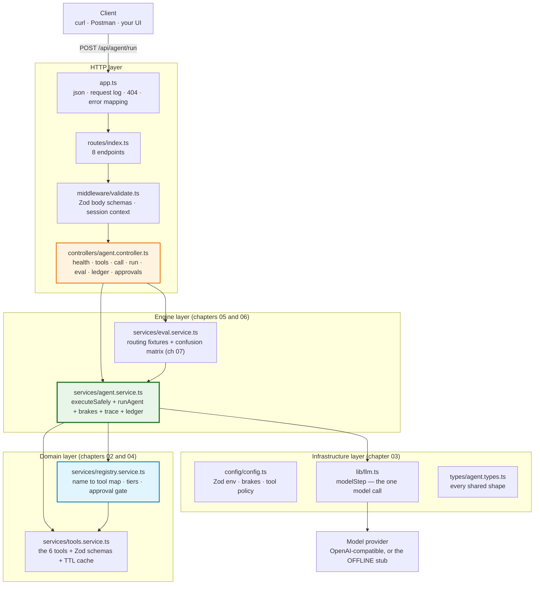
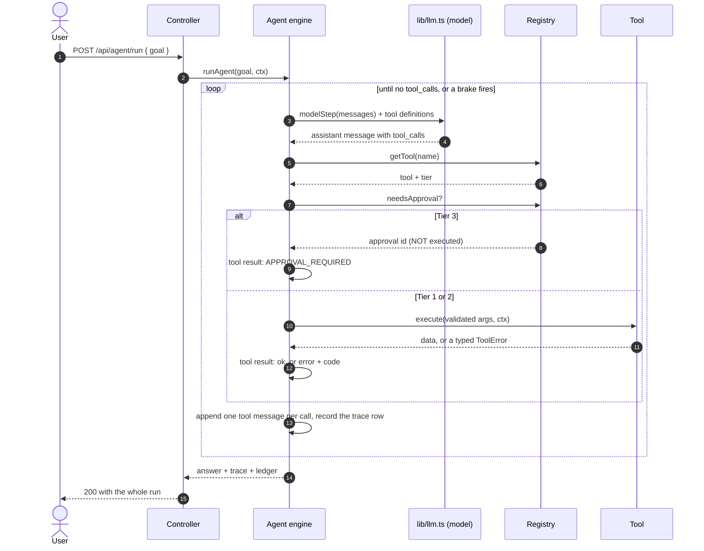

# Chapter 00: Overview, Architecture & File Structure

> **Chapter goal:** understand *what* this codebase is, *why* it is deliberately small, how one goal travels
> through it, and which file belongs to which notes chapter — before reading a line of code.
> **Notes chapters covered:** all of 01–08 (this is the map).

---

## 0.1 What this codebase is

This is the **minimum working tool-calling service** that proves the Lecture 08 notes. It is the roadmap's
build task — *"a CLI agent with 3–4 typed tools and a visible multi-step trace"* — reduced to the parts the
notes actually explain, and wrapped in an HTTP API so every claim is observable with `curl`.

- the **tool contract** — one Zod schema producing both the JSON Schema the model reads and the validator the
  runtime uses (chapter 02);
- the **5-step wire protocol** — definitions out, `tool_calls` back, local execution, an addressed `tool`
  result, synthesis (chapter 03);
- the **execution loop** — dynamic orchestration with five brakes and a causal trace (chapter 05);
- **errors as results** — two-stage argument validation, typed error codes and self-healing (chapter 06);
- **routing as a measurable behaviour** — `tool_choice` policies, fixtures, four metrics and a confusion
  matrix (chapter 07);
- **permission tiers and the token ledger** — a Tier 3 approval gate that is a *result*, not an exception,
  plus per-request cost accounting (chapter 08).

| Rule followed | Why |
| :--- | :--- |
| One notes chapter → one file | You can read the code for chapter 06 without reading the routing layer |
| One model call, one engine | Chapter 03 says the model only *proposes*; `lib/llm.ts` is the only file that knows that, and `agent.service.ts` is the only file that acts |
| Configuration validated once, at boot | A bad `.env` must not become a 3 a.m. incident |
| Every comment names its chapter and section | The code is *evidence* for the notes, not a second curriculum |
| Nothing is a black box | Every claim the notes make (the 2-hop chain, the malformed-arguments error, the approval gate, the quadratic token growth) is observable through an endpoint |

**What it is not:** no database, no auth server, no streaming, no vector store, no durable workflow engine,
no eval dashboard. Those belong to other lectures. Here we answer only: *how does a model ask for an action,
how does the runtime decide whether to perform it, and how do I prove it did the right thing?*

> **It runs with no API key.** With an empty `OPENAI_API_KEY` the service boots in **OFFLINE mode** and every
> endpoint still works against a deterministic stub that reads the same message array and returns the same
> normalised shape a provider would. Put a real key in the `.env` and the same code path calls the real
> provider; nothing else changes.

---

## 0.2 Architecture



**Read it against the notes.** The controller owns the HTTP lifecycle. The engine owns the loop and the one
error boundary. The registry owns *authority* — which tool exists, what tier it is, and whether an action may
run at all. The tools own the work. The model layer owns nothing but the conversation.

---

## 0.3 One goal, end to end



**Where the notes live in that picture:**

| Step | Notes chapter |
| :--- | :--- |
| `modelStep` returns a proposal, never an action | [03](../notes/03_The_Five_Step_Wire_Protocol_and_Double_Turn_Calling.md) |
| `getTool` + `needsApproval` — the runtime decides | [08](../notes/08_Security_Permissions_and_the_Token_Economy.md) |
| The loop, the brakes and the trace | [05](../notes/05_Multi_Step_Chaining_and_the_ReAct_Execution_Loop.md) |
| `executeSafely` converts every outcome into a result | [06](../notes/06_Error_Handling_Self_Healing_and_Result_Reinjection.md) |
| The tool contract and the tier on each tool | [02](../notes/02_Tool_Contracts_JSON_Schema_and_OpenAPI.md) · [04](../notes/04_Tool_Taxonomy_Deterministic_and_Live_Information_Tools.md) |

---

## 0.4 File structure

```text
Basic Code/
├── .env                     # your local config (git-ignored)
├── .env.example             # every variable, documented by chapter
├── .gitignore
├── package.json             # deps: express · zod · zod-to-json-schema · openai · dotenv
├── package-lock.json
├── tsconfig.json            # NodeNext + strict
├── implementations guide/   # this guide — read it in order
├── scripts/
│   └── verify.py            # the 12-section offline walkthrough (chapter 09)
└── src/
    ├── app.ts               # express wiring: json · log · routes · 404 · error map
    ├── server.ts            # listen + startup banner + graceful shutdown
    ├── config/
    │   └── config.ts        # Zod-validated env, BRAKES, TOOL_POLICY
    ├── types/
    │   └── agent.types.ts   # Message · Tool · ToolResult · StepTrace · Ledger
    ├── lib/
    │   └── llm.ts           # modelStep — the ONLY file that talks to a model
    ├── middleware/
    │   └── validate.ts      # request schemas + sessionContext
    ├── routes/
    │   └── index.ts         # 8 endpoints
    ├── controllers/
    │   └── agent.controller.ts
    └── services/
        ├── tools.service.ts     # the 6 tools + Zod schemas + TTL cache
        ├── registry.service.ts  # name→tool map · tiers · approval gate
        ├── agent.service.ts     # executeSafely + runAgent
        └── eval.service.ts      # routing fixtures + metrics
```

---

## 0.5 The 8 endpoints

| Method | Path | Notes chapter | What it proves |
| :--- | :--- | :--- | :--- |
| GET | `/api/health` | 02 · 08 | the wiring, the registry, every tool's tier and the brakes |
| GET | `/api/tools` | 02 | the **only** thing the model is told about your code |
| POST | `/api/tools/:name/call` | 03 · 06 | one call through `executeSafely` — including malformed and invalid arguments |
| POST | `/api/agent/run` | 03 · 05 | the whole loop with its trace and its ledger |
| POST | `/api/eval/routing` | 07 | 10 fixtures, four metrics, a confusion matrix |
| GET | `/api/ledger` | 08 | p50/p95 tokens, halt reasons, tool time |
| GET | `/api/approvals` | 08 | the Tier 3 queue a human reviews |
| POST | `/api/approvals/:approvalId` | 08 | approve or reject — bound to the exact arguments, executed once |

---

## 0.6 How to run it

```bash
cd "Lecture 08 - Tool Calling/code/Basic Code"

npm install          # express, zod, zod-to-json-schema, openai, dotenv + dev tooling
cp .env.example .env # no key needed — OFFLINE mode is fully functional

npm run dev          # tsx watch src/server.ts  -> http://localhost:8098
npm run typecheck    # tsc --noEmit
npm run build        # tsc -> dist/
npm start            # node dist/server.js
```

---

## 0.7 What you should see (verified output)

These are real results from this codebase, in OFFLINE mode.

**A 2-hop chain — the lecture's gate, satisfied:**

```text
ANSWER: 120 USD is about 10020 INR at a rate of 83.5. Split equally, each share is 1670.
STEPS : 3 | HALTED: None
  step 1: convertCurrency({"amount":120,"from":"USD","to":"INR"}) -> ok
  step 2: calculate({"operation":"divide","a":10020,"b":6}) -> ok
```

Notice `a: 10020` in hop 2 — a value that exists nowhere in the user's sentence. It came from hop 1's
**observation**, which is exactly what chapter 05 §05.2 claims. That single line is the lecture's gate.

**A parallel batch — two calls in ONE assistant message:**

```text
STEPS: 2
 step 1 -> calls in ONE assistant message: 2
    getCurrentWeather {"city":"London"}
    convertCurrency {"amount":500,"from":"USD","to":"INR"}
```

**Errors as results, never as 500s:**

```text
MALFORMED_ARGUMENTS  Arguments were not valid JSON (...). Re-send the call with valid JSON.   [retryable]
INVALID_ARGUMENTS    operation: Invalid enum value. Expected 'add' | ... ; b: Required
DIVISION_BY_ZERO     Division by zero is undefined. Provide a non-zero denominator.           [not retryable]
UNKNOWN_TOOL         available: [calculate, getCurrentWeather, ...]
NOT_FOUND            No invoice INV-9001 for this account.        <- cross-tenant attempt
```

**The Tier 3 gate:**

```text
refundPayment -> error APPROVAL_REQUIRED      (the run does NOT execute it)
queue:  apr_1 refundPayment pending | refundPayment({"invoiceId":"INV-1025","amount":1299})
approve apr_1       -> executed once
approve apr_1 again -> replayed the SAME result (idempotent)
tenant-b tries apr_1 -> 403 "This approval belongs to another tenant."
```

**Routing eval:**

```text
fixtures 10 | selectionAccuracy 1 | argumentValidity 1 | avgHops 1.9 | terminationRate 1
confusion matrix includes the `none` row:  none -> { none: 2 }
```

**The ledger — the super-linear shape:**

```text
[1148, 1200, 1220] -> 3568 in + 77 out = 3645 tokens for a 3-model-call run
```

Each call is larger than the last because it carries the whole history plus the tool definitions. That is
chapter 08 §08.6.1 in one line.

---

**Next:** [Chapter 01 — Project Setup & Environment](./01_Project_Setup_and_Environment.md)
