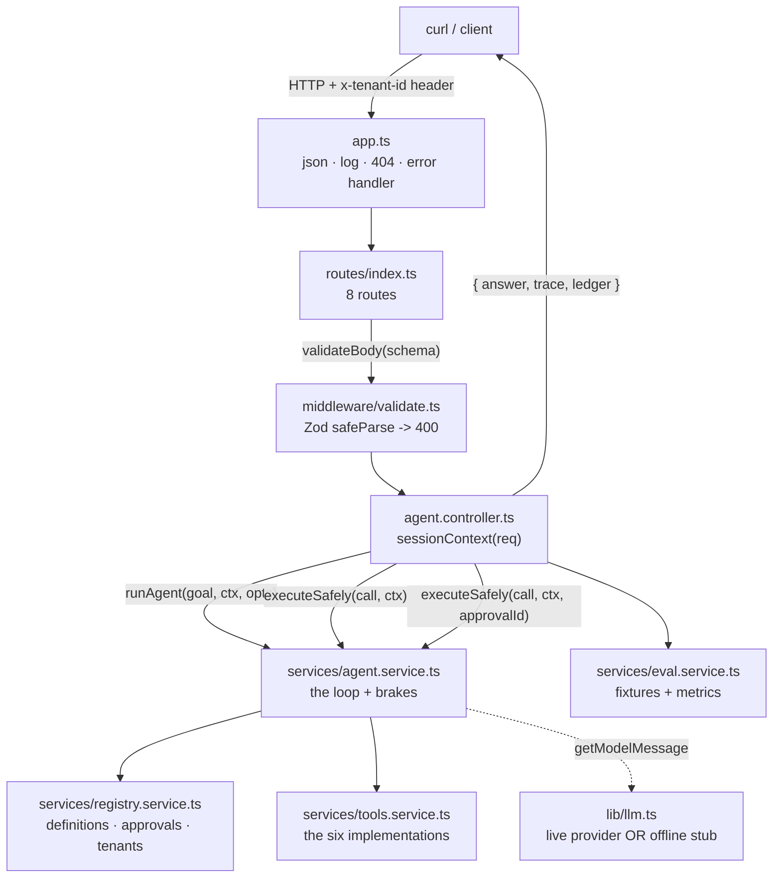

# Chapter 08: The API Surface — Validation, Controllers & Routes

> **Chapter goal:** expose the engine over HTTP with the same discipline the tools get — validate the body before
> anything runs, take identity from the session, and return the whole run so the gate is provable.
> **Notes chapters covered:** 06 §06.5 (validate before you execute) · 07 §07.2 (`tool_choice`) ·
> 08 §08.2.2 (identity from the session) · 08 §08.5 (the human side of the gate) · 08 §08.6.3 (the ledger).

---

## 8.1 `src/middleware/validate.ts` (full file)

```ts
import { NextFunction, Request, Response } from 'express';
import { z } from 'zod';
import { config } from '../config/config.js';
import type { ToolChoice } from '../types/agent.types.js';

/**
 * Chapter 06 §06.5 — validate BEFORE anything executes.
 *
 * The request body is untrusted input in exactly the same way the model's
 * `arguments` are. Both cross the same boundary, so both get the same treatment.
 */

/** Chapter 07 §07.2 — the four routing policies, as the API accepts them. */
const toolChoiceSchema = z
  .union([z.enum(['auto', 'required', 'none']), z.string().regex(/^[a-z][A-Za-z0-9]*$/)])
  .default('auto');

export const agentRunSchema = z.object({
  goal: z.string().min(1).max(config.MAX_INPUT_CHARS),
  maxSteps: z.coerce.number().int().min(1).max(20).optional(),
  /** Chapter 05 §05.7 — a per-request deadline, bounded by the configured maximum. */
  timeoutMs: z.coerce.number().int().min(500).max(config.REQUEST_TIMEOUT_MS).optional(),
  toolChoice: toolChoiceSchema,
});

/** Chapter 06 §06.5 — the RAW argument string, so you can exercise the parse path. */
export const toolCallSchema = z.object({
  arguments: z.string().default('{}'),
});

export const approvalSchema = z.object({
  decision: z.enum(['approve', 'reject']),
});

/** Chapter 08 §08.2.2 — the routing policy, in the one shape the engine wants. */
export const toToolChoice = (value: string): ToolChoice => {
  if (value === 'auto' || value === 'required' || value === 'none') return value;
  return { name: value }; // a forced, named tool (chapter 07 §07.2)
};

/** One validation layer for every route. */
export const validateBody =
  (schema: z.ZodTypeAny) =>
  (req: Request, res: Response, next: NextFunction): void => {
    const parsed = schema.safeParse(req.body ?? {});

    if (!parsed.success) {
      res.status(400).json({ error: 'Validation failed', details: parsed.error.flatten().fieldErrors });
      return;
    }

    req.body = parsed.data;
    next();
  };

/**
 * Chapter 08 §08.2.2 — identity comes from the SESSION, never from a tool argument
 * and never from the model. Headers stand in for an auth middleware here; the
 * principle is the point.
 */
export const sessionContext = (req: Request): { userId: string; tenantId: string } => ({
  userId: String(req.header('x-user-id') ?? 'user-1'),
  tenantId: String(req.header('x-tenant-id') ?? 'tenant-a'),
});
```

### Block by block

**The header comment is the whole chapter in one line:** *"The request body is untrusted input in exactly the same
way the model's `arguments` are."* That symmetry is why chapter 06's two-stage guard and this file's `safeParse`
are the same idea applied at two different boundaries.

**`toolChoiceSchema`** — chapter 07 §07.2's four policies as a Zod union: the three keywords, or any
lowercase-initial identifier (a forced tool name). The `.default('auto')` means the API never has to mention
policy, and the default is the safe one.

**`agentRunSchema`** — note what each bound actually protects:

| Field | Bound | Protects against |
| :--- | :--- | :--- |
| `goal` | `min(1).max(config.MAX_INPUT_CHARS)` | empty prompts and prompt-stuffing (chapter 06 §06.5) |
| `maxSteps` | `int().min(1).max(20)` | a client asking for 10 000 hops |
| `timeoutMs` | `min(500).max(config.REQUEST_TIMEOUT_MS)` | a client *raising* its own deadline past the server's |
| `toolChoice` | the union above | arbitrary strings reaching the provider |

The `timeoutMs` bound is the subtle one: a per-request override is useful (it is how the deadline demo works), but
it must be **capped** by the configured maximum. Letting a client set its own ceiling is how one request becomes an
outage.

**`toolCallSchema` takes `arguments` as a raw *string*.** This is deliberate and unusual: the endpoint exists to
exercise chapter 06 §06.5's parse path, so the API must be able to send malformed JSON. If the schema required an
object, `MALFORMED_ARGUMENTS` would be untestable through HTTP.

**`toToolChoice()`** — the string→union adapter, in exactly one place. The controller calls it; nothing else has to
know that a forced tool is represented as an object (chapter 02 §02.3's type decision).

**`validateBody(schema)`** — one middleware for every route, chapter 06 §06.5's rule applied to HTTP:

```ts
const parsed = schema.safeParse(req.body ?? {});
if (!parsed.success) { res.status(400).json({ ... }); return; }
req.body = parsed.data;
```

Three properties worth noting:

1. **`safeParse`, never `parse`.** A throwing validator would surface as a 500 through the error handler; a
   *validation* failure is a 400. That is the same distinction chapter 06 draws for tools.
2. **`req.body = parsed.data`** — the handler downstream receives coerced, typed data. `maxSteps: "3"` arrives as
   `3`, so no handler has to remember to coerce.
3. **The early `return` after `res.status(...).json(...)`** so `next()` is never called on failure. Express
   middleware that forgets this falls through into the handler — a classic bug.

**`sessionContext(req)`** — chapter 08 §08.2.2, and the most security-relevant function in this file. Identity is
read from **headers** (standing in for an auth middleware) with defaults for local use. Two properties matter:

- **It is never read from the body.** A `userId` field in `agentRunSchema` would let the caller impersonate;
  there is none.
- **It is never read from the model.** The model cannot see `ctx` at all — it is threaded from here through
  `runAgent` into `executeSafely` and finally into the tools (chapter 04 §04.6).

In production this is where a JWT or session cookie would be verified. The *shape* — a `ToolContext` derived once
per request from the session, then passed down — is what the notes require, and it is already correct here.

---

## 8.2 `src/controllers/agent.controller.ts` — part 1: the reads and the single call

```ts
import { Request, Response } from 'express';
import { BRAKES, TOOL_POLICY, config } from '../config/config.js';
import { executeSafely, runAgent } from '../services/agent.service.js';
import { routingFixtures, runRoutingEval } from '../services/eval.service.js';
import { decideApproval, describeRegistry, getApproval, pendingApprovals, toWireDefinitions } from '../services/registry.service.js';
import { isOffline } from '../lib/llm.js';
import { sessionContext, toToolChoice } from '../middleware/validate.js';
import type { Ledger, ToolCall } from '../types/agent.types.js';

/**
 * Chapter 05 §05.6.1 — the controller owns the HTTP lifecycle and nothing else.
 * It assembles a request, calls the engine, and reports what happened — including
 * the trace and the ledger, which is what makes the lecture's gate satisfiable.
 */

/** Chapter 08 §08.6.3 — the last 50 ledgers, so cost is observable at runtime. */
const recentRuns: { at: number; goal: string; ledger: Ledger; halted: string | null }[] = [];
const REMEMBERED_RUNS = 50;

/** Chapter 02 §02.6 / chapter 08 §08.8 — the wiring, the registry and the brakes. */
export const getHealth = (_req: Request, res: Response): void => {
  res.json({
    status: 'ok',
    mode: isOffline() ? 'offline (deterministic stub model)' : 'live provider',
    model: config.AI_MODEL,
    provider: config.AI_PROVIDER,
    toolChoice: config.TOOL_CHOICE,
    brakes: BRAKES,
    toolPolicy: TOOL_POLICY,
    registry: describeRegistry(),
    pendingApprovals: pendingApprovals().length,
    endpoints: [
      'GET  /api/health',
      'GET  /api/tools',
      'POST /api/tools/:name/call',
      'POST /api/agent/run',
      'POST /api/eval/routing',
      'GET  /api/ledger',
      'GET  /api/approvals',
      'POST /api/approvals/:approvalId',
    ],
  });
};

/** Chapter 02 §02.2 — exactly what the model is told about your code. Nothing else leaves. */
export const getTools = (_req: Request, res: Response): void => {
  res.json({
    note: 'This is the ONLY thing the model sees: name, description and parameters.',
    tools: toWireDefinitions(),
  });
};

/**
 * Chapter 03 §03.2 step 3, and chapter 06 §06.1 — one tool call, straight through
 * the same `executeSafely` boundary the loop uses.
 *
 * It never throws: a bad argument string, an unknown tool and a domain error all
 * come back as a result with `status: "error"` and a `code`.
 */
export const postToolCall = async (req: Request, res: Response): Promise<void> => {
  const name = String(req.params.name);
  const rawArguments = String((req.body as { arguments?: string }).arguments ?? '{}');
  const ctx = sessionContext(req);

  const call: ToolCall = { id: `call_direct_${Date.now()}`, name, arguments: rawArguments };
  const outcome = await executeSafely(call, ctx);

  res.json({
    tool: name,
    rawArguments,
    outcome: outcome.outcome,
    code: outcome.code,
    cached: outcome.cached,
    latencyMs: outcome.latencyMs,
    pendingApproval: outcome.pendingApproval,
    /** The exact string that would be sent back as the `tool` message. */
    content: outcome.content,
    parsed: JSON.parse(outcome.content),
  });
};
```

### Block by block

**The file-level comment states the layering rule:** *"the controller owns the HTTP lifecycle and nothing else."*
It does not validate arguments, does not decide policy, does not know what a `ToolResult` looks like internally. It
reads the request, calls a service, and serialises what came back. That is why every interesting decision in this
lab lives in `src/services/` and every controller here is short.

**`recentRuns` — a deliberate in-memory ring.** Chapter 08 §08.6.3 asks for cost to be *observable*, and the
smallest honest way to do that in a teaching lab is a bounded array: `unshift` to the front, `pop` past 50. No
database, no dependency, and the memory ceiling is explicit in `REMEMBERED_RUNS`.

**`getHealth`** — chapter 02 §02.6's "the wiring is part of the deliverable". It reports:

| Field | Why it belongs on `/health` |
| :--- | :--- |
| `mode` | offline vs live — the single most useful fact when debugging |
| `brakes` / `toolPolicy` | the runtime limits, so no one has to read `config.ts` |
| `registry` | `describeRegistry()` — tool count and tiers |
| `pendingApprovals` | a queue building up is an operational signal |
| `endpoints` | self-documenting API surface |

The `mode` line is the one that earns its place: `offline (deterministic stub model)` tells you immediately that
answers are reproducible and no key is set.

**`getTools` — chapter 02 §02.2, and a genuinely useful debugging endpoint.** `toWireDefinitions()` returns the
*serialised* definitions, not the internal ones, so `GET /api/tools` shows you exactly what the provider receives.
When routing misbehaves, this is the first thing to read: if the description here is vague, no amount of prompt
engineering downstream will fix it.

**`postToolCall` — the loop-free path through the same boundary.** Three details:

1. **`String(req.body.arguments ?? '{}')`** — the raw string is passed straight through. The endpoint's whole
   purpose is to let you post `'{"city": "Delhi"'` and watch the two-stage guard return
   `MALFORMED_ARGUMENTS`, exactly as chapter 06 §06.5 requires.
2. **`executeSafely(call, ctx)` — no approval id.** This route therefore *cannot* execute a Tier 3 tool; asking it
   to returns the `pendingApproval` outcome. That is the security property from chapter 08 §08.5.2 visible at the
   HTTP layer.
3. **`JSON.parse(outcome.content)`** — the response carries both the exact string that would be sent as the `tool`
   message (`content`) and its parsed form (`parsed`). The first is the wire truth, the second is convenience, and
   having both side by side is what makes the "models read strings" point concrete.

**`postToolCall` never throws — and that is a contract, not an accident.** Chapter 03 §03.2 step 3 and chapter 06
§06.1 both require that a failed tool produces a *result*, not an exception. Verified against the running server:
an unknown tool returns `200` with `{ outcome: "error", code: "UNKNOWN_TOOL" }`, and so do `MALFORMED_ARGUMENTS`,
`INVALID_ARGUMENTS`, `NOT_FOUND` and `DIVISION_BY_ZERO`. A `500` from this route would mean the guard leaked.

---

## 8.3 `src/controllers/agent.controller.ts` — part 2: the run and the eval

```ts
/**
 * Chapter 05 §05.6 — the loop, end to end.
 *
 * The response is deliberately the WHOLE run: the answer, the trace (one row per
 * hop, with the raw arguments) and the ledger. That is what lets you point at the
 * exact message that caused each hop — the lecture's completion gate.
 */
export const postAgentRun = async (req: Request, res: Response): Promise<void> => {
  const body = req.body as { goal: string; maxSteps?: number; timeoutMs?: number; toolChoice: string };
  const ctx = sessionContext(req);

  const run = await runAgent(body.goal, ctx, {
    maxSteps: body.maxSteps,
    timeoutMs: body.timeoutMs,
    toolChoice: toToolChoice(body.toolChoice),
  });

  recentRuns.unshift({ at: Date.now(), goal: body.goal, ledger: run.ledger, halted: run.halted });
  if (recentRuns.length > REMEMBERED_RUNS) recentRuns.pop();

  res.json({
    goal: body.goal,
    answer: run.answer,
    steps: run.steps,
    halted: run.halted,
    pendingApproval: run.pendingApproval,
    trace: run.trace,
    ledger: run.ledger,
  });
};

/**
 * Chapter 07 §07.4 — tool selection as a measurable behaviour.
 *
 * Four metrics plus the confusion matrix. The `none` row is the one most teams
 * forget, and it is the one that catches over-calling.
 */
export const postRoutingEval = async (_req: Request, res: Response): Promise<void> => {
  const report = await runRoutingEval();
  res.json({ fixtures: routingFixtures.length, ...report });
};
```

### Block by block

**The comment names the requirement it satisfies:** *"That is what lets you point at the exact message that caused
each hop — the lecture's completion gate."* Chapter 05 §05.6 and chapter 08 §08.8 both ask for a run you can
*explain*, not just a run that returns text. So the response is not `{ answer }` — it is seven fields.

**`sessionContext(req)` is called exactly once per request**, at the top, and the resulting `ctx` flows into
`runAgent`. Nothing downstream re-reads a header. That is what makes chapter 08 §08.2.2's rule enforceable: there
is a single point where identity enters the system.

**`toToolChoice(body.toolChoice)`** — the adapter from §8.1. The controller never branches on the policy itself;
it hands the engine a `ToolChoice` union and lets chapter 07's `llm.ts` decide what to do with it.

**The optional fields are passed through as `undefined` when absent:**

```ts
const run = await runAgent(body.goal, ctx, {
  maxSteps: body.maxSteps,       // undefined -> the engine's default brake
  timeoutMs: body.timeoutMs,     // undefined -> config.REQUEST_TIMEOUT_MS
  toolChoice: toToolChoice(body.toolChoice),
});
```

This is why `runAgent`'s options object uses `?` on those fields rather than defaults: the engine applies the
policy, not the transport layer. A controller that substituted `maxSteps ?? 6` would duplicate a decision that
belongs in `config.ts`.

**The response shape, field by field** — one endpoint, four audiences:

| Field | Audience | Answers |
| :--- | :--- | :--- |
| `answer` | the user | what do I show? |
| `steps` | the dashboard | how many hops did it take? |
| `halted` | the dashboard | did a brake fire, and which? |
| `pendingApproval` | the client | is there something for a human to sign? |
| `trace` | the engineer | which message caused which hop? |
| `ledger` | finance / ops | what did it cost, and where did the time go? |

**`pendingApproval` is not an error.** When a Tier 3 tool is proposed, the run ends with
`halted: null` **and** `pendingApproval: true`, and the answer explains that a human must sign. Verified: the
`refundPayment` fixture returns `steps: 2`, `pendingApproval: true`, and a trace whose second row's `outcome` is
`pending_approval` with `code: 'APPROVAL_REQUIRED'`.

**`postRoutingEval` is four lines, and that is the point.** The harness lives in `eval.service.ts`; the controller
only reports. `{ fixtures: routingFixtures.length, ...report }` spreads the report so the count appears *before*
the metrics in the JSON — a small readability choice that puts the sample size next to the scores.

**No `validateBody` on `/eval/routing`.** Look at `routes/index.ts`: this route has no schema because it takes no
body. The fixtures are code, not input — which is exactly right for a regression suite. A caller must not be able
to influence what the eval asserts.

---

## 8.4 `src/controllers/agent.controller.ts` — part 3: the ledger and the queue

```ts
/** Chapter 08 §08.6.3 — p50/p95 cost, halt reasons and the tool-time share. */
export const getLedger = (_req: Request, res: Response): void => {
  const runs = recentRuns.map((entry) => entry.ledger);
  const totals = runs.map((ledger) => ledger.totalInputTokens + ledger.totalOutputTokens);
  const sorted = [...totals].sort((a, b) => a - b);
  const percentile = (p: number): number => (sorted.length ? sorted[Math.min(sorted.length - 1, Math.floor(p * sorted.length))] : 0);

  const haltReasons: Record<string, number> = {};
  for (const entry of recentRuns) {
    const key = entry.halted ?? 'completed';
    haltReasons[key] = (haltReasons[key] ?? 0) + 1;
  }

  res.json({
    runs: runs.length,
    note: 'Input tokens grow super-linearly with hops: the whole history is re-sent every turn (chapter 08 §08.6.1).',
    avgSteps: runs.length ? runs.reduce((sum, ledger) => sum + ledger.steps, 0) / runs.length : 0,
    avgInputTokens: runs.length ? runs.reduce((sum, ledger) => sum + ledger.totalInputTokens, 0) / runs.length : 0,
    p50Tokens: percentile(0.5),
    p95Tokens: percentile(0.95),
    toolTimeMsTotal: runs.reduce((sum, ledger) => sum + ledger.toolTimeMs, 0),
    haltReasons,
    recent: recentRuns.slice(0, 10),
  });
};

/** Chapter 08 §08.5 — the queue a human reviews. */
export const getApprovals = (_req: Request, res: Response): void => {
  res.json({ pending: pendingApprovals() });
};
```

### Block by block

**`getLedger` is the observability half of chapter 08 §08.6.3** — "cost, halt reasons and the tool-time share".
Four computations, each answering a different operational question:

| Output | Question it answers |
| :--- | :--- |
| `avgSteps` | are runs getting longer? (a leading indicator of drifting descriptions) |
| `avgInputTokens` | what does a typical run cost? |
| `p50Tokens` / `p95Tokens` | what does the *worst* run cost — the number finance cares about |
| `toolTimeMsTotal` | how much wall-clock went to tools vs the model? |
| `haltReasons` | which brake is firing, and how often? |

**The percentile helper is deliberately naive** — nearest-rank on a sorted copy, no interpolation, no dependency:

```ts
const percentile = (p: number): number =>
  sorted.length ? sorted[Math.min(sorted.length - 1, Math.floor(p * sorted.length))] : 0;
```

Two details matter. `[...totals].sort(...)` copies before sorting, so `recentRuns` keeps its chronological order
(the `recent` field depends on it). And the `Math.min(sorted.length - 1, ...)` guard means `p95` on two runs
returns the larger one instead of `undefined` — an off-by-one that would otherwise surface as `null` in the JSON.

**`haltReasons` counts `completed` as a pseudo-reason:**

```ts
const key = entry.halted ?? 'completed';
```

Without this line the most common outcome — a run that finished normally — would be invisible, and the histogram
would only ever show failures. `null` is a *value* here, not a missing one; the `?? 'completed'` label is what
makes the metric readable.

**Why the averages guard on `runs.length`.** Every one of them is `runs.reduce(...) / runs.length`, so calling
`GET /api/ledger` before any run would divide by zero and emit `NaN`. The ternary makes an empty ledger return
`0`, which is valid JSON and renders correctly. Verified on a cold start: `{ runs: 0, avgSteps: 0, p50Tokens: 0 }`.

**`recent: recentRuns.slice(0, 10)`** — the last ten runs *with their goals*, so the aggregate numbers can be
traced back to concrete requests. This is the "explain the spike" affordance: if `p95Tokens` jumps, you can read
which goal caused it without leaving the endpoint.

**`getApprovals` is two lines**, and that is correct — the queue lives in `registry.service.ts`
(`pendingApprovals()`), which owns the approval records. Chapter 08 §08.5's flow is *request → queue → human →
decide*, and this route is only the "queue" view. Note it takes **no** `sessionContext`: in this lab the queue is
global for inspection. The tenant check that actually matters is on the *decision* route (§8.5), because deciding
is what executes.

**Verified round trip:** `POST /api/agent/run` with a refund goal returns `pendingApproval: true`, and
`GET /api/approvals` then lists the record with its `toolName`, `rawArguments`, `tenantId` and `status:
"pending"` — the same record that `POST /api/approvals/:id` will bind its decision to.

---

## 8.5 `src/controllers/agent.controller.ts` — part 4: the approval gate

```ts
/**
 * Chapter 08 §08.5.2 — the four rules, in one handler.
 *
 * The gate lives in the RUNTIME: no approval record, no execution. The decision
 * binds to the exact arguments, it cannot cross tenants, and an approved call is
 * executed exactly once — with the approval id passed down to `executeSafely`.
 */
export const postApproval = async (req: Request, res: Response): Promise<void> => {
  const approvalId = String(req.params.approvalId);
  const { decision } = req.body as { decision: 'approve' | 'reject' };
  const ctx = sessionContext(req);

  const approval = getApproval(approvalId);
  if (!approval) {
    res.status(404).json({ error: 'Not Found', message: `No approval ${approvalId}.` });
    return;
  }
  if (approval.tenantId !== ctx.tenantId) {
    // Rule: an approval belongs to the tenant that requested it.
    res.status(403).json({ error: 'Forbidden', message: 'This approval belongs to another tenant.' });
    return;
  }

  const decided = decideApproval(approvalId, decision);
  if (!decided || decided.status !== 'approved') {
    res.json({ approval: decided ?? approval, execution: null });
    return;
  }

  // "Execute once": an approval that has already run REPLAYS its result instead of
  // applying the side effect a second time (chapter 04 §04.7.1 rule 1).
  if (decided.executedResult !== undefined) {
    res.json({
      approval: decided,
      execution: { outcome: 'ok', code: undefined, content: JSON.stringify(decided.executedResult), replayed: true },
    });
    return;
  }

  // Rule 3 + "execute once": the same tool, the SAME arguments, once.
  const call: ToolCall = { id: `call_${approvalId}`, name: decided.toolName, arguments: decided.rawArguments };
  const outcome = await executeSafely(call, ctx, approvalId);
  decided.executedResult = JSON.parse(outcome.content);

  res.json({
    approval: decided,
    execution: { outcome: outcome.outcome, code: outcome.code, content: outcome.content, latencyMs: outcome.latencyMs },
  });
};
```

### Block by block

This is the highest-value handler in the lab: it is where chapter 08 §08.5's "the human side of the gate" becomes
code. Four rules, checked **in order**, and the order is itself the design.

**Rule 1 — the record must exist (`404`).**

```ts
const approval = getApproval(approvalId);
if (!approval) { res.status(404).json({ ... }); return; }
```

The gate lives in the *runtime*, not in a prompt: there is no code path from `executeSafely` to a Tier 3 tool
except through this handler, and this handler begins by requiring an approval record. A prompt injection cannot
invent one — `getApproval` reads from the registry's map, which only `executeSafely` ever writes to.

**Rule 2 — the tenant must match (`403`).**

```ts
if (approval.tenantId !== ctx.tenantId) { res.status(403).json({ ... }); return; }
```

The check runs **before** `decideApproval`, so a cross-tenant caller cannot even *reject* another tenant's pending
refund — it cannot mutate the record at all. Verified: approving tenant A's refund with `x-tenant-id: tenant-b`
returns `403 Forbidden` and the record is still `pending` afterwards.

Note where the identity came from: `sessionContext(req)`, i.e. the header — never the body, never the approval
record's own field. Comparing two values that both came from the request would prove nothing.

**Rule 3 — the decision must actually be an approval.**

```ts
const decided = decideApproval(approvalId, decision);
if (!decided || decided.status !== 'approved') {
  res.json({ approval: decided ?? approval, execution: null });
  return;
}
```

Two outcomes collapse here: a **rejection**, and a decision that could not be applied (`!decided`). Both return
`execution: null` with HTTP **200** — because "the human said no" is a successful API call, not an error. The
`decided ?? approval` fallback means the client always gets a record back, even in the impossible case.

**Rule 4 — the decision binds to the exact arguments, and executes once.**

```ts
const call: ToolCall = { id: `call_${approvalId}`, name: decided.toolName, arguments: decided.rawArguments };
const outcome = await executeSafely(call, ctx, approvalId);
```

Three things are happening in two lines:

1. **The tool and arguments come from the *record*, not from the request.** The caller posts only
   `{ decision }` — it cannot substitute a different amount or invoice. This is chapter 08 §08.5.2's
   **argument binding**: what was approved is what runs, byte for byte, because `decided.rawArguments` is the same
   string the model produced.
2. **The approval id is the third argument to `executeSafely`** — the only place in the codebase that passes it.
   Recall from chapter 06 §06.2 that the agent loop omits it, which is precisely why the loop can never execute a
   Tier 3 tool. The security property is enforced by a missing parameter at one call site and a present one at
   another.
3. **`ctx` is still the caller's session context**, so the tool runs with the deciding tenant's identity — which
   Rule 2 has already proved is the *requesting* tenant's.

**The idempotency guard — and the bug it fixes.** Before the execution block:

```ts
if (decided.executedResult !== undefined) {
  res.json({ approval: decided, execution: { ..., replayed: true } });
  return;
}
```

This is chapter 04 §04.7.1 rule 1 ("execute once") implemented at the HTTP boundary, and it was added because the
first version of this file had a real defect: **approving twice re-executed the refund.** A double-click, a retry
after a timeout, or a replay by an impatient client would apply the side effect again — the classic non-idempotent
POST. The fix has two halves:

- **`decided.executedResult = JSON.parse(outcome.content)`** caches the result on the record after the first
  execution.
- **The guard replays that cached result** on every subsequent approval, flagged `replayed: true`.

The `replayed: true` marker matters for the client: the caller can distinguish "your refund just happened" from
"your refund happened earlier and here is the receipt". Returning a bare `ok` would be a lie about *when*.

**Verified:** the first approve returns `{ outcome: "ok", content: '{"refundId": …}' }`; a second approve of the
same id returns the **same** `content` with `replayed: true`, and the tool's own call counter does not advance.

**What this handler does not do.** It does not re-run the agent loop, does not rebuild the message history, and
does not re-derive the tool name from the goal. An approval is a decision about *one recorded call* — resuming the
conversation around it is the caller's job (or, in a fuller system, a second `runAgent` seeded with the
observation). Chapter 08 §08.5 draws that boundary deliberately, and keeping the handler this narrow is what makes
the gate auditable: every execution traceable to exactly one approved record.

---

## 8.6 `src/routes/index.ts` (full file)

```ts
import { Router } from 'express';
import {
  getApprovals,
  getHealth,
  getLedger,
  getTools,
  postAgentRun,
  postApproval,
  postRoutingEval,
  postToolCall,
} from '../controllers/agent.controller.js';
import { agentRunSchema, approvalSchema, toolCallSchema, validateBody } from '../middleware/validate.js';

export const router = Router();

/** Chapter 02 §02.6 / chapter 08 §08.8 — the wiring, the registry and the brakes. */
router.get('/health', getHealth);

/** Chapter 02 §02.2 — the contract the model actually receives. */
router.get('/tools', getTools);

/** Chapter 03 §03.2 step 3 + chapter 06 §06.1 — one call through `executeSafely`. */
router.post('/tools/:name/call', validateBody(toolCallSchema), postToolCall);

/** Chapter 05 §05.6 — the whole loop, with its trace and its ledger. */
router.post('/agent/run', validateBody(agentRunSchema), postAgentRun);

/** Chapter 07 §07.5 — routing as a measurable behaviour. */
router.post('/eval/routing', postRoutingEval);

/** Chapter 08 §08.6.3 — cost, halt reasons and the tool-time share. */
router.get('/ledger', getLedger);

/** Chapter 08 §08.5 — the human side of the gate. */
router.get('/approvals', getApprovals);
router.post('/approvals/:approvalId', validateBody(approvalSchema), postApproval);
```

### Block by block

**The file is a table, and that is the whole point.** Eight routes, and each line carries a chapter reference. If
you want to know which note section a behaviour implements, you read this file — that is chapter 08 §08.8's
"map the code back to the spec" applied to the API surface.

**`validateBody(schema)` sits in the route, not in the handler.** This is deliberate Express composition:

```ts
router.post('/agent/run', validateBody(agentRunSchema), postAgentRun);
```

The middleware runs *first* and short-circuits with a `400` on a bad body, so `postAgentRun` can cast
`req.body as {...}` without a runtime check. If validation lived inside the handler, the same three lines would be
duplicated in three handlers, and one of them would eventually be forgotten.

**Which routes have a schema, and which do not:**

| Route | Schema | Why |
| :--- | :--- | :--- |
| `POST /tools/:name/call` | `toolCallSchema` | the raw `arguments` string is untrusted |
| `POST /agent/run` | `agentRunSchema` | goal, brakes and policy are all caller-supplied |
| `POST /approvals/:approvalId` | `approvalSchema` | `decision` must be exactly `approve`/`reject` |
| the four `GET`s | none | no body to validate |
| `POST /eval/routing` | none | takes no input at all — the fixtures are code |

The `GET`s are a reminder that validation is about *input*, not about being thorough: adding an empty schema to
`/health` would be noise. Note that the `:name` and `:approvalId` **path** parameters are *not* schema-validated —
`postToolCall` and `postApproval` both handle an unknown value themselves (`UNKNOWN_TOOL` as a result, `404` as a
status respectively), which is the right layer for each.

**`GET /api/approvals` takes no middleware and no `sessionContext`** (§8.4). `POST /api/approvals/:approvalId`
takes the body schema and derives the tenant inside the handler. The asymmetry is intentional: listing is
read-only inspection in this lab, deciding is the security-sensitive act.

**Route order does not matter here, and it is worth knowing why.** `GET /tools` and `POST /tools/:name/call`
differ in method, so Express cannot confuse them. There is no catch-all `:param` route at the top level that could
shadow a literal path — a subtlety that bites people who add `GET /:page` above `GET /health`.

**The `/api` prefix lives in `app.ts`, not here.** `app.use('/api', router)` keeps the router portable: mount it
at `/v2` tomorrow and nothing in this file changes. The endpoint list on `/health` prints the *full* paths, which
is why it is the place to look rather than this file when you forget a URL.

---

## 8.7 `src/app.ts` (full file)

```ts
import express, { NextFunction, Request, Response } from 'express';
import { router } from './routes/index.js';

export const app = express();

app.use(express.json({ limit: '1mb' }));

/** One log line per request; the timestamp is what you grep for later. */
app.use((req: Request, _res: Response, next: NextFunction) => {
  console.log(`[${new Date().toISOString()}] ${req.method} ${req.path}`);
  next();
});

app.use('/api', router);

app.use((_req: Request, res: Response) => {
  res.status(404).json({ error: 'Not Found', message: 'The requested resource does not exist.' });
});

/**
 * Chapter 06 §06.1 — the HTTP layer's own boundary.
 *
 * Note how thin it is: by the time a request reaches here, every tool failure has
 * already been converted into a `tool` result. Only request-shape and provider
 * problems can still become a non-2xx status, which is exactly right.
 */
app.use((error: Error, _req: Request, res: Response, _next: NextFunction) => {
  const status = Number((error as { status?: number }).status) || 500;
  const titles: Record<number, string> = {
    400: 'Bad Request',
    404: 'Not Found',
    502: 'Provider returned an unusable response',
    503: 'Model credentials are not configured',
  };

  console.error(`❌ ${status} ${error.message}`);
  res.status(status).json({ error: titles[status] ?? 'Internal Server Error', message: error.message });
});
```

### Block by block

**`export const app = express()` — app and server are split.** `app.ts` builds the Express application and exports
it; `server.ts` calls `listen`. That split is what makes the app testable (import `app`, hand it to a test client,
never bind a port) and it is the same separation chapter 05 §05.6.1 draws between the engine and the controller.
This lab's curl walkthrough drives the real server, but the shape is ready for a supertest-style harness.

**`express.json({ limit: '1mb' })`** — the body parser, with an explicit limit. `MAX_INPUT_CHARS` in the Zod
schema caps the *goal*; this caps the *request*. Two different attacks, two different layers.

**The log middleware is deliberately minimal:**

```ts
console.log(`[${new Date().toISOString()}] ${req.method} ${req.path}`);
```

Chapter 08 §08.6 asks for observability. An ISO timestamp plus method and path is enough to correlate a curl
command with a server line during the walkthrough — and `_res` is unused, which the underscore prefix signals to
both the reader and `noUnusedParameters`.

**`app.use('/api', router)`** — the mount point. Everything the lecture exposes lives under `/api`, so the
endpoint list from `/health` is always the truth.

**The 404 catch-all sits *after* the router and *before* the error handler:**

```ts
app.use((_req, res) => res.status(404).json({ ... }));
```

Order is load-bearing in Express: a middleware registered after the router only runs if nothing matched, which is
exactly the definition of a 404. It returns **JSON**, not Express's default HTML — a JSON API should never answer
with an HTML page, or every client needs two parsers.

**The error handler is the last thing registered and takes four arguments** — `(error, req, res, next)`. Express
identifies error handlers by arity, so a three-argument version would be treated as ordinary middleware and never
catch anything. This is the single most common Express mistake, and the `_next` parameter exists only to keep the
count at four.

**`const status = Number(error.status) || 500`** — it trusts a `status` property if the thrower set one (the LLM
layer sets `502`/`503`), otherwise defaults to `500`. The `Number(...) || 500` idiom also catches `NaN`.

**The comment is the chapter's thesis:** *"by the time a request reaches here, every tool failure has already been
converted into a `tool` result."* That is chapter 06 §06.1's boundary, stated from the outside. The five statuses
this handler can emit are therefore *only* about request shape and provider health:

| Status | Cause | Notes section |
| :--- | :--- | :--- |
| `400` | malformed JSON body, or a Zod failure that threw | 06 §06.5 |
| `404` | unknown route, or an unknown approval id | 08 §08.5.2 |
| `502` | the provider returned something unusable | 03 §03.3 |
| `503` | no credentials configured for a live call | 01 §01.4 |
| `500` | anything else — a genuine bug | — |

**A `500` here means a bug, not a bad input.** That is the invariant to hold onto: `DIVISION_BY_ZERO`,
`UNKNOWN_TOOL`, `INVALID_ARGUMENTS`, `MALFORMED_ARGUMENTS` and `NOT_FOUND` all return **200** with an error
*result*, because chapter 03 §03.2 step 3 requires failures to be observations. If you ever see one of those codes
paired with a 5xx, the guard has leaked somewhere.

---

## 8.8 `src/server.ts` (full file)

```ts
import { app } from './app.js';
import { BRAKES, config } from './config/config.js';
import { isOffline } from './lib/llm.js';
import { describeRegistry } from './services/registry.service.js';

const server = app.listen(config.PORT, () => {
  const tools = describeRegistry();

  console.log('=======================================================');
  console.log('🚀 Lecture 08 — Basic Tool Calling Lab');
  console.log(`📡 Server        : http://localhost:${config.PORT}`);
  console.log(`🤖 Model         : ${config.AI_PROVIDER} · ${config.AI_MODEL} (temperature ${config.AI_TEMPERATURE})`);
  console.log(`🔑 Mode          : ${isOffline() ? 'OFFLINE stub — every endpoint still works' : 'LIVE provider'}`);
  console.log(`🧭 tool_choice   : ${config.TOOL_CHOICE}  (chapter 07 §07.2)`);
  console.log(`🛑 Brakes        : steps ${BRAKES.maxSteps} · deadline ${BRAKES.requestTimeoutMs} ms · token ceiling ${BRAKES.tokenCeiling} · repeat ${BRAKES.repeatedCallLimit}`);
  console.log(`🧰 Tools         : ${tools.map((tool) => `${tool.name}[${tool.tier}]`).join(' · ')}`);
  console.log('-------------------------------------------------------');
  console.log('🔍 GET    /api/health                 (wiring · registry · tiers · brakes)');
  console.log('📜 GET    /api/tools                  (the contract the model receives — ch 02)');
  console.log('🔧 POST   /api/tools/:name/call       (one call through executeSafely — ch 03/06)');
  console.log('🔄 POST   /api/agent/run              (the 5-step loop + trace + ledger — ch 03/05)');
  console.log('📊 POST   /api/eval/routing           (routing fixtures + confusion matrix — ch 07)');
  console.log('💰 GET    /api/ledger                 (cost · halt reasons · p50/p95 — ch 08)');
  console.log('🛂 GET    /api/approvals              (the Tier 3 queue — ch 08)');
  console.log('✅ POST   /api/approvals/:id          (approve or reject, once — ch 08)');
  console.log('=======================================================');
});

/**
 * Chapter 08 §08.8 item 24 — a clean stop, and a reminder that the approval queue
 * is durable state, not request state (Lecture 09 owns the durable version).
 */
let shuttingDown = false;

const shutdown = (signal: string): void => {
  if (shuttingDown) return;
  shuttingDown = true;
  console.log(`\n${signal} received — closing the HTTP server.`);
  server.close(() => {
    console.log('✅ HTTP server closed cleanly.');
    process.exit(0);
  });
  server.closeAllConnections?.();
};

process.on('SIGTERM', () => shutdown('SIGTERM'));
process.on('SIGINT', () => shutdown('SIGINT'));
```

### Block by block

**The startup banner is documentation, not decoration.** Every fact you need before making a request is printed
once:

| Line | Why it is there |
| :--- | :--- |
| `Mode` | offline vs live — you know immediately whether answers are reproducible |
| `tool_choice` | chapter 07 §07.2's policy, with the section reference |
| `Brakes` | all four limits on one line, so a halt is never a mystery |
| `Tools` | every name with its `[tier]` — chapter 02 §02.5 and chapter 08 §08.5 at a glance |

The `Tools` line is the one to check first when a refund behaves oddly: if `refundPayment` shows `[1]` instead of
`[3]`, the gate will not fire, and no amount of debugging the controller will help.

**`app.listen(config.PORT, callback)`** — the port comes from config (default **8098**), so no number is hardcoded
in code. The callback runs *after* the socket is bound, which is why the banner never lies about the port.

**`server.closeAllConnections?.()`** — the optional call operator is deliberate. `closeAllConnections` exists in
Node 18.2+, and `close()` alone waits for in-flight requests to finish, which can hang a dev loop for as long as a
slow provider takes. Forcing the connections closed makes `Ctrl-C` feel instant while `close()` still runs its
callback for the clean-exit message.

**`let shuttingDown = false` — the re-entrancy guard.** Pressing `Ctrl-C` twice, or a `SIGTERM` arriving while a
`SIGINT` is being handled, would otherwise run `shutdown` twice and print the closing message twice (or exit
mid-close). The flag makes the second signal a no-op, which is what a signal handler is supposed to be.

**`SIGINT` *and* `SIGTERM`** — `SIGINT` is your `Ctrl-C`; `SIGTERM` is what a container runtime or `kill` sends.
Handling only the first is the common gap that leaves zombie processes in Docker.

**The comment points forward:** *"the approval queue is durable state, not request state (Lecture 09 owns the
durable version)."* That is an honest boundary. `recentRuns` and the approval map both live in process memory, so a
restart clears the queue. Naming the limitation in the code is how you keep a teaching lab from being mistaken for
a production system — and it is exactly the gap the next lecture's persistence work closes.

---

## 8.9 The wiring in one picture



Read it as four bands: **transport** (`app.ts`, `routes`, `validate`), **orchestration**
(`agent.controller.ts`), **engine** (`agent.service.ts` plus the other two services), and **adapters**
(`lib/llm.ts` and the tools). Only the engine knows what a `ToolResult` is; only the transport knows what a status
code is. Every chapter in this guide has been about one band.

---

**Next:** [Chapter 09 — Running & Verifying the Lab](./09_Running_and_Verifying.md)
