# Chapter 01 — From Token Prediction to Tool Augmentation

> **Lecture 08 · Chapter 01 of 08** · Level: 🟡 Intermediate · Phase 3 — Agency & Contracts
> **Source:** `Forward-Deployed-Engineer/Lecture 05/notes/01_From_Token_Prediction_to_Tool_Augmentation.md`
> **Roadmap topics:** from token prediction to tool augmentation · why LLMs fail at arithmetic ·
> tool = capability + permission.
> **Prerequisites:** Lecture 02 (tokens, BPE) · Lecture 03 (decoding, sampling) · Lecture 04 (the API
> protocol, roles, token economics) · Lecture 07 (streaming the generated tokens).

---

## 01.0 What this chapter is for

Every serious tool-calling bug you will ever debug traces back to one false belief: **that the model did
something**. It did not. It *said* something, and a piece of ordinary software you wrote did the thing.

That single distinction reorganises the whole lecture. If you believe the model acts, then you will design
for trust, and you will be surprised by every injected argument, every hallucinated tool name, and every
"the assistant claims it refunded the customer" incident. If you believe the model only **proposes**, then
tool calling becomes a *protocol problem* — and protocol problems have ordinary engineering answers:
schemas, validation, permissions, loops, bounds, and traces.

> **The claim of this chapter:** an LLM is a **semantic decoder and a proposal generator**. It is never an
> executor. Tool calling is the contract that lets a probabilistic text generator *ask* deterministic code
> to change the world, while the application remains the only thing with hands.

By the end of this chapter you should be able to:

1. State, precisely, the single mathematical job of a foundation model.
2. Explain why emitting the string `mkdir portfolio` does not create a directory.
3. Explain, from the tokenizer up, why LLMs hallucinate arithmetic — and why that is a *feature of the
   architecture*, not a bug to be prompted away.
4. Separate **cognitive processing** (LLM) from **actuation** (tools) and say what a raw LLM lacks.
5. Describe the **linguistic impedance mismatch** and why regex parsing loses at `O(∞)`.
6. Explain the LLM's real enterprise role: a **universal semantic decoder**.
7. List the five ways naïve "return JSON" prompting fails in production.
8. Define a tool as **capability + permission** — the sentence the whole lecture is built on.

---

## 01.1 The single job of a foundation model

Strip away the marketing. A foundation model performs one computation, repeatedly:

$$
P(w_t \mid w_1, w_2, \dots, w_{t-1}; \Theta)
$$

Given the tokens so far, produce a probability distribution over the vocabulary and sample the next token.

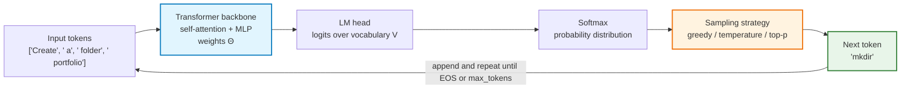

Three consequences fall out immediately, and all three matter for this lecture:

1. **The output is text.** It is a sequence of sampled tokens. Nothing else leaves the model.
2. **The model is stateless.** Weights `Θ` do not change during your conversation. Everything the model
   "remembers" is text *you* re-sent (Lecture 06).
3. **The model optimises plausibility per token, not truth per answer.** A sequence of locally fluent
   tokens can be globally wrong — which is exactly what a hallucinated calculation is.

> **Cardinal insight:** *the model has no representation of "an answer", and no representation of "an
> action". Both are emergent artifacts of many tiny next-token decisions.*

### 01.1.1 Where "plausibility" comes from — and why it degrades

Because the model optimises *plausibility*, the quality of its output is bounded by the **quality of the
text it learned plausibility from**. This matters to tool calling in a concrete way: it is the reason a model
can produce a confident, well-formatted, *wrong* tool argument.

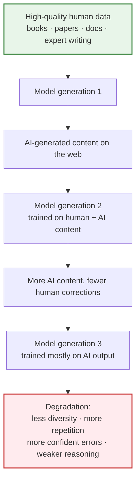

Two terms from the source notes describe this:

- **AI slop** — large volumes of low-quality, repetitive, unverified AI-generated content published on the
  web (fake blogs, clickbait, unverified tutorials, AI-generated reviews).
- **Model collapse** — the gradual degradation of model quality when successive models are trained primarily
  on AI-generated content instead of high-quality human-created data.

**Why this belongs in a tool-calling lecture.** If the model's sense of plausibility is drifting, then
"the model said so" becomes a weaker signal over time — which is precisely the argument for the rest of this
lecture. Ground truth must come from **tools and observations**, not from the model's priors. Mitigations
that the source notes recommend map directly onto this lecture:

| Mitigation | How it appears here |
| :--- | :--- |
| Human review before publishing | approval gates for Tier 3 actions (Chapter 08) |
| High-quality curated data | small, sharp tool contracts instead of sprawling prompt text (Chapter 02) |
| Guardrails on inputs, outputs, **tool usage** and safety rules | runtime validation, tiers, egress limits (Chapter 08) |
| Continuous evaluation on benchmark sets | fixture-based routing evals and regression runs (Chapter 07) |

> See **Lecture 04 §09 — AI Slop and Model Collapse** for the full treatment of the training-data side; here
> it is the reason *grounding via tools* is a correctness requirement, not a nicety.

---

## 01.2 Generating text is not performing an action

Now put a real instruction in front of it:

```text
User: "Create a directory called portfolio and write an index.html inside it."
```

The model does the only thing it can do — it samples the most probable continuation, which looks like:

```text
mkdir portfolio
touch portfolio/index.html
```

That output is **a description of an action**. It is not the action.

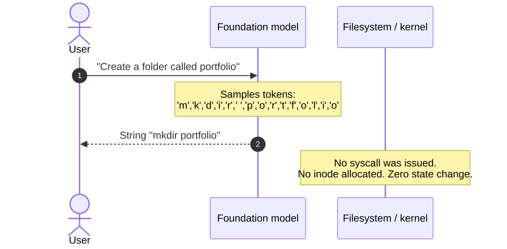

The engineering truth, stated plainly:

- The LLM **generated characters that represent an action**.
- The LLM did **not perform the action**.
- Emitting `mkdir portfolio` lights pixels on a monitor. It does not issue an interrupt to the kernel, does
  not allocate an inode, and does not touch a disk block.

An isolated LLM is trapped inside a purely **semantic universe**. It can describe reality, predict
descriptions of actions, and explain algorithms — but it cannot write a byte, open a socket, or query a
live database.

> This is why the string output of a model must never be treated as an *effect*. It is an *intent*.
> Turning intent into effect is your job, and that job is what the rest of this lecture is about.

## 01.3 Why LLMs fail at arithmetic: the BPE tokenization defect

The natural question is: *"A model with 70 billion parameters cannot multiply two numbers?"*

It cannot — reliably — and the reason is architectural. It lives in the **tokenizer**.

Byte-Pair Encoding (BPE) splits text into frequent character chunks. Numbers are just text, so they get
chopped at whatever boundaries were frequent in the training corpus.

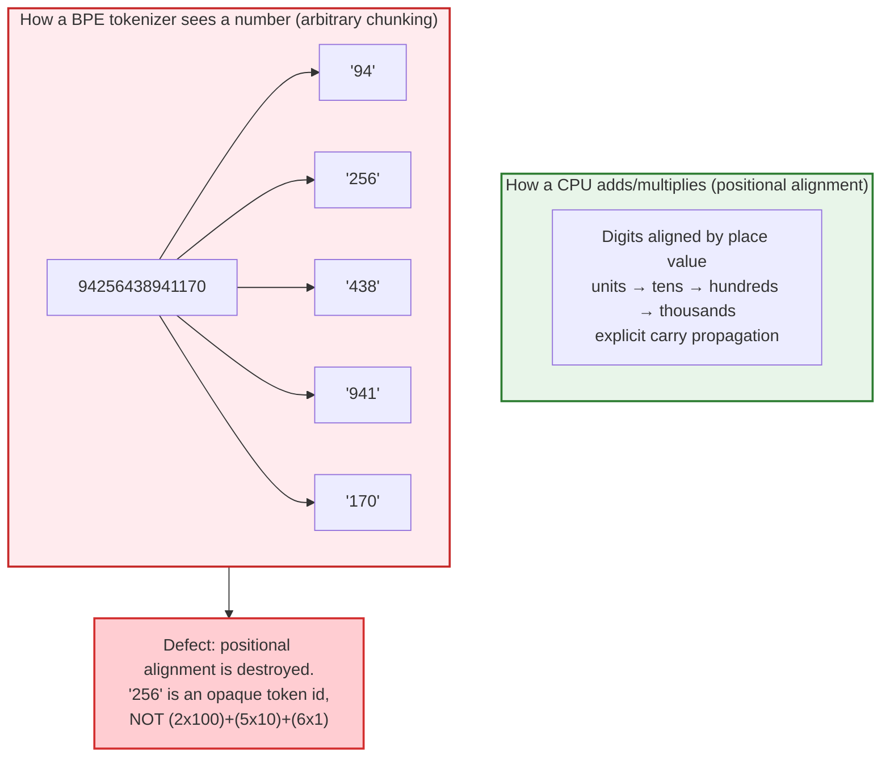

### 01.3.1 Three mechanical reasons

1. **Inconsistent chunking.** The same digit string may tokenize as `["94","256","438","941","170"]` in one
   context and `["9","42","56","43","89","41","170"]` in another. There is no stable notion of "the
   thousands column" across a sentence.
2. **No digit-level alignment.** Column-wise arithmetic requires right-to-left alignment and carries.
   Self-attention has no built-in mechanism that guarantees this alignment survives across layers.
3. **Probabilistic approximation, not deterministic arithmetic.** The model emits the *most statistically
   probable* token. For `2 + 2` and `12 × 12` the answer is memorised frequency. For unmemorised inputs the
   model produces a number with the right *shape*:

$$
78965 \times 34576 = 2{,}730{,}333{,}840 \quad(\text{exact})
$$
$$
\text{model output} \approx 2{,}732{,}154{,}890 \quad(\text{plausible-looking hallucination})
$$

> **The architectural moral:** never make an LLM your ALU. Give it a calculator tool and let it delegate.
> This is the first and most vivid proof of the lecture's thesis: **the model should decide, deterministic
> code should compute.**

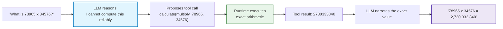

### 01.3.2 The generalisation that matters more than arithmetic

Arithmetic is only the *clearest* example. The same defect generalises to every capability that requires
**exact, stateful, externally-verifiable computation**:

| Capability | Why the model cannot be trusted alone | The tool that fixes it |
| :--- | :--- | :--- |
| Arithmetic | No ALU, no digit alignment | `calculate` |
| Current time / date | Weights frozen at the training cutoff | `now()` |
| Live weather, FX rates | Not in parametric memory | `getWeather`, `convertCurrency` |
| Record lookup | No access to your database | `queryInvoice` |
| File writes | No filesystem access | `writeFile` |
| Sending email | No network side effects | `sendEmail` |

The pattern is always the same: **the model owns the *decision*, the tool owns the *fact*.**

## 01.4 The "brain without hands" model

Designing AI systems requires a strict separation of concerns between **cognitive processing** and
**peripheral actuation**.

### 01.4.1 The genius locked in a room

Imagine a genius with eidetic memory, mastery of every language, and flawless reasoning — locked in a
windowless, soundproof room with no hands. Slip a note under the door:

```text
"The room is 40°C. Please turn on the air conditioner."
```

They understand the discomfort, know the thermodynamics of heat pumps, and can write back a perfectly
correct instruction: *"Press the blue power button on the wall unit."* And the room stays hot, because
**advice is not actuation**.

```mermaid
flowchart LR
    subgraph Brain["The LLM (the brain)"]
        B1["Semantic understanding"]
        B2["Intent classification"]
        B3["Language synthesis"]
        B4["Planning and decomposition"]
    end

    subgraph Hands["The application tools (the hands)"]
        H1["Filesystem and shell"]
        H2["Deterministic math runtime"]
        H3["Databases and caches"]
        H4["Third-party HTTP APIs"]
        H5["Transaction engines and queues"]
    end

    Brain <-->|"structured tool contract<br/>name + args in, JSON result out"| Hands

    style Brain fill:#ede7f6,stroke:#512da8,stroke-width:2px
    style Hands fill:#e0f2f1,stroke:#00796b,stroke-width:2px
```

### 01.4.2 What a raw LLM lacks out of the box

1. **No environmental mutability** — cannot write a file, mutate memory, or run a binary.
2. **No temporal grounding** — weights are frozen at the training cutoff; it cannot see *today*.
3. **No exact compute** — no internal ALU; large arithmetic is hallucinated.
4. **No authenticated access** — cannot reach your private APIs, ticketing system, or production database.
5. **No memory between calls** — continuity is reconstructed by your application every turn (Lecture 06).

Notice that all five gaps are filled by the *same* architectural move: expose a **typed tool** and let the
model request it. That is the whole of tool calling.

---

## 01.5 The linguistic impedance mismatch

Why involve an LLM at all? Why not write ordinary software?

Because humans and programs operate in opposite regimes.

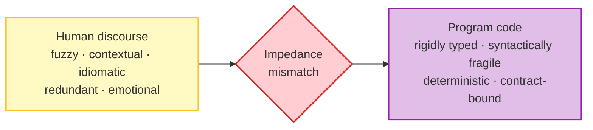

Consider the trivial function `add(a, b)`. The runtime executes `add(10, 20)` flawlessly. Now consider how
humans express the same instruction:

- "Add 10 and 20."
- "What is ten plus twenty?"
- "Combine 10 with 20."
- "I have 10 apples and my friend gave me 20 more — how many now?"
- "I started with ₹10 and earned ₹20; what is my total?"
- "10 + 20"

Classically you would attack this with regexes:

```ts
// ❌ PSEUDO-CODE ONLY — the losing strategy: brittle string parsing
function parseAddIntent(input: string) {
  const s = input.toLowerCase();
  if (s.includes('add') || s.includes('plus') || s.includes('sum')) {
    const nums = s.match(/\d+/g);           // positional assumption
    if (nums && nums.length >= 2) return { a: +nums[0], b: +nums[1] };
  }
  // ... one branch per synonym, per word order, per language ...
  return null;                              // silently fails
}
```

Why this always breaks:

1. **Vocabulary explosion** — `plus`, `increased by`, `aggregate`, `tally`, `together with`, `and then`…
2. **Implied semantics** — "I have ₹300 and received ₹200" contains no arithmetic keyword at all.
3. **Word-order inversion** — "from my base of 20, increase it by 10" reverses the parameters.
4. **Noise and filler** — "Hey! Hope you're well — quick one: what do 10 and 20 make?"
5. **Ambiguity** — "add 10 and 20" vs "add 10 to 20" vs "add 20, then 10".

Anticipating every permutation by hand is an $O(\infty)$ losing battle. **This is the gap the LLM closes —
not by being cleverer than a parser, but by being a probabilistic decoder of intent.**

## 01.6 LLMs as universal semantic decoders

The most valuable enterprise property of an LLM is not creative writing. It is **semantic decoding**:

> **Definition — semantic decoder:** a system that maps high-entropy, noisy, unconstrained natural language
> into low-entropy, deterministic, machine-readable structures.

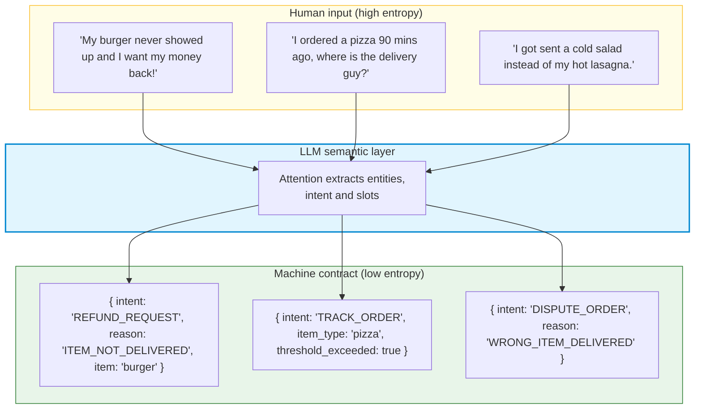

### 01.6.1 Case study: food-delivery support

Your backend microservice expects a strict payload:

```ts
// PSEUDO-CODE ONLY — the strict backend contract
interface OrderActionPayload {
  intent: 'REFUND_REQUEST' | 'ORDER_STATUS' | 'MODIFY_ADDRESS';
  orderId?: string;
  reason?: 'ITEM_NOT_DELIVERED' | 'COLD_FOOD' | 'WRONG_ITEM';
  targetItem?: string;
}
```

Without an LLM you have two bad options: force the user through rigid dropdowns, or maintain thousands of
regexes. With an LLM you get an **adaptive translation layer**:

$$
\text{messy human intent} \xrightarrow{\ \text{LLM decoder}\ } \text{strict typed contract}
\xrightarrow{\ \text{deterministic code}\ } \text{backend microservice}
$$

Note carefully what the LLM did and did not do: it produced a **typed proposal**. It did not issue a
refund. The refund is issued by deterministic code that runs *after* validation. That boundary — proposal
vs effect — is the spine of this lecture and of the enterprise security model in Chapter 08.

---

## 01.7 Why prompting "return JSON" fails in production

Once an engineer realises the model can extract structure, the first implementation is always the same:

```text
System prompt:
"You are a helpful assistant. Answer only with valid JSON. No explanations."
```

In a demo this appears to work. In production it fails unpredictably, and the failures cluster into five
classes.

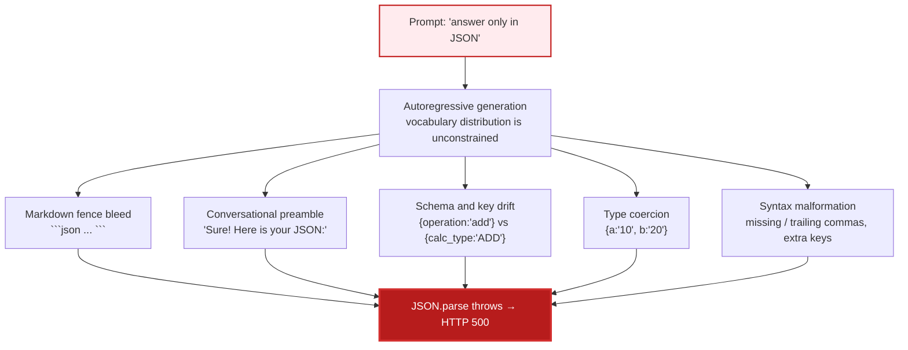

### 01.7.1 The five failure classes in detail

**1. Conversational preamble and markdown fences.** RLHF-tuned models are polite. They want to say
*"Sure! Here you go"* and they love fenced code blocks. `JSON.parse()` on that string throws:

```text
SyntaxError: Unexpected token 'S', "Sure! Here"... is not valid JSON
```

**2. Schema drift across turns.** Nothing constrains field names, so the same intent arrives differently:

```json
{ "operation": "add", "num1": 10, "num2": 20 }
{ "action": "ADDITION", "first": 10, "second": 20 }
{ "type": "+", "values": [10, 20] }
```

**3. String type coercion.** Your function expects `number`, the model sends `"10"`. In JavaScript
`"10" + "20" === "1020"` — a **silent data-corruption bug**, not a crash.

**4. Trailing commas and syntax malformations.** `{ "a": 10, }` is valid to a human, invalid to
`JSON.parse()`.

**5. No sampling-time constraint.** At every step, $P(w_t)$ is free to emit prose, emoji, markdown, or an
invalid escape sequence. **The grammar of JSON is nowhere encoded in the sampler.**

### 01.7.2 The architectural fix

The industry response was not a better prompt. It was a **protocol**: native tool calling.

| Dimension | Naïve "return JSON" prompting | Native tool calling |
| :--- | :--- | :--- |
| Contract | loose English sentences in a prompt | formal JSON Schema / OpenAPI definition |
| Enforcement | best-effort prompt adherence | constrained decoding + fine-tuned protocol |
| Wire payload | JSON embedded in message text | structured `tool_calls` object with `name` + serialised `arguments` |
| Type guarantees | low; brittle regex sanitisation | strong; validate directly with Zod / JSON Schema |
| Error handling | app crashes on invalid syntax | protocol feedback loop lets the model self-correct |
| Testability | fuzzy | deterministic — you can assert on tool names and args |

The next three chapters unpack that protocol: the **contract** (Chapter 02), the **wire lifecycle**
(Chapter 03), and the **tools themselves** (Chapter 04).

## 01.8 Tool = capability + permission

So far we have said the model proposes and the application executes. That leaves one question: **what
exactly is being granted when you expose a tool?**

> **Definition — tool = capability + permission.**
> The *capability* is what the code can physically do. The *permission* is what the application allows it
> to do, for whom, and under what conditions. Exposing a tool grants **both at once**, and it grants them
> to a **probabilistic** caller.

This is the sentence that separates a demo from a system. Two tools can look equally innocent in a schema
and be worlds apart in risk:

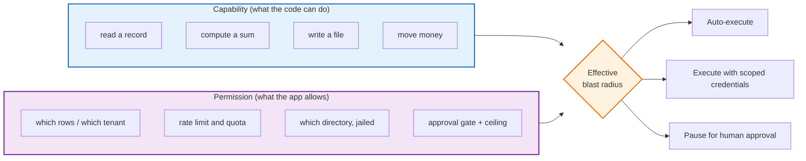

Practical consequences you will meet again in Chapter 08:

1. **A tool's name is a capability statement.** `deleteUser` is a liability; `archiveUser` is a policy.
2. **Granularity is a design decision.** `runShell(command)` exposes the whole machine;
   `listFiles(dir)` exposes one directory. Prefer many narrow tools over one powerful tool.
3. **Permissions live in the runtime, not the prompt.** "You must not delete production data" is a
   sentence, not a control. A *check* is a control.
4. **Read tools and write tools are not the same kind of thing** and must not share a permission tier
   (Chapter 04 and Chapter 08).

---

## 01.9 The three layers you must keep separate

Everything in this lecture belongs to one of three layers. Confusing them is the root cause of most
tool-calling bugs.

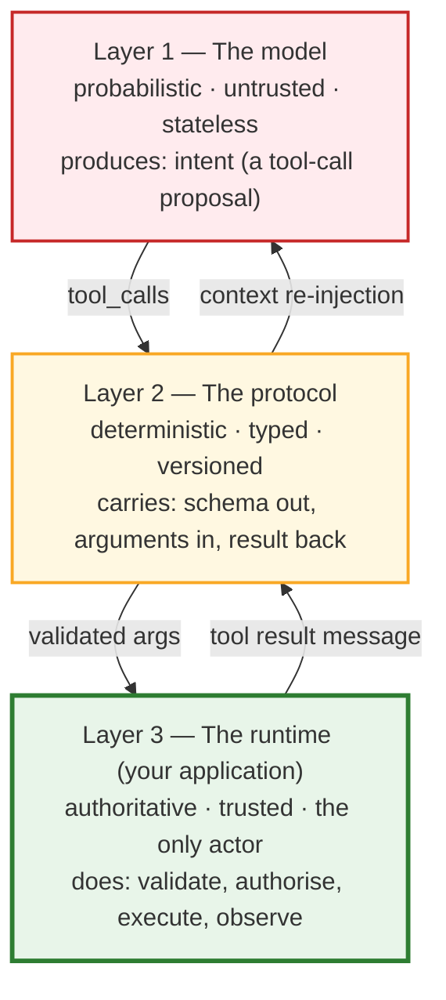

- **Layer 1 (model)** may hallucinate a tool name, invent arguments, or change its mind. Never trust it.
- **Layer 2 (protocol)** is the only contract both sides respect: JSON Schema in, JSON Schema-validated
  arguments out, results returned as addressed messages.
- **Layer 3 (runtime)** is the *kernel*. It decides whether the proposal becomes an effect.

---

## 01.10 Common mistakes

| # | Mistake | Consequence | Fix |
| :--- | :--- | :--- | :--- |
| 1 | Believing the model executed the action | You design for trust; injected arguments and phantom "done" claims go unnoticed | Treat every tool call as an **untrusted proposal** |
| 2 | Using the LLM as a calculator | Plausible-looking wrong numbers in production | Delegate arithmetic to a deterministic tool |
| 3 | Trying to fix arithmetic with better prompting | Non-deterministic; regressions under load or new inputs | Fix it **architecturally**, not verbally |
| 4 | Expecting live data (weather, FX, prices) from weights | Confidently stale answers | Expose a live-information tool |
| 5 | "Answer only in JSON" in a system prompt | 500s from `JSON.parse`, schema drift, silent `"10"+"20"` bugs | Use native tool calling / structured outputs |
| 6 | Regex-parsing free text for intent | `O(∞)` maintenance; silent failures | Let the model decode semantics; validate with a schema |
| 7 | Treating a tool's `name` as an identifier only | You under-estimate the blast radius you just granted | Read the tool as **capability + permission** |
| 8 | One mega-tool (`runAnyCommand`) | Unbounded blast radius; unauditable | Many narrow tools with typed parameters |
| 9 | Putting safety rules in the prompt | Not enforceable; bypassable by injection | Enforce in the runtime (Chapter 08) |
| 10 | Assuming the model remembers the previous turn | Lost context, repeated calls | Re-send the full message history (Lecture 06) |

---

## 01.11 Key takeaways

1. **An LLM performs exactly one job:** sample the next token from $P(w_t \mid w_{<t}; \Theta)$. It is a
   next-token predictor, not an answer generator and not an actor.
2. **Generating text ≠ performing an action.** `mkdir portfolio` on a screen changes nothing on disk until
   your application runs it.
3. **The BPE tokenization defect is architectural.** Numbers are chopped into opaque chunks, positional
   alignment is destroyed, and the model approximates rather than computes. Arithmetic belongs in a tool.
4. **Brain vs hands.** Cognitive work (understand, classify, plan, phrase) belongs to the model; actuation
   (files, databases, money, network) belongs to deterministic code.
5. **The linguistic impedance mismatch is the LLM's reason to exist** in backend engineering: it converts
   high-entropy human language into low-entropy typed contracts.
6. **The five failure classes of prompted JSON** — preambles, fences, schema drift, type coercion, syntax
   malformation — are why native tool calling exists.
7. **A tool is capability + permission.** Exposing a function to a probabilistic caller grants both; the
   runtime, not the prompt, is where safety lives.
8. **Keep three layers separate:** model (untrusted proposer), protocol (typed contract), runtime
   (authoritative executor). Everything else in this lecture is detail inside those three boxes.

---

**Next:** [Chapter 02 — Tool Contracts: JSON Schema & OpenAPI](./02_Tool_Contracts_JSON_Schema_and_OpenAPI.md)


