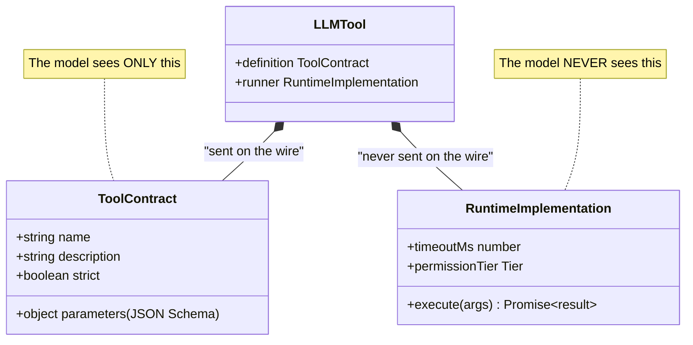
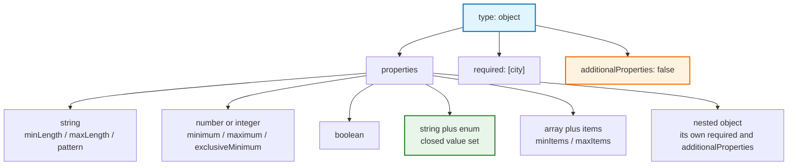
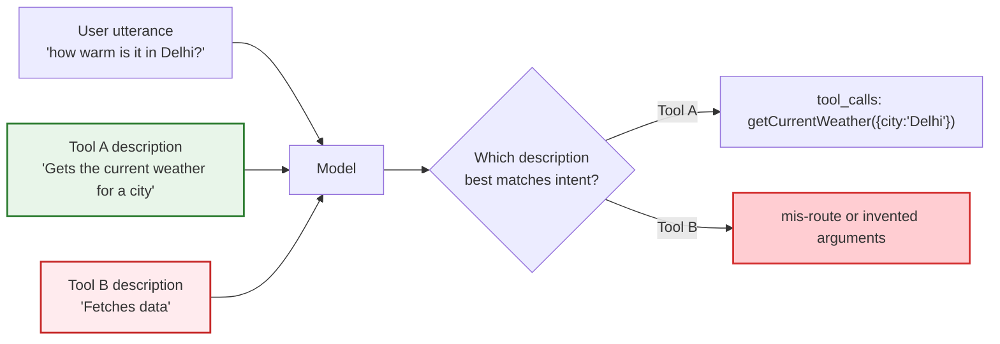
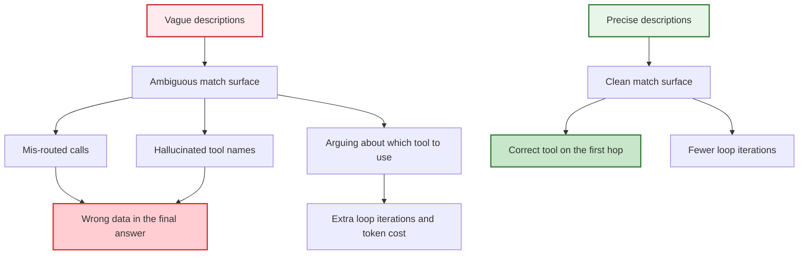
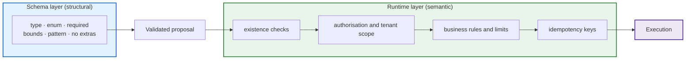
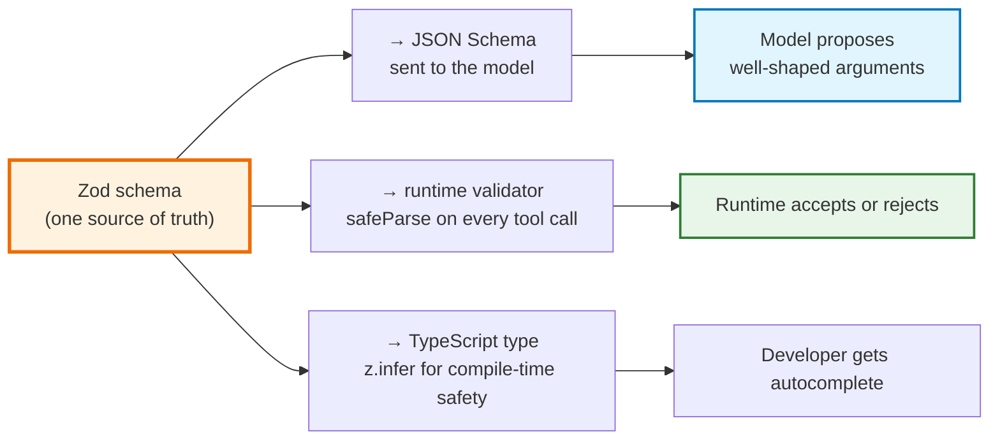
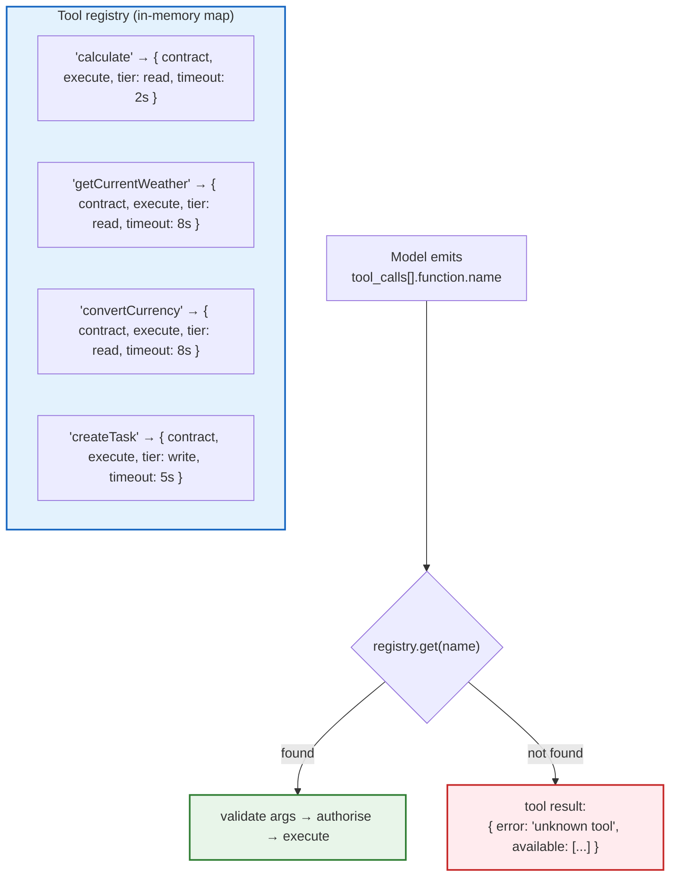
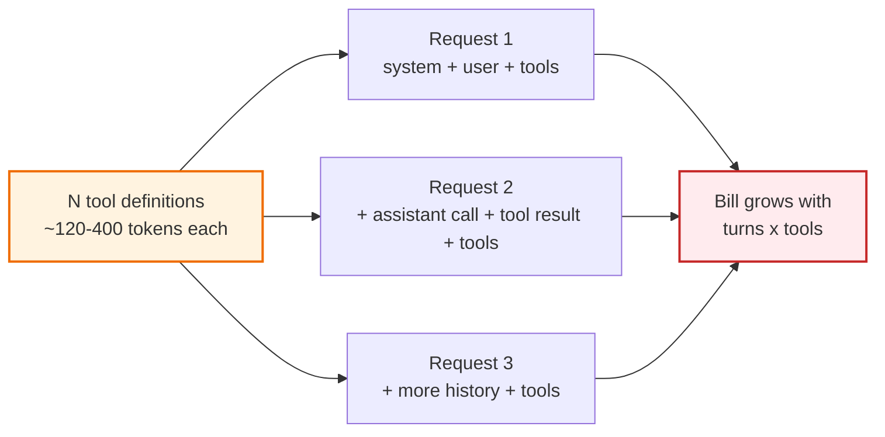
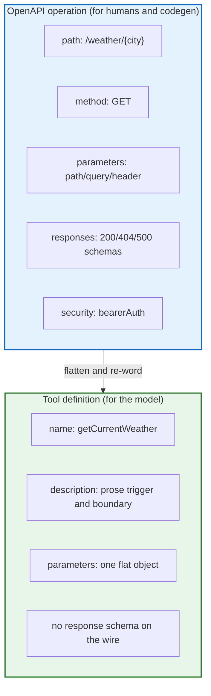

# Chapter 02 — Tool Contracts: JSON Schema, OpenAPI & Parameter Typing

> **Lecture 08 · Chapter 02 of 08** · Level: 🟡 Intermediate · Phase 3 — Agency & Contracts
> **Source:** `Forward-Deployed-Engineer/Lecture 05/notes/02_The_Tool_Calling_Protocol_and_Wire_Architecture.md`
> (§2.1–§2.3, §2.5) · `gen-ai-cohort/week02/learning/day03/notes/04-structured-output-and-function-calling.md`
> (the Zod sections)
> **Roadmap topics:** function/tool schema definition · parameter typing · tool definitions as an
> OpenAPI / JSON Schema contract.
> **Prerequisites:** Chapter 01 · Lecture 10 preview (structured outputs, schema enforcement).

---

## 02.0 What this chapter is for

Chapter 01 established that the model only *proposes*. This chapter is about the **document the model reads
when it decides what to propose** — the tool contract.

It is worth being blunt about the stakes: **the contract is the only thing the model knows about your
code.** The model never sees your implementation. It does not know whether your function is TypeScript,
Rust, or a shell script. It sees a `name`, a `description`, and a JSON Schema for the parameters — and on
that basis alone it decides *whether*, *which*, and *with what arguments* to call.

That means schema design is prompt engineering with a compiler behind it. Vague contract, vague behaviour.
Precise contract, precise behaviour you can test.

By the end of this chapter you should be able to:

1. Define a tool as *implementation + contract* and say which half the model sees.
2. Write a correct JSON Schema tool definition — types, `enum`, `required`, nested objects, arrays.
3. Explain why `description` is the highest-leverage field in the whole definition.
4. State exactly what JSON Schema can and cannot enforce at runtime.
5. Use **Zod** as a single source of truth for validation *and* schema generation.
6. Build a **tool registry** keyed by name.
7. Budget the token cost of tool definitions and keep a tool suite small and well-named.
8. Map a tool definition onto an **OpenAPI operation** and say when each is appropriate.

---

## 02.1 A tool is an ordinary function wrapped in a contract

Strip away the AI vocabulary and the definition is mundane:

> **A tool is an ordinary, deterministic application function exposed to a language model through a formal
> structured schema contract.**

```ts
// PSEUDO-CODE ONLY — zero AI dependencies; this is just a function
function multiply(a: number, b: number): number {
  return a * b;
}
```

On its own this is a few bytes of bytecode. The model has no awareness of its existence. To become a tool,
**two artefacts** must be exposed together:

1. **The implementation** — the code your runtime executes.
2. **The definition (the contract)** — the JSON Schema description of name, purpose, and parameters.



The asymmetry in that diagram is the security model of the entire lecture: **the model reads a
description; the runtime holds the power.**

---

## 02.2 The tool definition as a JSON Schema / OpenAPI contract

When your application calls an LLM API it sends an array of definitions in JSON Schema form:

```json
{
  "type": "function",
  "function": {
    "name": "calculate",
    "description": "Performs exact deterministic arithmetic. Use this whenever any arithmetic computation is required.",
    "parameters": {
      "type": "object",
      "properties": {
        "operation": {
          "type": "string",
          "enum": ["add", "subtract", "multiply", "divide", "power", "mod"],
          "description": "The arithmetic operation to perform."
        },
        "a": { "type": "number", "description": "The first operand." },
        "b": { "type": "number", "description": "The second operand." }
      },
      "required": ["operation", "a", "b"],
      "additionalProperties": false
    }
  }
}
```

### 02.2.1 The four pillars of a tool contract

| Field | Semantic role | Why it matters |
| :--- | :--- | :--- |
| `name` | unique identifier the model will emit | must be stable, verb-first, snake_case/camelCase, and unique across the whole suite |
| `description` | **the semantic trigger** | the model matches user intent to the tool *through this text*; vague text causes mis-routing and hallucinated calls |
| `parameters` | the JSON Schema of the argument object | constrains what the model may emit, and drives your runtime validation |
| `required` / `additionalProperties` | strictness | `required` removes "forgot the argument" failures; `additionalProperties: false` blocks invented keys |

### 02.2.2 The JSON Schema vocabulary you actually need

You do not need all of JSON Schema. In practice, tool schemas use a small, high-value subset:

```json
{
  "type": "object",
  "properties": {
    "city":   { "type": "string", "minLength": 1, "maxLength": 64 },
    "unit":   { "type": "string", "enum": ["celsius", "fahrenheit"] },
    "amount": { "type": "number", "exclusiveMinimum": 0 },
    "tags":   { "type": "array", "items": { "type": "string" }, "maxItems": 5 },
    "window": {
      "type": "object",
      "properties": { "from": { "type": "string" }, "to": { "type": "string" } },
      "required": ["from", "to"],
      "additionalProperties": false
    }
  },
  "required": ["city"],
  "additionalProperties": false
}
```



Three schema choices do most of the work in practice:

- **`enum` over free strings.** `"operation": "multiply"` is safe; `"operation": "times it"` is a runtime
  crash. Enums move a whole class of failures from *runtime* to *design time*.
- **`required` for everything genuinely needed.** A missing argument costs a re-prompt round trip (and a
  round trip is money and latency — Chapter 08).
- **`additionalProperties: false`** to stop invented fields like `"precision"` or `"debug"` from arriving
  and being silently ignored.

---

## 02.3 The `description` field is the highest-leverage text you will ever write

The model chooses a tool by comparing the **user's intent** with the **tool's description**. That is the
whole routing mechanism. There is no registry lookup by name and no deterministic dispatch — the
description *is* the index.



### 02.3.1 What a good description contains

Write the description as if briefing a competent contractor who cannot ask follow-up questions:

1. **What it does**, in one plain sentence, in the vocabulary of the *user*, not the codebase.
2. **When to use it** — the trigger phrases and the situations.
3. **When NOT to use it** — the boundary against neighbouring tools.
4. **Units, formats, and conventions** — ISO 4217 codes, ISO 8601 dates, Celsius, currency symbols.
5. **Constraints and side effects** — "read-only", "sends a real email", "may take up to 30 s".

```text
✅ GOOD
"getCurrentWeather — Returns live atmospheric conditions (temperature in Celsius,
humidity %, wind speed in km/h) for one city. Use this when the user asks about
current weather, temperature, rain, or travel conditions. Do not use for
historical weather or forecasts beyond today."

❌ BAD
"weather"      ← no verb, no units, no boundary, no trigger
"Fetches data" ← matches every tool in the suite
```

### 02.3.2 Description quality directly controls tool-selection accuracy



> **Practical rule:** if two tools in your suite could plausibly be chosen for the same sentence, your
> descriptions are wrong. Either sharpen the boundary or merge the tools.

---

## 02.4 Parameter typing: what a schema can and cannot do

A schema is a *constraint on generation*, not a *guarantee of correctness*. Understand the difference
precisely.

| Property | Enforced by JSON Schema? | Notes |
| :--- | :--- | :--- |
| Field exists | ✅ (`required`) | model may still omit under a weak schema |
| Field type (`string`/`number`/`boolean`) | ✅ | strongest, most valuable constraint |
| Value in a closed set | ✅ (`enum`) | moves failures to design time |
| Numeric bounds | ✅ (`minimum`, `maximum`, `exclusiveMinimum`) | e.g. amounts must be > 0 |
| String shape | ✅ (`pattern`, `minLength`, `maxLength`) | ISO codes, slugs, IDs |
| Array length | ✅ (`minItems`, `maxItems`) | protects your runtime from 10 000 items |
| No extra fields | ✅ (`additionalProperties: false`) | blocks invented keys |
| **Semantic truth** | ❌ | `city: "Delhi"` is well-typed and *wrong* for a user in Mumbai |
| **Authorisation** | ❌ | the schema cannot know whether *this user* may call it |
| **Business rules** | ❌ | "refunds ≤ ₹5 000 and only within 30 days" |
| **Uniqueness / idempotency** | ❌ | schema cannot see previous calls |
| **Existence** | ❌ | `orderId: "A-999"` may simply not exist |



**The rule that follows:** *validate structure with the schema, validate meaning with code.* A schema that
passes is not permission to execute — it is permission to *consider* executing.

---

## 02.5 Zod as the single source of truth

Hand-maintaining two artefacts — a JSON Schema for the model and a validator for the runtime — guarantees
drift. The professional pattern is **one schema, two consumers**.



```ts
// PSEUDO-CODE ONLY — one definition, three consumers
import { z } from 'zod';

export const CalculatorArgs = z.object({
  operation: z.enum(['add', 'subtract', 'multiply', 'divide', 'power', 'mod'])
              .describe('Arithmetic operation to execute'),
  a: z.number().describe('First operand'),
  b: z.number().describe('Second operand'),
});

export type CalculatorArgsT = z.infer<typeof CalculatorArgs>;   // compile-time type

export const calculatorTool = {
  name: 'calculate',
  description: 'Executes exact arithmetic. Supports add, subtract, multiply, divide, power and mod.',
  parameters: toJsonSchema(CalculatorArgs),      // wire contract for the model
  execute: async (raw: unknown) => {
    const parsed = CalculatorArgs.safeParse(raw); // runtime validation
    if (!parsed.success) throw new ToolInputError(parsed.error.issues);
    const { operation, a, b } = parsed.data;
    // ... deterministic arithmetic ...
  },
};
```

Why this matters in an AI system specifically:

- **`.describe()` propagates into the JSON Schema** — so the parameter descriptions the model reads are
  written *next to the validation rules* they document. They cannot drift apart.
- **`z.infer` gives you a real TypeScript type**, so the implementation is typed against the same contract.
- **`safeParse` never throws**, so a malformed model proposal becomes a *tool result* rather than a crash
  (Chapter 06).

### 02.5.1 A worked argument schema

```ts
// PSEUDO-CODE ONLY
export const CurrencyArgs = z.object({
  amount: z.number().positive().describe('Amount to convert; must be greater than zero'),
  from:   z.string().length(3).describe('ISO 4217 source code, e.g. USD, EUR, INR'),
  to:     z.string().length(3).describe('ISO 4217 target code, e.g. USD, EUR, INR'),
});
```

Three things are happening at once, and all three are contract work:

| Constraint | Model-facing effect | Runtime effect |
| :--- | :--- | :--- |
| `positive()` | biases generation away from `0` / negatives | rejects bad proposals cleanly |
| `length(3)` | signals "three letters", not "rupees" | blocks `"rupees"`, `"₹"`, `"dollars"` |
| `.describe(...)` | supplies units and examples | documents the field for the next engineer |

---

## 02.6 The tool registry

Tools are registered in a **map keyed by name** — the same string the model will emit. This is the single
lookup table that turns a proposal into an executable function.



```ts
// PSEUDO-CODE ONLY
interface Tool<TArgs = unknown, TResult = unknown> {
  name: string;
  description: string;
  parameters: Record<string, unknown>;            // JSON Schema
  permissionTier: 'read' | 'write' | 'critical';  // Chapter 08
  timeoutMs?: number;
  execute: (args: TArgs) => Promise<TResult>;
}

const registry = new Map<string, Tool>();
for (const tool of [calculatorTool, weatherTool, currencyTool, taskTool]) {
  registry.set(tool.name, tool);          // name is the contract key
}

function toolDefinitionsForWire(tools: Tool[]) {
  return tools.map((t) => ({
    type: 'function',
    function: { name: t.name, description: t.description, parameters: t.parameters },
  }));
}
```

Two invariants to protect:

1. **`registry.set` keys must equal the schema `name`.** A mismatch produces a call the runtime cannot
   resolve — a self-inflicted "unknown tool" error.
2. **The same registry produces both the wire definitions and the executor lookup.** Build them from one
   collection so a tool can never be described but not executable (or vice versa).

---

## 02.7 Definition hygiene: token cost, tool count, naming, versioning

Tool definitions are **not free**. They are serialised into every request, they consume the context window,
and they are billed as input tokens on **every loop iteration**.



### 02.7.1 Five hygiene rules

1. **Keep the suite small.** Each additional tool is another chance to mis-route. Most production agents
   ship 5–15 tools per task. If you need 40, split into *tool sets* per agent role.
2. **Write tight descriptions.** Two or three sentences, not a paragraph of history. Precision beats
   volume; verbosity is paid for on every turn.
3. **Verb-first, domain-qualified names.** `getInvoiceStatus` beats `invoice`, and `getInvoiceStatus`
   beats `getStatus` when a second domain also has a status.
4. **No overlapping semantics.** `searchProducts` and `findItems` will fight each other forever.
5. **Version deliberately.** Adding an optional parameter is backwards compatible; renaming a tool or
   changing a type is a **breaking change** that must be rolled out behind a new name
   (`calculateV2`) with both versions live during migration.

### 02.7.2 Naming conventions

| Pattern | Example | When |
| :--- | :--- | :--- |
| `get<Thing>` | `getCurrentWeather` | read one resource |
| `list<Things>` | `listOpenTasks` | read many, filtered |
| `search<Things>` | `searchOrders` | semantic/fuzzy retrieval |
| `create<Thing>` | `createTask` | create |
| `update<Thing>` | `updateTaskStatus` | mutate |
| `send<Thing>` | `sendEmail` | side-effecting dispatch |
| `<verb><Thing>` + `V2` | `calculateV2` | breaking change migration |

Naming is not cosmetic here. **The name is part of the semantic match surface**, alongside the
description. `processData` tells the model nothing; `convertCurrency` tells it almost everything.

---

## 02.8 Tool definitions and OpenAPI: the same idea, two audiences

An OpenAPI document describes HTTP operations for *client developers*. A tool definition describes
functions for a *language model*. They are close cousins — same JSON Schema DNA — but not identical.



| Dimension | OpenAPI operation | Tool definition |
| :--- | :--- | :--- |
| Audience | developers, SDK generators, gateways | the language model |
| Input model | path + query + header + body | **one flat JSON object** |
| Description | short summary + long markdown | **prose that carries triggers and boundaries** |
| Response | declared response schemas | not sent; the runtime returns a string result |
| Errors | status codes | returned **in-band as tool results** (Chapter 06) |
| Auth | declared security schemes | enforced by the runtime, invisible to the model |
| Change management | versioned paths, deprecation headers | new tool name, dual-publish during migration |

### 02.8.1 The pragmatic workflow

1. **Start from OpenAPI** if you already have a documented internal API — you get the parameter types for
   free.
2. **Flatten** path/query/body parameters into a single object schema.
3. **Rewrite the description for the model**: what it does, when to use it, when not to, units, side
   effects. Never ship a machine-generated `"summary"` as the tool description.
4. **Drop the response schema** from the wire; shape the *result* for the model instead (Chapter 04).
5. **Expose only a whitelist.** An API with 80 operations does not mean 80 tools. Choose the handful the
   agent needs and keep the blast radius small (Chapter 08).

---

## 02.9 Common mistakes

| # | Mistake | Consequence | Fix |
| :--- | :--- | :--- | :--- |
| 1 | Shipping a machine-generated summary as the `description` | Model mis-routes or never selects the tool | Hand-write triggers, boundaries, units |
| 2 | Free-string parameters instead of `enum` | `"times it"`, `"*"`, `"MULTIPLY"` reach the runtime | Closed value sets for every categorical argument |
| 3 | Forgetting `required` | Missing arguments cause extra loop iterations | Mark every genuinely needed field |
| 4 | Allowing `additionalProperties` | Invented keys silently ignored; confusing behaviour | Set `false` on the argument object |
| 5 | Trusting the schema as authorisation | A valid, well-typed, *unauthorised* call executes | Enforce permissions in the runtime (Chapter 08) |
| 6 | Hand-maintaining JSON Schema **and** a validator | Guaranteed drift between what the model is told and what you accept | Zod as single source of truth |
| 7 | Registry key ≠ schema `name` | Runtime "unknown tool" errors on valid model output | Derive both from one collection |
| 8 | Exposing 40 tools "just in case" | Higher mis-routing rate, higher token bill every turn | Small, sharp suites; split by role |
| 9 | Overlapping tool semantics | Non-deterministic routing between twins | Merge or sharpen boundaries |
| 10 | Renaming / retyping a tool in place | Silent breakage of prompts, evals and clients | New name (`V2`), dual-publish, then retire |
| 11 | Giant nested schemas nobody can read | Model fails on structure; humans cannot review it | Flat arguments, shallow nesting, one purpose per tool |
| 12 | Treating parameter descriptions as optional | Model guesses units (`₹` vs `$`, Celsius vs Fahrenheit) | Describe every parameter with units and examples |

---

## 02.10 Key takeaways

1. **A tool is implementation + contract.** The model sees *only* the contract: `name`, `description`,
   `parameters`. Your code is invisible to it.
2. **The contract is JSON Schema (OpenAPI's DNA).** Use a small, high-value subset: `type`, `enum`,
   `required`, bounds, `array`+`items`, nested objects, `additionalProperties: false`.
3. **`description` is the routing index.** The model matches intent to tool *through this text*. Write
   what it does, when to use it, when not to, units, and side effects.
4. **Enums move failures from runtime to design time.** Every categorical argument should be a closed set.
5. **A schema constrains structure, never meaning.** Existence, authorisation, business rules and
   idempotency are runtime concerns, not schema concerns.
6. **Zod gives you one source of truth**: JSON Schema for the model, `safeParse` for the runtime,
   `z.infer` for TypeScript. Drift becomes impossible.
7. **The registry is keyed by the same name the model emits**, and it produces both the wire definitions and
   the executor lookup.
8. **Definitions cost tokens on every turn.** Keep suites small (5–15), descriptions tight, names
   verb-first and domain-qualified.
9. **Version by adding, not by mutating.** Renaming a tool or changing a type is a breaking change.
10. **OpenAPI and tool definitions are cousins, not twins.** Flatten inputs, rewrite the prose for the
    model, drop response schemas, and expose only a whitelist.

---

**Next:** [Chapter 03 — The 5-Step Wire Protocol & Double-Turn Calling](./03_The_Five_Step_Wire_Protocol_and_Double_Turn_Calling.md)


