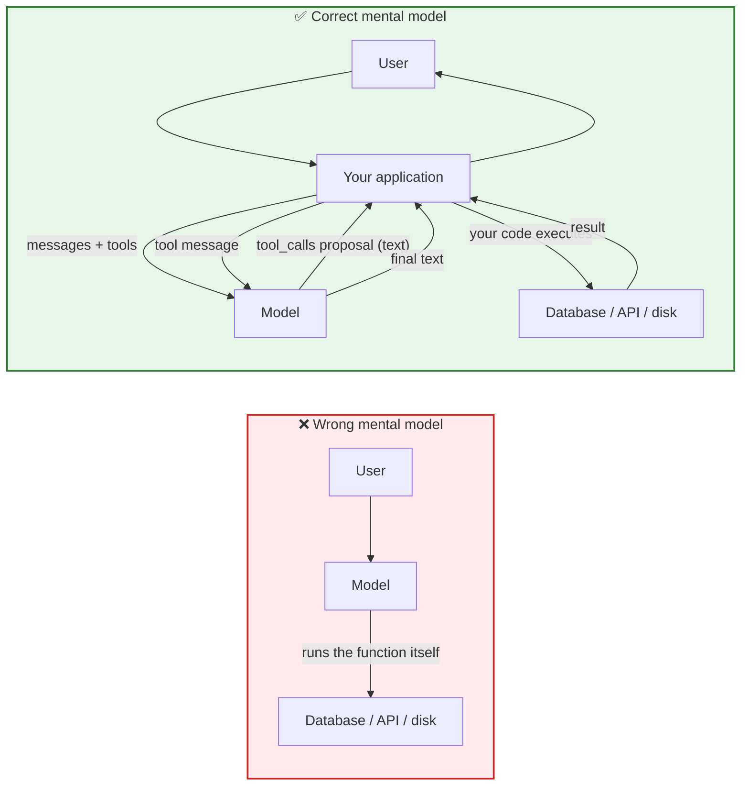
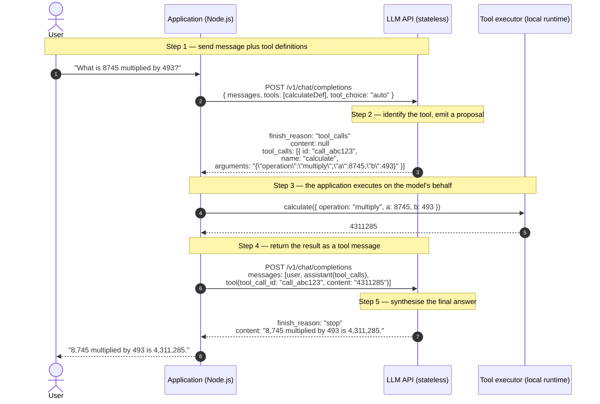
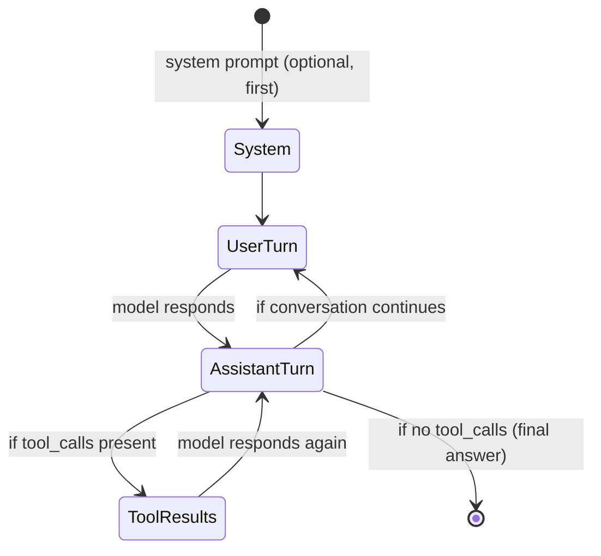
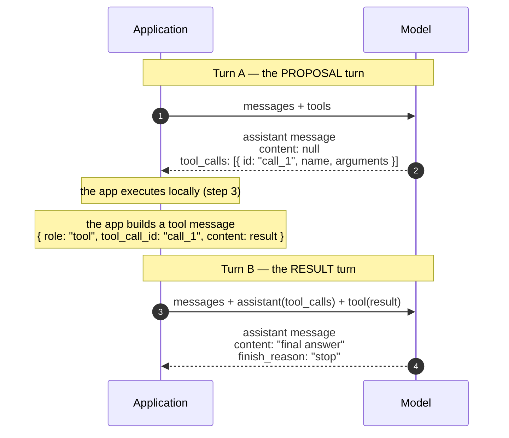
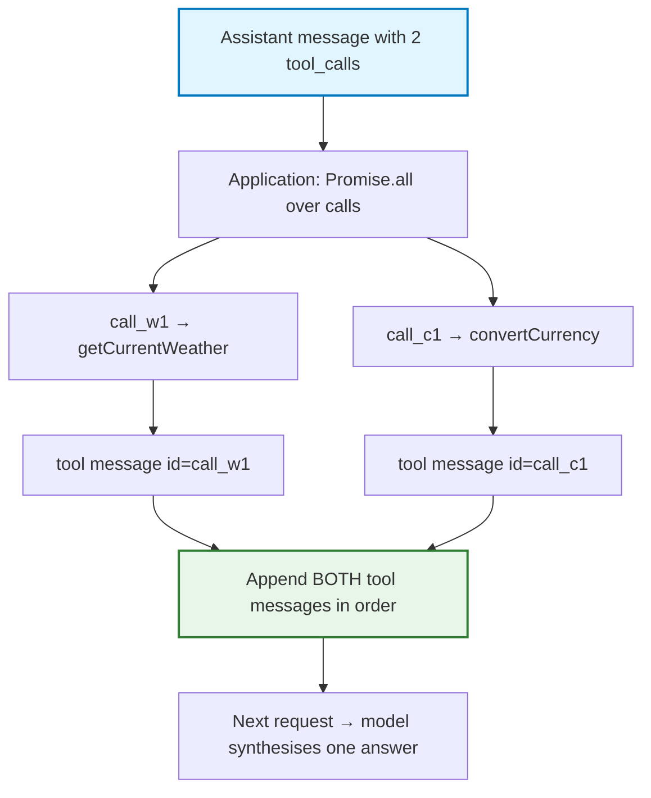
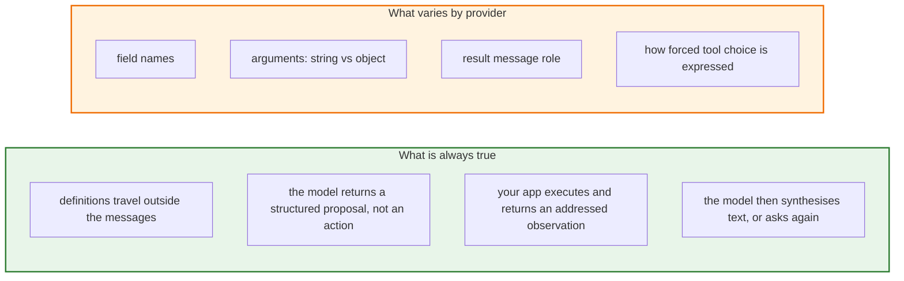
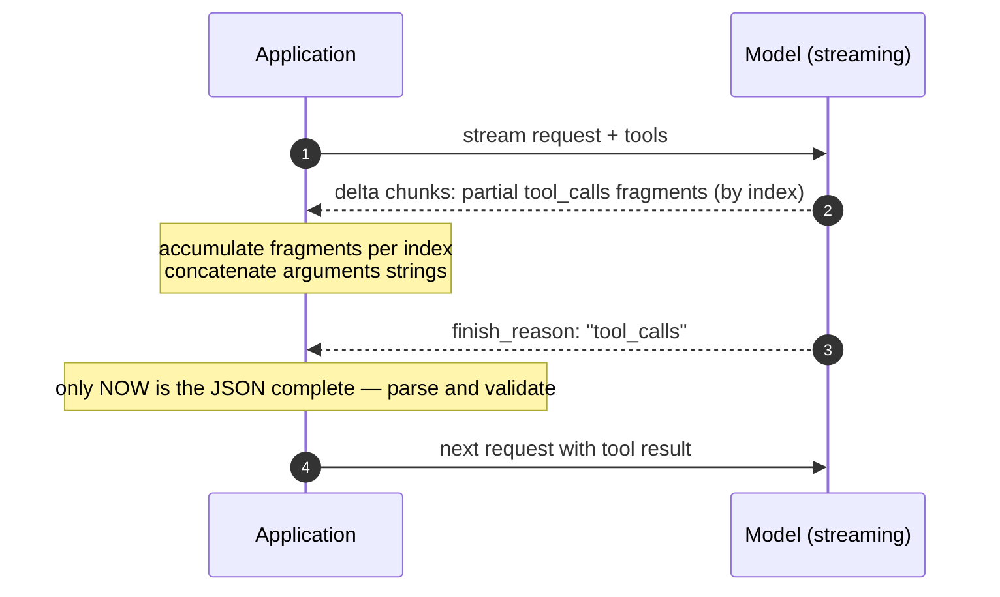

# Chapter 03 — The 5-Step Wire Protocol & Double-Turn Tool Calling

> **Lecture 08 · Chapter 03 of 08** · Level: 🟡 Intermediate · Phase 3 — Agency & Contracts
> **Source:** `Forward-Deployed-Engineer/Lecture 05/notes/02_The_Tool_Calling_Protocol_and_Wire_Architecture.md`
> (§2.3, §2.7, §2.9)
> **Roadmap topics:** the tool-calling protocol & wire architecture (schema → model → call → result →
> model) · the 5-step HTTP wire-protocol lifecycle · **double-turn tool calling** (proposal turn +
> result turn).
> **Prerequisites:** Chapter 02 (the contract) · Lecture 04 (the API protocol, message roles).

---

## 03.0 What this chapter is for

Chapter 02 built the contract. This chapter watches it travel.

Almost everyone's first mental model of tool calling is wrong in the same way: they imagine the model
"reaching into" the server and running a function. The correct model is a **stateless HTTP ping-pong**
where every hop is a full request containing the *entire* conversation so far — including the assistant's
own tool-call proposal and the tool's result.

Once you see the five hops, several things that looked like magic become obvious:

- why the model needs the whole history re-sent (it is stateless);
- why a tool result is a **message with a role and an ID**, not a return value;
- why "double-turn calling" is not a special feature but the *default shape* of the protocol;
- why parallel tool calls are just several entries in one array;
- and why the loop you will build in Chapter 05 is a `while` around these same five steps.

By the end of this chapter you should be able to:

1. State the five wire steps and what each one carries.
2. Read and write the raw JSON for each turn.
3. Explain `finish_reason: "tool_calls"`, `content: null`, and `tool_call_id` matching.
4. Describe the message-role invariants that make the protocol valid.
5. Define **double-turn tool calling**: the *proposal turn* and the *result turn*.
6. Handle **parallel tool calls** inside a single assistant message.
7. Compare how OpenAI-, Anthropic- and Gemini-style APIs express the same protocol.
8. Explain what happens to tool calls under streaming.

---

## 03.1 The central misconception: the model executes nothing

> **The LLM does not execute anything.** It returns an *instruction payload* requesting that **your
> application** execute a function.



The model's output in the wrong model is "an action"; in the right model it is **a proposal expressed as
structured text**. The distinction is not pedantic — it is the difference between a system where you can
enforce permissions and one where you cannot.

---

## 03.2 The five-step wire lifecycle

The complete lifecycle of one tool call is five HTTP steps (the third and fourth of which are local to your
application):

| Step | Direction | What travels |
| :---: | :--- | :--- |
| **1** | App → Model | user message **+ tool definitions** (`tools: [...]`, `tool_choice`) |
| **2** | Model → App | assistant message with `finish_reason: "tool_calls"`, `content: null`, `tool_calls: [...]` |
| **3** | App → Tool | **local** execution of the named function with parsed arguments |
| **4** | App → Model | the assistant tool-call message **+ a new `tool` role message** carrying the result, matched by `tool_call_id` |
| **5** | Model → App | final natural-language answer (`finish_reason: "stop"`) — or another `tool_calls` round |



Note what step 2 and step 4 have in common: **both are requests your application sends.** The model never
initiates anything. It answers. That is why tool calling works at all with a stateless HTTP API.

---

## 03.3 Turn-by-turn wire payloads

### 03.3.1 Turn 1 — App → Model (step 1)

```json
{
  "model": "gpt-4o",
  "messages": [
    { "role": "user", "content": "What is 8745 multiplied by 493?" }
  ],
  "tools": [
    {
      "type": "function",
      "function": {
        "name": "calculate",
        "description": "Performs exact arithmetic calculations.",
        "parameters": {
          "type": "object",
          "properties": {
            "operation": { "type": "string", "enum": ["add", "subtract", "multiply", "divide"] },
            "a": { "type": "number" },
            "b": { "type": "number" }
          },
          "required": ["operation", "a", "b"]
        }
      }
    }
  ],
  "tool_choice": "auto"
}
```

The system prompt is usually the first message; the user's question follows. **No mention of tools appears
in the message text** — the tools travel in a separate top-level array.

### 03.3.2 Turn 2 — Model → App (step 2): the proposal turn

```json
{
  "id": "chatcmpl-9xyz",
  "choices": [
    {
      "finish_reason": "tool_calls",
      "index": 0,
      "message": {
        "role": "assistant",
        "content": null,
        "tool_calls": [
          {
            "id": "call_8745_mul_493",
            "type": "function",
            "function": {
              "name": "calculate",
              "arguments": "{\"operation\":\"multiply\",\"a\":8745,\"b\":493}"
            }
          }
        ]
      }
    }
  ]
}
```

Four details deserve attention, because every bug in this area comes from missing one of them:

1. **`content` is `null`.** The model did not write prose; it wrote a proposal. Some providers emit a short
   *preamble* here ("Let me calculate that for you") — that is commentary, not the action.
2. **`finish_reason: "tool_calls"`** is the machine-readable signal that generation stopped *to request a
   tool*, not to answer.
3. **`arguments` is a stringified JSON string**, not an object. It is emitted token by token, so it can be
   truncated or malformed — validate it, never `JSON.parse` it bare (Chapter 06).
4. **`id` (`call_8745_mul_493`)** is the correlation key. The result you send back **must** quote it.

### 03.3.3 Turn 3 — App → Tool (step 3, local)

```text
registry.get("calculate")
  → JSON.parse('{"operation":"multiply","a":8745,"b":493}')   (guarded)
  → Zod safeParse                                              (validated)
  → execute()                                                  (pure arithmetic)
  → 4311285
```

This hop never touches the network. It is ordinary application code — which is exactly where your
permissions, logging, and timeouts live.

### 03.3.4 Turn 4 — App → Model (step 4): the result turn

```json
{
  "model": "gpt-4o",
  "messages": [
    { "role": "user", "content": "What is 8745 multiplied by 493?" },
    {
      "role": "assistant",
      "content": null,
      "tool_calls": [
        {
          "id": "call_8745_mul_493",
          "type": "function",
          "function": {
            "name": "calculate",
            "arguments": "{\"operation\":\"multiply\",\"a\":8745,\"b\":493}"
          }
        }
      ]
    },
    {
      "role": "tool",
      "tool_call_id": "call_8745_mul_493",
      "content": "4311285"
    }
  ]
}
```

The critical structural facts:

- **The assistant's tool-call message is re-sent verbatim.** The model is stateless; if you do not send it
  back, the model has no idea it ever asked for anything.
- **The tool result is a message with `role: "tool"`** — a first-class role alongside `system`, `user`,
  and `assistant`.
- **`tool_call_id` must match the proposal's `id` exactly.** Mismatched or missing IDs are the single most
  common cause of provider-side `400` errors in tool-calling code.
- **`content` is a string.** JSON results must be serialised (`JSON.stringify(result)`).

### 03.3.5 Turn 5 — Model → App (step 5): synthesis

```json
{
  "choices": [
    {
      "finish_reason": "stop",
      "message": {
        "role": "assistant",
        "content": "8,745 multiplied by 493 is 4,311,285."
      }
    }
  ]
}
```

`finish_reason: "stop"` with no `tool_calls` is your loop's **termination condition** (Chapter 05).

---

## 03.4 Message-role invariants

The message array is not a log you append to casually. It is a **typed structure with invariants**, and
providers validate it.



The invariants you must never break:

| # | Invariant | If you break it |
| :--- | :--- | :--- |
| 1 | Every `tool` message must reference an `assistant` message with a matching `tool_call_id` | provider `400`: "tool_call_id not found" |
| 2 | Every `tool_call_id` in an assistant message **must** receive exactly one `tool` message before the next assistant turn | provider `400`: "tool calls must be followed by tool messages" |
| 3 | `tool` messages must immediately follow the assistant message that requested them | ordering errors, or the model ignoring results |
| 4 | You may not modify the assistant's `tool_calls` while re-sending (no "cleaning up" the arguments) | ID mismatch; the model's plan and your history diverge |
| 5 | `content` of a `tool` message must be a string | provider `400` on object payloads |
| 6 | `system` (if used) goes first; it is not a tool and never carries `tool_call_id` | ignored or rejected |

> **Corollary:** a tool-calling application must persist messages as **structured objects**, not as rendered
> chat text. A UI transcript ("Assistant: let me look that up… Tool: 4311285") cannot be replayed to the
> API. Keep two representations: a display log for humans, and the exact message array for the model
> (Lecture 06, Lecture 07 §09).

---

## 03.5 Double-turn tool calling: the proposal turn and the result turn

"Double-turn tool calling" is the name for the fact that **one user question costs two model invocations
whenever a tool is used** — and it is not an optional extra feature. It is the shape of the protocol.



### 03.5.1 Why the split exists

The split is forced by statelessness plus the *shape of a request*:

- The model cannot run code, so it must **return control** to the application. That is turn A.
- The model cannot remember that it asked, so the application must **come back with the observation**.
  That is turn B.
- Each turn is a complete HTTP request containing the full history. There is no server-side session.

### 03.5.2 The three structural consequences

1. **Latency doubles (at least).** Two provider round trips instead of one, plus local execution time. This
   is the true cost of a tool: not just the tool call, but the extra model call around it (Chapter 08).
2. **The proposal is the model's plan, and the result turn is its reasoning about the observation.** That
   is precisely the ReAct loop (Chapter 05) — ReAct is double-turn calling, repeated.
3. **Everything the model will believe must be in the result turn.** If your `tool` message is vague,
   truncated, or wrong, the final answer will be too. Result formatting is not cosmetic (Chapter 04 §04.8).

### 03.5.3 The canonical loop expressed as pseudo-code

```ts
// PSEUDO-CODE ONLY — the same five steps, repeated until the model stops asking
let messages = [systemMessage, userMessage];

while (true) {
  const res = await model.chat({ messages, tools: wireDefinitions, tool_choice: 'auto' });
  messages.push(res.message);                          // proposal turn recorded

  if (!res.message.tool_calls?.length) {
    return res.message.content;                        // step 5: final answer
  }

  for (const call of res.message.tool_calls) {         // step 3 + 4
    const result = await executeSafely(call);          // never throws (Chapter 06)
    messages.push({ role: 'tool', tool_call_id: call.id, content: result });
  }
  // loop back: the next iteration is the RESULT turn, then possibly another proposal
}
```

Read that loop once more and notice: **there is no tool-specific logic in it at all.** The loop is generic;
all the intelligence about *which* tool to call lives in the model, and all the authority lives in
`executeSafely`.

---

## 03.6 Parallel tool calls inside one assistant message

A single assistant message may contain **several** `tool_calls` entries. The protocol does not care whether
they are independent or sequential — but *you* should, because it changes how you execute them (Chapter 05).

```json
{
  "role": "assistant",
  "content": null,
  "tool_calls": [
    { "id": "call_w1", "type": "function",
      "function": { "name": "getCurrentWeather", "arguments": "{\"city\":\"Delhi\"}" } },
    { "id": "call_c1", "type": "function",
      "function": { "name": "convertCurrency", "arguments": "{\"amount\":500,\"from\":\"USD\",\"to\":\"INR\"}" } }
  ]
}
```

The matching result turn must supply **one `tool` message per call**, each with its own `tool_call_id`:

```json
[
  { "role": "tool", "tool_call_id": "call_w1", "content": "{\"temperatureCelsius\":34,\"condition\":\"Hazy Sun\"}" },
  { "role": "tool", "tool_call_id": "call_c1", "content": "{\"exchangeRate\":83.5,\"convertedAmount\":41750}" }
]
```



Rules to keep in mind:

1. **Count matters.** Two calls need two tool messages. Sending one produces a `400`.
2. **Order is not the contract; `tool_call_id` is.** Still, emitting results in the same order as the calls
   is the safest convention.
3. **One failure does not cancel the batch.** If `call_w1` fails, its `tool` message carries the error
   string while `call_c1` still returns its data (Chapter 06).
4. **Do not assume parallelism.** A model may emit dependent calls in the same message; treat that as a
   malformed plan and let the observation correct it.

---

## 03.7 The same protocol across providers

The vocabulary differs; the lifecycle does not. Learn the shape once and translate the field names.

| Concept | OpenAI-style | Anthropic-style | Gemini-style |
| :--- | :--- | :--- | :--- |
| Tool declaration | `tools: [{ type: "function", function: {...} }]` | `tools: [{ name, description, input_schema }]` | `tools: [{ functionDeclarations: [...] }]` |
| Schema key | `parameters` | `input_schema` | `parameters` |
| Proposal | `assistant.tool_calls[]` | `content[]` block with `type: "tool_use"` | `functionCall` part |
| Proposal id | `tool_calls[].id` | `tool_use.id` | matched by name/order in many SDKs |
| Arguments | `arguments` — **stringified JSON** | `input` — **already an object** | `args` — **already an object** |
| Result message | `role: "tool"`, `tool_call_id` | `role: "user"` with `tool_result` block | `functionResponse` part |
| Force a tool | `tool_choice: "required"` / `{...}` | `tool_choice: { type: "any" \| "tool" }` | `toolConfig.functionCallingConfig` |



**Two practical consequences.** First, write a thin **adapter layer** that normalises
`{ name, arguments: object, id }` internally, so the rest of your code never sees provider field names
(Lecture 04's multi-SDK lesson). Second, the *stringified-arguments* difference is the one that bites: code
written for an object-shaped `input` will crash on a string, and vice versa. Normalise at the boundary.

---

## 03.8 Tool calls under streaming

If you stream (Lecture 07), tool calls arrive **in fragments**. The proposal is generated token by token, so
the provider emits deltas that must be accumulated:

```text
data: {"delta":{"tool_calls":[{"index":0,"id":"call_w1","function":{"name":"get","arguments":""}}]}}
data: {"delta":{"tool_calls":[{"index":0,"function":{"arguments":"{\"ci"}}]}}
data: {"delta":{"tool_calls":[{"index":0,"function":{"arguments":"ty\":\"De"}}]}}
data: {"delta":{"tool_calls":[{"index":0,"function":{"arguments":"lhi\"}"}}]}}
data: {"finish_reason":"tool_calls"}
```



Three rules:

1. **Never parse `arguments` mid-stream.** It is invalid JSON until the fragment sequence completes.
2. **Accumulate by `index`**, because parallel calls interleave in the delta stream.
3. **Emit a UI event, not text.** The user should see "using tool: getCurrentWeather", never raw JSON
   fragments. Tool-call deltas are control-plane data, not answer text.

---

## 03.9 Common mistakes

| # | Mistake | Consequence | Fix |
| :--- | :--- | :--- | :--- |
| 1 | Thinking the model executed the tool | Wrong security model; no validation, no permissions | The model proposes; the app executes |
| 2 | Re-sending only the `tool` message, not the assistant's `tool_calls` | Model does not know it asked; `400` or nonsense answer | Append the assistant message verbatim |
| 3 | Forgetting `tool_call_id` | Provider `400`; results attributed to the wrong call | Match IDs exactly, one result per call |
| 4 | Sending fewer tool messages than tool calls | `400`: "tool calls must be followed by tool messages" | One `tool` message per `tool_call_id` |
| 5 | `JSON.parse` on `arguments` without a guard | Uncaught `SyntaxError` → 500 (Chapter 06) | Parse inside a try/catch, then schema-validate |
| 6 | Passing an object as `tool` content | Provider `400` | Always `JSON.stringify` the result |
| 7 | Rewriting / "cleaning" the model's arguments in history | History and model belief diverge; debugging becomes impossible | Store the assistant message exactly as received |
| 8 | Treating `content: null` as an error | Needlessly retrying a valid proposal | `finish_reason` is the signal, not `content` |
| 9 | Persisting rendered chat text instead of structured messages | Cannot replay the conversation to the API | Store the message array (and a separate display log) |
| 10 | Ignoring the extra round trip in latency and cost budgets | Surprise p95 latency and token bills | Budget two model calls per tool hop (Chapter 08) |
| 11 | Parsing streamed `arguments` before the stream ends | Guaranteed parse failure mid-stream | Accumulate by `index`, parse at `finish_reason` |
| 12 | Hard-coding one provider's field names everywhere | A provider switch breaks the whole agent | Normalise in a thin adapter |

---

## 03.10 Key takeaways

1. **The LLM executes nothing.** It returns a proposal; your application is the only actor.
2. **Tool calling is five steps:** definitions out → `tool_calls` proposal back → local execution → addressed
   `tool` result → final synthesis (or another proposal).
3. **The assistant's tool-call message must be re-sent verbatim.** Statelessness is why.
4. **`tool_call_id` is the correlation key**, and every call needs exactly one matching `tool` message.
5. **`finish_reason: "tool_calls"` with `content: null` is the proposal turn**; `finish_reason: "stop"` with
   no `tool_calls` is termination.
6. **Double-turn tool calling is the default shape**, not a special mode: one *proposal turn*, one *result
   turn* — two model invocations for one user question.
7. **Parallel calls live in one assistant message**; execute them concurrently but return one addressed
   result each, and never let one failure cancel the batch.
8. **The protocol is provider-independent in shape and provider-specific in spelling.** Normalise at the
   boundary.
9. **Under streaming, tool calls arrive as fragments.** Accumulate by index, parse only at the end, and
   surface them as UI events rather than text.
10. **The loop around these five steps is generic.** All intelligence is in the model; all authority is in
    your runtime.

---

**Next:** [Chapter 04 — Tool Taxonomy: Deterministic & Live Information Tools](./04_Tool_Taxonomy_Deterministic_and_Live_Information_Tools.md)


