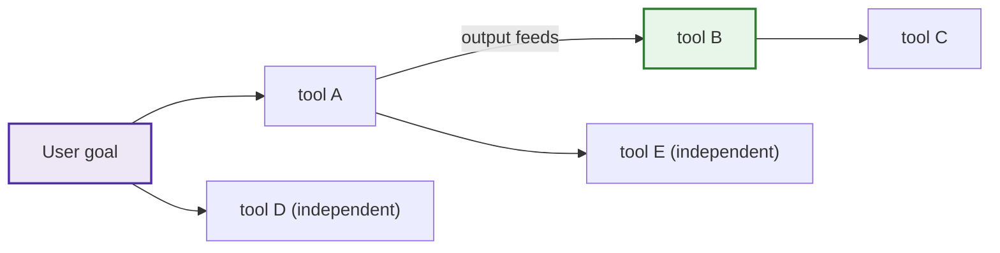
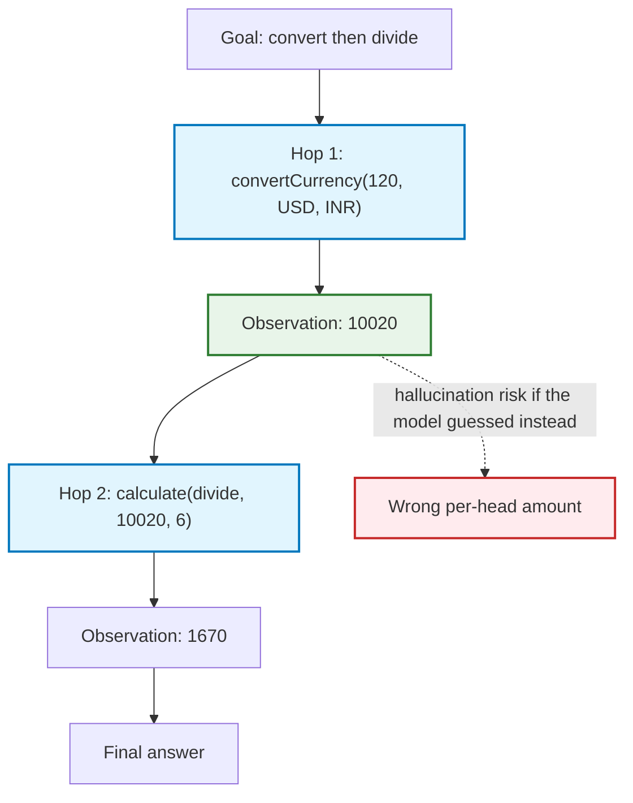
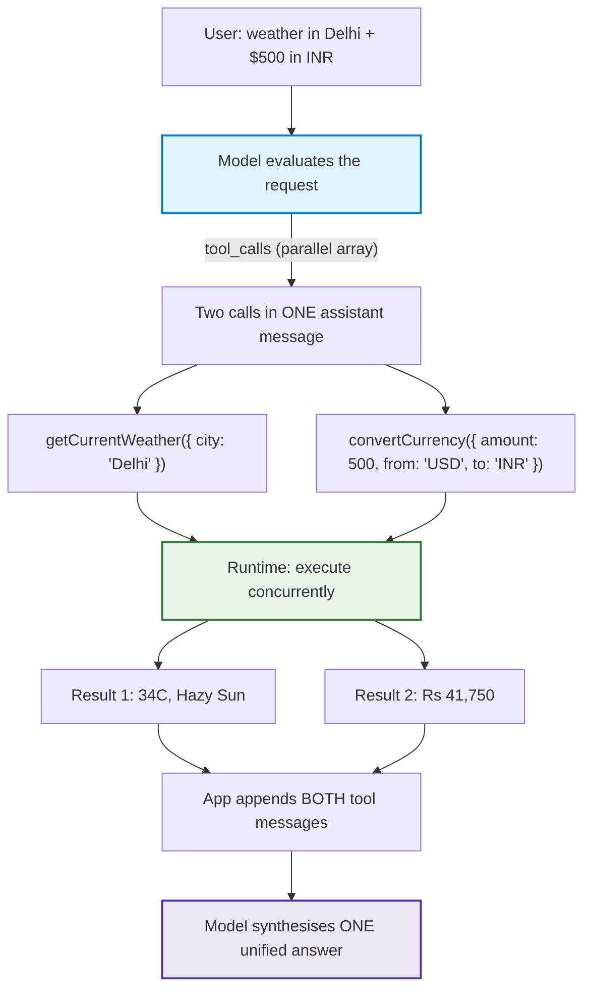
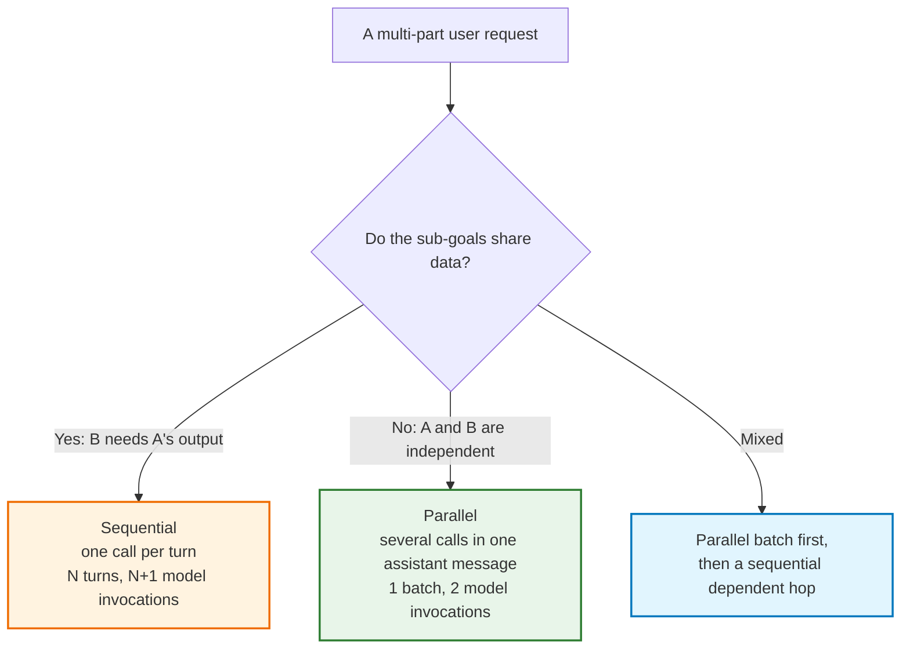
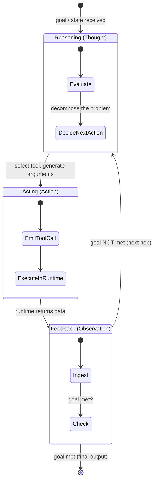
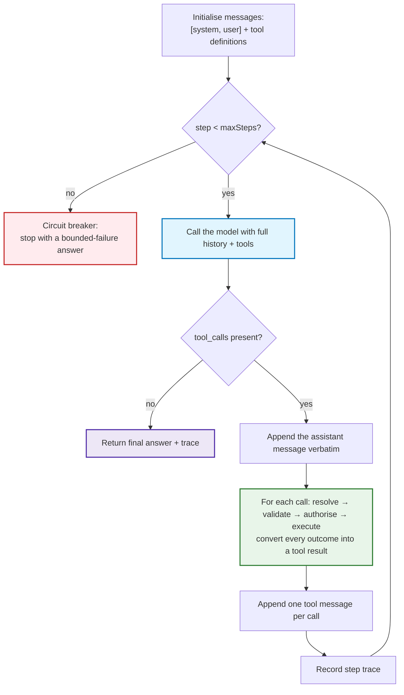
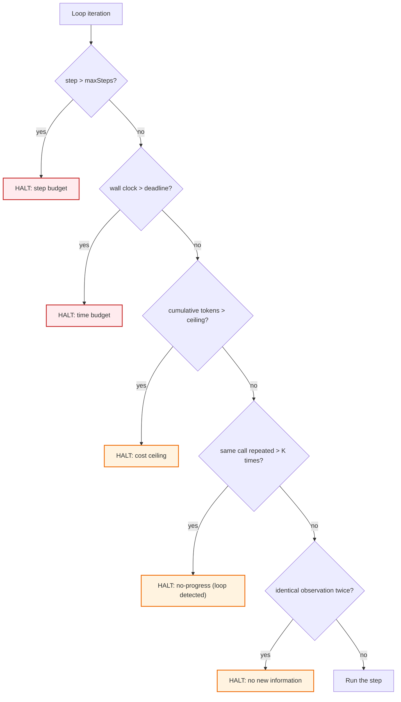
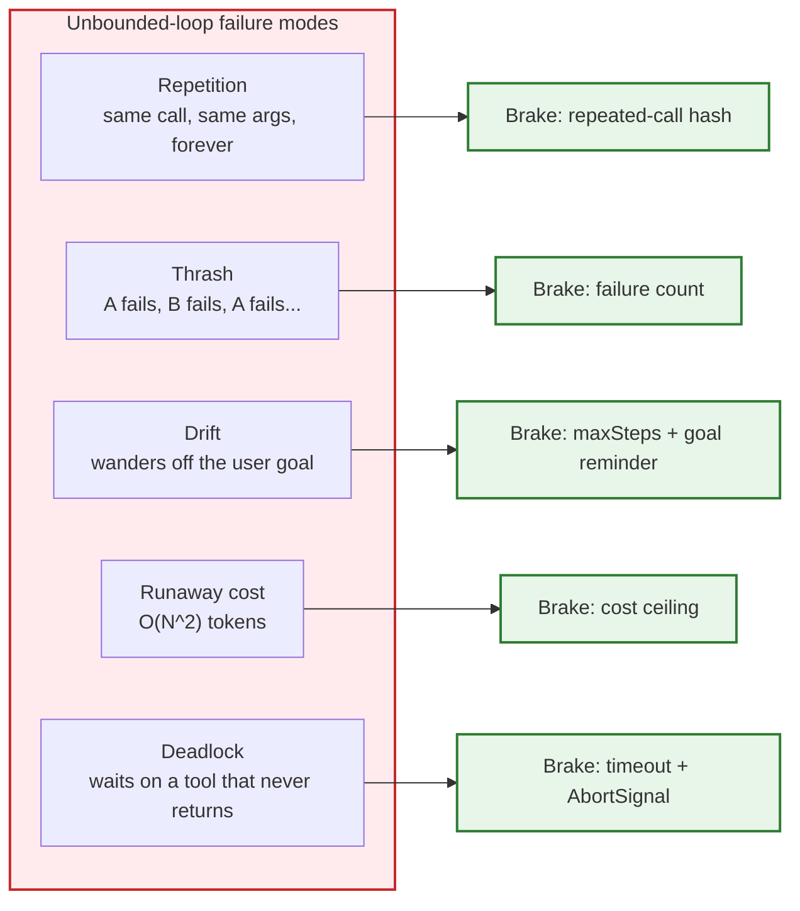
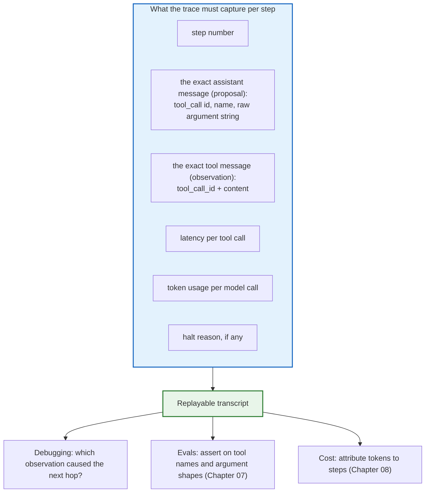

# Chapter 05 — Multi-Step Chaining & the ReAct Execution Loop

> **Lecture 08 · Chapter 05 of 08** · Level: 🟡 Intermediate · Phase 3 — Agency & Contracts
> **Source:** `Forward-Deployed-Engineer/Lecture 05/notes/03_Multi_Step_Tool_Chaining_and_Execution_Loops.md`
> (§3.1–§3.4, §3.6)
> **Roadmap topics:** multi-step tool chaining & execution loops · the ReAct cognitive paradigm
> (reasoning + acting) · loop bounds and termination conditions · a visible multi-step trace.
> **Prerequisites:** Chapters 02–04 · Lecture 06 (message history, context windows).

---

## 05.0 What this chapter is for

Chapters 02–04 built one tool call. This chapter builds the **engine** that runs many of them.

The moment a user asks something that needs two tools — *"convert $120 to rupees and split it six ways"* —
you discover that the hard part is not the tools. The hard part is that **nobody wrote the orchestration**.
The developer never typed `convertCurrency()` then `calculate()`. The model decomposed the goal, discovered
the dependency, and sequenced the calls itself, one observation at a time.

That is the leap this chapter formalises: from *a tool call* to *an agent loop*. It is also the chapter
where the loop becomes dangerous, because a loop that can decide what to do next can also decide to do it
forever, or to spend your entire token budget doing nothing useful. So this chapter pairs the ReAct pattern
with the engineering that makes it safe: **bounds, termination conditions, and traces**.

By the end of this chapter you should be able to:

1. Explain sequential chaining as a *dependency graph the model builds at runtime*.
2. Explain parallel dispatch for independent sub-goals and when it is safe.
3. State the ReAct triplet — **Thought → Action → Observation** — and trace it in a real transcript.
4. Describe the execution engine as a `while` loop with four responsibilities.
5. List and justify **every termination condition** a production loop needs.
6. Recognise the failure modes of unbounded loops: repetition, thrash, drift, runaway cost.
7. Produce a **visible step trace** that lets you point at the exact message that caused each hop.
8. Explain why token cost grows super-linearly with hop count (the economic ledger).

---

## 05.1 From single-turn to multi-hop

Single-turn tool calling is a straight line:

$$
\text{user query} \longrightarrow \text{tool call} \longrightarrow \text{tool result} \longrightarrow \text{final response}
$$

Real problems are not straight lines. They are **graphs**:



The critical observation: **you do not build that graph.** The model builds it, incrementally, conditioned
on observations that only exist at runtime. That is why this is called *dynamic orchestration*, and why
hardcoded pipelines cannot replace it.

---

## 05.2 Sequential chaining: the dependency chain

The source lecture's canonical example:

```text
User: "Convert $120 into Indian rupees and then divide that amount equally among 6 people."
```

There is no `convertCurrencyAndSplitAmongPeople()` tool. There are two atomic tools:

1. `convertCurrency({ amount, from, to })`
2. `calculate({ operation, a, b })`

```mermaid
sequenceDiagram
    autonumber
    actor User
    participant App as Orchestrator engine
    participant LLM as Model
    participant Tools as Tool runtime

    User->>App: "Convert $120 to INR and split among 6 people."
    App->>LLM: Turn 1: user + tool definitions

    Note over LLM: Reasoning: I need the INR total first.
    LLM-->>App: tool_calls: convertCurrency(120, "USD", "INR")
    App->>Tools: convertCurrency(120, "USD", "INR")
    Tools-->>App: { convertedAmount: 10020, currency: "INR" }

    Note over App: append the assistant call AND the tool result
    App->>LLM: Turn 2: user + toolCall_1 + toolResult_1

    Note over LLM: Reasoning: now divide 10020 by 6.
    LLM-->>App: tool_calls: calculate("divide", 10020, 6)
    App->>Tools: calculate("divide", 10020, 6)
    Tools-->>App: 1670

    App->>LLM: Turn 3: history + toolResult_2
    Note over LLM: Goal satisfied. Synthesise.
    LLM-->>App: "$120 is about Rs 10,020 INR; each of 6 people gets Rs 1,670."
    App-->>User: final answer
```

### 05.2.1 The breakthrough: no orchestration code was written

```ts
// ❌ THIS IS WHAT YOU DID **NOT** HAVE TO WRITE
const inr   = await currencyService.convert(120, 'USD', 'INR');
const perHead = inr / 6;
```

Instead, the model autonomously:

1. recognised that step 2 (`calculate`) **depends on** the output of step 1 (`convertCurrency`);
2. waited for the application to observe and return that output;
3. formulated step 2's arguments **conditioned on the runtime observation** (`10020`, not a guess);
4. concluded the loop when no further tool was needed.



> **Why the chain works at all:** because the *arguments of hop 2 are generated after hop 1's observation
> exists*. If the model had to plan both hops up front, it would have to invent the exchange rate — and it
> would invent a plausible-looking wrong one. **Chaining is what makes grounding possible.**

---

## 05.3 Parallel dispatch: independent sub-goals

Now a second scenario from the source lecture:

```text
User: "I'm travelling to Delhi. What is the current weather there, and how much is $500 in Indian rupees?"
```

The sub-goals are **orthogonal**: the weather in Delhi has no computational relationship to the USD→INR
rate. Modern models emit **parallel tool calls in a single inference response**.



```ts
// PSEUDO-CODE ONLY — concurrent dispatch of a batch of independent calls
const toolMessages = await Promise.all(
  assistantMessage.tool_calls.map(async (call) => {
    const result = await executeSafely(call);          // never throws
    return { role: 'tool', tool_call_id: call.id, content: result };
  }),
);
messages.push(...toolMessages);                         // one message per call
```

### 05.3.1 Parallel dispatch rules

1. **One result per call, always.** N calls → N `tool` messages, each with its own `tool_call_id`
   (Chapter 03 §03.6).
2. **Never let one failure cancel the batch.** `Promise.all` rejects on the first throw, which is why
   `executeSafely` must *return* error results rather than throw. (If you want strict semantics, use
   `Promise.allSettled` — but then still convert each rejection into a tool result.)
3. **Bound the fan-out.** A model can emit 20 calls; your runtime should cap concurrency and per-batch
   count, or you will hammer an upstream and get rate-limited.
4. **Do not parallelise actions blindly.** Two independent *reads* in parallel is free. Two *writes* that
   touch the same resource is a race; serialise them or reject the batch.
5. **Do not assume the model got the dependency right.** If it emits a dependent call in the same batch, the
   call will fail with a validation or "unknown input" error — and the error result is what teaches it to
   sequence properly on the next hop (Chapter 06).

---

## 05.4 Sequential vs parallel: how to think about the choice

You do not choose. **The model chooses, and the structure of the task determines what it can choose.** Your
job is to make the two shapes cheap to express and safe to execute.



| Dimension | Sequential chain | Parallel batch |
| :--- | :--- | :--- |
| Data flow | hop *n+1* consumes hop *n*'s observation | hops consume only the user request |
| Model invocations | N + 1 | 2 (one batch + one synthesis) |
| Wall-clock latency | sum of hops + N round trips | max of hops + 1 round trip |
| Failure handling | failure at hop *n* blocks hop *n+1* | partial results are usable |
| Risk | long chains; context growth per hop | rate limits; double-writes on action tools |
| Termination | when the dependency graph is satisfied | when the batch is answered |

> **Diagnostic use:** if a request feels slow, check whether the model is serialising work that could be
> batched. If a request feels expensive, check whether it is batching work that should be sequenced (the
> batch may be re-sent on every subsequent hop anyway).

---

## 05.5 The ReAct paradigm: reasoning + acting

Multi-step tool calling was formalised by Yao et al. (2022) as **ReAct** — *Reasoning + Acting*. The idea is
deceptively simple: **interleave thinking with doing**, so that each action is informed by the latest
observation instead of by an up-front guess.



### 05.5.1 The triplet

| Phase | What happens | Where it lives on the wire |
| :--- | :--- | :--- |
| **Thought** | the model reasons about the current state ("I need the live rate before I can divide") | assistant text content (or reasoning field), often `null` for pure tool calls |
| **Action** | the model emits a structured tool call | `assistant.tool_calls[]` |
| **Observation** | the application executes and injects ground truth | `role: "tool"` message |

```mermaid
sequenceDiagram
    autonumber
    participant App as Engine
    participant LLM as Model
    participant T as Tool

    Note over App,LLM: Thought 1 — "the user wants a split; I need INR first"
    LLM-->>App: Action 1: convertCurrency(120, USD, INR)
    App->>T: execute
    T-->>App: Observation 1: 10020

    Note over App,LLM: Thought 2 — "now divide 10020 by 6"
    LLM-->>App: Action 2: calculate(divide, 10020, 6)
    App->>T: execute
    T-->>App: Observation 2: 1670

    Note over App,LLM: Thought 3 — "goal satisfied"
    LLM-->>App: final text answer
```

### 05.5.2 Why interleaving beats planning everything up front

1. **Grounding.** Arguments for hop 2 are generated from hop 1's *actual* output, not from a prediction.
2. **Adaptation.** If hop 1 fails, the model can switch tools or fix parameters instead of executing a
   broken plan.
3. **Economy.** The model only "thinks" as far as the next action; it does not burn tokens planning steps it
   may never need.
4. **Robustness.** External state changes between hops are absorbed naturally, because every hop re-reads
   the world.

> **Where the loop gets its name:** the engine around the model is not the ReAct pattern; the *model's
> behaviour* is. Your engine only provides the three surfaces — let it propose, execute the proposal, and
> show it the result.

---

## 05.6 The execution engine

The engine is a `while` loop with four responsibilities. Everything else — the intelligence — is in the
model.



```ts
// PSEUDO-CODE ONLY — the whole engine, in ~25 lines
async function runAgent(goal: string, tools: Tool[], cfg: AgentConfig) {
  const messages: Message[] = [{ role: 'system', content: cfg.systemPrompt }, { role: 'user', content: goal }];
  const wireTools = tools.map(toWireDefinition);
  const trace: StepTrace[] = [];

  for (let step = 1; step <= cfg.maxSteps; step++) {
    const res = await model.chat({ messages, tools: wireTools, tool_choice: 'auto' }, { signal: cfg.signal });
    messages.push(res.message);                                  // 1. record the proposal

    if (!res.message.tool_calls?.length) {                       // 2. termination: model stopped asking
      return { answer: res.message.content ?? '', steps: step, trace };
    }

    const results: Message[] = [];                               // 3. execute the batch safely
    for (const call of res.message.tool_calls) {
      results.push({ role: 'tool', tool_call_id: call.id, content: await executeSafely(call, tools) });
    }
    messages.push(...results);                                   // 4. re-inject observations
    trace.push({ step, calls: res.message.tool_calls, results });
  }

  return { answer: cfg.budgetMessage, steps: cfg.maxSteps, trace, halted: 'maxSteps' };
}
```

### 05.6.1 The four responsibilities

| # | Responsibility | Why it belongs to the engine, not the model |
| :--- | :--- | :--- |
| 1 | **Assemble context** | the model is stateless; history is your job (Lecture 06) |
| 2 | **Decide continuation** | termination must be enforceable, not suggested |
| 3 | **Execute safely** | validation, authorisation, timeouts, error conversion (Chapter 06) |
| 4 | **Observe** | traces, metrics, token accounting (Chapter 08) |

Notice what is *absent*: no `if (userAskedAboutWeather)` branches, no tool-specific sequencing, no
hardcoded plan. **The engine is tool-agnostic; adding a tool must not change the engine.**

### 05.6.2 Do you need a framework? (LangChain and friends)

The source notes for this lecture also introduce **LangChain** — an *orchestration framework* for AI
applications. It is worth being precise about what such a framework does and does not do for the loop you
have just built.

> **Definition — orchestration framework:** a library that packages prompt templates, model clients, tool
> registration, memory, chains/agents and retrieval pipelines behind a shared abstraction, so you do not
> hand-write the glue for each of them.

```mermaid
flowchart LR
    subgraph Manual["What you built in this lecture (the protocol)"]
        M1["message array + roles"]
        M2["tool contract + registry"]
        M3["the 5-step loop"]
        M4["executeSafely + error contract"]
        M5["brakes + trace"]
    end
    subgraph FW["What a framework adds on top"]
        F1["prompt templates"]
        F2["model-client adapters (many providers)"]
        F3["tool decorators and schema helpers"]
        F4["memory / history strategies"]
        F5["chains, agents, retrievers, RAG pipelines"]
    end
    FW -->|"wraps"| Manual

    style Manual fill:#e8f5e9,stroke:#2e7d32,stroke-width:2px
    style FW fill:#e3f2fd,stroke:#1565c0,stroke-width:2px
```



| Question | Build the loop yourself | Use a framework |
| :--- | :--- | :--- |
| **Understanding** | you see every wire field and every failure | the protocol is hidden behind abstractions |
| **Speed to first demo** | slower | faster |
| **Provider switching** | write an adapter (Chapter 03 §03.7) | adapters already exist |
| **Debuggability** | full control over the trace | you debug the framework's trace format |
| **Safety posture** | you own the kernel: tiers, gates, validation | you must still own it — the framework does not do it for you |
| **Upgrades** | you decide | framework churn becomes your churn |
| **When it wins** | production systems with strict safety and cost budgets | prototypes, multi-provider experiments, RAG pipelines |

**The rule of thumb for this lecture:** *a framework may own the plumbing; it must never own the
permissions.* No matter how much orchestration a library provides, the four responsibilities in §05.6.1 —
context assembly, continuation, safe execution, observation — remain yours, because they are the parts that
enforce your policy. Learn the raw protocol first (this chapter), then adopt a framework for the parts that
are genuinely boilerplate.

> **Warning sign:** if you cannot explain what the framework sends on the wire — the message array, the
> `tool_calls` payload, the `tool` result message — you cannot debug it when it misroutes a call at 3 a.m.

---

## 05.7 Loop bounds and termination conditions

An unbounded ReAct loop is not a feature; it is an outage waiting for the right prompt. Every production
loop needs **several** independent brakes, because each one catches a different failure.



### 05.7.1 The five brakes

| Brake | Typical value | Catches |
| :--- | :--- | :--- |
| **`maxSteps`** (hop budget) | 5–10 | the general case: the model keeps asking for tools |
| **Wall-clock deadline** (`AbortSignal`) | 30–90 s | a slow tool, a stalled provider, a user who has left |
| **Token / cost ceiling** | e.g. 60 k input tokens per request | quadratic history growth (Chapter 08) |
| **Repeated-call detection** | same `name + args` hash twice | thrash: the model retries a failing call verbatim |
| **No-new-information detection** | identical observation, or no state change | the "I'll check again" loop |

Plus two **semantic** brakes that are cheap to add and surprisingly effective:

- **Tool-switch limit** — after *K* failures, forbid further calls and force a final answer from the
  evidence gathered so far. This converts a hang into a partial, honest answer.
- **Reflection injection** — when a brake is close, append a system message: *"You have used N of M steps.
  If you cannot complete the task, summarise what you know and what is missing."* This turns an abrupt halt
  into a useful response.

### 05.7.2 The failure modes the brakes exist for



### 05.7.3 How to halt well

A halt is still a **user-visible answer**. Three rules:

1. **Never return a raw exception.** Return the best partial answer plus an explicit statement of what was
   not completed: *"I confirmed the invoice is unpaid, but I could not reach the payment provider after 3
   attempts. Please retry in a moment."*
2. **Distinguish "halted by budget" from "failed".** They are different incidents with different alerts.
3. **Log the trace with the halt reason.** The trace is the only artefact that tells you *why* the loop
   burned its budget (Chapter 08).

```ts
// PSEUDO-CODE ONLY — deadline + step + cost brakes around the engine
const controller = new AbortController();
const timer = setTimeout(() => controller.abort(), cfg.timeoutMs ?? 60_000);

try {
  return await runAgent(goal, tools, { ...cfg, signal: controller.signal, maxSteps: 8 });
} catch (err) {
  if (isAbortError(err)) return { answer: partialSummary(trace), halted: 'timeout', trace };
  throw err;
} finally {
  clearTimeout(timer);            // always clear, or you leak timers per request
}
```

---

## 05.8 The visible step trace

The roadmap's build task requires "a visible multi-step trace", and its completion gate is precise:

> **Gate:** you can show a 3-hop tool chain and point at the exact message that caused each hop.

That gate is only satisfiable if the engine records enough to reconstruct the causal chain. A trace is not
a log of tool names; it is a **causal record of the message array**.



### 05.8.1 The trace shape

```ts
// PSEUDO-CODE ONLY
type StepTrace = {
  step: number;
  assistantMessage: Message;                    // verbatim, including tool_calls
  toolCalls: Array<{
    id: string;
    name: string;
    rawArguments: string;                       // the string the model emitted
    parsedArguments?: unknown;                  // after validation
    outcome: 'ok' | 'error';
    content: string;                            // the exact tool message content
    latencyMs: number;
  }>;
  usage?: { inputTokens: number; outputTokens: number };
};
```

### 05.8.2 A 3-hop trace, rendered for a human

```text
HOP 1  step 1
  model proposed : convertCurrency  args {"amount":120,"from":"USD","to":"INR"}
  tool returned  : {"convertedAmount":10020,"currency":"INR","asOf":"..."}   (312 ms)

HOP 2  step 2          <-- caused by HOP 1's observation (10020 appears in the args)
  model proposed : calculate        args {"operation":"divide","a":10020,"b":6}
  tool returned  : 1670                                                     (2 ms)

HOP 3  step 3          <-- caused by HOP 2's observation (1670 appears in the answer)
  model returned : "120 USD is about Rs 10,020; each of 6 people gets Rs 1,670."
  finish_reason  : stop

HALTED : no (goal met at step 3)
USAGE  : 1,840 input + 96 output tokens across 3 model calls
```

That rendering is exactly what the gate asks for: for each hop you can point at the *message* — the
observation from the previous hop — that supplied the argument. If your trace cannot show that, you cannot
debug an agent.

### 05.8.3 Three trace anti-patterns

1. **Logging only the final answer.** You learn nothing about the path, and you cannot reproduce failures.
2. **Logging the *parsed* arguments only.** When validation fails you need the **raw string** the model
   emitted; that is the artefact that explains the failure (Chapter 06).
3. **Logging without correlation ids.** Multi-user traffic becomes unattributable. Every trace needs a
   request id, a user/tenant id, and the model + prompt version.

---

## 05.9 Common mistakes

| # | Mistake | Consequence | Fix |
| :--- | :--- | :--- | :--- |
| 1 | Hardcoding the orchestration (`toolA()` then `toolB()`) | You rebuild the agent as a brittle pipeline; new goals need new code | Let the model build the dependency graph from observations |
| 2 | Planning all hops up front | Hop 2's arguments get invented → hallucinated results | Interleave: act, observe, then decide |
| 3 | No `maxSteps` | Infinite loops; unbounded spend | Cap steps (5–10) and log the halt reason |
| 4 | No wall-clock deadline | Requests hang until the client gives up | `AbortSignal` + `clearTimeout` in `finally` |
| 5 | No cost ceiling | One prompt can consume a month of budget | Track cumulative input tokens per request |
| 6 | `Promise.all` over calls that throw | One failure cancels the whole batch | `executeSafely` returns results, never throws |
| 7 | Fewer tool messages than tool calls | Provider `400` | One `tool` message per `tool_call_id` |
| 8 | Parallelising dependent calls | Validation errors, wrong sequencing | Expect the error result to teach the model to sequence |
| 9 | Parallelising writes to the same resource | Race conditions, double-writes | Serialise or reject the batch |
| 10 | Retrying the same failing call verbatim | Thrash until the step budget is gone | Detect repeated `name+args` hashes and halt |
| 11 | Returning a raw exception when the loop halts | 500s instead of partial answers | Return a partial answer + explicit gap statement |
| 12 | Logging only tool names | Cannot satisfy the gate; cannot debug | Trace the exact messages, raw args, latencies, usage |
| 13 | Logging parsed args only | Unexplainable validation failures | Keep the raw argument string too |
| 14 | Adding tool-specific branches to the engine | Engine churn on every new tool | Keep the engine tool-agnostic |
| 15 | Forgetting that a halt is user-visible | Confusing, unhelpful responses | Design the halt message as part of the product |

---

## 05.10 Key takeaways

1. **Multi-step chaining is dynamic orchestration.** The developer never writes `A then B`; the model
   constructs the dependency graph conditioned on runtime observations.
2. **Sequential chains exist because hop *n+1* needs hop *n*'s observation.** That is what makes grounding
   possible — and what prevents invented intermediate values.
3. **Parallel dispatch handles orthogonal sub-goals** in a single assistant message: one batch, one
   synthesis, N addressed tool results.
4. **The ReAct triplet is Thought → Action → Observation.** The model reasons, proposes an action, and
   ingests the ground-truth result; the loop repeats until the goal is met.
5. **The engine is a `while` loop with four responsibilities:** assemble context, decide continuation,
   execute safely, observe. It must remain **tool-agnostic**.
6. **Every loop needs several independent brakes:** step budget, wall-clock deadline, token ceiling,
   repeated-call detection, no-new-information detection.
7. **Unbounded loops fail in five recognisable ways:** repetition, thrash, drift, runaway cost, deadlock.
   Each brake targets one.
8. **A halt is still an answer.** Return the best partial result, state explicitly what is missing, and log
   the halt reason separately from "failed".
9. **A trace is a causal record, not a list of tool names.** Without raw arguments and exact messages you
   cannot satisfy the lecture's gate or debug a production incident.
10. **Cost grows super-linearly with hops** (the message array is re-sent every turn) — the subject of
    Chapter 08's ledger.

---

**Next:** [Chapter 06 — Error Handling, Self-Healing & Result Re-injection](./06_Error_Handling_Self_Healing_and_Result_Reinjection.md)


