# Chapter 06 — Error Handling, Self-Healing & Result Re-injection

> **Lecture 08 · Chapter 06 of 08** · Level: 🟡 Intermediate · Phase 3 — Agency & Contracts
> **Source:** `Forward-Deployed-Engineer/Lecture 05/notes/03_Multi_Step_Tool_Chaining_and_Execution_Loops.md`
> (§3.4–§3.5) · `Forward-Deployed-Engineer/Lecture 05/notes/02_The_Tool_Calling_Protocol_and_Wire_Architecture.md`
> (§2.7)
> **Roadmap topics:** error handling — a tool failure is a *result*, not an exception · self-healing error
> recovery & exception feedback · tool result formatting & context re-injection (error side).
> **Prerequisites:** Chapters 03–05 · Lecture 07 (error semantics in streams) · Lecture 31 preview.

---

## 06.0 What this chapter is for

This chapter contains the single most important design decision in tool engineering, and it fits in one
sentence:

> **A tool failure is a result, not an exception.**

Almost every other choice in this chapter follows from taking that sentence literally. If a failure is a
result, then a failure must be *formatted for the model*, *addressed to the right call*, *typed enough to
reason about*, and *bounded in how many times you will try it*. If a failure is an exception, none of that
happens and you get a 500.

There is a second, deeper reason to care. Errors are **information**. A well-shaped error tells the model
that its argument was invalid, that a resource does not exist, that a provider is temporarily down, or that
it lacks permission. That information is what makes *self-healing* possible: the model reads the
observation, adjusts, and tries again. An unhandled exception destroys that information and replaces it with
an outage.

By the end of this chapter you should be able to:

1. State and justify the "failure is a result" rule.
2. Explain why throwing from a tool turns an edge case into a production outage.
3. Classify errors into the six classes that matter, and say what each one should do to the loop.
4. Design a **structured error contract** the model can act on.
5. Implement the parse-and-validate defence for malformed arguments.
6. Describe the three levels of self-healing and the limits on each.
7. Apply retry policy correctly — and know exactly when retrying is dangerous.
8. Recognise the error-handling anti-patterns that hide bugs from both the model and your team.

---

## 06.1 The cardinal rule

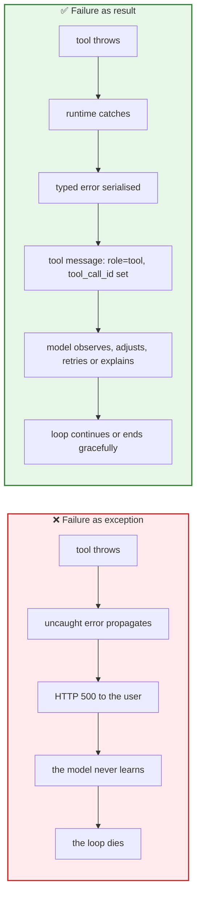

The source lecture states the failure mode bluntly:

```ts
// ❌ WRONG: throwing a runtime exception crashes the whole agent loop
try {
  const result = await tool.execute(args);
} catch (err) {
  throw err;            // the request terminates with HTTP 500
}
```

Consider a perfectly ordinary user question: *"What is 50 divided by 0?"* The calculator raises
`Division by zero is undefined`. Throwing turns a one-line edge case into a 500 for the user, a dead agent
loop, and an alert for the on-call engineer. Catching it and returning the message as an observation turns
it into a correct answer: *"That operation is undefined — division by zero has no result."*

> **The reframe:** your tools are not internal functions being called by code you control. They are
> **endpoints being called by a probabilistic client that sends invalid input regularly.** Treat every
> argument the way you treat an HTTP request body from the internet.

---

## 06.2 Why "never throw" is the wrong reading of the rule

A common over-correction is to forbid throwing entirely and swallow errors inside each tool. That is worse,
because it destroys the error's *type* and makes silent failure possible.

The correct discipline has three parts:

1. **Tools may throw** — freely, and with precise, typed errors. Throwing is the natural way to signal
   "this input is not acceptable" or "this dependency failed".
2. **The runtime always catches** — a single boundary (`executeSafely`) converts *every* outcome (success,
   validation failure, thrown error, timeout, abort) into a `tool` message.
3. **Nothing is swallowed silently** — a caught error is reported to the model, to telemetry, or both.
   Silent success is the only truly forbidden outcome.

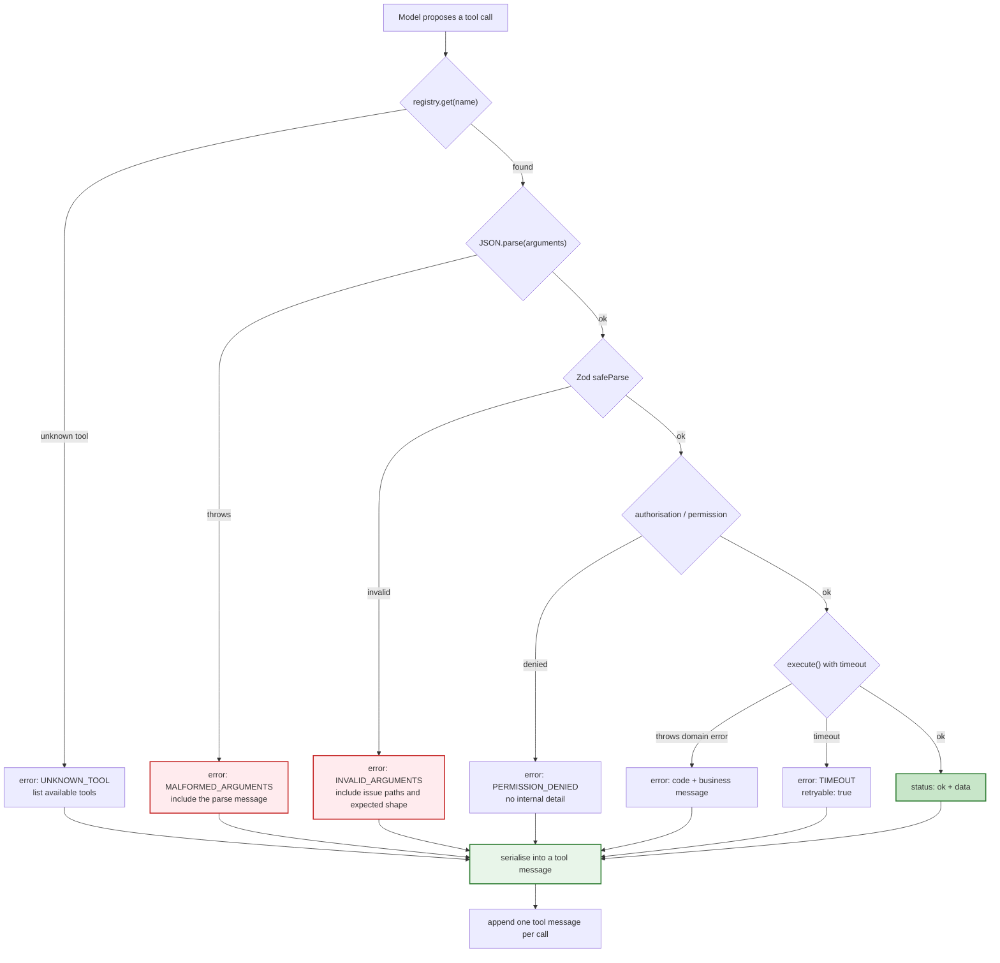

**Every arrow in that diagram ends at a tool message.** There is no path to a 500.

### 06.2.1 The single boundary: `executeSafely`

```ts
// PSEUDO-CODE ONLY — the only place in the system where a tool error is allowed to exist
async function executeSafely(call: ToolCall, registry: ToolRegistry, ctx: ToolContext): Promise<string> {
  const tool = registry.get(call.function.name);
  if (!tool) {
    return errorResult('UNKNOWN_TOOL', `No tool named "${call.function.name}".`, {
      available: [...registry.keys()],
    });
  }

  const parsed = parseAndValidate(call.function.arguments, tool.schema);   // §06.5
  if (!parsed.ok) return errorResult(parsed.code, parsed.message);

  if (!(await canCall(tool, ctx))) {
    return errorResult('PERMISSION_DENIED', 'You are not allowed to perform this action.');
  }

  try {
    const data = await withTimeout(tool.execute(parsed.value, ctx), tool.timeoutMs ?? 10_000);
    return JSON.stringify({ status: 'ok', ...shapeResult(data) });
  } catch (err) {
    return errorResult(classify(err), safeMessage(err));                   // never leaks internals
  }
}

function errorResult(code: string, message: string, extra: object = {}): string {
  return JSON.stringify({ status: 'error', code, message, retryable: isRetryable(code), ...extra });
}
```

Notice the four properties this function guarantees:

| Property | Why it matters |
| :--- | :--- |
| It **always returns a string** | the caller can never throw; the loop cannot die here |
| It **always names a code** | the model can branch on `code`, not on prose |
| It **always sets `retryable`** | the model learns whether trying again is worthwhile |
| It **never leaks internals** | stack traces, SQL, hostnames and secrets stay out of the context |

---

## 06.3 The error taxonomy

Not all failures should provoke the same reaction. The classification below is the one to implement, because
each class maps to a *different* action — for the model and for your runtime.

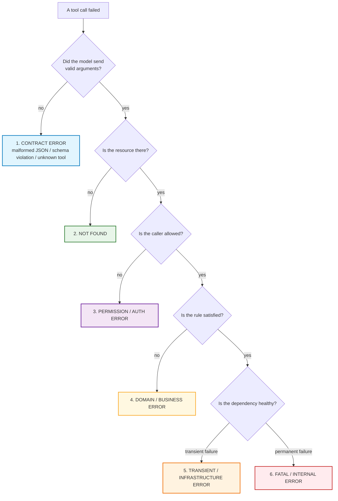

| # | Class | Example | `retryable` | Model should… | Runtime should… |
| :--- | :--- | :--- | :---: | :--- | :--- |
| 1 | **Contract** | `"times"` instead of `"multiply"`; missing `b`; truncated JSON | yes (with fixed args) | fix the arguments and call again | include the offending path and the expected shape |
| 2 | **Not found** | `INV-9999` does not exist | no | tell the user; stop asking | return a neutral message; log the miss |
| 3 | **Permission** | user may not refund this order | no | explain it cannot do this | log the attempt; never reveal internal policy detail |
| 4 | **Domain / business** | refund exceeds the 30-day window; insufficient balance | no | explain the rule; offer the alternative | return the rule in plain language |
| 5 | **Transient** | upstream 503, socket timeout, rate limit | **yes** | wait/retry, or try an alternative tool | retry with backoff + jitter, then surface |
| 6 | **Fatal / internal** | bug in the tool, schema drift, config missing | no | apologise and stop; do not loop | alert; return a generic message; never leak details |

### 06.3.1 The two classes that are easy to get wrong

- **Contract errors are the model's fault, and it can fix them.** These are the *most* valuable errors to
  return verbatim, because the model has all the information it needs to correct itself. Include the
  validation issues: `{ code: 'INVALID_ARGUMENTS', issues: [{ path: 'operation', message: 'expected one of add|subtract|…' }] }`.
- **Transient errors are nobody's fault, and the model cannot fix them.** If you return a raw 503, the model
  will often retry the same call immediately and burn the step budget (Chapter 05 §05.7). Better: retry
  in-runtime with backoff, and if it still fails, return a message that *discourages* immediate retry:
  *"The weather service is temporarily unavailable (attempted 3 times). Consider answering without it or
  asking the user to try again shortly."*

---

## 06.4 The structured error contract

A single error shape across every tool is worth more than a clever per-tool error. Uniformity is what lets
the model generalise and lets your evals assert.

```json
{
  "status": "error",
  "code": "DIVISION_BY_ZERO",
  "message": "Division by zero is undefined. Provide a non-zero denominator.",
  "retryable": false,
  "details": { "operation": "divide", "b": 0 }
}
```

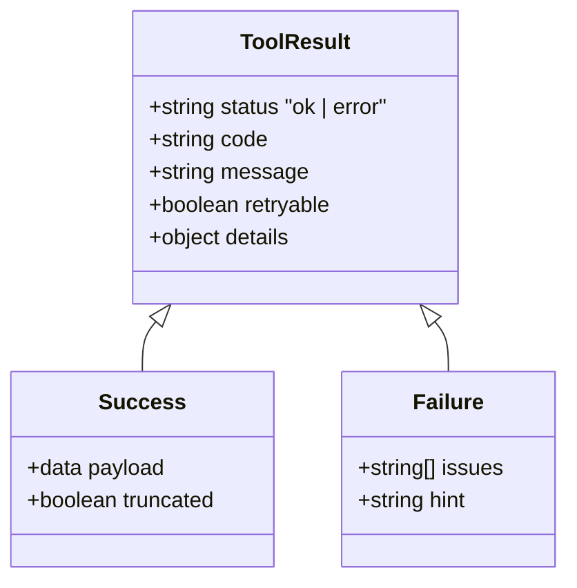

### 06.4.1 Field-by-field rationale

| Field | Purpose | Rule |
| :--- | :--- | :--- |
| `status` | machine-readable success/failure | **always present**, on success too |
| `code` | stable, SCREAMING_SNAKE identifier | never a sentence; never localised |
| `message` | one human-readable sentence the model can quote | written for the model, not for a log parser |
| `retryable` | whether trying again may help | `true` only for contract/transient |
| `details` | the minimum context needed to correct | the offending argument, the allowed values, the missing resource id |
| `issues` (contract only) | per-field validation failures | path + expected shape |

### 06.4.2 What must never appear in an error result

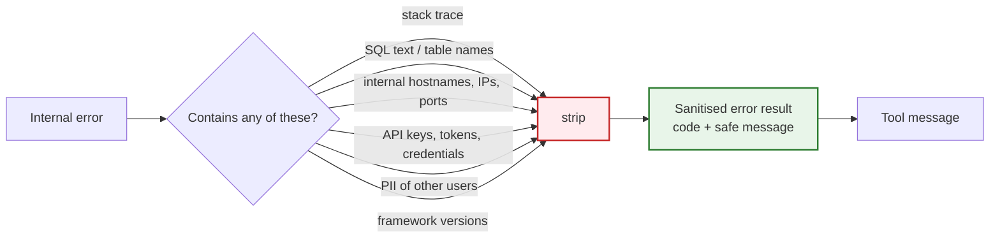

Everything stripped here is still **logged server-side** — the model's context and your observability
pipeline have opposite requirements, and the sanitisation step is where you separate them.

---

## 06.5 Malformed arguments: the parse-and-validate defence

Recall from Chapter 03 that the model emits `arguments` as a **stringified JSON string**, generated token by
token. It can be truncated, contain trailing commas, or contain the wrong types entirely.

```json
{ "id": "call_123", "type": "function",
  "function": { "name": "calculate",
                "arguments": "{\"operation\":\"divide\",\"a\":10000,\"b\":95}" } }
```

```ts
// ❌ DANGEROUS: an unhandled parse crash takes the process down
const parsed = JSON.parse(toolCall.function.arguments);
```

### 06.5.1 The two-stage guard

```ts
// PSEUDO-CODE ONLY
type ParseOutcome<T> =
  | { ok: true; value: T }
  | { ok: false; code: 'MALFORMED_ARGUMENTS' | 'INVALID_ARGUMENTS'; message: string };

function parseAndValidate<T>(raw: string, schema: ZodSchema<T>): ParseOutcome<T> {
  let json: unknown;

  // Stage 1 — syntax
  try {
    json = JSON.parse(raw);
  } catch (err) {
    return {
      ok: false,
      code: 'MALFORMED_ARGUMENTS',
      message: `Arguments were not valid JSON (${(err as Error).message}). Re-send the call with valid JSON.`,
    };
  }

  // Stage 2 — structure and types
  const result = schema.safeParse(json);
  if (!result.success) {
    const issues = result.error.issues.map((i) => `${i.path.join('.')}: ${i.message}`).join('; ');
    return { ok: false, code: 'INVALID_ARGUMENTS', message: `Arguments failed validation — ${issues}` };
  }

  return { ok: true, value: result.data };
}
```

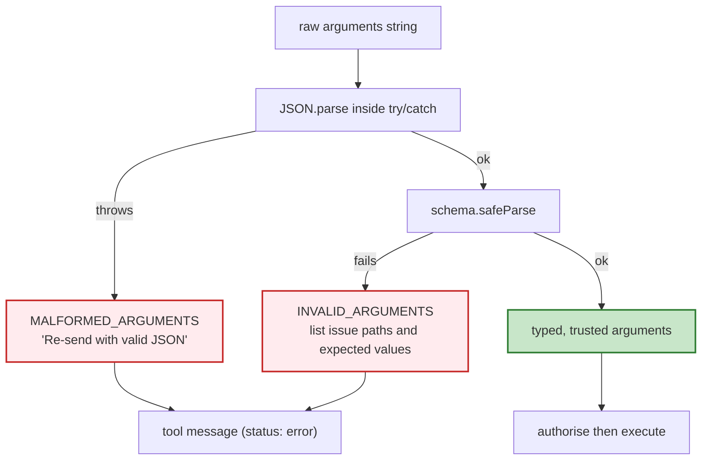

### 06.5.2 Why two stages, not one

They produce *different* error messages, and the model repairs them differently:

| Stage | Typical cause | Message the model needs |
| :--- | :--- | :--- |
| 1 — syntax | truncated stream, hallucinated token, stray text | "your JSON was invalid; re-emit it" |
| 2 — structure | wrong type (`"10"` vs `10`), missing field, bad enum | "field `operation` must be one of add\|subtract\|…; you sent `times`" |

Collapsing the two into a single "invalid arguments" message loses the distinction and produces a model that
retries the same mistake.

### 06.5.3 Repair strategies, in order of preference

1. **Return the error and let the model fix it** — cheapest, and it works for almost all contract errors.
2. **Coerce safely where the intent is unambiguous** — `"10"` → `10` for a numeric field, trimming
   whitespace, upper-casing a currency code. *Only* where lossless and documented.
3. **Re-prompt once with a repair instruction** — append the validation issues and ask for a corrected call.
4. **Give up on that call** — return a contract error and let the loop terminate with a partial answer.

> **Never "helpfully" guess the arguments.** If `city` is missing, do not default to the user's last city.
> A guessed argument produces a *plausible wrong answer*, which is worse than a visible failure.

---

## 06.6 The self-healing loop

Now the payoff. Because the failure arrived as an **observation**, the model can read it, reason about it,
and change its behaviour. The source lecture's example:

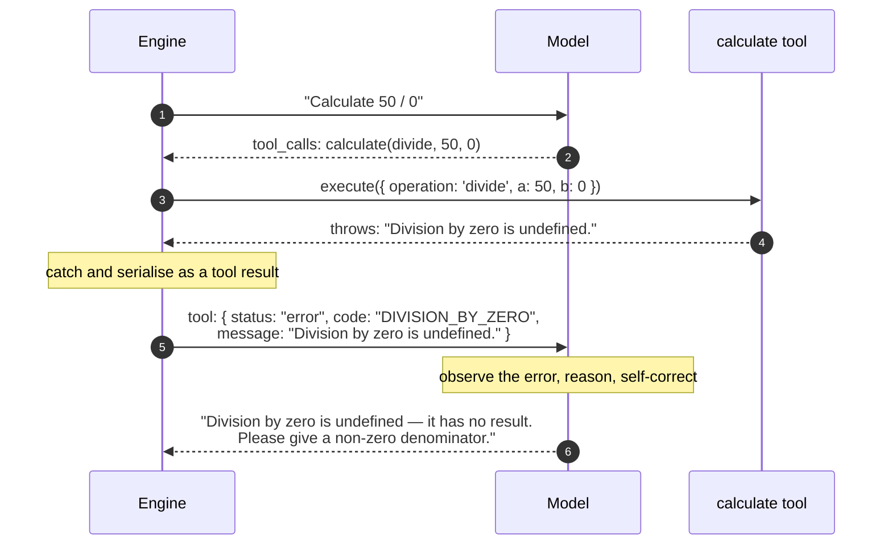

By receiving the error inside its context window, the model can do three things — and these are the **three
levels of self-healing**, in increasing sophistication.

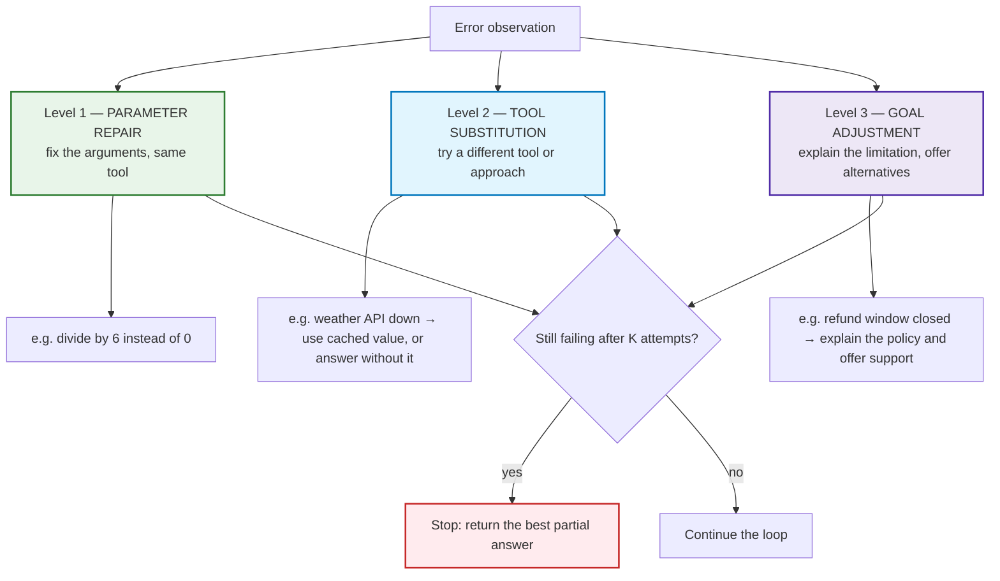

### 06.6.1 Level 1 — parameter repair

The most common case, and the one that pays for the whole design. Examples:

| Error | Model's correction |
| :--- | :--- |
| `INVALID_ARGUMENTS: operation must be add\|subtract\|multiply\|divide` | re-sends with `multiply` |
| `MALFORMED_ARGUMENTS: not valid JSON` | re-emits well-formed JSON |
| `UNSUPPORTED_PAIR: no rate for INR→XYZ` | uses a supported code, or asks the user |
| `NOT_FOUND: no invoice INV-9999` | stops retrying; reports it cannot find it |

> **Design implication:** the more precisely you describe the *expected* value in the error, the fewer
> repair attempts the model needs. This is why `INVALID_ARGUMENTS` must list the allowed values.

### 06.6.2 Level 2 — tool substitution

When the same tool keeps failing, a capable model will try a different route: a different tool, a broader
query, or a different argument shape. You enable this by having **overlapping but distinct capabilities**
(e.g. `getInvoiceStatus` and `listRecentInvoices`) and by *not* hard-blocking all tools after one failure.

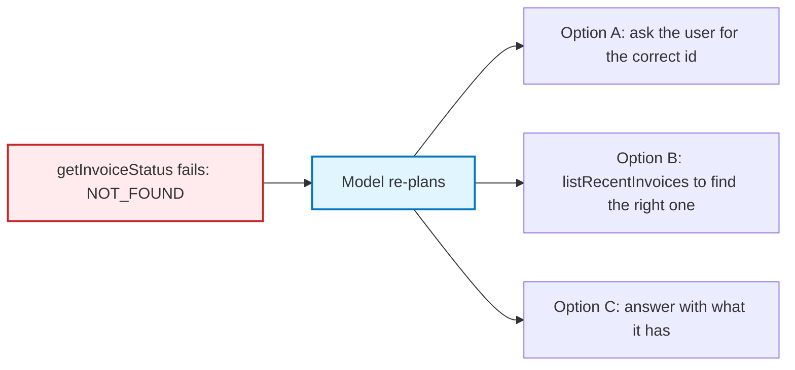

### 06.6.3 Level 3 — goal adjustment

Sometimes the goal is impossible and the right behaviour is to *stop gracefully and say so*. This is a
correct outcome, not a failure of the agent:

```text
"I can't complete the refund: the 30-day return window closed 12 days ago.
I can offer you a store credit instead — would you like that?"
```

To make Level 3 reachable you must give the model the *rule*, not just a status code. Compare:

| Bad error message | Good error message |
| :--- | :--- |
| `REFUND_FAILED` | `REFUND_WINDOW_EXPIRED: refunds are allowed within 30 days of purchase; this order is 42 days old.` |
| `E403` | `PERMISSION_DENIED: only the account owner can cancel a subscription.` |
| `Validation error` | `INVALID_ARGUMENTS: 'dueDate' must be ISO 8601 (e.g. 2026-11-05T09:00:00Z); you sent 'next Friday'.` |

The right-hand column is what lets a model produce the left-hand paragraph.

### 06.6.4 The limits of self-healing

Self-healing is not a licence for infinite retries. Three hard limits:

1. **Attempt limit per call.** The same `name + args` hash retried more than twice is thrash, not healing
   (Chapter 05 §05.7).
2. **Attempt limit per tool.** After *K* failures on one tool, mark it unavailable for this request and tell
   the model explicitly.
3. **Budget limit.** Self-healing consumes model invocations. If the step or token budget is nearly spent,
   force Level 3 (goal adjustment) instead of another retry.

---

## 06.7 Runtime retry policy — and when retrying is dangerous

There are **two** retry layers, and confusing them is a classic source of duplicate side effects:

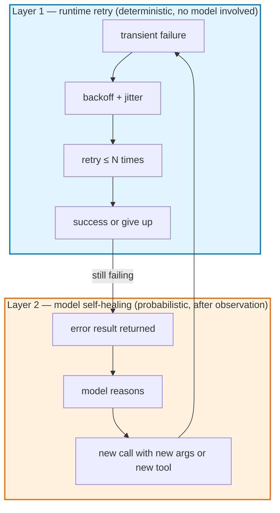

| Layer | Who decides | Handles | Must never |
| :--- | :--- | :--- | :--- |
| **Runtime retry** | your code, deterministically | transient network/5xx/timeout on **read** tools | retry an action tool without an idempotency key |
| **Model self-healing** | the model, after seeing the error | contract errors, wrong tool, wrong approach | be relied on to fix infrastructure |

### 06.7.1 The retry decision table

| Error class | Runtime retry? | Model retry? |
| :--- | :--- | :--- |
| Contract (`MALFORMED_ARGUMENTS`, `INVALID_ARGUMENTS`) | no | **yes** — with corrected arguments |
| Not found | no | no — report it |
| Permission | no | no — report it |
| Domain / business rule | no | no — explain the rule |
| Transient (timeout, 503, rate limit) | **yes** — backoff, ≤ 2–3 attempts | only if the runtime gives up |
| Fatal / internal | no | no — halt with a partial answer |

### 06.7.2 Backoff with jitter, and a budget

```ts
// PSEUDO-CODE ONLY
async function withRetry<T>(op: () => Promise<T>, opts = { attempts: 3, baseMs: 200 }): Promise<T> {
  for (let attempt = 1; ; attempt++) {
    try {
      return await op();
    } catch (err) {
      if (attempt >= opts.attempts || !isTransient(err)) throw err;
      const backoff = opts.baseMs * 2 ** (attempt - 1);
      const jitter = Math.random() * backoff;            // avoid synchronised retry storms
      await sleep(backoff + jitter);
    }
  }
}
```

Three rules:

1. **Retry only idempotent operations** unless the operation carries an idempotency key (Chapter 04 §04.7).
2. **Total retry time must fit inside the tool timeout**, which must fit inside the loop budget
   (Chapter 05 §05.7.1). A retry policy that outlives the request is just a slower failure.
3. **Count retries in your metrics.** A tool with a 40 % first-attempt failure rate is a bug report, not a
   design that "works because of retries".

### 06.7.3 Idempotency, restated

For any action tool, the runtime must be able to answer: *"have I already done this?"*

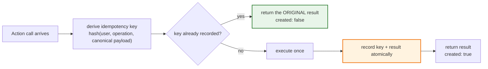

The key is derived from **intent**, not from a random request id — otherwise a genuine retry looks like a new
operation and you send the email twice.

---

## 06.8 Error-handling anti-patterns

These are the mistakes that make agents both fragile *and* opaque.

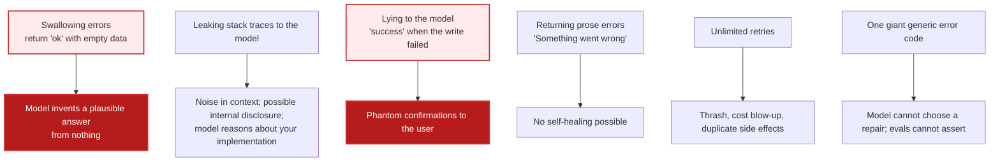

### 06.8.1 The two most damaging ones

**Swallowing errors** (returning `{ status: 'ok', data: null }`) is the worst, because the model *will*
produce a confident answer from nothing. A tool that cannot answer must say so:

```json
{ "status": "error", "code": "UPSTREAM_UNAVAILABLE", "message": "Weather data could not be retrieved.", "retryable": true }
```

**Lying to the model** (reporting success for a failed write) produces the single most damaging class of
agent bug: *phantom confirmations*. "Your refund has been processed" when nothing happened is worse than an
error message, because the user stops pursuing it.

> **The honesty rule:** the tool result must be a faithful description of what actually happened — no more
> optimistic, and no more pessimistic.

---

## 06.9 Common mistakes

| # | Mistake | Consequence | Fix |
| :--- | :--- | :--- | :--- |
| 1 | Letting a tool exception propagate | HTTP 500 for a one-line edge case | One `executeSafely` boundary converts every outcome to a result |
| 2 | Swallowing errors and returning `ok` | Model invents an answer from nothing | Always `status: 'error'` with a code |
| 3 | Reporting success for a failed write | Phantom confirmations; user stops pursuing | Faithful results — the honesty rule |
| 4 | Prose-only errors (`"Something went wrong"`) | No self-healing possible | Stable `code` + actionable `message` |
| 5 | One generic error code for everything | Model cannot choose a repair; evals cannot assert | Six classes with distinct codes |
| 6 | Leaking stack traces / SQL / keys to the model | Noise, disclosure, model reasons about internals | Sanitise; log the detail server-side |
| 7 | Single-stage argument validation | Model cannot tell syntax from structure errors | Two stages: parse, then validate |
| 8 | Guessing missing arguments | Plausible wrong answers | Return a contract error and let the model fix it |
| 9 | Retrying action tools without an idempotency key | Duplicate emails, refunds, tasks | Key derived from intent, recorded atomically |
| 10 | Unlimited retries | Thrash, cost blow-up | Attempt caps per call and per tool |
| 11 | Retry budget longer than the request budget | Slow failure instead of fast one | Nest retry ⊂ tool timeout ⊂ loop budget |
| 12 | Returning raw upstream 5xx text | Model retries immediately, burns steps | Runtime retries; then a discouraging message |
| 13 | Blocking every tool after one failure | No Level-2 substitution possible | Mark only the failing tool unavailable |
| 14 | Expecting self-healing to fix infrastructure | Infinite loop on a dead dependency | Distinguish "model can fix" from "nobody can fix" |
| 15 | Not counting error rates per tool | Silent chronic failures | Emit per-tool error/retry metrics |

---

## 06.10 Key takeaways

1. **A tool failure is a result, not an exception.** One boundary (`executeSafely`) converts every outcome —
   success, malformed JSON, schema violation, permission denial, domain error, timeout — into a `tool`
   message.
2. **Tools may throw; the runtime always catches; nothing is swallowed.** That trio is the correct reading of
   the rule.
3. **Errors are information.** The model self-heals only if the error tells it what was wrong and what was
   expected.
4. **Six error classes, six different reactions:** contract (model fixes), not found, permission, domain,
   transient (runtime retries), fatal (halt and alert).
5. **Use one structured error contract everywhere:** `status`, `code`, `message`, `retryable`, `details` —
   plus `issues` for contract errors.
6. **Two-stage argument defence:** `JSON.parse` in a `try/catch` (syntax), then `safeParse` (structure).
   They produce different repairs.
7. **Three levels of self-healing:** parameter repair → tool substitution → goal adjustment. All three are
   successes; none is a licence for infinite retries.
8. **Retry policy has two layers**, and only the runtime layer may retry blindly — and only for idempotent
   reads, unless an idempotency key exists.
9. **Never leak internals into the model's context.** Strip stack traces, SQL, hostnames, credentials and
   PII; log them server-side instead.
10. **Honesty is the contract.** The tool result must faithfully describe what happened; optimistic success
    is the most damaging bug class in agent systems.

---

**Next:** [Chapter 07 — Routing, `tool_choice` & Testing Tool Selection](./07_Routing_Tool_Choice_and_Testing_Tool_Selection.md)


