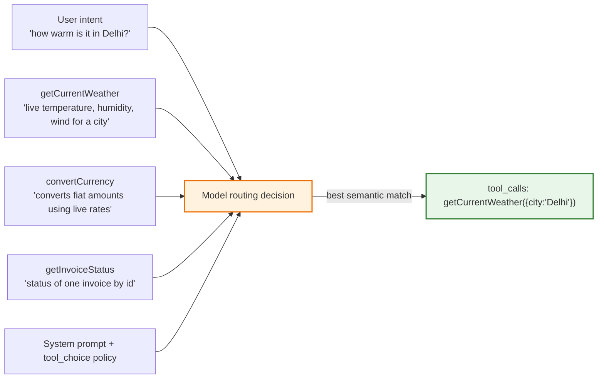
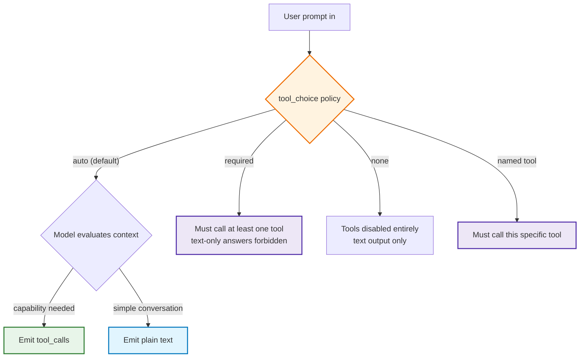
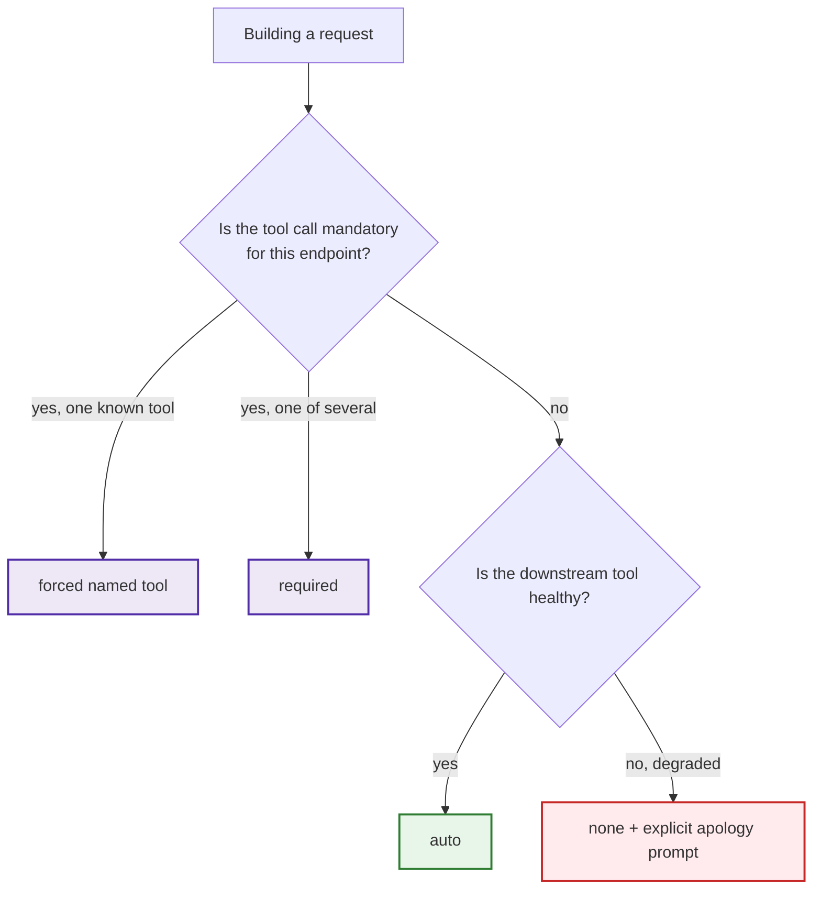
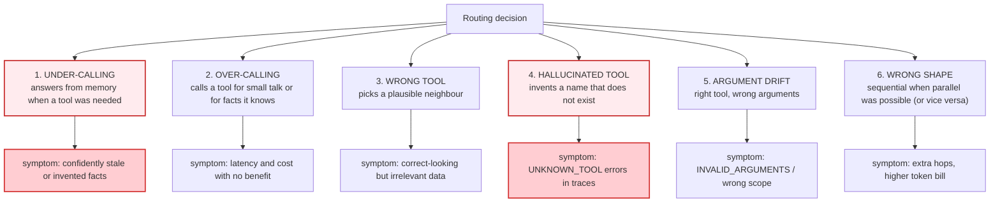
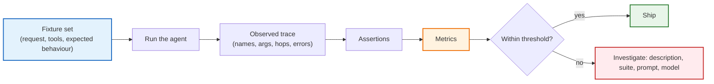
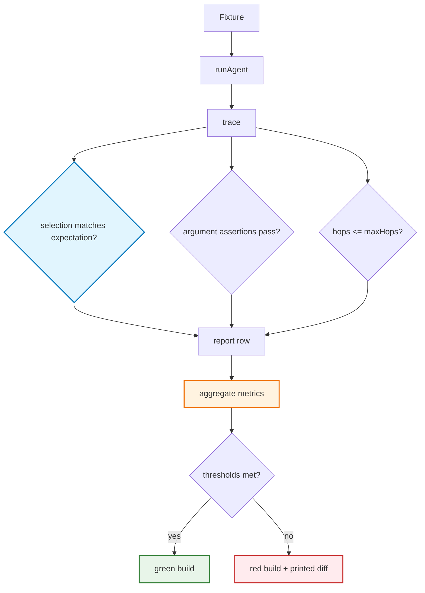
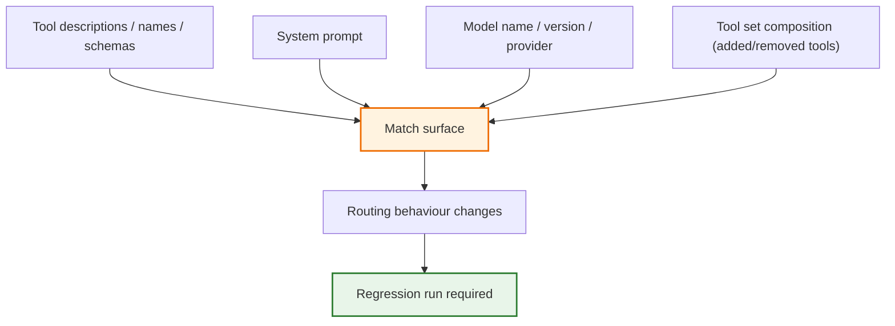
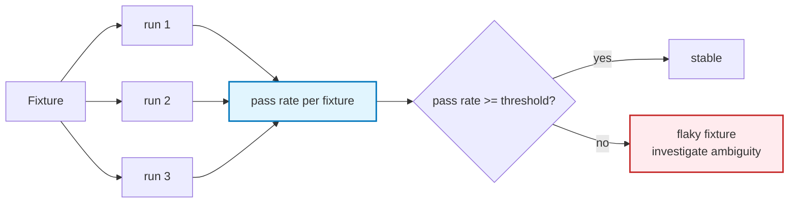

# Chapter 07 — Routing, `tool_choice` & Testing Tool Selection

> **Lecture 08 · Chapter 07 of 08** · Level: 🟡 Intermediate · Phase 3 — Agency & Contracts
> **Source:** `Forward-Deployed-Engineer/Lecture 05/notes/02_The_Tool_Calling_Protocol_and_Wire_Architecture.md`
> (§2.6, §2.8) · Chapter 02 §02.3 (description engineering)
> **Roadmap topics:** multi-tool routing & `tool_choice` policies · **tool selection as a behaviour you can
> test**.
> **Prerequisites:** Chapters 02–06 · Lecture 30 preview (evals and testing).

---

## 07.0 What this chapter is for

Everything so far has assumed the model picked the *right* tool. This chapter is about that assumption
itself.

Tool selection is a **decision the model makes from text** — the user's request, the tool names, the
descriptions, and the system prompt. It is not a lookup and not a rule engine. That makes it the single
highest-variance part of a tool-calling system, and it makes it a **behaviour**: something you can observe,
measure, regress, and improve.

The chapter has two halves:

1. **Routing** — the levers that influence which tool is chosen, and the `tool_choice` policies that
   constrain the choice.
2. **Testing** — how to turn "the model usually picks the right tool" into a number you can defend in a code
   review.

By the end of this chapter you should be able to:

1. Explain routing as a semantic match between intent and description.
2. Enumerate the six inputs that shape a routing decision.
3. Apply the four `tool_choice` policies and say when each is appropriate.
4. Diagnose the six routing failure modes by symptom.
5. Build a golden-transcript fixture set and assert on tool name, arguments and hop count.
6. Compute selection accuracy, argument validity, and average hops as first-class metrics.
7. Treat prompt/model/tool-schema changes as changes requiring regression runs.
8. Decide when to force a tool, when to allow choice, and when to disable tools entirely.

---

## 07.1 Routing is a semantic match, not a lookup

When you send a suite of tools, the model performs something like: *for each tool, how well does its
`description` explain what this user is asking for?* Then it either calls the best match or answers in text.



### 07.1.1 The six inputs that shape a routing decision

| # | Input | How it influences routing | Where you control it |
| :--- | :--- | :--- | :--- |
| 1 | **User message** | supplies the intent and entities | prompt engineering upstream (Lecture 05) |
| 2 | **Tool `name`** | a strong, cheap semantic signal | naming conventions (Chapter 02 §02.7.2) |
| 3 | **Tool `description`** | the primary match surface | description engineering (Chapter 02 §02.3) |
| 4 | **Parameter names/descriptions** | helps fill arguments correctly once selected | schema design |
| 5 | **System prompt** | sets policy ("check inventory before quoting", "never write without confirmation") | prompt + runtime enforcement |
| 6 | **`tool_choice`** | constrains whether a tool may or must be called | request parameter (§07.2) |

> **The uncomfortable implication:** if routing is wrong, the bug is usually in *your description text*, not
> in the model. That is good news — description text is versioned, reviewable and testable.

---

## 07.2 `tool_choice`: the four routing policies

`tool_choice` is how the *application* constrains the model's freedom to call tools.



| `tool_choice` | Model behaviour | Enterprise use case | Risk if misused |
| :--- | :--- | :--- | :--- |
| `"auto"` (default) | freely chooses text or one/more tools | general assistants, support agents | over-calling or under-calling; needs evals |
| `"required"` | **must** call at least one tool before returning text | ETL extraction, workflow gateways where text is invalid | forces a call even when "no tool needed" is the right answer |
| `"none"` | tools disabled; text only | degradation during an upstream outage; "explain only" modes | capability loss; the agent may invent data |
| `{ type: 'function', function: { name } }` | **must** call that specific tool | intent-locked pipelines; single-purpose extraction | removes the model's escape hatch; malformed args are likely |

### 07.2.1 Choosing a policy



**Practical guidance:**

- **Default to `auto`.** It is the only policy that lets the model answer "I don't need a tool", which is
  frequently the correct behaviour.
- **Use `required` for extraction-shaped endpoints** where a text answer is a contract violation (e.g. "parse
  this CV into JSON"). Note this overlaps with Lecture 10's structured outputs, which is usually the better
  tool for pure extraction.
- **Use `none` as a graceful-degradation lever.** If the DB is down, disabling the DB tool plus a system
  message ("database unavailable; do not claim to have looked anything up") produces an honest answer
  instead of a hallucinated one.
- **Use a forced tool sparingly.** It is powerful for a single-purpose endpoint (`/api/extract-invoice`) and
  dangerous inside a general agent, because it removes the model's ability to ask for something else.

### 07.2.2 Policies interact with tool-set size

`tool_choice` cannot fix a badly designed suite. If you have 30 tools with overlapping descriptions,
`required` will confidently pick a wrong one. Reduce the surface first (Chapter 02 §02.7), then choose the
policy.

| Suite size | Recommended policy | Why |
| :--- | :--- | :--- |
| 1–5 tools, distinct purposes | `auto` | the match surface is unambiguous |
| 6–15 tools, one domain | `auto` + evals | needs measurement, but choice is meaningful |
| 16+ tools | split into role-scoped agents, then `auto` | routing accuracy degrades before it collapses |
| Single-purpose endpoint | forced tool or `required` | text output is not a valid response |

---

## 07.3 The six routing failure modes

Routing fails in a small number of recognisable ways. Naming them makes them diagnosable.



### 07.3.1 Symptom → cause → fix

| Mode | Likely cause | Fix |
| :--- | :--- | :--- |
| **Under-calling** | description does not match the user's vocabulary; system prompt is passive | add trigger phrases to the description; add an explicit policy line to the system prompt ("always check live data for prices") |
| **Over-calling** | description is too broad ("fetches data") | add "when NOT to use" boundaries; sharpen the name |
| **Wrong tool** | two descriptions overlap | merge the tools, or differentiate the *when* clauses; rename to be domain-qualified |
| **Hallucinated tool** | the model wants a capability you did not expose | add the missing capability, or improve the closest tool's description so it is clearly the right one |
| **Argument drift** | parameter descriptions lack units/formats; enums missing | describe every parameter; convert free strings to enums; add `pattern` constraints |
| **Wrong shape** | the model is guessing about dependencies | return precise error results and let it re-plan (Chapter 06); do not over-constrain with `required` |

> **The hallucinated-tool signal is special.** It is the model *telling you what tool you forgot to build*.
> Treat `UNKNOWN_TOOL` traces as a product backlog, not as noise.

### 07.3.2 A worked diagnosis

```text
Trace excerpt:
  step 1  proposed: searchOrders  args {"query":"my last order"}
  step 1  result  : { status: "ok", results: [] }      <-- empty but "successful"
  step 2  proposed: searchOrders  args {"query":"recent purchases"}
  step 2  result  : { status: "ok", results: [] }
  step 3  proposed: searchOrders  args {"query":"order history"}
  step 3  halted  : maxSteps
```

Read it with the taxonomy:

- **Mode 6 (wrong shape)** is the visible symptom: three hops where one would do.
- The root cause is **Mode 3 (wrong tool)**: `searchOrders` takes a *semantic query*, but the user needed
  `listRecentOrders({ userId, limit })`. The model kept paraphrasing because the tool's contract could not
  express the actual intent.
- The fix is **not** a better prompt. It is a better tool: add `listRecentOrders` with an explicit
  description boundary ("use for *my* recent orders; use `searchOrders` only for keyword search").

That is the whole point of this chapter: **routing problems are usually interface problems.**

---

## 07.4 Tool selection is a behaviour — so measure it

The roadmap lists "tool selection as a behaviour you can test". That phrasing matters: you cannot test a
*decision* by reading code, because the decision lives in weights. You test it the way you test any
stochastic component: with **fixtures and metrics**.



### 07.4.1 The four metrics

| Metric | Definition | Target shape |
| :--- | :--- | :--- |
| **Tool-selection accuracy** | fraction of fixtures where the first proposed tool equals the expected tool (or `none`) | as high as possible; 100 % for small suites |
| **Argument validity rate** | fraction of proposed calls that pass schema validation on the first attempt | ≥ 95 % |
| **Average hops** | mean number of model invocations per fixture | low and stable; a rising trend means descriptions are drifting |
| **Termination rate** | fraction of fixtures that finish without hitting a brake | 100 % for well-formed fixtures |

Plus two supporting numbers: **error rate per tool** (Chapter 06) and **cost per fixture** (Chapter 08).

---

## 07.5 Designing the fixture set

A fixture is a **request + the expected behaviour**, where "expected behaviour" is deliberately looser than
an exact transcript — because the model is stochastic and a good second answer should not fail your suite.

```ts
// PSEUDO-CODE ONLY
type RoutingFixture = {
  id: string;
  request: string;
  expect:
    | { kind: 'noTool' }                                   // must answer in text
    | { kind: 'firstTool'; name: string }                  // first proposed tool must be this
    | { kind: 'toolChain'; names: string[] }               // exact ordered chain
    | { kind: 'anyOf'; names: string[] };                  // any of these is acceptable
  argAssertions?: Array<{ path: string; equals?: unknown; matches?: RegExp; isNumber?: boolean }>;
  maxHops?: number;
};
```

### 07.5.1 A starter fixture set for the lecture's four tools

```ts
// PSEUDO-CODE ONLY
const fixtures: RoutingFixture[] = [
  { id: 'w1', request: 'How warm is it in Delhi right now?',
    expect: { kind: 'firstTool', name: 'getCurrentWeather' },
    argAssertions: [{ path: 'city', matches: /delhi/i }], maxHops: 2 },

  { id: 'w2', request: 'Do I need a jacket in London today?',
    expect: { kind: 'firstTool', name: 'getCurrentWeather' },
    argAssertions: [{ path: 'city', matches: /london/i }], maxHops: 2 },

  { id: 'c1', request: 'What is 8745 multiplied by 493?',
    expect: { kind: 'firstTool', name: 'calculate' },
    argAssertions: [{ path: 'operation', equals: 'multiply' },
                    { path: 'a', isNumber: true }, { path: 'b', isNumber: true }], maxHops: 2 },

  { id: 'c2', request: 'Convert 120 USD to INR and split among 6 people.',
    expect: { kind: 'toolChain', names: ['convertCurrency', 'calculate'] }, maxHops: 4 },

  { id: 'p1', request: 'Weather in Delhi and $500 in rupees?',
    expect: { kind: 'anyOf', names: ['getCurrentWeather', 'convertCurrency'] }, maxHops: 2 },

  { id: 'n1', request: 'Hello! How are you today?',
    expect: { kind: 'noTool' }, maxHops: 1 },

  { id: 'n2', request: 'What is the capital of France?',
    expect: { kind: 'noTool' }, maxHops: 1 },

  { id: 'e1', request: 'What is 50 divided by 0?',
    expect: { kind: 'firstTool', name: 'calculate' }, maxHops: 3 },   // must not crash (Ch.06)
];
```

Notice the deliberate composition: **positive cases** (w1, c1), **chains** (c2), **multi-intent** (p1),
**negative cases** (n1, n2 — the model must *not* call a tool), and **error cases** (e1). Negative cases are
the ones teams forget, and they are exactly the ones that catch over-calling.

### 07.5.2 The harness

```ts
// PSEUDO-CODE ONLY
async function runRoutingEval(fixtures: RoutingFixture[], tools: Tool[], cfg: AgentConfig) {
  const rows = [];

  for (const fx of fixtures) {
    const { trace, steps, answer, halted } = await runAgent(fx.request, tools, cfg);

    const proposed = trace.flatMap((s) => s.toolCalls.map((c) => c.name));
    const firstCall = trace[0]?.toolCalls?.[0];

    const selectionOk =
      fx.expect.kind === 'noTool'   ? proposed.length === 0 :
      fx.expect.kind === 'firstTool'? firstCall?.name === fx.expect.name :
      fx.expect.kind === 'anyOf'    ? fx.expect.names.includes(firstCall?.name ?? '') :
      fx.expect.kind === 'toolChain'? fx.expect.names.every((n, i) => proposed[i] === n) : false;

    const argsOk = (fx.argAssertions ?? []).every((a) => checkAssertion(firstCall, a));

    rows.push({ id: fx.id, selectionOk, argsOk, hops: steps, halted, answer, proposed });
  }

  return {
    selectionAccuracy: mean(rows.map((r) => r.selectionOk)),
    argumentValidity: mean(rows.filter((r) => r.proposed.length).map((r) => r.argsOk)),
    avgHops: mean(rows.map((r) => r.hops)),
    terminationRate: mean(rows.map((r) => !r.halted)),
    rows,
  };
}
```



### 07.5.3 The confusion matrix — the most useful artefact

For a suite with *N* tools, a confusion matrix of `expected tool` × `observed tool` shows instantly which
descriptions collide.

```text
                observed →
expected ↓      weather  currency  calculate  none
weather             9        0          0      1
currency            0        8          1      1
calculate           0        1          9      0
none                0        0          0     10
```

Reading this matrix:

- `weather → none` (1) is **under-calling** — one weather request got a text answer.
- `currency → calculate` (1) and `calculate → currency` (1) are **wrong tool** — the two descriptions overlap
  on the word "convert".
- `none → none` (10) is perfect, and it is the row most suites are missing entirely.

---

## 07.6 Regression: anything that changes the match surface needs a run

A tool-calling system has **four versioned inputs** that can silently change routing behaviour. Every one of
them is a regression trigger.



| Change | Why it can break routing | Minimum gate |
| :--- | :--- | :--- |
| Rewording a description | it *is* the routing index | full fixture run |
| Renaming a tool | the name is a semantic signal | full fixture run |
| Adding a parameter | can pull a neighbouring tool's requests | full fixture run |
| Adding a tool | new overlap risk with existing tools | full fixture run + confusion matrix diff |
| Removing a tool | the model will hallucinate it (Mode 4) | check `UNKNOWN_TOOL` rate |
| Editing the system prompt | policy lines change call/no-call decisions | full fixture run |
| Changing the model | different routing priors entirely | full run, expect diffs, re-baseline |
| Changing temperature | more variance in tool arguments | run each fixture 3–5× and report variance |

### 07.6.1 Because the system is stochastic, run fixtures N times

A single run cannot distinguish "accurate" from "lucky". Two practical approaches:

1. **Repeat runs** — run each fixture 3–5 times; report the fraction of successes. `selectionOk` becomes a
   probability, not a boolean.
2. **Low temperature for tool calls** — many teams set a low temperature (or the provider's deterministic
   mode) specifically for tool-selection turns, and reserve higher temperature for final prose. This
   narrows the distribution you must test.



> **Flaky fixtures are usually ambiguous fixtures.** If a fixture passes 2 times out of 3, the request itself
> is probably expressible by two tools — which is a *design* finding, not a test problem.

---

## 07.7 What else to test besides routing

Routing accuracy is the headline metric, but the same fixture set can assert on every property this lecture
built.

| Property | Assertion | Chapter |
| :--- | :--- | :--- |
| **Correct tool** | first proposed name matches expectation | 07 |
| **Correct arguments** | `operation === 'multiply'`, `city` matches `/delhi/i` | 02 |
| **No tool when unnecessary** | `proposed.length === 0` for small talk | 07 |
| **Chain order** | `['convertCurrency','calculate']` in order | 05 |
| **Hop budget** | `steps <= maxHops` | 05 |
| **No crash on bad input** | "divide by 0" fixture terminates without `halted` | 06 |
| **Self-healing** | after an `INVALID_ARGUMENTS`, the next proposal is valid | 06 |
| **Result shape** | tool result parses as JSON and has `status` | 04 |
| **No leakage** | tool result contains no stack trace / key pattern | 06, 08 |
| **Cost ceiling** | tokens per fixture under a threshold | 08 |
| **Parallelism** | independent multi-intent fixture uses ≤ 2 hops | 05 |

### 07.7.1 Turning traces into assertions

Because the engine already emits a structured trace (Chapter 05 §05.8), assertions are cheap — you are
reading data you already record.

```ts
// PSEUDO-CODE ONLY — property assertions over a trace
function assertTrace(trace: StepTrace[], answer: string) {
  for (const step of trace) {
    for (const call of step.toolCalls) {
      expect(call.rawArguments).toBeTypeOf('string');                 // raw string preserved
      expect(JSON.parse(call.content)).toHaveProperty('status');      // uniform result contract
      expect(call.content).not.toMatch(/at Object\.<anonymous>|password|api[_-]?key/i);
      expect(call.latencyMs).toBeLessThan(15_000);
    }
  }
  expect(answer.length).toBeGreaterThan(0);                            // never an empty answer
}
```

---

## 07.8 Common mistakes

| # | Mistake | Consequence | Fix |
| :--- | :--- | :--- | :--- |
| 1 | Treating routing as deterministic | Surprise mis-routes in production | Treat selection as a measurable behaviour |
| 2 | Rewording a description without re-running fixtures | Silent routing regression | Description edits are regression triggers |
| 3 | Two tools with overlapping semantics | Non-deterministic routing between twins | Merge, or sharpen the *when* clauses |
| 4 | Vague descriptions ("fetches data") | Over-calling and wrong-tool routing | Describe what, when, when-not, units, side effects |
| 5 | `tool_choice: "required"` everywhere | Forced calls where "no tool" is correct | Default to `auto`; use `required` for extraction endpoints |
| 6 | Forced named tool inside a general agent | Removes the model's escape hatch; malformed args | Reserve forced choice for single-purpose endpoints |
| 7 | No negative fixtures (small talk, known facts) | Over-calling goes undetected | Add `noTool` fixtures; include the `none` row in the matrix |
| 8 | Single-run evals | "Accurate" may just be lucky | Run each fixture 3–5×; report pass rates |
| 9 | No confusion matrix | Colliding descriptions stay invisible | Build `expected × observed` and diff it per release |
| 10 | Ignoring `UNKNOWN_TOOL` traces | You never learn which tool to build | Treat them as backlog items |
| 11 | Testing only the first tool in a chain | Chain-order bugs pass the suite | Assert chain order for multi-hop fixtures |
| 12 | Treating a flaky fixture as a test problem | You miss a real interface ambiguity | Flakiness usually means two tools both fit the request |
| 13 | Shipping 30 tools because the API has 30 endpoints | Routing accuracy degrades | Expose a whitelist; split by agent role |
| 14 | Not recording model/prompt version with results | Metrics become incomparable over time | Stamp every run with model, prompt and schema versions |
| 15 | Disabling all tools on any failure | No degradation path; model invents data | Disable the failing tool, keep the rest, and say so |

---

## 07.9 Key takeaways

1. **Routing is a semantic match between intent and description**, not a lookup. The description is the
   index.
2. **Six inputs shape the decision:** user message, tool name, tool description, parameter descriptions,
   system prompt, and `tool_choice`.
3. **Four `tool_choice` policies:** `auto` (default), `required`, `none`, and a forced named tool. `auto` is
   the right default; `none` is your degradation lever; forced choice belongs to single-purpose endpoints.
4. **Six routing failure modes:** under-calling, over-calling, wrong tool, hallucinated tool, argument
   drift, wrong shape. Each has a distinct symptom and a distinct fix.
5. **Most routing bugs are interface bugs.** Fix the tool contract, not the prompt.
6. **Tool selection is testable behaviour.** Fixtures + assertions + metrics turn an opinion into a number.
7. **Four metrics:** selection accuracy, argument validity, average hops, termination rate — plus per-tool
   error rate and cost per fixture.
8. **The confusion matrix is the highest-value artefact**, and the `none` row is the one teams omit.
9. **Everything that changes the match surface is a regression trigger** — descriptions, names, schemas,
   tool-set composition, system prompt, model version.
10. **A flaky fixture is a design finding.** If two tools both fit a request, the request is ambiguous — and
    your users will find it too.

---

**Next:** [Chapter 08 — Security, Permissions & the Token Economy](./08_Security_Permissions_and_the_Token_Economy.md)


