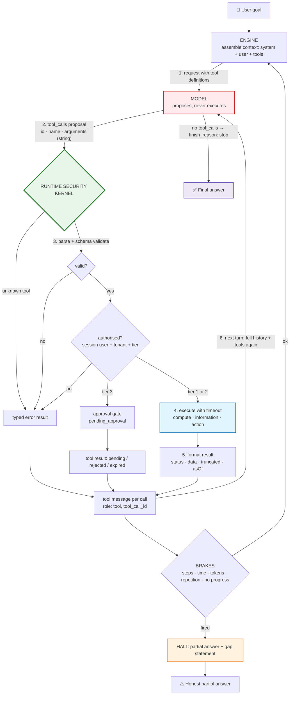
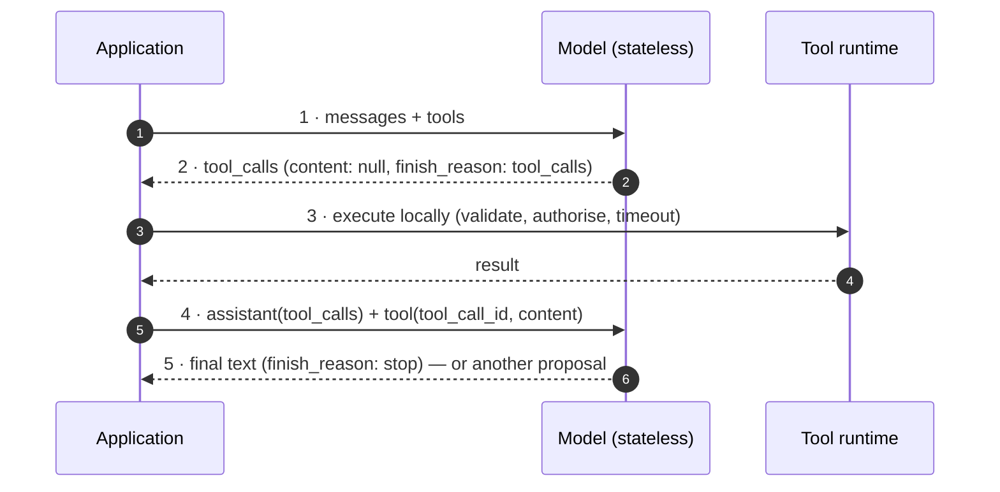

# Lecture 08 — Complete Notes
## Tool Calling: Contracts, Execution Loops & the Economics of Agency

> **Phase:** 3 · Agency & Contracts · **Level:** 🟡 Intermediate · **Prerequisites:** Lecture 07
> **Goal:** move from *"the model talks"* to *"the model acts"* — safely.
> **Gate:** you can show a 3-hop tool chain and point at the exact message that caused each hop.
> **Scope:** a single-pass consolidation of the eight chapter notes in this folder.
> **How to use this file:** read it to *revise and navigate*. It is deliberately shorter than the chapters,
> and every section links to the chapter that explains it in full.
>
> | Chapter | File |
> | :--- | :--- |
> | 01 · From token prediction to tool augmentation | [01_From_Token_Prediction_to_Tool_Augmentation.md](./01_From_Token_Prediction_to_Tool_Augmentation.md) |
> | 02 · Tool contracts: JSON Schema, OpenAPI & parameter typing | [02_Tool_Contracts_JSON_Schema_and_OpenAPI.md](./02_Tool_Contracts_JSON_Schema_and_OpenAPI.md) |
> | 03 · The 5-step wire protocol & double-turn calling | [03_The_Five_Step_Wire_Protocol_and_Double_Turn_Calling.md](./03_The_Five_Step_Wire_Protocol_and_Double_Turn_Calling.md) |
> | 04 · Tool taxonomy: deterministic, informative & action tools | [04_Tool_Taxonomy_Deterministic_and_Live_Information_Tools.md](./04_Tool_Taxonomy_Deterministic_and_Live_Information_Tools.md) |
> | 05 · Multi-step chaining & the ReAct execution loop | [05_Multi_Step_Chaining_and_the_ReAct_Execution_Loop.md](./05_Multi_Step_Chaining_and_the_ReAct_Execution_Loop.md) |
> | 06 · Error handling, self-healing & result re-injection | [06_Error_Handling_Self_Healing_and_Result_Reinjection.md](./06_Error_Handling_Self_Healing_and_Result_Reinjection.md) |
> | 07 · Routing, `tool_choice` & testing tool selection | [07_Routing_Tool_Choice_and_Testing_Tool_Selection.md](./07_Routing_Tool_Choice_and_Testing_Tool_Selection.md) |
> | 08 · Security, permissions & the token economy | [08_Security_Permissions_and_the_Token_Economy.md](./08_Security_Permissions_and_the_Token_Economy.md) |

---

## 1. Executive summary

**The lecture in eight sentences.**

1. An LLM is a **next-token predictor**, not an actor: emitting `mkdir portfolio` changes nothing on disk,
   and the BPE tokenizer's arbitrary chunking is why it hallucinates arithmetic — so **the model decides,
   deterministic code computes** ([01](./01_From_Token_Prediction_to_Tool_Augmentation.md)).
2. A tool is an ordinary function wrapped in a **contract** — `name`, `description`, JSON Schema
   `parameters` — and that contract is the *only* thing the model knows about your code
   ([02](./02_Tool_Contracts_JSON_Schema_and_OpenAPI.md)).
3. Tool calling is a **five-step stateless HTTP ping-pong**: definitions out → `tool_calls` proposal back →
   local execution → addressed `tool` result → final synthesis. The model never executes anything
   ([03](./03_The_Five_Step_Wire_Protocol_and_Double_Turn_Calling.md)).
4. Every tool belongs to a family — **compute, information, or action** — and the family determines caching,
   retries, timeouts, permission tier and whether a human approves
   ([04](./04_Tool_Taxonomy_Deterministic_and_Live_Information_Tools.md)).
5. Real requests need **multi-hop loops**: the model builds the dependency graph from runtime observations
   (ReAct: **Thought → Action → Observation**), which is why *nobody writes the orchestration* — and why
   every loop needs step, time, token, repetition and no-progress **brakes**
   ([05](./05_Multi_Step_Chaining_and_the_ReAct_Execution_Loop.md)).
6. **A tool failure is a result, not an exception.** One boundary converts every outcome into a typed
   observation, and that is what makes three levels of **self-healing** possible
   ([06](./06_Error_Handling_Self_Healing_and_Result_Reinjection.md)).
7. Tool selection is a **semantic match between intent and description**, so it is a *behaviour* you test
   with fixtures, a confusion matrix and four metrics — not an assumption
   ([07](./07_Routing_Tool_Choice_and_Testing_Tool_Selection.md)).
8. **The application is the kernel**: a tool is capability + permission, enforced by tiers and approval gates,
   and the loop's cost grows as $O(N^2)$ because the whole history is re-sent every turn
   ([08](./08_Security_Permissions_and_the_Token_Economy.md)).

### The five sentences that carry the most weight

> - *Generating tokens is not performing actions.* The model proposes; the runtime executes.
> - *A tool is a contract, and the contract is the prompt.* The description is the routing index.
> - *A tool failure is a **result**, not an exception.* Errors are the raw material of self-healing.
> - *The model decides **what**; the application decides **if**, **how** and **when**.*
> - *The loop is quadratic, so the cheap lever is the **size of what you put back into context**.*

### The one-line mental model

```text
user goal
   ↓
model proposes a tool call          (untrusted, probabilistic, text)
   ↓
runtime validates → authorises → executes → formats the result
   ↓
result is re-injected as an observation
   ↓
repeat until the model stops asking, or a brake fires
```

---

## 2. The one master diagram



**How to read it:** the model box is red because it is untrusted; the kernel box is green because it is the
only actor; the brakes are the orange loop guard. Everything else in this lecture is a detail inside one of
those three regions.

### The five-step wire protocol (Chapter 03 in one picture)



---

## 3. Cheat sheet

### 3.1 The contract (Chapter 02)

```json
{ "type": "function",
  "function": {
    "name": "convertCurrency",
    "description": "Converts an amount between fiat currencies using live rates. Requires ISO 4217 codes. Use for currency questions; not for crypto.",
    "parameters": {
      "type": "object",
      "properties": {
        "amount": { "type": "number", "exclusiveMinimum": 0, "description": "Amount to convert" },
        "from":   { "type": "string", "pattern": "^[A-Z]{3}$", "description": "Source ISO 4217 code" },
        "to":     { "type": "string", "pattern": "^[A-Z]{3}$", "description": "Target ISO 4217 code" }
      },
      "required": ["amount", "from", "to"],
      "additionalProperties": false
    }
  } }
```

| Do | Don't |
| :--- | :--- |
| verb-first, domain-qualified `name` | `processData`, `invoice` |
| description with *what · when · when not · units · side effects* | "fetches data" |
| `enum` for every categorical argument | free strings |
| `required` on everything needed | optional-everything schemas |
| `additionalProperties: false` | letting the model invent keys |
| one Zod schema → wire + validator + type | hand-maintained duplicates |
| ≤ 15 tools per agent | 40 tools "just in case" |

### 3.2 The tool families (Chapter 04)

| Family | Example | Idempotent | Cache | Retry | Tier |
| :--- | :--- | :---: | :--- | :--- | :--- |
| **Compute** | `calculate` | yes | memoise | n/a | 1 |
| **Information** | `getCurrentWeather`, `convertCurrency`, `getInvoiceStatus` | yes | TTL | ≤ 2 with jitter | 1 |
| **Action** | `createTask`, `sendEmail`, `refundPayment` | **no** | never | only with idempotency key | 2 / 3 |

### 3.3 The result contract (Chapters 04 & 06)

```json
{ "status": "ok", "data": { "temperatureCelsius": 34, "asOf": "2026-10-27T09:10:00Z" }, "truncated": false }
{ "status": "error", "code": "DIVISION_BY_ZERO", "message": "Division by zero is undefined.", "retryable": false }
```

Rules: always a `status` · units in the keys · a timestamp for time-varying facts · explicit truncation
metadata · never stack traces, SQL, hostnames, credentials or PII · never wrap prose in JSON.

### 3.4 The loop (Chapter 05)

```ts
// PSEUDO-CODE ONLY
for (let step = 1; step <= maxSteps; step++) {
  const res = await model.chat({ messages, tools, tool_choice: 'auto' }, { signal });
  messages.push(res.message);                       // record the proposal verbatim
  if (!res.message.tool_calls?.length) return answer(res);   // termination
  for (const call of res.message.tool_calls) {       // one result per call
    messages.push({ role: 'tool', tool_call_id: call.id, content: await executeSafely(call) });
  }
}
return partialAnswerWithGapStatement();             // brake fired
```

### 3.5 The brakes (Chapter 05)

| Brake | Value | Catches |
| :--- | :--- | :--- |
| `maxSteps` | 5–10 | the general case |
| wall clock | 30–90 s | slow tools, stalled providers |
| token ceiling | e.g. 60 k input | quadratic cost |
| repeated `name+args` hash | 2 | thrash |
| identical observation | 2 | "check again" loops |

### 3.6 The error classes (Chapter 06)

| Class | Code example | Runtime retry | Model should |
| :--- | :--- | :---: | :--- |
| Contract | `MALFORMED_ARGUMENTS`, `INVALID_ARGUMENTS`, `UNKNOWN_TOOL` | no | **fix the arguments and retry** |
| Not found | `NOT_FOUND` | no | report it |
| Permission | `PERMISSION_DENIED` | no | explain the limitation |
| Domain | `REFUND_WINDOW_EXPIRED` | no | explain the rule, offer the alternative |
| Transient | `TIMEOUT`, `UPSTREAM_UNAVAILABLE` | **yes**, ≤ 2–3 with jitter | wait or substitute |
| Fatal | `INTERNAL_ERROR` | no | apologise, stop, do not loop |

Two-stage argument defence: `JSON.parse` in a `try/catch` (**syntax**) → `safeParse` (**structure**).

### 3.7 Routing (Chapter 07)

| `tool_choice` | Use when |
| :--- | :--- |
| `"auto"` (default) | the model must be free to answer without a tool |
| `"required"` | a text answer is a contract violation (extraction endpoints) |
| `"none"` | degradation: the downstream tool is down |
| forced named tool | single-purpose endpoint, one known tool |

| Failure mode | Symptom | Fix |
| :--- | :--- | :--- |
| Under-calling | stale/invented facts | trigger phrases in the description |
| Over-calling | latency and cost for nothing | "when NOT to use" boundaries |
| Wrong tool | plausible but irrelevant data | merge or sharpen overlapping tools |
| Hallucinated tool | `UNKNOWN_TOOL` in traces | build the missing capability |
| Argument drift | `INVALID_ARGUMENTS` | units, formats, enums, patterns |
| Wrong shape | extra hops | better contracts, not more constraints |

### 3.8 Security tiers (Chapter 08)

| Tier | Criteria | Policy |
| :--- | :--- | :--- |
| **1 · Read** | no state change | auto-execute, TTL cache, retry ≤ 2 |
| **2 · Scoped write** | caller's own state, reversible | auto-execute with scoped credentials + idempotency key + audit |
| **3 · Critical** | irreversible / financial / external / cross-boundary | **pause for human approval**, deny by default, bind to hashed args, `expiresAt` |

---

## 4. Decision tables

### 4.1 Which tool family is this? (Chapter 04)

| Question | Answer | Family |
| :--- | :--- | :--- |
| Does it touch the outside world at all? | no | **Compute** |
| Does it only read? | yes | **Information** |
| Does it change state? | yes | **Action** |
| Can it change someone else's state, or leave the boundary? | yes | **Action, Tier 3** |

### 4.2 Sequential or parallel? (Chapter 05)

| Condition | Shape | Model calls |
| :--- | :--- | :--- |
| Hop B needs hop A's output | sequential, one call per turn | N + 1 |
| Sub-goals are independent | parallel batch in one assistant message | 2 |
| Mixed | parallel batch, then a sequential dependent hop | 3 |

### 4.3 Cache, retry or neither? (Chapter 04 §04.9)

| Tool family | Cache | Retry |
| :--- | :--- | :--- |
| Compute | memoise by args | not needed |
| Information | TTL (30 s – 15 min) + `asOf` in the result | yes, ≤ 2 with jitter |
| Action | **never** | only with an idempotency key |

### 4.4 Should this be a tool at all? (Chapters 01 & 02)

| Situation | Answer |
| :--- | :--- |
| The fact exists in the weights and never changes | **no tool** — let the model answer |
| The fact changes over time | information tool |
| The computation must be exact | compute tool |
| The state must change | action tool (with a tier) |
| A generic capability would cover many cases | **still narrow it** — one tool per intent |

### 4.5 What do I do with this tool result? (Chapter 04 §04.8)

| Content | Re-inject? |
| :--- | :--- |
| The requested data, stable ids, `status`/`code`, truncation metadata | ✅ yes |
| Upstream raw payload, stack traces, unrelated PII, credentials | ❌ never |

### 4.6 Which brake fired? (Chapter 05 §05.7)

| Symptom | Likely brake | Fix |
| :--- | :--- | :--- |
| `halted: maxSteps` | hop budget | better tool contracts or a lower budget with a partial answer |
| `halted: timeout` | wall clock | tool timeouts, upstream health |
| `halted: tokenCeiling` | cost ceiling | compact results, prune history |
| Same call twice | repetition | error messages the model can act on |
| Same observation twice | no progress | make "no new data" explicit in the result |

---

## 5. Twenty misconceptions

| # | Misconception | Reality | Chapter |
| :--- | :--- | :--- | :--- |
| 1 | "The model executes the tool." | It emits a **proposal**; your runtime executes. | [01](./01_From_Token_Prediction_to_Tool_Augmentation.md), [03](./03_The_Five_Step_Wire_Protocol_and_Double_Turn_Calling.md) |
| 2 | "A big model can do arithmetic." | BPE chunking destroys digit alignment; arithmetic is approximated, not computed. | [01](./01_From_Token_Prediction_to_Tool_Augmentation.md) |
| 3 | "Better prompting fixes arithmetic." | The defect is architectural; delegate to a calculator tool. | [01](./01_From_Token_Prediction_to_Tool_Augmentation.md) |
| 4 | "'Answer only in JSON' is good enough." | Preambles, fences, schema drift, type coercion and syntax errors break production parsers. | [01](./01_From_Token_Prediction_to_Tool_Augmentation.md) |
| 5 | "The model can see my function code." | It sees only `name`, `description` and `parameters`. | [02](./02_Tool_Contracts_JSON_Schema_and_OpenAPI.md) |
| 6 | "The description is documentation." | The description **is the routing index** — it decides which tool is called. | [02](./02_Tool_Contracts_JSON_Schema_and_OpenAPI.md), [07](./07_Routing_Tool_Choice_and_Testing_Tool_Selection.md) |
| 7 | "A valid schema means the call is safe." | A schema constrains structure, not meaning, existence or permission. | [02](./02_Tool_Contracts_JSON_Schema_and_OpenAPI.md) |
| 8 | "Tool definitions are free." | They are re-sent and billed on **every** turn. | [02](./02_Tool_Contracts_JSON_Schema_and_OpenAPI.md), [08](./08_Security_Permissions_and_the_Token_Economy.md) |
| 9 | "I can just `JSON.parse` the arguments." | `arguments` is a token-by-token string; it can be truncated or malformed. | [03](./03_The_Five_Step_Wire_Protocol_and_Double_Turn_Calling.md), [06](./06_Error_Handling_Self_Healing_and_Result_Reinjection.md) |
| 10 | "One user question = one model call." | A tool hop costs a **proposal turn and a result turn** — at least two calls. | [03](./03_The_Five_Step_Wire_Protocol_and_Double_Turn_Calling.md) |
| 11 | "I only need to send the tool result." | You must re-send the assistant's `tool_calls` verbatim, or the model has no idea it asked. | [03](./03_The_Five_Step_Wire_Protocol_and_Double_Turn_Calling.md) |
| 12 | "The orchestration is hidden magic I cannot influence." | The model chains from the descriptions and observations you provide. Fix the interface, not the model. | [05](./05_Multi_Step_Chaining_and_the_ReAct_Execution_Loop.md), [07](./07_Routing_Tool_Choice_and_Testing_Tool_Selection.md) |
| 13 | "Parallel tool calls always mean independence." | A model can emit dependent calls in one batch; the error result teaches it to sequence. | [05](./05_Multi_Step_Chaining_and_the_ReAct_Execution_Loop.md) |
| 14 | "Loops end when the model is done." | Loops also end when a **brake** fires; design that path as a product outcome. | [05](./05_Multi_Step_Chaining_and_the_ReAct_Execution_Loop.md) |
| 15 | "A tool error should throw." | A tool error is a **result**; throwing converts an edge case into a 500. | [06](./06_Error_Handling_Self_Healing_and_Result_Reinjection.md) |
| 16 | "Errors should be short and generic." | Vague errors prevent self-healing; the message must state the rule and the expected value. | [06](./06_Error_Handling_Self_Healing_and_Result_Reinjection.md) |
| 17 | "Retrying is always safe." | Retrying an action without an idempotency key duplicates side effects. | [04](./04_Tool_Taxonomy_Deterministic_and_Live_Information_Tools.md), [06](./06_Error_Handling_Self_Healing_and_Result_Reinjection.md) |
| 18 | "Tool selection is deterministic; I can verify it by reading code." | It is a stochastic behaviour needing fixtures, metrics and repeat runs. | [07](./07_Routing_Tool_Choice_and_Testing_Tool_Selection.md) |
| 19 | "The system prompt enforces safety." | A prompt is a wish; only the registry, credentials and gates are controls. | [08](./08_Security_Permissions_and_the_Token_Economy.md) |
| 20 | "Agent cost is linear in the number of tool calls." | History is re-sent each turn, so total input tokens grow as $O(N^2)$. | [08](./08_Security_Permissions_and_the_Token_Economy.md) |

---

## 6. Glossary

### 6.1 Contracts & protocol

| Term | Definition |
| :--- | :--- |
| **Tool** | An ordinary deterministic function exposed to a model through a JSON Schema contract. |
| **Tool contract** | `name` + `description` + `parameters` — the only thing the model knows about your code. |
| **Tool definition (wire)** | The `{ type: "function", function: { ... } }` object sent in the `tools` array. |
| **Tool registry** | A map from tool name to `{ contract, execute, tier, timeout }` — the runtime's lookup table. |
| **Tool call proposal** | The assistant message containing `tool_calls[]`; `content` is usually `null`. |
| **`tool_call_id`** | The correlation key linking a `tool` result message to the proposal that requested it. |
| **Tool message** | A message with `role: "tool"` carrying the result (or error) as a string. |
| **Double-turn calling** | The protocol's two-model-call shape: one **proposal turn** and one **result turn**. |
| **Parallel tool calls** | Several `tool_calls` in one assistant message; each needs its own addressed result message. |
| **`tool_choice`** | Request parameter constraining whether a tool may or must be called (`auto`/`required`/`none`/named). |
| **`finish_reason`** | The provider field signalling why generation stopped: `tool_calls` (a proposal) or `stop` (an answer). |
| **Semantic decoder** | The LLM's enterprise role: mapping high-entropy human language to low-entropy typed structures. |
| **BPE tokenization defect** | Subword chunking of digits destroys positional alignment, so arithmetic is approximated. |
| **Linguistic impedance mismatch** | The gap between fuzzy human language and rigid typed code that the LLM bridges. |
| **Prompted JSON** | The anti-pattern of asking for JSON in a prompt instead of using a tool/structured-output protocol. |
| **AI slop** | Large volumes of low-quality, repetitive, unverified AI-generated content flooding the web. |
| **Model collapse** | Gradual quality degradation when new models train primarily on AI-generated rather than human data. |
| **Orchestration framework** | A library (e.g. LangChain) packaging prompt templates, model adapters, tool registration, memory, chains and retrieval — plumbing, never permissions. |

### 6.2 Tools & loops

| Term | Definition |
| :--- | :--- |
| **Compute tool** | Pure, world-free tool (e.g. `calculate`); idempotent, memoised, trivial blast radius. |
| **Information tool** | Read-only world observation (weather, FX, DB lookup); TTL-cacheable, retryable. |
| **Action tool** | World mutation (create, send, refund, delete); non-idempotent, never cached, tier-gated. |
| **Idempotency key** | A key derived from the *intent* of an action, used to prevent duplicate side effects. |
| **ReAct** | The **Thought → Action → Observation** loop that grounds each step in the previous result. |
| **Multi-hop chain** | A sequence of tool calls where hop *n+1* depends on hop *n*'s observation. |
| **Dynamic orchestration** | The model constructing the dependency graph at runtime instead of you hardcoding it. |
| **Circuit breaker** | A loop brake that halts execution: steps, time, tokens, repetition, or no progress. |
| **Termination condition** | The clean end of the loop: no `tool_calls` in the response. |
| **Self-healing** | The model repairing a failure from an error observation: parameter repair → tool substitution → goal adjustment. |
| **Result re-injection** | Appending the tool result as context for the next model call. |
| **Context re-injection hygiene** | Choosing what of a result is allowed back into the model's context (and what is stripped). |
| **Explicit truncation** | Reporting `truncated`, `totalMatches` and `returned` so the model does not conclude "only N exist". |

### 6.3 Errors, routing & security

| Term | Definition |
| :--- | :--- |
| **Contract error** | A failure the model can fix: `MALFORMED_ARGUMENTS`, `INVALID_ARGUMENTS`, `UNKNOWN_TOOL`. |
| **Transient error** | An infrastructure failure the runtime retries: timeout, 503, rate limit. |
| **Structured error contract** | The uniform `{ status, code, message, retryable, details }` result shape. |
| **Trace** | A causal record of a request: exact messages, raw arguments, results, latencies, tokens. |
| **Ledger** | Per-request token and latency accounting used for cost attribution and ceilings. |
| **Confusion matrix (routing)** | `expected tool × observed tool` table revealing colliding descriptions. |
| **Golden transcript / fixture** | A recorded request + expected behaviour used to assert routing and arguments. |
| **Permission tier** | The classification (read / scoped write / critical) that determines execution policy. |
| **Approval gate** | A runtime control that pauses a Tier 3 action until a human approves it. |
| **Capability + permission** | The two halves of every tool: what the code *can* do, and what the app *allows*. |
| **Confused deputy** | A privileged agent acting on behalf of a less-privileged user. |
| **Indirect prompt injection** | Instructions hidden in content the agent reads (web page, document, tool result). |
| **Excessive agency** | An irreversible action taken because the model was confident and nothing stopped it. |
| **Kill switch** | The ability to disable a tool (or all tools) without a deploy. |

---

## 7. Twenty self-check questions

Answers are one line each; the chapter link takes you to the full reasoning.

1. **Why does an LLM hallucinate `78965 × 34576` even when it answers `12 × 12` correctly?**
   Because BPE chunks digits arbitrarily, destroying positional alignment; small products are memorised
   frequency, large ones are sampled shape. → [01](./01_From_Token_Prediction_to_Tool_Augmentation.md)

2. **What is the difference between generating `mkdir portfolio` and creating a directory?**
   The first is sampled text; the second requires your application to issue the syscall. The model has no
   path to effect. → [01](./01_From_Token_Prediction_to_Tool_Augmentation.md)

3. **Name the five failure classes of prompted JSON.**
   Conversational preamble, markdown fence bleed, schema/key drift, type coercion, and syntax malformation —
   plus the root cause: no sampling-time constraint. → [01](./01_From_Token_Prediction_to_Tool_Augmentation.md)

4. **What exactly does the model see of your tool?**
   Only `name`, `description`, and the `parameters` JSON Schema. Never your implementation, never your auth
   logic. → [02](./02_Tool_Contracts_JSON_Schema_and_OpenAPI.md)

5. **Why is `description` the highest-leverage field?**
   It is the routing index: the model matches user intent to tool *through that text*. Vague description,
   vague routing. → [02](./02_Tool_Contracts_JSON_Schema_and_OpenAPI.md)

6. **Which five things can a JSON Schema not enforce?**
   Semantic truth, authorisation, business rules, idempotency/uniqueness, and existence — all runtime
   concerns. → [02](./02_Tool_Contracts_JSON_Schema_and_OpenAPI.md)

7. **Why does one tool call cost at least two model invocations?**
   Statelessness: a **proposal turn** returns control to you, and a **result turn** brings the observation
   back. That is double-turn calling. → [03](./03_The_Five_Step_Wire_Protocol_and_Double_Turn_Calling.md)

8. **What must you re-send in the result turn, and why?**
   The assistant's tool-call message **verbatim**, plus one `tool` message per call matched by
   `tool_call_id`. Without it the model does not know it asked. → [03](./03_The_Five_Step_Wire_Protocol_and_Double_Turn_Calling.md)

9. **Two tools are called in one assistant message. How many result messages do you send?**
   Two — one per `tool_call_id`. Fewer produces a provider `400`. → [03](./03_The_Five_Step_Wire_Protocol_and_Double_Turn_Calling.md)

10. **Classify `calculate`, `getCurrentWeather`, `createTask` by family, and state the policy for each.**
    Compute (memoise), information (TTL cache + bounded retry), action (never cache, idempotency key, tier
    gated). → [04](./04_Tool_Taxonomy_Deterministic_and_Live_Information_Tools.md)

11. **Why must a DB lookup tool take the tenant id from the session and not from an argument?**
    Because a tool argument is untrusted model output; a session-scoped identity makes cross-tenant access
    impossible to express. → [04](./04_Tool_Taxonomy_Deterministic_and_Live_Information_Tools.md)

12. **What does "silent truncation is a lie" mean?**
    If you return 10 of 312 rows without saying so, the model concludes there are 10. Always report
    `truncated`, `totalMatches`, `returned`. → [04](./04_Tool_Taxonomy_Deterministic_and_Live_Information_Tools.md)

13. **Who writes the orchestration in a 3-hop chain?**
    Nobody — the model builds the dependency graph from runtime observations. That is dynamic
    orchestration. → [05](./05_Multi_Step_Chaining_and_the_ReAct_Execution_Loop.md)

14. **State the ReAct triplet and where each part lives on the wire.**
    Thought (assistant content/reasoning), Action (`assistant.tool_calls[]`), Observation (`role: "tool"`
    message). → [05](./05_Multi_Step_Chaining_and_the_ReAct_Execution_Loop.md)

15. **Name the five loop brakes and the failure mode each one targets.**
    `maxSteps` (general), wall clock (stalled tools), token ceiling (quadratic cost), repeated `name+args`
    (thrash), identical observation (no progress). → [05](./05_Multi_Step_Chaining_and_the_ReAct_Execution_Loop.md)

16. **A tool throws. What should the loop do, and what must the error contain?**
    Catch it at one boundary and return it as a `tool` result with `status`, `code`, a model-readable
    `message`, `retryable`, and no internals. → [06](./06_Error_Handling_Self_Healing_and_Result_Reinjection.md)

17. **Distinguish `MALFORMED_ARGUMENTS` from `INVALID_ARGUMENTS`, and why you need both.**
    The first is a JSON syntax failure; the second is a schema violation. They need different repairs, so the
    model must be able to tell them apart. → [06](./06_Error_Handling_Self_Healing_and_Result_Reinjection.md)

18. **When is a runtime retry of a tool call dangerous?**
    When the tool is an action tool without an idempotency key — retrying duplicates the side effect
    (double email, double refund). → [06](./06_Error_Handling_Self_Healing_and_Result_Reinjection.md)

19. **Your weather request sometimes returns a text answer instead of calling the tool. Which routing failure
    mode is that, and what do you change?**
    Under-calling — add trigger phrases ("current weather, temperature, rain, travel conditions") to the
    description. → [07](./07_Routing_Tool_Choice_and_Testing_Tool_Selection.md)

20. **Two questions for the ship gate, and why a 3-hop chain costs ~4× a single call.**
    (a) What is the blast radius if the model is wrong, and which control bounds it? (b) What is the
    worst-case cost, and which brake bounds it? The cost multiplier exists because the whole message history
    (plus tool definitions) is re-sent on every turn — $O(N^2)$ in total. → [08](./08_Security_Permissions_and_the_Token_Economy.md)

---

## 8. Reading paths & closing notes

### 8.1 Pick a path

| Situation | Read |
| :--- | :--- |
| First pass, start to finish | 01 → 02 → 03 → 04 → 05 → 06 → 07 → 08 |
| "Why does my agent need tools at all?" | [01](./01_From_Token_Prediction_to_Tool_Augmentation.md) §01.2–§01.7 |
| "My tool is never called" / "the wrong tool is called" | [02](./02_Tool_Contracts_JSON_Schema_and_OpenAPI.md) §02.3 · [07](./07_Routing_Tool_Choice_and_Testing_Tool_Selection.md) §07.3 |
| "Provider returns 400 on tool calls" | [03](./03_The_Five_Step_Wire_Protocol_and_Double_Turn_Calling.md) §03.4 (invariants) |
| "The agent hangs or costs too much" | [05](./05_Multi_Step_Chaining_and_the_ReAct_Execution_Loop.md) §05.7 · [08](./08_Security_Permissions_and_the_Token_Economy.md) §08.6 |
| "It crashed on a weird input" | [06](./06_Error_Handling_Self_Healing_and_Result_Reinjection.md) §06.2, §06.5 |
| "It claims it did something it didn't" | [06](./06_Error_Handling_Self_Healing_and_Result_Reinjection.md) §06.8 · [08](./08_Security_Permissions_and_the_Token_Economy.md) §08.2 |
| "Is this safe to ship?" | [08](./08_Security_Permissions_and_the_Token_Economy.md) §08.3, §08.4, §08.8 |
| Preparing for an interview | this file §1, §3, §5, §7 |
| Building the lecture's CLI agent | [02](./02_Tool_Contracts_JSON_Schema_and_OpenAPI.md) → [04](./04_Tool_Taxonomy_Deterministic_and_Live_Information_Tools.md) → [05](./05_Multi_Step_Chaining_and_the_ReAct_Execution_Loop.md) → [06](./06_Error_Handling_Self_Healing_and_Result_Reinjection.md) → [07](./07_Routing_Tool_Choice_and_Testing_Tool_Selection.md) |

### 8.2 The lecture's build task, as a checklist

The roadmap's build is *a CLI agent with 3–4 typed tools and a visible multi-step trace*. The minimum
viable version, mapped to chapters:

| Deliverable | Chapter |
| :--- | :--- |
| 4 typed tools: `calculate`, `getCurrentWeather`, `getInvoiceStatus`, `createTask` | [02](./02_Tool_Contracts_JSON_Schema_and_OpenAPI.md), [04](./04_Tool_Taxonomy_Deterministic_and_Live_Information_Tools.md) |
| Zod schemas as the single source of truth + a registry | [02](./02_Tool_Contracts_JSON_Schema_and_OpenAPI.md) §02.5–§02.6 |
| The 5-step loop with `executeSafely` | [03](./03_The_Five_Step_Wire_Protocol_and_Double_Turn_Calling.md), [05](./05_Multi_Step_Chaining_and_the_ReAct_Execution_Loop.md) §05.6 |
| Loop brakes: steps, time, tokens, repetition | [05](./05_Multi_Step_Chaining_and_the_ReAct_Execution_Loop.md) §05.7 |
| Structured errors and self-healing | [06](./06_Error_Handling_Self_Healing_and_Result_Reinjection.md) |
| Permission tiers + an approval stub for `createTask` | [08](./08_Security_Permissions_and_the_Token_Economy.md) §08.2, §08.5 |
| A visible trace that satisfies the gate | [05](./05_Multi_Step_Chaining_and_the_ReAct_Execution_Loop.md) §05.8 |
| A routing fixture set | [07](./07_Routing_Tool_Choice_and_Testing_Tool_Selection.md) §07.5 |

### 8.3 The gate, restated

> **Gate:** you can show a 3-hop tool chain and point at the exact message that caused each hop.

Satisfy it by running the chain
`getCurrentWeather` → `convertCurrency` → `calculate` (or any 3-hop equivalent) and printing a trace where,
for every hop, the argument that appears in hop *n+1* can be traced to the observation returned in hop *n*.
If your trace cannot show that lineage, the gate is not met — see
[05 §05.8](./05_Multi_Step_Chaining_and_the_ReAct_Execution_Loop.md).

### 8.4 The three ideas to carry forward

1. **The model proposes; the application acts.** Everything about safety, validation and cost follows from
   that one sentence.
2. **The contract is the interface, and the interface is the product.** Most "model problems" in tool calling
   are schema, description or result-shape problems.
3. **Errors and traces are features.** A system that formats its failures and records its path is a system
   you can operate; one that does not is a system you can only hope about.

### 8.5 Cross-links to adjacent lectures

| Topic in this lecture | Full treatment elsewhere |
| :--- | :--- |
| AI slop and model collapse (why grounding matters) | [Lecture 04 §09 — AI Slop and Model Collapse](../Lecture%2004%20-%20LLM%20APIs%20and%20Multi-SDK/index.md) |
| Token streaming of tool-call fragments | [Lecture 07 — AI Streaming](../Lecture%2007%20-%20AI%20Streaming/index.md) |
| Sandboxing, agency spectrum, durable approvals | [Lecture 09 — AI Agents and HITL](../Lecture%2009%20-%20AI%20Agents%20and%20HITL/index.md) |
| Schema enforcement instead of tool-shaped extraction | [Lecture 10 — Structured Outputs](../Lecture%2010%20-%20Structured%20Outputs/index.md) |
| Reusable harness, builder, ReAct loop | [Lecture 11 — Agent SDK from Scratch](../Lecture%2011%20-%20Agent%20SDK%20from%20Scratch/index.md) |
| Retrieval as an information tool | [Lecture 16 — RAG](../Lecture%2016%20-%20RAG/index.md) |
| Tools as a standard protocol | [Lecture 21 — MCP Core](../Lecture%2021%20-%20MCP%20Core/index.md) |
| Full evaluation harness | [Lecture 30 — Evals and Testing](../Lecture%2030%20-%20Evals%20and%20Testing/index.md) |
| Injection, RBAC, defensive wrappers | [Lecture 31 — Security and Guardrails](../Lecture%2031%20-%20Security%20and%20Guardrails/index.md) |

---

## 🔗 Related workspace links

| Item | Link |
| :--- | :--- |
| Lecture workspace / checklist | [📄 ../README.md](../README.md) |
| Chapter index | [📚 ../index.md](../index.md) |
| Chapter notes | [📂 ./](./) |
| Roadmap — Lecture 08 topics, build & gate | [🗺️ ../../roadmap.md](../../roadmap.md) |
| Repository index (all lectures) | [📚 ../../index.md](../../index.md) |
| Previous lecture — AI Streaming | [Lecture 07](../Lecture%2007%20-%20AI%20Streaming/index.md) |
| Next lecture — AI Agents and HITL | [Lecture 09](../Lecture%2009%20-%20AI%20Agents%20and%20HITL/index.md) |

---

## 🔗 Source references

- `Forward-Deployed-Engineer/Lecture 05/notes/01_From_Token_Prediction_to_Tool_Augmentation.md`
- `Forward-Deployed-Engineer/Lecture 05/notes/02_The_Tool_Calling_Protocol_and_Wire_Architecture.md`
- `Forward-Deployed-Engineer/Lecture 05/notes/03_Multi_Step_Tool_Chaining_and_Execution_Loops.md`
- `gen-ai-cohort/week02/learning/day03/notes/04-structured-output-and-function-calling.md`
  (structured output, Zod, function calling, AI slop, model collapse)
- `FDE-and-GenAI-Mastery/roadmap.md` → *Lecture 08 — Tool Calling & Function Execution Loops*
  (goal, topics, build, gate)

**Chapter count: 8** (within the 5–10 limit for this lecture).


