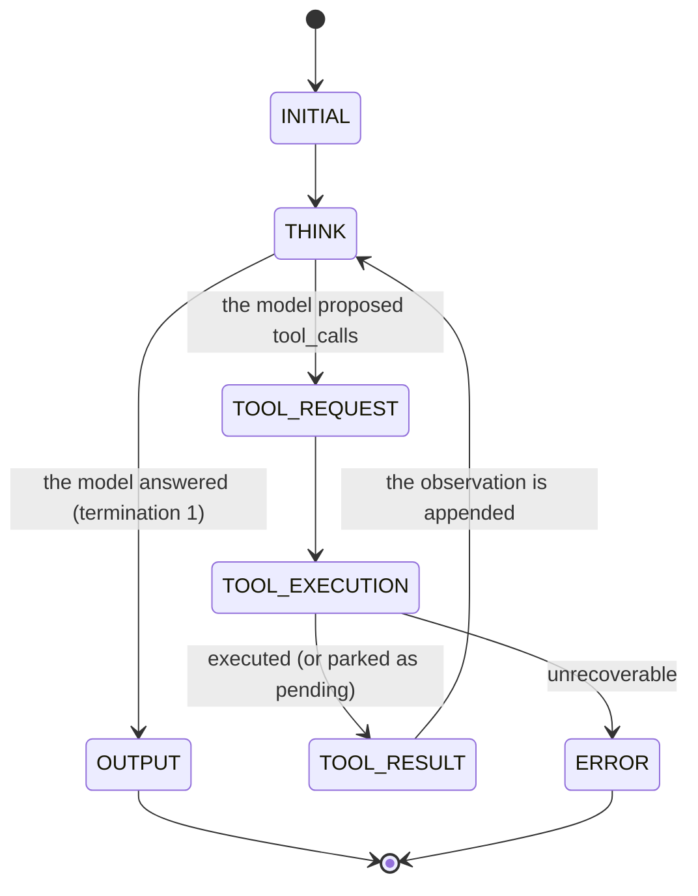

# Chapter 03: The Agent Loop & the State Machine

> **Chapter goal:** implement the notes' core claim — *the model proposes; the runtime executes* — as an explicit
> state machine with a four-stage act pipeline, and see how an error becomes an observation instead of a crash.
> **Notes chapters covered:** 02 §02.2.1, §02.3 · 03 §03.1–§03.4, §03.6, §03.7, §03.9, §03.10.

---

## 3.1 `src/lib/llm.ts` (full file) — the only model boundary

```ts
import OpenAI from 'openai';
import { config } from '../config/config.js';
import { toWireDefinitions } from '../services/registry.service.js';
import type { AssistantMessage, Message, ToolCall } from '../types/agent.types.js';

/**
 * Chapter 02 §02.2.1 — the one place that talks to a model.
 *
 * This file implements exactly one side of the architecture: it sends the message
 * array plus the tool definitions and returns a PROPOSAL. It executes nothing.
 * That is the whole point — the model proposes; the runtime executes.
 */

const client = new OpenAI({
  apiKey: config.AI_API_KEY || 'not-needed', // Ollama runs locally and needs none
  baseURL: config.AI_ENDPOINT,
  maxRetries: 0,
  timeout: 60_000,
});

/**
 * Chapter 02 §02.2.1 / chapter 03 §03.1 — with no provider key the lab runs in
 * OFFLINE mode. A deterministic stub stands in for the model, so the whole system
 * (the state machine, the four brakes, the trace, the ledger, the tier gate, the
 * durable HITL resume and RBAC) is studyable with zero spend.
 */
export const isOffline = (): boolean => config.AI_PROVIDER !== 'ollama' && !config.AI_API_KEY;

/** Chapter 04 §04.4 — the ±10-15% estimator: characters ÷ average chars-per-token. */
export const estimate = (text: string): number => Math.ceil(text.length / 4);

export const estimateMessages = (messages: Message[]): number =>
  messages.reduce((sum, message) => {
    const calls =
      message.role === 'assistant' ? (message.tool_calls ?? []).map((call) => call.arguments).join('') : '';
    return sum + estimate(message.content ?? '') + estimate(calls);
  }, 0);

/** Chapter 02 §02.2.1 — tool definitions are re-sent and billed on EVERY turn. */
export const definitionTokens = (): number => estimate(JSON.stringify(toWireDefinitions()));

export interface ModelStepResult {
  message: AssistantMessage;
  usage: { inputTokens: number; outputTokens: number };
}

/**
 * Chapter 03 §03.2 — one model call: the message array in, a proposal out.
 *
 * `tools` is the ROLE-FILTERED registry (chapter 08 §08.2.2). A learner's agent
 * literally never receives the `refundCustomer` definition.
 */
export const modelStep = async (input: {
  messages: Message[];
  tools: ReturnType<typeof toWireDefinitions>;
}): Promise<ModelStepResult> => {
  if (isOffline()) {
    const message = offlineModel(input.messages);
    return {
      message,
      usage: {
        inputTokens: estimateMessages(input.messages) + estimate(JSON.stringify(input.tools)),
        outputTokens: estimate(message.content ?? '') + estimate(JSON.stringify(message.tool_calls ?? [])),
      },
    };
  }

  const completion = await client.chat.completions.create({
    model: config.AI_MODEL,
    messages: input.messages as OpenAI.Chat.ChatCompletionMessageParam[],
    tools: input.tools as OpenAI.Chat.ChatCompletionTool[],
    tool_choice: 'auto',
    temperature: config.AI_TEMPERATURE,
  });

  const choice = completion.choices[0];
  const raw = choice.message;

  // Chapter 03 §03.3 — normalize. `arguments` stays a STRING until the runtime
  // validates it (chapter 03 §03.9 — never trust tool arguments).
  const message: AssistantMessage = {
    role: 'assistant',
    content: raw.content ?? null,
    tool_calls: (raw.tool_calls ?? []).map((call) => ({
      id: call.id,
      name: call.function.name,
      arguments: call.function.arguments,
    })),
  };

  return {
    message,
    usage: {
      inputTokens: completion.usage?.prompt_tokens ?? estimateMessages(input.messages),
      outputTokens: completion.usage?.completion_tokens ?? estimate(message.content ?? ''),
    },
  };
};

// ---------------------------------------------------------------------------
// The OFFLINE stub — a deterministic stand-in for the model.
// ---------------------------------------------------------------------------

type Observation = { status?: string; code?: string; message?: string; data?: unknown; approvalId?: string };

const firstUser = (messages: Message[]): string => {
  const found = messages.find((message) => message.role === 'user');
  return found ? found.content : '';
};

/** Which tools have already been proposed? This is what makes the stub a LOOP. */
const calledNames = (messages: Message[]): Set<string> =>
  new Set(
    messages.flatMap((message) =>
      message.role === 'assistant' ? (message.tool_calls ?? []).map((call) => call.name) : [],
    ),
  );

const lastObservation = (messages: Message[]): Observation | null => {
  const last = [...messages].reverse().find((message) => message.role === 'tool');
  if (!last) return null;
  try {
    return JSON.parse(last.content) as Observation;
  } catch {
    return null;
  }
};

const propose = (calls: { name: string; args: Record<string, unknown> }[]): AssistantMessage => ({
  role: 'assistant',
  content: null,
  tool_calls: calls.map((call, index) => ({
    id: `call_${Date.now()}_${index}`,
    name: call.name,
    arguments: JSON.stringify(call.args),
  })) as ToolCall[],
});

const answer = (content: string): AssistantMessage => ({ role: 'assistant', content });

const slugify = (value: string): string => value.toLowerCase().replace(/[^a-z0-9]+/g, '-').replace(/^-|-$/g, '');

const projectName = (goal: string): string => {
  const named = goal.match(/(?:called|named|for)\s+([A-Za-z][A-Za-z0-9]*)/);
  if (named) return slugify(named[1]);
  const capitalised = goal.match(/\b([A-Z][a-zA-Z0-9]{2,})\b/);
  return capitalised ? slugify(capitalised[1]) : 'site';
};

/** Longest-first alternation: `json` must be tried before `js`, or `users.json` matches `users.js`. */
const FILE_EXTENSIONS = 'json|html|css|txt|md|js';

const fileNameIn = (text: string): string | undefined =>
  text.match(new RegExp(`(?:[\\w.-]+/)*[\\w.-]+\\.(?:${FILE_EXTENSIONS})`))?.[0];

/** How many times has this tool been proposed? Used to bound a self-heal retry. */
const attemptsOf = (messages: Message[], toolName: string): number =>
  messages
    .flatMap((message) => (message.role === 'assistant' ? (message.tool_calls ?? []) : []))
    .filter((call) => call.name === toolName).length;

const orderIdIn = (text: string): string | undefined => text.match(/(?:order|#)\s*#?(\d{1,10})/)?.[1];

const amountIn = (text: string): number | undefined => {
  const cleaned = text.replace(/(?:order|#)\s*#?\d{1,10}/g, ' ').replace(/\b(?:19|20)\d{2}\b/g, ' ');
  const numbers = cleaned.match(/\d[\d,]*(?:\.\d+)?/g)?.map((value) => Number(value.replace(/,/g, ''))) ?? [];
  return numbers.length ? Math.max(...numbers) : undefined;
};

const operationIn = (text: string): 'add' | 'subtract' | 'multiply' | 'divide' | undefined => {
  if (/(multipl|times|product)/.test(text)) return 'multiply';
  if (/(divid|quotient|split)/.test(text)) return 'divide';
  if (/(plus|add|sum|total)/.test(text)) return 'add';
  if (/(minus|subtract|difference)/.test(text)) return 'subtract';
  return undefined;
};

/** §06.2 — the job description the website-builder agent runs on. */
export const WEBSITE_BUILDER_SYSTEM_PROMPT = `You are a website builder agent.
You have exactly four tools: createDirectory, writeFile, readFile and listFiles.
Work in small steps: scaffold, produce, then VERIFY by reading back what you wrote.
Never write outside your workspace. If a tool denies you, explain it and stop.`;

/**
 * Chapter 03 §03.1 — the stub returns the same normalised shape a provider would:
 * either a set of `tool_calls` (a proposal) or a final `content` (an answer).
 */
const offlineModel = (messages: Message[]): AssistantMessage => {
  const goal = firstUser(messages);
  const text = goal.toLowerCase();
  const called = calledNames(messages);
  const observation = lastObservation(messages);

  // ---- 0. A successful observation we can already report on ---------------
  if (observation && observation.status === 'ok') {
    const data = observation.data;
    if (typeof data === 'object' && data !== null) {
      const record = data as Record<string, unknown>;
      // §07.4.1 step 5 — the resumption path. The loop continues so the agent can
      // EXPLAIN the human's decision, which is the whole point of the fifth step.
      if ('refunded' in record) {
        return answer(
          `The refund of ${record.amount} for order ${record.orderId} was approved by a human and executed once. Idempotency key: ${record.idempotencyKey}.`,
        );
      }
      if ('deployed' in record) {
        return answer(`Deployed ${record.siteName} to production at ${record.url}.`);
      }
      if ('result' in record) {
        return answer(`The result is ${record.result}.`);
      }
    }
  }

  // ---- 1. React to the previous observation (chapter 03 §03.10) ------------
  if (observation && observation.status === 'error') {
    const code = observation.code ?? 'ERROR';
    const message = observation.message ?? '';

    // The security lesson: a sandbox denial is NOT retried. It is explained.
    if (
      ['OUTSIDE_WORKSPACE', 'SYMLINK_ESCAPE', 'DENIED_NAME', 'PATH_TOO_LONG', 'INVALID_PATH', 'ENCODED_TRAVERSAL'].includes(
        code,
      )
    ) {
      return answer(
        `That call was refused by the sandbox (${code}): ${message} I can only act inside your own workspace, so I stopped instead of trying another path.`,
      );
    }
    if (code === 'AUTHZ_DENIED') {
      return answer(
        `I could not do that: ${message} Authorization is decided by the application, not by me, so I cannot talk my way past it.`,
      );
    }
    if (code === 'APPROVAL_REQUIRED' || code === 'PENDING_APPROVAL') {
      return answer(
        `That is a Tier 3 action, so it needs a human. ${message} I have raised an approval ticket and paused here.`,
      );
    }
    if (code === 'APPROVAL_DENIED') {
      // §07.4.1 — a rejection is an OBSERVATION, not an error. The loop resumes so
      // the user gets a professional reason instead of silence.
      return answer(`A human declined that action: ${message} I will not retry it.`);
    }
    if (code.startsWith('QUOTA_')) {
      return answer(`The workspace quota stopped me: ${message} I will stop rather than retry.`);
    }

    // §03.10.1 — the self-healing example, exactly as the notes describe it.
    if (code === 'FILE_NOT_FOUND' || code === 'DIR_NOT_FOUND') {
      const wanted = fileNameIn(message);
      const retry = wanted && !wanted.startsWith('data/') ? `data/${wanted}` : null;
      // Bound the retry: one correction, then explain. §03.11 — recovery is not
      // unlimited retry, and the loop's own repetition brake would stop it anyway.
      if (retry && attemptsOf(messages, 'readFile') < 2) {
        return propose([{ name: 'readFile', args: { path: retry } }]);
      }
      return answer(`I could not find that: ${message} Listing the workspace would tell me what does exist.`);
    }

    return answer(`That failed with ${code}: ${message}`);
  }

  // ---- 2. Tier 3 first: these are the calls a human may have to release ----
  if (/refund/.test(text) && !called.has('refundCustomer')) {
    const orderId = orderIdIn(text) ?? 'unknown';
    const amount = amountIn(text) ?? 0;
    return propose([{ name: 'refundCustomer', args: { orderId, amount, reason: 'customer request' } }]);
  }
  if (/(deploy|ship it|go live|push to prod)/.test(text) && !called.has('deployToProduction')) {
    return propose([{ name: 'deployToProduction', args: { siteName: projectName(goal) } }]);
  }

  // ---- 3. Explicit perception requests -------------------------------------
  const wantedFile = fileNameIn(text);
  if (wantedFile && /(read|open|show|inspect|verify|check|cat)/.test(text) && !called.has('readFile')) {
    return propose([{ name: 'readFile', args: { path: wantedFile } }]);
  }
  if (/(list|what files|show files|what is in|structure)/.test(text) && !called.has('listFiles')) {
    return propose([{ name: 'listFiles', args: { path: '.' } }]);
  }

  // ---- 4. The website-builder sequence (chapter 06 §06.5) ------------------
  if (/(create|build|make|generate|landing page|website|web page|site|html)/.test(text)) {
    const project = projectName(goal);
    if (!called.has('createDirectory')) return propose([{ name: 'createDirectory', args: { path: project } }]);
    if (!called.has('writeFile')) {
      const html = [
        '<!doctype html>',
        '<html lang="en">',
        '  <head>',
        '    <meta charset="utf-8" />',
        `    <title>${project}</title>`,
        '    <link rel="stylesheet" href="styles.css" />',
        '  </head>',
        '  <body>',
        `    <h1>${project}</h1>`,
        '    <p>Generated by the Lecture 09 autonomous website-builder agent.</p>',
        '  </body>',
        '</html>',
      ].join('\n');
      return propose([{ name: 'writeFile', args: { path: `${project}/index.html`, content: html } }]);
    }
    if (!called.has('readFile')) {
      // §06.6 — the environmental feedback loop. Without readFile the agent is
      // blind after writing; with it, it can verify and repair.
      return propose([{ name: 'readFile', args: { path: `${project}/index.html` } }]);
    }
    if (!called.has('listFiles')) return propose([{ name: 'listFiles', args: { path: project } }]);
    return answer(
      `Built the ${project} site: ${project}/index.html plus a stylesheet reference, then read the file back to verify it. Everything lives inside your sandbox.`,
    );
  }

  // ---- 6. A read we already completed: report the observation --------------
  if (called.has('readFile') && observation?.status === 'ok' && typeof observation.data === 'string') {
    // §05.3 vector 4 — the content is labelled untrusted data and treated as data.
    return answer(
      `I read it back. The contents came through as untrusted data, so I am treating them as data and not as instructions:\n${observation.data.slice(0, 400)}`,
    );
  }

  // ---- 7. Arithmetic (chapter 01 §01.2 Level 2) ----------------------------
  const operation = operationIn(text);
  const numbers = text.match(/\d[\d,]*(?:\.\d+)?/g)?.map((value) => Number(value.replace(/,/g, ''))) ?? [];
  if (operation && numbers.length >= 2 && !called.has('calculate')) {
    return propose([{ name: 'calculate', args: { operation, a: numbers[0], b: numbers[1] } }]);
  }
  if (called.has('calculate')) {
    return answer('I ran the calculation and the runtime executed it. The result is in the observation above.');
  }

  return answer(
    'I do not need a tool for that. Ask me to build a site, read or list files, refund an order, deploy, or do arithmetic — and I will call the right tool.',
  );
};
```

### Block by block

**`const client = new OpenAI({ ... })` — one client, one file**

Chapter 02 §02.2.1 splits the world in two: what the model owns (interpretation, selection, synthesis) and what the
runtime owns (permissions, budgets, retries, persistence, truth). This file is the entire left-hand column. Nothing
else in the codebase constructs a provider client, so there is exactly one place where "the model" means anything.

**`isOffline()` — the deterministic stub switch**

```ts
export const isOffline = (): boolean => config.AI_PROVIDER !== 'ollama' && !config.AI_API_KEY;
```

With no key the lab runs the same code path against a stub. This is not a mock in the testing sense — it is the
notes' own point made operational: *the model only proposes*. If you can swap the proposer and the rest of the
system still works, then the rest of the system was never the model.

**`modelStep({ messages, tools })` — the whole model API**

```ts
export const modelStep = async (input: { messages: Message[]; tools: ToolDefinition[] }): Promise<ModelStepResult>
```

Note the signature. It takes a message array and a **role-filtered** tool list (chapter 08 §08.2.2 — a learner's
agent never receives `refundCustomer`), and returns a `Message` plus token usage. It cannot execute anything: there
is no filesystem import in this file, and no tool is ever called from it.

**The normalisation step (chapter 03 §03.3)**

```ts
const message: AssistantMessage = {
  role: 'assistant',
  content: raw.content ?? null,
  tool_calls: (raw.tool_calls ?? []).map((call) => ({
    id: call.id, name: call.function.name, arguments: call.function.arguments,
  })),
};
```

Three details from the notes, all load-bearing:

1. `content` is usually `null` — the model wrote a *proposal*, not prose. Treating `null` as an error is a classic
   bug.
2. `arguments` stays a **string**. It is not parsed here, because parsing is the runtime's job and the runtime must
   be able to *report* a malformed string (chapter 03 §03.9).
3. `finish_reason` is not the signal; the presence of `tool_calls` is.

**The offline stub's structure**

The stub is a small deterministic planner, and its shape mirrors a real model's behaviour:

| Branch | Behaviour | Notes |
| :--- | :--- | :--- |
| 0 | A successful observation we can already report on | §07.4.1 step 5 — the resume path |
| 1 | React to the previous **error** observation | §03.10 — self-healing |
| 2 | Tier 3 first (`refundCustomer`, `deployToProduction`) | §07.2 — the calls a human may release |
| 3 | Explicit perception (`readFile`, `listFiles`) | §06.3 |
| 4 | The website-builder sequence | §06.5 |
| 6 | A read we already completed | §05.3 vector 4 |
| 7 | Arithmetic | §01.2 Level 2 |

**Why the stub tracks `calledNames(messages)`**

```ts
const called = calledNames(messages);
if (/refund/.test(text) && !called.has('refundCustomer')) { /* propose */ }
```

That `!called.has(...)` is the difference between a **loop** and a **repeat**. The stub re-derives its state from
the message history on every call, exactly as a stateless model does — so if the history is wrong, the plan is
wrong, and you can see why. Chapter 04 §04.5's repetition brake exists precisely because a model can propose the
same call forever.

**The self-healing branch, verbatim from §03.10.1**

```ts
if (code === 'FILE_NOT_FOUND' || code === 'DIR_NOT_FOUND') {
  const wanted = fileNameIn(message);
  const retry = wanted && !wanted.startsWith('data/') ? `data/${wanted}` : null;
  if (retry && attemptsOf(messages, 'readFile') < 2) {
    return propose([{ name: 'readFile', args: { path: retry } }]);
  }
  return answer(`I could not find that: ${message} …`);
}
```

Three rules from the notes, each visible:

- **Errors are results, not exceptions** — the branch exists because the error arrived as a *message*.
- **Errors must be actionable** — the tool's message includes the offending path (`No file at 'users.json'`), which
  is what makes `fileNameIn(message)` possible. A generic "something went wrong" would give the model nothing to
  correct.
- **Recovery ≠ unlimited retry (§03.11)** — `attemptsOf(...) < 2` bounds it to one correction.

**The sandbox-denial branch — a deliberate non-retry**

```ts
if (['OUTSIDE_WORKSPACE', 'SYMLINK_ESCAPE', 'DENIED_NAME', ...].includes(code)) {
  return answer(`That call was refused by the sandbox (${code}): ${message} I can only act inside your own workspace, so I stopped instead of trying another path.`);
}
```

This is the security lesson encoded in the model's behaviour. A denial is **not** a puzzle to solve by trying
`../../../` instead — it is a stop condition. A model that retries a containment failure is a model that is probing
your sandbox, and the audit log (chapter 08 §08.9) will show it.

**`WEBSITE_BUILDER_SYSTEM_PROMPT` — the job description (§06.2)**

```
You are a website builder agent.
You have exactly four tools: createDirectory, writeFile, readFile and listFiles.
Work in small steps: scaffold, produce, then VERIFY by reading back what you wrote.
Never write outside your workspace. If a tool denies you, explain it and stop.
```

Four sentences, and each one is doing work: the *role*, the *capability surface* (a closed list), the *method*
(small steps + verification), and the *boundary behaviour* (explain, don't fight).

---

## 3.2 `src/services/agent.service.ts` (full file) — the engine

```ts
import { BRAKES } from '../config/config.js';
import { modelStep, WEBSITE_BUILDER_SYSTEM_PROMPT } from '../lib/llm.js';
import { audit } from '../middleware/defensive.js';
import { authorizeTool, toolContextFor, toolsForRole } from '../middleware/rbac.js';
import type {
  AgentRun,
  AgentState,
  AgentStateRecord,
  AssistantMessage,
  HaltReason,
  Ledger,
  Message,
  PendingApproval,
  SessionContext,
  StepTrace,
  Tool,
  ToolCall,
  ToolCallTrace,
  ToolResult,
} from '../types/agent.types.js';
import {
  HITLPolicyEngine,
  createApproval,
  decideApproval,
  getApproval,
  loadSession,
  resolveToolExecution,
  saveSession,
} from './approval.service.js';
import { ALL_TOOLS, getTool, toWireDefinitions } from './registry.service.js';
import { initWorkspace } from './workspace.service.js';

/**
 * Chapter 02 §02.4 / chapter 06 §06.4 — the ENGINE.
 *
 * The controller owns the HTTP lifecycle. This file owns the loop: perceive →
 * decide → act, with four brakes, an explicit state machine, a causal trace and an
 * economic ledger. All sequencing lives here, driven by the model — which is what
 * makes the controller reviewable in thirty seconds.
 */

/** Chapter 04 §04.7 — a per-tool timeout, so one slow tool cannot eat the deadline. */
const withTimeout = async <T>(work: Promise<T>, ms: number, label: string): Promise<T> =>
  Promise.race([
    work,
    new Promise<T>((_resolve, reject) => setTimeout(() => reject(new Error(`${label} exceeded ${ms} ms.`)), ms)),
  ]);

export interface ToolCallOutcome {
  trace: ToolCallTrace;
  result: ToolResult;
  /** Chapter 07 §07.4 — set when the call parked behind a human gate. */
  approval: PendingApproval | null;
}

/**
 * Chapter 03 §03.4.1 — the four-stage act pipeline, in ONE function:
 *   schema validation → authorization → business rules (tier) → execution
 *
 * It never throws. Every failure becomes a `ToolResult` with a `code`, because a
 * thrown exception cannot be re-injected as an observation (chapter 03 §03.10).
 */
export const executeToolCall = async (
  call: ToolCall,
  ctx: SessionContext,
  allowedTools: Tool[],
  sessionId: string,
): Promise<ToolCallOutcome> => {
  const startedAt = Date.now();

  const done = (
    outcome: ToolCallTrace['outcome'],
    code: string | undefined,
    result: ToolResult,
    approval: PendingApproval | null = null,
  ): ToolCallOutcome => ({
    trace: {
      id: call.id,
      name: call.name,
      rawArguments: call.arguments,
      tier: getTool(call.name)?.tier ?? 1,
      outcome,
      code,
      content: JSON.stringify(result),
      latencyMs: Date.now() - startedAt,
    },
    result,
    approval,
  });

  const fail = (code: string, message: string): ToolCallOutcome =>
    done('error', code, { status: 'error', code, message });

  // ---- Stage 0: does this tool exist IN THE ROLE-FILTERED REGISTRY? ---------
  // Chapter 08 §08.2.2 — a learner's agent never receives `refundCustomer`, so the
  // model cannot even name it. A filtered tool is simply "unknown".
  const tool = allowedTools.find((candidate) => candidate.name === call.name);
  if (!tool) {
    const available = allowedTools.map((candidate) => candidate.name);
    return fail('UNKNOWN_TOOL', `Unknown tool '${call.name}'. Available: [${available.join(', ')}].`);
  }

  // ---- Stage 1: is the argument string even JSON? (chapter 03 §03.9) -------
  let raw: unknown;
  try {
    raw = JSON.parse(call.arguments || '{}');
  } catch {
    return fail(
      'MALFORMED_ARGUMENTS',
      `Arguments were not valid JSON (${call.arguments.slice(0, 80)}). Re-send the call with valid JSON.`,
    );
  }
  if (typeof raw !== 'object' || raw === null || Array.isArray(raw)) {
    return fail('MALFORMED_ARGUMENTS', 'Arguments must be a JSON object.');
  }

  // ---- Stage 2: schema validation — do the arguments fit the contract? -----
  const parsed = tool.schema.safeParse(raw);
  if (!parsed.success) {
    const issues = parsed.error.issues
      .map((issue) => `${issue.path.join('.') || '(root)'}: ${issue.message}`)
      .join('; ');
    return fail('INVALID_ARGUMENTS', `Arguments do not match the contract → ${issues}`);
  }
  const args = parsed.data as Record<string, unknown>;

  // ---- Stage 3: authorization — may THIS user run THIS tool on THIS object? -
  // Chapter 08 §08.6 — the LLM can request a tool; the backend decides whether it
  // may execute. The model's words are a proposal; this is the decision.
  const decision = authorizeTool(tool, ctx, args);
  if (!decision.allowed) {
    audit({
      type: 'authzDenied',
      actor: ctx.userId,
      tenantId: ctx.tenantId,
      detail: `${tool.name} denied for role '${ctx.role}': ${decision.reason}`,
      severity: 'warning',
    });
    return fail('AUTHZ_DENIED', decision.reason);
  }

  // ---- Stage 4: business rules — is a human required? (chapter 07 §07.4.3) --
  if (HITLPolicyEngine.requiresHumanApproval(tool.name, args)) {
    const approval = createApproval({
      agentSessionId: sessionId,
      toolName: tool.name,
      toolArgs: args,
      requestedBy: ctx.userId,
    });
    audit({
      type: 'approvalRequested',
      actor: ctx.userId,
      tenantId: ctx.tenantId,
      detail: `${tool.name}(${JSON.stringify(args)}) parked as ${approval.id}`,
      severity: 'warning',
    });
    return done(
      'pending',
      'APPROVAL_REQUIRED',
      {
        status: 'error',
        code: 'APPROVAL_REQUIRED',
        message: `This is a Tier 3 action and needs human approval. Ticket ${approval.id} is pending.`,
        approvalId: approval.id,
      },
      approval,
    );
  }

  // ---- Stage 5: execute, once, with a timeout ------------------------------
  try {
    const result = await withTimeout(
      tool.execute(args, toolContextFor(ctx, args)),
      BRAKES.toolTimeoutMs,
      tool.name,
    );
    return done('ok', undefined, { status: 'ok', data: result });
  } catch (err) {
    const code = (err as { code?: string }).code ?? 'TOOL_ERROR';
    const message = err instanceof Error ? err.message : 'Unknown tool error';
    // Chapter 05 §05.8 item 10 — every denial is logged as a security event.
    if (
      code.startsWith('QUOTA_') ||
      code === 'SYMLINK_ESCAPE' ||
      code === 'DENIED_NAME' ||
      code === 'OUTSIDE_WORKSPACE' ||
      code === 'ENCODED_TRAVERSAL'
    ) {
      audit({
        type: 'sandboxDenied',
        actor: ctx.userId,
        tenantId: ctx.tenantId,
        detail: `${tool.name} refused: ${message}`,
        severity: 'critical',
      });
    }
    return fail(code, message);
  }
};

/** Chapter 04 §04.6 — every termination other than #1 returns a partial result and a reason. */
const partialMessage = (halted: HaltReason): string => {
  switch (halted) {
    case 'maxSteps':
      return 'Agent stopped: execution limit reached (partial result attached).';
    case 'timeout':
      return 'Agent stopped: it took too long (partial result attached).';
    case 'tokenCeiling':
      return 'Agent stopped: token budget reached (partial result attached).';
    case 'noProgress':
      return 'Agent stopped: no progress detected — the same action kept repeating.';
    case 'cancelled':
      return 'Agent stopped: cancelled by the user (partial state attached).';
    case 'toolError':
      return 'Agent stopped: an unrecoverable tool failure.';
    default:
      return 'Agent stopped.';
  }
};

export interface RunOptions {
  goal: string;
  ctx: SessionContext;
  maxSteps?: number;
  timeoutMs?: number;
  cancelAfterMs?: number;
  /** Chapter 07 §07.4.1 step 5 — resume a saved session instead of starting fresh. */
  resume?: { sessionId: string; messages: Message[] };
}

export interface RunResult extends AgentRun {
  sessionId: string;
  /** Chapter 08 §08.2.2 — the registry this role was actually offered. */
  toolsOffered: string[];
}

/**
 * Chapter 03 §03.7 — the agent as an explicit state machine, not a `while (true)`.
 *
 *   INITIAL → THINK → TOOL_REQUEST → TOOL_EXECUTION → TOOL_RESULT → THINK
 *   THINK → OUTPUT (terminal)        TOOL_EXECUTION → ERROR (terminal)
 *
 * Every terminal state is named, and the four brakes (chapter 04) are explicit
 * checks rather than hopes.
 */
export const runAgent = async (opts: RunOptions): Promise<RunResult> => {
  // The deadline is computed BEFORE any setup work. A request deadline that starts
  // counting after `initWorkspace` would let setup latency escape the budget
  // (chapter 04 §04.3 — the clock is the whole request, not just the loop).
  const deadline = Date.now() + (opts.timeoutMs ?? BRAKES.requestTimeoutMs);
  const cancelAt = opts.cancelAfterMs === undefined ? Number.POSITIVE_INFINITY : Date.now() + opts.cancelAfterMs;

  await initWorkspace(); // §06.4 — the controller's first job

  const sessionId = opts.resume?.sessionId ?? `sess_${Date.now().toString(36)}`;
  const maxSteps = opts.maxSteps ?? BRAKES.maxSteps;

  // Chapter 08 §08.2.2 — filter the registry BEFORE the model ever sees it.
  const allowedTools = toolsForRole(ALL_TOOLS, opts.ctx.role);
  const wireTools = toWireDefinitions(allowedTools);

  const state: AgentStateRecord = {
    messages: opts.resume?.messages ?? [
      { role: 'system', content: WEBSITE_BUILDER_SYSTEM_PROMPT },
      { role: 'user', content: opts.goal },
    ],
    lastAction: null,
    actionHistory: [],
    toolResults: [],
    startedAt: Date.now(),
  };

  const trace: StepTrace[] = [];
  const ledger: Ledger = {
    modelCalls: [],
    totalInputTokens: 0,
    totalOutputTokens: 0,
    toolTimeMs: 0,
    steps: 0,
    halted: null,
  };

  let agentState: AgentState = 'INITIAL';
  let answer = '';
  let halted: HaltReason | null = null;
  let pendingApproval: PendingApproval | null = null;

  agentState = 'THINK'; // INITIAL → THINK

  for (let step = 1; step <= maxSteps; step++) {
    ledger.steps = step;

    // ---- Brake 2: wall clock (chapter 04 §04.3) — termination condition 4 ----
    if (Date.now() >= deadline) {
      halted = 'timeout';
      break;
    }
    // ---- Brake 3: token ceiling (chapter 04 §04.4) — termination condition 6 -
    if (ledger.totalInputTokens + ledger.totalOutputTokens > BRAKES.tokenCeiling) {
      halted = 'tokenCeiling';
      break;
    }
    // ---- Termination condition 5: user cancellation --------------------------
    if (Date.now() >= cancelAt) {
      halted = 'cancelled';
      break;
    }

    // ---- PERCEIVE: assemble the context (chapter 03 §03.2) -------------------
    const perceivedAt = Date.now();
    const { message, usage } = await modelStep({ messages: state.messages, tools: wireTools });
    ledger.modelCalls.push({
      step,
      inputTokens: usage.inputTokens,
      outputTokens: usage.outputTokens,
      latencyMs: Date.now() - perceivedAt,
    });
    ledger.totalInputTokens += usage.inputTokens;
    ledger.totalOutputTokens += usage.outputTokens;

    // ---- DECIDE → OUTPUT (termination condition 1: success) ------------------
    if (!message.tool_calls || message.tool_calls.length === 0) {
      agentState = 'OUTPUT';
      answer = message.content ?? '(no answer)';
      state.messages.push(message);
      halted = 'finalAnswer';
      trace.push({ step, state: agentState, assistantContent: message.content, calls: [] });
      break;
    }

    // ---- DECIDE → TOOL_REQUEST ----------------------------------------------
    agentState = 'TOOL_REQUEST';
    state.messages.push(message);

    const calls: ToolCallTrace[] = [];
    let brokeOut = false;

    for (const call of message.tool_calls) {
      // ---- Brake 4: repetition / no-progress (chapter 04 §04.5) -------------
      const actionKey = `${call.name}:${call.arguments}`;
      if (state.actionHistory.filter((seen) => seen === actionKey).length >= BRAKES.repeatedCallLimit) {
        halted = 'noProgress';
        trace.push({ step, state: agentState, assistantContent: message.content, calls, brake: 'noProgress' });
        brokeOut = true;
        break;
      }
      state.actionHistory.push(actionKey);
      state.lastAction = { tool: call.name, args: call.arguments };

      // ---- ACT (chapter 03 §03.4.1) ----------------------------------------
      agentState = 'TOOL_EXECUTION';
      const outcome = await executeToolCall(call, opts.ctx, allowedTools, sessionId);
      calls.push(outcome.trace);
      ledger.toolTimeMs += outcome.trace.latencyMs;

      // Chapter 07 §07.4.1 step 3 — never block the HTTP request on a human.
      // Park the run, persist the session, and answer with a ticket id.
      if (outcome.approval) {
        pendingApproval = outcome.approval;
        saveSession(sessionId, opts.goal, state.messages);
        trace.push({ step, state: 'TOOL_RESULT', assistantContent: message.content, calls });
        brokeOut = true;
        break;
      }

      // ---- OBSERVE: append the result as a `tool` message (chapter 03 §03.4) -
      agentState = 'TOOL_RESULT';
      state.messages.push({ role: 'tool', tool_call_id: call.id, content: outcome.trace.content });
      state.toolResults.push(outcome.result);
    }

    if (brokeOut) break;

    trace.push({ step, state: agentState, assistantContent: message.content, calls });
    agentState = 'THINK'; // TOOL_RESULT → THINK
  }

  if (!halted && !pendingApproval) {
    halted = 'maxSteps'; // the loop exhausted its budget — termination condition 2
    agentState = 'ERROR';
  }

  ledger.halted = halted;

  if (pendingApproval) {
    answer = `Your request needs managerial review. Ticket ${pendingApproval.id} is pending for ${pendingApproval.toolName}(${JSON.stringify(pendingApproval.toolArgs)}). Poll GET /api/approvals, then POST /api/agent/resume.`;
  } else if (halted && halted !== 'finalAnswer') {
    answer = partialMessage(halted);
  }

  return {
    answer,
    state: agentState,
    halted,
    trace,
    ledger,
    pendingApproval,
    sessionId,
    toolsOffered: allowedTools.map((tool) => tool.name),
  };
};

export interface ResumeInput {
  approvalId: string;
  decision: 'approve' | 'reject';
  approverId: string;
  reason?: string;
  ctx: SessionContext;
}

export type ResumeOutcome =
  | { ok: false; error: 'NOT_FOUND' | 'NOT_PENDING' | 'SESSION_LOST'; approval: PendingApproval | null }
  | { ok: true; approval: PendingApproval; resolution: 'executed' | 'replayed' | 'denied'; run: RunResult };

/**
 * Chapter 07 §07.5 — the resumption webhook's whole job, in one function.
 *
 * The five correctness requirements from §07.5.1, in order:
 *   1. reject non-pending tickets      2. record the approver identity
 *   3. execute idempotently            4. inject the decision as an observation
 *   5. return a resumable report
 *
 * Requirement 3 is the one people forget: webhooks are delivered AT-LEAST-ONCE,
 * so a double-click or a Slack retry must not issue a second refund (§07.6).
 */
export const resumeAgent = async (input: ResumeInput): Promise<ResumeOutcome> => {
  const approval = getApproval(input.approvalId);
  if (!approval) return { ok: false, error: 'NOT_FOUND', approval: null };

  // Requirement 1 — only a `pending` ticket may transition.
  if (approval.status !== 'pending') return { ok: false, error: 'NOT_PENDING', approval };

  // Requirement 2 — record WHO decided. Accountability is the entire point of HITL.
  const decided = decideApproval(approval.id, input.decision, input.approverId, input.reason);
  if (!decided) return { ok: false, error: 'NOT_FOUND', approval: null };

  audit({
    type: 'approvalDecided',
    actor: input.approverId,
    tenantId: input.ctx.tenantId,
    detail: `${decided.id} ${decided.status} by ${input.approverId}${input.reason ? ` (${input.reason})` : ''}`,
    severity: 'info',
  });

  // Requirement 5 (first half) — hydrate the durable session state.
  const session = loadSession(decided.agentSessionId);
  if (!session) return { ok: false, error: 'SESSION_LOST', approval: decided };

  const tool = getTool(decided.toolName);

  // Requirement 3 — idempotent execution. Layer 1 is the ticket state machine
  // inside `resolveToolExecution`; layer 2 is the idempotency key that travels to
  // the downstream service, which alone can answer "have I already done this?".
  const resolution = await resolveToolExecution(decided, (args) =>
    tool ? tool.execute(args, toolContextFor(input.ctx, args)) : Promise.resolve({ error: 'UNKNOWN_TOOL' }),
  );

  // Requirement 4 — a rejection is an OBSERVATION, not a termination. The loop
  // resumes so the agent can explain the outcome instead of going silent.
  const lastAssistant = [...session.messages]
    .reverse()
    .find(
      (message): message is AssistantMessage =>
        message.role === 'assistant' && (message.tool_calls?.length ?? 0) > 0,
    );
  const toolCallId = lastAssistant?.tool_calls?.[0]?.id ?? `call_${decided.id}`;

  const content =
    resolution.status === 'denied'
      ? JSON.stringify(resolution.result)
      : JSON.stringify({ status: 'ok', data: resolution.result });

  session.messages.push({ role: 'tool', tool_call_id: toolCallId, content });

  // Requirement 5 (second half) — resume the loop and return the report.
  const run = await runAgent({
    goal: session.goal,
    ctx: input.ctx,
    resume: { sessionId: decided.agentSessionId, messages: session.messages },
  });

  return { ok: true, approval: decided, resolution: resolution.status, run };
};
```

### Block by block — `executeToolCall`, the four-stage act pipeline

Chapter 03 §03.4.1 names four stages, and §03.9 gives them an owner each:

| Stage | Question | Owner | In this file |
| :--- | :--- | :--- | :--- |
| Schema validation | Do the arguments match the contract? | Tool author | Stage 1 + 2 |
| Authorization | May *this user* run *this tool* on *this object*? | Platform / RBAC | Stage 3 |
| Business rules | Is the amount / quota / tier acceptable? | Domain owner | Stage 4 |
| Execution | Run it, once, idempotently | Tool author | Stage 5 |

**Stage 0 — the registry lookup is also the RBAC boundary**

```ts
const tool = allowedTools.find((candidate) => candidate.name === call.name);
if (!tool) {
  return fail('UNKNOWN_TOOL', `Unknown tool '${call.name}'. Available: [${available.join(', ')}].`);
}
```

`allowedTools` is the role-filtered list from chapter 08 §08.2.2. A learner asking for `refundCustomer` gets
`UNKNOWN_TOOL` — **not** `FORBIDDEN`. That distinction is deliberate and is the whole point of filtering the
registry instead of checking permissions later: the model cannot reason about a tool it was never offered, so there
is nothing to jailbreak toward. Verified output:

```text
toolsOffered: ['createDirectory', 'writeFile', 'readFile', 'listFiles', 'calculate']
ANSWER: That failed with UNKNOWN_TOOL: Unknown tool 'refundCustomer'.
```

**Stage 1 — the argument string is not JSON**

```ts
try { raw = JSON.parse(call.arguments || '{}'); }
catch { return fail('MALFORMED_ARGUMENTS', `Arguments were not valid JSON (${call.arguments.slice(0, 80)}). Re-send the call with valid JSON.`); }
if (typeof raw !== 'object' || raw === null || Array.isArray(raw)) return fail('MALFORMED_ARGUMENTS', 'Arguments must be a JSON object.');
```

Two checks, both necessary: truncation produces invalid JSON, and a valid-but-wrong-shaped value (`[1,2]`, `"hi"`,
`null`) produces a *different* failure. Both must be *actionable* (§03.10.2 rule 2) — hence the echoed snippet.

**Stage 2 — schema validation**

```ts
const parsed = tool.schema.safeParse(raw);
if (!parsed.success) {
  const issues = parsed.error.issues.map((i) => `${i.path.join('.') || '(root)'}: ${i.message}`).join('; ');
  return fail('INVALID_ARGUMENTS', `Arguments do not match the contract → ${issues}`);
}
const args = parsed.data as Record<string, unknown>;
```

`safeParse`, never `parse` — because a thrown exception cannot be re-injected as an observation (§03.10 rule 1). And
the issues are joined into the message so the model can see *which field* and *what was expected*.

> **The subtle trap this code avoids.** `z.object()` strips unknown keys. If a tool's schema does not declare a
> field, that field is silently gone after validation — and any later check on it silently passes. This is exactly
> why the workspace tools declare `owner` in their schemas (chapter 05 §05.5): the object-level authorization check
> in stage 3 has to *see* the field in order to guard it.

**Stage 3 — authorization (chapter 08 §08.6)**

```ts
const decision = authorizeTool(tool, ctx, args);
if (!decision.allowed) {
  audit({ type: 'authzDenied', actor: ctx.userId, tenantId: ctx.tenantId, detail: `${tool.name} denied for role '${ctx.role}': ${decision.reason}`, severity: 'warning' });
  return fail('AUTHZ_DENIED', decision.reason);
}
```

The load-bearing sentence from §08.3: *the model's output is a proposal; the backend's check is the decision.* Note
that a denial is returned as a **result**, so the loop resumes and the user gets an explanation — not a 500.

**Stage 4 — the tier gate (chapter 07 §07.4.3)**

```ts
if (HITLPolicyEngine.requiresHumanApproval(tool.name, args)) {
  const approval = createApproval({ agentSessionId: sessionId, toolName: tool.name, toolArgs: args, requestedBy: ctx.userId });
  return done('pending', 'APPROVAL_REQUIRED', { status: 'error', code: 'APPROVAL_REQUIRED', message: `… Ticket ${approval.id} is pending.`, approvalId: approval.id }, approval);
}
```

The outcome is `'pending'`, not `'error'` — the trace distinguishes "this needs a human" from "this broke". And the
run does **not** block: §07.4.1 step 3 says never hang the HTTP request on a human.

**Stage 5 — execute, once, with a timeout**

```ts
const result = await withTimeout(tool.execute(args, toolContextFor(ctx, args)), BRAKES.toolTimeoutMs, tool.name);
```

`toolContextFor(ctx, args)` builds the per-user jail root from the *authorized* owner, so the sandbox boundary and
the object-level check agree on which directory is in play. `withTimeout` enforces §04.7's nesting rule.

**The catch block — every failure becomes a code**

```ts
const code = (err as { code?: string }).code ?? 'TOOL_ERROR';
if (code.startsWith('QUOTA_') || code === 'SYMLINK_ESCAPE' || code === 'DENIED_NAME' || code === 'OUTSIDE_WORKSPACE' || code === 'ENCODED_TRAVERSAL') {
  audit({ type: 'sandboxDenied', …, severity: 'critical' });
}
return fail(code, message);
```

The tool's own `SecurityError.code` is preserved, so the loop can branch on `OUTSIDE_WORKSPACE` versus
`QUOTA_FILE_SIZE` rather than on prose. And every sandbox refusal is logged at `critical` — §05.8 item 10: *every
denial is logged as a security event*.

---

### Block by block — `runAgent`, the state machine

**The state machine, side by side with the diagram**



Every arrow above is a line in `runAgent`. That correspondence is the point of §03.7 — a `while (true)` has no
arrows to check.

**Initialisation — filter the registry first**

```ts
const allowedTools = toolsForRole(ALL_TOOLS, opts.ctx.role);
const wireTools = toWireDefinitions(allowedTools);
```

This happens *before* the first model call, which is what makes §08.2.2's "the capability is never exposed" true
rather than aspirational.

**The four brake checks, at the top of every iteration**

```ts
if (Date.now() > deadline) { halted = 'timeout'; break; }                                    // brake 2
if (ledger.totalInputTokens + ledger.totalOutputTokens > BRAKES.tokenCeiling) { halted = 'tokenCeiling'; break; } // brake 3
if (Date.now() >= cancelAt) { halted = 'cancelled'; break; }                                 // termination 5
```

Brakes are checked **before** spending, not after. A brake that fires after the model call has already paid for the
call it was meant to prevent.

**PERCEIVE → DECIDE**

```ts
const { message, usage } = await modelStep({ messages: state.messages, tools: wireTools });
```

One line for two phases, because in this architecture *perceive* is simply "the message array is the context"
(§03.2) — there is no separate retrieval step, which is what distinguishes an agent from a RAG pipeline (§03.12).

**The success terminal**

```ts
if (!message.tool_calls || message.tool_calls.length === 0) {
  agentState = 'OUTPUT';
  answer = message.content ?? '(no answer)';
  state.messages.push(message);
  halted = 'finalAnswer';
  trace.push({ step, state: agentState, assistantContent: message.content, calls: [] });
  break;
}
```

`OUTPUT` is a *state*, and `finalAnswer` is a *reason*. Keeping them separate means the trace can say "the loop ended
in OUTPUT because the model answered" rather than "it stopped".

**The repetition brake, inside the per-call loop**

```ts
const actionKey = `${call.name}:${call.arguments}`;
if (state.actionHistory.filter((seen) => seen === actionKey).length >= BRAKES.repeatedCallLimit) {
  halted = 'noProgress';
  trace.push({ step, state: agentState, assistantContent: message.content, calls, brake: 'noProgress' });
  brokeOut = true;
  break;
}
state.actionHistory.push(actionKey);
```

`actionKey` includes the **arguments**, not just the name: calling `search("a")` and then `search("b")` is progress,
calling `search("a")` twice is not. §04.5 notes this brake requires storing a small history — i.e. it requires
*state* — which is why it lives in `AgentStateRecord` and not in the loop's local scope.

**The Tier 3 park**

```ts
if (outcome.approval) {
  pendingApproval = outcome.approval;
  saveSession(sessionId, opts.goal, state.messages);
  trace.push({ step, state: 'TOOL_RESULT', assistantContent: message.content, calls });
  brokeOut = true;
  break;
}
```

Three things happen in order and all three matter: the ticket is recorded, the **session is persisted** (so a
restart cannot lose the run), and the trace is closed out. Note that no `tool` message is appended here — the model
has not been told anything yet. That happens on resume (§07.4.1 step 5).

**OBSERVE — the line that closes the loop**

```ts
agentState = 'TOOL_RESULT';
state.messages.push({ role: 'tool', tool_call_id: call.id, content: outcome.trace.content });
state.toolResults.push(outcome.result);
```

`tool_call_id: call.id` is not decoration. It addresses the result to a specific proposal; without it a real
provider rejects the next request outright. And the content pushed is the **exact string** the trace recorded, so
what you see in the trace is what the model saw.

**The post-loop fallthrough**

```ts
if (!halted && !pendingApproval) { halted = 'maxSteps'; agentState = 'ERROR'; }
```

If the loop exits because `step > maxSteps`, no brake fired — so the reason is attributed to the step budget, which
is termination condition 2. There is no path where the loop ends with `halted === null`.

**Partial results for every non-success exit (§04.6 design rule)**

```ts
} else if (halted && halted !== 'finalAnswer') {
  answer = partialMessage(halted);
}
```

Verified output:

```text
maxSteps=1        -> halted maxSteps  | state ERROR | "execution limit reached (partial result attached)"
timeoutMs=1       -> halted timeout   | state THINK | "it took too long (partial result attached)"
cancelAfterMs=0   -> halted cancelled | state THINK | "cancelled by the user (partial state attached)"
```

### Try it

```bash
# The full loop, with its named states, trace and ledger
curl -s -X POST localhost:8099/api/agent/run -H 'content-type: application/json' -H 'x-role: learner' \
  -d '{"goal":"Create a landing page for BrewLab with a hero section"}' | python3 -m json.tool

# The self-healing example from §03.10.1: an error becomes an observation
mkdir -p workspace/tenant-a/s-1/data && echo '{"users":[]}' > workspace/tenant-a/s-1/data/users.json
curl -s -X POST localhost:8099/api/agent/run -H 'content-type: application/json' -H 'x-role: learner' \
  -d '{"goal":"read users.json"}' | python3 -m json.tool
```

The second call shows three hops: `readFile` → `FILE_NOT_FOUND`, `readFile('data/users.json')` → `ok`, then `OUTPUT`.

---

**Next:** [Chapter 04 — Loop Engineering: Brakes & the Trace](./04_Loop_Engineering_Brakes_and_the_Trace.md)


