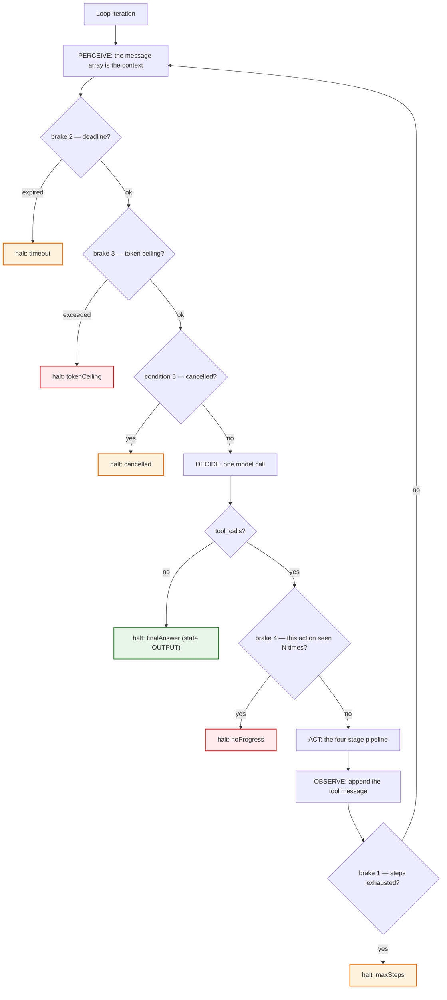

# Chapter 04: Loop Engineering — Brakes & the Trace

> **Chapter goal:** turn `while (true)` into something you can bound, observe and bill. Four brakes, six named
> termination conditions, one causal trace, one economic ledger.
> **Notes chapters covered:** 04 §04.1–§04.10.

**Files that own this chapter:** `src/config/config.ts` (the `BRAKES` object — chapter 02 §2.1) and
`src/services/agent.service.ts` (the checks — chapter 03 §3.2). This chapter walks the brake logic that lives in
those two files.

---

## 4.1 Why `while (true)` is dangerous (§04.1)

The notes name the failure: an unbounded loop is not a bug you *find*, it is a bill you *receive*. Four independent
things can run away — steps, wall clock, tokens and repetition — and no single limit catches all four.



---

## 4.2 Brake 1 — loop bounding (§04.2)

```ts
for (let step = 1; step <= maxSteps; step++) {
  ledger.steps = step;
  …
}

if (!halted && !pendingApproval) {
  halted = 'maxSteps'; // the loop exhausted its budget — termination condition 2
  agentState = 'ERROR';
}
```

A `for` loop, not a `while`, so the bound is in the loop header where a reviewer cannot miss it. And the
**post-loop fallthrough** is the subtle part: if the loop exits without any brake firing, no `break` ran, so the
reason must be attributed here. Without that line the run would return `halted: null` and the ledger would lie.

**Verified:**

```bash
curl -s -X POST localhost:8099/api/agent/run -H 'content-type: application/json' -H 'x-role: learner' \
  -d '{"goal":"Create a landing page for BrewLab","maxSteps":1}'
# -> halted maxSteps | state ERROR | "Agent stopped: execution limit reached (partial result attached)."
```

---

## 4.3 Brake 2 — timeout protection (§04.3)

```ts
const deadline = Date.now() + (opts.timeoutMs ?? BRAKES.requestTimeoutMs);
…
if (Date.now() > deadline) { halted = 'timeout'; break; }
```

Two layers, and the nesting rule from §04.7 is what makes them composable:

```text
tool timeout (8 s)  <  request deadline (60 s)  <  token ceiling (60 k)
```

The per-tool timeout is applied by `withTimeout`:

```ts
const withTimeout = async <T>(work: Promise<T>, ms: number, label: string): Promise<T> =>
  Promise.race([
    work,
    new Promise<T>((_resolve, reject) => setTimeout(() => reject(new Error(`${label} exceeded ${ms} ms.`)), ms)),
  ]);
```

`Promise.race` is enough here because the tools are pure I/O with no compensating action to take. In a real system
you would also pass an `AbortSignal` — the notes' point stands either way: **a tool timeout must be shorter than the
deadline**, or the request dies while the tool is still running and you have no result to report.

**Verified:**

```bash
-d '{"goal":"…","timeoutMs":1}'
# -> halted timeout | state THINK | "Agent stopped: it took too long (partial result attached)."
```

---

## 4.4 Brake 3 — token and cost limits, and the `O(N²)` ledger (§04.4)

```ts
if (ledger.totalInputTokens + ledger.totalOutputTokens > BRAKES.tokenCeiling) {
  halted = 'tokenCeiling';
  break;
}
```

The ledger is what makes this brake *possible* and what makes the cost visible:

```ts
ledger.modelCalls.push({ step, inputTokens: usage.inputTokens, outputTokens: usage.outputTokens, latencyMs: Date.now() - perceivedAt });
ledger.totalInputTokens += usage.inputTokens;
ledger.totalOutputTokens += usage.outputTokens;
```

**The shape to look at.** A real 5-hop run from this codebase:

```text
input tokens per hop (the O(N^2) shape): [717, 735, 837, 942, 961]
ledger: { totalInputTokens: 4192, totalOutputTokens: 219, toolTimeMs: 1, steps: 5, halted: 'finalAnswer' }
```

Each hop re-sends the **whole history plus the tool definitions**, so hop 5 pays for everything hops 1–4 already
paid for. That is why `estimateMessages` and `definitionTokens` exist in `lib/llm.ts` — so the ceiling is checked
against a number that grows, not a number that is constant.

> **The engineering consequence.** If you triple `MAX_STEPS`, you do not triple cost — you roughly *nonuple* it.
> This is the most common surprise in agent economics, and it is invisible unless you record per-hop input tokens.

---

## 4.5 Brake 4 — repetition and no-progress detection (§04.5)

```ts
const actionKey = `${call.name}:${call.arguments}`;
if (state.actionHistory.filter((seen) => seen === actionKey).length >= BRAKES.repeatedCallLimit) {
  halted = 'noProgress';
  trace.push({ step, state: agentState, assistantContent: message.content, calls, brake: 'noProgress' });
  brokeOut = true;
  break;
}
state.actionHistory.push(actionKey);
```

| Notes detection | How this code detects it |
| :--- | :--- |
| Identical action repeat | `actionKey` = name **+ arguments**, counted over `actionHistory` |
| Cycle detection (A→B→A→B) | falls out of the same count once the cycle repeats enough |
| No-progress detection | the halt reason `noProgress` is surfaced with a partial result |

**Why the arguments must be in the key.** `search("laptop under 70000")` twice is thrash. `search("laptop")` then
`search("laptop under 70000")` is refinement. A name-only key would kill the second case.

**Why this needs state.** §04.5: *"It requires you to store `lastAction` and a small history of actions — i.e. it
requires state."* That is why `actionHistory` lives in `AgentStateRecord` (chapter 03 §03.6) and not in a local
variable. A design decision in one chapter pays for a safety control in another.

---

## 4.6 The six termination conditions (§04.6)

| # | Notes condition | Code | `HaltReason` | User sees |
| :---: | :--- | :--- | :--- | :--- |
| 1 | Success | `!message.tool_calls` → `state = 'OUTPUT'` | `finalAnswer` | the answer |
| 2 | Maximum steps | loop exits + post-loop fallthrough | `maxSteps` | partial result + "execution limit reached" |
| 3 | Unrecoverable tool failure | `TOOL_ERROR` / repeated failure | `toolError` | failure explanation + what was tried |
| 4 | Timeout | `Date.now() > deadline` | `timeout` | partial result + "took too long" |
| 5 | User cancellation | `Date.now() >= cancelAt` | `cancelled` | acknowledgement + partial state |
| 6 | Budget exceeded | tokens > ceiling | `tokenCeiling` | partial result + "budget reached" |

Every row is an explicit `if` in `runAgent`; none of them is inferred. And §04.6's design rule is honoured by
`partialMessage`:

```ts
const partialMessage = (halted: HaltReason): string => {
  switch (halted) {
    case 'maxSteps': return 'Agent stopped: execution limit reached (partial result attached).';
    case 'timeout': return 'Agent stopped: it took too long (partial result attached).';
    case 'tokenCeiling': return 'Agent stopped: token budget reached (partial result attached).';
    case 'noProgress': return 'Agent stopped: no progress detected — the same action kept repeating.';
    case 'cancelled': return 'Agent stopped: cancelled by the user (partial state attached).';
    case 'toolError': return 'Agent stopped: an unrecoverable tool failure.';
    default: return 'Agent stopped.';
  }
};
```

**Verified — all three demoable conditions:**

```text
maxSteps=1        -> halted maxSteps  | state ERROR | "execution limit reached (partial result attached)"
timeoutMs=1       -> halted timeout   | state THINK | "it took too long (partial result attached)"
cancelAfterMs=0   -> halted cancelled | state THINK | "cancelled by the user (partial state attached)"
```

> Note `state THINK` on the timeout and cancel rows: the brake fired *at the top of an iteration*, so the loop was
> in `THINK` — it had re-entered to decide again. That is exactly what a state machine buys you: the terminal state
> tells you *where* the loop was, which is the first question in any incident review.

---

## 4.7 Observability — the execution trace (§04.8)

```ts
export interface StepTrace {
  step: number;
  state: AgentState;
  assistantContent: string | null;
  calls: ToolCallTrace[];
  brake?: HaltReason;
}
```

One record per hop, and the record contains the **raw argument string**:

```ts
export interface ToolCallTrace {
  id: string; name: string; rawArguments: string; tier: ToolTier;
  outcome: 'ok' | 'error' | 'pending'; code?: string; content: string; latencyMs: number;
}
```

Three fields earn their place:

- `rawArguments` — the exact string the model emitted. When a call fails validation, this *is* the evidence.
- `tier` — so a trace can be filtered to "everything that touched Tier 3".
- `outcome: 'pending'` — distinguishes "a human must decide" from "it broke".

**Verified — the full causal record:**

```text
step 1 state TOOL_RESULT | calls: [('createDirectory', 'ok', None, 'T2')]
step 2 state TOOL_RESULT | calls: [('writeFile',        'ok', None, 'T2')]
step 3 state TOOL_RESULT | calls: [('readFile',         'ok', None, 'T1')]
step 4 state TOOL_RESULT | calls: [('listFiles',        'ok', None, 'T1')]
step 5 state OUTPUT      | calls: []
```

That is §04.8's claim satisfied: you can point at the exact message that caused each hop, and you can point at the
hop where the loop decided it was done.

---

## 4.8 Defensive architecture — the full pipeline (§04.10)

```mermaid
flowchart LR
    In["User goal"] --> IG["Input gate<br/>ch 08 §08.7"]
    IG --> Filter["Registry filtered by role<br/>ch 08 §08.2.2"]
    Filter --> Loop["The loop<br/>ch 03 §03.7"]
    Loop --> Authz["Authorization<br/>ch 08 §08.6"]
    Authz --> Tier["Tier gate<br/>ch 07 §07.4.3"]
    Tier --> Sandbox["safePath + quotas<br/>ch 05 §05.4"]
    Sandbox --> Trace["Trace + ledger<br/>ch 04 §04.8"]
    Trace --> OG["Output gate<br/>ch 08 §08.7.4"]

    style IG fill:#ffebee,stroke:#c62828,stroke-width:2px
    style Filter fill:#ffebee,stroke:#c62828,stroke-width:2px
    style Authz fill:#ffebee,stroke:#c62828,stroke-width:2px
    style Tier fill:#fff3e0,stroke:#f57c00,stroke-width:2px
    style Sandbox fill:#fff8e1,stroke:#f9a825,stroke-width:2px
    style OG fill:#ffebee,stroke:#c62828,stroke-width:2px
    style Trace fill:#e8f5e9,stroke:#2e7d32,stroke-width:2px
```



Each box is one file in this codebase, and the loop is only one of them. That is the chapter's real message: *loop
engineering is what you do around the loop, not inside it.*

---

## 4.9 The six classic failure modes (§04.9) — and where each is caught here

| Notes failure mode | Caught by | Observable as |
| :--- | :--- | :--- |
| **Infinite loop / thrash** | brake 4 (`noProgress`) | `halted: noProgress` |
| **Runaway cost** | brake 3 (`tokenCeiling`) + the ledger | `ledger.totalInputTokens` growing per hop |
| **Latency creep** | brake 2 (`timeout`) + per-tool timeout | `halted: timeout`, `ToolCallTrace.latencyMs` |
| **Blind retry** | `attemptsOf(...) < 2` in the stub + brake 4 | one retry, then an explanation |
| **Silent wrong action** | tier gate (ch 07) + trace | `outcome: 'pending'` in the trace |
| **Unexplained stop** | `partialMessage` + a `HaltReason` on every exit | a non-null `halted` on every response |

The last row is the one that separates a lab from a product. There is no code path in `runAgent` that returns
`halted: null` — which means there is no run an operator cannot triage.

---

**Next:** [Chapter 05 — Workspace Sandboxing & `safePath`](./05_Workspace_Sandboxing_and_Safe_Path.md)


