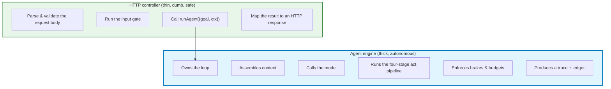
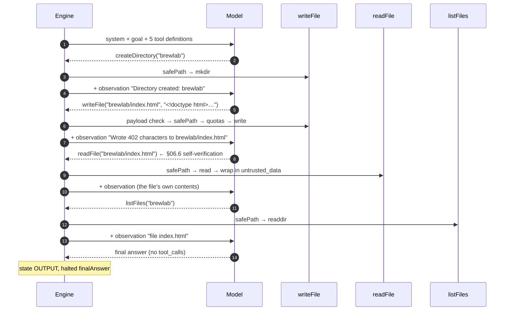
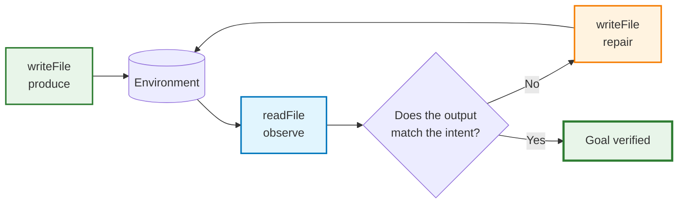

# Chapter 06: The Website-Builder Agent

> **Chapter goal:** build the notes' running example — an agent whose entire capability surface is four narrow
> tools, whose system prompt is a job description, and which verifies its own work by reading it back.
> **Notes chapters covered:** 06 §06.1–§06.10 · 01 §01.2 (Level 4) · 02 §02.2.

---

## 6.1 From advice to actuation (§06.1)

The distinction the chapter turns on:

```text
Advice:     the model tells you what to write
Actuation:  the model writes it, then reads it back to check
```

Everything that makes actuation safe is *structural*, not prompt-based:

| Concern | Structural answer | File |
| :--- | :--- | :--- |
| What may it touch? | four tools + `safePath` + quotas | `lib/security.ts`, `services/workspace.service.ts` |
| How far may it go? | four brakes + six termination conditions | `services/agent.service.ts` |
| May *this* user do it? | role-filtered registry + object-level check | `middleware/rbac.ts` |
| May it do it *at all*? | the tier gate | `services/approval.service.ts` |
| What did it do? | trace + ledger + audit log | `services/agent.service.ts`, `middleware/defensive.ts` |

---

## 6.2 System-prompt engineering: the job description (§06.2)

```ts
export const WEBSITE_BUILDER_SYSTEM_PROMPT = `You are a website builder agent.
You have exactly four tools: createDirectory, writeFile, readFile and listFiles.
Work in small steps: scaffold, produce, then VERIFY by reading back what you wrote.
Never write outside your workspace. If a tool denies you, explain it and stop.`;
```

Four sentences, four jobs:

| Sentence | Job | Why it matters |
| :--- | :--- | :--- |
| *"You are a website builder agent."* | role | sets the vocabulary the model reasons in |
| *"You have exactly four tools: …"* | a **closed** capability list | the model stops inventing `deploySite` or `runCommand` |
| *"…then VERIFY by reading back what you wrote."* | method | this is what makes `readFile` an *environmental* tool (§06.6) |
| *"If a tool denies you, explain it and stop."* | boundary behaviour | a denial is a stop condition, not a puzzle |

> **Note what is NOT in the prompt.** No file-size cap. No depth limit. No permission table. No approval threshold.
> Those live in code, because §06.2's real lesson is that *the prompt describes intent; the runtime enforces
> limits.* Anything in the prompt can be argued with — that is literally what prompt injection is.

---

## 6.3 `src/services/registry.service.ts` (full file) — the capability surface

```ts
import { z } from 'zod';
import { zodToJsonSchema } from 'zod-to-json-schema';
import { TIER_POLICY } from '../config/config.js';
import type { Permission, Tool, ToolDefinition, ToolTier } from '../types/agent.types.js';
import { workspaceTools } from './workspace.service.js';

/**
 * Chapter 02 §02.2.3 — the registry.
 *
 * A tool is an implementation PLUS a contract, and in this lecture the contract has
 * three parts the model never sees: the TIER (chapter 07) and the PERMISSION
 * (chapter 08). Only `name`, `description` and `parameters` are ever serialized.
 */

const describe = (schema: z.ZodTypeAny): Record<string, unknown> =>
  zodToJsonSchema(schema, { target: 'openApi3' }) as Record<string, unknown>;

/** Chapter 01 §01.2 Level 2 — the single-tool example, kept because it is pure. */
export const calculateTool: Tool = {
  name: 'calculate',
  description: 'Evaluates a basic arithmetic operation. Use it instead of doing arithmetic in your head.',
  parameters: describe(
    z.object({
      operation: z.enum(['add', 'subtract', 'multiply', 'divide']),
      a: z.number(),
      b: z.number(),
    }),
  ),
  schema: z.object({ operation: z.enum(['add', 'subtract', 'multiply', 'divide']), a: z.number(), b: z.number() }),
  tier: 1,
  permission: 'calc:run',
  execute: async (args) => {
    const { operation, a, b } = args as { operation: string; a: number; b: number };
    if (operation === 'divide' && b === 0) {
      // §03.10.2 rule 2 — actionable, never "something went wrong".
      throw new Error('Division by zero is undefined. Provide a non-zero denominator.');
    }
    const result =
      operation === 'add' ? a + b : operation === 'subtract' ? a - b : operation === 'multiply' ? a * b : a / b;
    return { operation, a, b, result };
  },
};

/**
 * Chapter 07 §07.2 — a Tier 3 tool. Non-idempotent, financial, irreversible.
 *
 * Notice the `idempotencyKey` in the schema: for a Tier 3 tool, idempotency is not
 * optional — it is part of the tool contract (§07.6).
 */
export const refundCustomerTool: Tool = {
  name: 'refundCustomer',
  description: 'Issues a refund against an order. Requires human approval above the configured threshold.',
  parameters: describe(
    z.object({
      orderId: z.string().describe('The order to refund, e.g. "892".'),
      amount: z.number().describe('Refund amount in the account currency.'),
      reason: z.string().optional(),
    }),
  ),
  schema: z.object({ orderId: z.string().min(1), amount: z.number().positive(), reason: z.string().optional() }),
  tier: 3,
  permission: 'billing:refund',
  execute: async (args) => {
    const { orderId, amount, reason } = args as { orderId: string; amount: number; reason?: string };
    // §07.6 layer 2 — the downstream service is the only place that can answer
    // "have I already applied this effect?". The key travels with the request.
    const idempotencyKey = `refund:${orderId}:${amount}`;
    return {
      refunded: true,
      orderId,
      amount,
      reason: reason ?? 'customer request',
      idempotencyKey,
      note: `Tier 3 action executed after human approval (threshold ${TIER_POLICY.financialThreshold}).`,
    };
  },
};

/** §07.2 — the other Tier 3 primitive named in the notes: an external, irreversible action. */
export const deployToProductionTool: Tool = {
  name: 'deployToProduction',
  description: 'Deploys a built site to the production environment. Irreversible and externally visible.',
  parameters: describe(z.object({ siteName: z.string().describe('The project directory to deploy.') })),
  schema: z.object({ siteName: z.string().min(1) }),
  tier: 3,
  permission: 'deploy:run',
  execute: async (args) => {
    const { siteName } = args as { siteName: string };
    return { deployed: true, siteName, url: `https://${siteName}.example.com`, deployedAt: new Date().toISOString() };
  },
};

/**
 * §06.3 — the capability surface, in one list. Four sandbox tools plus three
 * domain tools; the sandbox tools are the agent's *hands*, the others are its
 * *reach*.
 */
export const ALL_TOOLS: Tool[] = [
  ...workspaceTools,
  calculateTool,
  refundCustomerTool,
  deployToProductionTool,
];

export const getTool = (name: string): Tool | undefined => ALL_TOOLS.find((tool) => tool.name === name);

export const permissionFor = (name: string): Permission | undefined => getTool(name)?.permission;

export const tierFor = (name: string): ToolTier | undefined => getTool(name)?.tier;

/**
 * Chapter 02 §02.2.3 — the ONLY thing that leaves this process toward the model:
 * name, description, parameters. No tier, no permission, no implementation.
 */
export const toWireDefinitions = (tools: Tool[] = ALL_TOOLS): ToolDefinition[] =>
  tools.map((tool) => ({
    type: 'function',
    function: { name: tool.name, description: tool.description, parameters: tool.parameters },
  }));

/** Chapter 02 §02.6 — what `/api/health` and `/api/tools` report about the registry. */
export const describeRegistry = (tools: Tool[] = ALL_TOOLS) =>
  tools.map((tool) => ({ name: tool.name, tier: tool.tier, permission: tool.permission }));
```

### Block by block

**`calculateTool` — the Level-2 example, kept because it is pure (§01.2)**

```ts
tier: 1, permission: 'calc:run',
execute: async (args) => {
  const { operation, a, b } = args as { operation: string; a: number; b: number };
  if (operation === 'divide' && b === 0) {
    throw new Error('Division by zero is undefined. Provide a non-zero denominator.');
  }
  …
}
```

Tier 1 because it has **zero side effects** — §07.2's first classification question is "does it change any state?",
and this tool answers no. The divide-by-zero error is deliberately *actionable* (§03.10.2 rule 2): it names the
problem and the fix, so a model can correct itself.

**`refundCustomerTool` — the Tier 3 contract (§07.2, §07.6)**

```ts
tier: 3, permission: 'billing:refund',
execute: async (args) => {
  const idempotencyKey = `refund:${orderId}:${amount}`;
  return { refunded: true, orderId, amount, idempotencyKey, note: '…' };
}
```

Two things to notice. First, `tier: 3` and `permission: 'billing:refund'` are **part of the contract** — the model
never sees them, but the gate reads them. Second, the tool returns an `idempotencyKey` derived from
`(orderId, amount)`, which is §07.6 layer 2: the key travels to the downstream service, which is the only place
that can definitively answer *"have I already done this?"*.

**`deployToProductionTool` — the other Tier 3 primitive**

`deployToProduction` is irreversible and externally visible, so it is Tier 3 for a different reason than
`refundCustomer` (which is Tier 3 for *financial* impact). §07.2's classification tree reaches the same answer via
two paths: *"is the impact external, financial or irreversible?"* — **yes** for both.

**`ALL_TOOLS` — the one list that matters**

```ts
export const ALL_TOOLS: Tool[] = [...workspaceTools, calculateTool, refundCustomerTool, deployToProductionTool];
```

Seven tools: four sandbox primitives (the agent's *hands*) and three domain tools (its *reach*). This array is the
blast radius, and it is deliberately one line so a reviewer can count it.

**`toWireDefinitions(tools)` — the only thing that leaves the process**

```ts
export const toWireDefinitions = (tools: Tool[] = ALL_TOOLS): ToolDefinition[] =>
  tools.map((tool) => ({ type: 'function', function: { name: tool.name, description: tool.description, parameters: tool.parameters } }));
```

Note the parameter: it takes the **already-filtered** list. `tier`, `permission` and `execute` are dropped here — the
model receives a name, a description and a JSON Schema, and nothing else. Verified:

```text
GET /api/tools as learner -> offered: [createDirectory, writeFile, readFile, listFiles, calculate]
                            WITHHELD: [refundCustomer, deployToProduction]
```

**`describeRegistry(tools)` — the operator's view**

The same registry, but with `tier` and `permission` exposed. This is the endpoint an auditor reads; the model reads
`toWireDefinitions` and never this.

---

## 6.4 The four tools, and why not five or ten (§06.3.1)

| Temptation | Why it is wrong | Chapter |
| :--- | :--- | :--- |
| Add `runCommand` | Reintroduces arbitrary code execution | 05 §05.2 |
| Add `deleteFile` | Irreversible; needs a tier and a gate | 07 §07.2 |
| Add `moveFile` | Two mutations in one call; harder to audit and to make idempotent | 07 §07.6 |
| Add `appendToFile` | Premature; `readFile` + `writeFile` covers it | — |
| Add `deploySite` | Tier 3 — external and irreversible; belongs behind a human gate | 07 §07.2 |

> **The capability surface is the blast radius.** Four narrow tools in a jail mean the worst case is a ruined
> website directory.

---

## 6.5 The controller and the engine (§06.4)



The controller's whole contribution to "intelligence" is one line:

```ts
const run = await runAgent({ goal, ctx, maxSteps, timeoutMs, cancelAfterMs });
```

> **Why this separation matters.** *"From the controller's perspective, there is zero hardcoded site-generation
> logic."* All sequencing, tool choice, file creation and verification happen inside the engine, driven by the
> model. That is what makes §06.8's general-purpose emergence possible — and it is also what makes the controller
> reviewable in thirty seconds.

The engine's responsibilities, in the loop's own terms:

```text
PERCEIVE  → assemble context: system prompt + prompt + history + observations
DECIDE    → one model call, tool_calls or an answer
ACT       → validate → authorize → business rules → execute → observe
BRAKE     → steps · time · tokens · repetition
TRACE     → one record per hop, with the named state
```

---

## 6.6 End-to-end walkthrough: the BrewLab case study (§06.5)

The request:

```json
{ "goal": "Create a landing page for BrewLab with a hero section" }
```

**Verified trace — five hops, each one a decision:**

```text
step 1 state TOOL_RESULT | calls: [('createDirectory', 'ok', None, 'T2')]
step 2 state TOOL_RESULT | calls: [('writeFile',        'ok', None, 'T2')]
step 3 state TOOL_RESULT | calls: [('readFile',         'ok', None, 'T1')]
step 4 state TOOL_RESULT | calls: [('listFiles',        'ok', None, 'T1')]
step 5 state OUTPUT      | calls: []
```



**The file really exists — inside the per-user jail:**

```text
workspace/tenant-a/s-1/brewlab/index.html
```

Note the path: `<WORKSPACE_ROOT>/<tenantId>/<userId>/brewlab/`. The agent never chose `tenant-a` or `s-1` — those
came from the session (§08.3), and the object-level check in `authorizeTool` is what keeps them honest.

**The ledger, showing the `O(N²)` shape (§04.4):**

```text
input tokens per hop: [717, 735, 837, 942, 961]
ledger: { totalInputTokens: 4192, totalOutputTokens: 219, toolTimeMs: 1, steps: 5, halted: 'finalAnswer' }
```

---

## 6.7 The environmental feedback loop: why `readFile` transforms capability (§06.6)

Hop 3 above is the difference between a generator and an agent.



| Without `readFile` | With `readFile` |
| :--- | :--- |
| The agent is blind after writing | It can inspect its own output |
| Errors surface to the *user*, later | Errors surface to the *agent*, immediately |
| Repair requires a new human request | Repair is another hop in the same run |
| "Did it work?" is unanswerable | "I read it back" is a statement about the world |

That last row is why `readFile` wraps its output in `<untrusted_data>`: the agent must be able to *trust the
existence* of the file while *not trusting its contents* as instructions. Two different questions, two different
answers.

---

## 6.8 Multi-file coherence and general-purpose emergence (§06.7, §06.8)

**Multi-file coherence** comes from `listFiles` + `readFile` together. A single `writeFile` produces one artifact;
the pair produces a *project*, because the agent can see that `index.html` references `styles.css` and then check
whether `styles.css` exists.

**General-purpose emergence** is §06.8's claim: the same four tools and the same engine produce a landing page, a
documentation site, or a small dashboard — because the *sequencing* is decided by the model, not by the code. The
only thing you change between those tasks is the goal string and the system prompt.

> **What generalises is the loop, not the app.** That is why this codebase has no `generateSite()` function: the
> moment you write one, you have built a workflow (§09.1) and lost the emergence.

---

## 6.9 What generalises from this example (§06.9) — mapped

| Notes lesson | Where it lives here | Reusable beyond website building |
| :--- | :--- | :--- |
| Four narrow primitives beat one powerful one | `workspaceTools` | any code-modifying agent |
| The prompt is a job description, not a policy | `WEBSITE_BUILDER_SYSTEM_PROMPT` | every agent |
| The engine owns sequencing; the controller owns HTTP | `agent.service.ts` vs `agent.controller.ts` | every service |
| Verification must be a *tool*, not a hope | `readFile` | any generative step |
| Capability surface = blast radius | `ALL_TOOLS` (one array, seven entries) | every tool registry |

---

## 6.10 Common mistakes (§06.10) — and how this code avoids them

| # | Mistake | Consequence | Here |
| :---: | :--- | :--- | :--- |
| 1 | Hardcoding site-generation logic in the controller | No emergence; the agent is a template | the controller calls `runAgent` and nothing else |
| 2 | No `readFile`, so no verification | Blind writes; errors reach the user | hop 3 of every build |
| 3 | Ten tools "for flexibility" | Blast radius grows with the tool count | four tools, one closed array |
| 4 | Putting limits in the system prompt | They can be argued with | `QUOTAS` + `BRAKES` in config |
| 5 | Treating a denial as a retry signal | The agent probes the sandbox | the stub explains and stops |
| 6 | One tool per *outcome* instead of per *primitive* | Combinatorial tool counts | four primitives compose |
| 7 | No `listFiles` | The agent cannot see its own project | `listFiles` is Tier 1 and cheap |

### Try it

```bash
# Build a site (5 hops, ending in state OUTPUT)
curl -s -X POST localhost:8099/api/agent/run -H 'content-type: application/json' -H 'x-role: learner' \
  -d '{"goal":"Create a landing page for BrewLab with a hero section"}' \
  | python3 -c 'import sys,json;d=json.load(sys.stdin);print(d["answer"]);print(d["state"],d["halted"]);
[print(" ",r["step"],r["state"],[(c["name"],c["outcome"]) for c in r["calls"]]) for r in d["trace"]]'

# Look at what it produced
curl -s 'localhost:8099/api/workspace/files?path=brewlab' -H 'x-role: learner'
find workspace -type f
```

---

**Next:** [Chapter 07 — Human-in-the-Loop & the Approval Tiers](./07_Human_in_the_Loop_and_Approval_Tiers.md)


