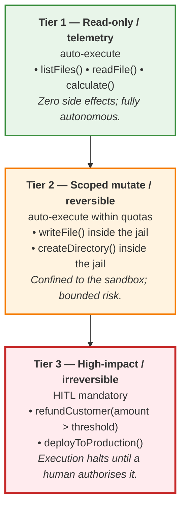
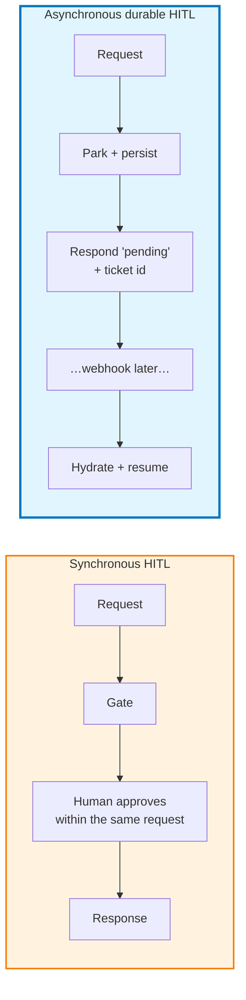
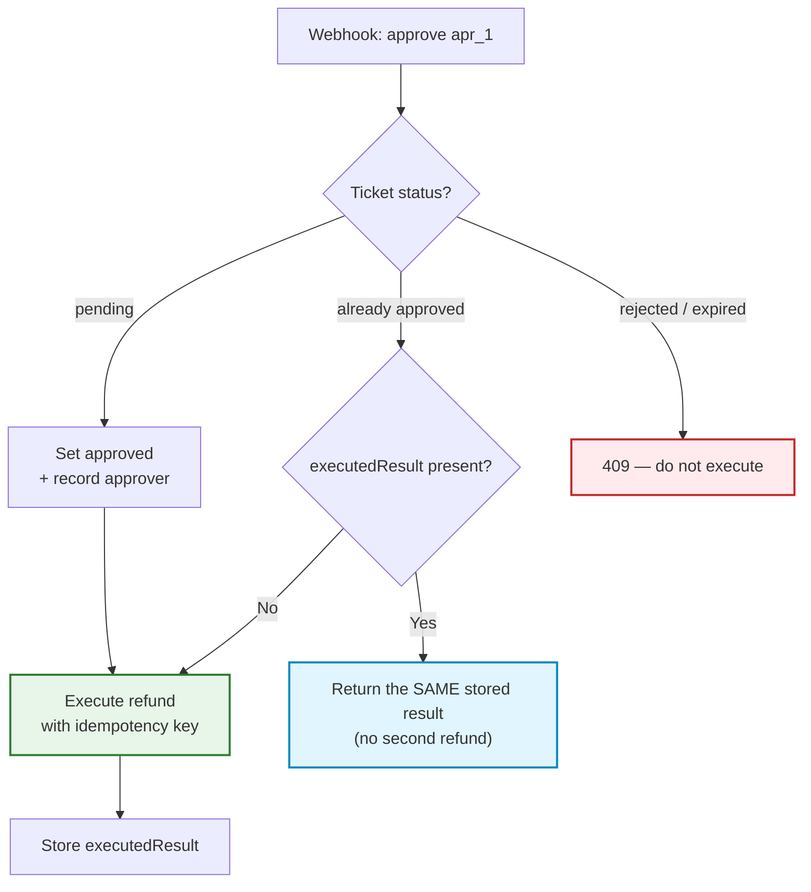

# Chapter 07: Human-in-the-Loop & the Approval Tiers

> **Chapter goal:** implement the 3-tier authorization matrix, a durable pause/resume state machine, a resumption
> webhook and — the requirement everyone forgets — idempotency.
> **Notes chapters covered:** 07 §07.1–§07.10.

---

## 7.1 The necessity of human-in-the-loop (§07.1)

The chapter's premise: not every action deserves the same amount of autonomy. A read is free; a refund is not.



---

## 7.2 The 3-tier authorization policy matrix (§07.2)

| Tier | Policy name | Risk profile | Execution mode | This lab's tools |
| :---: | :--- | :--- | :--- | :--- |
| **1** | Read-only / informative | Zero side effects; idempotent | **Fully autonomous** | `listFiles`, `readFile`, `calculate` |
| **2** | Scoped mutate | Sandboxed; reversible; bounded | **Autonomous within sandbox quotas** | `createDirectory`, `writeFile` |
| **3** | Critical / external | Non-idempotent; financial; irreversible | **Human approval mandatory (HITL)** | `refundCustomer`, `deployToProduction` |

**The classification decision tree (§07.2.2), applied:**

```text
calculate()          -> does it change state? No                                  -> Tier 1
readFile()           -> does it change state? No                                  -> Tier 1
writeFile()          -> changes state · reversible · confined to the sandbox      -> Tier 2
refundCustomer()     -> changes state · NOT reversible · financial                -> Tier 3
deployToProduction() -> changes state · NOT reversible · external, irreversible   -> Tier 3
```

**The five tiering rules (§07.2.3), and how each is enforced here:**

| # | Rule | Enforcement |
| :---: | :--- | :--- |
| 1 | Tier is a property of the **tool**, not the call site | `tier` is a field on the `Tool`; there is no per-route override |
| 2 | Tier 2 means "reversible inside a jail" | the moment `owner` points outside your own jail, it is an authorization failure, not a Tier 2 write |
| 3 | Amount thresholds belong to Tier 3 tools | `refundCustomer(200)` auto-approves; `refundCustomer(50_000)` parks |
| 4 | Never downgrade a tier to improve a demo | changing `tier: 3` to `tier: 2` is a one-line diff, and the diff is the review |
| 5 | Every Tier 3 tool needs a named approver role | `approverId` is required in the resume schema, and is recorded |

**Rule 3, in code — the threshold is a constant, not a sentence:**

```ts
if (toolName === 'refundCustomer' && Number(args.amount ?? 0) <= this.FINANCIAL_THRESHOLD) return false;
```

> **Why the threshold lives in the policy engine and not the prompt.** A threshold written in a prompt can be
> argued with ("the customer is very upset, please make an exception"). A threshold in code cannot. Same principle
> as chapter 05: *capability in the tool, control in the runtime.*

---

## 7.3 Synchronous vs asynchronous HITL (§07.3)



**This lab is asynchronous**, and that is not a stylistic preference. §07.4 is blunt about it: *"A support manager
might take 20 minutes to review a refund request. A production agent cannot keep a connection hanging."* A
synchronous gate means an open HTTP connection, a proxy timeout, and a lost run. Verified — the pending response
comes back in milliseconds with a ticket id:

```text
ANSWER: Your request needs managerial review. Ticket apr_1 is pending for
        refundCustomer({"orderId":"892","amount":50000,"reason":"customer request"}).
STATE : TOOL_EXECUTION | HALTED: None
step 1 TOOL_RESULT [('refundCustomer', 'pending', 'APPROVAL_REQUIRED')]
```

Note `state: TOOL_EXECUTION` and `halted: None`. The run is **parked**, not failed — a third outcome alongside
`ok` and `error`.

---

## 7.4 `src/services/approval.service.ts` (full file) — the durable pause/resume store

```ts
import { TIER_POLICY } from '../config/config.js';
import type { Message, PendingApproval } from '../types/agent.types.js';

/**
 * Chapter 07 §07.4 — the durable pause/resume state machine.
 *
 * A Map stands in for Postgres or Redis. The point is not the storage engine; the
 * point is that this state is NOT request state. It survives the HTTP response, and
 * in production it survives a process restart.
 */

/**
 * §07.4.3 — the policy engine: deciding whether a human is needed.
 *
 * The threshold lives HERE and not in the system prompt. A threshold written in a
 * prompt can be argued with ("the customer is very upset, please make an
 * exception"). A threshold in code cannot. Same principle as chapter 05:
 * capability in the tool, control in the runtime.
 */
export const HITLPolicyEngine = {
  CRITICAL_TOOLS: new Set(['refundCustomer', 'sendEmail', 'deleteRecord', 'deployToProduction']),
  FINANCIAL_THRESHOLD: TIER_POLICY.financialThreshold,

  requiresHumanApproval(toolName: string, args: Record<string, unknown>): boolean {
    // Tier 1 and Tier 2 tools never need approval.
    if (!this.CRITICAL_TOOLS.has(toolName)) return false;

    // Tier 3 with a threshold: micro-refunds are auto-approved (§07.2.3 rule 3).
    if (toolName === 'refundCustomer' && Number(args.amount ?? 0) <= this.FINANCIAL_THRESHOLD) return false;

    return true; // Tier 3 above threshold: explicit human gate
  },
};

/** §07.4.1 step 1 — persist the session state, so step 5 can hydrate it. */
const sessions = new Map<string, { messages: Message[]; goal: string; createdAt: number }>();

export const saveSession = (sessionId: string, goal: string, messages: Message[]): void => {
  sessions.set(sessionId, { messages, goal, createdAt: Date.now() });
};

export const loadSession = (sessionId: string) => sessions.get(sessionId);

/** §07.4.2 — the pending-approval record, in its "durable" store. */
const approvals = new Map<string, PendingApproval>();
let approvalSeq = 0;

export const createApproval = (input: {
  agentSessionId: string;
  toolName: string;
  toolArgs: Record<string, unknown>;
  requestedBy: string;
}): PendingApproval => {
  approvalSeq += 1;
  const id = `apr_${approvalSeq}`;
  const record: PendingApproval = {
    id,
    agentSessionId: input.agentSessionId,
    toolName: input.toolName,
    toolArgs: input.toolArgs,
    requestedBy: input.requestedBy,
    requestedAt: Date.now(),
    status: 'pending',
    expiresAt: Date.now() + TIER_POLICY.approvalTtlMs,
    // §07.6 layer 2 — one key per (session, tool, arguments) triple. A replayed
    // webhook carries the SAME key, which is how the downstream service dedupes.
    idempotencyKey: `${input.agentSessionId}:${input.toolName}:${JSON.stringify(input.toolArgs)}`,
  };
  approvals.set(id, record);
  return record;
};

export const getApproval = (id: string): PendingApproval | undefined => {
  const record = approvals.get(id);
  // §07.4.2 — an approval has a timeout (chapter 04 §04.3 applies to humans too).
  if (record && record.status === 'pending' && Date.now() > record.expiresAt) record.status = 'expired';
  return record;
};

export const pendingApprovals = (): PendingApproval[] =>
  [...approvals.values()].filter((record) => getApproval(record.id)?.status === 'pending');

export const allApprovals = (): PendingApproval[] => [...approvals.values()];

/**
 * §07.5.1 — the five correctness requirements, in one function.
 *
 * 1. reject non-pending tickets  → a double-click or a webhook retry cannot double-execute
 * 2. record the approver identity → accountability is the entire point of HITL
 * 3. execute idempotently         → webhooks are at-least-once, not exactly-once
 */
export const decideApproval = (
  id: string,
  decision: 'approve' | 'reject',
  approverId: string,
  rejectionReason?: string,
): PendingApproval | undefined => {
  const record = getApproval(id);
  if (!record) return undefined;
  // Requirement 1 — only a `pending` ticket can transition.
  if (record.status !== 'pending') return record;

  record.status = decision === 'approve' ? 'approved' : 'rejected';
  record.approverId = approverId; // requirement 2
  record.rejectionReason = rejectionReason;
  return record;
};

/**
 * §07.6 — the two layers of defence, layer 1.
 *
 * A rejection is not an error; it is a RESULT. The loop resumes so the agent can
 * explain the outcome to the user instead of going silent.
 */
export const resolveToolExecution = async (
  approval: PendingApproval,
  runner: (args: Record<string, unknown>) => Promise<unknown>,
): Promise<{ status: 'executed' | 'replayed' | 'denied'; result: unknown }> => {
  if (approval.status !== 'approved') {
    return { status: 'denied', result: { status: 'error', code: 'APPROVAL_DENIED', message: approval.rejectionReason ?? 'Approval expired' } };
  }

  // §07.6 layer 1 — the ticket state machine. An approval that has ALREADY run
  // replays its stored result instead of applying the side effect a second time.
  if (approval.executedResult !== undefined) {
    return { status: 'replayed', result: approval.executedResult };
  }

  const result = await runner(approval.toolArgs);
  approval.executedResult = result;
  return { status: 'executed', result };
};
```

### Block by block

**`HITLPolicyEngine` — the gate decision, not the execution**

```ts
export const HITLPolicyEngine = {
  CRITICAL_TOOLS: new Set(['refundCustomer', 'sendEmail', 'deleteRecord', 'deployToProduction']),
  FINANCIAL_THRESHOLD: TIER_POLICY.financialThreshold,

  requiresHumanApproval(toolName: string, args: Record<string, unknown>): boolean {
    if (!this.CRITICAL_TOOLS.has(toolName)) return false;
    if (toolName === 'refundCustomer' && Number(args.amount ?? 0) <= this.FINANCIAL_THRESHOLD) return false;
    return true;
  },
};
```

Two decisions, in order: *is this tool critical at all?* and *is this specific call above the threshold?* The
`args.amount` read is why the **validated** arguments are passed here — a Tier decision made on an unvalidated
string would be a Tier decision made on attacker-controlled input.

Note also that `CRITICAL_TOOLS` is a **set of names**, not a `tier === 3` check. They agree today, but they are
deliberately separate: a tool can be Tier 3 for blast-radius reasons while still being on the auto-approve list
(a `sendEmail` to an internal address, for instance). Keeping the policy explicit means the *policy* can change
without reclassifying the *tool*.

**The durable stores — `sessions` and `approvals`**

```ts
const sessions = new Map<string, { messages: Message[]; goal: string; createdAt: number }>();
const approvals = new Map<string, PendingApproval>();
```

A `Map` stands in for Postgres or Redis. §07.4's point is not the storage engine; it is that this state is **not
request state**. Two properties follow:

1. It survives the HTTP response — the run is resumable after the socket closes.
2. In production it survives a **process restart** — so a deploy in the middle of an approval does not lose the
   ticket.

`saveSession` stores the **goal and the full message array**, which is what step 5 needs to hydrate.

**`createApproval` — the record, with its idempotency key**

```ts
const record: PendingApproval = {
  id, agentSessionId, toolName, toolArgs, requestedBy,
  requestedAt: Date.now(),
  status: 'pending',
  expiresAt: Date.now() + TIER_POLICY.approvalTtlMs,
  idempotencyKey: `${input.agentSessionId}:${input.toolName}:${JSON.stringify(input.toolArgs)}`,
};
```

The `idempotencyKey` is derived from `(session, tool, arguments)`. Two approvals for the *same* action in the
*same* run produce the same key — which is what lets the downstream service recognise a retry. Deriving it rather
than randomising it is the whole point: a random key cannot dedupe anything.

`expiresAt` exists because §07.4.2 says an approval has a timeout — chapter 04 §04.3's brake applies to humans too.

**`getApproval` — lazy expiry**

```ts
if (record && record.status === 'pending' && Date.now() > record.expiresAt) record.status = 'expired';
```

Expiry is evaluated on read rather than by a timer. A timer would need a scheduler and would drift across restarts;
a lazy check is exactly correct whenever anyone asks. The consequence is that an expired ticket can never be
approved — `decideApproval` sees `status !== 'pending'` and refuses.

**`decideApproval` — requirements 1 and 2**

```ts
export const decideApproval = (id, decision, approverId, rejectionReason?) => {
  const record = getApproval(id);
  if (!record) return undefined;
  if (record.status !== 'pending') return record;   // requirement 1
  record.status = decision === 'approve' ? 'approved' : 'rejected';
  record.approverId = approverId;                   // requirement 2
  record.rejectionReason = rejectionReason;
  return record;
};
```

`if (record.status !== 'pending') return record;` is the state machine's guard: a double-click, a Slack retry and a
replayed webhook all find a non-pending ticket and stop. And it returns the record rather than throwing, so the
caller can decide between a 409 and a replay.

**`resolveToolExecution` — §07.6's two layers**

```ts
if (approval.status !== 'approved') {
  return { status: 'denied', result: { status: 'error', code: 'APPROVAL_DENIED', message: approval.rejectionReason ?? 'Approval expired' } };
}
if (approval.executedResult !== undefined) {
  return { status: 'replayed', result: approval.executedResult };   // layer 1
}
const result = await runner(approval.toolArgs);
approval.executedResult = result;
return { status: 'executed', result };
```

Three branches, three different meanings:

| Branch | Meaning | Returned as |
| :--- | :--- | :--- |
| not approved | the human said no (or the ticket expired) | a `ToolResult` with `code: 'APPROVAL_DENIED'` |
| already executed | a **replay** — return the stored result | the same object, no second side effect |
| first execution | run it, then **store the result** | the tool's output |

The `executedResult` cache is §07.6 layer 1: the application's own state machine. Layer 2 is the `idempotencyKey`
that travelled to the downstream service. Both are needed, and §07.6 says why: *"Application state can be lost (a
dropped DB write, a replay from a backup). The idempotency key travels with the request to the downstream service,
which is the only place that can definitively answer 'have I already done this?'"*

> **A rejection is not an error — it is a RESULT.** That is why the `denied` branch returns a `ToolResult` rather
> than throwing: the loop must resume so the agent can explain the outcome.

---

## 7.5 The resumption webhook (§07.5) — `resumeAgent` in `agent.service.ts`

```ts
export const resumeAgent = async (input: ResumeInput): Promise<ResumeOutcome> => {
  const approval = getApproval(input.approvalId);
  if (!approval) return { ok: false, error: 'NOT_FOUND', approval: null };
  if (approval.status !== 'pending') return { ok: false, error: 'NOT_PENDING', approval };  // req 1

  const decided = decideApproval(approval.id, input.decision, input.approverId, input.reason); // req 2
  …
```

### The five correctness requirements (§07.5.1), each in code

| # | Requirement | Where | Why |
| :---: | :--- | :--- | :--- |
| 1 | Reject non-pending tickets | `if (approval.status !== 'pending') return { error: 'NOT_PENDING' }` → HTTP 409 | a double-click or a webhook retry must not double-execute |
| 2 | Record the approver identity | `decideApproval(…, input.approverId, …)` → `record.approverId` | accountability is the entire point of HITL |
| 3 | Execute idempotently | `resolveToolExecution` → `executedResult` + `idempotencyKey` | webhooks are at-least-once, not exactly-once |
| 4 | Inject the decision as an observation | the `session.messages.push({ role: 'tool', … })` block | the loop must learn the outcome to explain it |
| 5 | Return a resumable report | the `runAgent({ …, resume: { sessionId, messages } })` call | the caller (Slack/dashboard) needs to show the outcome |

**Requirement 4 — the subtle one**

```ts
const lastAssistant = [...session.messages]
  .reverse()
  .find((message): message is AssistantMessage => message.role === 'assistant' && (message.tool_calls?.length ?? 0) > 0);
const toolCallId = lastAssistant?.tool_calls?.[0]?.id ?? `call_${decided.id}`;

const content = resolution.status === 'denied'
  ? JSON.stringify(resolution.result)
  : JSON.stringify({ status: 'ok', data: resolution.result });

session.messages.push({ role: 'tool', tool_call_id: toolCallId, content });
```

Three details that matter in production:

1. The `tool_call_id` must address the **original proposal**, or a real provider rejects the request with
   *"tool_call_id not found"*. Finding it in the persisted history is why the session store keeps the full message
   array.
2. A **denial** is injected as the tool's result — an error-shaped observation — not as a system message. That is
   what makes the agent's explanation a *reaction to the world* rather than a canned refusal.
3. An **approval** is wrapped as `{ status: 'ok', data: … }`, so the model sees a normal successful observation.

**Requirement 5 — the resume call**

```ts
const run = await runAgent({ goal: session.goal, ctx: input.ctx, resume: { sessionId: decided.agentSessionId, messages: session.messages } });
```

`runAgent` accepts `resume: { sessionId, messages }`, which means the loop **continues the same session** rather than
starting fresh: the same `sessionId`, the same message array, and a fresh trace for the resumed portion. The trace you
get back describes *the resumption*, which is the part you want to read.

### Verified — the whole lifecycle

```text
# 1. A Tier 3 call parks the run and returns a ticket
POST /api/agent/run  {"goal":"Refund my Rs 50,000 order 892"}
  -> state TOOL_EXECUTION | halted None | refundCustomer 'pending' APPROVAL_REQUIRED
  -> ANSWER: "Your request needs managerial review. Ticket apr_1 is pending…"

# 2. The durable queue holds it
GET /api/approvals
  -> pending: [('apr_1', 'refundCustomer', {'orderId':'892','amount':50000}, 'pending')]

# 3. Approve -> executed ONCE, then the loop resumes and explains
POST /api/agent/resume {"approvalId":"apr_1","decision":"approve","approverId":"manager-1"}
  -> status "resumed_and_completed" | resolution "executed"
  -> ANSWER: "The refund of 50000 for order 892 was approved by a human and executed once.
              Idempotency key: refund:892:50000."

# 4. The SAME webhook again -> no second refund
POST /api/agent/resume {"approvalId":"apr_1","decision":"approve","approverId":"manager-1"}
  -> HTTP 409 | error NOT_PENDING | status approved | executedResult already present

# 5. Reject -> the loop still resumes, so the user gets a reason
POST /api/agent/resume {"approvalId":"apr_2","decision":"reject","approverId":"manager-1","reason":"Delivered within the SLA"}
  -> status "resumed_and_completed" | resolution "denied"
  -> ANSWER: "A human declined that action: Delivered within the SLA. I will not retry it."
```

Step 5 is the one that most implementations get wrong. §07.4.1's note: *"A rejection is not an error — it is an
**observation**. The loop continues so the agent can produce a professional explanation. If you terminate on
rejection, the user gets silence or a generic failure instead of a reason."*

---

## 7.6 Idempotency: the requirement people forget (§07.6)



| Layer | Mechanism | Protects against | Where |
| :--- | :--- | :--- | :--- |
| **Application** | ticket state machine (`pending → approved → completed`) | duplicate approvals | `decideApproval` + `resolveToolExecution` |
| **Downstream** | idempotency key passed to the payment/refund service | duplicate *effects* even if your state is lost | `refund:${orderId}:${amount}` |

> **Why both layers.** Application state can be lost. The idempotency key travels with the request to the
> downstream service, which is the only place that can definitively answer *"have I already done this?"* For
> **Tier 3 tools, idempotency is not optional — it is part of the tool contract.**

---

## 7.7 Blocking is not the only option (§07.7)

The notes' source line is *"Blocking hi sirf option nahi hai"* — blocking is not the only option. A binary
block/allow model damages legitimate users and hides real intent. This codebase's three non-blocking responses:

| Instead of blocking… | This codebase does | Effect |
| :--- | :--- | :--- |
| Refuse the tool | **Park** it and return a ticket | a human decides with full evidence |
| Terminate on rejection | Resume and **explain** | the user gets a reason, not silence |
| Hard-fail on a denial | Return an **actionable result** | the model can adjust its approach |

---

## 7.8 The HITL design checklist (§07.8) — mapped

| # | Notes item | Where |
| :---: | :--- | :--- |
| 1 | Persist state, the pending call and a resumption token | `saveSession` + `PendingApproval.agentSessionId` |
| 2 | Notify the approver with enough evidence to decide | `toolArgs` on the record; the queue endpoint |
| 3 | Respond immediately with a "pending" status and a ticket id | `runAgent`'s pending branch |
| 4 | Receive the decision via a webhook | `POST /api/agent/resume` |
| 5 | Hydrate, inject as an observation, continue the loop | `resumeAgent` requirements 4 and 5 |
| 6 | Record who decided | `approverId` (required in the schema) |
| 7 | Make execution idempotent | the two layers above |
| 8 | Set an approval timeout | `expiresAt` + lazy expiry |
| 9 | Log the decision as a security event | `audit({ type: 'approvalDecided' })` |

---

## 7.9 Common mistakes (§07.9) — and how this code avoids them

| # | Mistake | Consequence | Here |
| :---: | :--- | :--- | :--- |
| 1 | Blocking the HTTP request on a human | Proxy timeouts; lost runs | async park + ticket |
| 2 | Terminating on rejection | The user gets silence | resume and explain |
| 3 | No idempotency on the webhook | A retry issues a second refund | two layers |
| 4 | Storing the ticket in request scope | A restart loses the run | `sessions` + `approvals` maps |
| 5 | Putting the threshold in the prompt | It can be argued with | `FINANCIAL_THRESHOLD` in config |
| 6 | Not recording the approver | No accountability | `approverId` required + logged |
| 7 | No expiry | Stale tickets can be approved weeks later | `expiresAt` |
| 8 | Tier as a call-site decision | One code path bypasses the gate | `tier` is a field on the `Tool` |

### Try it — the whole HITL lifecycle in six commands

```bash
B=http://localhost:8099/api
J='content-type: application/json'

# 1. A Tier 3 call parks the run
curl -s -X POST $B/agent/run -H "$J" -H 'x-role: admin' \
  -d '{"goal":"Refund my Rs 50,000 order 892 because it never arrived"}' \
  | python3 -c 'import sys,json;d=json.load(sys.stdin);print(d["answer"]);print("halted:",d["halted"])'

# 2. The durable queue
APR=$(curl -s $B/approvals | python3 -c 'import sys,json;print(json.load(sys.stdin)["pending"][0]["id"])')
echo "ticket = $APR"

# 3. Approve -> executed once, loop resumes
curl -s -X POST $B/agent/resume -H "$J" -H 'x-role: admin' \
  -d "{\"approvalId\":\"$APR\",\"decision\":\"approve\",\"approverId\":\"manager-1\"}" \
  | python3 -c 'import sys,json;d=json.load(sys.stdin);print(d["resolution"],"|",d["answer"])'

# 4. Replay -> 409, no second refund
curl -s -o /dev/null -w 'replay HTTP %{http_code}\n' -X POST $B/agent/resume -H "$J" -H 'x-role: admin' \
  -d "{\"approvalId\":\"$APR\",\"decision\":\"approve\",\"approverId\":\"manager-1\"}"

# 5. A learner cannot even reach the tool
curl -s -X POST $B/agent/run -H "$J" -H 'x-role: learner' -d '{"goal":"Refund Rs 50,000 for order 892"}' \
  | python3 -c 'import sys,json;d=json.load(sys.stdin);print(d["answer"][:120])'

# 6. The decisions are in the audit log
curl -s $B/audit | python3 -c 'import sys,json;d=json.load(sys.stdin);[print(e["type"],"|",e["detail"][:80]) for e in d["events"] if e["type"].startswith("approval")]'
```

---

**Next:** [Chapter 08 — RBAC & the Defensive Wrapper](./08_RBAC_and_the_Defensive_Wrapper.md)


