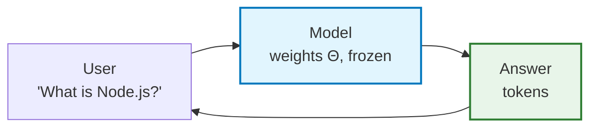
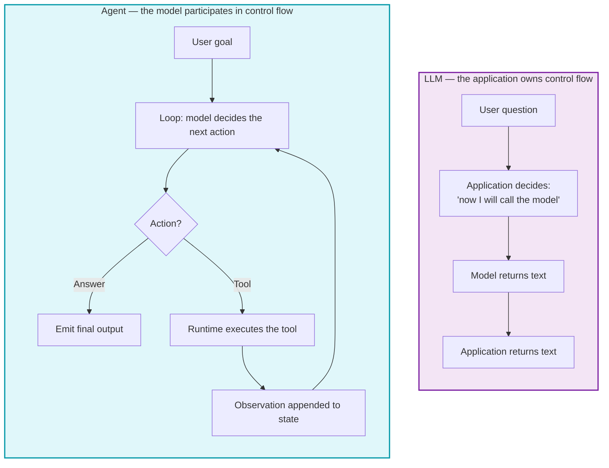
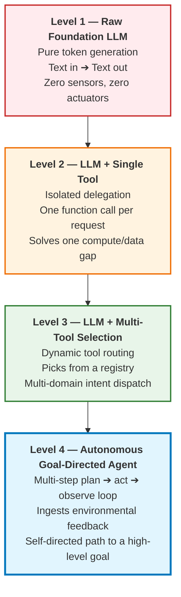
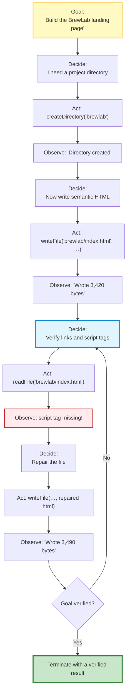
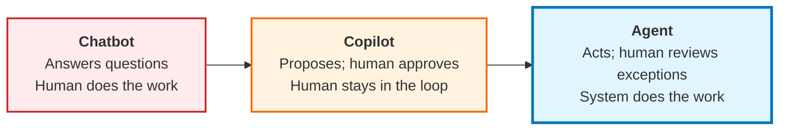
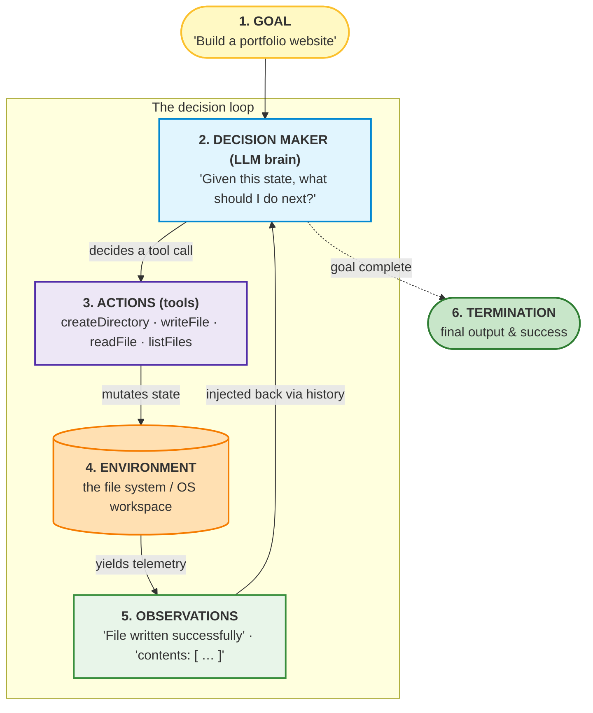
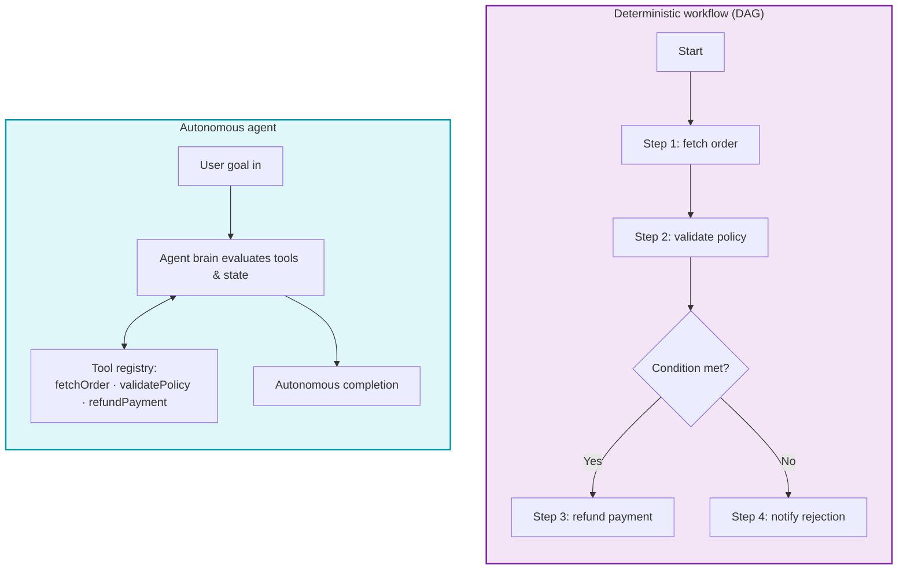
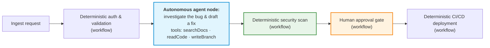

# Chapter 01 — First Principles of AI Agents & the Agency Spectrum

> **Lecture 09 · Chapter 01 of 09** · Level: 🟡 Intermediate · Phase 3 — Agency & Contracts
> **Source:** `Forward-Deployed-Engineer/Lecture 05/notes/04_First_Principles_of_AI_Agents_and_Agency_Spectrum.md` ·
> `gen-ai-cohort/week01/learning/day02/notes/05 agent-architecture-and-loops.md` (ch 1–3) ·
> `gen-ai-cohort/week02/learning/day03/notes/01-ai-agent-architecture.md` (ch 1–4)
> **Roadmap topics:** first principles of AI agents · the agency spectrum (chatbot → copilot → agent) ·
> the first-principles 6-component agent model · the agency spectrum as 4 progressive levels (from advice to
> full actuation).
> **Prerequisites:** Lecture 08 (tool calling — a tool is *capability + permission*; the 5-step wire protocol) ·
> Lecture 06 (statelessness, context, role architecture) · Lecture 05 (prompting as a contract).

---

## 01.0 What this chapter is for

The word *"agent"* is the most abused word in applied AI. It is used for a chat window with a nicer system
prompt, for a `for`-loop over three API calls, and for a system that books flights while you sleep. When a word
means everything, it stops being an engineering term — and engineering terms are the only kind that let you
answer the questions that actually matter:

- *How much autonomy did I just grant?*
- *What is the worst thing this system can do if it is wrong?*
- *Which line of code, not which sentence of prompt, stops it?*

This chapter rebuilds the concept from first principles so that every later chapter has something to attach to.
The rest of the lecture — loops, brakes, sandboxes, approval gates, RBAC — is only meaningful once you accept
the central claim:

> **An agent is not a model. An agent is a *control loop* wrapped around a model, with tools as its only way to
> touch reality, and constraints as its only way to stay safe.**

By the end of this chapter you should be able to:

1. State the difference between an LLM and an agent in terms of **control flow**, not capability.
2. Place any system you are shown on the **4-level agency spectrum**, and justify the placement.
3. Translate the marketing framing *chatbot → copilot → agent* into that same technical spectrum.
4. Name and define the **6 canonical components** of an agent, and the master formula that binds them.
5. Explain *why* the loop — not the model — is the source of agency.
6. Say what an agent is **not**, and list the six most common first-principles mistakes.

---

## 01.1 What is an agent? Start from what an LLM is *not*

An LLM performs one computation, over and over:

$$
P(w_t \mid w_1, \dots, w_{t-1}; \Theta)
$$

Sample the next token, append it, repeat. That is the whole job. (Lecture 02 for the mechanism, Lecture 04 for
the API surface, Lecture 08 for why "generating text is not performing an action".)

So a raw LLM does exactly this and nothing else:

Notice what is missing. The model cannot:

- **maintain state** between calls (it is stateless — Lecture 06),
- **decide what to do next** (the *application* decides when to call it),
- **call a tool** (it can only emit text that *looks like* a call — Lecture 08),
- **observe a result** (nothing flows back unless you send it back),
- **retry after an error** (there is no "after" — one call, one answer),
- **continue until a condition is met** (it has no notion of a condition).

Every item on that list is a property of *software*, not of *weights*. An agent is the software that supplies
them.

> **The one-line definition.**
> An agent is an LLM placed inside a controlled software execution loop that can observe state, decide actions,
> execute tools, process results, recover from errors, and eventually terminate.

### 01.1.1 The formula, in three levels of completeness

| Form | Formula | What it is good for |
| :--- | :--- | :--- |
| Minimal | `Agent = LLM + Loop + Tools` | A first mental handle; a whiteboard sketch. |
| Working | `Agent = LLM + State/Memory + Loop/Control + Tools + Guardrails` | How you would describe the architecture in a design review. |
| First-principles | `AI Agent = Foundation LLM + Tools + Environment + Observations + Decision Loop + Goal` | The rigorous version used for the rest of this lecture (§01.4). |

The minimal form is not wrong; it is *incomplete in the dangerous direction*. It hides **State** (so people
assume the model remembers), **Guardrails** (so people assume the prompt is the safety layer), and **Goal**
(so people build loops that never terminate). All three omissions become bugs in production.

### 01.1.2 The real difference is control flow

This is the sentence to internalise:

> **An LLM answers. An agent decides what to do next.**

In the LLM flow there is exactly one branch: *return the text*. In the agent flow there is a **decision node
the model controls** and a **cycle the application owns**. Both halves are required. Remove the decision node
and you have a workflow (§01.6); remove the cycle and you have a single tool call (Lecture 08).

| Feature | LLM | AI Agent |
| :--- | :---: | :---: |
| Generates text | ✅ | ✅ |
| Calls external APIs / tools | ❌ | ✅ |
| Reads or writes a database | ❌ | ✅ |
| Memory across interactions | Limited (whatever you re-send) | ✅ (application-managed) |
| Multi-step tasks | ❌ | ✅ |
| Plans / sequences its own steps | Limited | ✅ |
| Retries failed tasks | ❌ | ✅ |
| Executes code | ❌ | ✅ |
| Enforces business rules | ❌ | ✅ (in the runtime, not the prompt) |

> **Note on the last row.** The agent enforces business rules — but *not* because the model was told to. The
> rules live in the runtime that wraps the model. That distinction is Chapter 08's entire subject, and it is
> the difference between a policy and a hope.

---

## 01.2 The agency spectrum — 4 progressive levels

Agency is **not a binary switch**. It is a spectrum of progressive autonomy, and the levels differ in *who
decides the next step* and *how many decisions are chained before a human is consulted again*.

### Level 1 — Raw foundation LLM (text generation)

**Architecture:** `User query → LLM → Text answer`.

**Example:** *"Explain polymorphism in object-oriented programming."*

**Operational reality:** the model samples tokens from its parametric weights `Θ`. Nothing outside the model
changes. No external system is queried. There is no state beyond what you paste into the prompt.

**Why it is still on the spectrum:** because it is the *substrate*. Every higher level is this, plus structure.
If you cannot describe a system as "a model plus X", the X is where the engineering is.

### Level 2 — LLM + single tool (isolated delegation)

**Architecture:** `User query → LLM → one tool call → result → LLM → text answer`.

**Example:** *"What is 94823 multiplied by 3291?"* → the model delegates to a calculator (Lecture 08).

**Operational reality:** the model closes exactly **one** capability gap in **one** round trip. The developer
chose *which* gap to close by exposing exactly one tool. There is no routing decision and no sequencing
decision.

**Engineering character:** this is *not yet agentic*. It is a function call with a language front-end.

### Level 3 — LLM + multi-tool selection (dynamic routing)

**Architecture:** the model evaluates a **tool registry** — say `[calculator, weather, currency]` — and routes
to the matching capability.

**Example:** *"What is the weather in Delhi right now?"* vs *"Convert 500 USD to INR."* Same endpoint, same
code, different tool.

**Operational reality:** the model now acts as an **intelligent router** — a natural-language API gateway. It
makes one *classification* decision and stops. This is where tool-selection quality starts to matter
(Lecture 08, Chapter 07: routing evals, `tool_choice` policies).

**Why it is still not an agent:** the number of decisions per request is still one. There is no plan, no
observation-driven re-planning, and no way to react to a tool failure beyond reporting it.

### Level 4 — Autonomous goal-directed agent (multi-step closed loop)

**Architecture:** `User goal → LOOP[ decide → act → observe → re-evaluate ] → goal verified`.

**Example:** *"Build a full-featured coffee shop landing page called BrewLab in a dedicated workspace
directory."*

**Operational reality:** the model receives a **high-level objective** plus **primitive workspace tools**
(`createDirectory`, `writeFile`, `readFile`, `listFiles`). It autonomously sequences *dozens* of decisions,
inspects its own work, corrects errors, and stops only when the objective is verified.

**The three properties that only appear at Level 4** — and that define the rest of this lecture:

1. **Multi-step planning:** the path is not known in advance; it is discovered.
2. **Environmental feedback ingestion:** the model's next decision is conditioned on what reality said.
3. **Self-directed termination:** the loop ends when the *goal* is satisfied, not when a fixed script ends.

### 01.2.1 The spectrum as a table (use this in design reviews)

| | L1 Raw LLM | L2 Single tool | L3 Multi-tool router | L4 Autonomous agent |
| :--- | :--- | :--- | :--- | :--- |
| Decisions per request | 0 | 1 | 1 | N (unbounded, bounded by policy) |
| Who chooses the next step | Nobody (no steps) | Developer (fixed tool) | Model (1 of K) | Model (any tool, any order) |
| Reads its own output | No | No | No | **Yes** (observation) |
| Failure handling | None | Report the error | Report the error | **Self-correct** |
| Determinism | High | High | Medium | Low |
| Testability | Unit tests | Unit tests | Routing evals | Trajectory evals + sandbox |
| Blast radius | None | One capability | K capabilities | **Everything the tools touch** |
| Typical guard | Input/output moderation | Schema validation | Tool allow-list | Sandbox + tiers + HITL (Ch. 05, 07) |

> **Read the "blast radius" row twice.** Going from L1 to L4 is not a feature upgrade; it is a
> **threat-model change**. Chapters 05–09 exist because of that row.

### 01.2.2 The trap: choosing the highest level by default

Because Level 4 is the most impressive, teams reach for it first. That is backwards. The correct question is:

> **What is the smallest amount of agency that solves this problem?**

| If the steps are known… | Build a workflow (§01.6), not an agent |
| :--- | :--- |
| If exactly one capability is missing… | Build Level 2 — one tool |
| If the model must *choose* among known capabilities… | Build Level 3 — a router with an allow-list |
| If the path is genuinely unknown and must be discovered from feedback… | Build Level 4 — and pay for it with a sandbox, budgets, and gates |

A Level-4 agent costs you: non-determinism, unbounded latency, `O(N²)` token growth (Chapter 04), a sandbox to
build (Chapter 05), and an approval system to operate (Chapter 07). You pay that price only when the problem
requires discovery.

---

## 01.3 The product-facing spectrum: chatbot → copilot → agent

The roadmap names the same spectrum from the *product* side. It is the same axis, described by **how much of
the user's job the system takes over**.

| Product framing | What the human does | Technical level (§01.2) | Typical example |
| :--- | :--- | :--- | :--- |
| **Advisor / chatbot** | Everything. Reads the answer, then creates the folders, files and code by hand. | L1 | *"Here is the code you should paste into your files…"* |
| **Copilot** | Approves each proposed action; the action is applied after consent. | L2–L3 (+ an approval gate) | *"Shall I create `brewlab/index.html` with this content?"* |
| **Agent** | Sets the goal and reviews the result — or just the exceptions. | L4 (+ tiers, HITL for high-impact tools) | *"Website created at `/sites/brewlab/index.html`."* |

> **Key insight.** *Copilot* is not a different architecture from *agent* — it is the **same agent with the
> approval gate turned on for everything**. That is why Chapter 07 (HITL and authorization tiers) is not a
> separate safety feature bolted on at the end; it is the dial that moves a system along this axis.

---

## 01.4 The first-principles 6-component agent model

Instead of memorising vendor frameworks, any agent operating in a computing environment can be defined
rigorously with **six fundamental components**. If a system is missing one, you can predict exactly how it will
fail.

| # | Component | Definition & role | In the website-builder agent |
| :---: | :--- | :--- | :--- |
| **1** | **Goal** | The explicit target state, specified by the user or an upstream system. | *"Build a modern portfolio site for a data scientist."* |
| **2** | **Decision maker** | The cognitive engine that reads the current state and chooses the next action. | The foundation LLM, conditioned on the system prompt and history. |
| **3** | **Actions (tools)** | The discrete actuators exposed to the decision maker. | `createDirectory`, `writeFile`, `readFile`, `listFiles`. |
| **4** | **Environment** | The external reality that actions mutate and that produces state transitions. | The sandboxed file system (`generated-sites/`). |
| **5** | **Observations** | The empirical feedback returned after each action. | `"Directory created"`, `"Wrote 3,420 bytes"`, file contents. |
| **6** | **Decision loop** | The control structure that re-prompts the decision maker until the goal is met. | The orchestrator loop, bounded by `maxSteps` and a timeout. |

### 01.4.1 The master formula

$$
\mathbf{AI\ Agent} = \mathbf{Foundation\ LLM} + \mathbf{Tools} + \mathbf{Environment} + \mathbf{Observations}
+ \mathbf{Decision\ Loop} + \mathbf{Goal}
$$

Note what is *not* in the formula: no framework, no vector database, no "multi-agent swarm", no chain library.
Those are implementation choices. The six terms are the invariant.

### 01.4.2 What breaks when a component is missing

This is the practical value of the model. Each omission produces a *characteristic* bug.

| Missing component | What you observe in production |
| :--- | :--- |
| **Goal** | The agent "answers" instead of acting; it never knows when to stop, so it stops when `maxSteps` runs out. |
| **Decision maker (LLM)** | You have a script. Deterministic, but it cannot handle a state it was not programmed for. |
| **Actions (tools)** | Advice, not actuation. The user still does the work (the classic chatbot failure — Chapter 06). |
| **Environment** | The agent "does things" in the conversation only: it claims success with no artifact on disk. |
| **Observations** | Open-loop writing. The agent cannot detect that it referenced `app.js` when it created `script.js`. |
| **Decision loop** | A single tool call. Fine for L2/L3; it cannot sequence dependent steps. |

> **The observation row is the one people skip.** An agent with `writeFile` but no `readFile`/`listFiles` is
> *blind after writing*. Adding observation tools is what converts an open-loop script into a closed-loop agent
> (Chapter 06, §06.5).

---

## 01.5 Brain, loop and tools — where the agency actually lives

There is a mental model that resolves most confusion in one sentence:

> **The LLM is the brain. The tools are the hands. The loop is the will.**

```mermaid
flowchart LR
    subgraph Brain["🧠 Brain — the LLM"]
        B1["Understands language"]
        B2["Classifies intent"]
        B3["Plans & reasons"]
        B4["Chooses the next action"]
    end

    subgraph Will["🔁 Will — the loop"]
        W1["Re-prompts the brain"]
        W2["Executes proposals"]
        W3["Re-injects observations"]
        W4["Decides when to stop"]
    end

    subgraph Hands["✋ Hands — the tools"]
        H1["Files"]
        H2["Databases"]
        H3["Network / APIs"]
        H4["Money"]
    end

    Brain -->|"proposes"| Will
    Will -->|"authorises & actuates"| Hands
    Hands -->|"observations"| Will
    Will -->|"new state"| Brain

    style Brain fill:#e1f5fe,stroke:#0277bd,stroke-width:2px
    style Will fill:#fff3e0,stroke:#ef6c00,stroke-width:2px
    style Hands fill:#e8f5e9,stroke:#2e7d32,stroke-width:2px
```

Read the arrows carefully, because they are the whole architecture:

- The **brain never touches the hands directly.** It can only *propose*. (Lecture 08: "the model proposes, the
  runtime executes.")
- The **will is application code**, not model behaviour. It is the `for`/`while` loop you write, and it is the
  only place where budgets, timeouts and approvals can live.
- The **hands are ordinary functions**. There is nothing AI-specific about `writeFile`. That is precisely why
  they can be secured with ordinary engineering (Chapter 05).

An LLM without tools is "an intellect trapped in a room with no actuators". A loop without tools spins forever.
Tools without a loop are a single function call. **Agency is the combination, and safety is the fourth,
invisible component that every later chapter is about.**

---

## 01.6 Agent vs workflow: the architectural distinction

One of the most consequential decisions an AI systems architect makes is whether a problem needs a
**deterministic workflow** or an **autonomous agent**.

### The definitive comparison

| Dimension | Deterministic workflow | Autonomous agent |
| :--- | :--- | :--- |
| **Who defines WHAT?** | The developer | The developer / user (the goal) |
| **Who defines HOW?** | **The developer** — hardcoded paths, `if/else`, state machines | **The LLM** — dynamic tool order, retries, parameters |
| **Execution graph** | Static DAG | Dynamic, emergent trajectory |
| **Predictability & testing** | 100% deterministic; unit and integration tests work normally | Probabilistic; needs trajectory evals, guardrails, sandboxes |
| **Novel states** | Very low tolerance; crashes or halts on unhandled edges | Reasons through unexpected exceptions; tries fallbacks |
| **Ideal use cases** | KYC verification, checkout flows, ETL, compliance audits | Code generation, deep research, dynamic troubleshooting, design |
| **Cost profile** | Predictable | Unpredictable — grows with the number of turns (`O(N²)`, Ch. 04) |
| **Failure mode** | Throws / returns an error | Silently does the wrong thing, confidently |

### The rule of thumb

> **If you can draw the flowchart before you write the code, build a workflow.**
> **If the flowchart depends on what the world says back, build an agent — and wrap it in a workflow.**

### 01.6.1 The hybrid topology — the golden enterprise pattern

Pure autonomous agents are dangerous with unrestricted freedom. Pure workflows are too rigid for ambiguous
sub-tasks. The premier production architecture is the **hybrid**: deterministic scaffolding on the outside,
constrained autonomy on the inside.

In this pattern:

- The **macro-level business process** is a rigid, reliable, auditable workflow.
- **High-ambiguity micro-tasks** are delegated to autonomous agents with tightly sandboxed tools.
- Every *dangerous* transition (deploy, pay, delete, email) is a workflow edge — not a model decision.

This is the pattern you should default to in enterprise systems, and Chapter 09 develops it in full.

---

## 01.7 What an agent is *not*

Five misuses of the word cause most of the confusion. Each has a concrete consequence.

| Claim | Why it is wrong | What it actually is |
| :--- | :--- | :--- |
| *"Our prompt chain is an agent."* | A chain has a fixed sequence; the developer chose every step. | A workflow (§01.6) — possibly with an LLM inside some nodes. |
| *"A fine-tuned model is an agent."* | Fine-tuning changes *weights*, not control flow. It cannot call a tool or observe a result. | A better-conditioned L1. |
| *"An agent is a chatbot with a longer system prompt."* | Prompt text is not a control structure; it does not create a loop or grant permissions. | Still L1 — advice, not actuation. |
| *"Agent = many agents."* | Multi-agent is a *topology* choice, not the definition. One loop with tools is already an agent. | A distribution strategy for a hard problem. |
| *"The agent decided to delete the record."* | The model *proposed*; your code *executed*. Responsibility never moves to the model. | A runtime that failed to gate an action (Chapter 07). |

> **The last row is the one to argue about in code review.** If a production incident report says "the AI deleted
> the table", the correct rewrite is: *"the runtime executed a `dropTable` proposal without an approval gate."*
> One of those sentences points at a fixable line of code. The other one does not.

---

## 01.8 Common mistakes

| # | Mistake | Consequence | Fix |
| :--- | :--- | :--- | :--- |
| 1 | Treating "agent" as a binary label | You cannot reason about autonomy, cost or risk | Place every system on the 4-level spectrum (§01.2) and justify it |
| 2 | Reaching for Level 4 by default | Non-determinism, cost blow-ups and a sandbox you did not budget for | Ask "what is the *smallest* agency that solves this?" (§01.2.2) |
| 3 | Assuming the model remembers the previous turn | Lost context, repeated tool calls, incoherent plans | The runtime owns state; re-send history (Lecture 06, Chapter 03) |
| 4 | Assuming the model's answer *is* the action | "It says it created the file" — no artifact on disk | Observations must come from the environment, not the model (Ch. 06) |
| 5 | Building a loop without a Goal | The agent never knows when it is done; it stops on `maxSteps` | State the goal explicitly and define the termination check (Ch. 03–04) |
| 6 | Confusing a workflow with an agent | You get probabilistic behaviour where you needed guarantees | Use the rule of thumb (§01.6) and the hybrid pattern (§01.6.1) |
| 7 | Shipping an agent with only write tools | Open-loop writing; broken references it cannot detect | Add `readFile` / `listFiles` for observation (§01.4.2, Ch. 06) |
| 8 | Believing safety is a prompt | Prompt rules are bypassable and unenforceable | Safety lives in the runtime: sandbox, tiers, gates (Ch. 05, 07, 08) |
| 9 | Ignoring the blast-radius change from L1 → L4 | You grant file/network/money access without a threat model | Threat-model per tool, not per feature (Ch. 05, §05.2) |
| 10 | Letting the model own the "when to stop" decision alone | Infinite loops and `O(N²)` token spend | The runtime owns termination, budgets and timeouts (Ch. 04) |

---

## 01.9 Key takeaways

1. **An agent is a loop, not a model.** `AI Agent = Foundation LLM + Tools + Environment + Observations +
   Decision Loop + Goal`. Remove any term and you can predict the bug.
2. **The difference between an LLM and an agent is control flow.** An LLM answers; an agent decides what to do
   next, observes the result, and decides again.
3. **Agency is a spectrum of four levels.** L1 raw LLM → L2 single tool → L3 multi-tool router → L4
   goal-directed closed loop. Each level adds decisions, feedback and blast radius.
4. **The product framing maps onto the same axis.** *Chatbot → copilot → agent* is L1 → (L2/L3 + gates) → L4.
   Copilot is simply an agent with the approval gate switched on.
5. **Pick the lowest level that solves the problem.** Level 4 buys flexibility with non-determinism, cost,
   latency, sandboxing work and governance overhead.
6. **Brain / hands / will.** The model proposes; the loop authorises and actuates; the tools touch reality. The
   model never touches the hands directly.
7. **If you can draw the flowchart in advance, build a workflow.** Agents are for problems whose path must be
   discovered from environmental feedback.
8. **The hybrid pattern is the enterprise default:** a deterministic workflow with constrained autonomous
   nodes inside it, and every dangerous transition as a workflow edge.
9. **"The agent did X" is always the wrong sentence.** The runtime executed a proposal. That reframing is what
   makes the failure fixable.

---

**Next:** [Chapter 02 — Agent Architecture: Components & the Request Lifecycle](./02_Agent_Architecture_Components_and_Request_Lifecycle.md)

