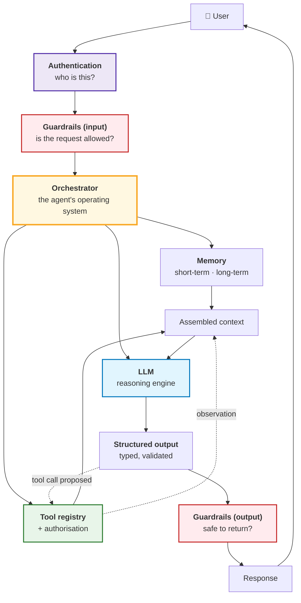
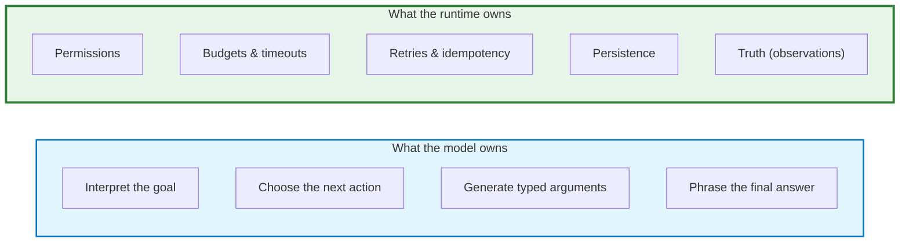
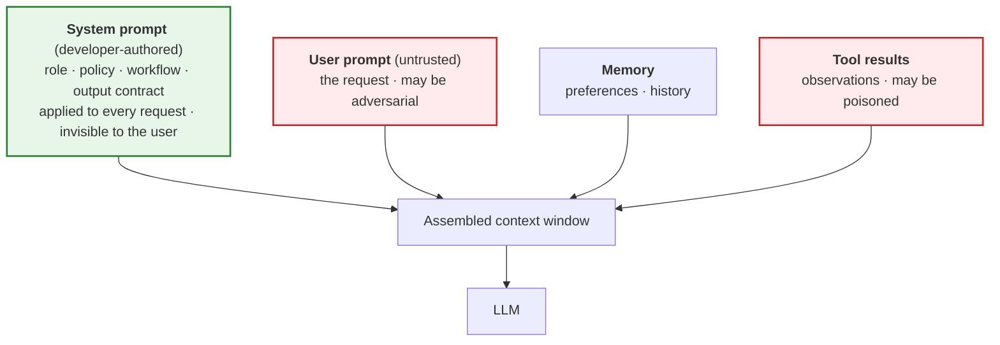
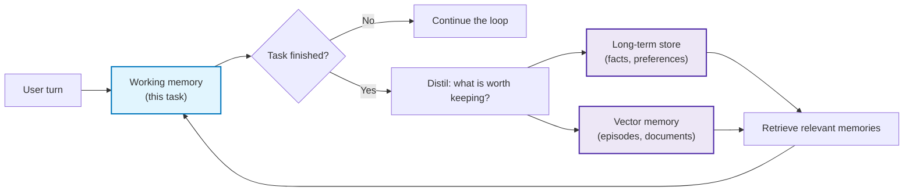
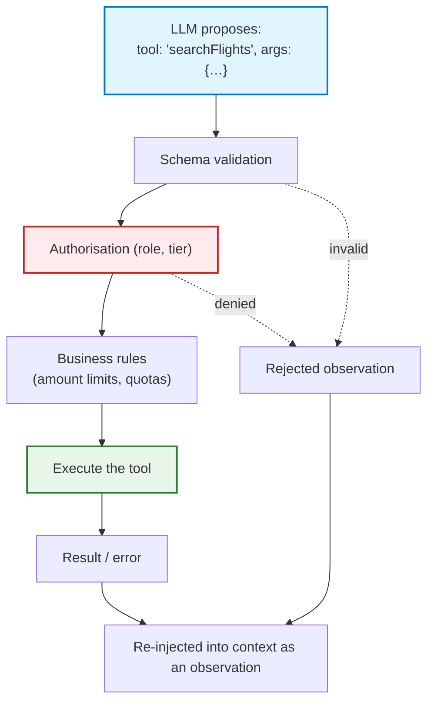
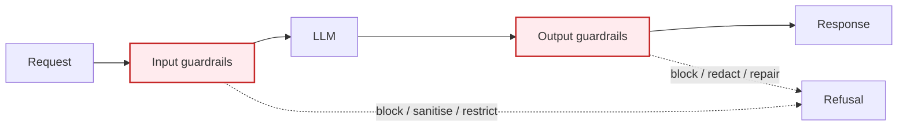
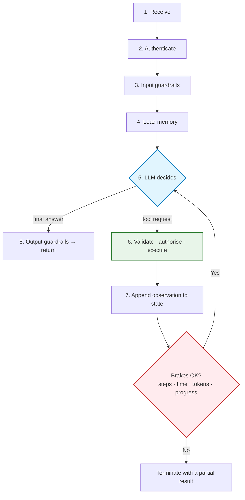
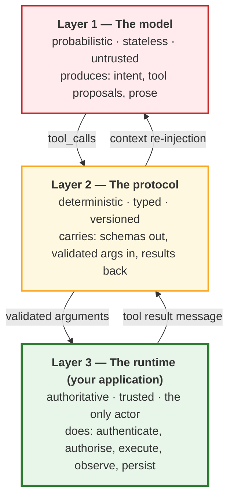
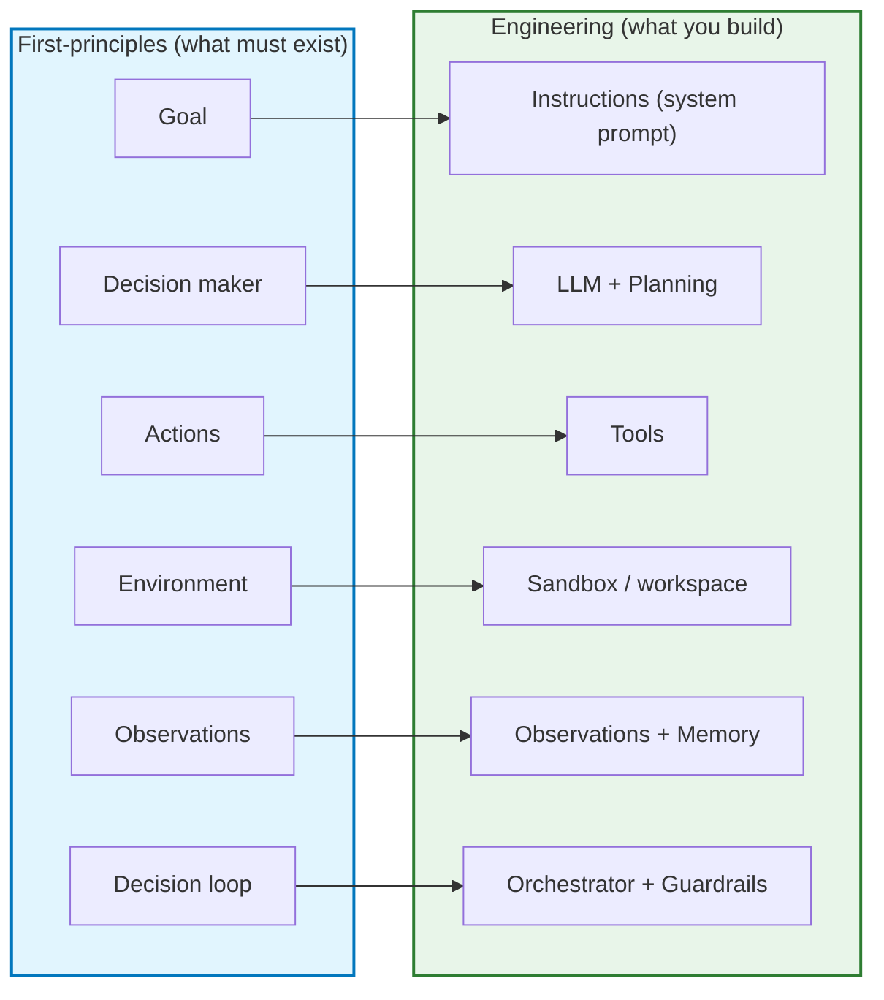

# Chapter 02 — Agent Architecture: Components & the Request Lifecycle

> **Lecture 09 · Chapter 02 of 09** · Level: 🟡 Intermediate · Phase 3 — Agency & Contracts
> **Source:** `gen-ai-cohort/week02/learning/day03/notes/01-ai-agent-architecture.md` ·
> `gen-ai-cohort/week01/learning/day02/notes/05 agent-architecture-and-loops.md` (ch 1–2, 9, 24–27) ·
> `Forward-Deployed-Engineer/Lecture 05/notes/04_First_Principles_of_AI_Agents_and_Agency_Spectrum.md` (§4.2)
> **Roadmap topics:** agent architecture — **LLM + memory + tools + guardrails + planning** ·
> brain + loop + tools · the perceive → decide → act cycle (introduced here, developed in Chapter 03).
> **Prerequisites:** Chapter 01 (the 6-component model, the agency spectrum) · Lecture 08 (tools, schemas,
> the wire protocol) · Lecture 06 (context, roles, memory basics).

---

## 02.0 What this chapter is for

Chapter 01 gave you the *shape* of an agent. This chapter gives you the *parts list* — the concrete components
you will actually build, name in a design document, and assign to a team.

Two facts make this chapter necessary:

1. **The roadmap's component list and the first-principles list are not the same list.** The roadmap says
   *LLM + memory + tools + guardrails + planning*. The first-principles model says *Goal + Decision Maker +
   Actions + Environment + Observations + Decision Loop*. Both are correct; they describe the same system at
   different altitudes. Reconciling them (§02.5) removes a lot of confusion.
2. **A request does not travel through the components in a straight line.** It passes authentication, input
   guardrails, the orchestrator, memory, the model, output guardrails, and (if a tool was requested)
   authorisation — in a specific order, with specific re-entry points. If you get the order wrong, you build a
   system that is either unsafe or unusably slow.

By the end of this chapter you should be able to:

1. Draw the reference architecture of a production agent from memory.
2. Say what each of the eight components is responsible for — and what it is *not*.
3. Trace a single user request through the full lifecycle, naming the state at each step.
4. Explain why the orchestrator is "the operating system of the agent".
5. Distinguish the five kinds of memory and say where each is stored.
6. Reconcile the roadmap's formula with the first-principles formula.

---

## 02.1 The reference architecture

Here is the whole system on one page. Every later chapter zooms into one box.



Three things to notice before we go component by component:

- **The LLM is in the middle, not at the edge.** It never receives raw user input and never emits the raw
  response. Everything is mediated. (This is the "the model is inside the security architecture, not the
  security architecture itself" idea, developed in Chapter 08.)
- **The orchestrator is the hub.** It is the only component that talks to all the others. Everything that must
  be *guaranteed* — budgets, retries, ordering, approval — is implemented here.
- **Memory and tools both feed the same thing: the context.** Memory is retrieved *into* the prompt; tool
  results are re-injected *into* the prompt. From the model's point of view, both are just text in its window.

### The purpose of each component

| Component | Purpose | Owned by |
| :--- | :--- | :--- |
| **Authentication** | Verify user identity and session | Platform / IAM |
| **Guardrails (input)** | Keep unsafe requests away from the model | App security |
| **Orchestrator** | Coordinate the whole workflow; own the loop | Agent team |
| **LLM** | Understand language; reason; choose the next action | Provider + prompt |
| **Tools** | Perform real-world actions | Domain teams |
| **Memory** | Preserve context across turns and sessions | Platform |
| **Structured output** | Return predictable, machine-readable data | Agent team |
| **Guardrails (output)** | Prevent leaks, unsafe content, malformed payloads | App security |

> **Rule of thumb for ownership.** If a component's failure can cause *data loss, financial loss or a
> compliance breach*, it must be owned by a team that is not the prompt-engineering team.

---

## 02.2 The components in depth

### 02.2.1 The LLM — the reasoning engine

The model is responsible for exactly three things inside an agent:

1. **Interpretation** — turn an ambiguous human goal into a structured intent.
2. **Selection** — choose the next action from the tool registry, or decide that the goal is met.
3. **Synthesis** — phrase the final answer, and phrase the *arguments* for the next tool call.

It is **not** responsible for: permissions, budgets, ordering guarantees, retries, persistence, or truth.



> **Why the split matters.** Every "the agent is unreliable" complaint resolves into one of two causes: either
> the model was asked to own something from the right-hand box (a design error), or the runtime failed to
> enforce something from the right-hand box (an implementation error).

Model selection is therefore an *architecture* decision, not a preference:

| Model class | Fits where | Why |
| :--- | :--- | :--- |
| Small / fast model | Routing (L3), classification, extraction, guardrails | Cheap, low latency, good enough for a bounded decision |
| Frontier reasoning model | The decision-maker in an L4 loop; planning | Better at multi-step reasoning and tool selection |
| Local / self-hosted model | Sandboxed or air-gapped agents | Data residency; no egress (Chapter 05, §05.4) |

### 02.2.2 Instructions: system prompt vs user prompt

Two kinds of instruction, with very different trust levels.



| | System prompt | User prompt |
| :--- | :--- | :--- |
| Author | Developer | End user (untrusted) |
| Changes per request | No | Yes |
| Contains | Role, policy, workflow, output contract, tool guidance | The request |
| Trust level | Trusted (still not a security control) | **Untrusted** |
| Failure if misused | Model ignores the workflow | Injection, jailbreak, policy bypass |

> **The trap.** A system prompt *looks* like a policy. It is not one. `"Never delete production data"` is a
> sentence; the enforcement is a check in the tool wrapper (Chapter 05, Chapter 08). Chapter 06 shows what a
> good agent system prompt *does* contain — a job description, not a wish list.

### 02.2.3 Memory

Without memory, an agent is a brilliant stranger every turn:

```text
User: My name is Aminul.
      … later …
User: Who am I?
Agent: I don't know.
```

Memory exists so the agent can (a) stay coherent within a task, and (b) personalise across sessions. The
source notes distinguish short-term from long-term; the fuller taxonomy below is the one to design against,
because each kind has a different **store, lifetime and eviction policy**.

| Kind | What it holds | Store | Lifetime | Eviction |
| :--- | :--- | :--- | :--- | :--- |
| **Working / short-term** | This task's message array, tool results, scratch state | In-process memory or Redis | The turn / task | Dropped when the task ends |
| **Conversation (episodic)** | Prior turns in this chat | DB / Redis | The session | Windowed, summarised or truncated (Lecture 06) |
| **Long-term semantic** | Durable facts and preferences ("prefers IndiGo") | Relational or document DB | Indefinite | Explicit delete / retention policy |
| **Vector / retrieval** | Embeddings of past interactions, docs, notes | Vector DB | Indefinite | Similarity + recency + score threshold |
| **Procedural** | Learned workflows, tool-use patterns, skills | Prompts / config / fine-tunes | Versioned | Replaced on release |



> **Retrieval is a tool, not magic.** The pattern is: `User → Agent → memory retrieval → relevant memories →
> LLM`. Retrieval can itself be exposed as a tool, so the *model* decides when to look something up — which is
> exactly how RAG becomes one of an agent's capabilities (§02.2.4). Lecture 19 covers agent memory systems in
> depth; here you only need to know that memory is a **component with a lifetime**, not an afterthought.

**Non-negotiable rules for memory:**

1. **Store only what you need.** Every stored token is a privacy liability and a future context cost.
2. **Always have a retention policy.** "Forever" is not a policy.
3. **Make memory inspectable and deletable by the user.** If you remember it, they should be able to see it.
4. **Never let memory bypass authorisation.** A remembered preference is data, not a permission.

### 02.2.4 Tools — the only way to act

A tool is an ordinary function exposed through a JSON Schema contract (Lecture 08). Inside an agent, tools are
where **all** side effects live, so they are also where **all** risk lives.



| Tool family | Character | Caching | Retry | Permission tier |
| :--- | :--- | :--- | :--- | :--- |
| **Informative / read-only** | Idempotent, no side effects | Yes | Safe | Tier 1 (auto) |
| **Compute / deterministic** | Pure function | Yes | Safe | Tier 1 (auto) |
| **Scoped mutate** | Reversible, confined to a sandbox | No | Careful (idempotency key) | Tier 2 (auto with quotas) |
| **Action / external** | Non-idempotent, irreversible, financial | No | **Never blind** | Tier 3 (HITL) |

> **Design rules that pay off immediately:** many narrow tools beat one powerful tool; the `description` is a
> prompt (it is the routing index); never expose a general-purpose shell; and every tool result is
> **untrusted data** when it comes back (it may contain injected instructions — Chapter 05, §05.2).

### 02.2.5 Planning & reasoning

Many goals cannot be met in one step. Planning is the component that decomposes a goal into ordered sub-tasks.

```text
User: Find the best laptop under ₹70,000 and compare three options.
        ↓
Agent plan:
  Step 1 → search products
  Step 2 → extract specifications
  Step 3 → compare prices
  Step 4 → rank the options
  Step 5 → generate the answer
```

Two important engineering cautions, both from the source notes:

1. **A plan is not a hidden chain-of-thought.** Production systems prefer **structured actions and concise
   state** over requiring the model to reveal private reasoning. Expose *what it will do next*, not *how it
   privately thinks*.
2. **Planning is incremental, not waterfall.** The plan is revised after every observation. A plan written once
   and executed blindly is just a workflow written in natural language — with all of the rigidity and none of
   the guarantees.

| Planning style | How it works | When to use |
| :--- | :--- | :--- |
| **ReAct (interleaved)** | Think → act → observe → think … one step at a time | Default for L4 agents; highest adaptability |
| **Plan-and-execute** | Produce a full plan first, then execute steps | When the plan is cheap to validate up front |
| **Plan-and-revise** | Produce a plan, execute, re-plan on divergence | Long tasks with expensive mistakes |
| **Explicit workflow (DAG)** | Developer-authored steps | When the path is known (Chapter 01, §01.6) |

> **Deepen this later:** Chapter 03 covers the decide/observe mechanics, and Chapter 04 covers the budgets that
> make planning *safe* (a planner that never converges is a planner that spends your budget).

### 02.2.6 Guardrails

Guardrails keep the system safe and compliant. The source notes split them by position in the pipeline, which
is the split that matters operationally.

| | Input guardrails | Output guardrails |
| :--- | :--- | :--- |
| Position | Before the model | After the model, before the user |
| Checks | Injection patterns, size/format, policy, rate limits, PII in input | Malformed output, data leakage, unsafe content, policy, schema |
| Failure mode if missing | Prompt injection, jailbreak, abuse, cost blow-up | Leaks, broken clients, compliance breach |
| Example | `"Ignore previous instructions."` → blocked | Generated JSON → validate with a schema → send |



> **Guardrails are not authorisation.** A guardrail asks *"is this request/response acceptable?"*;
> authorisation asks *"is this user permitted to do this?"* They are different questions with different owners
> — Chapter 08 keeps them apart and shows why confusing them creates a false sense of safety.

### 02.2.7 The orchestration layer — the operating system of the agent

The orchestrator is the manager. It decides:

- Which model to use?
- Which tool (or none) — and in what order?
- Should this call be retried? With what backoff?
- Should memory be read or written?
- Should the output be validated, repaired, or rejected?
- Should the user be asked for clarification?
- **Should the loop stop?** (step budget, time budget, token budget, no progress)

```text
User
 ↓
Orchestrator (router)
 ↓
Does this need a tool?
 ├── No  → LLM → answer
 └── Yes → authorise → execute tool → validate result → LLM → answer
```

> **This is why the orchestrator is the OS.** An operating system does not do the user's work; it *schedules*
> work, enforces limits, and arbitrates resources. Exactly the same responsibilities apply here: scheduling
> (which model/tool), limits (budgets/timeouts), and arbitration (permissions/approvals).

### 02.2.8 Structured output

An agent's decisions must be *machine-routable*. Natural language decisions force your runtime to parse
prose, which is unreliable:

```text
# Fragile — the runtime must interpret English
"I think we should search the web first, and then maybe…"

# Robust — the runtime inspects a field
{ "step": "TOOL_REQUEST", "tool": "searchWeb", "arguments": { "query": "…" } }
```

The runtime can then route deterministically:

```ts
// pseudo-code — the idea, not runnable code
if (decision.step === "TOOL_REQUEST") { executeTool(decision.tool, decision.arguments); }
if (decision.step === "OUTPUT")       { return decision.text; }
```

| Why structured output matters | Consequence if absent |
| :--- | :--- |
| Deterministic routing | You parse prose; failures are silent and unbounded |
| Schema validation before execution | Bad arguments reach production tools |
| Machine-readable traces | You cannot evaluate or replay a trajectory |
| Contract between app and model | Prompt edits silently break the runtime |

> Structured output is the *interface* between the probabilistic layer and the deterministic layer. Lecture 10
> is entirely about it; here, treat it as a **mandatory component** of any agent you build.

---

## 02.3 The complete request lifecycle

Now trace one request end to end. This is the section to revisit when something behaves oddly in production.

**User:** *"Book a flight to Mumbai tomorrow."*

```mermaid
sequenceDiagram
    autonumber
    actor U as User
    participant A as Authentication
    participant G as Input guardrails
    participant O as Orchestrator
    participant M as Memory
    participant L as LLM
    participant T as Tool layer
    participant OG as Output guardrails

    U->>A: "Book a flight to Mumbai tomorrow."
    A->>A: Is the user logged in? → YES (identity, role)
    A->>G: Authenticated request
    G->>G: Is it safe / allowed? → YES
    G->>O: Approved request
    O->>M: Load relevant memory
    M-->>O: Preferred airline = IndiGo; home city = Guwahati
    O->>L: system prompt + memory + user request
    L-->>O: "I need the flight-search tool"
    O->>T: searchFlights({ from: "Guwahati", to: "Mumbai", date: "tomorrow" })
    T->>T: validate → authorise → execute
    T-->>O: [ { airline: "IndiGo", price: 4200 } ]
    O->>L: observation re-injected
    L-->>O: final answer (structured)
    O->>OG: check output (leakage, policy, format)
    OG-->>U: "I found an IndiGo flight tomorrow for ₹4200."
```

The eight steps in words:

| Step | What happens | State added |
| :---: | :--- | :--- |
| 1 | Request received | `{ user, message }` |
| 2 | **Authenticate** | `{ identity, role }` |
| 3 | **Input guardrails** | `{ approved: true }` |
| 4 | **Load memory** | `{ preferences, history }` |
| 5 | **LLM reasons** — decides it needs a tool | `{ intent: "searchFlights" }` |
| 6 | **Tool executed** (validated + authorised) | `{ observation }` |
| 7 | **LLM formats the answer** | `{ response }` |
| 8 | **Output guardrails** then return | `{ safe response }` |

### 02.3.1 The same lifecycle, inside a loop

Steps 5–7 *repeat* when the agent is at Level 4. That is the only structural difference between a single tool
call and an agent:



> **Note the position of the brakes.** They sit *between* the observation and the next decision — not around the
> whole loop. That placement lets the agent finish cleanly with a partial result instead of being killed
> mid-operation. Chapter 04 is entirely about that box.

---

## 02.4 Where each component lives (the layer map)

Every component belongs to one of three layers. Confusing the layers is the root cause of most agent bugs.



| Component (from §02.1) | Layer | Notes |
| :--- | :--- | :--- |
| LLM | 1 — model | Never trust; never persist from it |
| Structured output schema | 2 — protocol | The contract; versioned |
| Tool contracts (JSON Schema) | 2 — protocol | The only thing the model sees |
| Orchestrator | 3 — runtime | Owns the loop, budgets, retries |
| Authentication | 3 — runtime | IAM / platform |
| Guardrails (input/output) | 3 — runtime | App security team |
| Tool authorisation | 3 — runtime | Role + tier + object-level checks |
| Memory | 3 — runtime | Stores; the model only *reads* what you inject |
| Observations | 3 — runtime | The only source of truth |

> **The one-line summary of the layer map:** *the model may propose; only the runtime may act.* Every safety
> mechanism in Chapters 05–09 is an implementation of that sentence in Layer 3.

---

## 02.5 Reconciling the two formulas

| Roadmap / source (Day-02 style) | First-principles (Chapter 01) |
| :--- | :--- |
| `AI Agent = LLM + Memory + Tools + Planning + Guardrails + Orchestration + Instructions` | `AI Agent = Foundation LLM + Tools + Environment + Observations + Decision Loop + Goal` |

These are not competing definitions. They are the **same system seen from two altitudes**:



| Conceptual requirement | Engineering component that satisfies it |
| :--- | :--- |
| **Goal** | The system prompt + the user request (the "instructions" box) |
| **Decision maker** | The LLM, plus the planning strategy you give it |
| **Actions** | The tool registry (schemas + implementations) |
| **Environment** | The sandbox / workspace / connected systems |
| **Observations** | Tool results + memory retrieval, re-injected into context |
| **Decision loop** | The orchestrator, with guardrails and budgets wrapped around it |

> **Practical upshot.** When someone asks "what is an agent made of?", answer with the *engineering* list (they
> can build it). When someone asks "why is this an agent?", answer with the *first-principles* list (it
> explains the agency). Keeping both in your head is what makes design reviews go quickly.

---

## 02.6 What this architecture looks like in the wild

| Agent | Which components it leans on |
| :--- | :--- |
| Customer support | Memory (order history), tools (tickets, refunds), **Tier 3 HITL** on refunds, heavy input guardrails |
| Coding assistant | Tools (read/write files, run tests), strong observation loop, sandbox mandatory |
| Healthcare assistant | Read-only tools, strict output guardrails, **human review** mandatory, retention policy |
| Finance assistant | Memory + tools, **hard amount thresholds**, full audit logging, SIEM integration |
| Travel agent | Memory (preferences), tools (search, book), HITL on payment, idempotency keys |
| Research agent | Retrieval tool (RAG), long working memory, summarisation to fight context growth |
| DevOps agent | Tools (deploy, scale, rollback), Tier 3 gates on production, **no free shell** |

---

## 02.7 The design decisions this chapter forces you to make

| Decision | Options | Default for a first production agent |
| :--- | :--- | :--- |
| Where does the loop live? | App code / durable workflow engine | App code for L2–L3; a durable engine once approvals span minutes (Ch. 07) |
| How many tools? | Few, narrow / many, broad | Few and narrow; add only when routing evals justify it |
| Memory scope | Task only / session / cross-session | Task + session; add cross-session only with a retention policy |
| Guardrail position | Input / output / both / tool-level | All three; tool-level is the one people forget |
| Who owns "stop"? | Model / runtime / both | **Runtime owns it** (budgets); the model may only *request* it |
| Where is truth? | Model text / tool observations | Observations only |
| How is output shaped? | Free text / structured | Structured for every decision; prose only for the final answer |

---

## 02.8 Common mistakes

| # | Mistake | Consequence | Fix |
| :--- | :--- | :--- | :--- |
| 1 | Putting the LLM at the edge (raw input in, raw output out) | No place to enforce anything | Mediate every request (§02.1) |
| 2 | Treating the system prompt as a policy engine | Rules are bypassable; you believe you are safe when you are not | Enforce in Layer 3 (§02.4) |
| 3 | Skipping the orchestrator ("just call the model in a loop") | No budgets, no retries, no ordering, no trace | Make the orchestrator an explicit component |
| 4 | Loading all memory into every prompt | Cost explosion, latency, privacy exposure | Retrieve by relevance; bound the budget |
| 5 | No retention policy on memory | Compliance breach; unbounded growth | Explicit TTL + user-visible deletion |
| 6 | Treating tool output as trusted | Indirect prompt injection succeeds | Treat every observation as untrusted data (Ch. 05) |
| 7 | One mega-tool (`runAnyCommand`) | Unbounded blast radius; unauditable | Many narrow tools with typed parameters |
| 8 | Letting the model own termination | Infinite loops; `O(N²)` token spend | Runtime-owned budgets (§02.3.1, Ch. 04) |
| 9 | Parsing prose decisions instead of structured output | Silent routing failures | Structured decisions (§02.2.8) |
| 10 | Putting guardrails only at the input | Output leaks and malformed payloads reach users | Both ends, plus tool level (§02.2.6) |
| 11 | Using the LLM as the authorisation layer | A jailbreak becomes a privilege escalation | Authorise in the backend (Ch. 08) |
| 12 | Forgetting that memory is *data*, not permission | A remembered "admin" note becomes an access path | Separate data from claims; verify roles from IAM |

---

## 02.9 Key takeaways

1. **The reference architecture is: auth → input guardrails → orchestrator → (memory, tools, LLM) →
   structured output → output guardrails.** The LLM is in the middle, not at the edge.
2. **Eight components, eight owners.** LLM, instructions, memory, tools, planning, guardrails, orchestration,
   structured output. Anything that can cause loss must be owned outside the prompt team.
3. **The model owns interpretation, selection and synthesis.** The runtime owns permissions, budgets, retries,
   persistence and truth. Mixing these up produces either unsafe or unreliable systems.
4. **Memory is a component with a lifetime.** Working, episodic, semantic, vector and procedural memory have
   different stores and different eviction policies — and all of them are *data*, never permission.
5. **The orchestrator is the agent's OS.** Scheduling, limits, arbitration. If it is not an explicit component,
   you have no place to put the brakes.
6. **The lifecycle repeats steps 5–7 inside a loop**, and the brakes sit *between* the observation and the next
   decision so the agent can exit cleanly.
7. **Three layers: model (untrusted proposer) → protocol (typed contract) → runtime (the only actor).**
8. **The roadmap formula and the first-principles formula are the same system at two altitudes.** Use the
   engineering list to build, the first-principles list to explain.
9. **Structured output is not optional.** It is the interface between the probabilistic layer and the
   deterministic layer — without it, the runtime is parsing prose.
10. **Truth comes from observations.** A tool result is the only thing an agent should believe about the world.

---

**Next:** [Chapter 03 — The Agent Loop: Perceive → Decide → Act & State Machines](./03_The_Agent_Loop_Perceive_Decide_Act_and_State_Machines.md)
