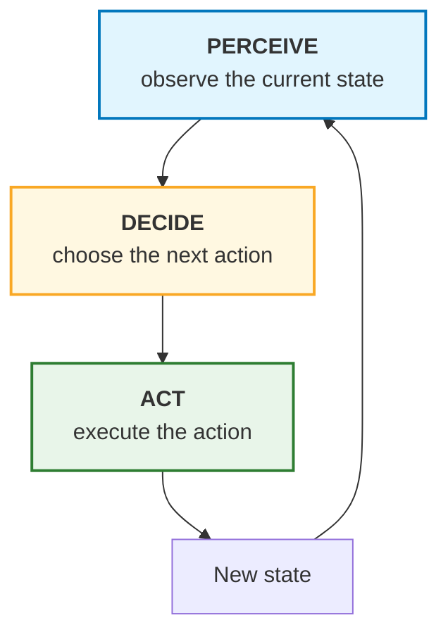
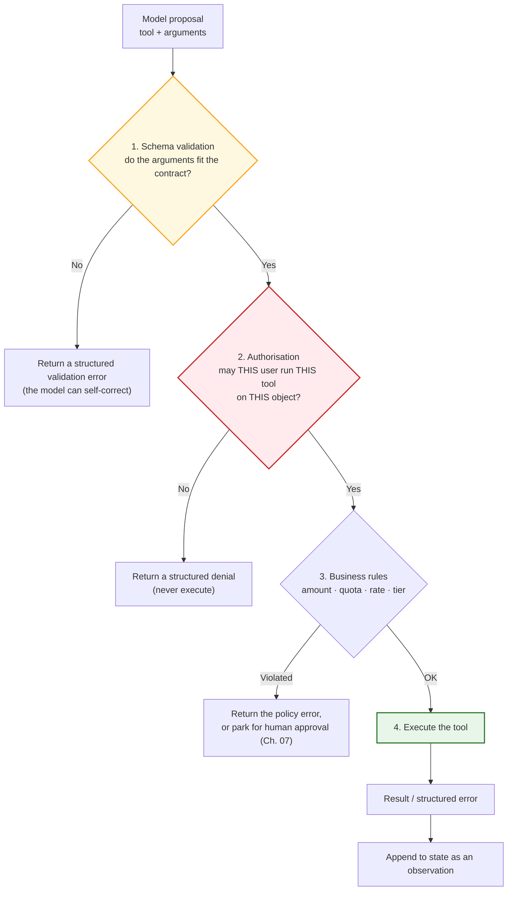
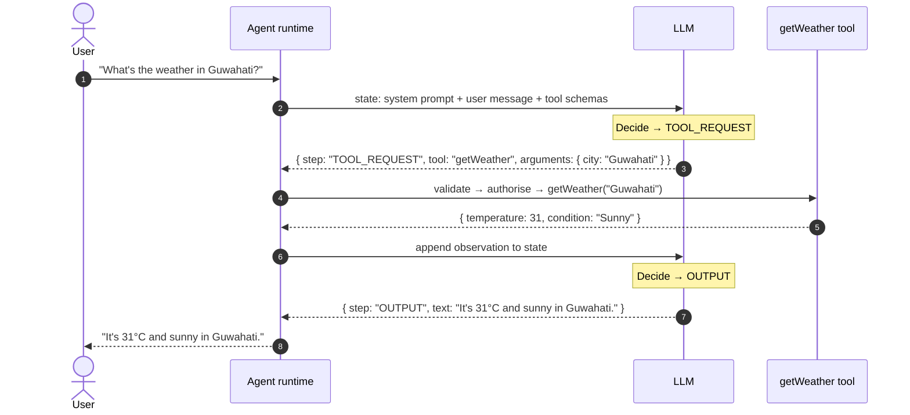
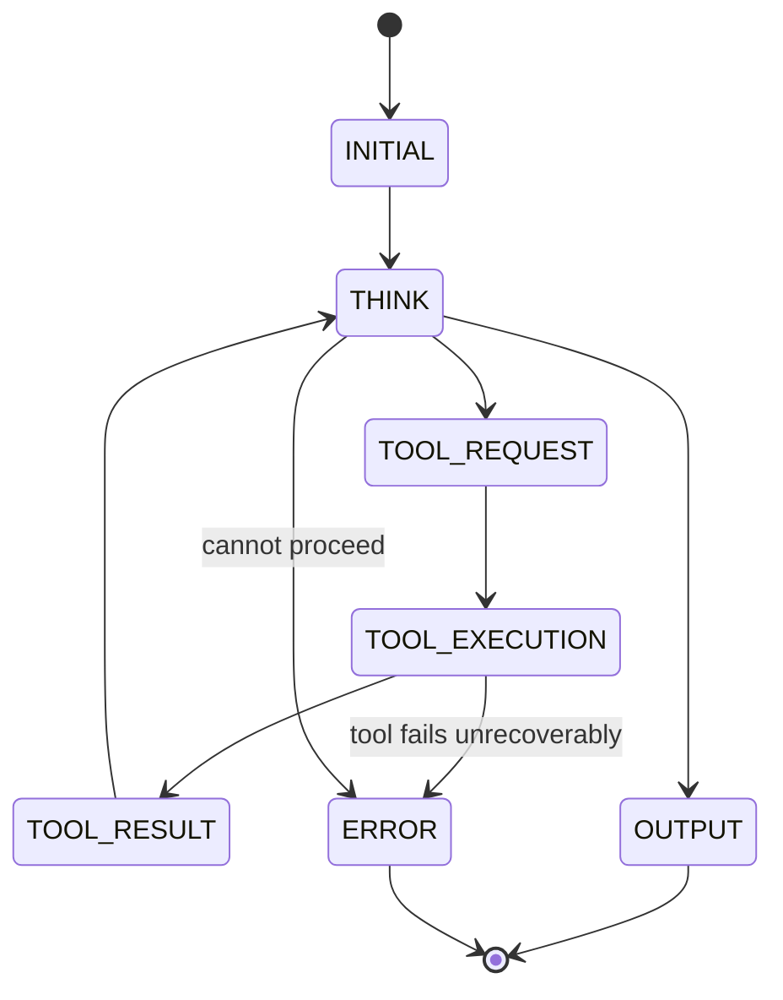
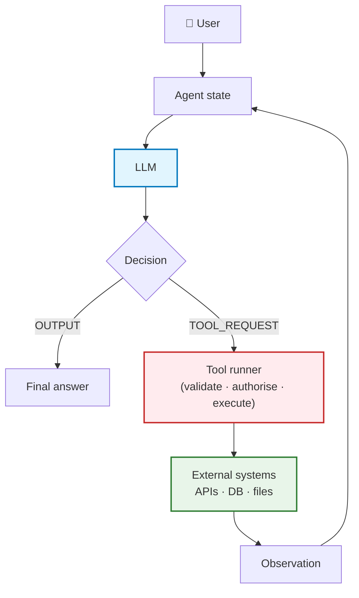
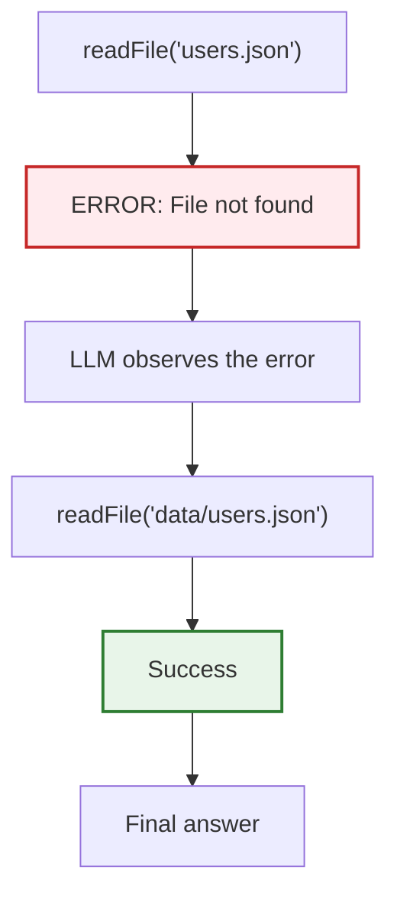
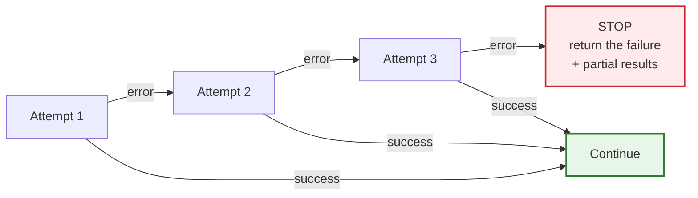
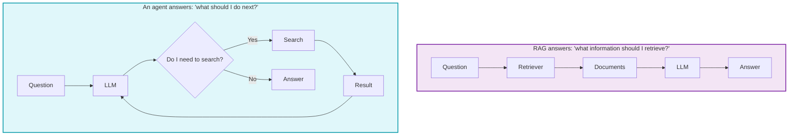
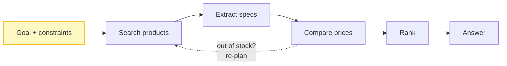

# Chapter 03 — The Agent Loop: Perceive → Decide → Act & State Machines

> **Lecture 09 · Chapter 03 of 09** · Level: 🟡 Intermediate · Phase 3 — Agency & Contracts
> **Source:** `gen-ai-cohort/week01/learning/day02/notes/05 agent-architecture-and-loops.md` (ch 3–14, 19–28, 31–32) ·
> `gen-ai-cohort/week02/learning/day03/notes/01-ai-agent-architecture.md` (ch 11, 13) ·
> `Forward-Deployed-Engineer/Lecture 05/notes/04_First_Principles_of_AI_Agents_and_Agency_Spectrum.md` (§4.2)
> **Roadmap topics:** brain + loop + tools · the perceive → decide → act cycle · planning ·
> the agent's decision loop as an explicit state machine.
> **Prerequisites:** Chapter 02 (components, the request lifecycle) · Lecture 08 (tool contracts, the wire
> protocol, `tool_calls`) · Lecture 06 (state, context, message roles).

---

## 03.0 What this chapter is for

Chapter 02 gave you the parts. This chapter gives you the **cycle** — the actual mechanics of one turn, and how
those turns compose into a trajectory.

The distinction matters because the loop is where *everything you cannot see in the model* happens:

- The model does not run the loop. **Your application runs the loop.**
- The model does not decide to keep going. **Your loop decides whether to ask it again.**
- The model does not know it made a mistake. **The observation tells it** — if you inject it.

The source notes put it bluntly: an agent is *"an LLM placed inside a controlled software execution loop"*, and
the loop is the thing you engineer. Everything the model contributes is a *decision proposal*; everything else
is your code.

By the end of this chapter you should be able to:

1. Draw the perceive → decide → act cycle and say what belongs in each phase.
2. Explain why "the LLM requests the tool; the runtime executes the tool" is a load-bearing sentence.
3. Define an agent's **state object** and justify each field.
4. Model an agent as an explicit **state machine**, and explain why that beats `while (true)`.
5. Apply **state bounding** so the model cannot invent states your runtime does not handle.
6. Write the loop as pseudo-code with a tool runner, argument validation and bounded error recovery.
7. Explain how error recovery differs from retrying, and why retries must be bounded.
8. Distinguish an agent loop from chain-of-thought, and an agent from RAG.

---

## 03.1 The fundamental loop

Three phases, repeated. This is the atomic unit of agency.



Written as a trajectory, the same thing reads:

```text
Input
  ↓
Observe
  ↓
Decide
  ↓
Act
  ↓
Observe the result
  ↓
Decide again
  ↓
Act again
  ↓
…
  ↓
Final answer
```

**This repetition is what gives the system agent-like behaviour.** One pass is a tool call; the repetition is
the agency.

### 03.1.1 Who does what in each phase

| Phase | Performed by | Output |
| :--- | :--- | :--- |
| **Perceive** | The runtime (assembling context) | A context window: system prompt + history + memory + observations |
| **Decide** | The model | A structured decision: `TOOL_REQUEST` or `OUTPUT` (or an error state) |
| **Act** | The runtime (validated, authorised) | A result or a structured error |
| **New state** | The runtime | The observation appended to the message array |

> **The asymmetry to internalise.** *Perceive* and *Act* are pure application code. Only *Decide* involves the
> model. An agent is therefore ~80% ordinary backend engineering and ~20% prompt/model work — which is why this
> lecture spends so much time on sandboxes, budgets and gates.

---

## 03.2 Phase 1 — Perceive

**Perceive means giving the agent information about the current state.** The model has no sensors of its own;
perception is entirely what *you* put into the context window.

The perception surface:

```text
User question
Conversation history
Tool results
Database information
Retrieved documents
API responses
Previous errors
Environment state
```

**Example.** User: *"What's the weather in Guwahati?"*

The agent perceives:

```text
Task     = get weather
Location = Guwahati
```

### 03.2.1 Perception is a *design* decision, not a dump

You decide what the agent perceives. That decision determines what the agent can be good at:

| Perception choice | Effect |
| :--- | :--- |
| Full history, every turn | Maximum continuity, `O(N²)` cost (Ch. 04) |
| Windowed / summarised history | Bounded cost, possible amnesia (Lecture 06) |
| Raw tool output | Maximum fidelity, context bloat and injection surface |
| Distilled tool output | Smaller and safer, possible loss of signal |
| Retrieved memory injected | Personalisation, plus a new injection surface |
| Error text injected verbatim | Excellent self-repair (Lecture 08), leaks internals |

> **The rule.** Perceive the **minimum** the decision needs. Every extra token is a cost *and* a risk — the
> more untrusted text in the window, the more room for an injected instruction (Chapter 05, §05.2).

---

## 03.3 Phase 2 — Decide

The model determines what should happen next.

```json
{
  "step": "TOOL_REQUEST",
  "tool": "getWeather",
  "arguments": { "city": "Guwahati" }
}
```

### 03.3.1 The crucial distinction: the model *requests*, it does not *execute*

```text
LLM
 │  "Call getWeather"
 ▼
Agent runtime
 │  actually executes
 ▼
getWeather("Guwahati")
```

This is the single most important sentence in the whole lecture, so it is worth stating in three ways:

- **The model produces a request.** The request is data (a `tool_call`), not an effect.
- **The runtime produces the effect.** It validates, authorises, executes, and formats a result.
- **Therefore the model cannot do anything the runtime does not permit.** All safety is in the runtime.

> **Common misconception:** *"the model has access to the file system."* It does not. It has access to the
> *names and descriptions* of functions that, if called, would touch the file system. The difference is the
> difference between a plan and a permission.

### 03.3.2 The decision schema (structured states)

A useful decision schema has a small, closed set of states:

| Decision state | Meaning | Runtime action |
| :--- | :--- | :--- |
| `THINK` | Internal reasoning text (optional to expose) | Append; continue the loop |
| `TOOL_REQUEST` | The model wants a tool run | Validate → authorise → execute |
| `OUTPUT` | The goal is met; this is the answer | Return to the user |
| `ERROR` | The model cannot proceed | Terminate with an explanation |

```json
{ "step": "THINK", "text": "I need weather information first." }
```
```json
{ "step": "TOOL_REQUEST", "tool": "getWeather", "arguments": { "city": "Guwahati" } }
```
```json
{ "step": "OUTPUT", "text": "The weather is 31°C and sunny." }
```

The runtime then routes each state deterministically:

```ts
// pseudo-code — routing a structured decision
switch (decision.step) {
  case "THINK":        append(decision.text); continue;
  case "TOOL_REQUEST": observe(runValidatedTool(decision.tool, decision.arguments)); continue;
  case "OUTPUT":       return decision.text;
  case "ERROR":        return gracefulFailure(decision.text);
  default:             throw new InvalidDecisionError(decision.step);   // state bounding
}
```

> **Why not let the model return prose?** Because then your runtime has to interpret English, and English is
> ambiguous, unbounded, and *different every release of the model*. Structured decisions turn a parsing problem
> into a `switch` statement.

### 03.3.3 State bounding — the guardrail around the decision

This is one of the core ideas of **harness engineering**: *do not allow the model to return arbitrary states.*

```text
Allowed states (the closed set):
  INITIAL
  THINK
  TOOL_REQUEST
  OUTPUT
  ERROR
```

The runtime **rejects** anything outside the set:

```json
{ "step": "DELETE_EVERYTHING" }     ← rejected: not a valid state
```

| Without state bounding | With state bounding |
| :--- | :--- |
| The model can invent transitions | The transition graph is finite and known |
| Unknown states cause silent no-ops or crashes | Unknown states are a *detected* protocol error |
| You cannot test the loop | You can enumerate and test every transition |

> **This is the difference between a prompt and a protocol.** A prompt asks the model to behave; a bounded state
> machine *verifies* that it did.

---

## 03.4 Phase 3 — Act

The runtime executes the requested action.

```js
// pseudo-code
const result = await getWeather("Guwahati");
```

The result might be:

```json
{ "temperature": 31, "condition": "Sunny" }
```

Then the result goes **back into the agent's state**:

```text
Tool
 ↓
Result
 ↓
Agent state
 ↓
LLM
```

### 03.4.1 The act phase has four stages, and only the last one is "the tool"



> **Note the shape of every failure branch.** All three of them return something *to the model* rather than
> throwing to the client. A rejected tool call is a **result**, not an exception — because the agent can often
> fix its own mistake when told precisely what was wrong (Lecture 08, Chapter 06; and §03.10 below).

---

## 03.5 A complete worked example

**User:** *"What's the weather in Guwahati?"*



Step by step:

```text
STEP 1 — Perceive + Decide
  User input
      ↓
  LLM
      ↓
  TOOL_REQUEST
      ↓
  getWeather("Guwahati")

STEP 2 — Act + Observe + Decide + Output
  Tool result
      ↓
  LLM
      ↓
  OUTPUT
```

Final answer: `It's 31°C and sunny in Guwahati.`

### 03.5.1 The same example as a state transition trace

```text
INITIAL
   │
   ▼
THINK
   │
   ▼
TOOL_REQUEST
   │
   ▼
TOOL_EXECUTION
   │
   ▼
TOOL_RESULT
   │
   ▼
THINK
   │
   ▼
OUTPUT
   │
   ▼
DONE
```

This trace is not decoration — it is **the debugging artefact**. When something goes wrong, you read the trace
and ask: *which transition was wrong?* (Chapter 04 covers observability formally.)

---

## 03.6 Agent state

An agent needs an explicit representation of the current execution state. Minimal:

```js
// pseudo-code
const state = {
  messages: [],        // the conversation + observations
  step: 0,             // how many decisions have been made
  status: "RUNNING",   // RUNNING | DONE | FAILED | AWAITING_APPROVAL
  toolResults: [],     // observations
};
```

A more complete, production-shaped state:

```js
// pseudo-code
const state = {
  messages: [],          // system, user, assistant, tool messages
  currentStep: 0,
  status: "RUNNING",

  lastAction: null,      // what we just tried — needed for no-progress detection
  toolResults: [],
  errors: [],

  budgets: {             // the runtime's, not the model's (Ch. 04)
    maxSteps: 15,
    tokensUsed: 0,
    maxTokens: 120_000,
    startedAt: Date.now(),
    maxDurationMs: 120_000,
  },

  metadata: {
    userId: "123",
    role: "learner",     // authorisation context (Ch. 08)
    traceId: "…",        // correlation for logs / SIEM
  },
};
```

### 03.6.1 What every agent state must contain

| Field group | Why it must exist |
| :--- | :--- |
| **Messages** | The model's entire memory of the task; observations live here |
| **Step counter** | Bounded loops; cost control; traceability |
| **Status** | Enables `AWAITING_APPROVAL` — the durable pause state (Ch. 07) |
| **Last action** | Detects repetition ("same tool, same args, no change") |
| **Errors** | Lets you distinguish "failed once" from "failing forever" |
| **Budgets** | Makes the brakes enforceable rather than aspirational |
| **Identity + role** | Authorisation is a function of *who* is asking (Ch. 08) |
| **Trace id** | Correlates every model call, tool call and denial in logs |

> **Design principle:** if a value is needed to make a *safety or cost* decision, it belongs in state — never in
> the model's context. The model should not be asked to remember your budgets.

---

## 03.7 The agent as an explicit state machine

An agent can be modelled as a state machine. This is safer than a bare loop:



Compare with the naive version:

```js
// pseudo-code — the thing to avoid
while (true) {
  askLLM();
}
```

| | `while (true)` | Explicit state machine |
| :--- | :--- | :--- |
| Termination | Hope the model stops | Every terminal state is defined |
| Testability | You cannot enumerate behaviour | You can unit-test each transition |
| Observability | One opaque call | A named state in every log line |
| Safety | No place to insert gates | Approval gates are *states* (Ch. 07) |
| Cost control | Unbounded | Bounded by the transition graph + budgets |

### 03.7.1 A better agent loop (production-shaped pseudo-code)

```ts
// pseudo-code — the shape of a real loop, not runnable code
const MAX_STEPS = 10;

for (let step = 0; step < MAX_STEPS; step++) {
  // PERCEIVE — assemble the context
  const context = assembleContext(state);

  // DECIDE — one model call
  const decision = await callLLM(context);          // structured output
  assertValidState(decision.step);                  // state bounding

  // TERMINATE?
  if (decision.step === "OUTPUT") return decision.text;
  if (decision.step === "ERROR")  return gracefulFailure(decision.text);

  // ACT — validate → authorise → execute → observe
  if (decision.step === "TOOL_REQUEST") {
    const result = await runValidatedTool(decision.tool, decision.arguments, state.metadata);
    state.messages.push({ role: "tool", content: JSON.stringify(result) });
    state.lastAction = { tool: decision.tool, args: decision.arguments };
    state.toolResults.push(result);
    continue;
  }
}

return "Agent stopped: execution limit reached (partial result attached).";
```

What this loop gives you, in the source notes' words:

```text
Structured state
+
Tool execution
+
Loop limit
+
Termination condition
```

---

## 03.8 The tool runner — the application layer that acts

The **tool runner** is the application code responsible for actually executing tools. It is the boundary
between the model's proposal and the real world.

```ts
// pseudo-code
async function runTool(name, args, ctx) {
  switch (name) {
    case "getWeather": return await getWeather(args.city);
    case "searchWeb":  return await searchWeb(args.query);
    case "readFile":   return await readFile(args.path, ctx.workspace);
    default:           throw new UnknownToolError(name);   // hallucinated tool
  }
}
```

The source notes state the invariant plainly:

> **The LLM requests the tool. The runtime executes the tool.**

### 03.8.1 The full agent + tools architecture



The loop `state → LLM → tool runner → external → observation → state` **is** the agent. Everything else is
configuration.

---

## 03.9 Never trust tool arguments

Suppose the model generates:

```json
{ "tool": "deleteUser", "arguments": { "userId": "123" } }
```

Do **not** blindly execute:

```js
// pseudo-code — NEVER do this
await deleteUser(args.userId);
```

Instead, route every call through the four-stage pipeline (§03.4.1):

```text
LLM
 ↓
Tool request
 ↓
Schema validation        ← do the arguments fit the contract?
 ↓
Authorization            ← may this user run this tool on this object?
 ↓
Business rules           ← amount · quota · tier
 ↓
Tool execution
```

| Stage | Question | Who owns it |
| :--- | :--- | :--- |
| Schema validation | Do the arguments match the declared types/enums/bounds? | Tool author |
| Authorization | Is *this user* permitted *this action* on *this object*? | Platform / RBAC (Ch. 08) |
| Business rules | Is the amount/rate/quota/tier acceptable? | Domain owner (Ch. 07) |
| Execution | Run it, once, idempotently | Tool author |

> **Why this belongs in the *loop* chapter and not only the security chapter:** because the loop is where the
> decision to execute is made. If the loop calls the tool directly, no later security layer can help — you have
> already skipped the only checkpoint that exists.

---

## 03.10 Dynamic error recovery

One of the most powerful agent capabilities is recovering from tool errors — but only if the loop is built to
allow it.

Suppose the model requests:

```json
{ "tool": "readFile", "arguments": { "path": "users.json" } }
```

The file does not exist. The tool returns:

```json
{ "error": "FileNotFoundException: users.json" }
```

Instead of crashing:

```text
Agent → ERROR → STOP
```

feed the error **back into the loop**:

```text
Agent
 ↓
Tool request
 ↓
Tool
 ↓
ERROR
 ↓
LLM            ← the model now sees the failure
 ↓
Corrected request
 ↓
Tool
```

### 03.10.1 The recovery example, concretely

First attempt:

```json
{ "tool": "readFile", "arguments": { "path": "users.json" } }
```

Tool:

```json
{ "error": "File not found" }
```

The model sees the result and decides:

```json
{ "tool": "readFile", "arguments": { "path": "data/users.json" } }
```

Then:

```text
Tool
 ↓
Success
 ↓
LLM
 ↓
Final answer
```



### 03.10.2 The three rules that make error recovery work

1. **Errors are results, not exceptions.** Serialise the error and return it as a tool observation. (Lecture 08,
   Chapter 06: exception serialisation.)
2. **Errors must be *actionable*.** `"File not found"` is fine; `"Something went wrong"` gives the model nothing
   to correct. Include the offending value and the expectation.
3. **Errors must never leak secrets.** Stack traces, connection strings and internal paths are an exfiltration
   channel. Redact before injection (Chapter 08, output gate).

---

## 03.11 Error recovery ≠ unlimited retry

This is the trap that turns a helpful agent into an expensive outage.

Bad:

```js
// pseudo-code
while (true) {
  retryTool();
}
```

Better — bound it:

```ts
// pseudo-code
const MAX_RETRIES = 3;
```

```text
Attempt 1 → Error
Attempt 2 → Error
Attempt 3 → Error
              ↓
            STOP
```



> **Why unbounded retry is worse than a crash.** A crash costs one request. An unbounded retry against a broken
> tool costs `N × timeout × tokens` per user *and* hammers a downstream service that is already failing — a
> self-inflicted denial of service. Chapter 04 makes this a first-class budget.

---

## 03.12 Agent vs RAG — related, but answering different questions

These two are constantly confused, and the confusion produces bad architectures.



| | RAG | Agent |
| :--- | :--- | :--- |
| Core question | *What information should I retrieve?* | *What should I do next?* |
| Control flow | Fixed: retrieve → generate | Dynamic: decide → act → observe → decide |
| Number of steps | One retrieval pass (usually) | Many |
| Failure mode | Irrelevant context | Wrong action / loop |

> **The relationship:** *an agent can use RAG as one of its tools.* That is the correct composition. Building RAG
> and calling it "an agent" inverts the layering and hides the fact that you have no loop, no observations and no
> gates.

---

## 03.13 Agent loop vs chain-of-thought

These are also different, and mixing them up leads to prompts that ask the model to "think harder" when the real
problem is a missing observation.

| | Chain-of-thought | Agent loop |
| :--- | :--- | :--- |
| Focus | The **reasoning process** | The **execution process** |
| Shape | `Problem → reasoning → answer` | `Problem → decision → tool → observation → decision → answer` |
| Grounded in reality? | No — all inside one forward pass | Yes — every step can consult the environment |
| Fixes a wrong fact? | No | Yes, by retrieving the right one |
| Cost | One call | N calls |

> **The distinction in one line:** *CoT changes how the model thinks; the loop changes what the model can find
> out.* An agent may use reasoning internally — but the engineering problem is **state + actions + control
> flow**, not the length of the hidden reasoning chain.

---

## 03.14 Planning inside the loop

The plan is not a document produced up front; it is a **consequence of the loop**. Each observation may change
the plan.

```text
User: Find the best laptop under ₹70,000 and compare three options.
        ↓
Perceived state: goal + constraints (budget, count)
        ↓
Decision 1: search products          → observe: candidate list
Decision 2: extract specifications   → observe: specs
Decision 3: compare prices           → observe: prices
Decision 4: rank the options         → observe: ranking
Decision 5: OUTPUT                   → answer
```



Two engineering points the source notes stress:

1. **Expose structured actions, not hidden reasoning.** In production it is better to surface *what the agent
   will do next* (a typed action) than to require it to reveal private chain-of-thought. Structured actions are
   auditable, testable and cheaper to store.
2. **Re-plan on divergence.** If an observation contradicts the plan (an item is out of stock, a file is
   missing), the loop must be allowed to revisit an earlier step. This is why "plan-and-execute-blindly" is just
   a workflow in disguise (Chapter 01, §01.6).

---

## 03.15 Common mistakes

| # | Mistake | Consequence | Fix |
| :--- | :--- | :--- | :--- |
| 1 | Believing the model runs the loop | You look for the bug in the prompt instead of the `for` loop | The runtime owns the loop (§03.1.1) |
| 2 | Believing the model executes tools | You skip validation and authorisation entirely | The model requests; the runtime executes (§03.3.1) |
| 3 | Parsing prose decisions | Silent, unbounded routing failures | Structured decisions + a `switch` (§03.3.2) |
| 4 | Letting the model invent states | Undefined transitions, crashes, no-op steps | State bounding (§03.3.3) |
| 5 | Not storing `lastAction` | You cannot detect repetition or no-progress | Include it in state (§03.6.1) |
| 6 | Storing budgets only in the prompt | The model "forgets" them; costs spiral | Budgets live in runtime state (§03.6) |
| 7 | Executing tool arguments without validation | Injection and type confusion reach production tools | Four-stage act pipeline (§03.9) |
| 8 | Throwing tool errors to the client | The agent cannot self-correct; users see stack traces | Return errors as observations (§03.10) |
| 9 | Vague error messages | The model retries the identical failing call | Make errors actionable (§03.10.2) |
| 10 | Unbounded retries | Self-inflicted DoS and cost explosion | `MAX_RETRIES` (§03.11, Ch. 04) |
| 11 | Calling RAG an agent | No loop, no observations, no gates — but you think you have them | Compose: RAG is a *tool* (§03.12) |
| 12 | Asking the model to "think step by step" when the fact is missing | Confident, fluent, wrong answers | Add an observation step (§03.13) |
| 13 | Requiring hidden chain-of-thought for every step | Higher cost, un-auditable, brittle | Require structured actions + concise state (§03.14) |

---

## 03.16 Key takeaways

1. **The loop is three phases — perceive, decide, act — repeated.** The repetition is what makes it an agent.
2. **Perceive and act are pure application code; only decide involves the model.** An agent is mostly backend
   engineering.
3. **The model requests; the runtime executes.** Everything about safety follows from that asymmetry.
4. **Decisions must be structured and bounded.** A closed set of states (`THINK`, `TOOL_REQUEST`, `OUTPUT`,
   `ERROR`) turns prose parsing into a `switch` statement, and turns an unknown state into a *detected* error.
5. **Agent state is both the agent's memory and its safety context.** Messages, step counter, status, last
   action, errors, budgets, identity and trace id.
6. **Model the agent as an explicit state machine.** Every terminal state is defined, every transition is
   testable, and approval gates become *states* rather than afterthoughts.
7. **The act phase is a four-stage pipeline:** schema validation → authorisation → business rules → execution.
   Skipping a stage is the same as removing the checkpoint.
8. **Tool errors are results, not exceptions.** Actionable, redacted error observations are what enable
   self-correction.
9. **Bound retries.** Unbounded retry is worse than a crash: it costs money and hammers a failing dependency.
10. **RAG answers "what should I retrieve"; an agent answers "what should I do next".** RAG is a tool inside an
    agent, not a synonym for one.
11. **Chain-of-thought changes how the model thinks; the loop changes what it can find out.** Grounding beats
    reasoning when the fact is simply absent from the weights.
12. **The plan is a consequence of the loop,** not a document written once — and it must be allowed to change
    when an observation contradicts it.

---

**Next:** [Chapter 04 — Loop Engineering & Harness Engineering](./04_Loop_Engineering_and_Harness_Engineering.md)
