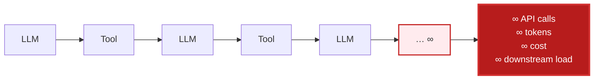
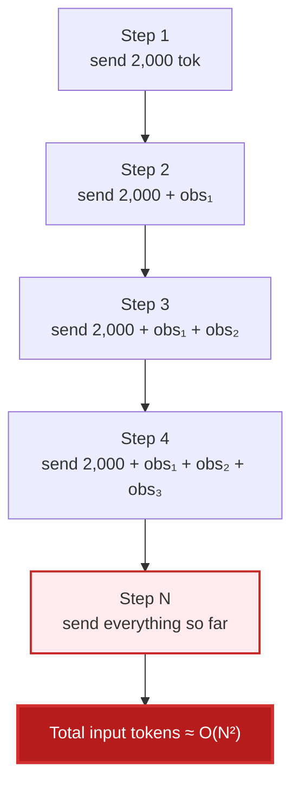
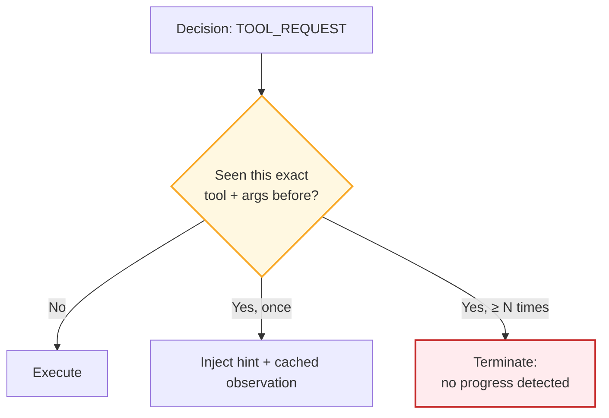
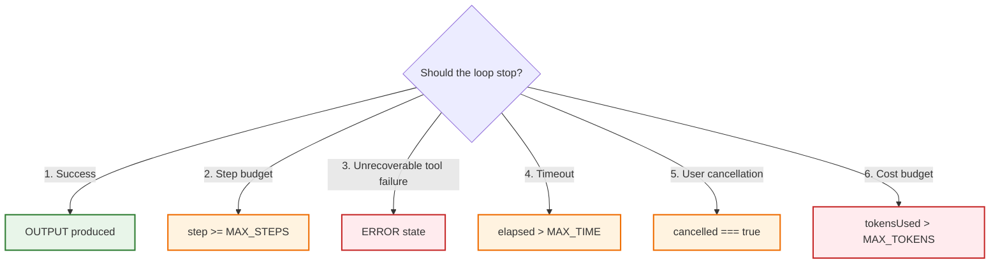
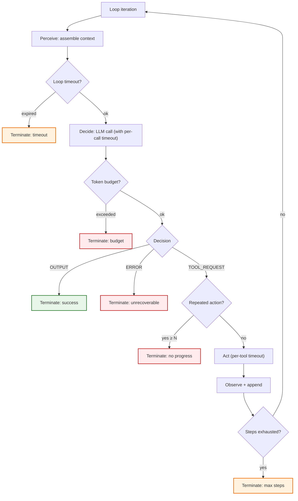
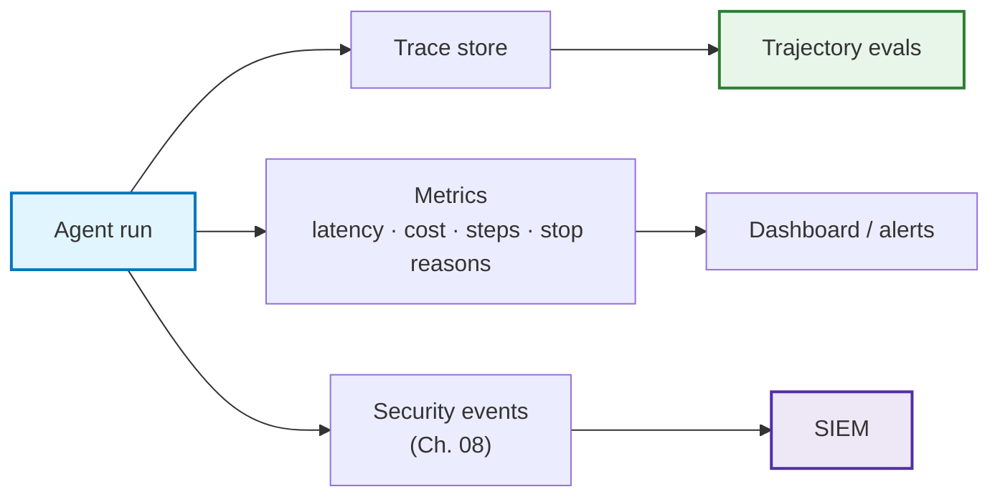
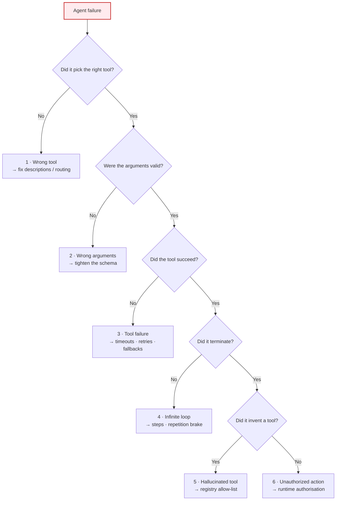
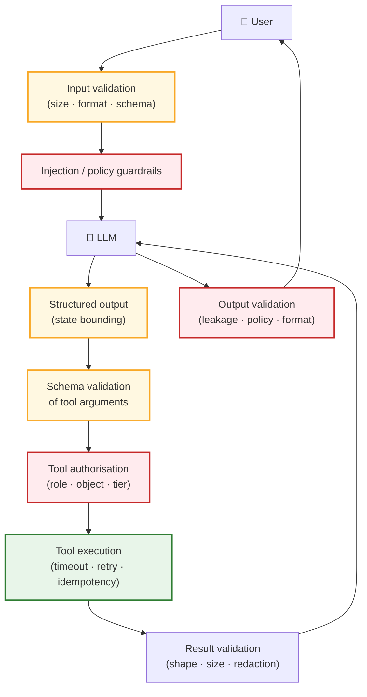
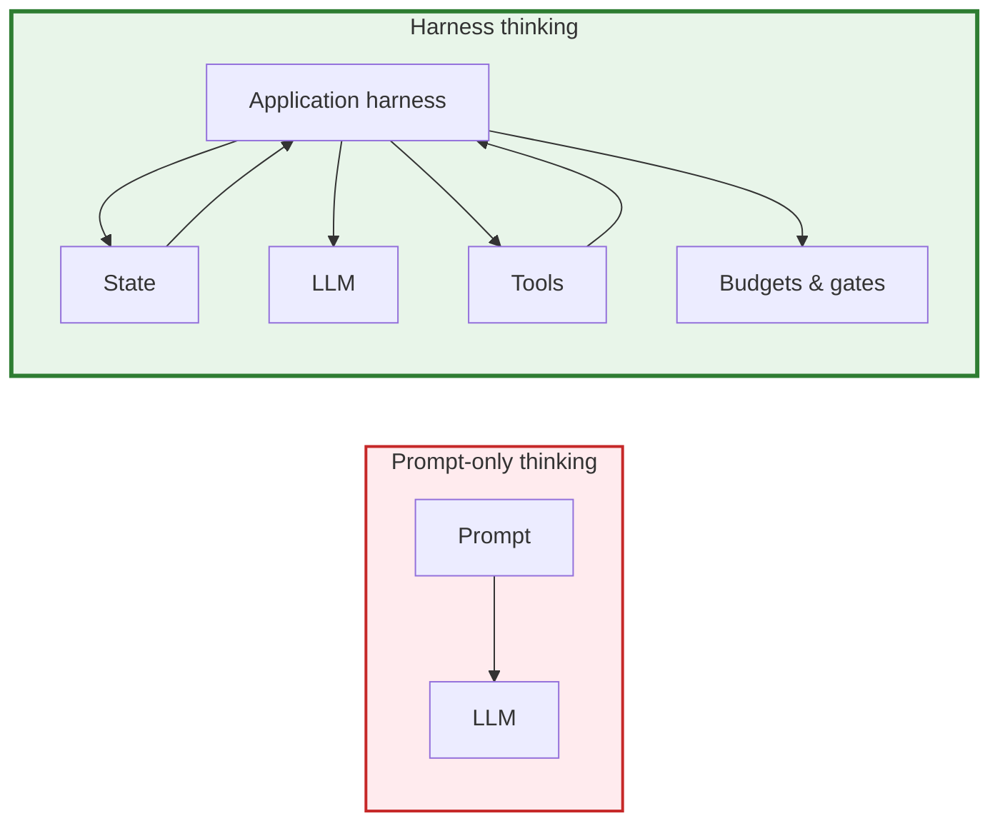
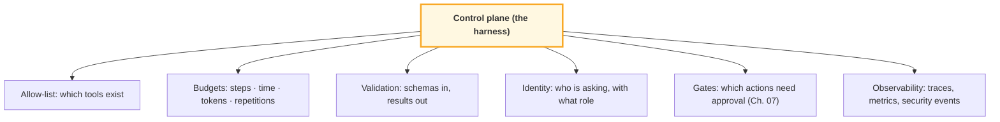

# Chapter 04 — Loop Engineering & Harness Engineering

> **Lecture 09 · Chapter 04 of 09** · Level: 🟡 Intermediate · Phase 3 — Agency & Contracts
> **Source:** `gen-ai-cohort/week01/learning/day02/notes/05 agent-architecture-and-loops.md`
> (ch 15–23, 29–38) · `Forward-Deployed-Engineer/Lecture 05/notes/07_Human_In_The_Loop_Safety_and_Enterprise_Patterns.md`
> (Principle 25 — the quadratic token ledger)
> **Roadmap topics:** loop engineering & harness engineering (first contact) · enterprise agent patterns and
> failure modes · the economics of multi-turn loops.
> **Prerequisites:** Chapter 03 (the loop, state, termination) · Lecture 04 (token economics, cost per call) ·
> Lecture 06 (context growth, token accumulation).

---

## 04.0 What this chapter is for

Chapter 03 taught you to build the loop. This chapter teaches you to make it **survivable**.

A loop without brakes is not an agent — it is an unbounded spend with a language model inside it. Every agent
outage you will ever see is one of these five:

1. It never stopped (no step limit).
2. It hung (no timeout).
3. It cost more than the feature earns (no token budget, `O(N²)` growth).
4. It repeated the same failing action forever (no progress detection).
5. Nobody could tell what happened (no trace).

None of these are model problems. They are **loop engineering** problems, and they are all fixed by code you
write around the model.

This is where the roadmap's *"harness engineering (first contact)"* lands. The harness is the software that
surrounds the model and decides what it is allowed to do — and this chapter is the harness's first full pass.

By the end of this chapter you should be able to:

1. Explain, with numbers, why `while (true)` is unacceptable in production.
2. List the five independent brakes and say what each one catches that the others miss.
3. Explain the `O(N²)` token ledger and three mitigations.
4. Name the six termination conditions and implement each as a check.
5. Describe what a useful execution trace contains.
6. Diagnose the six classic agent failure modes and match each to a control.
7. Draw the full defensive architecture and explain each layer's job.
8. Distinguish prompt engineering from harness engineering, and explain "the harness is the control plane".

---

## 04.1 Why `while (true)` is dangerous

A naive implementation looks like this:

```js
// pseudo-code — the anti-pattern
while (true) {
  await callLLM(state);
}
```

What if the model never produces `OUTPUT`? You get:

```text
LLM → Tool → LLM → Tool → LLM → Tool → …
```

That produces:

- unnecessary API costs,
- token consumption,
- latency,
- repeated tool calls,
- possible **service abuse** (you are now a load generator against your own dependencies).



> **The uncomfortable truth:** an infinite agent loop is not a bug the model causes. It is a bug *you* permit by
> omitting a counter. The model will happily keep proposing actions — that is its job.

---

## 04.2 Brake 1 — Loop bounding (maximum steps)

The simplest and most important brake:

```ts
// pseudo-code
const MAX_STEPS = 10;

for (let step = 0; step < MAX_STEPS; step++) {
  const decision = await callLLM(state);
  if (decision.step === "OUTPUT") return decision.text;
  // … execute tool, append observation
}
```

```text
Step 1
 ↓
Step 2
 ↓
Step 3
 ↓
…
 ↓
Step 10
 ↓
STOP
```

This is called **loop bounding** or **step bounding**.

| | Unbounded | Bounded |
| :--- | :--- | :--- |
| Worst-case cost | Unbounded | `MAX_STEPS × cost_per_step` |
| Worst-case latency | Unbounded | Predictable enough to set a request timeout |
| Worst-case downstream load | Unbounded | Bounded |
| Behaviour on exhaustion | Never happens (it just keeps going) | Return a partial result + a clear reason |

**Choosing `MAX_STEPS`.** Derive it from the task, not from taste. A website builder needs ~7–15 turns; a
single-lookup assistant needs 2–3. Measure the 99th percentile of successful trajectories in your evals, then set
the limit slightly above it. Too low and legitimate work is truncated; too high and you have not bounded
anything meaningful.

---

## 04.3 Brake 2 — Timeout protection

Step limits are not enough, because **a tool can hang**. Ten steps is fine until step 3 blocks for forty minutes.

```text
Agent
 ↓
API request
 ↓
Waiting…
 ↓
Waiting…
 ↓
Waiting…
```

Two timeouts are needed, at two different scopes:

```ts
// pseudo-code — per-tool timeout
const result = await Promise.race([
  runTool(name, args),
  timeout(5_000),
]);
```

```text
Tool execution
      │
      ├── completes  → continue
      └── timeout    → structured error observation
```

| Timeout | Scope | Value guidance | On expiry |
| :--- | :--- | :--- | :--- |
| **Per-tool timeout** | One tool call | `p99` of the tool's healthy latency × 2 | Return a timeout error as an observation |
| **Per-model-call timeout** | One LLM call | Provider `p99` + margin | Retry once with backoff, then fail |
| **Whole-loop timeout** | The entire agent run | Product-level SLO (e.g. 120 s) | Terminate with partial results |
| **Approval timeout** | A parked HITL gate (Ch. 07) | Business SLA (e.g. 24 h) | Auto-reject / auto-escalate |

> **Note the last row.** A timeout is not only a performance control — for HITL it is a *policy* control. "If
> nobody approves within 24 hours, do not execute" is a timeout that prevents an action, not one that aborts a
> request.

---

## 04.4 Brake 3 — Token and cost limits, and the `O(N²)` ledger

Agents make many model calls, and **the context grows with every step**.

```text
One request ≈ 2,000 tokens
15 iterations
```

Naively you might think that is 30,000 tokens. It is far worse than that, because **each step re-sends the
entire accumulated history**:



### 04.4.1 The quadratic token ledger, in numbers

If each step adds `k` tokens of observation and the base prompt is `b`, the input tokens billed across `N`
steps are:

$$
\text{Total input tokens} \;=\; \sum_{i=1}^{N} \bigl(b + (i-1)k\bigr) \;=\; Nb + \frac{N(N-1)}{2}k \;\approx\; O(N^2)
$$

With `b = 2,000`, `k = 1,500`, `N = 15`:

```text
Total ≈ 15 × 2,000 + (15 × 14 / 2) × 1,500
      = 30,000 + 105 × 1,500
      = 30,000 + 157,500
      = 187,500 input tokens      ← 6.25× the naive 30,000 estimate
```

Double the steps to 30 and the observation term grows from 157,500 to 652,500 — **4× the cost for 2× the
steps**. That is the quadratic term doing its work.

### 04.4.2 The four mitigations

| Mitigation | How | Trade-off |
| :--- | :--- | :--- |
| **Prune intermediate tool outputs** | Replace old observations with a summary or a reference | The agent may lose a detail it later needs |
| **Summarise history** | Compress turns `1…k` into a running summary | Extra model call; information loss |
| **Cap observation size at the source** | Tools return compact, structured results, not raw payloads | Tool authors must design for the context (Lecture 08) |
| **Enforce hard budgets** | `maxTokens`, `maxCost`, `maxSteps` — and stop | Truncated work; but bounded cost |

```ts
// pseudo-code — budgets enforced by the runtime, per step
state.budgets.tokensUsed += usage.totalTokens;

if (state.budgets.tokensUsed > state.budgets.maxTokens) {
  return partialResult("token budget exhausted", state.toolResults);
}
```

> **Cardinal principle 25 (from the source notes):** *agent loops accumulate context at `O(N²)`. Prune
> intermediate tool outputs and enforce token budgets to prevent cost explosions.* This is why "make the agent
> try harder" is an expensive instruction, and why the cheapest agent improvement is usually **a better tool
> result**, not a longer prompt.

---

## 04.5 Brake 4 — Repetition and no-progress detection

Steps, time and tokens are *resource* brakes. They do not catch the most common pathology: **the agent doing the
same thing over and over, within budget.**

```text
LLM → search("laptop under 70000")
    → LLM → search("laptop under 70000")     ← identical
    → LLM → search("laptop under 70000")     ← identical
    → …
```

Three detections are worth implementing:

| Detection | Signal | Response |
| :--- | :--- | :--- |
| **Identical action repeat** | Same tool + same arguments as `lastAction`, ≥ 2 times | Inject a hint: *"you already ran this; here is the result"*; then stop after N |
| **Cycle detection** | The same short sequence of actions (A→B→A→B) | Break the cycle; escalate to a different strategy or terminate |
| **No-progress detection** | No change in the observable state (no new file, no new fact, no smaller error) | Terminate with a partial result and a reason |



> **Why this brake is missing from most tutorials.** It requires you to store `lastAction` and a small history of
> actions — i.e. it requires *state* (Chapter 03, §03.6.1). This is a concrete example of a design decision in
> one chapter paying for a safety control in another.

---

## 04.6 The six termination conditions

An agent should stop for exactly one of these reasons. Every one of them must be an explicit check in code.



| # | Condition | Check | What the user sees |
| :---: | :--- | :--- | :--- |
| 1 | **Success** | Decision is `OUTPUT` | The answer |
| 2 | **Maximum steps** | `step >= MAX_STEPS` | Partial result + "execution limit reached" |
| 3 | **Unrecoverable tool failure** | Decision is `ERROR`, or the same tool failed > `MAX_RETRIES` | Failure explanation + what was tried |
| 4 | **Timeout** | `now - startedAt > MAX_TIME` | Partial result + "took too long" |
| 5 | **User cancellation** | `cancelled === true` | Acknowledgement + partial state |
| 6 | **Budget exceeded** | `tokensUsed > MAX_TOKENS` (or cost) | Partial result + "budget reached" |

> **Design rule:** every termination other than #1 must return a **partial result plus a machine-readable reason
> code**. "It just stopped" is not an outcome a product can display or an operator can triage.

---

## 04.7 The brake stack — where each brake sits



Five brakes, seven exit paths, all of them inside your code. **None of them require the model's cooperation** —
which is exactly the point.

---

## 04.8 Observability — the execution trace

For production agents, log the execution trace. Without it you cannot debug, evaluate, or audit.

```text
[01] User request
[02] LLM decision: TOOL_REQUEST
[03] Tool: searchWeb
[04] Tool result: success
[05] LLM decision: TOOL_REQUEST
[06] Tool: getProduct
[07] Tool result: success
[08] LLM decision: OUTPUT
[09] Agent completed
```

### 04.8.1 What a production trace contains

| Field | Why it matters |
| :--- | :--- |
| `traceId` / `spanId` | Correlate model calls, tool calls and denials across services |
| `step` number | Ordering; correlate with budgets |
| Decision state + reason | Why the agent chose this action |
| Tool name + **validated** arguments | Reproduce the call exactly |
| Argument-validation outcome | Distinguish "bad args" from "bad tool" |
| Authorisation outcome | Prove a denial happened (compliance) |
| Latency per step | Find the slow tool, not the slow request |
| Tokens in/out per step | Attribute cost to a step |
| Termination reason | Aggregate: are runs ending by success or by budget? |
| Final status | `SUCCESS` · `MAX_STEPS` · `TIMEOUT` · `BUDGET` · `ERROR` · `CANCELLED` |



> **Why this is a *loop engineering* topic, not an afterthought.** The brakes only work if you can see them
> fire. If you cannot answer "what fraction of runs end by hitting `MAX_STEPS`?", you cannot tune `MAX_STEPS`, and
> you will not notice that a prompt change doubled your step count until the invoice arrives.

### 04.8.2 The four metrics to watch from day one

| Metric | Healthy direction | What a regression means |
| :--- | :--- | :--- |
| **Steps per successful run** (p50/p99) | Stable | Prompt/tool change made the agent wander |
| **Token cost per successful run** | Stable or down | `O(N²)` growth; observations are too large |
| **Stop-reason distribution** | Mostly `SUCCESS` | Rising `MAX_STEPS`/`TIMEOUT` = a control is firing wrongly |
| **Tool error rate + self-repair rate** | Errors flat, repairs high | Tool contracts or error messages degraded |

---

## 04.9 The six classic agent failure modes

These are the failures the source notes enumerate. For each: the signal, the cause, and the control.

| # | Failure mode | Signal in the trace | Root cause | Control |
| :---: | :--- | :--- | :--- | :--- |
| 1 | **Wrong tool** | User asked about weather; agent called the calculator | Ambiguous tool `description`s; overlapping tools | Sharper descriptions; fewer, narrower tools (Lecture 08, Ch. 02/07) |
| 2 | **Wrong arguments** | `getWeather({ city: "Guwahati, USA" })` instead of `"Guwahati"` | Under-specified schema; no enum/locale constraint | Typed schema with enums, formats and examples; validation rejects |
| 3 | **Tool failure** | `API unavailable` | Downstream outage; not the model's fault | Timeouts, retries with backoff, a fallback tool, actionable error text |
| 4 | **Infinite loop** | `Tool → LLM → Tool → LLM …` with no state change | No step/repetition brake | `MAX_STEPS` + repetition detection (§04.2, §04.5) |
| 5 | **Hallucinated tool** | `tool: "magicSearch"` when no such tool exists | Model invented a capability | Runtime rejects unknown tools; registry is the allow-list |
| 6 | **Unauthorized action** | `deleteUser` requested by a non-admin | Tool exposed without an authorisation check | Authorise in the runtime; tiers + HITL (Ch. 07, Ch. 08) |



> **The triage value of this tree.** Every agent bug report can be classified in one pass through these five
> questions. In practice you will find that modes 1, 4 and 6 cause the vast majority of incidents — and all three
> are runtime problems, not model problems.

---

## 04.10 Defensive architecture — the full pipeline

Putting the brakes together with the validation stages from Chapter 03 gives the complete defensive pipeline.
**Every arrow is a checkpoint.**



| Checkpoint | Catches | Chapter |
| :--- | :--- | :--- |
| Input validation | Oversized input, malformed payloads, missing fields | 08 |
| Injection / policy guardrails | Prompt injection, jailbreak, disallowed topics | 08 |
| Structured output + state bounding | Invented states, prose decisions | 03, 10 |
| Schema validation of arguments | Type confusion, bad enums, missing required args | 03, 10 |
| Tool authorisation | Privilege escalation, cross-object access | 07, 08 |
| Tool execution hardening | Hangs, duplicate side effects, runaway resources | 04, 05 |
| Result validation | Oversized/poisoned observations, leaked internals | 05, 08 |
| Output validation | Data leakage, unsafe content, broken contract | 08 |

> **Defence in depth is not paranoia — it is *failure tolerance*.** Each layer is individually imperfect
> (keyword filters miss paraphrases, schemas miss semantic errors, authorisation misses business context). Their
> value is that they fail *independently*.

---

## 04.11 Harness engineering — the control plane

This is the roadmap's *"harness engineering (first contact)"*, and it is the concept that ties this chapter
together.

### 04.11.1 Prompt engineering vs harness engineering

| | Prompt engineering | Harness engineering |
| :--- | :--- | :--- |
| Central question | *"What should I tell the model?"* | *"How should the whole application control the model?"* |
| Unit of work | A string | A system |
| Artefacts | System prompt, examples, format rules | State management, tool execution, schemas, retries, timeouts, permissions, loop limits, error handling, logging, observability |
| Failure it prevents | Wrong phrasing, wrong format | Wrong action, runaway loop, unbounded cost, privilege escalation |
| Who owns it | Prompt/ML engineer | Backend/platform engineer (with prompt input) |



> **The one-line distinction:** *prompt engineering changes what the model is told; harness engineering changes
> what the model is able to do.*

### 04.11.2 The harness is the control plane

The harness answers a specific list of questions. If your system cannot answer them, you have a prompt, not a
harness:

```text
Can the model call this tool?          → allow-list / registry
       ↓
How many times?                        → step + repetition budget
       ↓
With which arguments?                  → schema validation
       ↓
On whose behalf?                       → identity + role (Ch. 08)
       ↓
For how long?                          → timeouts
       ↓
What happens if it fails?              → error contract + retries + fallback
       ↓
When should execution stop?            → termination conditions (§04.6)
       ↓
How do we know what happened?          → trace + metrics (§04.8)
```



### 04.11.3 The harness checklist

Use this as a review gate before shipping any agent.

| # | Control | Present? |
| :---: | :--- | :---: |
| 1 | Explicit tool registry (allow-list) — unknown tool names rejected | ☐ |
| 2 | `MAX_STEPS` derived from eval data | ☐ |
| 3 | Per-tool and per-model-call timeouts | ☐ |
| 4 | Whole-loop timeout + user cancellation path | ☐ |
| 5 | Token and cost budgets, checked every step | ☐ |
| 6 | Repetition / no-progress detection using `lastAction` | ☐ |
| 7 | Structured decisions with state bounding | ☐ |
| 8 | Schema validation of every tool argument | ☐ |
| 9 | Authorisation on every tool (role + object + tier) | ☐ |
| 10 | Structured, actionable, redacted error observations | ☐ |
| 11 | Partial-result return on every non-success termination | ☐ |
| 12 | Full execution trace with `traceId` | ☐ |
| 13 | Stop-reason and cost metrics on a dashboard | ☐ |
| 14 | Trajectory evals (not just single-turn evals) | ☐ |

> **Note how few of these are prompt changes.** That ratio is the lesson of this chapter.

---

## 04.12 Common mistakes

| # | Mistake | Consequence | Fix |
| :--- | :--- | :--- | :--- |
| 1 | Shipping `while (true)` | Unbounded cost, latency and downstream load | `MAX_STEPS` (§04.2) |
| 2 | Only a step limit, no timeout | A hanging tool blocks a request forever | Per-tool + whole-loop timeouts (§04.3) |
| 3 | Estimating cost as `steps × per-call` | You under-estimate by 3–10× and blow the budget | Model the `O(N²)` ledger (§04.4.1) |
| 4 | Never pruning observations | Context and cost grow quadratically | Prune/summarise/cap (§04.4.2) |
| 5 | No repetition detection | Identical failing calls until the step limit | `lastAction` + repeat counter (§04.5) |
| 6 | Silent termination | Users see "something went wrong"; ops cannot triage | Reason codes + partial results (§04.6) |
| 7 | Treating `MAX_STEPS` as a magic number | Truncated legitimate work, or no real bound | Derive it from `p99` of successful runs (§04.2) |
| 8 | No trace, only a final log line | You cannot diagnose, evaluate or audit | Full step-level trace (§04.8) |
| 9 | Only measuring success rate | Cost and step regressions go unnoticed | The four metrics (§04.8.2) |
| 10 | Believing prompt engineering will fix an infinite loop | You add words; the counter is still missing | It is a harness problem (§04.11) |
| 11 | Accepting a hallucinated tool name as an error to "handle later" | Unbounded blast radius | Registry rejects unknown tools (§04.9 mode 5) |
| 12 | Reviewing the prompt but not the harness | You ship without budgets, gates or traces | Use the checklist (§04.11.3) |

---

## 04.13 Key takeaways

1. **A loop without brakes is a spend, not an agent.** Every production incident traces to a missing counter, a
   missing timeout, a missing budget, a missing progress check, or a missing trace.
2. **Five independent brakes:** max steps, timeouts, token/cost budgets, repetition/no-progress detection, and
   user cancellation. Each catches what the others miss.
3. **Context grows quadratically.** `O(N²)` — 15 steps with 1.5k-token observations is ~187k input tokens, not
   30k. Prune, summarise, cap observations, and enforce hard budgets.
4. **Six termination conditions, all explicit in code.** Success, max steps, unrecoverable failure, timeout,
   cancellation, budget. Every non-success exit returns a partial result and a reason code.
5. **The brakes sit inside the loop, not around it** — so the agent can exit cleanly with partial work rather
   than being killed mid-operation.
6. **Traces are the substrate of debugging, evaluation and audit.** Log step number, decision state, validated
   arguments, authorisation outcome, latency, tokens and termination reason.
7. **Six classic failure modes, and a triage tree for them.** Wrong tool, wrong arguments, tool failure,
   infinite loop, hallucinated tool, unauthorised action. Modes 1, 4 and 6 dominate — and all three are runtime
   problems.
8. **Defence in depth is failure tolerance.** Eight checkpoints, each individually imperfect, each failing
   independently.
9. **Prompt engineering asks "what should I tell the model?"; harness engineering asks "how does the application
   control the model?"** The harness is the control plane: allow-list, budgets, validation, identity, gates,
   observability.
10. **Almost nothing on the harness checklist is a prompt change.** That ratio is the whole lesson.

---

**Next:** [Chapter 05 — Workspace Sandboxing & Agent Security](./05_Workspace_Sandboxing_and_Agent_Security.md)
