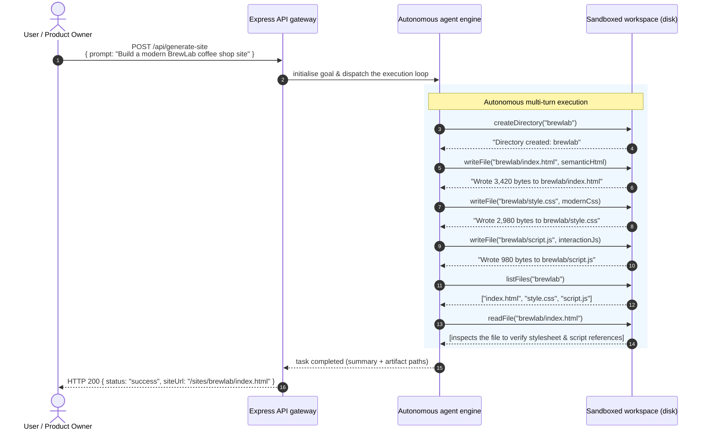
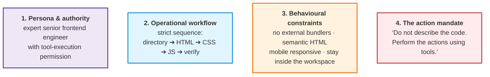
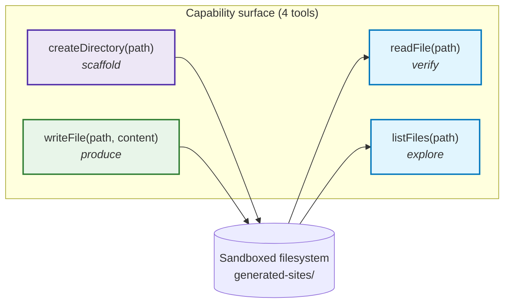
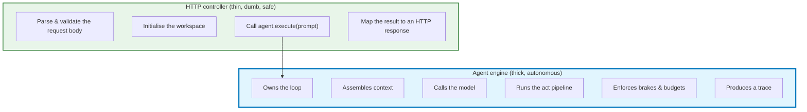
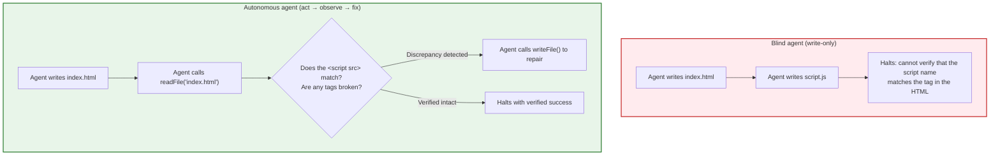
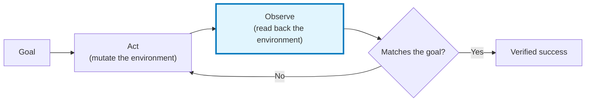
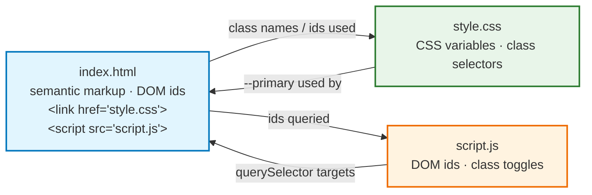
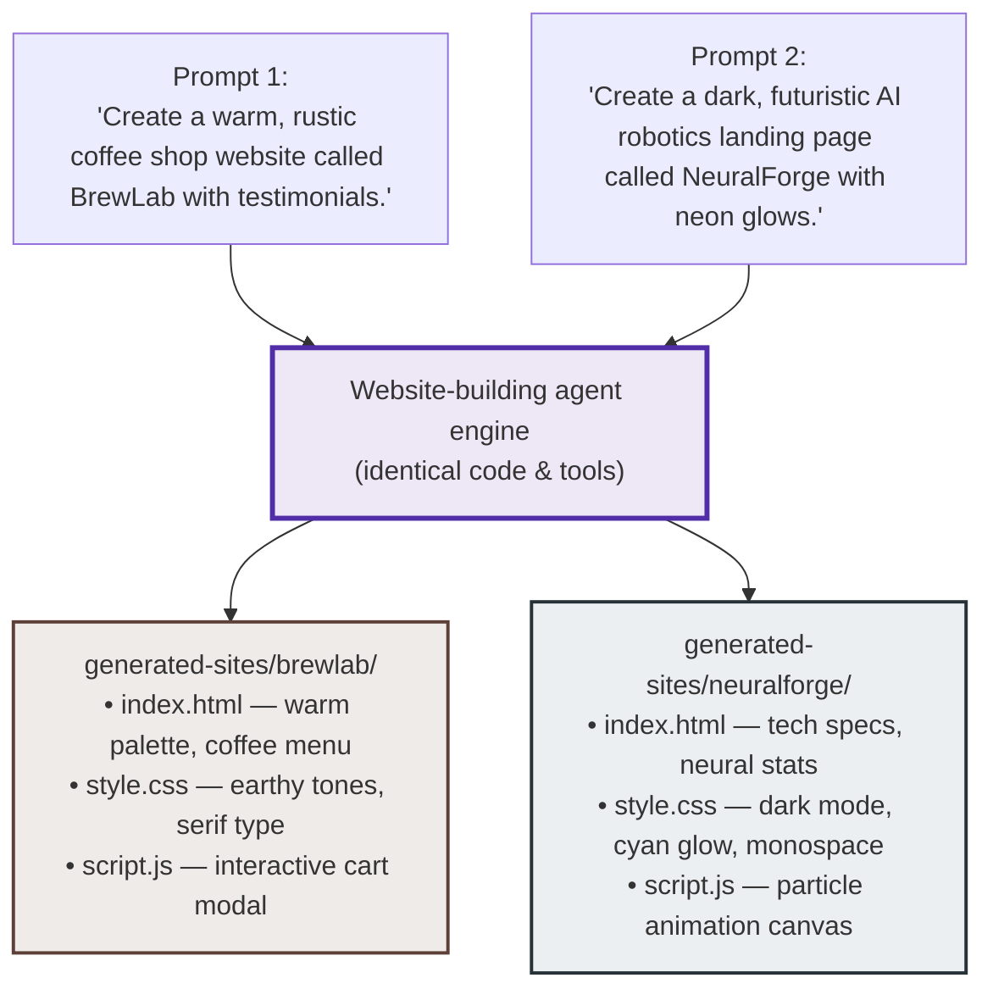

# Chapter 06 — Building an Autonomous Website-Builder Agent

> **Lecture 09 · Chapter 06 of 09** · Level: 🟡 Intermediate · Phase 3 — Agency & Contracts
> **Source:** `Forward-Deployed-Engineer/Lecture 05/notes/06_Building_an_Autonomous_Website_Builder_Agent.md` ·
> `Forward-Deployed-Engineer/Lecture 05/notes/04_...Agency_Spectrum.md` (§4.4 general-purpose emergence)
> **Roadmap topics:** the autonomous website-builder agent (the end-to-end example) ·
> "Don't describe the action. Perform it!" · the environmental feedback loop ·
> general-purpose emergence with zero code changes.
> **Prerequisites:** Chapters 02–05 (architecture, loop, harness, sandbox) · Lecture 08 (tool contracts,
> the multi-step execution loop).

---

## 06.0 What this chapter is for

Chapters 02–05 gave you the components, the loop, the brakes and the sandbox. This chapter assembles them into
one working agent, end to end, and traces what actually happens on the wire and on disk.

It is the lecture's **build task** in narrative form: *a sandboxed autonomous agent that writes files inside a
jailed workspace*. Every mechanism you read about earlier appears here in context:

| Mechanism | Where it appears in this chapter |
| :--- | :--- |
| The 6-component model (Ch. 01) | Goal, brain, tools, environment, observations, loop |
| The act pipeline (Ch. 03) | validate → authorise → execute → observe |
| The brakes (Ch. 04) | `maxSteps`, low temperature, per-tool timeouts |
| The sandbox (Ch. 05) | `safePath`, 5 MB cap, quotas, no shell |
| The system prompt as a job description (Ch. 02) | §06.2 |

By the end of this chapter you should be able to:

1. Explain the difference between an *advisor* and an *actuator* with a concrete example.
2. Write an agent system prompt as a **job description with an action mandate**.
3. Justify the four workspace tools as the minimum sufficient capability set.
4. Keep the HTTP controller thin and put the intelligence in the engine.
5. Trace a seven-turn autonomous run and name the observation at each turn.
6. Explain why `readFile` and `listFiles` transform an agent from open-loop to closed-loop.
7. Explain why the same code produces a coffee-shop site and a robotics site with zero code changes.

---

## 06.1 From advice to actuation

Ask a traditional chatbot to build a website and you get a passive response:

```text
User:    "Build me a website for BrewLab coffee shop."
Chatbot: "Sure! Here is the code you should copy and paste into your files…"
```

The user must create folders, create files, open an editor, paste code, and debug the missing `<link>` tag. The
model acted as an **advisor**, placing the entire operational burden back on the human.

In an autonomous agent architecture, the model is given **hands**:



> **The structural difference in one sentence:** the human expresses the **goal**; the agent autonomously mutates
> the **environment** until the goal is verified. The chatbot's output was *a message*; the agent's output is
> *a directory on disk*.

---

## 06.2 System prompt engineering: the job description

An agent's system prompt is not conversational chit-chat. It is a **formal job specification and operating
contract**.

Without unambiguous operational rules, an LLM falls back on its conversational pre-training — and it will
*describe* code in a chat message instead of *triggering tools*. This is the single most common reason a
first agent attempt "does nothing".



### 06.2.1 The four pillars

| Pillar | What it fixes | Example line |
| :--- | :--- | :--- |
| **1. Persona & authority** | The model knows *who* it is and that it may act | *"You are an expert autonomous senior frontend engineer with permission to use workspace tools."* |
| **2. Operational workflow** | The model has an ordered plan, not a vague mission | *"Create the directory, then `index.html`, then `style.css`, then `script.js`, then verify."* |
| **3. Behavioural constraints** | Output quality and containment | *"Semantic HTML5. No external bundlers. Keep all files strictly inside your project directory."* |
| **4. The action mandate** | The conversational reflex | *"Do not merely tell the user what code to write. Actually execute the actions."* |

### 06.2.2 The production system prompt contract

```text
You are an expert autonomous senior frontend engineer and website builder.
Your objective is to create complete, responsive, visually stunning static websites
in the sandboxed workspace using your available workspace tools.

For every website requested by the user:
1. Create a dedicated project directory using createDirectory (e.g. 'brewlab').
2. Create index.html using semantic HTML5, with a meta viewport tag, accessible
   headers, sections and footers.
3. Create style.css with a curated, modern aesthetic:
   - custom CSS variables (--bg, --primary, --text, --card)
   - modern typography, smooth transitions, full mobile responsiveness
     (Flexbox and CSS Grid)
4. Create script.js to add interactive polish (nav toggle, modal, form handler).
5. Link style.css and script.js inside index.html using relative paths.
6. Do not use external build tools, bundlers or framework dependencies
   (vanilla HTML/CSS/JS only).
7. Keep all files strictly inside your dedicated project workspace directory.
8. After creating the files, call listFiles to inspect the created structure.
9. Call readFile on critical files (such as index.html) to verify link paths,
   script tags and syntax integrity. Fix any defects immediately using writeFile.
10. Terminate only when the website is completely written, verified and ready.

CRITICAL OPERATIONAL MANDATE:
Do not merely tell the user what code they should write in your conversational
response. Actually execute the actions and create the files using your tools.
Don't describe the action. Perform it.
```

> **Read line 9 again.** The prompt *tells* the agent to verify — but verification only becomes real because
> `readFile` and `listFiles` **exist as tools** (§06.6). A prompt instruction with no matching capability is
> theatre. This is the recurring lesson of the lecture: *capability first, instruction second.*

### 06.2.3 Agent system-prompt anti-patterns

| Anti-pattern | What happens | Fix |
| :--- | :--- | :--- |
| Only a persona ("You are a helpful website builder") | The model chats instead of acting | Add workflow + action mandate |
| Rules in prose with no ordering | The model writes CSS before HTML; broken links | Number the steps |
| No containment rule | The agent writes outside its directory | Add a containment line — **and** enforce it in `safePath` |
| Safety rules *instead of* checks | Rules are bypassable; you feel safe anyway | Keep the rule for behaviour; add the check for safety |
| Ten pages of instructions | Instruction dilution; the model skips steps | Keep it to a tight numbered contract |
| No termination criterion | The agent keeps "improving" until `maxSteps` | State the termination condition explicitly |

---

## 06.3 The four workspace tools — the agent's entire capability surface

The agent's "hands" are exactly four functions. Everything it can do, it does through these.



| Tool | Verb | Why it is in the minimal set |
| :--- | :--- | :--- |
| `createDirectory` | **Scaffold** | Projects need a namespace; without it everything collides in the root |
| `writeFile` | **Produce** | The actual work product; auto-creates parent directories |
| `readFile` | **Verify** | Without it the agent is blind after writing (§06.6) |
| `listFiles` | **Explore** | Cheap, high-value perception; lets the agent see its own output structure |

### 06.3.1 Why exactly these four, and not five or ten

| Temptation | Why it is wrong |
| :--- | :--- |
| Add `runCommand` | Reintroduces arbitrary code execution (Chapter 05) |
| Add `deleteFile` | Irreversible; needs a tier and a gate (Chapter 07) |
| Add `moveFile` | Two mutations in one call; harder to audit and to make idempotent |
| Add `appendToFile` | Premature; `readFile` + `writeFile` covers it and keeps the surface small |
| Add `deploySite` | Tier 3 — it is an external, irreversible action; belongs behind a human gate |

> **The capability surface is the blast radius.** Four narrow tools in a jail mean the worst case is a ruined
> website directory. Ten tools including a shell mean the worst case is a ruined company (Chapter 05, §05.1).

---

## 06.4 The controller and the engine

Two pieces of code, with very different jobs.



```ts
// pseudo-code — the controller, in full. Note how little is here.
app.post('/api/generate-site', async (req, res) => {
  const { prompt } = req.body;
  if (typeof prompt !== 'string' || !prompt.trim()) {
    return res.status(400).json({ error: "Missing or invalid 'prompt'." });
  }

  await workspaceTools.init();                       // ensure the jail exists

  const agent = new AgentExecutionEngine({
    apiKey: process.env.OPENAI_API_KEY,
    tools: workspaceTools.getAllTools(),              // the 4 tools, nothing else
    systemPrompt: WEBSITE_BUILDER_SYSTEM_PROMPT,     // the job description
    model: 'gpt-4o',
    maxSteps: 15,                                    // brake 1 (Ch. 04)
    temperature: 0.2,                                // low: deterministic tool use
  });

  const result = await agent.execute(prompt);        // ← ALL the intelligence
  return res.status(200).json({ status: 'success', ...result });
});

// Serve the generated artefacts for live viewing
app.use('/sites', express.static('generated-sites'));
```

The controller's whole contribution to "intelligence" is this one line:

```ts
const result = await agent.execute(prompt);
```

> **Why this separation matters.** *"From the controller's perspective, there is zero hardcoded site-generation
> logic."* All sequencing, tool choice, file creation and verification happen inside the engine, driven by the
> model. That is what makes §06.8 (general-purpose emergence) possible — and it is also what makes the
> controller reviewable in thirty seconds.

### 06.4.1 The engine's responsibilities, in the loop's own terms

```text
PERCEIVE  → assemble context: system prompt + prompt + history + observations
DECIDE    → one model call, structured output, state-bounded
ACT       → validate → authorise → execute → observe   (Ch. 03 §03.4.1)
BRAKE     → steps · time · tokens · repetition          (Ch. 04)
TRACE     → one record per step with reason codes       (Ch. 04 §04.8)
```

---

## 06.5 End-to-end walkthrough: the BrewLab case study

The request:

```json
{ "prompt": "Create a premium landing page for a coffee shop called BrewLab. Use a dark elegant design with a hero section, featured coffees, customer testimonials and a contact section." }
```

Note what is *not* in the request: no file names, no directory name, no ordering, no CSS strategy. The agent
supplies all of that.

```mermaid
flowchart TD
    Start(["Goal: build the BrewLab landing page"]) --> T1

    subgraph Turn1["Turn 1 — project scaffolding"]
        T1["LLM evaluates tools → createDirectory('brewlab')"]
        --> O1["Obs: 'Directory created: brewlab'"]
    end

    subgraph Turn2["Turn 2 — HTML structure"]
        O1 --> T2["LLM writes brewlab/index.html<br/>semantic tags: header · section#hero ·<br/>section#menu · link rel=stylesheet href=style.css"]
        T2 --> O2["Obs: 'Wrote 3,420 bytes'"]
    end

    subgraph Turn3["Turn 3 — styling system"]
        O2 --> T3["LLM writes brewlab/style.css<br/>CSS variables (--coffee-dark, --amber-glow),<br/>flex/grid layout, hover transforms, media queries"]
        T3 --> O3["Obs: 'Wrote 2,980 bytes'"]
    end

    subgraph Turn4["Turn 4 — interactive script"]
        O3 --> T4["LLM writes brewlab/script.js<br/>cart-order modal · smooth-scroll nav"]
        T4 --> O4["Obs: 'Wrote 980 bytes'"]
    end

    subgraph Turn5["Turn 5 — environmental verification"]
        O4 --> T5["LLM calls listFiles('brewlab')"]
        T5 --> O5["Obs: ['index.html','style.css','script.js']"]
    end

    subgraph Turn6["Turn 6 — code audit & integrity check"]
        O5 --> T6["LLM calls readFile('brewlab/index.html')<br/>verifies link and script paths match"]
        T6 --> O6["Obs: complete HTML returned"]
    end

    subgraph Turn7["Turn 7 — goal fulfilled"]
        O6 --> T7["LLM emits a stop finish_reason<br/>returns a summary to the user"]
    end

    T7 --> End(["Website complete on disk"])

    style Turn1 fill:#f3e5f5,stroke:#7b1fa2,stroke-width:1px
    style Turn2 fill:#e1f5fe,stroke:#0288d1,stroke-width:1px
    style Turn3 fill:#e8f5e9,stroke:#388e3c,stroke-width:1px
    style Turn4 fill:#fff3e0,stroke:#f57c00,stroke-width:1px
    style Turn5 fill:#e0f7fa,stroke:#00838f,stroke-width:1px
    style Turn6 fill:#ede7f6,stroke:#512da8,stroke-width:1px
    style Turn7 fill:#c8e6c9,stroke:#2e7d32,stroke-width:2px
```



### 06.5.1 The seven turns as a table

| Turn | Decision | Action | Observation | Why this turn exists |
| :---: | :--- | :--- | :--- | :--- |
| 1 | "I need a project directory" | `createDirectory('brewlab')` | *Directory created* | Namespacing; keeps projects separable |
| 2 | "Now the document structure" | `writeFile('brewlab/index.html', …)` | *Wrote 3,420 bytes* | Content first — CSS needs selectors to target |
| 3 | "Style it" | `writeFile('brewlab/style.css', …)` | *Wrote 2,980 bytes* | Design system with CSS variables |
| 4 | "Add interaction" | `writeFile('brewlab/script.js', …)` | *Wrote 980 bytes* | Progressive enhancement |
| 5 | "Verify the structure" | `listFiles('brewlab')` | *3 files* | Cheap confirmation that all three exist |
| 6 | "Verify the wiring" | `readFile('brewlab/index.html')` | *HTML content* | Catch broken `<link>` / `<script>` paths |
| 7 | "Goal verified" | emit stop | — | Termination on success (Ch. 04, condition #1) |

### 06.5.2 The resulting artefacts on disk

```text
generated-sites/
└── brewlab/
    ├── index.html   (semantic HTML5 with metadata and content)
    ├── style.css    (modern responsive stylesheet)
    └── script.js    (interactive JavaScript)
```

Opening `http://localhost:3000/sites/brewlab/index.html` loads an immediately usable website.

> **Notice the shape of the trajectory.** Content → presentation → behaviour → verification. That ordering is
> not accidental: it is exactly what the system prompt's numbered workflow asked for (§06.2.2). **The prompt
> shapes the trajectory; the loop makes it real.**

---

## 06.6 The environmental feedback loop: why `readFile` and `listFiles` transform capability

This is the single most important engineering idea in the chapter.

In early prototypes, developers often expose only `writeFile`. Without `readFile` and `listFiles`, the agent is
**blind after writing**.



### 06.6.1 The three capabilities observation unlocks

| Capability | What it needs | Why it matters |
| :--- | :--- | :--- |
| **Self-correction** | `readFile` | The agent can read its own HTML, notice it referenced `app.js` instead of `script.js`, and rewrite the file |
| **Incremental editing** | `readFile` + `writeFile` | For complex projects: read the existing file, append CSS classes or nav items, write it back |
| **Structural exploration** | `listFiles` | Cheap perception; the agent discovers what already exists before writing |

> **The principle in the source notes' words:** *observation is what separates an open-loop script from a true
> closed-loop agent.* A write-only agent is a generator. A read-and-write agent is a **worker**.

### 06.6.2 A concrete self-repair trace

```text
[Turn 5] Agent calls: listFiles({ path: "brewlab" })
[Turn 5] Observation: ["index.html", "style.css", "script.js"]

[Turn 6] Agent calls: readFile({ path: "brewlab/index.html" })
[Turn 6] Observation: "<!DOCTYPE html><html><head>
                        <link rel='stylesheet' href='style.css'>
                        </head><body>…</body></html>"

[Agent internal decision]
  "I inspected index.html and noticed that while script.js was created,
   the <script src='script.js'></script> tag is missing before the closing
   </body> tag. I must fix this immediately using writeFile."

[Turn 7] Agent calls: writeFile({
           path: "brewlab/index.html",
           content: "<!DOCTYPE html>…<script src='script.js'></script></body></html>"
         })
[Turn 7] Observation: "Successfully wrote 3,490 characters to: brewlab/index.html"

[Turn 8] Agent finishes:
  "BrewLab website successfully created and verified with active JavaScript wiring."
```

```mermaid
sequenceDiagram
    autonumber
    participant A as Agent
    participant FS as Workspace
    A->>FS: listFiles("brewlab")
    FS-->>A: ["index.html", "style.css", "script.js"]
    A->>FS: readFile("brewlab/index.html")
    FS-->>A: HTML without the script tag
    Note over A: Detects a missing &lt;script&gt; reference
    A->>FS: writeFile("brewlab/index.html", repairedHtml)
    FS-->>A: "Wrote 3,490 characters"
    Note over A: Goal verified → terminate
```

> **Why this is not just a nice demo.** Without turn 6, the site *looks* finished and silently ships with dead
> JavaScript. The bug would reach a user, and the "agent" would have reported success. **Observation is the
> difference between reporting success and having success.**

### 06.6.3 The feedback loop generalised

The pattern is not about websites. Replace the domain and the shape is identical:



| Domain | Act | Observe | Verified by |
| :--- | :--- | :--- | :--- |
| Website builder | write files | read/list files | links and tags match |
| Data pipeline | write to the warehouse | query row counts | counts and constraints |
| Code agent | edit the repo | run tests / lint | the test suite passes |
| Infra agent | apply a change | read back the resource | the desired state is observed |

> **The general rule:** *a tool that mutates should have a companion tool that observes.* If you can write but
> not read, you cannot self-correct — and a non-self-correcting agent will confidently ship broken work.

---

## 06.7 Multi-file coherence

A website is not three independent files; it is one artefact spread across three files. An autonomous agent
must maintain **shared mental state** across them.



The three couplings that must stay consistent:

| Coupling | Where it breaks | How the agent detects it |
| :--- | :--- | :--- |
| **File references** | `<link href="styles.css">` but the file is `style.css` | `listFiles` (the names) + `readFile` (the tags) |
| **Selectors** | CSS targets `.hero-card`; HTML uses `.heroCard` | `readFile` on both, or a check step |
| **DOM ids** | JS queries `#cart-modal`; HTML never defines it | `readFile` on both files |

> **Why this is the hard part of "agentic" work.** Any single-file generator can be locally correct and globally
> broken. Coherence requires the agent to *hold the whole artefact in its context* — which is exactly why
> `readFile`/`listFiles` matter (perception) and why the token budget matters (Chapter 04, §04.4): the more files
> you add, the more expensive coherence becomes.

---

## 06.8 General-purpose emergence: same code, diverse capabilities

The ultimate validation of an agentic architecture is **general-purpose capability without code changes**.

In traditional software engineering, a coffee-shop generator and a robotics-site generator are two different
programs: different templates, hardcoded assets, different logic. In an agentic architecture:

$$
\text{The tools stay identical } (\text{createDirectory}, \text{writeFile}, \text{readFile}, \text{listFiles}).
$$
$$
\text{The application code remains completely untouched.}
$$



### 06.8.1 Why emergence works

The model's parametric pre-training contains design patterns, colour harmonies, semantic HTML layouts and
domain terminology for thousands of industries. Given workspace tools:

1. It draws on its domain knowledge of *coffee shops* or *robotics companies* to synthesise appropriate
   aesthetics, copy and layout.
2. It uses the **exact same** `createDirectory` and `writeFile` tools to instantiate those designs on disk.

> **We did not build specialised domain software. We built an autonomous agent that projects its generalised
> intelligence into an operational environment.**

### 06.8.2 The two conditions for emergence

Emergence is not automatic. It requires both:

| Condition | If missing |
| :--- | :--- |
| **General-purpose primitives** (few, composable, domain-agnostic tools) | Every new domain needs new code — you are back to writing `CoffeeShopGenerator` |
| **A goal-level instruction** (the *what*, not the *how*) | The model is over-constrained and cannot generalise |

> **The design test:** *if adding a new domain requires a code change, you did not build an agent — you built a
> template engine with an LLM front-end.*

---

## 06.9 What generalises from this example

The website builder is a teaching vehicle. The transferable pattern is:

| Pattern | Why it transfers |
| :--- | :--- |
| **Four narrow tools in a jail** | Any artefact-producing agent needs create / write / read / list analogues |
| **System prompt as a numbered job contract** | Any agent that underperforms is usually missing a workflow or an action mandate |
| **Thin controller, thick engine** | Keeps the HTTP layer reviewable and the intelligence testable |
| **Act → observe → repair** | The only way to ship verified artefacts |
| **Low temperature for tool use** | Determinism where you want predictability; creativity where you want variety |
| **Bounded steps + quotas** | Required the moment an agent writes to disk |
| **No shell** | The difference between a demo and something you can deploy |

> **The most portable sentence in this chapter:** *if you want an agent to produce something, give it a way to
> produce it, a way to look at what it produced, and a way to try again — and then bound all three.*

---

## 06.10 Common mistakes

| # | Mistake | Consequence | Fix |
| :--- | :--- | :--- | :--- |
| 1 | A persona-only system prompt | The agent chats; nothing is created | Add a numbered workflow + an action mandate (§06.2) |
| 2 | Omitting the action mandate | The model writes code into the chat window | *"Don't describe the action. Perform it."* (§06.2.1) |
| 3 | Exposing `writeFile` only | Blind, open-loop writing; broken references ship | Add `readFile` + `listFiles` (§06.6) |
| 4 | Adding `runCommand` "for convenience" | Arbitrary code execution | Keep the surface at four narrow tools (§06.3.1) |
| 5 | Hardcoding site-generation logic in the controller | New domains require code changes; no emergence | Thin controller, thick engine (§06.4) |
| 6 | No containment rule *and* no `safePath` | Writes land in the app source | Rule for behaviour, check for safety (§05.4) |
| 7 | No `maxSteps` | The agent keeps "polishing" until the budget dies | `maxSteps: 15` (§06.4) |
| 8 | High temperature for tool-using agents | Erratic tool choice and arguments | Low temperature for determinism |
| 9 | Skipping the verification turns | The site ships with dead JavaScript | Verify with `listFiles` + `readFile` (§06.6.2) |
| 10 | Treating "the agent said it finished" as success | No artefact, or a broken artefact | Verify on disk; the observation is the proof |
| 11 | No file-size or quota limits | One write can fill the disk | Payload cap + quotas (§05.7) |
| 12 | Serving the workspace without checks | Generated HTML is served from your origin | Serve from a separate origin/domain; sandbox the iframe |
| 13 | Ignoring multi-file coherence | Locally correct files, globally broken site | Read back all coupled files (§06.7) |
| 14 | Over-constraining the prompt with templates | No generalisation; you rebuilt a template engine | Describe the goal, not the HTML (§06.8) |

---

## 06.11 Key takeaways

1. **The difference between a chatbot and an agent is a directory on disk.** The chatbot returns a message; the
   agent mutates the environment and verifies the result.
2. **An agent system prompt is a job description, not a chat persona.** Four pillars: persona & authority,
   operational workflow, behavioural constraints, and the action mandate.
3. **The action mandate is load-bearing:** *"Do not describe the action. Perform it."* Without it, models fall
   back to conversational pre-training.
4. **Four tools are enough:** `createDirectory` (scaffold), `writeFile` (produce), `readFile` (verify),
   `listFiles` (explore). The capability surface *is* the blast radius.
5. **Keep the controller thin and the engine thick.** The controller's only intelligent line is
   `agent.execute(prompt)`.
6. **Observation converts a generator into a worker.** `readFile` and `listFiles` enable self-correction,
   incremental editing and structural exploration.
7. **The feedback loop generalises:** act → observe → compare to the goal → act again. Every domain that
   mutates state needs a companion observation tool.
8. **Multi-file coherence is the real difficulty.** File references, selectors and DOM ids must agree across
   files, which is why perception tools and token budgets matter.
9. **General-purpose emergence is the payoff.** The same four tools and the same code produce a rustic coffee
   shop and a neon robotics portal — driven only by the prompt.
10. **Emergence requires two conditions:** general-purpose primitives and goal-level instructions. If a new
    domain needs new code, you built a template engine, not an agent.
11. **Verification is not optional polish — it is the difference between reporting success and having it.**
12. **Everything in Chapters 03–05 shows up here:** the act pipeline, the brakes, the sandbox, and the trace.

---

**Next:** [Chapter 07 — Human-in-the-Loop & the 3-Tier Tool Authorization Matrix](./07_Human_in_the_Loop_and_Tool_Authorization_Tiers.md)
