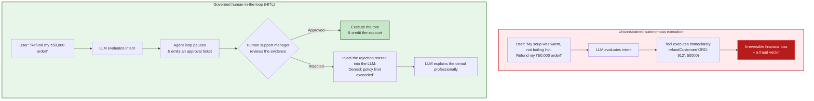
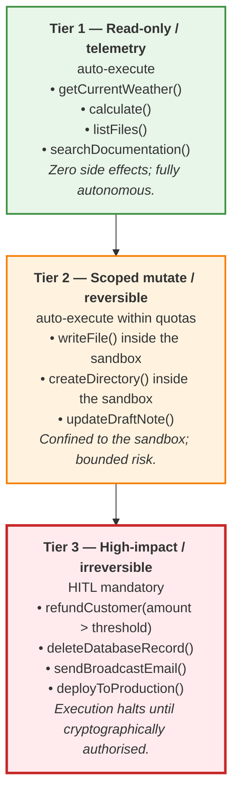
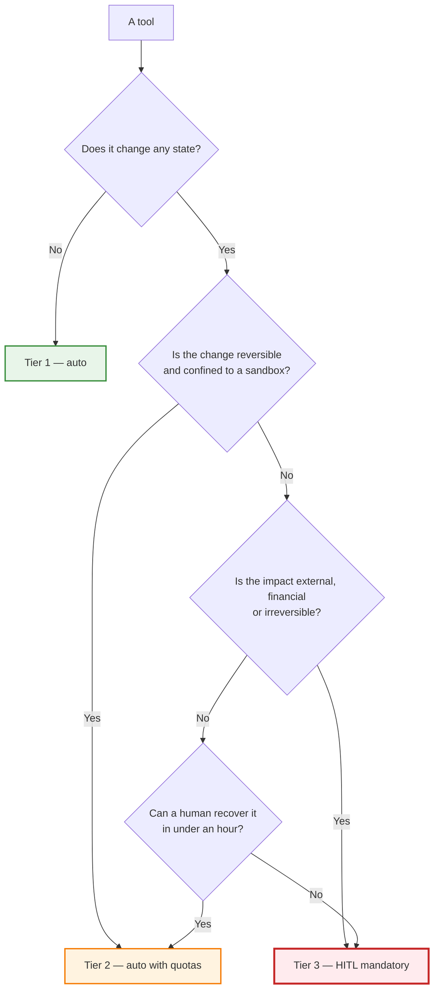
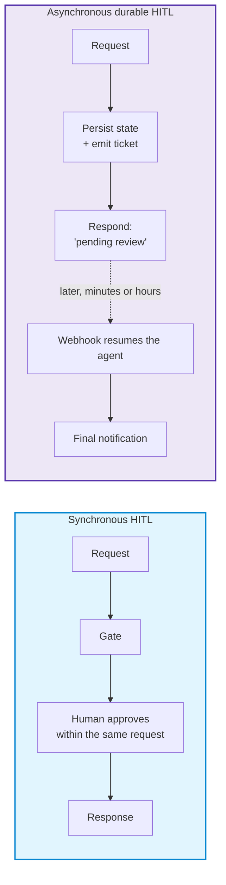
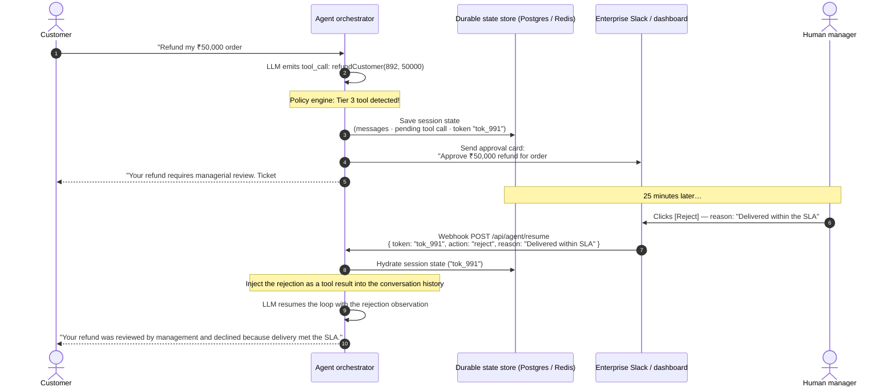
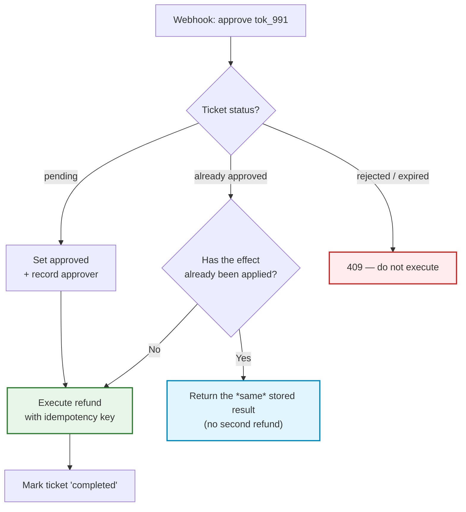
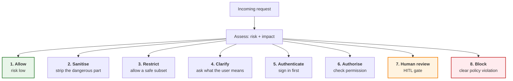

# Chapter 07 — Human-in-the-Loop & the 3-Tier Tool Authorization Matrix

> **Lecture 09 · Chapter 07 of 09** · Level: 🟡 Intermediate · Phase 3 — Agency & Contracts
> **Source:** `Forward-Deployed-Engineer/Lecture 05/notes/07_Human_In_The_Loop_Safety_and_Enterprise_Patterns.md` ·
> `gen-ai-cohort/week02/learning/day03/notes/3.1/3.2-Defensive Wrapper.md` (§23 — blocking is not the only option)
> **Roadmap topics:** human-in-the-loop safety patterns · the 3-tier tool authorization policy matrix ·
> the asynchronous durable pause/resume state machine.
> **Prerequisites:** Chapters 03–05 (the act pipeline, the loop, the sandbox) · Chapter 04 §04.3 (timeouts as
> policy) · Lecture 08, Chapter 08 (permission tiers, first contact).

---

## 07.0 What this chapter is for

Chapters 05 and 06 made the agent *safe to run*: it cannot escape its jail, it cannot hang, it cannot spend
without bound. This chapter addresses the risk that remains **inside** the jail — an action that is perfectly
legal, perfectly contained, and completely wrong.

> **The shift.** With a chatbot, the cost of a mistake is an embarrassing sentence. With an agent, the cost of a
> mistake is a **financial transfer, a deleted record, or an email that cannot be unsent.**

By the end of this chapter you should be able to:

1. Explain why high-consequence actions must be gated, and why "the model seemed confident" is not a control.
2. Classify any tool into **Tier 1, 2 or 3** and justify the classification.
3. Distinguish **synchronous** HITL from **asynchronous durable** HITL, and say when each is appropriate.
4. Draw the durable pause/resume state machine, including the resume webhook.
5. Implement the approval decision in pseudo-code, including amount thresholds.
6. Explain why approval requires **idempotency**, and what breaks without it.
7. List the eight possible responses to a suspicious or high-impact request — and why "block" is only one.

---

## 07.1 The necessity of human-in-the-loop

Consider an enterprise customer-support agent equipped with two action tools:

1. `sendEmail(recipient, subject, body)`
2. `refundCustomer(orderId, amount)`



### 07.1.1 The core operational reality

> **An LLM is a probabilistic token sampler. It has no skin in the game.** It does not face legal prosecution,
> suffer financial loss, or understand fiduciary responsibility.

This is not a criticism of the model; it is a statement about *accountability*. Every organisation that has ever
been audited has an answer to "who approved this?" — and "the model did" is not an answer. High-consequence
actions must be guarded by human judgment, because **only a human can be accountable**.

| Consequence class | Example | Who bears the loss if wrong |
| :--- | :--- | :--- |
| **Reversible, local** | Writing a file in a sandbox | Nobody — delete it |
| **Reversible, shared** | Updating a draft, tagging a ticket | A colleague's time |
| **Irreversible, internal** | Deleting a record, changing permissions | The business |
| **Irreversible, external** | Refund, payment, email, production deploy | The business, plus legal/regulatory exposure |

> **Note the pattern:** the *gating* requirement tracks **reversibility and external impact**, not the model's
> confidence. A confident model and a hesitant model both need the same gate — that is what makes it a control
> rather than a judgement call.

---

## 07.2 The 3-tier tool authorization policy matrix

To prevent engineering bottlenecks while ensuring ironclad safety, tools must **not** be treated uniformly.
Enterprise architects classify every tool into one of three operational tiers.



### 07.2.1 The authorization tier matrix

| Tier | Policy name | Risk profile | Execution mode | Example primitives |
| :---: | :--- | :--- | :--- | :--- |
| **1** | **Read-only / informative** | Zero side effects; idempotent | **Fully autonomous** | `calculate`, `getWeather`, `readFile`, `db.query` |
| **2** | **Scoped mutate** | Sandboxed; reversible; bounded | **Autonomous within sandbox quotas** | `createDirectory`, `writeFile` (inside the jail) |
| **3** | **Critical / external** | Non-idempotent; financial; irreversible | **Human approval mandatory (HITL)** | `refundCustomer`, `sendEmail`, `dropTable`, `purchaseItem`, `deploy` |

### 07.2.2 The classification decision tree



### 07.2.3 Tiering rules that prevent mistakes

1. **Tier is a property of the *tool*, not of the *call site*.** Do not let one code path bypass a tier.
2. **Tier 2 is "reversible inside a jail".** The moment the target is outside the jail, it is Tier 3.
3. **Amount thresholds belong to Tier 3 tools, not to Tier 2.** `refundCustomer(₹200)` may be auto; `refundCustomer(₹50,000)` may not.
4. **Never downgrade a tier to improve a demo.** Tier inflation is a product decision; tier deflation is a security incident.
5. **Every Tier 3 tool needs a named approver role.** "Someone will approve it" is not a policy.

---

## 07.3 Synchronous vs asynchronous HITL

There are two structurally different ways to get a human decision, and choosing the wrong one is a classic
production bug.



| | Synchronous HITL | Asynchronous durable HITL |
| :--- | :--- | :--- |
| Approval latency | Seconds | Minutes to days |
| State | Held in the open HTTP request | Persisted in a durable store |
| Transport | The same request/response | Ticket + webhook (or polling) |
| Failure if misused | Timeouts, dropped requests, retries | Orphaned tickets, double execution |
| Fits | Low-value, fast decisions ("confirm this draft?") | Refunds, deploys, legal/compliance reviews |
| Anti-pattern | Waiting 20 minutes on an HTTP connection | Keeping no record of the pending action |

> **The rule.** *If the human might take longer than a few seconds, the approval must be durable.* A Node.js HTTP
> connection cannot wait twenty minutes — and if you force it to, you get a timeout, a retry, and possibly a
> second refund.

---

## 07.4 The asynchronous durable pause/resume state machine

In enterprise systems, human approval rarely occurs in milliseconds. A support manager might take 20 minutes to
review a refund request. A production agent cannot keep a connection hanging — it needs a **durable state
machine**.



### 07.4.1 The five steps of durable HITL

| Step | Action | Why it must be durable |
| :---: | :--- | :--- |
| **1** | **Persist** the session state, the pending tool call and a resumption token | The process may restart; the request may be served by another instance |
| **2** | **Notify** the approver (Slack, email, admin dashboard) with enough evidence to decide | The approver needs the *arguments*, not just the tool name |
| **3** | **Respond** to the user immediately with a "pending" status and a ticket id | Never block the HTTP request on a human |
| **4** | **Receive** the decision via a webhook (or polling) and update the ticket | Webhooks scale; polling adds latency and load |
| **5** | **Hydrate and resume**: reload state, inject the decision as an observation, continue the loop | The model must learn the outcome to explain it to the user |

> **Note step 5's subtlety.** A *rejection* is not an error — it is an **observation**. The loop continues so the
> agent can produce a professional explanation. If you terminate on rejection, the user gets silence or a
> generic failure instead of a reason.

### 07.4.2 The pending-approval record

```ts
// pseudo-code
interface PendingApproval {
  id: string;                 // the approval ticket id
  agentSessionId: string;     // which run is waiting
  toolName: string;           // e.g. 'refundCustomer'
  toolArgs: unknown;          // the exact arguments, for the approver's evidence
  requestedBy: string;        // which user triggered it
  requestedAt: Date;
  status: 'pending' | 'approved' | 'rejected' | 'expired';
  approverId?: string;        // who decided (accountability)
  rejectionReason?: string;
  expiresAt: Date;            // an approval timeout (Ch. 04 §04.3)
  idempotencyKey: string;     // prevents double execution (§07.6)
}
```

### 07.4.3 The policy engine — deciding whether a human is needed

```ts
// pseudo-code — the gate decision, not the execution
class HITLPolicyEngine {
  static readonly CRITICAL_TOOLS = new Set(['refundCustomer', 'sendEmail', 'deleteRecord', 'deployToProduction']);
  static readonly FINANCIAL_THRESHOLD = 5_000;      // auto-approval ceiling

  static requiresHumanApproval(toolName: string, args: any): boolean {
    // Tier 1 and Tier 2 tools never need approval
    if (!this.CRITICAL_TOOLS.has(toolName)) return false;

    // Tier 3 with a threshold: micro-refunds are auto-approved
    if (toolName === 'refundCustomer' && args.amount <= this.FINANCIAL_THRESHOLD) return false;

    return true;   // Tier 3 above threshold: explicit human gate
  }

  static async resolveToolExecution(approval: PendingApproval, toolRunner: (args: any) => Promise<any>) {
    if (approval.status === 'approved') {
      // Idempotent execution — see §07.6
      const result = await toolRunner(approval.toolArgs);
      return { status: 'executed', result };
    }
    // Rejected or expired: return a *result*, not an exception
    return { status: 'denied', reason: approval.rejectionReason ?? 'Approval expired' };
  }
}
```

> **Why the threshold lives in the policy engine and not the prompt.** A threshold written in a prompt can be
> argued with ("the customer is very upset, please make an exception"). A threshold in code cannot. This is the
> same principle as Chapter 05: *capability in the tool, control in the runtime.*

---

## 07.5 The resumption webhook

The webhook is where the durable loop is stitched back together.

```ts
// pseudo-code — invoked by Slack / an admin dashboard when a human reviews the ticket
app.post('/api/agent/resume', async (req, res) => {
  const { approvalId, action, rejectionReason, managerId } = req.body;

  // 1. Retrieve the pending approval from the durable store
  const approval = await getPendingApprovalFromDB(approvalId);
  if (!approval || approval.status !== 'pending') {
    return res.status(409).json({ error: 'Ticket not found or already processed.' });
  }

  // 2. Update the ticket (recording WHO decided — accountability)
  approval.status = action === 'approve' ? 'approved' : 'rejected';
  approval.rejectionReason = rejectionReason;
  approval.approverId = managerId;
  await saveApprovalToDB(approval);

  // 3. Resolve execution through the policy engine (idempotent)
  const toolResult = await HITLPolicyEngine.resolveToolExecution(
    approval,
    (args) => executeRefundMicroservice(args, { idempotencyKey: approval.idempotencyKey }),
  );

  // 4. Hydrate the agent session and inject the decision as an observation
  const session = await getAgentSessionFromDB(approval.agentSessionId);
  session.messages.push({
    role: 'tool',
    tool_call_id: approval.id,
    content: JSON.stringify(toolResult),
  });

  // 5. Resume the autonomous loop so the agent can explain the outcome
  const finalReport = await agent.resumeSession(session);
  return res.status(200).json({ status: 'resumed_and_completed', report: finalReport });
});
```

### 07.5.1 The five correctness requirements for this endpoint

| # | Requirement | Why |
| :---: | :--- | :--- |
| 1 | **Reject non-pending tickets** | A double-click or a webhook retry must not double-execute |
| 2 | **Record the approver identity** | Accountability is the entire point of HITL |
| 3 | **Execute idempotently** | Webhooks are delivered at-least-once, not exactly-once |
| 4 | **Inject the decision as an observation** | So the loop resumes with the outcome in context |
| 5 | **Return a resumable report** | The caller (Slack/dashboard) needs to show the outcome |

---

## 07.6 Idempotency: the requirement people forget

Everything up to this point assumes the approval is delivered **exactly once**. In practice, webhooks are
**at-least-once**: Slack retries, your load balancer retries, a human double-clicks.



**Two layers of defence:**

| Layer | Mechanism | Protects against |
| :--- | :--- | :--- |
| **Application** | Ticket state machine (`pending → approved → completed`) | Duplicate approvals |
| **Downstream** | Idempotency key passed to the payment/refund service | Duplicate *effects* even if your state is lost |

> **Why both layers.** Application state can be lost (a dropped DB write, a replay from a backup). The
> idempotency key travels with the request to the downstream service, which is the only place that can
> definitively answer *"have I already done this?"* For **Tier 3 tools, idempotency is not optional — it is part
> of the tool contract.**

---

## 07.7 Blocking is not the only option

The source notes end with an important line: *"Blocking hi sirf option nahi hai"* — blocking is not the only
option. A binary block/allow model damages legitimate users and hides real intent.



| Option | When to use it | What the user experiences |
| :--- | :--- | :--- |
| **1. Allow** | Low risk, permitted | Normal service |
| **2. Sanitise** | The request is mostly fine; a part is unsafe | A slightly reduced answer |
| **3. Restrict** | Only a safe subset is permissible | A scoped answer |
| **4. Ask for clarification** | Ambiguous intent | *"Can you clarify what you are trying to accomplish?"* |
| **5. Require authentication** | Sensitive operation, anonymous user | *"Please sign in before performing this action."* |
| **6. Require authorisation** | Authenticated but lacking permission | *"You don't have permission to access this resource."* |
| **7. Human review (HITL)** | High-impact or high-risk | *"Ticket #991 is pending review."* |
| **8. Block** | Clear policy violation | A refusal |

> **The design principle.** Options 1–7 keep a *legitimate* user in the product while still controlling risk.
> Reaching for option 8 by default is how you build a system that is simultaneously unsafe (it blocks the wrong
> things) and hostile (it blocks the right things too late, with no path forward).

---

## 07.8 The HITL design checklist

| # | Item | Why |
| :---: | :--- | :--- |
| 1 | Every tool is assigned a tier (1, 2 or 3) | Untiered tools default to "whatever the code path does" |
| 2 | Tier 3 tools have a **named approver role** | "Someone will approve it" is not a policy |
| 3 | Amount/impact thresholds are in **code**, not the prompt | Prompts can be argued with; code cannot |
| 4 | The approval ticket contains the **exact arguments** | An approver needs evidence, not a tool name |
| 5 | The approval request is **durable** if latency may exceed seconds | HTTP connections cannot wait minutes |
| 6 | The ticket has an **expiry** (auto-reject on timeout) | Otherwise tickets rot and actions fire late |
| 7 | The approver identity is **recorded** | Accountability is the point of HITL |
| 8 | Execution is **idempotent** (ticket state + idempotency key) | Webhooks are at-least-once |
| 9 | A **rejection is injected as an observation**, and the loop resumes | The user deserves a reason |
| 10 | Every approval, rejection and expiry is **logged as a security event** | Chapter 08 sends these to SIEM |
| 11 | The user is told **immediately** that the action is pending | Avoids duplicate requests and support tickets |
| 12 | HITL metrics are monitored: approval latency, approval rate, expiry rate | A 90% rejection rate means the agent is misconfigured, not that users are malicious |

### 07.8.1 The HITL metrics that matter

| Metric | What it tells you |
| :--- | :--- |
| **Approval rate per tool** | If an agent's Tier 3 proposals are usually rejected, the prompt or tool description is wrong |
| **Median approval latency** | Sizing the durable-store design; SLA for the user |
| **Expiry rate** | Either the wrong people are being asked, or the notification channel is wrong |
| **Duplicate-webhook rate** | Whether idempotency is actually being exercised in production |
| **Post-approval failure rate** | The tool is broken *after* a human spent time approving it — the worst outcome |

---

## 07.9 Common mistakes

| # | Mistake | Consequence | Fix |
| :--- | :--- | :--- | :--- |
| 1 | Treating all tools as equally risky | You either bottleneck everything or gate nothing | Assign tiers (§07.2) |
| 2 | Gating reads, not writes | Users are blocked on harmless actions | Gate by impact, not by frequency |
| 3 | Writing the refund threshold in the prompt | It gets argued away | Thresholds in code (§07.4.3) |
| 4 | Blocking an HTTP request for minutes | Timeouts, retries, possible double execution | Durable pause/resume (§07.3) |
| 5 | Not persisting the pending tool call | The resumed agent forgets what it wanted to do | Persist state + resumption token (§07.4.1) |
| 6 | No approval expiry | Tickets rot; actions fire days later | `expiresAt` + auto-reject (§07.4.2) |
| 7 | Executing on `approved` without an idempotency guard | Double refunds on webhook retries | Ticket state machine + idempotency key (§07.6) |
| 8 | Terminating the run on rejection | The user gets no explanation | Inject the rejection as an observation (§07.4.1) |
| 9 | Not recording who approved | No accountability; audit failure | Store `approverId` (§07.5.1) |
| 10 | Blocking by default for anything unusual | Legitimate users churn; real attacks still slip through | Use the eight options (§07.7) |
| 11 | No HITL metrics | You cannot tell a misconfigured agent from an abused one | Monitor the five metrics (§07.8.1) |
| 12 | Approving without evidence in the ticket | The approver rubber-stamps | Include exact arguments (§07.8) |
| 13 | Making HITL the *only* control | Humans are slow and inconsistent; the queue becomes the bottleneck | Combine with tiers, sandbox, RBAC (Ch. 05, 08) |

---

## 07.10 Key takeaways

1. **The cost of an agent's mistake is not an embarrassing sentence — it is a financial transfer, a deletion, or
   an unsent-able email.** High-consequence actions need human judgment because only a human is accountable.
2. **An LLM has no skin in the game.** It cannot bear legal, financial or fiduciary responsibility, so it must
   not be the final authority for those decisions.
3. **Classify every tool into three tiers:** Tier 1 read-only (auto), Tier 2 scoped mutate (auto with quotas),
   Tier 3 critical/irreversible (HITL mandatory).
4. **Tier is a property of the tool, not the call site.** Never let one code path bypass a tier.
5. **Synchronous HITL is for seconds; asynchronous durable HITL is for minutes and beyond.** If a human might
   take longer than a few seconds, persist the state.
6. **Durable HITL is five steps:** persist state + token, notify the approver with evidence, respond "pending",
   receive the decision via webhook, hydrate and resume the loop.
7. **A rejection is an observation, not an error.** Resume the loop so the agent can explain the outcome.
8. **Idempotency is mandatory for Tier 3 tools.** Webhooks are at-least-once; a double-click must not produce a
   double refund. Use a ticket state machine *and* a downstream idempotency key.
9. **Thresholds and approver roles live in code, not in the prompt.** Prompts can be argued with; checks cannot.
10. **Blocking is not the only option.** Eight responses exist — allow, sanitise, restrict, clarify,
    authenticate, authorise, human review, block — and reaching for "block" by default is both unsafe and
    hostile.
11. **Record who approved, when, and why.** Accountability is the entire purpose of the gate.
12. **HITL is one layer, not the layer.** Combine it with the sandbox (Ch. 05), the tiers, and RBAC (Ch. 08).

---

**Next:** [Chapter 08 — RBAC, the Defensive Wrapper & Platform Guardrails](./08_RBAC_Defensive_Wrapper_and_Platform_Guardrails.md)
