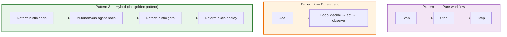
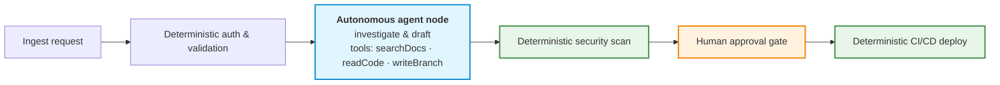
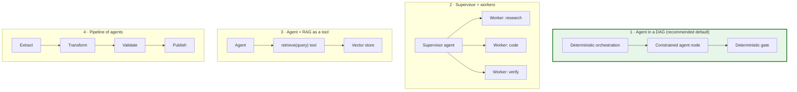
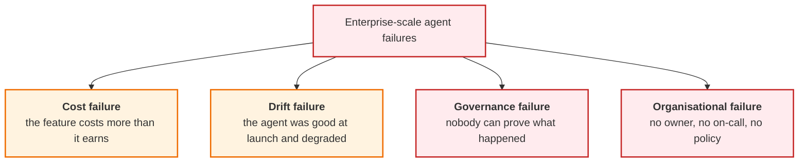
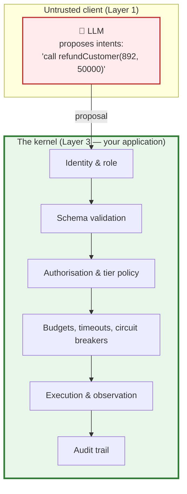
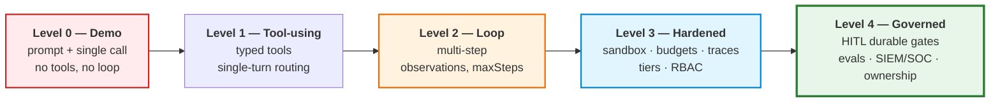

# Chapter 09 — Enterprise Agent Patterns, Failure Modes & the 25 Cardinal Principles

> **Lecture 09 · Chapter 09 of 09** · Level: 🟡 Intermediate · Phase 3 — Agency & Contracts
> **Source:** `Forward-Deployed-Engineer/Lecture 05/notes/07_Human_In_The_Loop_Safety_and_Enterprise_Patterns.md`
> (§7.4 comparison matrix, §7.5 the 25 cardinal principles) ·
> `Forward-Deployed-Engineer/Lecture 05/notes/04_...Agency_Spectrum.md` (§4.3 agent vs workflow, §4.3.1 hybrid) ·
> `gen-ai-cohort/week01/learning/day02/notes/05 agent-architecture-and-loops.md` (ch 36–37)
> **Roadmap topics:** enterprise agent patterns and failure modes ·
> "the application is the kernel" — why the runtime, not the prompt, owns safety.
> **Prerequisites:** Chapters 01–08. This chapter is the synthesis.

---

## 09.0 What this chapter is for

Every previous chapter answered one question. This chapter answers the question a staff engineer is actually
asked:

> **Would you put this in production, and what would you change first?**

Three things are needed to answer it:

1. **Patterns** — the small number of architectures that actually ship, and when each applies (§09.1–§09.2).
2. **A failure taxonomy** — how agents fail at the *system* level, not just the loop level (§09.4).
3. **Principles** — the 25 cardinal laws that compress the whole lecture into reviewable statements (§09.5).

By the end of this chapter you should be able to:

1. Choose between a workflow, an agent, and the hybrid — and defend the choice.
2. Recognise the four enterprise topologies and say what each one costs.
3. Compare a naive chatbot with an enterprise autonomous agent across eleven dimensions.
4. Classify enterprise-scale failures (cost, drift, governance, org) and match each to a control.
5. Recite and apply the **25 Cardinal Engineering Principles**.
6. Explain *"the application is the kernel"* and why it is the thesis of the entire lecture.
7. Assess an agent against a production-readiness maturity model.

---

## 09.1 The three architecture patterns



| | Pure workflow | Pure agent | Hybrid |
| :--- | :--- | :--- | :--- |
| Determinism | 100% | None | Where it matters |
| Cost | Predictable | Unbounded without brakes | Predictable at the edges, bounded inside |
| Auditability | Excellent | Requires traces | Excellent (the risky edges are deterministic) |
| Handles novel states | Poorly | Well | Well (inside the node) |
| Fits | KYC, checkout, ETL, compliance | Code generation, research, design | **Almost everything in production** |
| Failure mode | Crashes on the unhandled edge | Silently does the wrong thing | Bounded |

> **The rule of thumb, restated:** *if you can draw the flowchart before you write the code, build a workflow. If
> the flowchart depends on what the world says back, build an agent — and wrap it in a workflow.*

### 09.1.1 The hybrid topology in detail



| Element | Why it is deterministic |
| :--- | :--- |
| Auth & validation | A model must not decide who you are |
| Security scan | A model must not decide whether code is safe to merge |
| Human approval gate | A model must not be accountable for a deploy |
| CI/CD deploy | A model must not be the thing that pushes to production |
| **The investigation & drafting in the middle** | **This is where ambiguity lives — and where agency earns its keep** |

> **The design heuristic:** put agency where the *ambiguity* is, and determinism where the *consequence* is.

---

## 09.2 The four enterprise topologies

Beyond workflow/agent/hybrid, there are four recurring *shapes* in real deployments. Each buys something and
costs something.



| Topology | Buys | Costs | Use when |
| :--- | :--- | :--- | :--- |
| **1. Agent in a DAG** | Bounded risk, auditable edges | Some rigidity at the boundaries | **Default for enterprise** |
| **2. Supervisor + workers** | Parallelism; specialisation per worker | Coordination cost; error amplification; harder to trace | A genuinely decomposable task with independent sub-parts |
| **3. Agent + RAG as a tool** | Grounded answers on demand | Retrieval quality becomes a failure mode | Knowledge-heavy tasks |
| **4. Pipeline of agents** | Clear stage boundaries; each stage testable | Each stage's errors compound; latency adds up | Well-separated stages (extract → validate → publish) |

> **A caution about topology 2.** Multi-agent systems are often reached for before they are needed. Coordination
> overhead, cost amplification and trace complexity all grow faster than capability. **Start with one loop and a
> good tool set; add a second agent only when a single context window is demonstrably the bottleneck.**

---

## 09.3 Naive chatbot vs enterprise autonomous agent

This is the comparison to memorise — it is the fastest way to explain the whole lecture to a stakeholder.

| Dimension | Naive chatbot | Enterprise autonomous agent |
| :--- | :--- | :--- |
| **Output** | Text | **Artifacts + verified state changes** |
| **Control flow** | One model call | A bounded decision loop |
| **Tools** | None, or hardcoded calls | Typed registry with permissions and tiers |
| **Memory** | None | Working · episodic · semantic · vector · procedural |
| **Observations** | None | Closed-loop observations (`readFile`, `listFiles`) |
| **Failure recovery** | Apologises or hallucinates | Self-corrects from error observations |
| **Safety governance** | Moderation APIs, prompt guardrails | IAM · sandboxes · path containment · tier gates · HITL |
| **Cost model** | Per message | Per trajectory, with budgets and `O(N²)` awareness |
| **Auditability** | A conversation log | Step-level traces, security events, SIEM/SOC |
| **Blast radius** | None (it only talks) | **Everything its tools can reach — by design, bounded** |
| **Accountability** | "The chatbot said" | Named approver on every Tier 3 action |

> **Read the last two rows together.** The enterprise agent has a *large potential* blast radius and a *small
> designed* one. The entire difference is whether you built the controls in Chapters 05–08.

---

## 09.4 Enterprise failure modes

Chapter 04 listed the six *loop-level* failure modes (wrong tool, wrong arguments, tool failure, infinite loop,
hallucinated tool, unauthorised action). At enterprise scale, four more classes appear — and these are the ones
that get features cancelled.



### 09.4.1 Cost failure

| Signal | Cause | Control |
| :--- | :--- | :--- |
| Cost per trajectory rising over weeks | `O(N²)` context growth; verbose observations | Prune observations; cap tool result size (Ch. 04, §04.4) |
| `MAX_STEPS` hit frequently | Ambiguous tool descriptions; the agent wanders | Sharpen descriptions; add routing evals (Lecture 08) |
| Long tails (p99 ≫ p50) | One user pattern triggering 40-step runs | Per-user rate limits; per-run budgets |
| Cost is fine but margin is not | No unit economics per trajectory | Instrument cost per *successful outcome*, not per call |

> **The measurement that matters:** **cost per successful outcome**, not cost per model call. A cheap model that
> needs six extra steps to succeed is not cheaper.

### 09.4.2 Drift failure

| Signal | Cause | Control |
| :--- | :--- | :--- |
| Success rate falls after a model version bump | Provider model changed behaviour | Pin versions; run trajectory evals before switching |
| Tool-selection accuracy falls after adding tools | Description overlap; routing ambiguity | Routing evals; fewer, sharper tools |
| Self-repair rate falls | Error messages degraded; tools now leak or truncate | Keep error contracts actionable (Ch. 03, §03.10) |
| Users stop trusting and re-do the work manually | Silent partial failures | Report stop reasons and partial results honestly |

> **The rule:** *an agent is a system that drifts.* Anything that depends on model behaviour must be
> continuously evaluated — trajectory evals, not just single-turn evals.

### 09.4.3 Governance failure

| Signal | Cause | Control |
| :--- | :--- | :--- |
| "Who approved this refund?" cannot be answered | No approver recorded | Record `approverId` (Ch. 07, §07.5.1) |
| A data-access incident cannot be reconstructed | No step-level traces | Trace every decision, tool call and denial (Ch. 04, §04.8) |
| Audit asks for a policy and gets a prompt | No explicit tier/policy document | Tier matrix in code + documented (Ch. 07, §07.2) |
| Security team learns about AI attacks from users | No SIEM integration | Emit security events (Ch. 08, §08.9) |

### 09.4.4 Organisational failure

| Signal | Cause | Control |
| :--- | :--- | :--- |
| Nobody owns the agent's on-call | The "AI team" is a project, not a service | Assign ownership like any production service |
| Prompt changes ship without review | Prompts treated as config, not code | Version prompts; review them; eval them |
| No one can say what the agent may do | No capability inventory | Publish the tool registry + tiers |
| Incident response has no AI playbook | AI incidents treated as ordinary bugs | Extend SOC runbooks (Ch. 08, §08.9.3) |

> **The uncomfortable observation:** in most organisations, the *technical* controls (sandbox, tiers, traces) are
> cheaper to build than the *organisational* ones (ownership, review, runbooks). The failures still happen in the
> second category.

---

## 09.5 The 25 Cardinal Engineering Principles

These are the source notes' consolidated laws for production AI agents. They are grouped exactly as the source
groups them, with a short commentary for each so they are reviewable rather than decorative.

### 09.5.1 Cognitive foundations & LLM realities (1–5)

| # | Principle | Commentary |
| :---: | :--- | :--- |
| **1** | **The Representation Law** — generating tokens that spell `mkdir` is not issuing a `sys_mkdir` syscall. | Text generation is orthogonal to environmental action. |
| **2** | **LLM = brain, tools = hands** — an LLM without tools is an intellect trapped in a room without actuators. | Chapter 01, §01.5. |
| **3** | **The Semantic Decoder Principle** — an LLM's greatest engineering strength is translating high-entropy human ambiguity into low-entropy typed contracts. | This is *why* the model belongs in the system at all. |
| **4** | **The Naïve JSON Fallacy** — never rely on prompt-based "always answer in JSON" in production; always use native tool/function-calling schemas. | Prompts are not parsers. |
| **5** | **Autoregressive Conditioning** — every tool result must be serialised into the message array so subsequent tokens can condition on physical reality. | No observation in context = no grounding. |

### 09.5.2 Tool architecture & contracts (6–10)

| # | Principle | Commentary |
| :---: | :--- | :--- |
| **6** | **Tools are normal code** — strip away the AI jargon; a tool is an ordinary function exposed through a JSON Schema contract. | This is what makes them testable and securable. |
| **7** | **The Tool Definition Law** — the LLM never sees your source code; it sees only `name`, `description` and `parameters`. | Your contract *is* your interface. |
| **8** | **Descriptions are prompts** — the tool `description` is the primary feature the model attends to when selecting actions. | Make descriptions unambiguous; they are the routing index. |
| **9** | **Separate compute from generation** — never ask an LLM to multiply 8-digit numbers when a 4-line function does it deterministically in a microsecond. | Deterministic work belongs in code. |
| **10** | **The Command-Query Separation** — distinguish informative tools (read-only, idempotent) from action tools (mutating, side-effect producing). | Different tiers, caching, retry and permission policies. |

### 09.5.3 Autonomous loops & execution (11–15)

| # | Principle | Commentary |
| :---: | :--- | :--- |
| **11** | **The Master Agent Formula** — `AI Agent = LLM + Tools + Environment + Observations + Decision Loop + Goal`. | The invariant definition (Ch. 01, §01.4.1). |
| **12** | **The ReAct Triplet** — true agency requires continuous cycling through **Thought → Action → Observation**. | One pass is a tool call; the cycle is the agent. |
| **13** | **Observation closes the loop** — an agent that writes files without reading them is open-loop. | `readFile` / `listFiles` enable self-correction (Ch. 06, §06.6). |
| **14** | **The Circuit Breaker Mandate** — never allow an unbounded `while(true)` loop; enforce strict `maxSteps` and timeout budgets. | Chapter 04, §04.2–§04.3. |
| **15** | **Exception Serialization** — when a tool throws, catch it and return the error message as a tool observation. | Let the model self-correct (Ch. 03, §03.10). |

### 09.5.4 Security, sandboxing & least privilege (16–20)

| # | Principle | Commentary |
| :---: | :--- | :--- |
| **16** | **Tool = Capability + Permission** — giving an agent a tool grants it authority to alter that subsystem. | Chapter 05, §05.1. |
| **17** | **The Application Is the Kernel** — the LLM decides *what* it wants to do; the application enforces *what* it is permitted to do. | The thesis of the lecture (§09.6). |
| **18** | **The Least Privilege Law** — expose only atomic domain primitives (`createDirectory`, `writeFile`), never raw OS shells (`exec`, `bash`). | Chapter 05, §05.2.1. |
| **19** | **Path Traversal Defense** — always normalise paths and verify both lexical and canonical boundary containment (`path.resolve`, `fs.realpath`). | Both checks; they fail on different attacks (Ch. 05, §05.4.1). |
| **20** | **Indirect Prompt Injection Shielding** — treat all content returned by tools (read files, web pages) as untrusted user data. | There is no complete prompt-layer fix (Ch. 05, §05.3). |

### 09.5.5 Governance, architecture & production economics (21–25)

| # | Principle | Commentary |
| :---: | :--- | :--- |
| **21** | **Workflow defines HOW; agent decides HOW** — in workflows, developers hardcode the path; in agents, developers set the goal and the agent determines the trajectory. | Chapter 01, §01.6. |
| **22** | **The Hybrid Golden Pattern** — wrap autonomous agents inside deterministic workflow nodes; combine flexibility with predictability. | Chapter 09, §09.1.1. |
| **23** | **The HITL Invariant** — high-impact, non-reversible or financial operations must be gated behind human approval. | Chapter 07, §07.2. |
| **24** | **Durable Pause/Resume** — long-running approvals must persist state in durable stores (Postgres/Redis) rather than blocking threads. | Chapter 07, §07.3–§07.5. |
| **25** | **The Quadratic Token Ledger** — agent loops accumulate context at `O(N²)`; prune intermediate tool outputs and enforce token budgets. | Chapter 04, §04.4. |

> **How to use this list.** In a design review, walk it top to bottom. Every "no" is either a deliberate,
> documented trade-off or a bug you have not written yet.

---

## 09.6 "The application is the kernel"

This is principle 17 and the thesis of the whole lecture. It deserves its own section.

> **The LLM decides *what* it wants to do. The application enforces *what* it is permitted to do.**



### 09.6.1 Why the kernel metaphor is exact

| Operating-system kernel | Agent runtime |
| :--- | :--- |
| Enforces process isolation | Enforces the sandbox (filesystem, network, process) |
| Validates system calls | Validates tool arguments against schemas |
| Checks permissions before `open()` | Checks authorisation before executing a tool |
| Limits CPU/memory per process | Limits steps, tokens, time, and repetitions |
| Keeps an audit/accounting trail | Keeps a step-level trace and security events |
| Is the only thing that can touch hardware | Is the only thing that can touch the real world |

An OS does not ask a user program to *promise* not to write to `/etc/passwd` — it checks. An agent runtime does
not ask the model to *promise* not to call `deleteUser` — it checks.

### 09.6.2 The three sentences that carry the lecture

1. **The model proposes; the runtime disposes.** (Ch. 03, §03.3.1)
2. **A prompt is not a permission; a check is.** (Ch. 05, §05.1)
3. **Design so that a fully compromised model cannot exceed its granted permissions.** (Ch. 08, §08.11.3)

Everything else in this lecture — the loop, the brakes, the sandbox, the tiers, RBAC, the wrapper, the traces —
is an implementation detail of those three sentences.

---

## 09.7 Production-readiness maturity model

Use this to place an agent and decide what to fix next.



| Level | You have | You lack | Next step |
| :---: | :--- | :--- | :--- |
| **0 — Demo** | A prompt and a model call | Tools, loop, safety | Add typed tools (Lecture 08) |
| **1 — Tool-using** | A registry, one call per request | Sequencing, observation | Add the loop (Ch. 03) |
| **2 — Loop** | `maxSteps`, observations, error recovery | Sandbox, budgets, traces | Add brakes + sandbox (Ch. 04–05) |
| **3 — Hardened** | Sandbox, budgets, traces, tiers, RBAC | Durable HITL, evals, SIEM | Add gates + governance (Ch. 07–08) |
| **4 — Governed** | Durable approval, evals, security events, ownership | — | Optimise cost, add domains, tune `MAX_STEPS` |

> **Do not skip levels.** A Level-4 governance layer on a Level-1 agent is theatre: you have approval gates for
> actions that cannot execute anyway, and no loop to pause.

---

## 09.8 The lecture's build task and gate, restated

**Build (from the roadmap):** *a sandboxed autonomous agent that writes files inside a jailed workspace, plus an
approval gate that must be satisfied before any destructive action.*

| Piece | Chapter | What "done" looks like |
| :--- | :--- | :--- |
| The loop | 03 | Perceive → decide → act → observe, with a bounded step count |
| The tools | 05, 06 | Four narrow tools: create, write, read, list |
| The sandbox | 05 | `safePath` with lexical + canonical containment; quotas; no shell |
| The brakes | 04 | `maxSteps`, timeouts, token budget, repetition detection |
| The traces | 04 | A step-level record with stop reasons |
| The approval gate | 07 | A Tier 3 tool parked until a named human approves |
| Durable resume | 07 | State persisted, decision delivered by webhook, loop resumed |
| Authorization | 08 | Role-filtered tool registry; backend decides, not the model |

**Gate (from the roadmap):** *you can describe the blast radius of your agent and the exact control that limits
it.*

Answer it in this shape:

```text
Blast radius:
  The agent can read and write any file inside generated-sites/,
  and can reach no network, no database, and no credential store.

Exact controls:
  1. safePath() — lexical + canonical containment (path.resolve + fs.realpath)
  2. Quotas     — 5 MB per file, 500 files, depth 10, 100 MB total
  3. No shell   — no exec/spawn/eval exposed as a tool
  4. Egress     — network disabled in the sandbox
  5. Tiers      — write/create are Tier 2; nothing Tier 3 is exposed
  6. Traces     — every denial is logged as a security event
```

> **Note that every control is a line of code or a configuration, not a sentence in a prompt.** That is the
> test of whether you actually built the control.

---

## 09.9 Common mistakes

| # | Mistake | Consequence | Fix |
| :--- | :--- | :--- | :--- |
| 1 | Choosing an agent where a workflow would do | Non-determinism and cost where you needed guarantees | Apply the rule of thumb (§09.1) |
| 2 | Reaching for multi-agent before one loop is exhausted | Coordination overhead, cost amplification, untraceable failures | Start with one loop + good tools (§09.2) |
| 3 | Putting agency where the *consequence* is | A model decides who you are / what deploys | Agency where ambiguity is; determinism where consequence is (§09.1.1) |
| 4 | Measuring cost per model call | You miss that a "cheap" model needs 6 extra steps | Measure cost per successful outcome (§09.4.1) |
| 5 | No trajectory evals | Drift goes undetected until users complain | Eval trajectories, not just single turns (§09.4.2) |
| 6 | Model-version changes shipped without evals | Silent behavioural regression | Pin versions; eval before switching |
| 7 | No approver identity recorded | Governance failure; cannot answer "who approved?" | Record `approverId` (§09.4.3, Ch. 07) |
| 8 | Treating prompts as config, not code | Unreviewed behaviour changes in production | Version and review prompts (§09.4.4) |
| 9 | No ownership or on-call for the agent | Incidents are nobody's job | Own it like a service (§09.4.4) |
| 10 | Building controls but skipping the organisational ones | The remaining failures are the expensive ones | Runbooks, ownership, review (§09.4.4) |
| 11 | Skipping maturity levels | Governance theatre on an agent that cannot act | Level up in order (§09.7) |
| 12 | A "blast radius" answer that names a prompt | You have not built the control | Name a check, a tier, a quota or a jail (§09.8) |
| 13 | Believing the 25 principles are aspirational | They are review criteria | Walk the list in design review (§09.5) |
| 14 | Forgetting principle 25 while adding capability | Cost explodes as tools grow | Prune observations; enforce budgets |

---

## 09.10 Key takeaways

1. **Three patterns: pure workflow, pure agent, hybrid.** The hybrid — a deterministic workflow with constrained
   autonomous nodes — is the enterprise default.
2. **Put agency where the ambiguity is and determinism where the consequence is.** Auth, security scans,
   approvals and deploys stay deterministic.
3. **Four enterprise topologies:** agent-in-a-DAG (default), supervisor + workers, agent + RAG as a tool, and a
   pipeline of agents. Each buys capability and costs coordination.
4. **Multi-agent is a scaling decision, not a starting point.** Add a second agent only when one context window
   is demonstrably the bottleneck.
5. **The naive-chatbot vs enterprise-agent comparison is the fastest explanation of this lecture:** text vs
   artefacts, one call vs a loop, apology vs self-repair, no blast radius vs a *bounded* one.
6. **Four enterprise failure classes beyond the loop:** cost, drift, governance and organisational. The
   organisational ones are the most commonly skipped and the most expensive.
7. **Measure cost per successful outcome,** not per model call, and eval *trajectories*, not single turns.
8. **The 25 Cardinal Principles** compress the lecture into reviewable laws across five groups: cognitive
   foundations, tool contracts, loops, security, and governance/economics.
9. **The application is the kernel.** The model proposes; the runtime disposes. An OS does not ask a program to
   promise — it checks.
10. **Three sentences carry the lecture:** the model proposes and the runtime disposes; a prompt is not a
    permission; design so a fully compromised model cannot exceed its granted permissions.
11. **Climb the maturity model in order:** demo → tool-using → loop → hardened → governed. Governance on an agent
    that cannot act is theatre.
12. **The gate is answered with controls, not sentences.** If your blast-radius answer names a prompt, you have
    not built the control.

---

## 09.11 Where this lecture connects to the rest of the roadmap

| Next lecture | Connection |
| :--- | :--- |
| **Lecture 10 — Structured Outputs** | The agent's decision schema and tool arguments are structured-output problems; state bounding and repair loops live there. |
| **Lecture 11 — Agent SDK from Scratch** | You will rebuild the harness, builder and ReAct loop from this lecture as a reusable library. |
| **Lecture 19 — Agent Memory Systems** | The memory component (§02.2.3) gets its full treatment: STM/LTM, graph memory, dreaming, Mem0. |
| **Lecture 22 — MCP Resources, Prompts & Gateway** | The tool registry and its authorisation become a protocol-level gateway. |
| **Lecture 26 — Durable Execution (Inngest)** | The durable pause/resume state machine (Ch. 07) becomes a framework primitive. |
| **Lecture 30 — Evals & Testing** | Trajectory evals, golden data and LLM-as-judge for everything this lecture said to measure. |
| **Lecture 31 — Security & Guardrails** | Prompt injection, jailbreaks and safe tool use in depth — the extension of Chapters 05 and 08. |

---

**Previous:** [Chapter 08 — RBAC, the Defensive Wrapper & Platform Guardrails](./08_RBAC_Defensive_Wrapper_and_Platform_Guardrails.md)
**Consolidated notes:** [Lecture 09 — Complete Notes](./Lecture_09_Complete_Notes.md)
