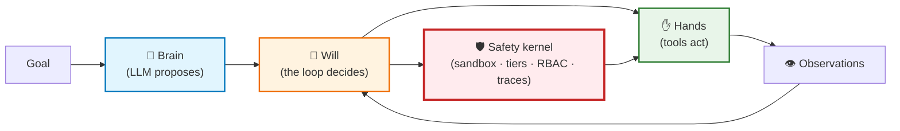
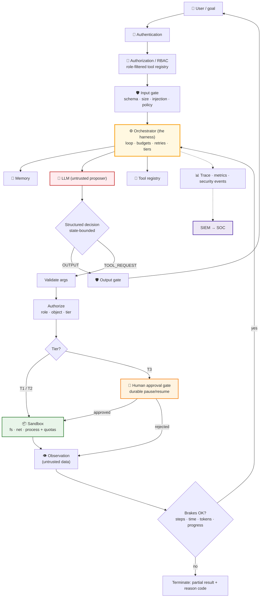
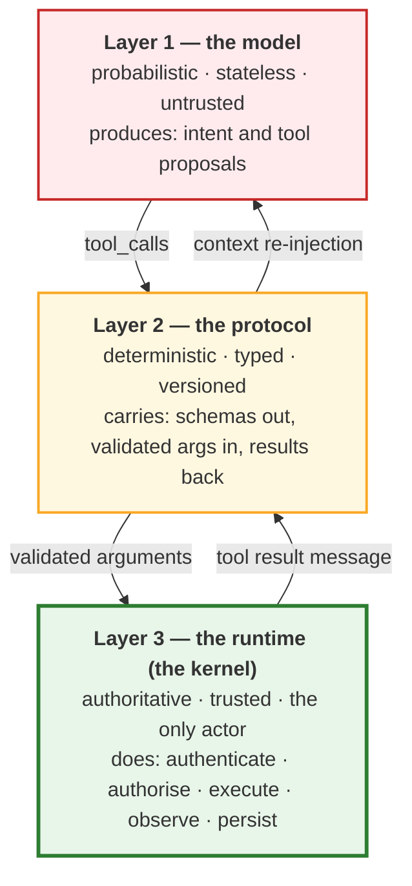
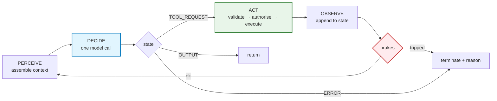

# Lecture 09 — Complete Notes
## AI Agents from First Principles: Agency, Sandboxing & HITL

> **Phase 3 · Agency & Contracts** · Level: 🟡 Intermediate · **Prerequisites:** Lectures 06, 07, 08
> **Source:** `FDE L05 (ch4–7)` · `GAC D02` · `GAC D03 (notes 01 + 3.1/3.2, 3.1/3.3)`
> **Gate:** you can describe the blast radius of your agent and the exact control that limits it.
>
> This is the **revision layer**, not a replacement for the chapters. Each section links to the chapter that
> carries the full treatment.

---

## 1. Executive summary

Chapter 01 asked what an agent actually *is*. Chapter 02 gave the parts list. Chapter 03 built the loop.
Chapter 04 made it survivable. Chapter 05 contained it. Chapter 06 assembled it end to end. Chapter 07 gated the
dangerous actions. Chapter 08 decided *who may do what*. Chapter 09 turned all of it into production judgement.

The lecture's single thesis, in one sentence:

> **An agent is a control loop wrapped around a model, with tools as its only way to touch reality — and the
> runtime, not the prompt, owns safety.**

### 1.1 The five sentences that carry the most weight

1. **An agent is not a model.** `AI Agent = Foundation LLM + Tools + Environment + Observations + Decision Loop
   + Goal`. Remove any term and you can predict the bug. → [Ch. 01](./01_First_Principles_of_AI_Agents_and_the_Agency_Spectrum.md)
2. **The model proposes; the runtime executes.** The model can only emit a `tool_call`. Your application is the
   only thing with hands. → [Ch. 03](./03_The_Agent_Loop_Perceive_Decide_Act_and_State_Machines.md)
3. **A tool is capability + permission.** Exposing a function to a probabilistic caller grants *authority*, not
   just ability. A prompt is not an access-control mechanism. → [Ch. 05](./05_Workspace_Sandboxing_and_Agent_Security.md)
4. **Observation is what separates a generator from a worker.** A write-only agent is blind after writing; a
   read-and-write agent self-corrects. → [Ch. 06](./06_Building_an_Autonomous_Website_Builder_Agent.md)
5. **Assume the model can be fooled.** Design so that even a fully compromised model cannot exceed its granted
   permissions — that is what "small blast radius" means. → [Ch. 08](./08_RBAC_Defensive_Wrapper_and_Platform_Guardrails.md)

### 1.2 The one-line mental model



### 1.3 What each chapter contributes

| Ch. | Chapter | The one thing it adds |
| :---: | :--- | :--- |
| 01 | First Principles & the Agency Spectrum | Agency is a 4-level spectrum; the 6-component model; workflow vs agent |
| 02 | Agent Architecture & Request Lifecycle | Eight components, eight owners; the full request path |
| 03 | The Agent Loop & State Machines | Perceive → decide → act; bounded states; the act pipeline |
| 04 | Loop Engineering & Harness Engineering | Five brakes; `O(N²)` cost; traces; the harness as control plane |
| 05 | Workspace Sandboxing & Agent Security | Threat model; `safePath`; four isolation tiers; three axes |
| 06 | The Autonomous Website-Builder Agent | The job-description prompt; four tools; act → observe → repair |
| 07 | HITL & the 3-Tier Authorization Matrix | Tiers; durable pause/resume; idempotency; eight responses |
| 08 | RBAC, Defensive Wrapper & Platform Guardrails | The model is outside the auth path; blast radius; SIEM/SOC |
| 09 | Enterprise Patterns & the 25 Principles | Hybrid pattern; four topologies; the 25 laws; the kernel thesis |

---

## 2. The one master diagram

Everything in the lecture on one page. Read it top to bottom; every box is a chapter.



### 2.1 The same architecture as three layers



### 2.2 The loop in one picture



> Full treatment: [Ch. 02](./02_Agent_Architecture_Components_and_Request_Lifecycle.md) · [Ch. 03](./03_The_Agent_Loop_Perceive_Decide_Act_and_State_Machines.md) · [Ch. 04](./04_Loop_Engineering_and_Harness_Engineering.md)

---

## 3. Cheat sheet

### 3.1 The definitions (Ch. 01, 02)

| Term | Definition |
| :--- | :--- |
| **Agent** | An LLM inside a controlled software loop that can observe state, decide actions, execute tools, process results, recover from errors, and terminate |
| **Master formula** | `AI Agent = LLM + Tools + Environment + Observations + Decision Loop + Goal` |
| **Engineering formula** | `Agent = LLM + Memory + Tools + Planning + Guardrails + Orchestration + Instructions` |
| **Agency** | A 4-level spectrum: L1 raw LLM → L2 single tool → L3 multi-tool router → L4 goal-directed loop |
| **Product spectrum** | Chatbot (L1) → Copilot (L2/L3 + gates) → Agent (L4 + tiers) |
| **Workflow** | Developer defines WHAT and HOW (static DAG) |
| **Agent** | Developer defines WHAT; the model decides HOW (dynamic trajectory) |
| **Hybrid** | Deterministic workflow with constrained autonomous nodes — the enterprise default |

### 3.2 The 6-component model (Ch. 01)

| # | Component | If missing… |
| :---: | :--- | :--- |
| 1 | **Goal** | The agent never knows when it is done |
| 2 | **Decision maker (LLM)** | You have a script |
| 3 | **Actions (tools)** | Advice, not actuation |
| 4 | **Environment** | "Success" with no artefact on disk |
| 5 | **Observations** | Open-loop writing; broken references ship |
| 6 | **Decision loop** | A single tool call |

### 3.3 The loop (Ch. 03)

```text
PERCEIVE  → assemble context (system prompt + history + memory + observations)
DECIDE    → one model call → structured, state-bounded decision
ACT       → validate → authorise → business rules → execute → observe
BRAKE     → steps · time · tokens · repetition · cancellation
TRACE     → one record per step, with a reason code
```

**Decision states (the closed set):** `THINK` · `TOOL_REQUEST` · `OUTPUT` · `ERROR`
Anything else is a **detected protocol error** — never a silent no-op.

### 3.4 The brakes (Ch. 04)

| Brake | Catches | Default |
| :--- | :--- | :--- |
| **Max steps** | Unbounded loops | `p99` of successful runs + margin |
| **Timeouts** | Hanging tools and requests | per-tool · per-call · per-run · per-approval |
| **Token/cost budget** | `O(N²)` context growth | hard cap, checked every step |
| **Repetition / no-progress** | Identical failing calls within budget | same tool + args ≥ 2 |
| **Cancellation** | The user changed their mind | a flag in state |

**The six termination conditions:** success · max steps · unrecoverable failure · timeout · cancellation ·
budget. Every non-success exit returns a **partial result + a reason code**.

**The `O(N²)` ledger:** with base `b`, per-step observation `k`, and `N` steps,
`total ≈ Nb + N(N−1)k/2`. With `b=2000`, `k=1500`, `N=15` → **187,500 input tokens**, not 30,000.

### 3.5 The sandbox (Ch. 05)

```text
safePath(raw):
  1. target = path.resolve(workspaceRoot, raw)
  2. if (!target.startsWith(workspaceRoot + path.sep)) → REJECT     // lexical
  3. if (exists) real = fs.realpath(target)
     if (!real.startsWith(workspaceRoot + path.sep))  → REJECT     // canonical
  4. → ALLOW
```

| Isolation tier | Mechanism | Fits |
| :---: | :--- | :--- |
| **1** | In-process logical guards | Writing text files into a jail |
| **2** | chroot / namespaces / cgroups | Long-lived workers |
| **3** | Ephemeral containers, `--network none` | Agents that run commands |
| **4** | MicroVMs (Firecracker, WebContainers) | Model-generated code that you run |

**Three axes, all required:** filesystem · network · process.
**Five threat vectors:** path traversal · symlink escape · host source overwrite · indirect prompt injection ·
resource exhaustion.

### 3.6 Authorization tiers & HITL (Ch. 07)

| Tier | Risk | Mode | Examples |
| :---: | :--- | :--- | :--- |
| **1** | Read-only, idempotent | Fully autonomous | `calculate`, `getWeather`, `readFile`, `db.query` |
| **2** | Scoped mutate, reversible | Autonomous with quotas | `createDirectory`, `writeFile` (inside the jail) |
| **3** | Non-idempotent, financial, irreversible | **HITL mandatory** | `refundCustomer`, `sendEmail`, `dropTable`, `deploy` |

**Durable HITL is five steps:** persist state + token → notify the approver with evidence → respond "pending" →
receive the decision by webhook → hydrate and resume the loop.

**A rejection is an observation, not an error.** Resume the loop so the agent can explain.

**Idempotency is mandatory for Tier 3:** a ticket state machine (`pending → approved → completed`) **and** a
downstream idempotency key.

**Eight responses to a suspicious/high-impact request:**
allow · sanitise · restrict · clarify · authenticate · authorise · human review · block.

### 3.7 The authorization & wrapper stack (Ch. 08)

| Layer | Main question |
| :--- | :--- |
| Authentication | Who is the user? |
| RBAC | What can this role do? |
| Resource authorization | Can this user access this specific object? |
| Input guardrail | Is this request suspicious or unsafe? |
| LLM | What is the user's intent? |
| Output guardrail | Is the generated response acceptable? |
| Tool authorization | Can this action actually execute? |
| SIEM | What security events are happening? |
| SOC | What should the security team do about them? |

**Six injection patterns:** instruction override · system-prompt extraction · role-play · fake authority ·
educational framing · repeated probing.

**Risk score bands:** 0–29 allow · 30–59 extra checks · 60–79 restrict · 80–100 block.

**The blast-radius rule:** *even if the model is completely fooled, permissions should not change.*

### 3.8 The 25 principles, compressed (Ch. 09)

| Group | Principles | The gist |
| :--- | :--- | :--- |
| **Cognitive foundations (1–5)** | Representation Law · brain/hands · semantic decoder · naïve-JSON fallacy · autoregressive conditioning | The model generates text; everything else is your code |
| **Tool contracts (6–10)** | Tools are normal code · definition law · descriptions are prompts · separate compute from generation · command-query separation | The contract is the interface; descriptions are the routing index |
| **Loops (11–15)** | Master formula · ReAct triplet · observation closes the loop · circuit breaker · exception serialisation | Cycles, not calls; brakes, not hope; errors as observations |
| **Security (16–20)** | Tool = capability + permission · the application is the kernel · least privilege · path-traversal defence · indirect-injection shielding | Authority, not ability; the runtime enforces |
| **Governance (21–25)** | Workflow vs agent · hybrid golden pattern · HITL invariant · durable pause/resume · quadratic token ledger | Structure, gates, durability and cost control |

> Full detail: [Ch. 09 §09.5](./09_Enterprise_Agent_Patterns_Failure_Modes_and_the_25_Principles.md)

---

## 4. Decision tables

### 4.1 Workflow, agent, or hybrid? (Ch. 01, 09)

| Situation | Choose |
| :--- | :--- |
| You can draw the flowchart before writing code | **Workflow** |
| Exactly one capability is missing | **Level 2** — one tool |
| The model must choose among known capabilities | **Level 3** — router with an allow-list |
| The path must be discovered from feedback | **Level 4** — agent, inside a workflow |
| Macro process with high-ambiguity sub-tasks | **Hybrid** (the default) |

### 4.2 Which agency level? (Ch. 01)

| Ask | Answer |
| :--- | :--- |
| Are the steps known in advance? | Then it is a workflow, not an agent |
| Does the agent need to read its own output? | Then it needs observation tools |
| Does it need to react to failures? | Then it needs a loop |
| Does a new domain require a code change? | Then you built a template engine, not an agent |

### 4.3 Which isolation tier? (Ch. 05)

| Agent does… | Tier |
| :--- | :--- |
| Writes text files into one directory | **1** — logical guards + quotas + no shell |
| Runs long-lived trusted work | **2** — chroot / namespaces |
| Runs commands (allow-listed) | **3** — ephemeral container, `--network none`, non-root |
| Runs model-generated code | **4** — microVM |

### 4.4 Which authorization tier? (Ch. 07)

| Question | Tier |
| :--- | :--- |
| Does it change any state? | No → **Tier 1** |
| Is the change reversible and sandbox-confined? | Yes → **Tier 2** |
| Is the impact external, financial or irreversible? | Yes → **Tier 3** |
| Can a human recover it in under an hour? | Yes → Tier 2 · No → **Tier 3** |

### 4.5 Which brake fired? (Ch. 04)

| Symptom | Brake |
| :--- | :--- |
| It never stopped | Max steps |
| It hung | Timeout |
| The bill exploded | Token/cost budget (`O(N²)`) |
| It repeated the same call | Repetition / no-progress |
| It kept running after the user left | Cancellation |

### 4.6 Sync or async HITL? (Ch. 07)

| Approval latency | Use |
| :--- | :--- |
| Seconds | Synchronous HITL (same request) |
| Minutes to days | **Durable pause/resume** (persist + webhook) |
| Unbounded / unknown | Durable, with an expiry that auto-rejects |

### 4.7 Which response to a suspicious request? (Ch. 07, 08)

| Situation | Response |
| :--- | :--- |
| Low risk, permitted | Allow |
| Mostly fine, one unsafe part | Sanitise |
| Only a safe subset is permissible | Restrict |
| Ambiguous intent | Ask for clarification |
| Sensitive action, anonymous user | Require authentication |
| Authenticated but not permitted | Require authorisation |
| High impact or high risk | Human review (HITL) |
| Clear policy violation | Block |

---

## 5. Twenty misconceptions

| # | Misconception | Correction | Ch. |
| :---: | :--- | :--- | :---: |
| 1 | "An agent is a better chatbot." | An agent mutates an environment and verifies the result; a chatbot returns text. | 01 |
| 2 | "The model runs the loop." | Your application runs the loop; the model only proposes the next step. | 03 |
| 3 | "The model executed the tool." | The model emitted a `tool_call`; your runtime executed it. | 03 |
| 4 | "The model has file-system access." | It has *names and descriptions* of functions that would touch the file system. | 03 |
| 5 | "A prompt is a security control." | A prompt is a sentence; a check is a control. | 05 |
| 6 | "Agents are just prompt chains." | A chain has a fixed path; an agent discovers its path from observations. | 01 |
| 7 | "More tools = more capable agent." | More tools = more routing ambiguity and a larger blast radius. | 06 |
| 8 | "Fine-tuning makes a model agentic." | Weights do not create control flow, tools or observations. | 01 |
| 9 | "Multi-agent is more advanced." | It is a scaling decision with real coordination cost. Start with one loop. | 09 |
| 10 | "The agent said it finished, so it finished." | Only an observation from the environment is proof. | 06 |
| 11 | "`while (true)` is fine if the prompt says to stop." | The counter, not the prompt, is what stops the loop. | 04 |
| 12 | "Cost is steps × per-call price." | Context re-sends make it `O(N²)`; a 15-step run can be 6× the naive estimate. | 04 |
| 13 | "Retries make the agent robust." | Unbounded retries cause cost explosions and self-inflicted DoS. | 03 |
| 14 | "Guardrails make the system secure." | Guardrails are one layer; you still need auth, authorization, sandboxing and logging. | 08 |
| 15 | "RBAC is enough for authorization." | RBAC cannot express ownership; you need object-level checks and often ABAC. | 08 |
| 16 | "A jailbreak means a breach." | A jailbreak is not an authorization bypass unless the backend also fails. | 08 |
| 17 | "Blocking is the safest response." | Eight responses exist; blanket blocking is unsafe and hostile. | 07 |
| 18 | "HITL means pausing the HTTP request." | Beyond a few seconds, HITL must be durable: persist, notify, resume by webhook. | 07 |
| 19 | "Approval is enough — no need for idempotency." | Webhooks are at-least-once; a double-click must not double-refund. | 07 |
| 20 | "Retrain the model for each new attack." | Update the wrapper instead; it is faster, cheaper and auditable. | 08 |

---

## 6. Glossary

### 6.1 Agency & architecture

| Term | Meaning |
| :--- | :--- |
| **Agent** | An LLM inside a bounded decision loop with tools, observations and a goal |
| **Agency spectrum** | L1 raw LLM → L2 single tool → L3 multi-tool router → L4 goal-directed agent |
| **Perceive → Decide → Act** | The three phases of one loop iteration |
| **Decision loop** | The application-owned cycle that re-prompts the model until termination |
| **Observation** | Environment feedback re-injected into the model's context |
| **Decision maker** | The LLM acting as the cognitive engine |
| **Environment** | The external reality the tools mutate |
| **Termination condition** | An explicit check that ends the loop (success, budget, error, timeout, cancellation) |
| **Workflow** | A developer-authored DAG; deterministic |
| **Hybrid pattern** | A deterministic workflow containing constrained autonomous nodes |
| **Orchestrator** | The runtime component that schedules, validates, retries and bounds |
| **Harness** | The whole software control system around the model; the control plane |
| **Trajectory** | The full sequence of decisions, actions and observations in one run |

### 6.2 Loop engineering

| Term | Meaning |
| :--- | :--- |
| **Step bounding** | Capping the number of loop iterations (`MAX_STEPS`) |
| **Quadratic token ledger** | The `O(N²)` growth of billed input tokens as steps accumulate |
| **No-progress detection** | Terminating when repeated actions change nothing observable |
| **Circuit breaker** | A hard stop on runaway execution |
| **Exception serialisation** | Returning a caught tool error as an observation so the model can self-correct |
| **State bounding** | Restricting the model to a closed set of decision states |
| **Stop reason** | The machine-readable reason a run ended |
| **Partial result** | The work completed before a non-success termination |

### 6.3 Security & governance

| Term | Meaning |
| :--- | :--- |
| **Tool = capability + permission** | Exposing a tool grants authority, not merely ability |
| **Least privilege** | Expose the minimum atomic primitives needed |
| **Path traversal** | Escaping a jail via `../` sequences |
| **Symlink escape** | A link inside the jail that resolves outside it |
| **Indirect prompt injection** | Malicious instructions hidden in content the agent reads |
| **Isolation tier** | In-process guards → chroot → containers → microVMs |
| **Sandbox axes** | Filesystem · network · process |
| **Tier 1/2/3** | Read-only auto · scoped mutate auto-with-quotas · critical HITL-mandatory |
| **HITL** | Human-in-the-loop: a required human decision before an action executes |
| **Durable pause/resume** | Persisting agent state so a human decision can resume it later |
| **Idempotency key** | A token that lets a downstream service de-duplicate a repeated call |
| **Blast radius** | How much damage a single compromised component can cause |
| **Authentication** | Who the user is |
| **Authorization** | What the user is permitted to do |
| **RBAC** | Role-based access control |
| **ABAC** | Attribute/context-based access control |
| **IDOR** | Insecure direct object reference — accessing another user's object by id |
| **Defensive wrapper** | The security layer around the model: input gate → model → output gate |
| **Guardrail** | One mechanism inside the wrapper |
| **SIEM** | Security Information and Event Management — central event correlation |
| **SOC** | Security Operations Center — the team and process that responds |
| **The application is the kernel** | The runtime, not the model, enforces what may happen |

---

## 7. Twenty self-check questions

**1. State the master agent formula and say what breaks when each term is missing.**
`AI Agent = LLM + Tools + Environment + Observations + Decision Loop + Goal`. Missing Goal → never terminates;
missing LLM → a script; missing tools → advice not actuation; missing environment → claims success with no
artefact; missing observations → open-loop writing; missing loop → a single tool call.

**2. What is the difference between an LLM and an agent, stated in terms of control flow?**
An LLM answers; an agent decides what to do next, observes the result, and decides again. The application owns
control flow in the first case; the model participates in it in the second.

**3. Name the four levels of the agency spectrum and the one property that appears only at level 4.**
L1 raw LLM, L2 single tool, L3 multi-tool router, L4 goal-directed loop. Only L4 ingests environmental feedback
and re-plans from it.

**4. Translate "chatbot → copilot → agent" into the technical spectrum.**
Chatbot = L1. Copilot = L2/L3 with an approval gate on everything. Agent = L4 with tiers, where only Tier 3
actions are gated.

**5. When should you build a workflow instead of an agent?**
When you can draw the flowchart before writing the code. If the path depends on what the world says back, build
an agent — and wrap it in a workflow.

**6. Name the eight components of a production agent and say who owns each.**
LLM, instructions, memory, tools, planning, guardrails, orchestration, structured output. Anything whose failure
can cause data/financial/compliance loss must be owned outside the prompt team.

**7. Why is the orchestrator described as "the operating system of the agent"?**
It schedules work (which model/tool), enforces limits (budgets, timeouts), and arbitrates resources
(permissions, approvals) — exactly the kernel's responsibilities.

**8. Draw the perceive → decide → act loop and say which phases involve the model.**
Perceive (runtime), Decide (model), Act (runtime), Observe (runtime). Only *decide* involves the model — an
agent is mostly backend engineering.

**9. What is state bounding, and what does it buy you?**
Restricting the model to a closed set of decision states (`THINK`, `TOOL_REQUEST`, `OUTPUT`, `ERROR`). It turns
prose parsing into a `switch` statement and an unknown state into a *detected* protocol error.

**10. Name the four stages of the act phase and say what happens if you skip one.**
Schema validation → authorisation → business rules → execution. Skipping a stage removes the only checkpoint that
existed at that point.

**11. Why is `while (true)` unacceptable, and what are the five brakes?**
It permits unbounded cost, latency and downstream load. Brakes: max steps, timeouts, token/cost budgets,
repetition/no-progress detection, user cancellation.

**12. Explain the `O(N²)` token ledger with numbers.**
Each step re-sends the accumulated context. With base 2,000 tokens, 1,500-token observations and 15 steps:
`15×2000 + 105×1500 = 187,500` input tokens — 6.25× the naive 30,000 estimate. Mitigations: prune, summarise,
cap observation size, enforce hard budgets.

**13. List the six termination conditions and what a non-success exit must return.**
Success, max steps, unrecoverable failure, timeout, cancellation, budget. Every non-success exit returns a
partial result plus a machine-readable reason code.

**14. Name the six classic agent failure modes and the control for each.**
Wrong tool (sharper descriptions), wrong arguments (tighter schema), tool failure (timeouts/retries/fallbacks),
infinite loop (step + repetition brakes), hallucinated tool (registry allow-list), unauthorised action (runtime
authorisation + tiers).

**15. State the Sovereign Axiom of agent security and the golden law that follows from it.**
`Tool = Capability + Permission`. Therefore: expose the minimum atomic primitives required — never raw OS
primitives such as `exec` or `bash`.

**16. Describe the safe path resolver and explain why both containment checks are needed.**
`path.resolve` → strict prefix check with a trailing separator (lexical) → `fs.realpath` re-check for existing
paths (canonical) → allow/reject. Lexical stops traversal; canonical stops symlink escapes. They fail on
different attacks, so neither is redundant.

**17. Name the four isolation tiers and the rule for choosing one.**
In-process logical guards → chroot/namespaces → ephemeral containers → microVMs. The tier must be at least as
strong as the untrusted input it processes.

**18. Classify `readFile`, `writeFile` (inside a jail), `sendEmail` and `refundCustomer(₹50,000)` into tiers.**
`readFile` = Tier 1 (read-only, idempotent). `writeFile` in a jail = Tier 2 (scoped, reversible). `sendEmail` and
`refundCustomer(₹50,000)` = Tier 3 (external/financial, non-idempotent, irreversible) → HITL mandatory.

**19. Describe durable HITL in five steps, and say why a rejection is not an error.**
Persist state + resumption token; notify the approver with the exact arguments; respond "pending" to the user;
receive the decision via webhook; hydrate the session and resume the loop. A rejection is an *observation* — the
loop resumes so the agent can explain the denial to the user.

**20. Explain "the application is the kernel" and why a jailbreak is not an authorization bypass.**
The LLM proposes intents; the runtime enforces what is permitted — exactly like a kernel validating syscalls and
checking permissions before `open()`. A jailbreak changes what the model *says*; authorization is checked
against IAM in the backend, so the model's words cannot change the user's permissions. Hence the blast radius
stays small.

---

## 8. Reading paths & closing notes

### 8.1 Pick a path

| Situation | Read |
| :--- | :--- |
| First pass, start to finish | 01 → 02 → 03 → 04 → 05 → 06 → 07 → 08 → 09 |
| "What even *is* an agent?" | [01](./01_First_Principles_of_AI_Agents_and_the_Agency_Spectrum.md) §01.1–§01.4 |
| "My agent chats instead of acting" | [06](./06_Building_an_Autonomous_Website_Builder_Agent.md) §06.2 |
| "My agent loops forever / costs too much" | [04](./04_Loop_Engineering_and_Harness_Engineering.md) §04.2–§04.5 |
| "My agent wrote outside its directory" | [05](./05_Workspace_Sandboxing_and_Agent_Security.md) §05.3–§05.5 |
| "The site ships broken but it says success" | [06](./06_Building_an_Autonomous_Website_Builder_Agent.md) §06.6 |
| "An agent refunded ₹50,000 without approval" | [07](./07_Human_in_the_Loop_and_Tool_Authorization_Tiers.md) §07.2–§07.6 |
| "A user got data they should not see" | [08](./08_RBAC_Defensive_Wrapper_and_Platform_Guardrails.md) §08.2–§08.6 |
| "A prompt injection made it do something bad" | [05](./05_Workspace_Sandboxing_and_Agent_Security.md) §05.3 · [08](./08_RBAC_Defensive_Wrapper_and_Platform_Guardrails.md) §08.7 |
| "Would you ship this?" | [09](./09_Enterprise_Agent_Patterns_Failure_Modes_and_the_25_Principles.md) §09.4, §09.5, §09.7 |
| Preparing for an interview | This file §1, §3, §4, §5, §7 |

### 8.2 The lecture's build task, as a checklist

| # | Deliverable | Ch. | Done |
| :---: | :--- | :---: | :---: |
| 1 | A bounded loop (perceive → decide → act → observe) | 03 | ☐ |
| 2 | Four narrow tools in a jail (create · write · read · list) | 05, 06 | ☐ |
| 3 | A `safePath` with lexical + canonical containment | 05 | ☐ |
| 4 | Quotas: file size, file count, depth, total bytes | 05 | ☐ |
| 5 | No shell; network egress disabled | 05 | ☐ |
| 6 | Brakes: `maxSteps`, timeouts, token budget, repetition detection | 04 | ☐ |
| 7 | A step-level trace with stop reasons | 04 | ☐ |
| 8 | A job-description system prompt with the action mandate | 06 | ☐ |
| 9 | A verification turn (`listFiles` + `readFile`) with self-repair | 06 | ☐ |
| 10 | Tier assignment for every tool, in code | 07 | ☐ |
| 11 | An approval gate for the destructive/Tier 3 action | 07 | ☐ |
| 12 | Durable pause/resume with an idempotency key | 07 | ☐ |
| 13 | Role-filtered tool registry; backend authorisation | 08 | ☐ |
| 14 | Security events logged (denials, injection attempts) | 08 | ☐ |

### 8.3 The gate, restated

> **Describe the blast radius of your agent and the exact control that limits it.**

A passing answer names **controls**, not intentions:

```text
Blast radius: generated-sites/ only — no network, no database, no credentials.
Controls:     safePath (lexical + canonical) · quotas · no shell · egress off ·
              Tier 2 only · every denial logged.
```

If any item in your answer is a sentence in a system prompt, you have not built that control yet.

### 8.4 The three ideas to carry forward

1. **The model proposes; the runtime disposes.** Every safety mechanism in this lecture is an implementation of
   that sentence.
2. **Observation closes the loop.** An agent that cannot read back what it did is a generator, not a worker.
3. **Assume the model can be fooled.** Design for a small blast radius, and the rest of the engineering becomes
   ordinary — testable — backend work.

### 8.5 Cross-links to adjacent lectures

| Lecture | Why |
| :--- | :--- |
| [Lecture 06 — Chatbots and Context](../../Lecture%2006%20-%20Chatbots%20and%20Context/index.md) | State, context windows, token accumulation, hallucination |
| [Lecture 08 — Tool Calling](../../Lecture%2008%20-%20Tool%20Calling/index.md) | Prerequisite: contracts, the wire protocol, routing, error handling, permission tiers |
| [Lecture 10 — Structured Outputs](../../Lecture%2010%20-%20Structured%20Outputs/index.md) | The decision schema, state bounding, validation and repair |
| [Lecture 11 — Agent SDK from Scratch](../../Lecture%2011%20-%20Agent%20SDK%20from%20Scratch/index.md) | The harness, builder and ReAct loop as a reusable library |
| [Lecture 19 — Agent Memory Systems](../../Lecture%2019%20-%20Agent%20Memory%20Systems/index.md) | The memory component in full |
| [Lecture 26 — Durable Execution with Inngest](../../Lecture%2026%20-%20Durable%20Execution%20with%20Inngest/index.md) | Durable pause/resume as a framework primitive |
| [Lecture 30 — Evals and Testing](../../Lecture%2030%20-%20Evals%20and%20Testing/index.md) | Trajectory evals, golden data, LLM-as-judge |
| [Lecture 31 — Security and Guardrails](../../Lecture%2031%20-%20Security%20and%20Guardrails/index.md) | Prompt injection, jailbreaks and safe tool use in depth |

---

## 🔗 Related workspace links

| Item | Link |
| :--- | :--- |
| Chapter index | [📄 ../index.md](../index.md) |
| Lecture workspace / checklist | [📄 ../README.md](../README.md) |
| Chapter notes | [📂 ./](./) |
| The lecture's assignment | [📝 ../Assignment/task.md](../Assignment/task.md) |
| Roadmap — Lecture 09 topics, build & gate | [🗺️ ../../roadmap.md](../../roadmap.md) |
| Repository index (all lectures) | [📚 ../../index.md](../../index.md) |
| Previous lecture — Tool Calling | [Lecture 08](../../Lecture%2008%20-%20Tool%20Calling/index.md) |
| Next lecture — Structured Outputs | [Lecture 10](../../Lecture%2010%20-%20Structured%20Outputs/index.md) |

## 🔗 Source references

- `Forward-Deployed-Engineer/Lecture 05/notes/04_First_Principles_of_AI_Agents_and_Agency_Spectrum.md`
- `Forward-Deployed-Engineer/Lecture 05/notes/05_Workspace_Sandboxing_and_Agent_Security.md`
- `Forward-Deployed-Engineer/Lecture 05/notes/06_Building_an_Autonomous_Website_Builder_Agent.md`
- `Forward-Deployed-Engineer/Lecture 05/notes/07_Human_In_The_Loop_Safety_and_Enterprise_Patterns.md`
- `gen-ai-cohort/week01/learning/day02/notes/05 agent-architecture-and-loops.md`
- `gen-ai-cohort/week02/learning/day03/notes/01-ai-agent-architecture.md`
- `gen-ai-cohort/week02/learning/day03/notes/3.1/3.2-Defensive Wrapper.md`
- `gen-ai-cohort/week02/learning/day03/notes/3.1/3.3-Role-Based Access Control (RBAC) + Platform-Level Guardrails.md`

---

**Chapter 01:** [First Principles of AI Agents & the Agency Spectrum](./01_First_Principles_of_AI_Agents_and_the_Agency_Spectrum.md)
**Chapter 09:** [Enterprise Agent Patterns, Failure Modes & the 25 Cardinal Principles](./09_Enterprise_Agent_Patterns_Failure_Modes_and_the_25_Principles.md)
