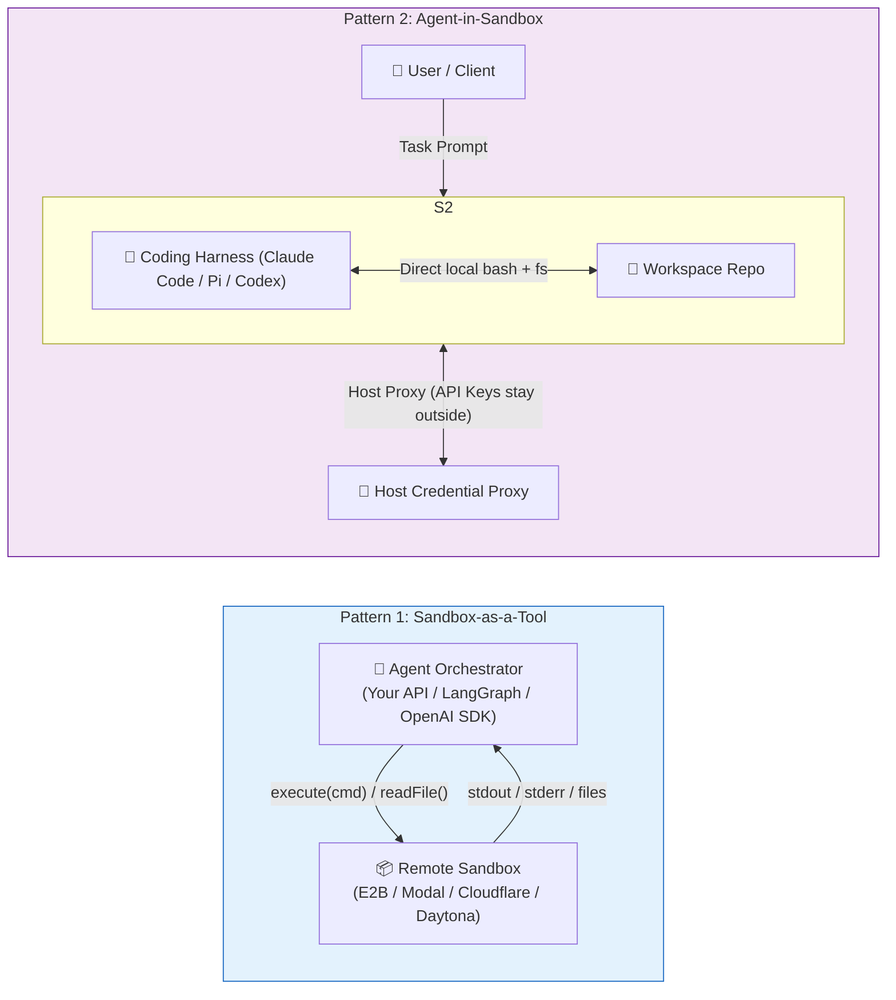
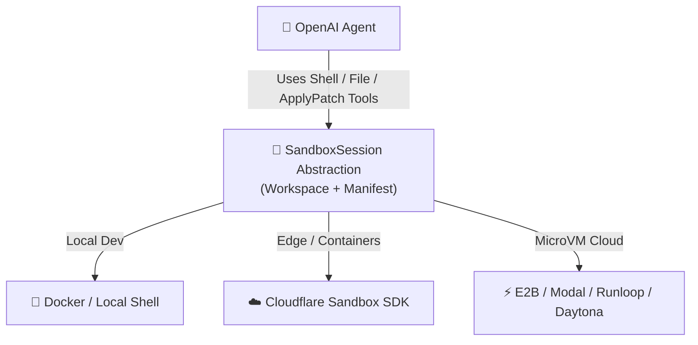

# Chapter 10 — Modern Agent Sandbox Architectures & Platform Selection

> **Lecture 10 (Old L09) · Chapter 10 of 10** · Level: 🟡 Intermediate → 🟠 Advanced
> **Prerequisites:** [Chapter 05 — Workspace Sandboxing & Agent Security](./05_Workspace_Sandboxing_and_Agent_Security.md)
> **References:**
> - [LangChain — How to Choose the Right Sandbox for Your Agent](https://www.langchain.com/blog/how-to-choose-the-right-sandbox-for-your-agent)
> - [Docker AI Sandboxes Documentation](https://docs.docker.com/ai/sandboxes/)
> - [OpenAI Agents SDK — Sandboxes Guide](https://developers.openai.com/api/docs/guides/agents/sandboxes)
> - [Mastra — Best AI Agent Sandbox Platforms](https://mastra.ai/articles/best-ai-agent-sandbox-platforms)

---

## 10.1 Why Path Jails Are Not Enough

In [Chapter 05](./05_Workspace_Sandboxing_and_Agent_Security.md), we built `safePath` — an in-process filesystem jail that stops an agent from reading `/etc/passwd` or escaping `workspace/`. That works when the agent only calls **your** TypeScript `readFile` / `writeFile` tools.

The moment an agent needs to:
- Run `npm test`, `pytest`, `pip install`, or arbitrary bash scripts,
- Start a local dev server and inspect it,
- Clone a repository, compile code, or run Docker builds,

an in-process path check **breaks down**: a child process can spawn symlinks, fork bombs, open raw sockets to cloud metadata (`169.254.169.254`), or read environment secrets (`process.env.OPENAI_API_KEY`).

Modern AI engineering solves this with **dedicated Agent Sandboxes** — isolated, programmable compute environments purpose-built for untrusted LLM execution.

---

## 10.2 The Two Core Agent Sandbox Topologies

When architecting an agent with a sandbox, there are **two fundamentally different ways** to wire the brain (LLM loop) to the hands (sandbox):

| Dimension | Pattern 1: **Sandbox-as-a-Tool** | Pattern 2: **Agent-in-Sandbox** |
| :--- | :--- | :--- |
| **Where the agent loop runs** | Outside the sandbox (your backend / serverless worker) | Inside the sandbox alongside the repo and tools |
| **How tools execute** | RPC / HTTP calls (`sandbox.exec()`, `files.write()`) | Local shell & filesystem directly inside the VM |
| **Secret safety** | **Highest** — API keys stay on your orchestrator | Requires a **Host Credential Proxy** so LLM keys are not inside the VM |
| **Latency per tool call** | Network hop per command (~20–100 ms) | Zero-hop local execution (<1 ms) |
| **Best for** | Data analysis, multi-tenant SaaS code execution, Code Mode | Autonomous coding agents (Claude Code, Codex, Devin-style SWE agents) |

---

## 10.3 Docker AI Sandboxes (MicroVM-Backed Local & Hybrid Sandboxes)

Traditional `docker run` shares the host Linux kernel and **cannot** safely run Docker-in-Docker without `--privileged` (which gives root on the host). **[Docker AI Sandboxes](https://docs.docker.com/ai/sandboxes/)** (`docker sandbox run`) solve this for coding agents:

1. **MicroVM per workspace:** Each sandbox runs inside a lightweight hardware-virtualized microVM (not a shared-kernel container), giving strong kernel isolation on macOS, Windows, and Linux.
2. **Private Docker daemon inside the sandbox:** An agent can build images, run `docker compose up`, and run integration tests *inside* the sandbox without touching the host Docker socket.
3. **Host-side Credential & Network Proxy:** LLM API keys and Git credentials are injected by a proxy *outside* the microVM — even if prompt-injected code inspects `env`, it never sees raw production secrets.
4. **Synced workspace:** Only the explicitly mounted project directory is shared between host and microVM.

---

## 10.4 OpenAI Agents SDK Sandbox Abstraction

The **[OpenAI Agents SDK Sandboxes](https://developers.openai.com/api/docs/guides/agents/sandboxes)** architecture standardizes how agents interact with isolated workspaces so your agent code stays **provider-agnostic**:

Key primitives in this abstraction:
- **`Workspace` / `SandboxSession`:** Binds an agent run (or conversation `thread_id`) to a persistent filesystem and shell session.
- **`Manifest` / Snapshots:** Declaratively captures the base image, pre-installed packages, and repo state so cold starts resume in milliseconds rather than re-running `npm install`.
- **Pluggable Providers:** Swap between local Docker sandboxes during development and cloud sandboxes (Cloudflare Sandbox, E2B, Modal, Daytona) in production without rewriting agent prompts or tool schemas.

---

## 10.5 Modern Agent Sandbox Platform Selection Matrix

Choosing the wrong sandbox wastes either latency (multi-second cold starts on every tool call) or security (shared kernels for untrusted code):

| Platform | Isolation Boundary | Typical Boot Time | Best Workload | State / Snapshots | Network & Secrets Model |
| :--- | :--- | :--- | :--- | :--- | :--- |
| **Cloudflare Dynamic Workers** | V8 Isolate | **~2–5 ms** | High-frequency JS/TS Code Mode (L31) | Stateless per call | `globalOutbound: null` + Host RPC proxy |
| **Cloudflare Sandbox SDK (GA)** | Durable Object + Linux Container | **~1–2 s** (warm sleep/wake) | Full Linux, Python/bash, git, preview URLs | Persistent disk + sleep/wake | Worker outbound handlers; secrets stay in Worker |
| **E2B** | Firecracker MicroVM | **~150 ms** (from snapshot) | Untrusted Python/JS code interpreter, data science | Memory + disk snapshots | Configurable egress allow-lists |
| **Modal Sandboxes** | gVisor / Serverless Container | **~1–3 s** | GPU workloads, ML evals, batch Python | Volume mounts + image cache | Serverless secrets & VPC egress |
| **Daytona** | Container / VM Workspaces | **<200 ms** | Stateful SWE coding workspaces, Git repos | Persistent workspace snapshots | Isolated workspace networking |
| **Docker AI Sandboxes** | MicroVM + Private Dockerd | **~1–3 s** (local) | Local/hybrid coding agents needing `docker compose` | Workspace sync + VM state | Host proxy injects auth; egress policy |
| **AIO Sandbox (`agent-infra/sandbox`)** | Container (Browser + Shell + VNC) | **~2–4 s** | Computer-use + Browser + Shell in one workspace (L30) | Shared container volume | Exposed via unified MCP / REST |

### The 4-Question Selection Checklist
1. **Do you only need JS/TS against typed APIs?** → Use **V8 Isolates (Dynamic Workers)** for ~2 ms boot and zero container overhead.
2. **Do you need untrusted Python, bash, or OS binaries?** → Use **MicroVMs (E2B / Firecracker / Kata)** or **Cloudflare Sandbox SDK**.
3. **Does the agent need a real browser + terminal + IDE together?** → Use an **All-in-One Sandbox (`agent-infra/sandbox`)** (covered in Lecture 30).
4. **Does the agent need to run `docker build` / `docker compose` locally?** → Use **Docker AI Sandboxes** (`docker sandbox run`).

---

## 10.6 Common Mistakes & Key Takeaways

### Common Mistakes
- **Putting API keys in sandbox `env`:** Prompt-injected code running `printenv` will immediately exfiltrate them. Always use a **host-side RPC or HTTP proxy**.
- **Booting a full Linux container for simple JSON filtering:** Costs 1–3 s per call when a V8 isolate takes ~3 ms.
- **Treating `docker run` as multi-tenant safe:** Standard containers share the host kernel; untrusted LLM code requires **microVMs** (Firecracker, Kata, Docker AI Sandboxes) or **user-space kernels** (`gVisor`).

### Key Takeaways
1. **Pick the topology first:** *Sandbox-as-a-Tool* maximizes secret isolation; *Agent-in-Sandbox* maximizes local coding velocity.
2. **Match isolation to threat:** V8 isolates for JS/TS API glue, gVisor/Containers for controlled workloads, Firecracker/MicroVMs for arbitrary untrusted code.
3. **Use a `SandboxProvider` abstraction** (like OpenAI Agents SDK's `SandboxSession`) so you can run Docker locally and E2B/Cloudflare/Modal in production.

