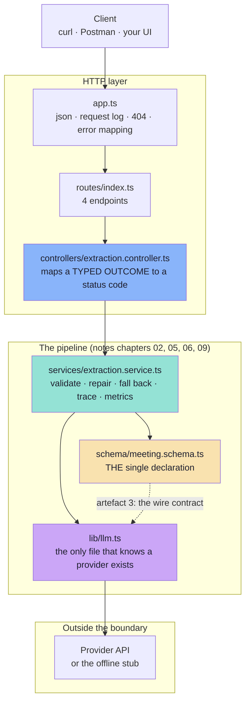
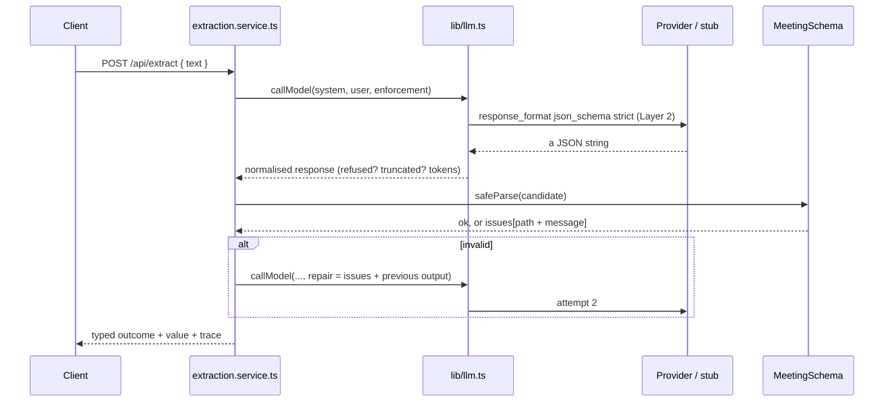

# Chapter 00: Overview, Architecture & File Structure

> **Chapter goal:** understand *what* this codebase is, *why* it is deliberately small, how one sentence of
> human text travels through it, and which file belongs to which notes chapter — before reading a line of code.
> **Notes chapters covered:** all of 01–09 (this is the map).

---

## 0.1 What this codebase is

This is the **minimum working structured-output service** that proves the Lecture 10 notes. It is the roadmap's
build task — *"a validated extraction service with a repair loop and a metrics table showing validity per
enforcement rung"* — reduced to the parts the notes actually explain, and wrapped in an HTTP API so every claim is
observable with `curl`.

| Feature | Where it lives | Notes chapter |
| :--- | :--- | :--- |
| **One declaration → three artefacts** (type · validator · wire contract) | `src/schema/meeting.schema.ts` | 02 §02.6 |
| The **form analogy** (the application writes the slots) | `src/schema/meeting.schema.ts` | 02 §02.3 |
| **Schema design for LLMs** — enum, required+nullable, closed objects, units in names, `description`, reasoning field first | `src/schema/meeting.schema.ts` | 04 §04.4–§04.12 |
| The **enforcement ladder** (`native_schema` > `json_mode` > `instruction`) | `src/lib/llm.ts` | 05 §05.5, §05.7 |
| The **strict-mode silent limits** (`minimum`, `pattern`, `format`, `default` are NOT enforced by the decoder) | `src/schema/meeting.schema.ts` → `SILENT_LIMITS` | 05 §05.4.3 |
| **One adapter, many providers, always validated** | `src/lib/llm.ts` | 05 §05.11 |
| The **boundary rule** + **structural validation** | `src/services/extraction.service.ts` | 06 §06.1, §06.5 |
| **Semantic validation** with `block` / `review` severities | `src/services/extraction.service.ts` | 06 §06.6 |
| The **bounded repair loop** and the **repair prompt** | `src/services/extraction.service.ts` | 06 §06.7, §06.8 |
| The **fallback ladder** ending in a **degraded object** | `src/services/extraction.service.ts` | 06 §06.9 |
| **Refusal / truncation as typed outcomes** | `src/services/extraction.service.ts` | 06 §06.10 |
| One **trace per attempt** (paths and types, never values) | `src/services/extraction.service.ts` | 09 §09.6 |
| **First-pass validity · repair rate · issue distribution · cost** | `src/services/extraction.service.ts` | 09 §09.2, §09.5 |

| Rule followed | Why |
| :--- | :--- |
| One notes chapter → one file (mostly) | You can read the schema without reading the loop |
| One declaration, three derived artefacts | Chapter 02 §02.6 — anything written twice will drift |
| The validator is the ONLY place that sees raw model text | Chapter 06 §06.1 corollary 2 — one boundary, one policy |
| Every model failure is a typed value, never a throw | Chapter 06 §06.10 — a thrown exception cannot be measured |
| Enforcement is chosen in one file | Chapter 05 §05.11.1 — upgrading a rung is a config change |
| Every comment names its chapter and section | The code is *evidence* for the notes, not a second curriculum |
| Nothing is a black box | Every claim the notes make (the enum drift, the wrong type, the repair, the refusal, the truncation, the review flag) is reachable through one endpoint |

**What it is not:** no database, no auth, no durable queue, no golden-set runner, no dashboard. Those belong to
other lectures. Here we answer only: *how do I make a probabilistic component's output something a program can
trust — and how do I prove it?*

> **It runs with no API key.** With an empty `OPENAI_API_KEY` the service boots in **OFFLINE mode** and every
> endpoint still works against a deterministic stub. The stub deliberately makes two classic mistakes on the first
> attempt — a **wrong type** (`"30"` instead of `30`) and an **enum drift** (`"one-to-one"` instead of
> `ONE_ON_ONE`) — and corrects both when the repair prompt arrives. That is the failure taxonomy of chapter 03,
> made live. Put a real key in the `.env` and the same code path calls the real provider; nothing else changes.

---

## 0.2 Architecture



Read it as one sentence: **the schema declares the shape, the adapter enforces it as strongly as it can, the
service validates and repairs, and the controller reports a typed outcome.**

---

## 0.3 One sentence, end to end

The user types:

```text
Schedule a Docker discussion with Rahul tomorrow at 4 PM for 30 minutes
```



The five steps, in the notes' language:

| Step | Code | Notes |
| :--- | :--- | :--- |
| 1 · Declare | `MeetingSchema` | Chapter 02 §02.6 — one declaration, three artefacts |
| 2 · Enforce | `callModel` + `chooseEnforcement` | Chapter 05 §05.7 — the strongest rung available |
| 3 · Validate | `parseCandidate` + `semanticChecks` | Chapter 06 §06.5, §06.6 — shape, then meaning |
| 4 · Repair / fall back | the loop + `degradedMeeting` | Chapter 06 §06.7, §06.9 |
| 5 · Measure | `record` + `metrics` | Chapter 09 §09.2, §09.6 |

---

## 0.4 File structure

```text
Basic Code/
├── .env                        # your local configuration (git-ignored)
├── .env.example                # the same keys, with every knob explained
├── .gitignore
├── package.json                # express · zod · zod-to-json-schema · openai · tsx · typescript
├── package-lock.json
├── tsconfig.json               # ES2022 · NodeNext · strict
├── implementations guide/      # ← you are here
│   ├── 00_Overview_and_File_Structure.md
│   ├── 01_Project_Setup_and_Environment.md
│   ├── 02_Config_and_Types.md
│   ├── 03_The_Schema_Three_Artefacts.md
│   ├── 04_The_Model_Layer_and_Enforcement.md
│   ├── 05_The_Extraction_Service.md
│   ├── 06_The_API_Surface.md
│   └── 07_Running_and_Verifying.md
└── src/
    ├── server.ts                          # boot, banner, graceful shutdown
    ├── app.ts                             # express wiring + the error boundary
    ├── config/config.ts                   # zod-validated env + the ladder + the policy
    ├── types/extraction.types.ts          # Issue · Outcome · Trace · Metrics
    ├── schema/meeting.schema.ts           # THE single declaration (all three artefacts)
    ├── lib/llm.ts                         # enforcement selection + the provider adapter
    ├── services/extraction.service.ts     # the loop, the checks, the traces, the metrics
    ├── controllers/extraction.controller.ts
    ├── middleware/validate.ts             # request-shape validation
    └── routes/index.ts                    # the 4 endpoints
```

### 0.4.1 Which file belongs to which chapter

| File | Notes chapters | Read it when you want to know… |
| :--- | :--- | :--- |
| `config/config.ts` | 05 §05.7, 06 §06.6, 09 §09.5 | …which knobs exist and what they mean |
| `types/extraction.types.ts` | 06 §06.5, §06.10, 09 §09.6 | …what an outcome and a trace look like |
| `schema/meeting.schema.ts` | **02, 04** | …how one declaration produces a type, a validator and a wire contract |
| `lib/llm.ts` | **05** | …how enforcement is chosen and how a provider is hidden |
| `services/extraction.service.ts` | **06, 09** | …the loop, the severities, the ladder, the metrics |
| `controllers/extraction.controller.ts` | 06 §06.10 | …how each outcome becomes an HTTP status |
| `middleware/validate.ts` | 07 §07.9 | …that the request body is untrusted input too |
| `app.ts` / `server.ts` | 06 §06.1 | …that almost nothing can reach the error handler |
| `routes/index.ts` | — | …the four endpoints |

---

## 0.5 The four endpoints

| Method | Path | What it proves | Notes chapter |
| :--- | :--- | :--- | :--- |
| `GET` | `/api/health` | Which enforcement rung is active, and **why**; the silent limits; the semantic policy | 05 §05.4.3, §05.7 |
| `GET` | `/api/schema` | The wire contract (artefact 3), the closed set, and why no unions are used | 02 §02.6, 04 §04.12.10 |
| `POST` | `/api/extract` | The whole pipeline: validate → repair → accept, or degrade | 06 §06.2 |
| `GET` | `/api/metrics` | First-pass validity, repair rate, issue distribution, cost | 09 §09.2, §09.5 |

---

## 0.6 The outcome → status table

The controller's only interesting decision. It is a **product** decision, not a technical one.

| Outcome | HTTP | Why that status |
| :--- | :--- | :--- |
| `ok` | `200` | The happy path |
| `repaired` | `200` | Usable — the repair is reported in the body, not as an error |
| `degraded` | `206` | *Partial Content*: a valid object with explicit unknowns |
| `refused` | `422` | The model declined. **Do not retry** (chapter 06 §06.10.1) |
| `truncated` | `502` | The provider cut the output; raise the budget or shrink the schema |
| `invalid` | `502` | Repairs exhausted; the object never became usable |

> Note what is **absent**: no `500` for a model failure. A refusal is an outcome, not a bug — and a system that
> cannot say *why* it failed cannot route the failure or measure it (chapter 06 §06.10).

---

## 0.7 What you should see when you run it

**The clean case — chapter 06 §06.2 step 5:**

```text
POST /api/extract  "Schedule a Docker discussion with Rahul tomorrow at 4 PM for 30 minutes"
-> ok · 1 attempt · title "Docker" · startIso <tomorrow>T16:00 · durationMinutes 30 (a NUMBER)
```

**The repair — chapter 03 §03.2 failures #7 and #9, fixed by chapter 06 §06.7:**

```text
POST /api/extract  "Schedule a one to one with Priya tomorrow at 2 PM in zoom"
-> repaired · 2 attempts
   issues[0] durationMinutes: Expected number, received string      [invalid_type]
   issues[1] type: Invalid enum value ... received 'one-to-one'     [invalid_enum_value]
   value: durationMinutes 30 (a number) · type ONE_ON_ONE
```

**The terminal outcomes — chapter 06 §06.10:**

```text
POST /api/extract  "What is the weather in Delhi?"                  -> 422 refused
POST /api/extract  "Schedule a TRUNCATE meeting with Sam ..."       -> 502 truncated
```

**The two severities — chapter 06 §06.6.1:**

```text
POST /api/extract  "Schedule a team standup with Ana tomorrow at 10 AM for 300 minutes"
-> ok (accepted)  but semanticFlags: ["durationMinutes: Duration exceeds the 240-minute policy"]
```

**The metrics table — the lecture's gate, chapter 09 §09.2:**

```text
firstPassValidityRate 0.4   repairRate 0.2   finalFailureRate 0    refusalRate 0.2
issueDistribution: durationMinutes :: invalid_type (2) · type :: invalid_enum_value (2) · (root) :: truncated (1)
byEnforcement: native_schema -> validityRate 0.4
```

The last line is the one the gate asks for: **validity dimensioned by enforcement rung.**

---

**Next:** [Chapter 01 — Project Setup & Environment](./01_Project_Setup_and_Environment.md)


