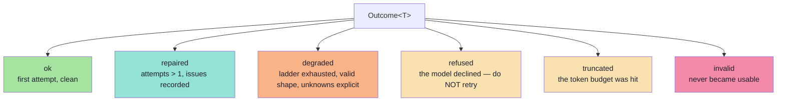

# Chapter 02: Config & Types

> **Chapter goal:** see how every knob becomes a validated, frozen value at boot — and how the *vocabulary* of the
> lecture (outcome, issue, severity, trace) is expressed as types.
> **Notes chapters covered:** 05 §05.7 (the ladder), 06 §06.5–§06.6 (issues and severities), 06 §06.10 (outcomes),
> 09 §09.2 and §09.6 (metrics and traces).

---

## 2.1 `src/config/config.ts` (full file)

```ts
import dotenv from 'dotenv';
import { z } from 'zod';

dotenv.config();

/** Chapter 05 §05.5 — one endpoint per provider. All three speak the OpenAI dialect. */
export const PROVIDER_ENDPOINTS = {
  openai: 'https://api.openai.com/v1',
  groq: 'https://api.groq.com/openai/v1',
  ollama: 'http://localhost:11434/v1',
} as const;

/**
 * Chapter 05 §05.7 — the enforcement ladder, strongest first.
 *
 * Read the ladder as the answer to one question: *what does the decoder
 * enforce, and what is left to me?* Nothing below `native_schema` removes the
 * need for the validator — which is why `extraction.service.ts` validates on
 * every path.
 */
export const ENFORCEMENT_LADDER = ['native_schema', 'json_mode', 'instruction'] as const;

export type EnforcementName = (typeof ENFORCEMENT_LADDER)[number];

const envSchema = z.object({
  PORT: z.coerce.number().int().default(8100),

  // Chapter 05 §05.5 — which model, and therefore which enforcement is available.
  AI_PROVIDER: z.enum(['openai', 'groq', 'ollama']).default('openai'),
  AI_MODEL: z.string().min(1).default('gpt-4o-mini'),
  // Chapter 03 §03.3.1 — extraction wants determinism, not creativity.
  AI_TEMPERATURE: z.coerce.number().min(0).max(2).default(0),

  // Chapter 05 §05.7 — `auto` = strongest rung the provider supports.
  ENFORCEMENT: z.enum(['auto', ...ENFORCEMENT_LADDER]).default('auto'),

  // Chapter 03 §03.2 failure #11 — truncation is a known failure, so budget for it.
  MAX_TOKENS: z.coerce.number().int().min(64).default(700),

  // Chapter 06 §06.7.1 — bound the loop. Unbounded repairs cost money and delay failure.
  MAX_REPAIRS: z.coerce.number().int().min(0).max(3).default(2),

  // Chapter 06 §06.6 — semantic policy the schema cannot express.
  POLICY_MAX_DURATION_MINUTES: z.coerce.number().int().positive().default(240),
  POLICY_MAX_DURATION_DAYS: z.coerce.number().int().positive().default(30),

  MAX_INPUT_CHARS: z.coerce.number().int().positive().default(4_000),

  OPENAI_API_KEY: z.string().default(''),
  GROQ_API_KEY: z.string().default(''),
  OLLAMA_BASE_URL: z.string().default(PROVIDER_ENDPOINTS.ollama),
});

const parsed = envSchema.safeParse(process.env);

// Fail fast, fail loud: a bad .env dies at boot, not on request one.
if (!parsed.success) {
  console.error('❌ Invalid environment configuration:');
  for (const issue of parsed.error.issues) {
    console.error(`   • ${issue.path.join('.') || '(root)'}: ${issue.message}`);
  }
  process.exit(1);
}

const env = parsed.data;

/** Which key belongs to which provider. Ollama runs locally, so it has none. */
const KEY_FOR: Record<string, 'OPENAI_API_KEY' | 'GROQ_API_KEY' | ''> = {
  openai: 'OPENAI_API_KEY',
  groq: 'GROQ_API_KEY',
  ollama: '',
};

const activeApiKey = (): string => {
  const name = KEY_FOR[env.AI_PROVIDER];
  return name ? env[name] : '';
};

/** Frozen boot-time configuration — nothing drifts at runtime. */
export const config = Object.freeze({
  ...env,
  AI_ENDPOINT: env.AI_PROVIDER === 'ollama' ? env.OLLAMA_BASE_URL : PROVIDER_ENDPOINTS[env.AI_PROVIDER],
  AI_API_KEY: activeApiKey(),
});

/**
 * Chapter 06 §06.6 — the semantic rules, as data.
 *
 * A semantic rule is anything the schema cannot express: it needs the clock,
 * another system, or another field. Keeping them in one object makes them
 * reviewable, testable and countable.
 */
export const SEMANTIC_POLICY = Object.freeze({
  maxDurationMinutes: config.POLICY_MAX_DURATION_MINUTES,
  maxDurationDays: config.POLICY_MAX_DURATION_DAYS,
  /** §06.6.1 — a duration at or above this is a `review`, not a hard failure. */
  reviewDurationMinutes: config.POLICY_MAX_DURATION_MINUTES,
});

/** Chapter 09 §09.2 — how many traces to keep so the metrics are computable. */
export const REMEMBERED_TRACES = 200;

export type Config = typeof config;
```

### Block by block

**Block 1 — `dotenv.config()`.** Runs first, before anything reads `process.env`. If this line moved below the
schema, every value would fall back to its default and the service would silently ignore your `.env`. Order is the
whole mechanism here.

**Block 2 — `PROVIDER_ENDPOINTS`.** Three providers, one dialect. This is chapter 05 §05.5 in three lines: the
*capability categories* differ (native schema, JSON mode, guided decoding), but the transport is identical — so one
SDK covers all three and the adapter has almost nothing to translate.

**Block 3 — `ENFORCEMENT_LADDER`.** The ladder as a **tuple**, not a comment. Two things follow for free:

```ts
export type EnforcementName = (typeof ENFORCEMENT_LADDER)[number];
// = 'native_schema' | 'json_mode' | 'instruction'
```

1. The type is derived from the data, so you can never add a rung to the array and forget the type.
2. It is exported to `/api/health`, so the running process can *state* which rungs exist — the choice becomes
   auditable rather than implicit.

**Block 4 — `envSchema`.** One `z.object` describing the entire environment. Notice the deliberate choices:

| Line | Choice | Why it matters |
| :--- | :--- | :--- |
| `z.coerce.number()` | Coerce, because env vars are always strings | `MAX_REPAIRS=2` becomes the number `2` |
| `.min(0).max(3)` on `MAX_REPAIRS` | Bound the bound | An unbounded repair loop is a cost incident (06 §06.7.1) |
| `z.enum(['auto', ...ENFORCEMENT_LADDER])` | Reuse the tuple | A typo like `ENFORCEMENT=stict` fails at boot, not at request one |
| `AI_TEMPERATURE` `.min(0).max(2)` | Valid range | Chapter 03 §03.3.1 — the knob exists, but its range is fixed |
| `POLICY_*` | The semantic policy | Chapter 06 §06.6 — the rules that cannot live in the schema |
| `.default(...)` everywhere | The service boots with an empty `.env` | Which is why the offline mode works out of the box |

**Block 5 — the fail-fast gate.** This is the pattern worth stealing:

```ts
const parsed = envSchema.safeParse(process.env);
if (!parsed.success) { /* print every issue */ process.exit(1); }
```

It uses `safeParse` (not `parse`) so it can print **all** the problems at once instead of dying on the first. And it
exits — it does not limp along with a half-valid configuration. A bad `.env` should be a boot failure, not a 3 a.m.
incident (chapter 09 §09.8).

**Block 6 — `activeApiKey()`.** A tiny indirection with a real purpose: it means `AI_API_KEY` is *derived from the
provider*, so a learner cannot point at Groq while carrying an OpenAI key. Note that Ollama maps to `''`, which is
what makes `isOffline()` work for local runtimes without a key.

**Block 7 — `config`.** `Object.freeze` on a spread of the validated env plus two computed fields
(`AI_ENDPOINT`, `AI_API_KEY`). Freezing is not paranoia: a mutable global config is how a request handler ends up
changing the enforcement rung for everyone. Chapter 09 §09.2's metrics are only meaningful if the configuration is
stable for the lifetime of the process.

**Block 8 — `SEMANTIC_POLICY`.** The domain rules, lifted out of the service and into data. This is deliberate
(chapter 06 §06.6): the checks are still written in code, but the *numbers* live where a product owner can review
them. Note `reviewDurationMinutes` — the name says the severity, which is the whole point of §06.6.1.

**Block 9 — `REMEMBERED_TRACES`.** A ring-buffer bound for the in-memory traces. In production these go to a
metrics store (chapter 09 §09.6); here a bound is enough, and the bound prevents an unbounded-memory bug in a lab
that runs for days.

---

## 2.2 `src/types/extraction.types.ts` (full file)

```ts
import type { EnforcementName } from '../config/config.js';

/**
 * Chapter 06 §06.5 — a validation issue is DATA, not an exception.
 *
 * `path + message` is exactly what a repair prompt needs (chapter 06 §06.8) and
 * exactly what a metric can aggregate (chapter 09 §09.2). A thrown exception can
 * be neither.
 */
export interface Issue {
  path: string;
  message: string;
  /** Chapter 06 §06.6 — `block` stops the pipeline, `review` only flags it. */
  severity: Severity;
}

export type Severity = 'block' | 'review';

/** Chapter 06 §06.3 — the eight-class taxonomy, reduced to the classes this lab can hit. */
export type FailureReason = 'refused' | 'truncated' | 'parse_error' | 'shape_error' | 'timeout';

/**
 * Chapter 06 §06.10 — outcomes are modelled explicitly.
 *
 * A system with only "success" and "exception" cannot report *why* it failed,
 * cannot route failures differently, and cannot measure anything.
 */
export type Outcome<T> =
  | { kind: 'ok'; value: T; attempts: number; enforcement: EnforcementName }
  | { kind: 'repaired'; value: T; attempts: number; issues: Issue[]; enforcement: EnforcementName }
  | { kind: 'degraded'; value: T; reason: string; attempts: number }
  | { kind: 'refused'; reason: string; attempts: number }
  | { kind: 'truncated'; raw: string; attempts: number }
  | { kind: 'invalid'; issues: Issue[]; raw: string; attempts: number };

/**
 * Chapter 09 §09.6 — one trace object per ATTEMPT.
 *
 * Note what is logged: field PATHS and error TYPES, never values. The raw output
 * may contain personal data, so it belongs in a short-retention debug store, not
 * in general application logs.
 */
export interface StructuredTrace {
  traceId: string;
  task: 'meeting_extraction';
  schemaVersion: string;
  model: string;
  attempt: number;
  enforcement: EnforcementName;
  outcome: 'ok' | 'repaired' | 'degraded' | 'refused' | 'truncated' | 'invalid';
  issues: { path: string; type: string }[];
  inputTokens: number;
  outputTokens: number;
  latencyMs: number;
  semanticFlags: string[];
}

/** Chapter 09 §09.2 — the twelve metrics, reduced to the six this lab can compute. */
export interface MetricsSnapshot {
  calls: number;
  attempts: number;
  firstPassValidityRate: number;
  repairRate: number;
  finalFailureRate: number;
  refusalRate: number;
  semanticFlagRate: number;
  p95LatencyMs: number;
  issueDistribution: { path: string; type: string; count: number }[];
  byEnforcement: Record<string, { calls: number; firstPassValid: number; validityRate: number }>;
}

/** The shape of what the model is asked to return, before validation. */
export interface RawModelResponse {
  text: string;
  refused: boolean;
  truncated: boolean;
  inputTokens: number;
  outputTokens: number;
  finishReason: string;
}
```

### Block by block

**Block 1 — `Issue` and `Severity`.** The most important two types in the file, and the smallest.

```ts
export interface Issue { path: string; message: string; severity: Severity; }
export type Severity = 'block' | 'review';
```

Why `path` and not a formatted sentence? Because of chapter 06 §06.5: the issue list must be **machine-readable**.
A `path` is what the repair prompt needs, what the metrics group by, and what a dashboard can chart. A prose
sentence is readable once and useless thereafter.

Why only two severities? Because of chapter 06 §06.6.1:

| Severity | Meaning | Action |
| :--- | :--- | :--- |
| `block` | Unusable or unsafe | Repair, then fall back |
| `review` | Plausible, needs a human | **Accept**, flag, and route to a queue |

Collapsing both into "invalid" is the classic mistake: it either over-rejects good data (a 5-hour meeting is
legal) or under-rejects bad data (a meeting in the past is not). Two severities solve both.

**Block 2 — `Outcome<T>`.** A **discriminated union**, and the shape is the lesson.



Three properties worth noting:

1. **`ok` and `repaired` both carry a `value: T`.** The caller gets a usable object either way — the distinction is
   *how hard it was to get*, which is a metric, not a branch.
2. **`degraded` also carries `value: T`.** That is the whole point of the degraded object (chapter 06 §06.9.1): the
   shape stays valid, so downstream code needs no special case.
3. **`refused` and `truncated` carry no value at all.** The type system makes it impossible to accidentally read a
   field from a response that never produced one. This is the compiler doing real work for you.

> **Why not exceptions?** Chapter 06 §06.10: a system that only has "success" and "exception" cannot report *why* it
> failed, cannot route failures differently, and cannot measure anything except a single error rate.

**Block 3 — `StructuredTrace`.** Chapter 09 §09.6, with one deliberate omission: there is **no field for the raw
text or any value**. Only `issues: { path, type }`. That is the privacy control from §09.6 — log paths and error
types, never values. The `traceId` is what lets you join to a short-retention debug store if you need the raw text.

Note `schemaVersion` and `model` are on **every** trace. Without them you cannot tell a regression from a rollout
(chapter 09 §09.2.1) — triage becomes archaeology.

**Block 4 — `MetricsSnapshot`.** Six rates, a latency percentile, and two grouped breakdowns. The one to notice is
`byEnforcement`: it is the metrics table the lecture's gate asks for, and it exists because a validity number
without the rung it was measured at is not actionable.

**Block 5 — `RawModelResponse`.** The *normalised* shape the adapter returns, so the service never sees a provider
type. `refused` and `truncated` are booleans rather than thrown errors, which is what makes chapter 06 §06.10's
"outcomes, not exceptions" real at the lowest level.

---

## 2.3 What this chapter bought you

| Before | After |
| :--- | :--- |
| "The model failed" | Six named outcomes, each with a different correct response |
| "Validation failed" | `Issue[]` with `path`, `message` and `severity` |
| "It was slow / expensive" | Per-attempt tokens and latency, joinable by `traceId` |
| "The `.env` is misconfigured" | A boot failure listing every bad key |

---

**Next:** [Chapter 03 — The Schema: Three Artefacts from One Declaration](./03_The_Schema_Three_Artefacts.md)


