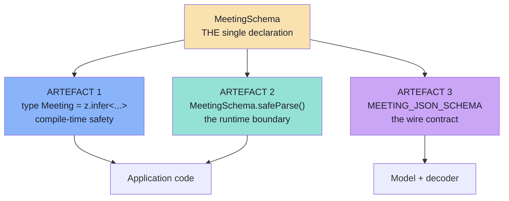
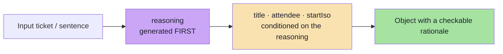
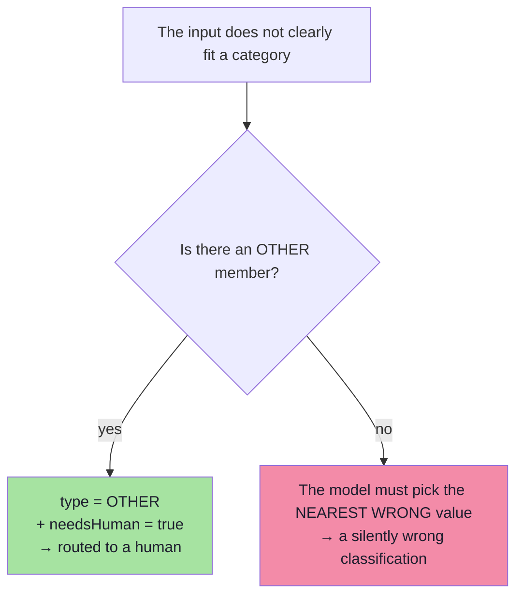

# Chapter 03: The Schema — Three Artefacts from One Declaration

> **Chapter goal:** understand the single most important idea in this lecture — *declare once, derive the rest* —
> and read every one of the twelve schema rules as a line of code.
> **Notes chapters covered:** **02 §02.3, §02.6** (the form analogy; one declaration → three artefacts) ·
> **04 §04.4–§04.12** (enums, required+nullable, closure, units in names, the reasoning field, the twelve rules) ·
> 05 §05.4.2–§05.4.3 (why `$ref` is inlined; the silent limits).

---

## 3.1 `src/schema/meeting.schema.ts` (part 1 of 2 — the imports, the constants, and the form)

```ts
import { z } from 'zod';
import { zodToJsonSchema } from 'zod-to-json-schema';

/**
 * Chapter 02 §02.6 — ONE DECLARATION, THREE ARTEFACTS.
 *
 * This file is the single source of truth. From it we derive:
 *
 *   artefact 1  the TypeScript type        -> `export type Meeting = z.infer<...>`
 *   artefact 2  the runtime validator      -> the schema object itself (`safeParse`)
 *   artefact 3  the wire contract          -> `MEETING_JSON_SCHEMA`, sent to the model
 *
 * Maintain those three by hand and they WILL drift. The classic failure is a
 * hand-written interface, a hand-pasted JSON Schema in the prompt, and a
 * hand-written validator: three documents, three authors, three bugs.
 *
 * The schema is also a FORM the application writes (chapter 02 §02.3). The model
 * fills the values; it does not get to change the slots.
 */

/** Chapter 04 §04.12 rule 12 — a version stamp, so stored objects stay interpretable. */
export const SCHEMA_VERSION = 'meeting.v1';

/**
 * Chapter 04 §04.4 — the closed set, with an escape hatch.
 *
 * Without `OTHER` the model must lie when the input does not fit, and it will
 * pick the nearest wrong value.
 */
export const MEETING_TYPES = ['ONE_ON_ONE', 'INTERVIEW', 'TEAM', 'OTHER'] as const;

/**
 * The form.
 *
 * Chapter 04 rules applied, one by one:
 *   §04.12.3  flatten by default        -> one flat object, no nesting
 *   §04.12.4  enum every closed set      -> `type`
 *   §04.12.5  required + nullable        -> `attendeeEmail`, `location`
 *   §04.12.6  close every object         -> `.strict()`
 *   §04.12.7  constrain numbers and lists-> `min`/`max` on the duration
 *   §04.12.8  normalise strings          -> `datetime()`, `email()`
 *   §04.12.9  describe every field       -> `.describe()` everywhere
 *   §04.12.10 avoid unions               -> no `oneOf`/`anyOf`
 *   §04.12.11 bound the output size      -> `max()` on every string
 *   §04.12.12 version the schema         -> `schemaVersion` as a literal
 *   §04.10    reasoning field FIRST      -> `reasoning` is the first property
 */
export const MeetingSchema = z
  .object({
    /** §04.12.12 — a `const`-equivalent: exactly one allowed value. */
    schemaVersion: z.literal(SCHEMA_VERSION),

    /**
     * §04.10 — the reasoning-field pattern.
     *
     * Order is part of the contract: because these tokens are generated BEFORE
     * the labels, the labels are conditioned on an explicit analysis instead of
     * being a reflex. Put this field last and you get a justification, not an
     * influence.
     */
    reasoning: z
      .string()
      .min(1)
      .max(280)
      .describe('One sentence: which words in the input drove this extraction. Cite them.'),

    /** §04.7 — normalised, bounded free text. */
    title: z.string().min(1).max(120).describe('Short topic of the meeting. Not the whole input.'),

    attendeeName: z.string().min(1).max(80).describe('Full name of the other participant.'),

    /**
     * §04.9 — REQUIRED + NULLABLE, the default you should reach for.
     *
     * "This key is always present; its value may be null" is one testable rule.
     * "This key may be absent" forces `undefined` checks into every consumer.
     */
    attendeeEmail: z
      .string()
      .email()
      .nullable()
      .describe('Email address if it appears in the input, otherwise null. Never invent one.'),

    /** §04.7 — a resolved, sortable instant. Never "tomorrow". */
    startIso: z
      .string()
      .datetime()
      .describe('ISO 8601 start time with timezone. Resolve relative dates ("tomorrow") against TODAY.'),

    /** §04.8 — integer + bounds, and the unit lives in the NAME. */
    durationMinutes: z
      .number()
      .int()
      .min(5)
      .max(480)
      .describe('Duration in whole minutes. Default 30 when the input does not state one.'),

    type: z
      .enum(MEETING_TYPES)
      .describe('Meeting kind. Use OTHER when the input does not clearly fit the other values.'),

    location: z.string().max(120).nullable().describe('Place if stated, otherwise null.'),

    /** §04.14.1 — abstention is representable, so guessing is unnecessary. */
    needsHuman: z.boolean().describe('True when any field required a guess or is null.'),
  })
  .strict(); // §04.12.6 -> additionalProperties: false
```

## 3.2 `src/schema/meeting.schema.ts` (part 2 of 2 — the three artefacts and the silent limits)

```ts
/**
 * ARTEFACT 1 — the TypeScript type, DERIVED and never hand-written.
 *
 * If you also write `interface Meeting` by hand, you now have two truths.
 */
export type Meeting = z.infer<typeof MeetingSchema>;

/**
 * ARTEFACT 3 — the wire contract.
 *
 * `$refStrategy: 'none'` inlines every sub-schema: several providers dislike
 * `$ref`, and a `$ref`-heavy schema can fail to compile into a grammar
 * (chapter 05 §05.4.2). The `openAi` target emits the dialect that provider's
 * strict mode expects; other providers get their own generated variant — the
 * canonical schema above never changes.
 */
export const MEETING_JSON_SCHEMA = zodToJsonSchema(MeetingSchema, {
  $refStrategy: 'none',
  target: 'openAi',
});

/**
 * Chapter 05 §05.4.3 — THE SILENT LIMITS.
 *
 * A "strict" schema is not a semantically strict schema. The decoder enforces
 * structure (type · required · enum · closure); these keywords are frequently
 * accepted and IGNORED by the grammar, so the runtime validator is the only
 * guarantee for them:
 */
export const SILENT_LIMITS = [
  'minimum / maximum      -> validated by Zod, not by the decoder',
  'minLength / maxLength  -> validated by Zod, not by the decoder',
  'pattern                -> validated by Zod, not by the decoder',
  'format (email, date-time) -> validated by Zod, not by the decoder',
  'default                -> never applied by a decoder; apply it in code',
  'cross-field rules      -> impossible for a per-token grammar',
] as const;

/** §04.12.1 — why the schema avoids unions. Shown on /api/schema so the choice is visible. */
export const NO_UNIONS_REASON =
  'A union forces the model to make a TYPE decision, which is harder than a VALUE decision. ' +
  'Prefer a wide, flat, mostly-nullable object over a narrow union.';
```

> **Note on the split.** The file is one unit; it is shown in two parts only so this guide stays readable. Artefact 2
> is not a separate line of code at all — it is `MeetingSchema` itself, used as a validator. That is the elegance of
> the pattern: the declaration *is* the validator.

### Block by block — the three artefacts



**Artefact 1 — `z.infer`.** One line, and it is the difference between a schema and a *contract*:

```ts
export type Meeting = z.infer<typeof MeetingSchema>;
```

If you also write `interface Meeting` by hand, you now have two truths. Add a field to one and not the other and the
compiler stays quiet while production breaks — exactly the drift chapter 02 §02.6 warns about.

**Artefact 2 — the schema *is* the validator.** There is no code here because none is needed. `MeetingSchema.safeParse`
is the boundary. Note the deliberate choice of `safeParse` over `parse`: `parse` throws, and chapter 06 §06.5 says
errors must be **data** — because data can be logged, counted, and turned into a repair prompt, and an exception can
only be caught and forgotten.

**Artefact 3 — the generated wire contract.** Two options, both with a reason:

| Option | Why |
| :--- | :--- |
| `$refStrategy: 'none'` | Inlines every sub-schema. Providers dislike `$ref`, and a `$ref`-heavy schema can fail to compile into a grammar (05 §05.4.2). |
| `target: 'openAi'` | Emits the dialect strict mode expects. A different provider gets a *generated variant* — the canonical schema above never changes. |

That second row is the portability advice from chapter 05 §05.4.5: **one canonical schema, N generated provider
variants.** Never hand-edit a provider's variant, because it will drift from the canonical one.

> **Verify it yourself:** `curl -s localhost:8100/api/schema | python3 -m json.tool` prints the generated JSON
> Schema, the closed set, and the silent limits — so the contract is inspectable at runtime, not just at build time.

### Block by block — the twelve rules, field by field

Each row is a rule from chapter 04 §04.12 turned into a line of code, plus the failure it prevents.

| Field | Rule applied | What it prevents |
| :--- | :--- | :--- |
| `schemaVersion: z.literal('meeting.v1')` | **12 · Version the schema** | Stored objects becoming uninterpretable after a change |
| `reasoning` **first** | **§04.10 · reasoning field first** | Reflex labels. Order is the mechanism: the tokens are generated before the labels |
| `reasoning.max(280)` | **11 · Bound the output size** | A 2,000-token rationale on every call |
| `title.min(1).max(120)` | **11 · Bound** + **9 · Describe** | The whole input echoed into `title` |
| `attendeeEmail.email().nullable()` | **5 · Required + nullable** | Invented emails; and `undefined` checks in every consumer |
| `startIso.datetime()` | **8 · Normalise strings** | `"tomorrow"` arriving where an instant is needed |
| `durationMinutes.int().min(5).max(480)` | **7 · Constrain numbers** + **units in the name** | The 30-vs-1800 ambiguity, and the 1440-minute meeting |
| `type: z.enum(MEETING_TYPES)` | **4 · Enum every closed set** | `"one-to-one"`, `"High "`, `"urgent"` — silent routing failures |
| `location.max(120).nullable()` | **5 · Required + nullable** | Two ways to say "unknown" (`""` and absent) |
| `needsHuman: z.boolean()` | **§04.14.1 · abstention** | Confident nonsense: a guess presented as a fact |
| `.strict()` | **6 · Close every object** | "Helpful" extra keys reaching storage |
| No `oneOf` / `anyOf` anywhere | **10 · Avoid unions** | A type decision where a value decision would do |
| One flat object, no nesting | **3 · Flatten by default** | Compounded failure probability and harder repairs |

### 3.2.1 The reasoning field: why first, and why capped



Two things make this work, and both are visible in the code:

1. **Order.** `reasoning` is the *first* property in the object. Because generation is autoregressive, the label
   tokens are conditioned on an explicit analysis. Move it last and you get a post-hoc justification, not an
   influence.
2. **A cap.** `.max(280)` exists because the field costs output tokens on every call (chapter 04 §04.10). An
   uncapped rationale is the easiest way to double your bill without noticing.

### 3.2.2 The escape hatch: why `OTHER` must exist



An enum without an escape hatch forces the model to **lie**, and a model that must lie will pick the nearest wrong
value with total confidence. The `OTHER` member (chapter 04 §04.4) is what makes honesty representable. Pair it with
`needsHuman` and you have a routing signal instead of a silent error.

### 3.2.3 The silent limits, as data

`SILENT_LIMITS` is a **comment that runs**. It is exported to `/api/health`, which means the claim "strict mode
does not enforce `minimum`" is verifiable at runtime rather than buried in a doc. That matters because it is the
single most expensive misunderstanding in this subject (chapter 05 §05.4.3): a team that assumes `format: email` is
enforced will ship an email field that accepts `"tomorrow"`.

| Keyword | Enforced by the decoder? | Enforced here by |
| :--- | :--- | :--- |
| `type`, `required`, `properties` | ✅ (strict mode) | Zod — but the decoder helps |
| `additionalProperties: false` | ✅ (`.strict()`) | Zod — but the decoder helps |
| `enum`, `const` | ✅ usually | Zod — but the decoder helps |
| **`min`/`max`, `minLength`/`maxLength`** | ❌ often ignored | **Zod only** |
| **`email()`, `datetime()`** (`format`) | ❌ usually annotation-only | **Zod only** |
| **`pattern`** | ⚠️ sometimes, poorly | **Zod only** |
| **`default`** | ❌ never applied | **code only** |
| **Cross-field rules** | ❌ impossible per token | **`semanticChecks()`** (chapter 05) |

> **The rule to carry forward:** structure is enforced by the decoder; **values are enforced by you.** That is why
> `parseCandidate()` and `semanticChecks()` in the service are not optional extras — they are the only guarantee for
> everything in the bottom half of that table.

---

## 3.3 The one test to write

If you write a single test for this file, write the **drift test**:

```ts
// pseudo-code — fails CI when the wire contract changes without review
it('the wire contract has not changed by accident', () => {
  expect(MEETING_JSON_SCHEMA).toMatchSnapshot();
});
```

Chapter 04 §04.15 calls this out, and it is the cheapest possible guard against the failure mode this whole chapter
is about: a schema change that silently reaches the model.

---

**Next:** [Chapter 04 — The Model Layer & Enforcement](./04_The_Model_Layer_and_Enforcement.md)


