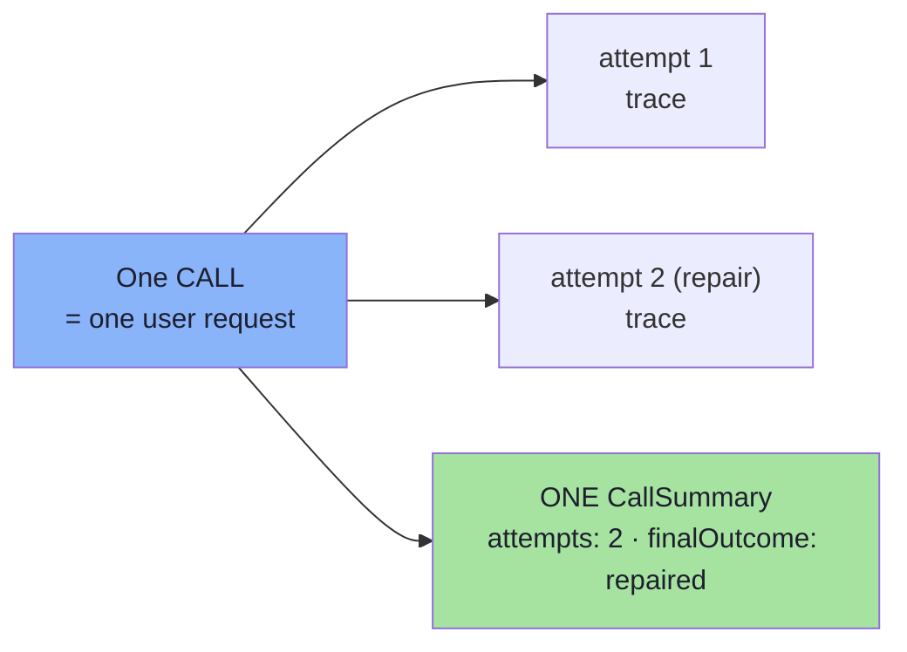
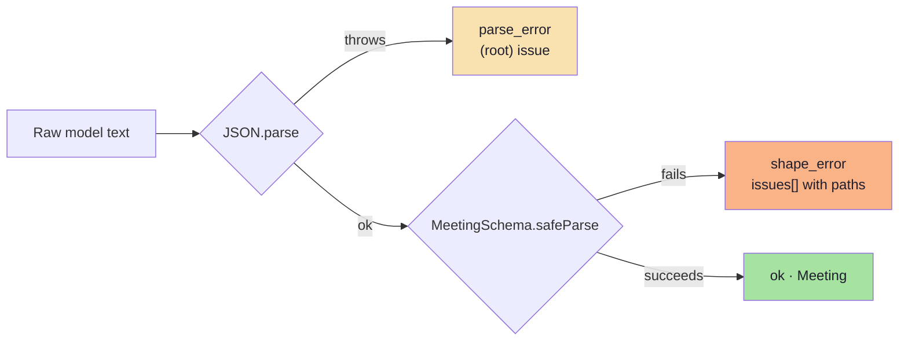
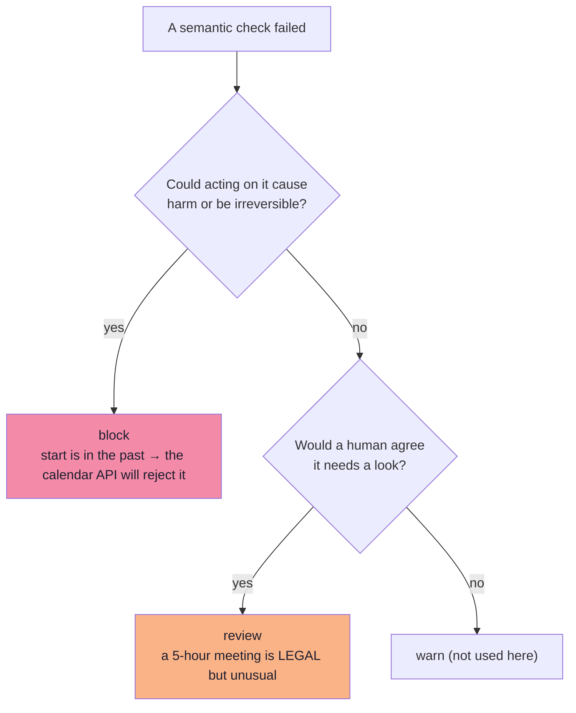
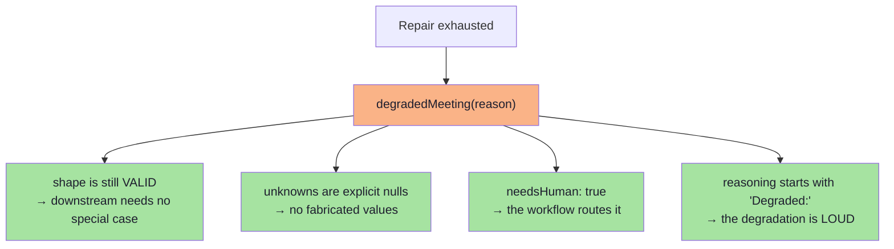
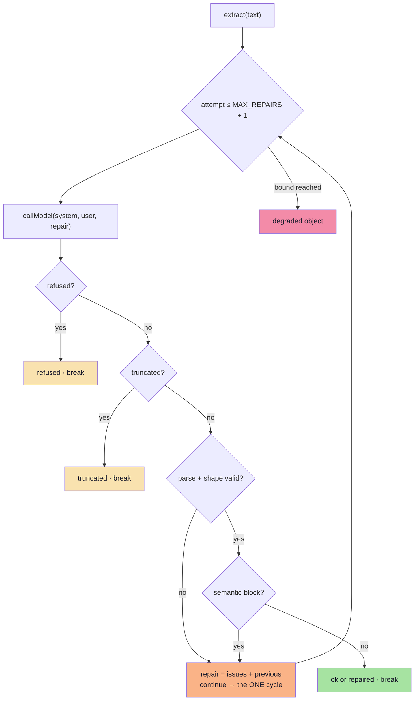

# Chapter 05: The Extraction Service — Validate, Repair, Fall Back

> **Chapter goal:** read the reliability loop as the *shape* it is — one cycle, one bound, one typed outcome per
> path — and see the two severities, the repair prompt and the degraded object in code.
> **Notes chapters covered:** **06 §06.1–§06.11** (the boundary rule, the reliability loop, the error taxonomy,
> structural vs semantic validation, severities, the repair loop and prompt, the fallback ladder, refusals and
> truncation, idempotency) · **09 §09.2, §09.5, §09.6** (metrics, cost, traces).

---

## 5.1 `src/services/extraction.service.ts` (part 1 of 3 — the boundary, the shape checks, the meaning checks)

```ts
import { REMEMBERED_TRACES, SEMANTIC_POLICY, config } from '../config/config.js';
import { SYSTEM_PROMPT, chooseEnforcement, estimate, callModel, isOffline } from '../lib/llm.js';
import { MeetingSchema, MEETING_JSON_SCHEMA, SCHEMA_VERSION, type Meeting } from '../schema/meeting.schema.js';
import type { Issue, MetricsSnapshot, Outcome, StructuredTrace } from '../types/extraction.types.js';

/**
 * Chapter 06 — THE DETECTION AND RECOVERY HALF.
 *
 * One rule from which everything here follows:
 *
 *   > No unvalidated model output may cross into application logic.
 *
 * The three corollaries are visible in this file:
 *   1. the validator is not optional — it runs on EVERY path, even the happy one;
 *   2. the boundary is a SINGLE place — `extract()` is the only entry point;
 *   3. failure is a DESIGNED path — every outcome is a typed value.
 */

/** Chapter 09 §09.2 — the traces and per-call summaries the metrics are computed from. */
const traces: StructuredTrace[] = [];

interface CallSummary {
  traceId: string;
  attempts: number;
  finalOutcome: StructuredTrace['outcome'];
  enforcement: StructuredTrace['enforcement'];
  totalLatencyMs: number;
  flagged: boolean;
}

const calls: CallSummary[] = [];

const push = <T>(list: T[], item: T, limit: number): void => {
  list.push(item);
  if (list.length > limit) list.shift();
};

/**
 * Chapter 06 §06.5.2 — the validator's contract, made explicit.
 *
 * Deterministic · total (never throws) · cheap · explainable · side-effect free.
 * Note what it does NOT do: it never "cleans up" data. Coercing "30" into 30
 * would convert a detectable failure into a silent mutation — the exact class of
 * bug this lecture exists to remove.
 */
export const toIssues = (error: { issues: { path: (string | number)[]; message: string; code: string }[] }): Issue[] =>
  error.issues.map((issue) => ({
    path: issue.path.join('.') || '(root)',
    message: `${issue.message} [${issue.code}]`,
    severity: 'block' as const,
  }));

/**
 * Chapter 06 §06.2 step 2 and 3a — parse, then validate the SHAPE.
 *
 * Returns a discriminated result rather than throwing, because errors are data:
 * they will be logged, counted and turned into a repair prompt.
 */
export const parseCandidate = (
  raw: string,
): { kind: 'ok'; value: Meeting } | { kind: 'parse_error' | 'shape_error'; issues: Issue[] } => {
  let json: unknown;
  try {
    json = JSON.parse(raw);
  } catch (error) {
    return {
      kind: 'parse_error',
      issues: [{ path: '(root)', message: `Not parseable JSON: ${String(error)}`, severity: 'block' }],
    };
  }

  const result = MeetingSchema.safeParse(json);
  if (!result.success) return { kind: 'shape_error', issues: toIssues(result.error) };

  return { kind: 'ok', value: result.data };
};

/**
 * Chapter 06 §06.6 — the SEMANTIC layer, which is where the value lives.
 *
 * Structural validation is the same in every project. Semantic validation needs
 * the world: a clock, another system, another field. Three reasons the schema
 * cannot do this (chapter 06 §06.4.1):
 *   - the schema has no clock      -> "must be in the future"
 *   - the schema has no other system -> "the attendee must exist"
 *   - the schema has no cross-field logic -> "INTERVIEW implies >= 30 minutes"
 */
export const semanticChecks = (meeting: Meeting, ctx: { now: Date }): Issue[] => {
  const issues: Issue[] = [];
  const start = new Date(meeting.startIso);
  const horizonMs = SEMANTIC_POLICY.maxDurationDays * 24 * 60 * 60 * 1000;

  // Temporal: a start time in the past is unusable — `block`.
  if (start.getTime() <= ctx.now.getTime()) {
    issues.push({ path: 'startIso', message: 'Meeting start is not in the future', severity: 'block' });
  }

  // Temporal: absurdly far in the future usually means a mis-parsed year — `review`.
  if (start.getTime() - ctx.now.getTime() > horizonMs) {
    issues.push({
      path: 'startIso',
      message: `Start is more than ${SEMANTIC_POLICY.maxDurationDays} days away`,
      severity: 'review',
    });
  }

  // Numeric plausibility: long but legal durations need a human — `review`.
  if (meeting.durationMinutes > SEMANTIC_POLICY.reviewDurationMinutes) {
    issues.push({
      path: 'durationMinutes',
      message: `Duration exceeds the ${SEMANTIC_POLICY.reviewDurationMinutes}-minute policy`,
      severity: 'review',
    });
  }

  // Cross-field consistency — `block`.
  if (meeting.type === 'INTERVIEW' && meeting.durationMinutes < 30) {
    issues.push({ path: 'durationMinutes', message: 'Interviews must be at least 30 minutes', severity: 'block' });
  }

  // §04.14.1 — the abstention flag must be honest. Claiming confidence with a
  // null email is exactly the over-confident object this lecture warns about.
  if (meeting.attendeeEmail === null && meeting.needsHuman === false) {
    issues.push({
      path: 'needsHuman',
      message: 'needsHuman must be true when a field is null',
      severity: 'block',
    });
  }

  return issues;
};
```

### Block by block — part 1

**Block 1 — the boundary rule as a file header.** The comment is not decoration; it states the invariant the whole
file exists to enforce, and the three corollaries are each visible in a specific function:

| Corollary (chapter 06 §06.1) | Where you can see it |
| :--- | :--- |
| "The validator is not optional" | `parseCandidate` is called on **every** path, including the success path |
| "The boundary is a single place" | `extract()` is the only exported entry point that touches raw model text |
| "Failure is a designed path" | the return type is `Outcome<Meeting>` — six named kinds, never a throw |

**Block 2 — the two in-memory stores.** `traces` (per attempt) and `calls` (per call). The split is deliberate and
it is the thing most people get wrong:



| Store | Granularity | Answers |
| :--- | :--- | :--- |
| `traces` | per **attempt** | What failed, where, how long each attempt took, how many tokens |
| `calls` | per **call** | Was this request valid on the first try? Did it need a repair? How did it end? |

> **The metrics bug this prevents.** If you remember a summary per *attempt*, then a repaired call is counted twice:
> `calls` is inflated, first-pass validity is deflated, and the repair rate is wrong. It is the most common mistake
> in structured-output metrics, and it is invisible unless you check that `attempts ≥ calls`. In the verified run:
> **calls 5, attempts 6** — the extra attempt is the one repair. That is the relationship to assert.

**Block 3 — `push()`.** A bounded ring buffer. In production these go to a metrics store (chapter 09 §09.6); here a
bound keeps a long-running lab from leaking memory.

**Block 4 — `toIssues()`.** The translation from a Zod error into the lecture's `Issue` vocabulary. Three details:

```ts
path: issue.path.join('.') || '(root)'      // "durationMinutes" or "(root)" for a whole-document failure
message: `${issue.message} [${issue.code}]` // "Expected number, received string [invalid_type]"
severity: 'block' as const                  // a structural failure is ALWAYS a block
```

Why append `[${issue.code}]`? Because chapter 09 §09.2's **issue distribution** groups by a short, stable *type*. The
`code` is exactly that type — and the verified metrics output shows it working:

```text
durationMinutes :: invalid_type          (2)
type            :: invalid_enum_value    (2)
```

That is the difference between "the model is unreliable" and "`durationMinutes` arrives as a string 4% of the time".

Why `severity: 'block'` unconditionally? Because a **structural** failure is never a matter of judgement. The
`review` severity only ever comes from `semanticChecks` (§06.6.1), where a human opinion is the right answer.

**Block 5 — `parseCandidate()`.** The two gates of chapter 06 §06.2 (steps 2 and 3a) in one function, and the
**only** place raw model text is touched.



Note the deliberate use of `safeParse`, never `parse`. `parse` throws; `safeParse` returns
`{ success, error }`. Chapter 06 §06.5: errors must be **data**, because data can be logged, counted and turned into
a repair prompt — and chapter 03 §03.8 taught us what happens when you try to *parse* your way out of the problem
instead.

**Block 6 — `semanticChecks()`.** Where the value lives, and where a Forward Deployed Engineer earns their salary
(chapter 06 §06.6). Five rules, each one impossible for a schema to express:

| # | Rule | Severity | Why the schema cannot do it |
| :--: | :--- | :--- | :--- |
| 1 | `startIso` must be in the future | **block** | The schema has no clock |
| 2 | Not more than 30 days away | `review` | Needs "now" and a policy horizon |
| 3 | Duration ≤ 240 minutes | `review` | Needs a business policy |
| 4 | `INTERVIEW` implies ≥ 30 minutes | **block** | Needs *two fields at once* |
| 5 | `needsHuman` must be true when a field is null | **block** | Cross-field, and it is an honesty rule |

**Why severities are assigned the way they are.** This is the §06.6.1 decision tree, applied:



Rule 3 is the important one to internalise: a 300-minute meeting **passes** the schema (480 is the maximum) and is
**accepted** by the service — with a flag. That is what stops the pipeline over-rejecting good data. Try it:

```text
POST /api/extract  "Schedule a team standup with Ana tomorrow at 10 AM for 300 minutes"
-> ok (accepted!)   semanticFlags: ["durationMinutes: Duration exceeds the 240-minute policy"]
```

Rule 5 is a small honesty check that catches a specific real failure: the model returning
`attendeeEmail: null, needsHuman: false` — an object that *claims* confidence while abstaining on a field. Chapter
04 §04.14.1 warns that self-reported confidence is not calibrated; this rule at least makes it *consistent*.

---

## 5.2 `src/services/extraction.service.ts` (part 2 of 3 — the repair prompt, the degraded object, the trace)

```ts
/**
 * Chapter 06 §06.8 — THE REPAIR PROMPT.
 *
 * Four ingredients, and each one matters:
 *   1. the machine-readable issues (path + expected vs received);
 *   2. the previous output, so the model EDITS rather than regenerates;
 *   3. a scoping instruction ("fix only these fields");
 *   4. a format instruction ("return the object only").
 *
 * Anti-pattern it avoids: restating the original input in full. It is already in
 * the conversation; repeating it dilutes attention and doubles the cost.
 */
export const buildRepairPrompt = (args: { previous: string; issues: Issue[] }): string =>
  [
    'Your previous output failed validation against the required schema.',
    '',
    'Validation errors:',
    ...args.issues.map((issue) => `- ${issue.path}: ${issue.message}`),
    '',
    'Previous output:',
    args.previous,
    '',
    'Fix ONLY the fields listed above. Do not add, remove or rename any fields.',
    'Return the corrected object only.',
  ].join('\n');

/**
 * Chapter 06 §06.9.1 — THE DEGRADED OBJECT.
 *
 * The most under-used rung of the fallback ladder, and often the best one. The
 * SHAPE stays valid (so downstream code needs no special case), every unknown is
 * an explicit `null` rather than a guess, and the degradation is LOUD: it is in
 * the object, not only in a log.
 */
export const degradedMeeting = (reason: string): Meeting => ({
  schemaVersion: SCHEMA_VERSION,
  reasoning: `Degraded: ${reason}`,
  title: 'Untitled meeting',
  attendeeName: 'Unknown',
  attendeeEmail: null,
  startIso: new Date(Date.now() + 60 * 60 * 1000).toISOString(),
  durationMinutes: 30,
  type: 'OTHER',
  location: null,
  needsHuman: true,
});

/** Chapter 09 §09.6 — one trace per ATTEMPT. Paths and types, never values. */
const record = (args: {
  traceId: string;
  attempt: number;
  enforcement: StructuredTrace['enforcement'];
  outcome: StructuredTrace['outcome'];
  issues: Issue[];
  inputTokens: number;
  outputTokens: number;
  latencyMs: number;
  semanticFlags: string[];
}): void => {
  push(
    traces,
    {
      traceId: args.traceId,
      task: 'meeting_extraction',
      schemaVersion: SCHEMA_VERSION,
      model: isOffline() ? 'offline-stub' : config.AI_MODEL,
      attempt: args.attempt,
      enforcement: args.enforcement,
      outcome: args.outcome,
      issues: args.issues.map((issue) => ({
        path: issue.path,
        type: issue.message.match(/\[(\w+)\]/)?.[1] ?? 'semantic',
      })),
      inputTokens: args.inputTokens,
      outputTokens: args.outputTokens,
      latencyMs: args.latencyMs,
      semanticFlags: args.semanticFlags,
    },
    REMEMBERED_TRACES,
  );
};

const remember = (summary: CallSummary): void => push(calls, summary, REMEMBERED_TRACES);
```

### Block by block — part 2

**Block 1 — `buildRepairPrompt()`.** Compare it against the weak version from chapter 06 §06.8:

| Weak | Strong (this function) | Why it matters |
| :--- | :--- | :--- |
| `"That was not valid JSON. Try again."` | The issues, with `path` and reason | A blind retry samples the same distribution |
| — | The previous output, verbatim | The model **edits** instead of regenerating |
| — | "Fix ONLY the fields listed above" | Prevents collateral changes that break *other* fields |
| — | "Return the corrected object only" | Keeps the format instruction explicit |
| The original input, restated | **Not restated** | It is already in the conversation (§06.8 anti-pattern) |

The four ingredients map one-to-one onto the array. Notice the *order*: issues first, previous output second. The
model reads the problem statement before the artifact it must fix.

> **Why "Fix ONLY the fields listed above" is not politeness.** A model asked to "fix the object" will often rewrite
> fields that were already correct — turning one validation error into three. The scoping instruction is a
> correctness control, not a style preference.

**Block 2 — `degradedMeeting()`.** The most under-used rung of the fallback ladder (chapter 06 §06.9.1), and the
object that makes the ladder *usable*:



Five design decisions worth naming:

| Field | Value | Why |
| :--- | :--- | :--- |
| `title` | `'Untitled meeting'` | A non-null placeholder, so the UI has something to render |
| `attendeeEmail` / `location` | `null` | The nullable fields *earn their place* here — this is exactly what required+nullable is for (§04.9) |
| `startIso` | now + 1 hour | A syntactically valid instant, so the object still *validates*. It is obviously wrong, which is the point |
| `type` | `'OTHER'` | The escape hatch (§04.4), used honestly |
| `needsHuman: true` | — | The honest flag, and it satisfies semantic rule 5 from part 1 |
| `reasoning` | `'Degraded: <reason>'` | The degradation travels **with the object**, not only in a log |

> **The two rules for degraded objects (chapter 06 §06.9.1):** (1) never let one trigger an irreversible action;
> (2) always make the degradation visible *in the object*. This function satisfies both — the reason is in
> `reasoning`, and the controller maps `degraded` to `206 Partial Content` so a caller cannot miss it.

**Block 3 — `record()`.** The trace builder. Two things to notice:

1. **The `type` extraction.** `issue.message.match(/\[(\w+)\]/)` pulls the `[invalid_type]` code back out of the
   message string, falling back to `'semantic'` when there is none. That fallback is what produces the clean grouping
   in the metrics — `(root) :: truncated` for a truncation, `(root) :: semantic` for a hand-written issue.
2. **`model: isOffline() ? 'offline-stub' : config.AI_MODEL`.** The trace records *which model actually ran*. That is
   what makes a regression attributable: you cannot compare this week's validity to last week's if you do not know
   the model changed (chapter 09 §09.8.1).

**What is deliberately absent:** there is no `raw` field. Chapter 09 §09.6's privacy rule is *structural* here — the
trace cannot leak a value, because it has nowhere to put one.

**Block 4 — `remember()`.** One line, and its whole purpose is the invariant from part 1: exactly **one**
`CallSummary` per call. It is called once, at the very end of `extract()`, on every path — which is why a repaired
call produces two *traces* but only one *call*.

---

## 5.3 `src/services/extraction.service.ts` (part 3 of 3 — the loop, the ladder, the metrics)

```ts
export const extract = async (text: string): Promise<Outcome<Meeting>> => {
  const traceId = `tr_${Date.now().toString(36)}_${Math.random().toString(36).slice(2, 7)}`;
  const enforcement = chooseEnforcement();
  const startedAt = Date.now();

  const collected: Issue[] = [];
  const collectedFlags: string[] = [];
  /** Chapter 06 §06.8 — the repair block is a FOLLOW-UP turn; the original text stays put. */
  let repair: string | undefined;
  let attempts = 0;
  let finalOutcome: StructuredTrace['outcome'] = 'invalid';
  let result: Outcome<Meeting> | null = null;

  /** Chapter 09 §09.6 — one trace per attempt. */
  const finish = (
    attempt: number,
    outcome: StructuredTrace['outcome'],
    issues: Issue[],
    flags: string[],
    usage: { inputTokens: number; outputTokens: number; latencyMs: number },
  ): void => {
    record({ traceId, attempt, enforcement, outcome, issues, ...usage, semanticFlags: flags });
  };

  for (let attempt = 1; attempt <= config.MAX_REPAIRS + 1; attempt++) {
    attempts = attempt;
    const attemptStart = Date.now();
    const raw = await callModel({ system: SYSTEM_PROMPT, user: text, repair, enforcement });
    const usage = { inputTokens: raw.inputTokens, outputTokens: raw.outputTokens, latencyMs: Date.now() - attemptStart };

    // Chapter 06 §06.10 — refusals and truncation are terminal outcomes, never
    // exceptions, and never blind-retried.
    if (raw.refused) {
      finish(attempt, 'refused', [], [], usage);
      finalOutcome = 'refused';
      result = { kind: 'refused', reason: raw.text.slice(0, 200), attempts };
      break;
    }

    if (raw.truncated) {
      const issues: Issue[] = [{ path: '(root)', message: 'Output hit the token budget [truncated]', severity: 'block' }];
      finish(attempt, 'truncated', issues, [], usage);
      collected.push(...issues);
      finalOutcome = 'truncated';
      result = { kind: 'truncated', raw: raw.text, attempts };
      break;
    }

    // Chapter 06 §06.2 steps 2 and 3a — parse, then validate the SHAPE.
    const parsed = parseCandidate(raw.text);
    if (parsed.kind !== 'ok') {
      collected.push(...parsed.issues);
      finish(attempt, 'invalid', parsed.issues, [], usage);
      repair = buildRepairPrompt({ previous: raw.text, issues: parsed.issues });
      continue; // -> the repair cycle, bounded by MAX_REPAIRS
    }

    // Chapter 06 §06.2 step 3b — validate the MEANING.
    const semantic = semanticChecks(parsed.value, { now: new Date() });
    const blocking = semantic.filter((issue) => issue.severity === 'block');
    const flags = semantic.filter((issue) => issue.severity === 'review').map((issue) => `${issue.path}: ${issue.message}`);
    collectedFlags.push(...flags);

    if (blocking.length > 0) {
      collected.push(...blocking);
      finish(attempt, 'invalid', blocking, flags, usage);
      repair = buildRepairPrompt({ previous: raw.text, issues: blocking });
      continue;
    }

    // §06.2 step 5 — accept. A `review` object is accepted AND flagged, which is
    // exactly what prevents over-rejecting good data.
    const clean = attempt === 1 && collected.length === 0;

    if (clean) {
      finish(attempt, 'ok', [], flags, usage);
      finalOutcome = 'ok';
      result = { kind: 'ok', value: parsed.value, attempts, enforcement };
      break;
    }

    finish(attempt, 'repaired', collected, flags, usage);
    finalOutcome = 'repaired';
    result = { kind: 'repaired', value: parsed.value, attempts, issues: collected, enforcement };
    break;
  }

  // Chapter 06 §06.9 — repair exhausted, so walk down the ladder rather than throw.
  if (!result) {
    const reason = collected.map((issue) => `${issue.path}: ${issue.message}`).join('; ') || 'no usable object';
    finish(attempts, 'degraded', collected, ['degraded'], {
      inputTokens: 0,
      outputTokens: 0,
      latencyMs: Date.now() - startedAt,
    });
    finalOutcome = 'degraded';
    result = { kind: 'degraded', value: degradedMeeting(reason), reason, attempts };
  }

  /**
   * Chapter 09 §09.2 — exactly ONE call summary per call.
   *
   * Getting this wrong is the classic metrics bug: remembering per ATTEMPT
   * inflates `calls` and quietly corrupts first-pass validity and the repair
   * rate. A call is a call; an attempt is a call plus its repairs.
   */
  remember({
    traceId,
    attempts,
    finalOutcome,
    enforcement,
    totalLatencyMs: Date.now() - startedAt,
    flagged: collectedFlags.length > 0,
  });

  return result;
};
```

### Block by block — part 3

**Block 1 — the loop's shape.** Everything about this function is designed so a reader can *see* that there is
exactly one cycle and exactly one bound:



**Block 2 — why `break` instead of `return`.** This is the structural trick that makes the metrics correct. Every
path sets `finalOutcome` and `result` and then **breaks**, so there is exactly one exit point:

```ts
let result: Outcome<Meeting> | null = null;
// … every branch: result = {...}; break;
if (!result) { /* the degraded rung */ }
remember({ traceId, attempts, finalOutcome, … });   // called ONCE, always
return result;
```

Four returns would have meant four places to remember the call summary — and one of them would eventually be
forgotten. One exit means the metrics cannot drift from the outcomes. This is the same discipline as the boundary
rule, applied to control flow: **one place, one policy.**

**Block 3 — the terminal branches.** `refused` and `truncated` are checked *before* parsing, and both `break`
immediately:

| Branch | Why before parsing | Why terminal |
| :--- | :--- | :--- |
| `refused` | There is nothing to parse | Chapter 06 §06.10.1 — a refusal is an answer, not a bug. Retrying wastes spend and can produce a *worse* answer |
| `truncated` | The text is *deliberately* unparseable, so a parse error would be a misleading diagnosis | Raising the budget is a *change*; retrying the same request is not |

> **The `truncated` ordering matters.** If you parsed first, a truncation would surface as `parse_error` and your
> issue distribution would show `(root) :: parse` instead of `(root) :: truncated`. You would then "fix" the prompt
> when the real fix was `MAX_TOKENS`. Ordering the checks correctly is what makes the metrics *diagnostic*.

**Block 4 — the repair branch.** Two statements, and they are the whole of chapter 06 §06.7:

```ts
finish(attempt, 'invalid', parsed.issues, [], usage);
repair = buildRepairPrompt({ previous: raw.text, issues: parsed.issues });
continue;
```

`finish` records the attempt (so the trace shows *what* failed), `repair` sets the follow-up turn for the next
iteration, and `continue` re-enters the loop. Note that `text` — the original — is never touched.

**Block 5 — the severity split.** The single most consequential pair of lines in the file:

```ts
const blocking = semantic.filter((issue) => issue.severity === 'block');
const flags    = semantic.filter((issue) => issue.severity === 'review').map(…);
```

| Result | Action |
| :--- | :--- |
| `blocking.length > 0` | Repair. If the bound is reached → degraded |
| only `review` | **Accept** the object, and carry the flags in the trace |

That second row is chapter 06 §06.6.1's whole point: a 300-minute meeting is *legal*, so rejecting it would be
over-rejection. It is accepted, flagged, and the `semanticFlagRate` metric counts it. `collectedFlags` accumulates
across attempts, so a flag raised on a failed attempt is not lost when the next attempt succeeds.

**Block 6 — `clean`.** One boolean, and it is the definition of first-pass validity:

```ts
const clean = attempt === 1 && collected.length === 0;
```

Both conditions are required. `attempt === 1` alone would let a first-attempt object with a `block` slip through —
impossible in practice, but the second condition makes the invariant explicit rather than incidental. This is
exactly the predicate the metrics later use:

```ts
calls.filter((call) => call.attempts === 1 && call.finalOutcome === 'ok')
```

**Block 7 — the degraded rung.** Reached only when the loop is exhausted without a `result`. Note what it does
*not* do: it does not throw, and it does not return an error. It walks down the ladder (chapter 06 §06.9) and
returns a valid object that says, loudly, that it is degraded.

> **The one-line experiment.** Set `MAX_REPAIRS=0` in `.env`, restart, and send the duration-less input. The loop
> runs exactly once, the string duration fails validation, the bound is reached immediately, and you get the
> degraded object with `needsHuman: true` — with the reason `durationMinutes: Expected number, received string`.
> That is the entire fallback ladder in one request.

---

## 5.4 The metrics: `recentTraces`, `metrics`, `costEstimate`, `flaggedCount`

```ts
/** Chapter 09 §09.6 — the raw traces, for inspection. */
export const recentTraces = (): StructuredTrace[] => [...traces].reverse();

/**
 * Chapter 09 §09.2 — THE METRICS THAT MATTER.
 *
 * Note the dimension every rate carries: `enforcement`. Without it you cannot
 * tell a regression from a rollout — and the gate for this lecture asks for
 * exactly this table (validity per enforcement rung).
 */
export const metrics = (): MetricsSnapshot => {
  const total = calls.length || 1;
  const firstPass = calls.filter((call) => call.attempts === 1 && call.finalOutcome === 'ok').length;
  const repaired = calls.filter((call) => call.attempts > 1).length;
  const failed = calls.filter((call) => call.finalOutcome === 'degraded' || call.finalOutcome === 'invalid').length;
  const refused = calls.filter((call) => call.finalOutcome === 'refused').length;
  const flagged = calls.filter((call) => call.flagged).length;

  const latencies = calls.map((call) => call.totalLatencyMs).sort((a, b) => a - b);
  const p95 = latencies.length ? latencies[Math.min(latencies.length - 1, Math.floor(latencies.length * 0.95))] : 0;

  // Chapter 09 §09.2 — the single most useful chart: "the model is unreliable"
  // becomes "durationMinutes is a string 4% of the time", which is a ticket.
  const distribution = new Map<string, number>();
  for (const trace of traces) {
    for (const issue of trace.issues) {
      const key = `${issue.path} :: ${issue.type}`;
      distribution.set(key, (distribution.get(key) ?? 0) + 1);
    }
  }

  const byEnforcement: MetricsSnapshot['byEnforcement'] = {};
  for (const call of calls) {
    const bucket = (byEnforcement[call.enforcement] ??= { calls: 0, firstPassValid: 0, validityRate: 0 });
    bucket.calls += 1;
    if (call.attempts === 1 && call.finalOutcome === 'ok') bucket.firstPassValid += 1;
  }
  for (const bucket of Object.values(byEnforcement)) {
    bucket.validityRate = bucket.calls ? Number((bucket.firstPassValid / bucket.calls).toFixed(4)) : 0;
  }

  return {
    calls: calls.length,
    attempts: traces.length,
    firstPassValidityRate: Number((firstPass / total).toFixed(4)),
    repairRate: Number((repaired / total).toFixed(4)),
    finalFailureRate: Number((failed / total).toFixed(4)),
    refusalRate: Number((refused / total).toFixed(4)),
    semanticFlagRate: Number((flagged / total).toFixed(4)),
    p95LatencyMs: p95,
    issueDistribution: [...distribution.entries()]
      .map(([key, count]) => {
        const [path, type] = key.split(' :: ');
        return { path, type, count };
      })
      .sort((a, b) => b.count - a.count),
    byEnforcement,
  };
};

/**
 * Chapter 09 §09.5 — the cost model, with its four drivers.
 *
 *   base call  + schema tokens (input)  + reasoning tokens (output)
 *   multiplied by  (1 + repairRate)
 */
export const costEstimate = (): {
  inputTokens: number;
  outputTokens: number;
  repairMultiplier: number;
  schemaTokenCost: number;
} => {
  const inputTokens = traces.reduce((sum, trace) => sum + trace.inputTokens, 0);
  const outputTokens = traces.reduce((sum, trace) => sum + trace.outputTokens, 0);
  const repairMultiplier = calls.length ? Number((traces.length / calls.length).toFixed(2)) : 1;
  return {
    inputTokens,
    outputTokens,
    repairMultiplier,
    schemaTokenCost: estimate(JSON.stringify(MEETING_JSON_SCHEMA)),
  };
};

/** Chapter 05 §05.10.1 — how many objects were valid but abstained or flagged. */
export const flaggedCount = (): number => traces.filter((trace) => trace.semanticFlags.length > 0).length;
```

### Block by block — the metrics

**Block 1 — the denominator.** One line explains the whole design:

```ts
const total = calls.length || 1;   // never divide by zero
```

Every rate divides by **calls**, not by attempts. That is the invariant from part 1, and it is what makes the six
rates mean what their names say.

**Block 2 — the six rates, each one a named question from chapter 09 §09.2:**

| Rate | Predicate | The question it answers |
| :--- | :--- | :--- |
| `firstPassValidityRate` | `attempts === 1 && finalOutcome === 'ok'` | Does the schema + prompt + enforcement combination work first time? |
| `repairRate` | `attempts > 1` | How often does the loop have to earn its keep? |
| `finalFailureRate` | `degraded \|\| invalid` | What fraction of users experience a non-answer? |
| `refusalRate` | `refused` | Is the prompt over-restrictive, or is a policy conflicting? |
| `semanticFlagRate` | `flagged` | How often is a *valid* object still questionable? |
| `p95LatencyMs` | sorted total latencies | What does the tail feel like, **including repairs**? |

> **The metric that is easiest to get wrong is `p95LatencyMs`.** It uses `totalLatencyMs` from the *call* summary, so
> a repaired call's repair is included. Measured per attempt, you would report a flattering p95 and miss the fact
> that repairs dominate the tail (chapter 09 §09.5.1).

**Block 3 — the issue distribution.** Twelve lines, and they are the most valuable in the file. The verified output:

```text
durationMinutes :: invalid_type          (2)
type            :: invalid_enum_value    (2)
(root)          :: truncated             (1)
```

Sorted descending, so the worst field is always first. Chapter 09 §09.2: *"it converts an unfalsifiable complaint
('the model is unreliable') into a ranked list of specific, fixable defects."* The `path :: type` key is exactly the
shape a ticket needs — a field and a failure mode.

**Block 4 — `byEnforcement`.** The gate. Group every call by the rung it ran on, and compute validity per group:

```ts
const bucket = (byEnforcement[call.enforcement] ??= { calls: 0, firstPassValid: 0, validityRate: 0 });
```

The `??=` initialiser is what makes the grouping a one-liner. The result:

```json
"byEnforcement": { "native_schema": { "calls": 5, "firstPassValid": 2, "validityRate": 0.4 } }
```

Run the same input set with `ENFORCEMENT=instruction`, then `json_mode`, then `native_schema`, and this object **is**
the lecture's completion gate — a table showing validity per enforcement rung, produced by configuration alone.

**Block 5 — `costEstimate`.** Chapter 09 §09.5's four drivers, computed:

```text
base call  +  schema tokens (input)  +  reasoning tokens (output)
           ×  (1 + repairRate)
```

| Field | How it is computed | Why it is the right number |
| :--- | :--- | :--- |
| `inputTokens` | summed across **traces** (attempts), not calls | A repair really does pay the schema cost twice |
| `outputTokens` | likewise | Same reason |
| `repairMultiplier` | `traces.length / calls.length` | The `1 + repairRate` factor, measured rather than assumed |
| `schemaTokenCost` | `estimate(JSON.stringify(MEETING_JSON_SCHEMA))` | The fixed overhead paid on **every** call |

The verified run gives `repairMultiplier: 1.2` and `schemaTokenCost: 391` — so the schema alone is ~391 input tokens
per call, a number you can then decide about (chapter 04 §04.11).

**Block 6 — `flaggedCount()`.** A convenience for the "valid but questionable" bucket. Chapter 05 §05.10.1 makes the
point that enforcement removes *malformed* output and does nothing about *empty or abstaining* output — so both need
counting, and this is the second one.

---

## 5.5 What this file demonstrates

| Claim from the notes | Where to see it |
| :--- | :--- |
| "Nothing unvalidated crosses into application logic" | `parseCandidate` runs on every path, and `extract` is the only entry point |
| "Errors are data, not exceptions" | `Issue[]` everywhere; `safeParse`, never `parse` |
| "Structural is cheap and automatic; semantic is where value lives" | `toIssues` vs `semanticChecks` |
| "`block` vs `review` prevents over- and under-rejection" | the severity filter, and the 300-minute case |
| "A repair is a bounded, error-informed second call" | `buildRepairPrompt` + `continue`, bounded by `MAX_REPAIRS` |
| "The fallback ladder ends in a degraded object" | the `if (!result)` branch |
| "Refusal and truncation are first-class outcomes" | the first two branches, before parsing |
| "A production system is judged by its failure path" | one exit point; `remember()` on every path |
| "Track the issue distribution" | `path :: type`, sorted descending |
| "Cost = tokens × (1 + repairRate)" | `costEstimate()` |

---

**Next:** [Chapter 06 — The API Surface](./06_The_API_Surface.md)


