# Chapter 01 — Why Plain Text Is Not Enough: The Integration Gap

> **Lecture 10 · Chapter 01 of 09** · Level: 🟡 Intermediate · Phase 3 — Agency & Contracts
> **Source:** `Forward-Deployed-Engineer/Lecture 13/notes/01_Why_Plain_Text_Is_Not_Enough.md` ·
> `gen-ai-cohort/week02/learning/day03/notes/04-structured-output-and-function-calling.md`
> (§1 *What is Structured Output?* · §2 *Why Structured Output?* · *Real World Example*)
> **Roadmap topics:** why plain text is not enough — the integration gap (humans read meaning, software reads
> fields) · what structured output is **not**.
> **Prerequisites:** Lecture 04 (one call, one response — the API surface) · Lecture 06 (statelessness, roles,
> context) · Lecture 08 (a tool is *capability + permission*; generating text is not performing an action).

---

## 01.0 What this chapter is for

Every GenAI feature starts the same way: a prompt goes in, prose comes out, a human reads it and is satisfied.
That is a complete product when the reader is a person. It is an **unfinished input** the moment the reader is a
program.

This chapter is the *problem statement* for the whole lecture — the one you must be able to restate to a
stakeholder before you are allowed to write a schema. Everything later (schemas, decoding constraints,
validators, repair loops, adapters) is machinery built to close a gap that this chapter defines.

By the end of this chapter you should be able to:

1. Explain why `"Rahul wants a meeting tomorrow at 4 PM for 30 minutes"` is simultaneously *perfect* for a human
   and *worthless* for a program.
2. State the lecture's thesis — **humans prefer meaning, software prefers structure** — and give the mechanical
   reason behind it (a program *dereferences fields*; a `string` has none).
3. Place any GenAI feature on the **five levels of LLM integration** (L0 → L4) and say which level it is.
4. Read the lecture's three board flows (chatbot · typed REST · meeting scheduler) and explain why the
   hand-filled `MeetingDetails` form is the mental model for a schema.
5. Recite the **failure taxonomy** of free-form output and classify any bug you meet into it.
6. Say what structured output is **not** — the confusions that cause the most production damage.

---

## 01.1 The pipeline every GenAI application starts with

Almost every GenAI application begins with the same three boxes.

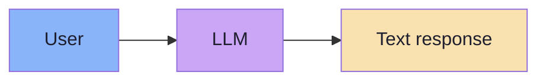

In a JS/TS environment the call is a handful of lines:

```ts
// pseudo-code — the simplest possible integration
const response: string = await chatClient.prompt()
  .user("Explain Docker")
  .call()
  .content();
```

And the model returns something like:

```text
Docker is a platform that lets developers package applications into
containers so they run consistently across environments...
```

For a chatbot this is **correct, complete and finished**. The consumer is a human, and humans are
extraordinarily good at reading unstructured information — they bring a model of the world, they tolerate
typos, they infer missing fields, they ask follow-up questions. Nothing about that response needs to change.

The problem appears the moment a *program* — not a person — must consume the same response.

> **The whole lecture in one contrast.**
> Text is the finished product for a human and a raw material for a program. Structured output is the
> conversion step in between.

---

## 01.2 The final consumer decides the format

Read this sentence:

> **"Rahul wants a meeting tomorrow at 4 PM for 30 minutes to discuss Docker deployment."**

A human extracts five facts instantly and effortlessly:

| Field | Value |
|---|---|
| Person | Rahul |
| Date | Tomorrow |
| Time | 4 PM |
| Duration | 30 minutes |
| Topic | Docker deployment |

A TypeScript or Java application extracts **nothing**. From the program's point of view the entire response is
one value of one type:

```ts
const response: string =
  "Rahul wants a meeting tomorrow at 4 PM for 30 minutes to discuss Docker deployment.";
```

There is no `person`, no `date`, no `time` — **because a `string` has no fields**.

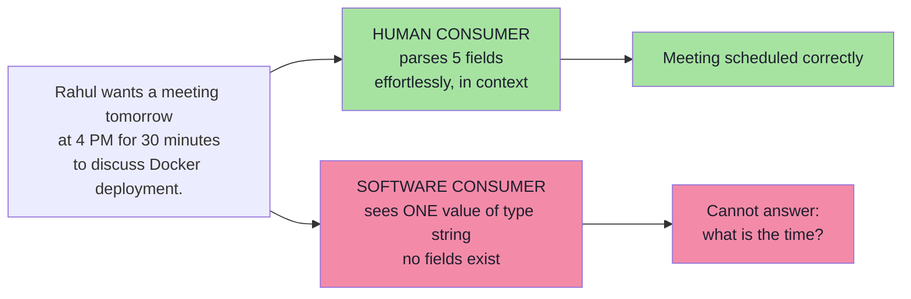

The human's advantage is **not** intelligence. It is that the human already holds a model of the world in which
a meeting *has* an attendee, a date, a time and a duration. The program has no such model — unless we hand it one
explicitly, as a type.

> **Design rule #1 of this lecture:** decide the format from the **consumer**, not from the producer. "What does
> the caller need to do with this?" is asked *before* "how do I phrase the prompt?"

---

## 01.3 Human-readable vs machine-usable

The distinction is one sentence long, and it is the thesis of the lecture:

> **Humans prefer meaning. Software prefers structure.**

The same information, written for a person:

```text
The meeting with Rahul is scheduled for tomorrow at 4 PM
and should last for approximately 30 minutes.
```

Written for a program:

```ts
const attendee: string = "Rahul";
const date: string     = "2026-10-02";
const time: string     = "16:00";
const duration: number = 30;   // minutes
```

The second version is uglier to read and *immediately useful*: every value can participate in logic,
comparison, arithmetic and a database write without a single line of string parsing.

The types applications actually work with are **not** prose:

| Application type | Example | Why prose cannot carry it |
|---|---|---|
| Object | `MeetingRequest` | Needs named, typed fields |
| Array | `attendees: string[]` | Needs a countable, iterable collection |
| Number | `durationMinutes: 30` | Needs arithmetic, not the word "thirty" |
| Boolean | `isRecurring: true` | Needs a truth value, not "yes, every week" |
| Enum | `MeetingType.INTERVIEW` | Needs a closed, known set of values |
| Date / time | `2026-10-02T16:00:00+05:30` | Needs a sortable, comparable instant |
| Identifier | `meetingId: "mtg_8f21"` | Needs an exact, opaque token |

Which is why the bridge looks like this:

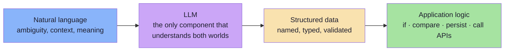

**That bridge is structured output.** The LLM is the only component in your stack that can read both sides of
it: it was trained on human language, and it can be constrained to emit machine-shaped data.

---

## 01.4 What "understanding" means to a program

A common confusion: *"the model understood the sentence, so why can't my app use it?"*

Because a program never *understands* — it **dereferences**. When the application wants the meeting time it must
execute something like:

```ts
meeting.getTime();          // a field must EXIST, with a known type
```

then use it in logic:

```ts
if (meeting.durationMinutes > 60) {
  requireApproval();        // comparison requires a number, not "about an hour"
}
```

and eventually hand it to another system:

```ts
await calendar.createEvent(meeting);   // the callee has its own typed contract
```

Every one of those three lines is a **type-level demand**:

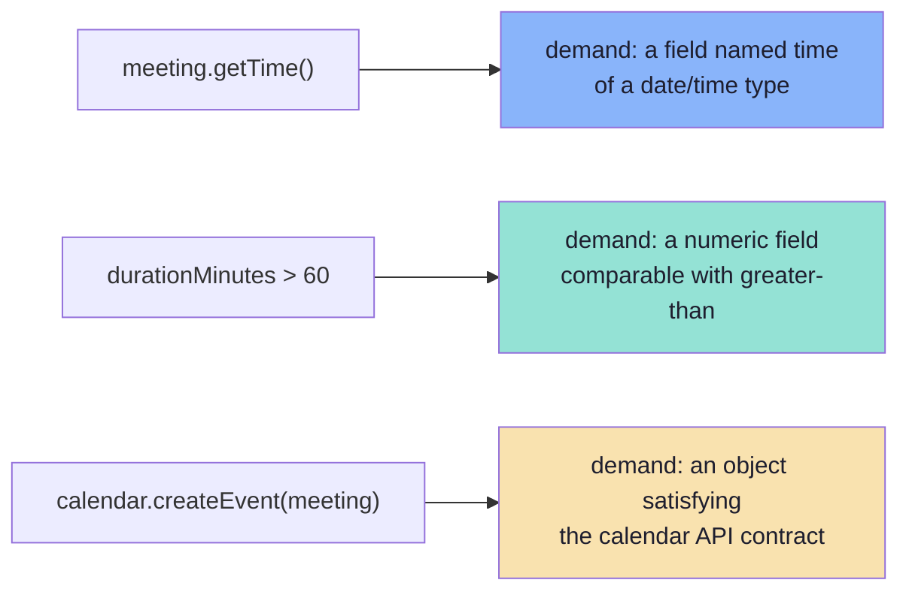

### 01.4.1 The "stringly typed" trap

When the LLM's output stays a `string`, engineers do the only thing available: they **write parsers**. This is
exactly what the `gen-ai-cohort` source shows with its `response.match(/Name:\s(.+)/)[1]` example — it works
until the input changes shape.

```ts
// pseudo-code — the anti-pattern this lecture exists to remove
const match = response.match(/at (\d{1,2})\s*(AM|PM)/i);
const hour = match ? Number(match[1]) : null;      // silently wrong if AM/PM missing
const dateGuess = response.includes("tomorrow")
  ? addDays(today(), 1)
  : null;                                          // "next Tuesday" => null, silently
```

Three properties, all bad:

1. **It is invisible business logic.** The rules of "what a meeting is" now live in regexes spread across the
   codebase — nobody owns them, nothing tests them.
2. **It fails silently.** `null` propagates; the meeting is created with a wrong time, or with no time at all.
3. **It is unmaintainable.** Every new phrasing ("the day after tomorrow", "in half an hour", "same time next
   week") requires a new regex, and every new regex is a new latent bug.

> **Rule of thumb:** if your application contains a function named `parseXFromText()`, you have found a place
> where a **schema** belongs.

---

## 01.5 The five levels of LLM integration

It helps to place structured output on a ladder, because it is not the destination — it is the **hinge**
between talking and acting.

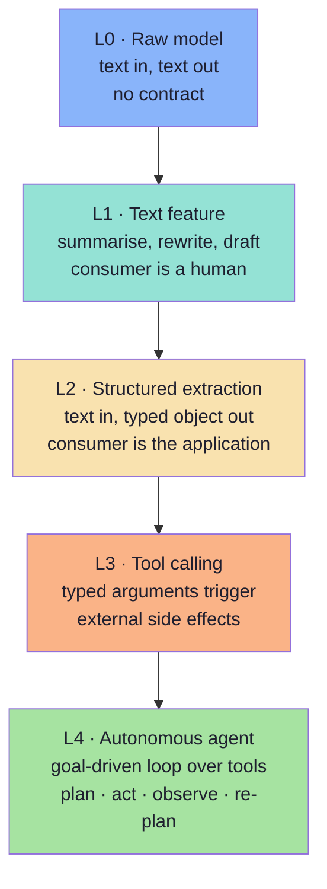

| Level | Input | Output | Who consumes the output | Guarantee available |
|---|---|---|---|---|
| L0 Raw model | text | text | nobody (research) | none |
| L1 Text feature | text | text | a human | readability |
| **L2 Structured extraction** | text | **typed object** | **the application** | **schema validity** |
| L3 Tool calling | text | typed arguments + effect | an external system | schema validity + authorisation |
| L4 Agent | goal | a sequence of actions | the environment | all of the above + loop bounds |

**Level 2 is where most enterprise GenAI work actually happens.** Ticket triage, invoice extraction, meeting
scheduling, sentiment routing, résumé parsing, log classification, CRM enrichment, "find the risks in this
project" — all of them are the same shape: *unstructured input, structured output*. Levels 3 and 4 are simply
Level 2 plus **permission to act** (Chapters 07–08 of this lecture).

> **Two useful consequences of the ladder:**
> 1. If your feature has no consumer beyond a human reading it, you may not need structured output at all —
>    spending a schema on it adds cost and failure modes for nothing.
> 2. If your feature needs to *do* something, you must still build L2 first. There is no safe path from raw
>    text straight to a side effect.

---

## 01.6 The board: a chatbot and an API are different programs

The lecture board draws **two different systems side by side**, and the comparison is the point.

### 01.6.1 Flow A — the chatbot (free-form text)

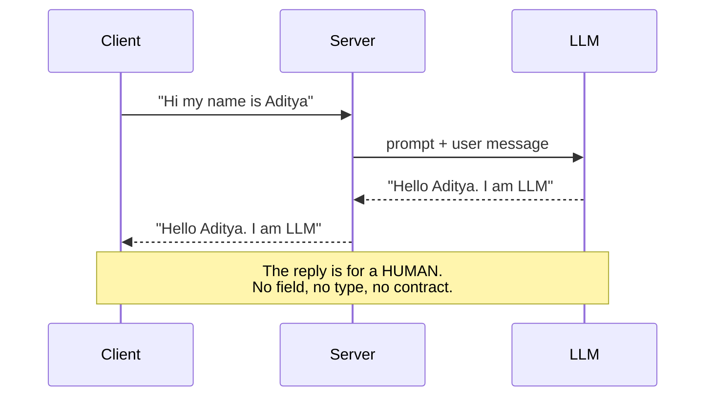

### 01.6.2 Flow B — the API (structured contract)

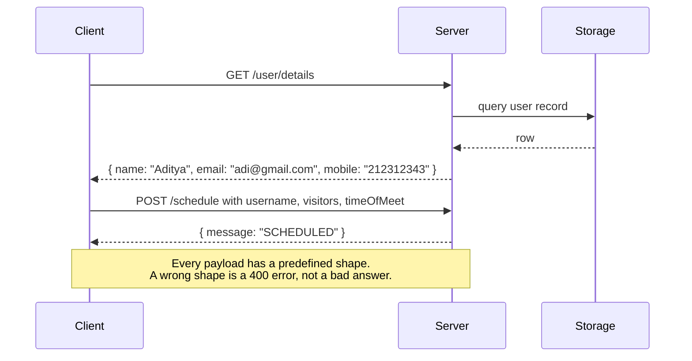

The two flows differ in exactly one respect: **in Flow B, the shape existed before the request was made.**
Flow A is a conversation; Flow B is a contract. That difference is the whole lecture.

### 01.6.3 Flow C — the meeting scheduler (where the LLM is inserted)

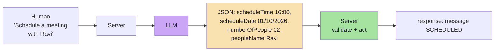

The board also sketches the **pre-LLM version** of the very same feature — a form with fixed slots:

```text
scheduleTime   : __________
scheduleDate   : __________
numberOfPeople : __________
peopleName     : __________
```

**That form is a schema.** The LLM's job is to fill the form from a sentence instead of from a UI. This is the
single most useful mental image in the lecture, and Chapter 02 builds on it directly: the *application* writes
the form, the *model* fills the values, and *nothing else about the form is negotiable*.

> **Board observation worth memorising.** The hand-drawn JSON on the board contains typos — `meetingTming`,
> `meetinfgDate`, `mesage`. That is precisely the point. Free-form JSON is *suggested* text; a schema is
> *enforced* structure. A typo in a schema is a **build-time** error. A typo in free-form JSON is a **runtime
> incident at 2 a.m.**

---

## 01.7 The failure taxonomy of free-form output

If you ask a model for "JSON" and then parse the string, you have signed up for a specific and well-known list of
failures. Every one of them is a bug in *your* system, not in the model.

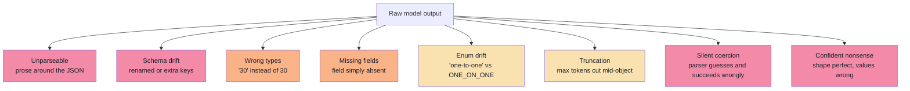

| Failure | Typical cause | What the app experiences | Caught by a schema? |
|---|---|---|---|
| **Unparseable output** | Preamble, markdown fences, trailing commas, comments | `JSON.parse` throws | ✅ (as a parse error) |
| **Schema drift** | The model "improves" your field names | `meeting.attendee` is `undefined` | ✅ |
| **Wrong types** | `"30"`, `"4 PM"`, `"02/10/2026"` | Arithmetic and comparisons misbehave | ✅ |
| **Missing fields** | The model omits what it cannot find | `undefined` deep in the call stack | ✅ (if `required`) |
| **Enum drift** | A free-text synonym chosen instead of the allowed value | `switch` falls through to `default` | ✅ |
| **Truncation** | `max_tokens` reached mid-object | Half an object, or a parse error | ⚠️ only if you notice |
| **Silent coercion** | A permissive parser fills defaults | Wrong data, no error, no alert | ❌ — the dangerous one |
| **Confident nonsense** | All fields valid, all values wrong | A business decision made on garbage | ❌ — needs semantic evaluation (Ch. 09) |

The last two rows are why "the JSON parsed" is **not** a success criterion. A syntactically perfect object can be
semantically wrong. Chapters 06 and 09 handle those two distinct problems.

> **Naming the failure is half the fix.** A team that says "the model is unreliable" cannot act. A team that says
> "`durationMinutes` arrives as a string in 4% of calls" has a ticket, an owner and an ETA. Chapter 09 makes this
> measurable via the **issue distribution**.

---

## 01.8 Why this is a Forward-Deployed Engineer problem

Enterprise systems are **contracts**: typed REST APIs, database schemas, message queues with versioned payloads,
workflow engines with typed inputs. Dropping a probabilistic text generator into the middle of that system
breaks the type system at exactly one point.

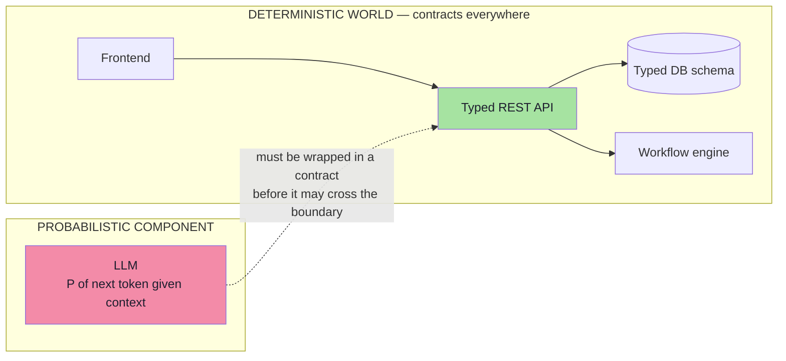

The Forward Deployed Engineer's job at this seam is **not** to make the model deterministic — that is impossible.
It is to do five things, in order:

1. **Define the contract** the surrounding system requires (Chapters 02, 04).
2. **Enforce** that contract as early and as cheaply as possible (Chapter 05).
3. **Verify** that the model's output satisfies it before any other code trusts it (Chapter 06).
4. **Never let unvalidated model output touch a side effect** (Chapters 07, 08).
5. **Measure** how often the guarantee holds in production (Chapter 09).

That list is the lecture's spine. If you remember nothing else, remember that it is a *five-step discipline*, not
a library choice.

---

## 01.9 Pseudo-code: the naive bridge and why it breaks

Here is the code almost everyone writes first, and the reason it is not enough.

```ts
// pseudo-code — the naive bridge
type MeetingRequest = {
  title: string;
  attendee: string;
  date: string;
  time: string;
  durationMinutes: number;
};

async function extractMeeting(userText: string): Promise<MeetingRequest> {
  const raw = await chatClient.prompt()
    .system("Extract the meeting details. Return JSON.")
    .user(userText)
    .call()
    .content();                       // <-- a STRING, not a MeetingRequest

  const json = raw.substring(
    raw.indexOf("{"),
    raw.lastIndexOf("}") + 1          // <-- hoping braces are balanced
  );

  const parsed = JSON.parse(json) as MeetingRequest;   // <-- unchecked cast
  return parsed;
}
```

Three things are wrong, and **none of them is the model's fault**:

| Line | Assumption | Reality |
|---|---|---|
| `.content()` | The response is exactly the JSON | It may be `"Sure! Here is the JSON:"` plus the JSON |
| `substring(indexOf("{"), lastIndexOf("}"))` | Braces are balanced and singular | Nested braces, or none at all, break it |
| `as MeetingRequest` | The shape is correct | `as` is a **compile-time lie**; at runtime `attendee` may be `undefined` |

Notice the deeper problem: the type annotation `MeetingRequest` created a *false sense of safety*. The compiler is
satisfied; the runtime is not. TypeScript types are **erased at runtime** — they cannot validate anything that
arrives over a wire.

> **The lesson:** a type is a promise to the compiler. A schema is a promise to the *runtime*. Structured output
> needs the second one; Chapter 02 shows how to derive both from a single declaration.

---

## 01.10 What structured output is **not** *(beyond the source, roadmap topic)*

The roadmap explicitly lists "what structured output is **not**". Five confusions cause most of the damage in real
teams. Read this table slowly — each row is a conversation you will eventually have.

| Misconception | Why it is wrong | What is actually true |
|---|---|---|
| **"It is just JSON."** | JSON is an *encoding*. It is the envelope, not the contract. | The target is a **typed application object**; JSON is one of several ways to carry it (Ch. 02). |
| **"It makes the model correct."** | Shape and truth are independent. A perfectly shaped object can be wrong. | It makes output **consumable**. Correctness needs semantic validation and evaluation (Ch. 06, 09). |
| **"It removes the need for validation."** | Decoders enforce structure; `pattern`, `format`, `minimum` may be ignored. | Enforcement and validation are **complements** (Ch. 05, 06). |
| **"It is the same as tool calling."** | One describes a *result*, the other requests an *action*. | They are different concepts that compose (Ch. 07). |
| **"It is a prompt trick."** | A prompt instruction is a preference over a probability distribution. | It is an **interface** — a contract with an owner, a version and tests (Ch. 02, 09). |
| **"It is a library."** | Libraries change; the discipline does not. | Zod/`json_schema`/grammars are implementations of the same four ideas: declare · enforce · verify · measure. |
| **"It means I never see garbage."** | Enforcement bounds *shape* failures, not *semantic* ones. | You see fewer, better-typed failures — and you must still design the failure path. |

There is one more, subtler confusion, and it is the most expensive:

> **Structured output is not a replacement for understanding the task.** A schema cannot rescue a vague
> instruction. If the task is "figure out what the customer wants", the model still has to *do* that work; the
> schema only decides the shape in which the answer arrives.

---

## 01.11 Where this shows up in real work *(beyond the source)*

The `gen-ai-cohort` source gives a compact real-world example: *"find the risks in this project"*.

```text
Normal response                     Structured response
-----------------                   -------------------
Risk 1:                             { "risks": [
Server overload                       { "title": "Server Overload", "score": 5 },
                                      { "title": "Security Issues",  "score": 4 }
Risk 2:                             ] }
Security issues
```

The prose version needs a human to read it. The structured version lets the frontend render a table, lets the
backend sort by `score`, and lets a policy engine route anything with `score >= 4` to a review queue — with no
parsing anywhere.

That pattern — *unstructured in, typed out* — repeats across almost every enterprise GenAI feature:

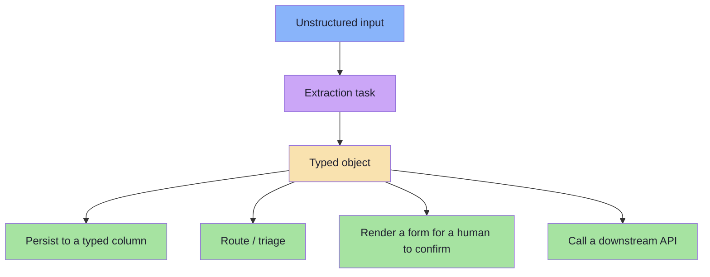

| Feature | Unstructured input | Typed output |
|---|---|---|
| Support triage | A customer email | `{ category, priority, product, needsHuman }` |
| Invoice processing | A PDF invoice | `{ vendor, invoiceNo, amountMinor, currency, dueDate, lineItems[] }` |
| Meeting scheduling | "Book 30 min with Rahul tomorrow at 4" | `MeetingRequest` |
| Résumé parsing | A CV | `{ name, skills[], yearsExperience, education[] }` |
| Log classification | A stack trace | `{ service, severity, cause, isRegression }` |
| CRM enrichment | A call transcript | `{ account, sentiment, objections[], nextStep }` |
| Risk assessment | A project brief | `{ risks: [{ title, score, mitigation }] }` |
| Compliance review | A policy document | `{ clause, obligation, appliesTo, riskLevel }` |

In every row, the **same** three questions decide the schema:

1. Who consumes this object, and what will they *do* with each field?
2. Which of those fields are **closed sets** (enums) rather than free text?
3. Which fields might be **absent** in the input, and how should absence be represented?

Those three questions are answered in Chapter 04. This chapter's job was to make you ask them at all.

---

## 01.12 Common mistakes at this stage

| Mistake | Why it hurts | Correct habit |
|---|---|---|
| Treating the LLM response as "just text, I'll parse it" | Every parse site becomes untested business logic | Define a schema first, then write the prompt |
| Assuming a valid JSON object is a valid object | `JSON.parse` proves syntax, never shape or meaning | Validate against a schema at the boundary |
| Judging quality from one successful demo | Demos sample the happy path; production samples the tail | Keep a golden set with adversarial inputs (Ch. 09) |
| Letting the model choose field names | Contract drift; frontend and backend disagree silently | The schema is owned by the application, not the model |
| Skipping "what does the consumer need?" | You extract 12 fields when the app needs 4 | Design the output from the caller's perspective |
| Mixing "the LLM is smart" with "the LLM is reliable" | Capability is not a guarantee | Assume failure, then measure its rate |
| Using `as SomeType` after `JSON.parse` | A compile-time lie; the runtime stays unguarded | Use a runtime validator (Ch. 02, 06) |
| Designing the prompt before the output shape | The prompt becomes the de-facto schema, unversioned and untestable | Schema first, prompt second |

---

## 01.13 Key takeaways

| Idea | Statement |
|---|---|
| The starting pipeline | User → LLM → **text** is complete for a human and unusable for a program. |
| The core distinction | Humans prefer **meaning**; software prefers **structure**. |
| Why prose fails | A program dereferences fields; a `string` has no fields. |
| The bridge | Natural language → LLM → **structured data** → application logic. |
| The board's insight | An LLM-filled form and a hand-filled form produce the *same* object. |
| The five levels | L0 raw → L1 text feature → **L2 structured extraction** → L3 tool calling → L4 agent. |
| The failure taxonomy | Unparseable · drift · wrong types · missing fields · enum drift · truncation · silent coercion · confident nonsense. |
| What it is not | Not "just JSON", not correctness, not a substitute for validation, not tool calling, not a prompt trick. |
| The FDE obligation | Wrap the probabilistic component in a contract at the boundary — then measure it. |

> **Final mental model:** structured output is not a formatting preference. It is the **interface** between a
> probabilistic component and a deterministic system. Everything that follows — schemas, enforcement, validation,
> tools — exists to make that interface trustworthy.

---

## Where this goes next

- **[Chapter 02](./02_What_Structured_Output_Is.md)** — what a schema *is*: a form the application writes and the
  model fills, and how one declaration yields three artefacts.
- **[Chapter 03](./03_Why_Just_Ask_For_JSON_Fails.md)** — the exact failure modes of prompt-only JSON, and the
  three layers of enforcement that replace hope with a guarantee.
- **[Chapter 07](./07_Structured_Output_vs_Tool_Calling.md)** — the difference between returning an object and
  requesting an action.
- Foundations: Lecture 04 (the application→LLM call), Lecture 06 (statelessness and context), Lecture 08 (tools).

---

**Back to:** [Lecture 10 — Chapter Index](../index.md) · [Complete Notes](./Lecture_10_Complete_Notes.md)


