# Chapter 02 — What Structured Output Is: Schema, Contract and Types

> **Lecture 10 · Chapter 02 of 09** · Level: 🟡 Intermediate · Phase 3 — Agency & Contracts
> **Source:** `Forward-Deployed-Engineer/Lecture 13/notes/02_What_Structured_Output_Is_Schema_Contract_And_Types.md` ·
> `gen-ai-cohort/week02/learning/day03/notes/04-structured-output-and-function-calling.md`
> (§2 *Zod Schema Validation* · §*Why Zod with AI?*)
> **Roadmap topics:** what structured output is — **a schema is a form the application writes and the model
> fills** · schema contract & types · **one declaration → three artefacts** (TS type, runtime validator, wire
> contract) · OpenAPI / JSON Schema as the shared contract between app and model.
> **Prerequisites:** Chapter 01 (the integration gap) · Lecture 04 (one request, one response) ·
> Lecture 08, Ch. 02 (JSON Schema vocabulary already used for tool parameters).

---

## 02.0 What this chapter is for

Chapter 01 ended with a problem: prose cannot feed a program. This chapter converts the informal fix
("return JSON, please") into an **engineering definition** with a vocabulary you can use in a design review.

The vocabulary is small and precise: *schema*, *contract*, *type*, *validator*, *boundary*. Teams that skip this
chapter end up arguing about prompts when they should be arguing about field types — and they discover the
difference in production.

By the end of this chapter you should be able to:

1. Define structured output in one sentence, and defend each of its three load-bearing words.
2. Explain the **form analogy**: the application writes the form, the model fills the values.
3. Map every concept of a REST API onto its LLM equivalent — including `400 Bad Request` and versioning.
4. Distinguish **syntax → shape → meaning**, and say which one a schema does and does not cover.
5. Describe the **one declaration → three artefacts** rule and the drift risk it removes.
6. Design a schema *from the consumer backwards*, rather than from the sentence forwards.

---

## 02.1 The definition

> **Structured output** means asking the model to produce information in a **predefined structure** that our
> application can reliably consume.

Three words carry all the weight:

| Word | What it demands | What it excludes |
|---|---|---|
| **Predefined** | The shape exists *before* the request, decided by the application | The model inventing a shape |
| **Structure** | Named, typed fields — objects, arrays, enums, numbers | Prose, headings, bullet lists |
| **Reliably consume** | The consumer can index, validate and trust it | "Looks right in the playground" |

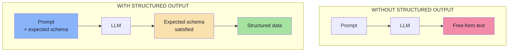

The difference is **not** "JSON instead of prose". The difference is that in the second flow a structure was
declared *in advance* and the model was made **accountable** to it.

> **The sentence to memorise.** Structured output is a *contract with your own code*, where the model is the
> producer and your validator is the inspector.

---

## 02.2 The REST API analogy

To understand structured output, look at how a normal API already works. Instead of returning:

```text
The user's name is Rahul.
He is 28 years old and his email is rahul@gmail.com.
```

we normally return:

```json
{
  "name": "Rahul",
  "age": 28,
  "email": "rahul@gmail.com"
}
```

The second response follows a structure, and by publishing that structure we have defined a **contract**. Consumers
of that API do not parse sentences; they read fields.

Structured output applies the same idea to an LLM:

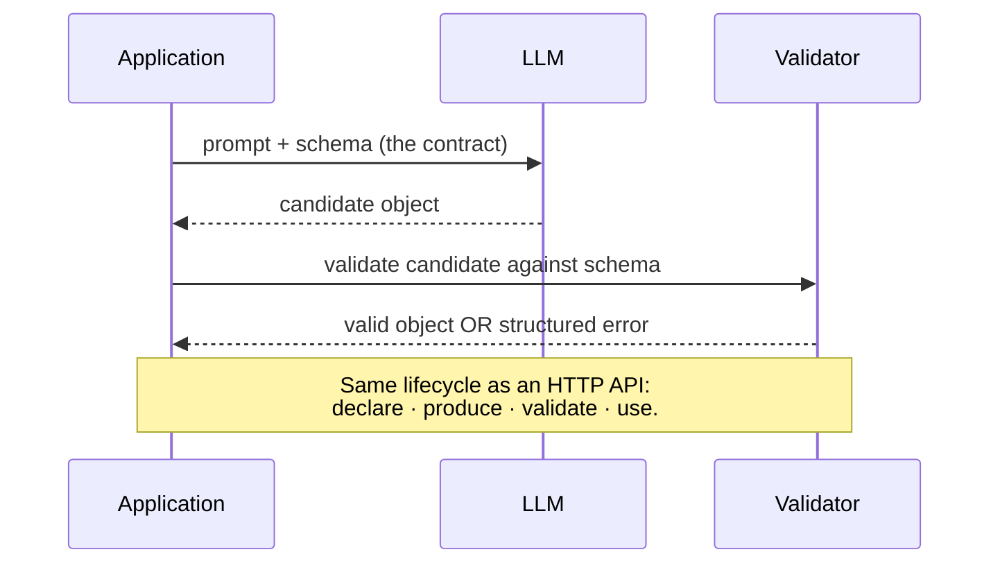

| REST API concept | LLM equivalent |
|---|---|
| Endpoint path | The prompt / task definition |
| Request body schema | The **input** contract (usually plain text) |
| Response body schema | The **output** schema — structured output |
| OpenAPI document | The published schema the model is asked to satisfy |
| `400 Bad Request` | A validation failure (Chapter 06) |
| Versioned API (`/v2`) | A versioned output schema (Chapter 09) |
| Integration test suite | Golden set + evaluation harness (Chapter 09) |
| Gateway rate limits | Token/cost budgets, retry caps, blast-radius caps |

> **Key reframing:** the LLM is not a text generator you hope behaves. It is a **service with an untyped output**
> that you wrap in a schema — exactly as you would wrap a legacy endpoint you do not control.

This reframing has a practical consequence: everything you already know about API design transfers directly.
Contract-first design, versioning, backward compatibility, contract tests, deprecation windows — all of it applies,
and Chapter 09 uses all of it.

---

## 02.3 The form analogy: the application writes the form, the model fills it

This is the lecture's central mental image, and it is worth more than any definition.

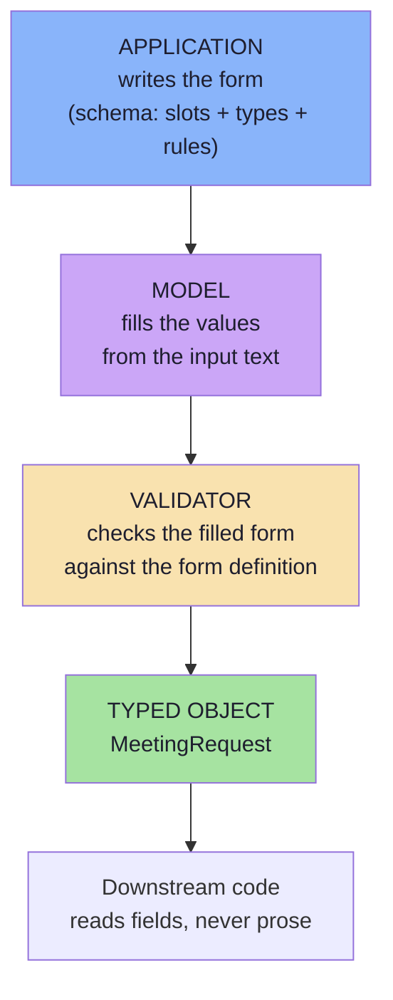

A paper form has three properties that make this analogy exact:

| Paper form property | Schema equivalent |
|---|---|
| **Fixed slots with printed labels** | `properties` with names |
| **A field type per slot** (date box, checkbox, number) | `type`, `enum`, `format` |
| **"Required" markers** | `required` array |
| **"Do not write outside the boxes"** | `additionalProperties: false` |
| **Instructions printed under each field** | `description` |
| **A clerk who rejects a badly filled form** | the runtime validator |

The important part: **the form's shape is not negotiable at fill time.** The person filling it cannot decide to add
a column, rename "Date" to "When", or leave the ID box blank because they did not like it. That is precisely the
guarantee we want from the model — and precisely what a prompt alone does not give us.

> **Why this analogy survives contact with reality:** it also predicts the failure modes. People fill forms badly
> in exactly the ways models emit bad JSON — wrong format in a box, a blank where something was required, an answer
> that fits the box but is factually wrong. Every one of those has a counterpart here: type errors, missing fields,
> confident nonsense.

---

## 02.4 Structured output is not "just JSON"

This is the most common misconception, and it is worth dismantling carefully.

| Statement | Verdict |
|---|---|
| "Structured output means JSON." | ❌ JSON is one **encoding** among several (YAML, XML, protobuf, SQL, an AST, a DSL, a typed tool call). |
| "If it parses as JSON, it is structured output." | ❌ A JSON blob of arbitrary shape is still unusable. Shape must be **declared**. |
| "The target is a JSON string." | ❌ The target is a **typed application object**. The string is transport. |
| "Structured output means a schema exists." | ✅ Close — with the addition that the schema must be **enforced and verified**. |

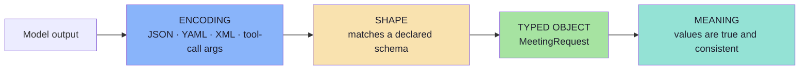

Read the chain as a series of gates, not a single event:

1. **Encoding** — can it be parsed at all?
2. **Shape** — does it match the declared schema?
3. **Object** — do we now hold a value with a known type in our own language?
4. **Meaning** — is it *true*? (Chapters 06 and 09.)

JSON only guarantees gate 1. A schema guarantees gate 2. Your code needs gate 3. Only domain logic and evaluation
can touch gate 4.

---

## 02.5 The three layers of a structured result

Putting §02.4 into engineering language gives the distinction every later chapter depends on:

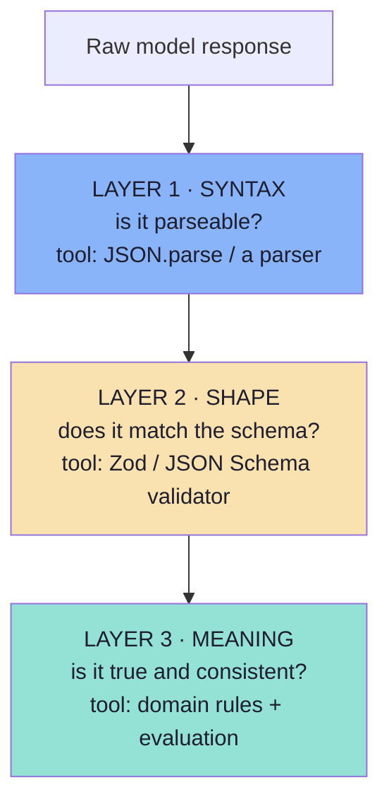

| Layer | Question | Fails when | Fixed by |
|---|---|---|---|
| **Syntax** | Can I parse it? | Preamble, fences, truncation | JSON mode / constrained decoding (Ch. 05) |
| **Shape** | Does it match my contract? | Missing keys, wrong types, enum drift | Schema + validator (Ch. 04, 06) |
| **Meaning** | Is it *true*? | Impossible dates, hallucinated people | Semantic rules + evaluation (Ch. 06, 09) |

Three consequences worth stating explicitly:

1. **Each layer has a different tool.** Confusing them is the most common design error in this subject — e.g.
   believing that JSON mode (layer 1) solves shape (layer 2).
2. **Layers are cumulative.** You cannot validate meaning without first validating shape; you cannot validate shape
   without first parsing.
3. **The cost profile is inverted.** Layer 1 is nearly free, layer 2 is cheap, layer 3 is expensive — and layer 3
   is where the business value lives.

---

## 02.6 One declaration → three artefacts

The single most valuable engineering rule in this chapter.

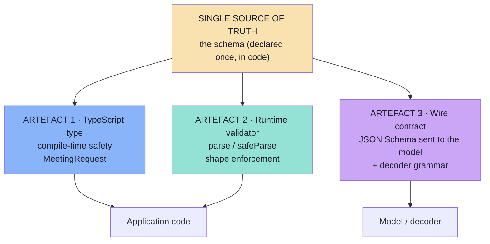

| Artefact | Consumer | Purpose | If it drifts |
|---|---|---|---|
| **TypeScript type** | Your compiler | Autocomplete, refactors, exhaustive `switch` | Runtime surprises; `as` casts creep in |
| **Runtime validator** | Your boundary | Reject anything that does not match | Bad objects reach business logic |
| **Wire contract (JSON Schema)** | The model + decoder | Instruct and constrain generation | The model satisfies a *different* shape |

**Why one declaration matters:** if you maintain these three by hand, they *will* diverge. The classic divergence is
a hand-written TypeScript interface, a hand-written JSON Schema pasted into a prompt, and a hand-written validator —
three documents, three authors, three release cadences. The first time someone adds a field to only two of them, you
get a production bug that no unit test catches.

> **Rule:** declare the schema once, in code, and **derive** the other two. Any place where the same field is
> written twice is a future incident.

### 02.6.1 The schema-as-code pipeline *(beyond the source)*

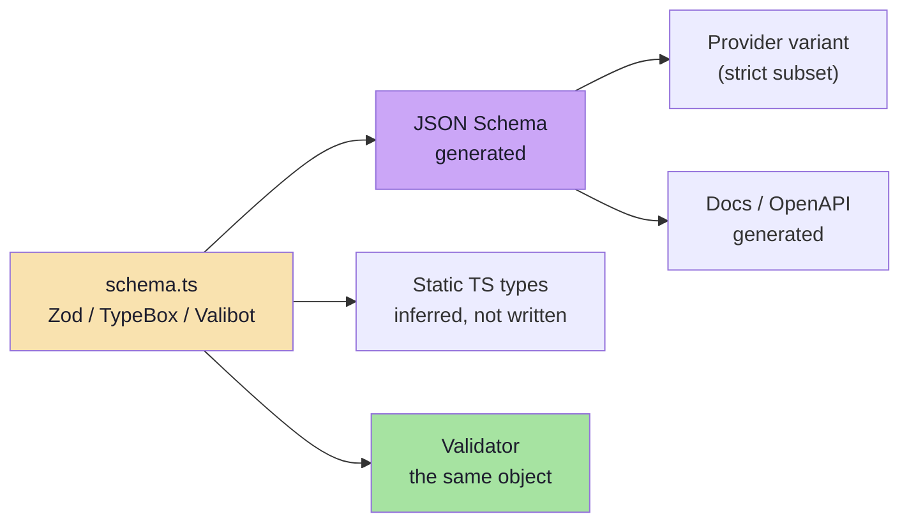

In a JS/TS codebase this pipeline is usually three lines of glue plus a test:

- **Zod** (or TypeBox/Valibot) is the declaration.
- `z.infer<typeof Schema>` gives the TypeScript type — no hand-written interface.
- `zodToJsonSchema(Schema)` gives the wire contract — no hand-pasted JSON.
- The same `Schema` object is the validator — no third implementation.

**The drift test to write once:** snapshot the generated JSON Schema in the repository and fail CI when it changes
without the snapshot being updated. That turns "someone quietly changed the contract" into a review comment.

---

## 02.7 The schema is a contract: owner, producer, consumer

A contract is not just a document; it is an agreement with named parties. Structured output has three.

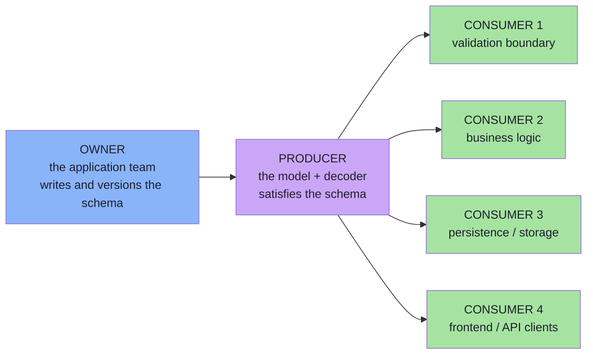

| Party | Responsibility | Never allowed to |
|---|---|---|
| **Owner** | Define fields, types, constraints, version; publish the contract | Let the model invent field names |
| **Producer** | Fill the form with values drawn from the input | Change the form, add fields, omit required ones |
| **Consumers** | Read fields, act on validated objects only | Touch raw model output |

### 02.7.1 The boundary rule

> **No unvalidated model output may cross into application logic.**

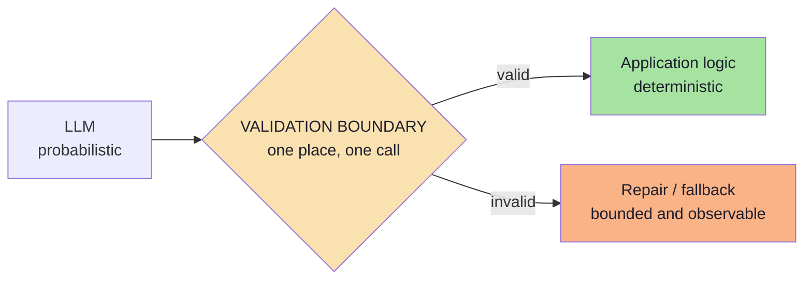

Three corollaries (developed fully in Chapter 06):

1. **The validator is not optional** — even with strict-mode decoding.
2. **The boundary is a single place** — one `parse()` at the edge, not `if (!x)` checks scattered through the
   service layer.
3. **Failure is a designed path** — "it threw an exception" is not a design.

---

## 02.8 Types: what the schema must be able to express

A schema that cannot express the right *type* will be worked around with strings. Here is the minimum type
vocabulary a real extraction schema needs, and why.

| Need | Schema expression | Why a string will not do |
|---|---|---|
| A closed set | `enum` | `switch`/routing never matches free text reliably |
| A count or duration | `integer` + `minimum`/`maximum` | Arithmetic and policy checks need numbers |
| A yes/no | `boolean` (with `null` when unknown) | `"maybe"` is not a truth value |
| A moment in time | `string` + `format: date-time` (ISO 8601) | Sorting, timezone maths, comparisons |
| Money | `integer` in minor units + currency enum | Floating-point currency is a defect |
| A list | `array` + `items` + `minItems`/`maxItems` | Unbounded lists blow up cost and latency |
| A group of facts | nested `object` (used sparingly) | Flat is more reliable (Ch. 04) |
| "Unknown" | `required` + `["string","null"]` | Absent keys force defensive code everywhere |
| An identifier | `string` + `pattern` | IDs must be exact, not fuzzy |

> **Rule of thumb:** every time you catch yourself writing "the field is a string, but it should look like X", you
> have found a constraint the schema should carry. Chapter 04 is entirely about that translation.

---

## 02.9 Schema-first design: start from the consumer

The order of work matters more than any individual field.

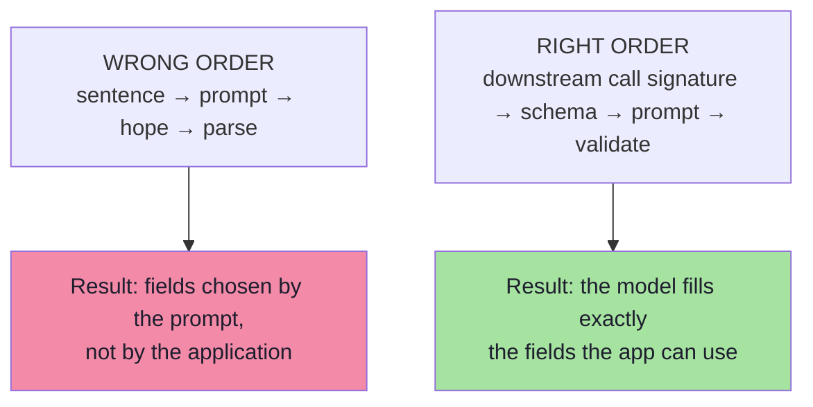

The right order in practice:

1. **Write the consuming call first.** `calendar.createEvent({ title, startIso, durationMinutes, attendeeEmail })`.
   That signature *is* the schema's origin.
2. **Add the fields the policy layer needs** — `needsHuman`, `confidence`, `reasoning` — even though the calendar
   does not use them. Different consumers, one object.
3. **Add the fields the persistence layer needs** — `schemaVersion`, and an idempotency-relevant subset.
4. **Only now write the prompt**, and let it refer to the schema's own field descriptions.
5. **Validate against the schema at the boundary**, and log failures as issues (Ch. 06).

### 02.9.1 A worked example: the `MeetingRequest` form

The lecture's board gives us the input sentence and the slots. Filling in the engineering gives:

```ts
// pseudo-code — the form the application writes, expressed as a Zod schema
const MeetingSchema = z.object({
  schemaVersion:   z.literal("meeting.v1"),
  reasoning:       z.string().max(280),          // short rationale, generated first
  title:           z.string().min(1).max(120),
  attendeeName:    z.string().min(1),
  attendeeEmail:   z.string().email().nullable(), // may be unknown at extraction time
  startIso:        z.string().datetime(),         // normalised, never "tomorrow"
  durationMinutes: z.number().int().min(5).max(480),
  type:            z.enum(["ONE_ON_ONE", "INTERVIEW", "TEAM", "OTHER"]),
  location:        z.string().nullable(),
  needsHuman:      z.boolean(),
}).strict();
```

| Slot | Why it exists | Who reads it |
|---|---|---|
| `reasoning` | Auditability + better labels (Ch. 04) | Reviewer, evaluator |
| `title` | Calendar event summary | Calendar API |
| `attendeeName` | Human-readable confirmation | UI |
| `attendeeEmail` | The calendar needs an email, not a name | Calendar API |
| `startIso` | A sortable, timezone-safe instant | Calendar API, policy |
| `durationMinutes` | Integer for policy comparison (`> 240`) | Policy |
| `type` | Closed set for routing rules | Policy, analytics |
| `location` | Genuinely optional in the input | Calendar API |
| `needsHuman` | Explicit abstention flag | Workflow |
| `schemaVersion` | Which contract this object satisfies | Storage, migrations |

The board's flow, drawn as the data transformations it really is:

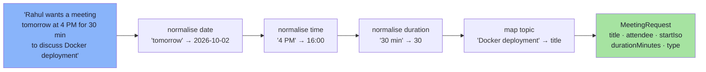

Note what the schema forced: **normalisation**. Relative dates and 12-hour times are unusable to a calendar API.
The schema's `description` fields instruct the model to normalise; the validator verifies the *type*; a semantic
check verifies the *value*.

> **The pattern in one line:** *declare the schema the consumer needs → instruct the model in the schema's own
> language → validate before use.*

---

## 02.10 OpenAPI and JSON Schema as the shared contract *(beyond the source, roadmap topic)*

The roadmap calls out "OpenAPI / JSON Schema as the shared contract between app and model". This is worth a
dedicated section, because it is the piece that turns structured output from a one-off prompt trick into
*architecture*.

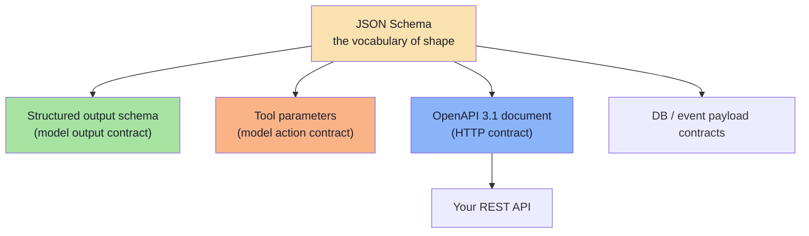

| Property | Why it matters here |
|---|---|
| **One vocabulary everywhere** | The same keywords describe a REST response, a tool parameter object and an LLM output. You learn it once. |
| **Tooling exists** | Validators, code generators, docs generators, linters, diff tools, mock servers — all already written for JSON Schema. |
| **Tool definitions reuse it** | In tool calling the `parameters` field *is* JSON Schema (Lecture 08, Ch. 02). Structured output and tools are the same vocabulary with different purposes (Ch. 07). |
| **OpenAPI 3.1 aligns with JSON Schema 2020-12** | You can lift a response schema out of an OpenAPI document and hand it to a model, or generate the document from the same source. |
| **Versioning discipline is pre-solved** | Additive evolution, deprecation windows, contract tests — existing API practice transfers. |

### 02.10.1 Practical interop notes

| Topic | What to know |
|---|---|
| **`$schema` / draft** | JSON Schema has several drafts (`draft-07`, `2019-09`, `2020-12`). Providers usually support a *subset* of one draft. Pin your draft; do not mix. |
| **Dialect differences** | `nullable` is OpenAPI-ism; JSON Schema uses `"type": ["string","null"]`. Generators may emit either — normalise before sending. |
| **`format` is annotation-first** | In JSON Schema, `format` is not always an assertion. Do not rely on the provider to enforce it (Ch. 05). |
| **`$ref` / `$defs`** | Excellent for reuse and for keeping the wire payload small; risky for grammar compilation when recursion is involved. |
| **Generated types** | `json-schema-to-typescript` (schema → type) and `zod-to-json-schema` (code → schema) both exist. Pick **one direction** and stick to it, or you will have a two-way sync problem. |

> **The architectural payoff:** the model is not a special case in your system. It is one more producer behind a
> schema you already own — and the same contract can describe the HTTP endpoint that consumes its output.

---

## 02.11 The schema is a versioned artefact *(beyond the source)*

Because the schema is a contract, **changing it is an API change**. Chapter 09 covers rollout; the design rules
belong here, because they constrain what you are allowed to write today.

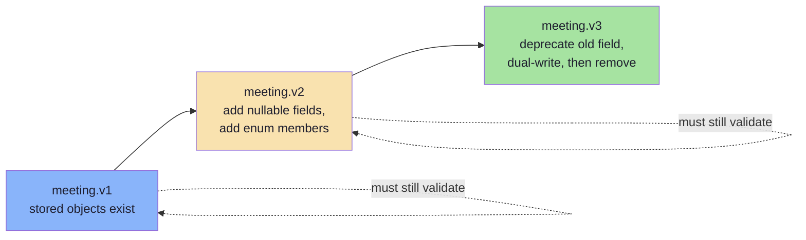

| Change | Safe? | Reason |
|---|---|---|
| Add a new nullable field | ✅ | Old objects remain valid; new objects carry more |
| Add an enum member | ✅ (if consumers tolerate unknown) | Write consumers defensively |
| Widen a constraint (`maxLength` up) | ✅ | Nothing that was valid becomes invalid |
| Narrow a constraint (`maxLength` down) | ❌ | Stored objects now fail validation |
| Rename a field | ❌ | Consumers break silently |
| Repurpose a field's meaning | ❌❌ | Same shape, different semantics — the worst class of bug |
| Remove a field | ❌ | Readers get `undefined` |

**Two habits that make this cheap from day one:**

1. **Put a `schemaVersion` constant in every object** — `{ "const": "meeting.v1" }`. Then every stored object
   declares which contract it satisfies, and migrations become a query, not an archaeology project.
2. **Treat absence explicitly.** Prefer `required` + nullable over optional (Chapter 04), so "unknown" is one
   representable state rather than three.

---

## 02.12 Pseudo-code: declare once, derive three

The pattern, in full, as it would appear in a JS/TS service.

```ts
// pseudo-code — ONE declaration, THREE artefacts, no drift
import { z } from "zod";
import { zodToJsonSchema } from "zod-to-json-schema";

// ---- 1 · the declaration (the single source of truth) --------------------
export const MeetingSchema = z.object({
  schemaVersion:   z.literal("meeting.v1"),
  reasoning:       z.string().max(280)
                    .describe("One sentence: which words in the input drove this extraction."),
  title:           z.string().min(1).max(120).describe("Short topic of the meeting."),
  attendeeName:    z.string().min(1).describe("Full name of the other participant."),
  attendeeEmail:   z.string().email().nullable()
                    .describe("Email if present in the input, otherwise null."),
  startIso:        z.string().datetime()
                    .describe("ISO 8601 start time. Resolve 'tomorrow' against TODAY."),
  durationMinutes: z.number().int().min(5).max(480)
                    .describe("Duration in minutes. Default 30 when unstated."),
  type:            z.enum(["ONE_ON_ONE", "INTERVIEW", "TEAM", "OTHER"]),
  location:        z.string().nullable(),
  needsHuman:      z.boolean().describe("True if any field required a guess."),
}).strict();

// ---- 2 · the TypeScript type (derived, never hand-written) ---------------
export type Meeting = z.infer<typeof MeetingSchema>;

// ---- 3 · the wire contract (derived, never hand-pasted) ------------------
export const MEETING_JSON_SCHEMA = zodToJsonSchema(MeetingSchema, {
  $refStrategy: "none",            // providers dislike refs; inline them
  target: "jsonSchema2020-12",
});

// ---- the same declaration is also the validator --------------------------
export function validate(raw: unknown) {
  return MeetingSchema.safeParse(raw);   // { success, data } | { success, error.issues }
}
```

Three properties worth noticing:

| Property | Consequence |
|---|---|
| The type is `z.infer`, not an interface | Adding a field updates the type automatically |
| The JSON Schema is generated at build time | The model and the validator can never disagree |
| `.strict()` maps to `additionalProperties: false` | The wire contract and the runtime agree on closure |
| `.describe()` becomes JSON Schema `description` | Field docs double as prompt instructions (Ch. 04) |

> **Anti-pattern to watch for:** a hand-written `interface Meeting` *plus* a hand-written `MeetingSchema`. They
> will disagree within a month, and the disagreement will be invisible until production.

---

## 02.13 Common mistakes at this stage

| Mistake | Why it hurts | Correct habit |
|---|---|---|
| Designing the schema from the input text instead of the consumer's needs | You extract fields nobody uses and miss the one that matters | Start from the downstream call signature |
| Treating the schema as documentation | Docs drift; schemas must be *executed* | Derive the validator and types from the same source |
| Leaving `additionalProperties` open | The model adds plausible fields; downstream code silently ignores or breaks | Close the object (`.strict()`) unless you truly need flexibility |
| Making everything required | Missing information becomes a hard failure instead of a `null` | Mark genuinely optional fields optional or nullable |
| Using a free-text `string` where an enum exists | Unbounded vocabulary; downstream `switch` never matches | Use `enum` for any closed set |
| Encoding structure inside a string (`"Rahul, 30 min"`) | You recreated the parsing problem *inside* a field | One field, one meaning |
| Versioning by editing in place | Old stored objects no longer validate | Add a version field; evolve additively (Ch. 09) |
| Writing the prompt before the schema | The prompt silently becomes the contract, unversioned and untested | Schema first, prompt second |
| Maintaining type + schema + validator by hand | Guaranteed drift, silent production bugs | One declaration, three derived artefacts |

---

## 02.14 Key takeaways

| Idea | Statement |
|---|---|
| Definition | Structured output = the model produces information in a **predefined structure** the application can consume. |
| The analogy | A schema is a **form**: the application defines the slots, the model fills the values. |
| Not just JSON | JSON is an encoding; the real target is a **typed application object**. |
| The contract | The schema is an executable interface with an owner (you), a producer (the model) and consumers (your code). |
| Three layers | **Syntax** (parseable) → **shape** (schema-valid) → **meaning** (correct values). |
| One source of truth | Declare once; derive the TypeScript type, the JSON Schema wire contract and the runtime validator. |
| Shared vocabulary | JSON Schema / OpenAPI is the same contract language your HTTP APIs already speak. |
| Schema-first design | Start from the consumer's requirements, not from the sentence you were given. |
| The boundary rule | Nothing downstream should ever touch unvalidated model output. |

> **Final mental model:** structured output is a **typed API boundary** with the LLM on the producer side. Design
> the response contract the way you would design any API response — then enforce it.

---

## Where this goes next

- **[Chapter 03](./03_Why_Just_Ask_For_JSON_Fails.md)** — why the naive "please return JSON" instruction fails,
  and the three layers of enforcement that fix it.
- **[Chapter 04](./04_JSON_Schema_Design_for_LLMs.md)** — the schema-design craft: which keywords models honour,
  and which ones break them.
- **[Chapter 06](./06_Validation_Repair_and_Failure_Handling.md)** — the validator this chapter promised.
- Related: Lecture 08, Ch. 02 uses the same JSON Schema vocabulary for **tool** definitions.

---

**Back to:** [Lecture 10 — Chapter Index](../index.md) · [Complete Notes](./Lecture_10_Complete_Notes.md)


