# Chapter 04 — JSON Schema Design for LLMs: The Craft

> **Lecture 10 · Chapter 04 of 09** · Level: 🟡 Intermediate · Phase 3 — Agency & Contracts
> **Source:** `Forward-Deployed-Engineer/Lecture 13/notes/04_JSON_Schema_And_Schema_Design_For_LLMs.md` ·
> `gen-ai-cohort/week02/learning/day03/notes/04-structured-output-and-function-calling.md`
> (§2 *Zod Schema Validation* — optional fields, enums, arrays, nested objects, the `RiskSchema`)
> **Roadmap topics:** JSON Schema design for LLMs — **enums for closed sets**, **require-or-nullify**,
> **flatten by default**, **units in names**, **reasoning field first**, `description` as the highest-value keyword.
> **Prerequisites:** Chapter 02 (schema as contract) · Chapter 03 (why shape must be enforced) ·
> Lecture 08, Ch. 02 (JSON Schema for tool parameters).

---

## 04.0 What this chapter is for

The lecture tells us *that* we need a schema. This chapter is about **how to write one a model can actually
satisfy**. A schema is simultaneously three things:

1. a **contract** for your application,
2. an **instruction** for the model,
3. an **input** to a decoder (a grammar).

Bad schemas fail on all three fronts at once — and they fail *silently*, because a schema that is merely awkward
still validates.

By the end of this chapter you should be able to:

1. Write a field so that all **four decisions** (kind, presence, constraints, meaning) are made deliberately.
2. Use `enum` wherever a closed set exists — and explain why it is the highest-leverage keyword.
3. Choose between **required + nullable** and **optional**, and say why tri-state fields are a bug magnet.
4. Apply the **flatten-by-default** rule and quantify the depth tax.
5. Normalise strings in the schema (dates, times, durations, money, phones, IDs, languages).
6. Use the **reasoning-field pattern** and know its four benefits and four costs.
7. Recite the **twelve rules** and the anti-pattern list from memory.

---

## 04.1 What a schema is, formally

A **schema** defines what the structured data should look like. The industry-standard vocabulary for that
definition is **JSON Schema** — the same vocabulary tool/function definitions use (Lecture 08, Ch. 02).

For the lecture's meeting example, the schema may start as a list of slots:

```text
title             → text
attendee          → text
date              → text
time              → text
durationMinutes   → number
```

A precise version of that same idea:

```json
{
  "$schema": "https://json-schema.org/draft/2020-12/schema",
  "title": "MeetingRequest",
  "type": "object",
  "additionalProperties": false,
  "required": ["title", "attendee", "startIso", "durationMinutes"],
  "properties": {
    "title":           { "type": "string", "minLength": 1, "maxLength": 120 },
    "attendee":        { "type": "string", "minLength": 1 },
    "startIso":        { "type": "string", "format": "date-time" },
    "durationMinutes": { "type": "integer", "minimum": 1, "maximum": 480 },
    "type":            { "type": "string", "enum": ["ONE_ON_ONE", "INTERVIEW", "TEAM", "OTHER"] },
    "location":        { "type": ["string", "null"] }
  }
}
```

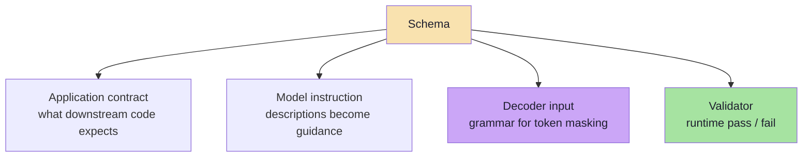

That **triple role** is why schema design is a *design activity*, not a typing exercise. When you edit a field you
are simultaneously editing a type, a prompt and a state machine.

---

## 04.2 The core keyword vocabulary

| Keyword | Meaning | Typical use |
|---|---|---|
| `type` | The JSON type: `object`, `array`, `string`, `number`, `integer`, `boolean`, `null` | Every field |
| `properties` | Named fields of an object | Object shape |
| `required` | Which properties must be present | Mandatory fields |
| `additionalProperties` | Whether extra keys are allowed (`false` closes the object) | Contract enforcement |
| `enum` | A closed set of allowed values | Categories, statuses, routing labels |
| `const` | Exactly one allowed value | Discriminators, fixed versions |
| `items` | Schema for each element of an array | Lists |
| `minItems` / `maxItems` | Array length bounds | Capping cost and drift |
| `minimum` / `maximum` | Numeric bounds | Durations, scores, quantities |
| `minLength` / `maxLength` | String length bounds | Titles, summaries |
| `pattern` | Regular expression constraint | IDs, codes, postcodes |
| `format` | Semantic hint: `date-time`, `date`, `email`, `uri`, `uuid` | Normalised values |
| `description` | Human-readable intent — **part of the prompt** | Every field, always |
| `default` | Value to use when absent | Optional fields |
| `$defs` / `$ref` | Reusable named sub-schemas | Shared nested shapes |
| `anyOf` / `oneOf` / `allOf` | Unions and intersections | **Restrictively supported** — see §04.14 |

> **The single highest-value keyword is `description`.** Models are far more likely to produce the right value when
> the field explains itself (`"ISO 8601 date, YYYY-MM-DD"`) than when it relies on a good name alone.

Two more keywords that repay their cost immediately:

| Keyword | Use it when | Example |
|---|---|---|
| `examples` | The format is easier to show than to describe | `["2026-10-02T16:00:00+05:30"]` |
| `deprecated` | You are retiring a field (Ch. 09) | `"deprecated": true` on the old key |

---

## 04.3 Types: the four decisions

Every field forces four decisions, and each one is a place where a wrong choice causes silent bugs.

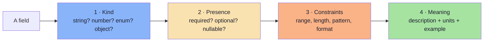

| Decision | Good choice | Bad choice | Consequence of the bad choice |
|---|---|---|---|
| Kind | `enum` for a closed set | `string` with "one of: …" in the description | Unbounded vocabulary; `switch` never matches |
| Kind | `integer` for a count | `string` `"30 minutes"` | Arithmetic requires parsing |
| Presence | `null` allowed when unknown | `required` with a sentinel like `""` or `"N/A"` | Two ways to say "unknown"; both leak into logic |
| Constraints | `minimum: 1, maximum: 480` | Unbounded integer | Hallucinated 1440-minute meetings |
| Meaning | Units in the name: `durationMinutes` | `duration` | The 30-vs-1800 ambiguity |
| Meaning | `format: date-time` plus a description with an example | Bare `"date"` | Locale-ambiguous strings |

> **A useful review question per field:** *if this field arrives with the wrong value, what will break, and how
> loudly?* If the answer is "nothing, silently", the field needs a constraint or a semantic check.

---

## 04.4 Enums: the highest-leverage constraint

If a field has a closed set of valid values, **say so**. This is the cheapest, most effective schema improvement
available.

```json
{ "type": "string", "enum": ["LOW", "MEDIUM", "HIGH", "CRITICAL"] }
```

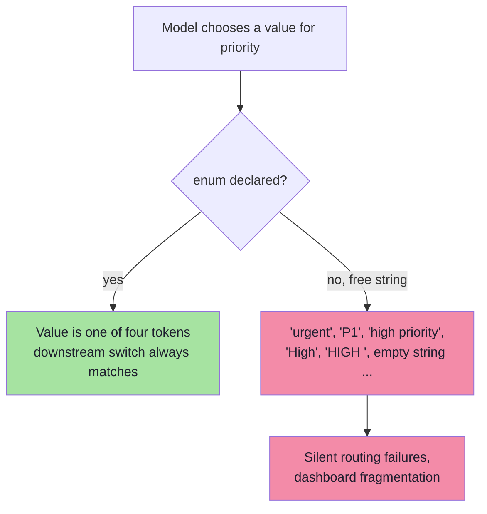

Three practical rules for enums:

1. **Use machine-friendly literals** — `ONE_ON_ONE`, not `"one-to-one"`. Enum values are identifiers, not display
   text; map them to human labels in the UI.
2. **Include an escape hatch** — an `OTHER` or `UNKNOWN` member. Without one, the model must lie when the input
   does not fit, and it will pick the nearest wrong value.
3. **Keep the set small** — beyond roughly 10–15 members, models start confusing adjacent categories; consider a
   two-step classification instead.

> `const` is the degenerate case: an enum of size one. It is useful for schema versioning —
> `"schemaVersion": { "const": "meeting.v2" }`.

### 04.4.1 Two-step classification when the set is large *(beyond the source)*

When you have 40 categories, do not hand the model a 40-member enum. Split it:

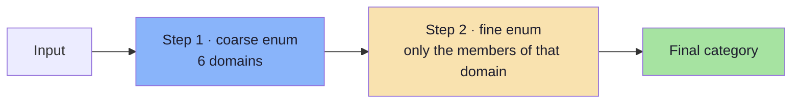

| Benefit | Cost |
|---|---|
| Each decision is easier, so accuracy rises | Two calls → more latency and cost |
| Each enum stays small and interpretable | The second call needs the first result (sequencing) |
| A wrong coarse choice is *visible* in metrics | Partial failure paths multiply |

An alternative that is often better: **one enum of ~15 "families"** plus a free-text `subcategory` field that is
advisory only — never routed on.

### 04.4.2 Enum drift detection *(beyond the source)*

Even with an enum, watch the *distribution*:

| Signal | Meaning | Action |
|---|---|---|
| `OTHER`/`UNKNOWN` rate rising | The enum no longer covers the world | Add members (additively) or split the task |
| One member suddenly dominating | Prompt regression or input-distribution shift | Inspect 20 raw examples |
| Validation errors on enum values | The provider is not enforcing the enum | Check strict-mode support (Ch. 05) |

> Chapter 09 makes these into a single number: the **escape-hatch rate**. Above roughly 10%, the schema is wrong,
> not the model.

---

## 04.5 Objects, required fields and closure

```json
{
  "type": "object",
  "additionalProperties": false,
  "required": ["attendee", "startIso"],
  "properties": {
    "attendee": { "type": "string" },
    "startIso": { "type": "string" },
    "notes":    { "type": ["string", "null"] }
  }
}
```

| Setting | Effect on the model | Effect on your code |
|---|---|---|
| `additionalProperties: false` | Cannot emit keys outside the list | You can trust the object has exactly these keys |
| `additionalProperties: true` (default) | Free to add "helpful" fields | Extra keys appear in storage and break equality checks |
| `required: [...]` | Must emit those keys, even as `null` if allowed | No `undefined` checks needed |
| Absent from `required` | May omit the key entirely | Every read site must handle `undefined` **and** `null` |

**Recommendation for LLM schemas:** prefer **required + nullable** over **optional**. "This key is always present;
its value may be `null`" is a single, testable rule, whereas "this key may not exist" forces defensive code
everywhere.

### 04.5.1 Nesting and the depth tax

Nesting is legitimate (an address, a line item) but it is not free:

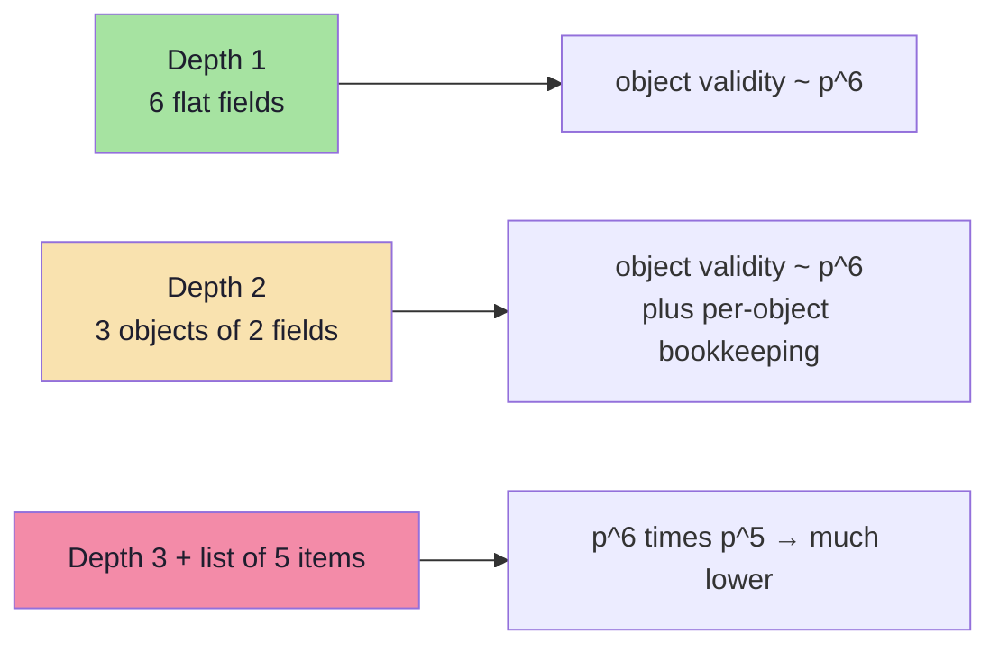

| Depth cost | Why |
|---|---|
| **More output tokens** | Braces, keys and indentation for every level |
| **More places to fail** | A malformed child invalidates the parent |
| **Harder repairs** | "Fix `items[3].address.city`" is a much harder instruction than "fix `city`" |
| **Grammar cost** | Deep/recursive structures enlarge the compiled grammar (Ch. 05) |
| **Worse partial parsing** | Streaming benefits shrink when values live deep in the tree |

**Rule of thumb:** *flatten until nesting buys you something.* Group fields only when the group is a real domain
concept that travels together (an address, a monetary amount with a currency) or when it is optional **as a unit**.

---

## 04.6 Arrays and lists

Lists are where "mostly works" becomes "sometimes catastrophically wrong". Four constraints to always consider:

| Constraint | Why it matters |
|---|---|
| `maxItems` | Bounds cost, latency and blast radius; prevents the model from inventing 200 items |
| `minItems` | Prevents an empty list when the task requires at least one |
| `items` schema | Without it, element types drift; with it, each element is validated |
| Element `description` | Explains *what one item is*, which is the commonest source of confusion |

```json
{
  "type": "array",
  "minItems": 1,
  "maxItems": 10,
  "items": {
    "type": "object",
    "additionalProperties": false,
    "required": ["name", "role"],
    "properties": {
      "name": { "type": "string", "description": "Full name of the attendee" },
      "role": { "type": "string", "enum": ["ORGANISER", "PARTICIPANT", "OPTIONAL"] }
    }
  }
}
```

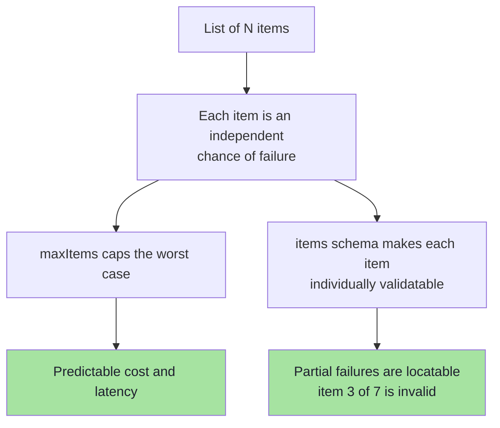

> **Practical warning:** a long list is often better modelled as **N independent calls**, one per item. It is more
> requests, but each is independently retryable, cacheable and measurable — and a failure loses one item instead of
> the whole response.

### 04.6.1 One call or N calls? *(beyond the source)*

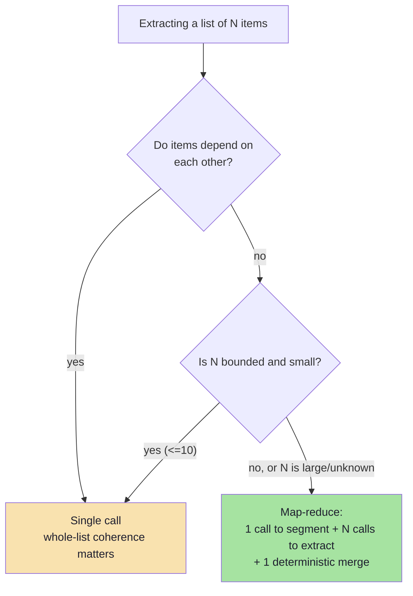

| Pattern | When it wins | Failure behaviour |
|---|---|---|
| **Single call** | Coherence matters; items are few; the document is short | All-or-nothing; one bad item fails the object |
| **Map-reduce** | Long documents; many independent items; per-item retry is valuable | Partial success is representable and reportable |
| **Fan-out with parallelism** | Latency matters; items are truly independent | Needs a bound on concurrency and a budget cap |

---

## 04.7 Strings: normalisation is a schema responsibility

Most extraction bugs are string-format bugs. The schema is the right place to fix them, because the `description`
is instruction and `format`/`pattern` is verification.

| Domain | Wrong (ambiguous) | Right (normalised) |
|---|---|---|
| Dates | `"tomorrow"`, `"02/10/2026"` | `"2026-10-02"` with `"format": "date"` |
| Times | `"4 PM"` | `"16:00"` (24h) or full ISO date-time |
| Durations | `"half an hour"` | `durationMinutes: 30` with `minimum: 1` |
| Money | `"$1,200.50"` | `{ "amountMinor": 120050, "currency": "USD" }` |
| Phone | `"(212) 312-3430"` | E.164 `"+12123123430"` with `pattern` |
| Booleans | `"yes"`, `"maybe"` | `true` / `false` / `null` |
| Language | `"English"`, `"eng"` | BCP-47 `"en-US"` |
| IDs | `"#1234"` | `"1234"` with `pattern: "^[0-9]+$"` |
| Timezone | `"IST"`, `"India time"` | IANA `"Asia/Kolkata"` |

```json
{
  "amountMinor": {
    "type": "integer",
    "minimum": 0,
    "description": "Amount in the smallest currency unit, e.g. cents. 12.50 USD is 1250."
  }
}
```

**Money is the canonical example of why this matters.** Floating-point currency is a defect; an integer minor unit
plus a currency code is the only schema that survives arithmetic.

### 04.7.1 The relative-date trap *(beyond the source)*

"Tomorrow" is not a value; it is a function of *today*, evaluated in a *timezone*, by a *person*. Three rules:

1. **Put the reference instant in the prompt**, explicitly: `"Today is 2026-10-01 (Asia/Kolkata)."` — the model
   cannot infer it reliably.
2. **Emit a resolved instant plus a timezone field**, never a bare local time: `startIso` + `timeZone`.
3. **Verify with a semantic check.** A date in the past for a future meeting is a `block`-severity issue (Ch. 06).

> **Why this is a schema responsibility, not a prompt responsibility:** the schema *declares* that a resolved
> instant is required (`format: date-time`, `required`), so an unresolved `"tomorrow"` cannot pass validation. The
> prompt helps the model succeed; the schema makes failure detectable.

---

## 04.8 Numbers and booleans

| Rule | Rationale |
|---|---|
| Use `integer` for counts, durations, quantities | Floats invite `29.999999` |
| Use `number` only for genuine measurements and scores | — |
| Always add `minimum` / `maximum` | Turns "impossible value" into "validation error" |
| Prefer `exclusiveMinimum` / `exclusiveMaximum` when zero is invalid | `"exclusiveMinimum": 0` beats `minimum: 1` for "positive" |
| Never use a number to encode a category | `1 = urgent` is an untyped enum |
| Prefer `boolean` + `null` over string tri-states | `"maybe"` is not a truth value |
| Put units in the field name | `durationMinutes`, `weightGrams`, `distanceKm`, `amountMinor` |
| Avoid floats for money | Use integer minor units + a currency enum |

### 04.8.1 Units in names: why it is not pedantry

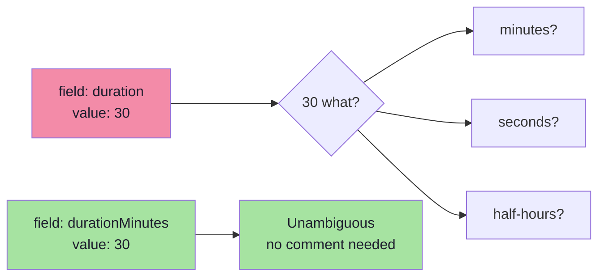

The name is the cheapest documentation that can never drift out of sync with the value. A unit in a `description`
can be ignored; a unit in the *name* is part of the contract.

---

## 04.9 Nullability vs optionality

These are **not** the same thing, and conflating them is a frequent source of bugs.

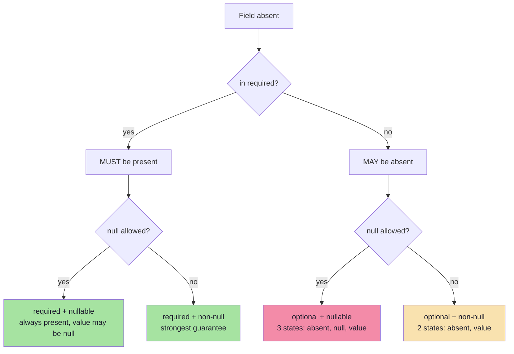

**Guidance:**

- `required + non-null` → for facts that always exist in the input.
- `required + nullable` → for facts that may not exist in the input ("the user did not mention a location").
  **This is the default you should reach for.**
- `optional + *` → avoid unless the field genuinely represents "this concept is not applicable". Three states
  (absent, null, value) is a state machine nobody wants to debug.

### 04.9.1 The three-state trap in practice *(beyond the source)*

```ts
// pseudo-code — what optional+nullable does to every read site
const city =
  meeting.location === undefined ? "unknown"
  : meeting.location === null    ? "not provided"
  : meeting.location;                      // three branches, forever, everywhere
```

Versus the required+nullable version:

```ts
const city = meeting.location ?? "not provided";   // one branch
```

> **Design rule:** every field you make optional adds a branch to *every* consumer. Make it required and nullable
> instead, and put the "why is it null" information in a separate, explicit flag (`needsHuman`, `locationKnown`).

---

## 04.10 The reasoning-field pattern

A well-known and highly effective design: put a short natural-language reasoning field **before** the answer fields
in the schema.

```json
{
  "type": "object",
  "additionalProperties": false,
  "required": ["reasoning", "priority", "category", "needsHuman"],
  "properties": {
    "reasoning": {
      "type": "string",
      "description": "One or two sentences explaining which evidence in the input drives the classification. Keep it under 40 words."
    },
    "priority":  { "type": "string", "enum": ["LOW", "MEDIUM", "HIGH", "CRITICAL"] },
    "category":  { "type": "string", "enum": ["BILLING", "TECHNICAL", "ACCOUNT", "OTHER"] },
    "needsHuman":{ "type": "boolean" }
  }
}
```

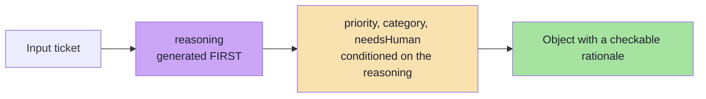

**Why it works:**

1. **Autoregressive conditioning.** Because the reasoning tokens are generated before the label tokens, the labels
   are conditioned on an explicit analysis rather than being a reflex.
2. **Auditability.** Every classification ships with a rationale a human can review — essential for regulated
   workflows.
3. **Cheaper evaluation.** A wrong label with a *good* rationale points at the schema or the prompt; a wrong label
   with a *bad* rationale points at the input or the model.
4. **Better repair prompts.** When validation fails, the reasoning explains *why* the model chose a value.

**Costs and cautions:**

| Cost | Mitigation |
|---|---|
| Extra output tokens → higher latency and cost | Cap the field: "under 40 words" |
| The rationale can be post-hoc and plausible rather than causal | Do not treat it as ground truth; use it as a debugging aid |
| It can leak into downstream systems that only expect the answer | Keep the reasoning field at the edge; strip it before persistence if needed |
| It is not a substitute for chain-of-thought when the task needs *exploration* | For hard reasoning, consider a two-call design: think freely, then extract |

> **Ordering is part of the contract.** The reasoning field works because it comes *first* in the property order.
> Put it last and you get a justification, not an influence.

### 04.10.1 Two-call "think then extract" *(beyond the source)*

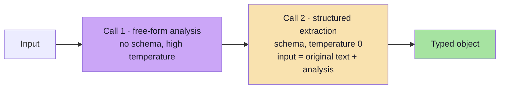

| When to prefer it | Why |
|---|---|
| The task needs real exploration (multi-hop, comparison) | A single constrained pass cannot "wander" |
| The reasoning would exceed a 40-word cap | Free-form thinking needs room |
| You want to cache the analysis separately | The analysis is reusable across schemas |

Cost: two calls, and the second call's input is longer. Benefit: better answers on hard tasks *and* a reasoning
field that is genuinely analytical.

---

## 04.11 The token cost of a schema

Schemas are not free. In most APIs the schema is serialised into the request, so it consumes **input tokens on
every call** and, in strict mode, may also affect prompt caching.

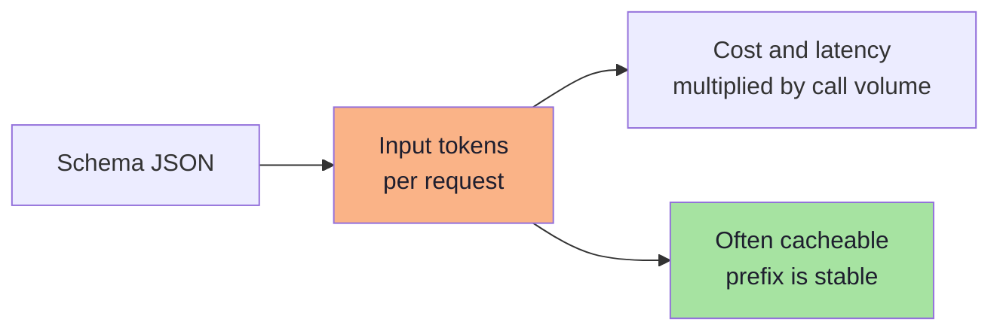

Practical budgeting rules:

| Rule | Rationale |
|---|---|
| Keep schemas **shallow and narrow** | Fewer tokens, fewer failure modes |
| Prefer **one schema per task** over one mega-schema | A mega-schema costs tokens on every call and increases confusion |
| Shorten `description`s to what changes behaviour | A description that repeats the field name is pure cost |
| **Cache** the schema-bearing prefix where supported | Stable prefixes are usually cacheable |
| Measure `input_tokens` with and without the schema | Know the real overhead before scaling |

> **Rule of thumb (illustrative):** a well-designed extraction schema costs on the order of a few hundred input
> tokens; a careless one costs thousands. At a million calls a month, that difference is a line item.

### 04.11.1 Where schema tokens hide *(beyond the source)*

| Hidden cost | Where it comes from |
|---|---|
| Enum members listed in full | A 40-member enum is ~200 tokens on every call |
| Verbose `description`s | Marketing prose in a schema is billed per call |
| Nested `$defs` repeated | Some providers inline refs, duplicating sub-schemas |
| The schema being sent *twice* | Once in the system prompt, once in `response_format` — check your adapter |
| The repair prompt repeating the schema | Never send the schema twice in one conversation (Ch. 06) |

---

## 04.12 Twelve rules for LLM-friendly schemas

```mermaid
flowchart TD
    R["Schema design rules"] --> S1["1 · One schema, one task"]
    R --> S2["2 · Start from the consumer"]
    R --> S3["3 · Flatten by default"]
    R --> S4["4 · Enum every closed set"]
    R --> S5["5 · Required + nullable"]
    R --> S6["6 · Close every object"]
    R --> S7["7 · Constrain numbers and lists"]
    R --> S8["8 · Normalise strings"]
    R --> S9["9 · Describe every field"]
    R --> S10["10 · Avoid unions"]
    R --> S11["11 · Bound the output size"]
    R --> S12["12 · Version the schema"]

    style R fill:#f9e2af,color:#1e1e2e
    style S5 fill:#a6e3a1,color:#1e1e2e
    style S10 fill:#f38ba8,color:#1e1e2e
```

| # | Rule | Because |
|---|---|---|
| 1 | **One schema per task** | Mixing extraction, classification and summarisation in one call confuses all three |
| 2 | **Design from the consumer's requirements** | You extract what the downstream call needs, not everything the text mentions |
| 3 | **Flatten by default** | Depth compounds the failure rate (§04.5.1) |
| 4 | **Enum every closed set** | Removes an unbounded vocabulary (§04.4) |
| 5 | **Required + nullable over optional** | One rule instead of two states (§04.9) |
| 6 | **Close every object** | `additionalProperties: false` everywhere |
| 7 | **Constrain numbers and lists** | `minimum` / `maximum` / `maxItems` convert nonsense into validation errors |
| 8 | **Normalise strings in the schema** | Dates, times, money, phones, IDs (§04.7) |
| 9 | **Describe every field** | Descriptions are instructions and the highest-leverage token spend |
| 10 | **Avoid unions (`oneOf` / `anyOf`)** | Poorly supported in strict mode and hard for the model to discriminate |
| 11 | **Bound the output size** | `maxLength`, `maxItems`, "under 40 words" — cost and latency are yours to control |
| 12 | **Version the schema** | Add `schemaVersion: { const: "task.v1" }` so stored objects remain interpretable |

### 04.12.1 Rule 10 in detail: why unions hurt

A union forces the model to make a *type* decision, which is harder than making a *value* decision.

| Instead of | Do this |
|---|---|
| `attendee: string OR object` | Two fields: `attendeeName: string` + `attendeeEmail: string \| null` |
| `date: string OR null` plus `dateText: string OR null` | One field `startIso: string` + one `dateUncertain: boolean` |
| `result: { type: "ok", data } OR { type: "error", message }` | One object with `ok: boolean`, `data: object \| null`, `errorMessage: string \| null` |
| `items: A OR B` | Discriminate first in a separate call, or add `kind: enum` to a common shape |

> The general principle: **prefer a wide, flat, mostly-nullable object over a narrow union.** The model fills slots
> far more reliably than it selects types.

---

## 04.13 Anti-patterns

| Anti-pattern | Symptom | Fix |
|---|---|---|
| **The mega-schema** | One 40-field object doing five jobs; every field is slightly wrong | Split into one schema per task |
| **The stringly-typed field** | `"duration": "30 minutes"` | `durationMinutes: integer` |
| **The open object** | Extra keys appear in storage | `additionalProperties: false` |
| **The optional everything** | Tri-state logic across the codebase | Required + nullable |
| **The deep tree** | `a.b.c[0].d.e` repairs | Flatten |
| **The unbounded list** | 200 items, 40-second responses | `maxItems` |
| **The sentinel** | `"N/A"`, `""`, `-1` meaning "unknown" | `null` |
| **The prose enum** | `"priority": "as soon as possible please"` | `enum` |
| **The number-coded category** | `"severity": 3` | `enum` |
| **The description-free field** | The model guesses what `code` means | `description` on every field |
| **The unversioned schema** | Old stored objects are uninterpretable | `schemaVersion` const |

---

## 04.14 Four patterns worth stealing *(beyond the source)*

### 04.14.1 The confidence + abstention pattern

A schema that cannot say "I do not know" will guess. Give it a legitimate way out.

```json
{
  "type": "object",
  "additionalProperties": false,
  "required": ["value", "confidence", "needsHuman"],
  "properties": {
    "value":      { "type": ["string", "null"], "description": "The extracted value, or null if not present." },
    "confidence": { "type": "string", "enum": ["HIGH", "MEDIUM", "LOW"] },
    "needsHuman": { "type": "boolean", "description": "True when confidence is LOW or the value is null." }
  }
}
```

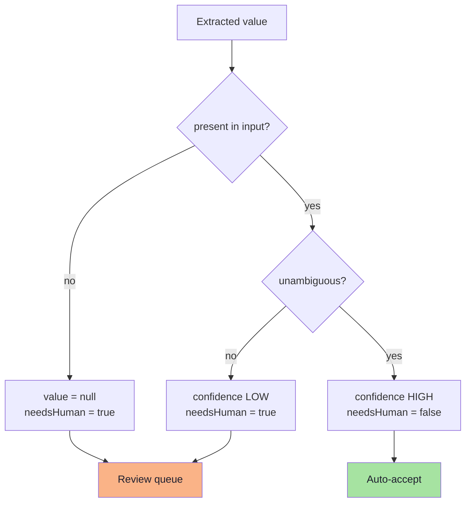

| Benefit | Caveat |
|---|---|
| Abstention is representable, so guessing is unnecessary | Self-reported confidence is **not calibrated** — treat it as a routing hint, not a probability |
| Human review can be targeted at the uncertain 5% | The model may be confidently wrong; calibrate against the golden set (Ch. 09) |
| "Unknown" becomes measurable | Do not let `needsHuman` become an escape hatch the model always takes |

> **Calibration check:** bucket your golden-set results by reported confidence and measure accuracy per bucket. If
> `HIGH` is only 80% accurate, the field is decoration. Chapter 09 shows the harness.

### 04.14.2 The multi-label pattern

For "select all that apply", avoid `oneOf`. Use an array of enum members plus explicit flags:

```json
{
  "required": ["labels", "primaryLabel"],
  "properties": {
    "labels":       { "type": "array", "items": { "type": "string", "enum": ["A","B","C","OTHER"] }, "maxItems": 4 },
    "primaryLabel": { "type": "string", "enum": ["A","B","C","OTHER"] }
  }
}
```

| Why two fields | Reason |
|---|---|
| `labels` | Captures co-occurrence without forcing a choice |
| `primaryLabel` | Gives the deterministic downstream a single routing key |
| `maxItems: 4` | Prevents "label everything" behaviour |
| `OTHER` in both | Keeps the escape hatch consistent |

### 04.14.3 The long-document pattern

Documents exceed the context window, or attention degrades long before it. Do not simply pass more text.

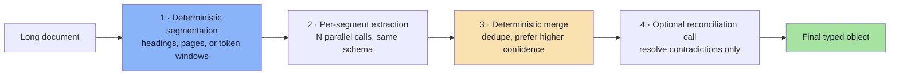

| Rule | Why |
|---|---|
| Segment **deterministically** | Segmenting with an LLM adds a failure mode before you start |
| Merge **in code**, not with a model | Merging is deterministic logic; a model makes it probabilistic |
| Add an overlap between segments | Facts that straddle a boundary get missed otherwise |
| Only use a reconciliation call for *contradictions* | Cheaper and more auditable than a full re-extraction |

### 04.14.4 The "schema per intent" pattern

When one endpoint receives several kinds of request, do not build a mega-schema. Classify first, then extract.

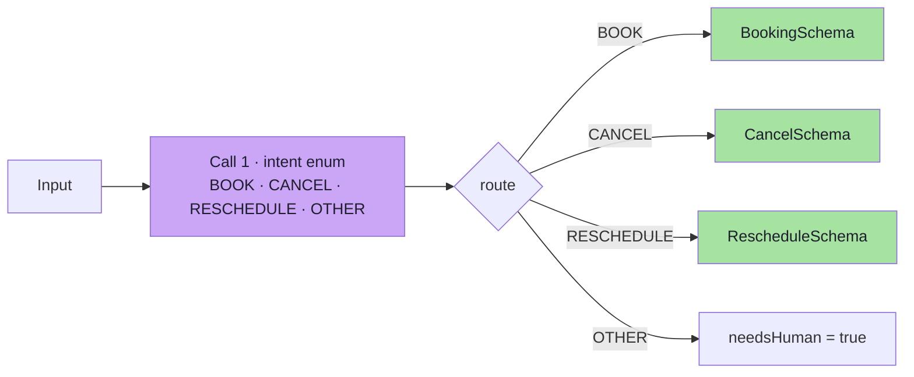

| Benefit | Cost |
|---|---|
| Each schema stays small and satisfiable | An extra call (though a cheap one — a tiny enum) |
| Each intent can be versioned independently | Two places to fail, so both need metrics |
| The classifier's confusion matrix is *itself* a useful dashboard | Intent errors are silent unless you measure per-intent accuracy |

---

## 04.15 Testing the schema itself *(beyond the source)*

A schema is code. Code without tests is a liability — and a schema is *three* artefacts, so it deserves three kinds
of test.

| Test | What it protects | Example assertion |
|---|---|---|
| **Valid fixtures** | The happy path still validates | A clean `MeetingRequest` passes `safeParse` |
| **Invalid fixtures** | The validator actually rejects | `durationMinutes: "30"` fails with a path of `durationMinutes` |
| **Boundary fixtures** | Limits are where you think | `durationMinutes: 480` passes; `481` fails |
| **Snapshot test on the generated JSON Schema** | The wire contract did not change by accident | `expect(MEETING_JSON_SCHEMA).toMatchSnapshot()` |
| **Provider conformance test** | The provider accepts your schema | One live call per provider in CI (or a recorded response) |
| **Property-based test** | Invariants hold for arbitrary input | Any object that validates can be re-serialised and re-validated |

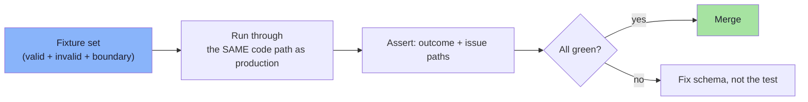

**Three specific tests that repay their cost immediately:**

1. **The "closed object" test** — feed an object with an extra key and assert it is rejected. This catches a
   forgotten `.strict()` the day it happens, not in production.
2. **The "nullable" test** — feed `null` for every nullable field and assert it passes. Nullability is the single
   most common cause of "the model was right but the validator rejected it".
3. **The "schema is not too big" test** — assert the generated JSON Schema's serialised length (or token count) is
   below a budget. Schema creep is real and invisible without a test.

---

## 04.16 Common mistakes at this stage

| Mistake | Why it hurts | Correct habit |
|---|---|---|
| Writing the schema in the prompt as prose only | No validation, no types, no reuse | Machine-readable schema as the source of truth |
| Ignoring the provider's supported subset | The schema is rejected or silently degraded | Test the schema against the provider early (Ch. 05) |
| Assuming strict mode enforces `pattern`/`format`/`minimum` | Those may not be compiled into the grammar | Validate them at runtime (Ch. 06) |
| Deep nesting "for tidiness" | Failure probability compounds per level | Flatten unless the group is a real concept |
| Optional fields everywhere | Three states per field; defensive code everywhere | Required + nullable |
| Free-text fields for closed sets | Unbounded vocabulary | `enum` |
| Sending a 2,000-token schema for a 100-token task | Cost and latency per call | Trim descriptions and split schemas |
| No `schemaVersion` | Stored objects become uninterpretable after a change | `const` version field |
| No escape hatch in an enum | The model must lie when the input does not fit | Add `OTHER` / `UNKNOWN` |
| Units omitted from field names | Silent 30-vs-1800 class bugs | `durationMinutes`, `amountMinor`, `weightGrams` |
| Reasoning field placed last | It justifies instead of influencing | Put it first in property order |
| No tests for the schema | Drift and accidental breaking changes | Fixtures + snapshot + budget tests |

---

## 04.17 Key takeaways

| Idea | Statement |
|---|---|
| Schema roles | Contract for the app, instruction for the model, grammar for the decoder, check for the validator. |
| Four decisions per field | Kind · presence · constraints · meaning. |
| Highest-leverage keywords | `description`, `enum`, `required` + nullable, `additionalProperties: false`. |
| Enums | Every closed set gets an `enum`, with an `OTHER` escape hatch and a small member count. |
| Flatten by default | Depth and list length multiply the failure probability. |
| Units in names | `durationMinutes` is documentation that cannot drift. |
| Nullability ≠ optionality | Prefer required + nullable; avoid tri-state fields. |
| Reasoning field | A short rationale *before* the answers improves labels, auditability and repairs. |
| Normalisation | Dates, times, durations, money, phones, IDs, languages, timezones are the schema's job. |
| Cost | Schema tokens are paid on every call; trim, cache and budget. |
| Evolution | Additive, versioned, never repurpose. |

> **Final mental model:** a schema is a **compression of the task** into a shape the model, the decoder and your code
> can all agree on. Every field you add is a slot to fill *and* a way to fail; every constraint you add is a failure
> converted into a detectable error.

---

## Where this goes next

- **[Chapter 05](./05_Enforcement_Mechanisms_and_the_Strict_Mode_Reality.md)** — which of these keywords the
  decoder actually enforces, and which are silently ignored.
- **[Chapter 06](./06_Validation_Repair_and_Failure_Handling.md)** — what to do when the schema is violated anyway.
- **[Chapter 09](./09_Production_Playbook_Evaluation_and_Go_Live.md)** — the golden set that proves the schema
  works, and the versioning discipline that keeps it working.
- Related: Lecture 08, Ch. 02 for the same JSON Schema vocabulary applied to tool parameters.

---

**Back to:** [Lecture 10 — Chapter Index](../index.md) · [Complete Notes](./Lecture_10_Complete_Notes.md)


