# Chapter 05 — Enforcement Mechanisms and the Strict-Mode Reality

> **Lecture 10 · Chapter 05 of 09** · Level: 🟠 Advanced · Phase 3 — Agency & Contracts
> **Source:** `Forward-Deployed-Engineer/Lecture 13/notes/05_Enforcement_Mechanisms_And_Provider_Landscape.md` ·
> `…/04_JSON_Schema_And_Schema_Design_For_LLMs.md` §4.10 (*Provider subsets: the "strict mode" reality*) ·
> `gen-ai-cohort/week02/learning/day03/notes/04-structured-output-and-function-calling.md`
> (§*How APIs Generate Structured Output?*)
> **Roadmap topics:** enforcement mechanisms & provider landscape (prompt-only → JSON mode → strict schema →
> logit masking) · **the strict-mode subset and its silent limits** (`pattern`, `minimum` ignored by the grammar) ·
> grammar compilation & caching · the tool-use workaround · constrained-decoding tooling: grammars, **Outlines**,
> **Guidance**.
> **Prerequisites:** Chapters 03–04 (why instruction is not enforcement; schema design) · Lecture 02 (logits,
> sampling, temperature) · Lecture 08, Ch. 02 (tool schemas are enforced on arguments).

---

## 05.0 What this chapter is for

Chapter 03 established that "asking" is not "enforcing". This chapter shows **how enforcement actually works** —
token masking and grammars — and then does something the vendor documentation usually will not: it enumerates what
enforcement **does not** cover.

The goal is to be able to answer, for any model and any schema:

> *What is enforced by the decoder, what is enforced only by my validator, and what is not enforced at all?*

By the end of this chapter you should be able to:

1. Draw the **five-rung enforcement ladder** and place any API you use on it.
2. Explain logit masking and incremental parser state in enough detail to debug a "the model refuses to emit my
   field" bug.
3. State the one sentence that governs this entire subject: enforcement guarantees **shape, never meaning**.
4. Describe how a schema becomes a grammar, and name the main compiler families (GBNF, regex, CFG, Outlines,
   XGrammar, llguidance).
5. Recite the **strict-mode subset** rules and, crucially, the keywords that are **accepted but silently ignored**.
6. Use the **tool-use workaround** and explain why it is a workaround.
7. Choose an enforcement level with a decision tree, and price the choice (compilation, caching, schema tokens,
   streaming).

---

## 05.1 The enforcement spectrum, restated

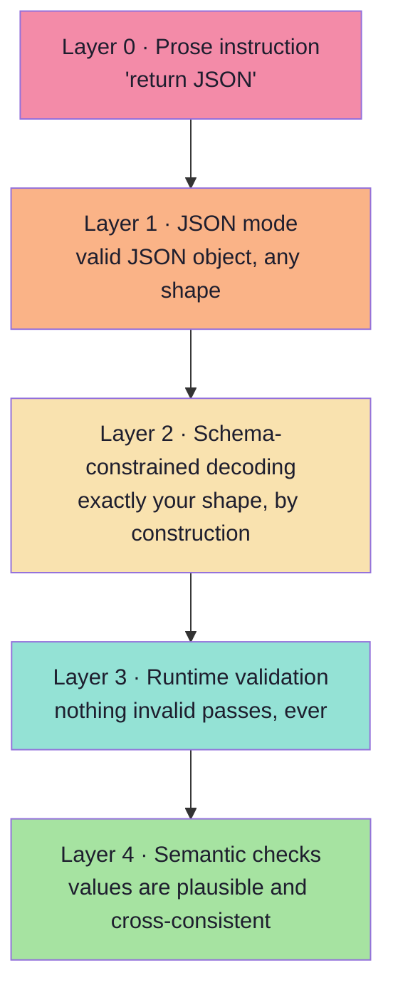

Layers 0–2 are **prevention**; layers 3–4 are **detection**. This chapter is about layers 1–2 (and their limits);
Chapter 06 covers 3–4.

| Layer | Where the guarantee comes from | Who owns it |
|---|---|---|
| 0 · Instruction | The model's willingness | The prompt author |
| 1 · JSON mode | The provider's sampler | The provider |
| 2 · Schema-constrained decoding | The provider's grammar compiler | The provider + your schema |
| 3 · Runtime validation | Your code | You |
| 4 · Semantic checks | Your domain knowledge | You |

> **The asymmetry to remember:** layers 0–2 are somebody else's runtime; layers 3–4 are yours. That is why you keep
> layers 3–4 even when 0–2 are available — and why they are the only layers you can always rely on.

---

## 05.2 How constrained decoding works

The model's final layer produces a **logit** (score) for every token in the vocabulary. Normally the sampler applies
temperature, top-k, top-p and then samples. Constrained decoding inserts one step before sampling:

> **Mask the logits of every token that would make the output invalid, then sample from the rest.**

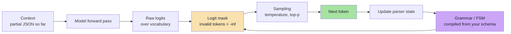

The key idea is the **incremental parser state**. After each emitted token, the runtime updates where it is in the
grammar:

```text
state: expecting object start
emit  {           → state: expecting key or }
emit  "attendee"  → state: expecting :
emit  :           → state: expecting string value
emit  "Rahul"     → state: expecting , or }
```

At every step, only tokens that keep the grammar satisfiable are allowed. **It is impossible to emit an unparseable
document**, because the tokens that would break it were never candidates.

| Concept | Meaning |
|---|---|
| **Logit mask** | A vector that sets disallowed tokens to negative infinity |
| **Grammar / FSM** | A state machine derived from the schema describing all valid token sequences |
| **Grammar compilation** | The (sometimes expensive) step that turns a schema into a state machine |
| **Grammar cache** | Cached compiled grammars keyed by schema — critical for latency |
| **Guided / structured / constrained decoding** | Three names for this same mechanism |

### 05.2.1 The tokenisation subtlety *(beyond the source)*

Masking happens over **tokens**, not characters, and this explains several real-world oddities:

| Observation | Explanation |
|---|---|
| The model "cannot" emit a value with an unusual spelling | The grammar is satisfied by a different tokenisation; token boundaries do not align with your `pattern` |
| Whitespace behaves differently across providers | `{ "a": 1 }` vs `{"a":1}` are different token sequences; grammars differ in whether they allow optional whitespace |
| A field "gets stuck" mid-string | The grammar requires the closing quote, so the model must keep generating characters it did not want |
| `pattern` constraints can cause long, strange outputs | A character-class regex can only be enforced per character; the model rambles inside the class until it satisfies it |
| Streaming chunks look misaligned with fields | Chunk boundaries are token boundaries, not JSON boundaries (see §05.10) |

> **Practical consequence:** if the model seems to fight your schema, the fight is at the token boundary. Simplify
> the `pattern`, remove a deep nesting level, or move the constraint into semantic validation where you control it.

### 05.2.2 What this guarantees — and what it does not

| Guaranteed | Not guaranteed |
|---|---|
| Well-formed JSON | That the JSON is the *right* JSON |
| Every `required` key present | That values are semantically correct |
| No extra keys (if closed) | That `pattern`, `format`, `minimum` were enforced — depends on the compiler |
| Enum values come from the set | That the chosen enum is the correct one |
| No truncation *within* the grammar (the grammar completes) | That the model had enough budget or attention to answer well |

> **The single most important sentence in this chapter:** constrained decoding guarantees the **shape** of the
> output, never the **meaning**. A perfectly shaped object can still be wrong.

---

## 05.3 From schema to grammar

The compilation step is provider-specific, but the families are stable:

| Approach | How it works | Typical use |
|---|---|---|
| **JSON Schema compiler** | Schema → FSM/grammar internally, fully managed | Provider-native structured outputs |
| **GBNF grammars** | A hand-written grammar syntax for local runtimes | llama.cpp-family servers |
| **Regex grammars** | A regex constrains the whole output | Simple fixed formats |
| **CFG libraries** | Context-free grammar engines compiled from schemas | Self-hosted serving stacks |
| **Outlines / XGrammar / llguidance-style engines** | Libraries that compile schemas/grammars and mask logits | vLLM, SGLang, local stacks |
| **Hand-written parser + mask** | You compute the allowed-token set yourself | Research, exotic formats |

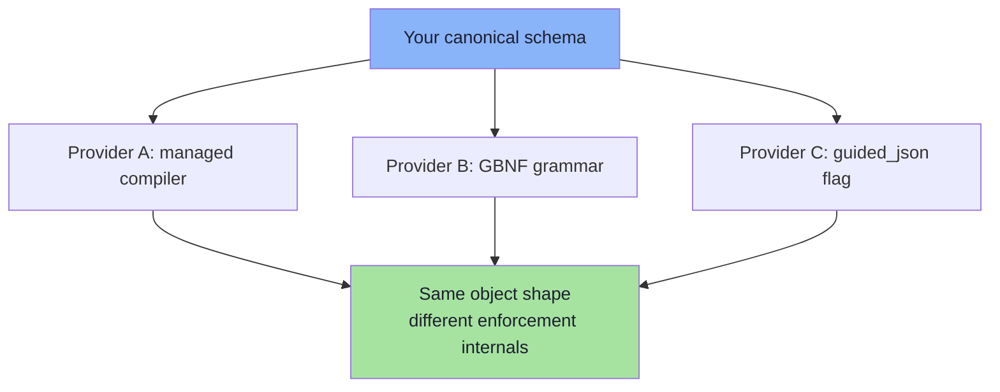

### 05.3.1 Constrained-decoding tooling *(beyond the source, roadmap topic)*

The roadmap names three tools. They occupy different layers of the stack, and confusing them is common.

| Tool | What it is | Where it sits | Use it when |
|---|---|---|---|
| **GBNF** | A grammar **format** (llama.cpp family) | The grammar language | You self-host on a llama.cpp-style server and need a hand-written grammar |
| **Outlines** | A **library** that compiles JSON Schema / regex / Pydantic models into masks and integrates with serving engines | Client/library layer | You self-host (vLLM, Transformers, llama.cpp) and want schema-driven masking without hand-writing grammars |
| **Guidance** | A **framework** for interleaving generation with control flow (templates, loops, selects, regex/schema constraints) | Application layer | You need multi-step constrained generation — e.g. generate a list until a condition, then a summary |
| **XGrammar / llguidance** | High-performance **grammar engines** used inside serving stacks | Engine layer | You operate the inference server and care about mask-computation latency |

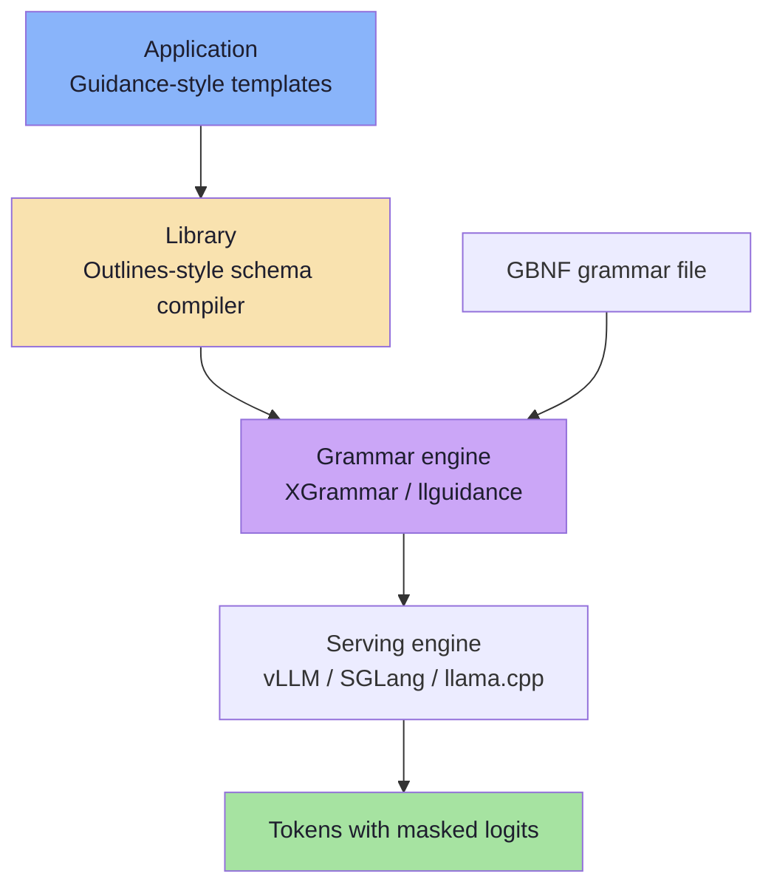

**Portability advice:** keep the canonical schema provider-neutral, and generate the provider-specific form at call
time. Do not hand-edit a GBNF grammar and a JSON Schema independently — they will drift.

---

## 05.4 The strict-mode subset and its silent limits

This is the roadmap's explicit callout, and it is the section that prevents the most production surprises.

### 05.4.1 Why a subset exists

The full JSON Schema specification is enormous. **No decoder implements all of it**, because grammar-constrained
decoding needs a schema that can be compiled into a finite-state machine. Providers therefore publish a *supported
subset* — often called "strict mode".

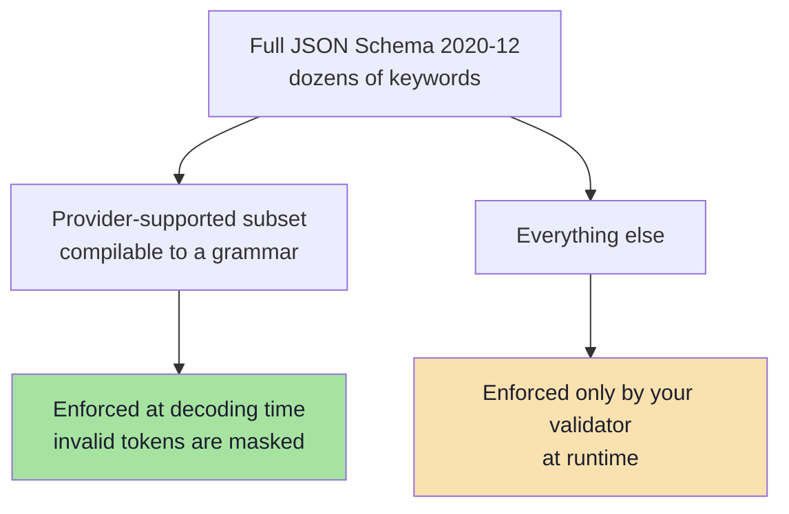

The three reasons a keyword may be excluded:

| Reason | Example keyword | Why it cannot be compiled |
|---|---|---|
| **Not a local decision** | `oneOf` (with overlapping branches) | Deciding which branch is valid requires looking ahead at the whole document, not the next token |
| **Unbounded / expensive** | Arbitrary `pattern`, deeply recursive `$ref` | The state machine explodes |
| **Semantic, not structural** | `format: email`, `format: uri` | "Is this a valid email?" is not a character-level property |
| **Cross-field** | `dependentRequired`, complex `if/then/else` | Requires global knowledge of the object |

> **The mental model:** the decoder can only enforce what is decidable **one token at a time**. Everything else has
> to be checked *after* the object exists — which is precisely what your validator is for.

### 05.4.2 What strict mode usually requires

Patterns that are **widely shared** across strict implementations:

| Constraint in strict mode | Why |
|---|---|
| Every property must appear in `required` | The grammar must know exactly which keys follow |
| Optionality is expressed as **nullable + required** | Removes the "key may be absent" branch from the grammar |
| `additionalProperties: false` is mandatory | The grammar must know when the object ends |
| `oneOf` is usually **not** supported; `anyOf` sometimes is | `oneOf` requires global validation, not a local grammar decision |
| `$ref` / `$defs` are supported but recursion needs care | Deep or cyclic refs explode the grammar |
| Validation keywords (`minLength`, `pattern`, `format`, `minimum`) may be **accepted but not enforced by the decoder** | The decoder enforces *structure*, not value predicates |
| Unsupported keywords are sometimes rejected with an API error | Always test the schema against the provider before shipping |

> **Two consequences for engineers:**
> 1. **A "strict" schema is not a semantically strict schema.** `minimum`, `pattern` and `format` may be silently
>    ignored by the grammar — so your runtime validator is still the only guarantee for those (Chapter 06).
> 2. **Portability is a real cost.** A schema tuned to one provider's subset may be rejected or degraded on another.
>    Keep the canonical schema provider-neutral and generate the provider-specific variant (§05.3).

### 05.4.3 The silent-limits table — what you must validate yourself

This is the checklist to keep next to your validator. Treat every row as "the decoder probably did **not** do this".

| Keyword | Usually enforced by the grammar? | Consequence if you assume yes | Where to enforce instead |
|---|---|---|---|
| `type` | ✅ Yes | — | — |
| `properties` / `required` | ✅ Yes (in strict mode) | — | — |
| `additionalProperties: false` | ✅ Yes (often mandatory) | — | — |
| `enum` (string members) | ✅ Usually | — | — |
| `items` (array element shape) | ✅ Usually | — | — |
| `minimum` / `maximum` | ❌ Often ignored | The 1440-minute meeting passes | Validator + semantic rules |
| `minLength` / `maxLength` | ❌ Often ignored | Empty strings, 10 kB descriptions | Validator |
| `pattern` | ⚠️ Sometimes, poorly | A "valid-looking" but wrong ID passes | Validator (never trust the decoder here) |
| `format` (`email`, `uri`, `date-time`) | ❌ Usually annotation only | `"tomorrow"` passes a `date-time` field | Validator (`z.string().datetime()`) |
| `minItems` / `maxItems` | ⚠️ Sometimes | A 200-item list arrives | Validator |
| `const` | ✅ Usually | — | — |
| `oneOf` / `anyOf` | ❌ Usually unsupported | The request may be rejected outright | Restructure the schema (§04.12.1) |
| `$ref` / `$defs` | ⚠️ Supported, recursion risky | Compilation errors, latency spikes | Inline refs for the wire contract |
| `default` | ❌ Never | The model omits the field and no default appears | Apply defaults in code, after validation |
| `examples` | ❌ Never | Purely a prompt hint | — |
| Cross-field rules (`if/then`, `dependentRequired`) | ❌ Never | Contradictory objects pass | Semantic validation (Ch. 06) |

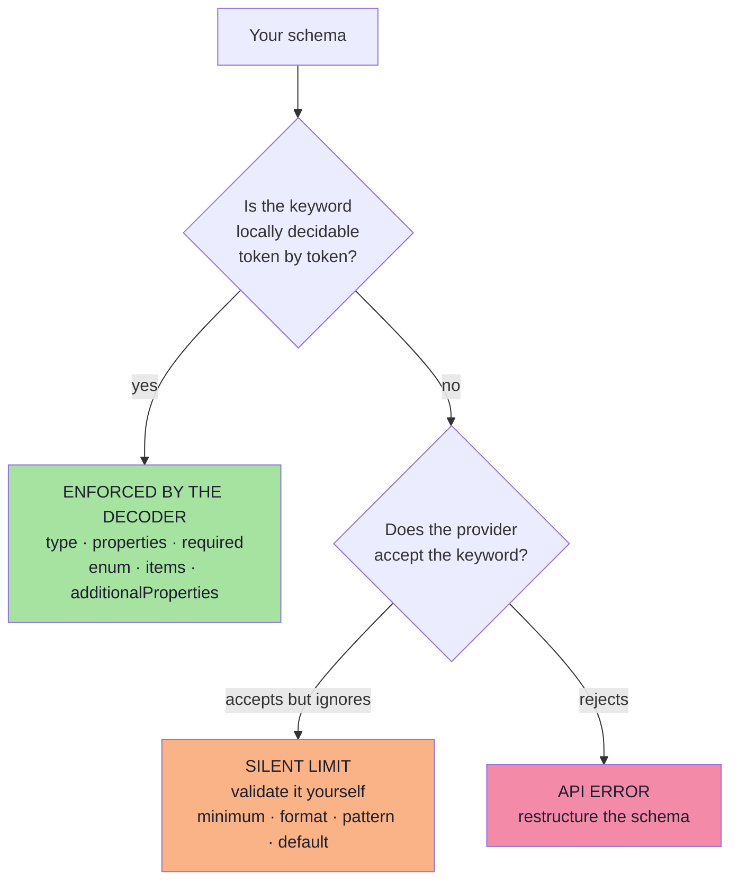

### 05.4.4 Conformance testing per provider *(beyond the source)*

Because the subset is a *documented claim* that drifts, test it rather than trusting it.

| Test | Method | What it catches |
|---|---|---|
| **Schema acceptance** | Send the schema; assert no API error | Unsupported keywords |
| **Silent-limit probes** | Put a deliberately out-of-range value in a *fixture* and check whether the provider ever emits it | A keyword that is claimed but not enforced |
| **Required-field probe** | Ask for an object where one field is genuinely absent in the input | Whether the model invents a value or the grammar blocks a `null` |
| **Enum probe** | Use an input that tempts a synonym (`"one-to-one"` for `ONE_ON_ONE`) | Whether the enum is really enforced |
| **Nesting probe** | Use your deepest schema | Compilation failures or latency spikes |
| **Snapshot** | Record the provider's response to a fixed prompt in CI | Behaviour drift after a provider update |

> **Rule:** a schema conformance test is part of the *contract*, not a nice-to-have. Chapter 09 puts it in the go-live
> checklist.

### 05.4.5 Designing *for* the subset

The practical design rules that follow from everything above:

1. **Keep structural constraints structural** — types, required, enums, closed objects. These are enforced.
2. **Move value constraints to the validator** — ranges, formats, patterns, cross-field rules.
3. **Prefer `anyOf`-free designs** — flatten unions into nullable fields (§04.12.1).
4. **Inline `$ref`s for the wire contract** and keep the DRY version in your code.
5. **Never rely on `default`** — apply defaults in code after validation, where you can test them.
6. **Test the schema against every provider you might switch to**, before you need to switch.

---

## 05.5 The provider landscape

Provider APIs change frequently; treat the table below as **categories with concrete examples**, and always verify
against current documentation before shipping.

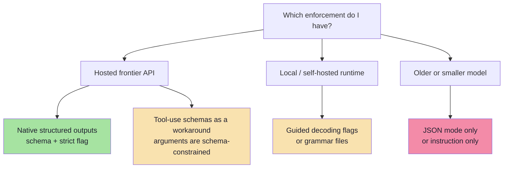

| Capability | What it means | Typical API surface |
|---|---|---|
| **Instruction only** | The prompt asks for JSON | No dedicated parameter |
| **JSON mode** | Output must be a valid JSON object | `response_format: { type: "json_object" }` or equivalent |
| **Native structured outputs** | Schema is passed to the API and enforced during decoding | `response_format: { type: "json_schema", json_schema: { name, schema, strict: true } }` |
| **Tool-use schema** | The schema of a function's *arguments* is enforced; the model "calls" the function | `tools: [{ type: "function", function: { name, parameters } }]` |
| **Guided decoding (self-hosted)** | A schema or grammar is compiled by the serving engine | `guided_json`, `grammar`, or a response-format flag on local servers |
| **Native response schema (other providers)** | A schema is passed alongside a MIME type | `responseSchema` plus `responseMimeType: application/json` |

### 05.5.1 Reading a provider's capability claim *(beyond the source)*

When a vendor says "structured outputs supported", ask these five questions before you rely on it:

| Question | Why it matters |
|---|---|
| Is it **JSON mode** or **schema-enforced**? | Determines whether shape failures are possible |
| Which **subset** of JSON Schema? | Determines whether your `pattern`/`format`/`minimum` do anything |
| Is the schema **compiled once and cached**, or per request? | Determines first-token latency and cost |
| Does it work with **streaming**? | Determines your UX options |
| Does it work with **all models** in the family, or a subset? | Determines your model-routing options |

> **The engineering move:** wrap every provider behind one adapter (see §05.11) so that "which enforcement do I
> have?" is answered in exactly one file, and upgrading to a stronger rung is a configuration change rather than a
> refactor.

---

## 05.6 The tool-use workaround

Before native structured outputs existed, the standard workaround was to define a **single tool** whose parameters
*are* your schema, and force the model to call it:

```ts
// pseudo-code — schema enforcement via a forced tool call
const res = await client.chat.completions.create({
  model: "…",
  messages: [{ role: "user", content: prompt }],
  tools: [{
    type: "function",
    function: {
      name: "emit_meeting_request",
      description: "Return the extracted meeting request.",
      parameters: MEETING_JSON_SCHEMA,     // your schema, enforced on the arguments
    },
  }],
  tool_choice: { type: "function", function: { name: "emit_meeting_request" } },
});

const args = res.choices[0].message.tool_calls?.[0].function.arguments;  // JSON string
```

This works because providers constrain tool-call arguments to the declared parameter schema.

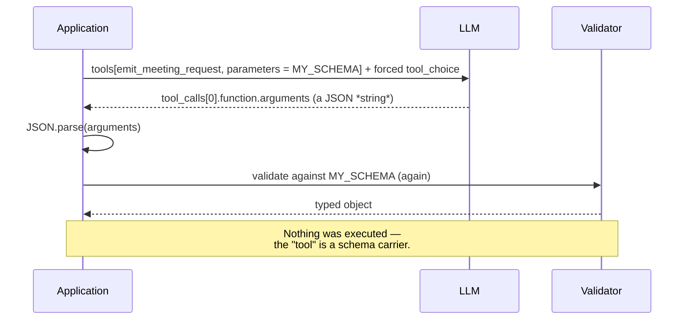

| Advantage | Catch |
|---|---|
| Works on providers without native structured outputs | You receive a **JSON string** that still needs parsing |
| Reuses the tool-schema machinery | The semantics *look* like an action even though nothing executes |
| Often more widely available than strict mode | Refusals surface as "no tool call" rather than a schema error |
| Good escape hatch in a legacy stack | Tool-call arguments may be constrained to a *different* subset than `response_format` |
| | You must still validate; argument schemas are not always fully enforced |

> This is the historical bridge between structured output and tool calling — and the reason Chapter 07 insists on
> keeping the two concepts mentally separate.

---

## 05.7 Choosing an enforcement level

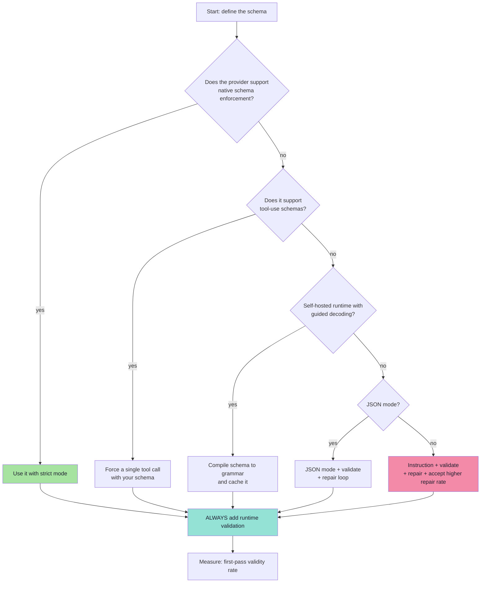

**How to read this tree:** you do not choose the *best* option; you choose the *strongest available* option and then
compensate with validation and repair. Every path ends at the same place — validation plus measurement — which is why
Chapter 06 is not optional regardless of which rung you are on.

| Rung chosen | Expected first-pass validity (illustrative) | Compensating work |
|---|---|---|
| Native strict schema | Highest | Validator for the silent limits (§05.4.3) |
| Tool-use workaround | High | Parse the argument string; validate; handle "no tool call" |
| Guided decoding (self-hosted) | High | Compile + cache grammars; validate silent limits |
| JSON mode | Moderate | Full validator + repair loop |
| Instruction only | Lowest | Full validator + repair loop + expect a higher repair rate |

---

## 05.8 Grammar compilation, caching and the cost of enforcement

Constrained decoding is not free, and the costs are not where people expect them.

| Cost | Cause | Mitigation |
|---|---|---|
| **Grammar compilation** | Turning a schema into an FSM can take milliseconds to seconds for large schemas | Compile once per schema and cache; never per request |
| **Cache invalidation** | Any schema change invalidates the compiled grammar and prompt cache | Version schemas; batch changes |
| **Per-token overhead** | Masking and parser updates on every token | Usually small; measure p95, not mean |
| **First-token latency** | Grammar setup can delay the first token | Keep schemas small; warm the cache |
| **Schema tokens** | The schema occupies input tokens | Trim descriptions; use prompt caching |
| **Reduced flexibility** | The model cannot "explain its way out" of a field | Pair with a `reasoning` field (Ch. 04 §04.10) |

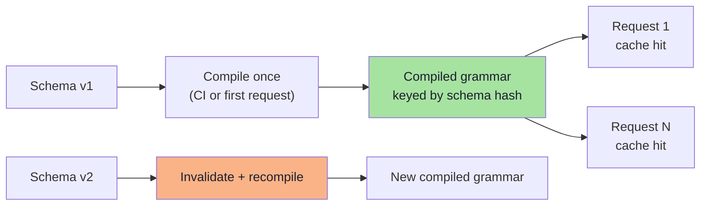

> **Practical rule:** treat the compiled grammar as a **deployable artifact**. Build it in CI, warm it at boot, and
> alert if compilation fails for a new schema version.

### 05.8.1 A caching checklist *(beyond the source)*

| Cache | Key | Invalidate when | Payoff |
|---|---|---|---|
| **Compiled grammar** | Schema hash | Schema changes | Avoids per-request compilation latency |
| **Prompt prefix** (system prompt + schema) | Prompt-prefix hash | System prompt or schema changes | Cuts input-token cost |
| **Extraction cache** | Hash of (input text + schema version + model) | Model or schema changes | Free repeats for identical inputs |
| **Conformance result** | Provider + schema hash | Provider version changes | Skip redundant live probes in CI |

> **Warning about caching extractions:** only cache when the input is *identical* and the task is *deterministic
> enough*. Caching a user's free-text message across sessions can leak one tenant's data into another's response.
> Key the cache per tenant, and never cache across authorisation boundaries.

---

## 05.9 Streaming structured outputs

Streaming and structured output interact badly unless you plan for it. A JSON object is only parseable **when it is
complete** — but users expect tokens immediately.

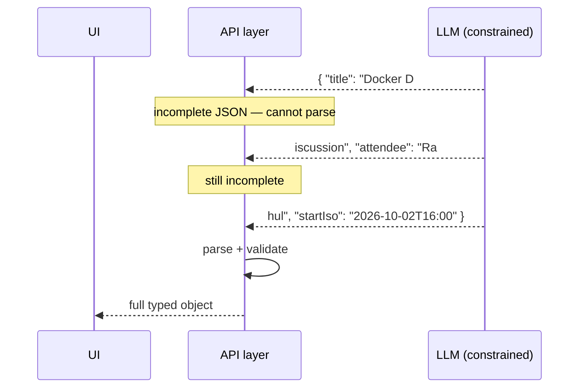

Three strategies, each with a trade-off:

| Strategy | Mechanism | Trade-off |
|---|---|---|
| **Wait for completion** | Buffer the whole response, then parse | Simplest and safest; no progressive UI |
| **Incremental / partial parsing** | A streaming JSON parser emits fields as they complete | Better UX; more moving parts; partial values can mislead |
| **Field-order design** | Put user-visible fields first in the schema | Early fields can render while later ones arrive |

| Concern | Guidance |
|---|---|
| **Validation timing** | Validate the **final** object. Do not act on partially parsed fields. |
| **Field ordering** | Schema property order influences emission order; use it deliberately. |
| **Cancellation** | A user aborting mid-stream leaves a partial object — discard it, never persist it. |
| **Observability** | Log the completion event, not each chunk; chunk-level logs are noise. |

> **Rule:** stream for *perception*, validate for *action*. Never let a partially parsed object reach a side effect.

### 05.9.1 Combining streaming with the reasoning field *(beyond the source)*

The reasoning-field pattern (§04.10) and streaming are natural allies **if you order the schema deliberately**:

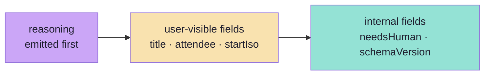

| Position | Field kind | Why |
|---|---|---|
| 1 | `reasoning` | It must influence the answers, and it can stream as a "thinking" indicator |
| 2–n | user-visible answers | They render as they arrive |
| last | internal flags, version | Nobody needs them early, and they are cheap |

---

## 05.10 Edge cases that survive enforcement

Even with Layer 2 active, these remain:

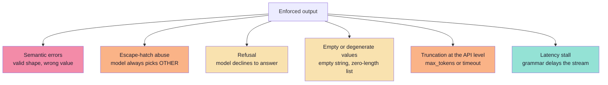

| Edge case | Detection | Response |
|---|---|---|
| Semantic error | Cross-field rules, golden set (Ch. 06, 09) | Flag for review; consider a second-pass verifier |
| Escape-hatch abuse | Track the distribution of `OTHER` / `UNKNOWN` | Investigate the prompt; possibly split the enum |
| Refusal | Empty content, a refusal field, or no tool call | Treat as a first-class outcome, not an exception (Ch. 06) |
| Degenerate values | `minLength`, `minItems`, non-empty checks | Add constraints; validate |
| Truncation | `finish_reason` indicates length | Raise the budget or shrink the schema |
| Latency stall | p95 latency monitoring | Simplify the grammar; check cache warmth |

### 05.10.1 A special case: the "valid but useless" object *(beyond the source)*

Enforcement can produce objects that are structurally perfect and analytically empty. Watch for these:

| Symptom | What it usually means | Fix |
|---|---|---|
| Every field `null` | The schema allowed it and the prompt did not forbid it | Add `needsHuman`, and make the prompt explicit about when `null` is acceptable |
| `reasoning` is generic ("based on the text") | The prompt did not demand evidence | Require a quote: "cite the exact words you used" |
| Enum always `OTHER` | The enum is wrong, not the model | Extend or restructure the enum |
| `title` is a truncated copy of the whole input | No `maxLength`, no instruction | Add `maxLength` and a description of what a title is |
| Numbers at the boundary (`480`, `999`) | The model is guessing | Narrow the range, or add a semantic check that rejects boundary guesses |

> **The general principle:** enforcement removes *malformed* output. It does nothing about *empty* output. Both need
> metrics — and "how many objects were valid but abstained" is a metric Chapter 09 tracks explicitly.

---

## 05.11 Pseudo-code: a provider-agnostic structured call

The engineering pattern is to hide provider differences behind **one adapter** that always ends with validation.

```ts
// pseudo-code — one contract, many providers, always validated
type StructuredResult<T> =
  | { ok: true;  value: T; attempts: number; provider: string }
  | { ok: false; reason: "refused" | "invalid" | "timeout" | "truncated"; raw: string };

async function structuredCall<T>(
  schema: ZodType<T>,
  prompt: string,
  opts: { model: string; maxAttempts?: number }
): Promise<StructuredResult<T>> {
  const jsonSchema = zodToJsonSchema(schema);
  const attempts = opts.maxAttempts ?? 2;

  for (let attempt = 1; attempt <= attempts; attempt++) {
    const raw = await callProvider({
      model: opts.model,
      prompt,
      // strongest enforcement the provider supports:
      //   native schema  >  tool-use schema  >  JSON mode  >  instruction
      enforcement: pickEnforcement(opts.model),
      jsonSchema,
    });

    if (raw.refused)   return { ok: false, reason: "refused",   raw: raw.text };
    if (raw.truncated) return { ok: false, reason: "truncated", raw: raw.text };

    const parsed = schema.safeParse(safeJsonParse(raw.text));
    if (parsed.success) {
      return { ok: true, value: parsed.data, attempts: attempt, provider: opts.model };
    }

    // repair path: pass the validation error, not the raw text (Ch. 06)
    prompt = buildRepairPrompt(prompt, raw.text, parsed.error);
  }

  return { ok: false, reason: "invalid", raw: "" };
}
```

Four properties worth noticing:

1. **The schema is the argument**, not a string buried in the prompt.
2. **Enforcement is chosen per provider**, so the caller never thinks about it.
3. **Validation happens on every path**, including the successful one.
4. **Refusal and truncation are typed outcomes**, not exceptions to be swallowed.

### 05.11.1 The adapter's responsibilities *(beyond the source)*

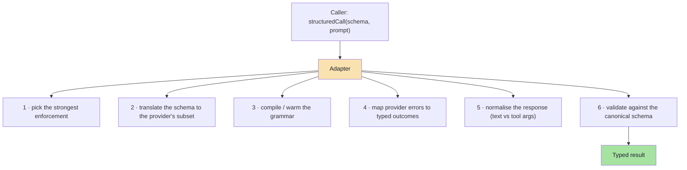

| Responsibility | Why it belongs in the adapter |
|---|---|
| Enforcement selection | One place to change when a provider adds capability |
| Subset translation | Prevents a provider quirk from leaking into your domain schema |
| Grammar warm-up | Turns a per-request cost into a boot-time cost |
| Error mapping | Keeps `429`/`5xx`/refusals out of business logic |
| Response normalisation | Makes "tool args string" and "response text" indistinguishable to callers |
| Validation | Guarantees no caller can forget it |

---

## 05.12 Common mistakes at this stage

| Mistake | Why it hurts | Correct habit |
|---|---|---|
| Believing "strict" means "semantically validated" | `format`, `pattern`, `minimum` may be ignored by the grammar | Validate those at runtime |
| Compiling the grammar per request | Seconds of latency for zero benefit | Compile once, cache, version |
| Switching providers without re-testing the schema | The new provider's subset may reject or ignore keywords | Keep a schema conformance test per provider |
| Acting on partially streamed objects | Half an object can look complete | Validate the final object only |
| Using tool-use as "just structured output" | You inherit tool-call semantics and a JSON string | Use native structured outputs where available |
| Ignoring refusal as a possible outcome | Empty or non-conforming responses look like bugs | Model refusal explicitly (Ch. 06) |
| No measurement of first-pass validity | You cannot tell whether enforcement is working | Track validity rate per schema version |
| Assuming whitespace/format is free | Token-boundary quirks can make a valid schema unsatisfiable in practice | Test the schema live, not just on paper |
| Relying on `default` values | They are not applied by the decoder | Apply defaults in code after validation |
| Caching extractions across tenants | Data leakage between users | Key caches per tenant and per schema version |
| Treating an empty object `{}` as success | JSON mode can return it legally | `required` + validator + non-empty checks |
| Assuming every model in a family supports strict mode | Capability varies by model and by version | Query capability per model in the adapter |

---

## 05.13 Key takeaways

| Idea | Statement |
|---|---|
| The mechanism | Constrained decoding masks logits so invalid tokens cannot be sampled. |
| The guarantee | **Shape, by construction. Never meaning.** |
| The compilation | Schema → grammar/FSM, compiled once and cached; treat it as a build artifact. |
| The strict subset | Every provider supports a **subset**; validation keywords may be accepted and ignored. |
| Silent limits | `minimum`, `maxLength`, `pattern`, `format`, `default`, cross-field rules — validate them yourself. |
| The landscape | Instruction → JSON mode → tool-use schema → native schema enforcement → self-hosted guided decoding. |
| The tooling | GBNF (format), Outlines (library), Guidance (framework), XGrammar/llguidance (engines). |
| The tool-use trick | A forced single tool call with your schema as its parameters — the historical bridge to tool calling. |
| Streaming | Stream for perception, validate for action; never persist a partial object. |
| Costs | Grammar compilation, cache invalidation, schema tokens, first-token latency, reduced flexibility. |
| Surviving edge cases | Semantic errors, escape-hatch abuse, refusals, degenerate values, truncation, latency stalls. |
| The adapter | One file answers "which enforcement do I have?" and guarantees validation on every path. |

> **Final mental model:** enforcement moves the failure boundary. Without it, malformed output is *likely*; with it,
> malformed output is *impossible* — but wrong output is still possible. That is why enforcement and validation are
> complements, not alternatives.

---

## Where this goes next

- **[Chapter 06](./06_Validation_Repair_and_Failure_Handling.md)** — the detection half: validation, repair loops,
  fallbacks and metrics.
- **[Chapter 07](./07_Structured_Output_vs_Tool_Calling.md)** — why the tool-use trick is a *workaround* and how
  real tool calling differs.
- **[Chapter 09](./09_Production_Playbook_Evaluation_and_Go_Live.md)** — how to measure whether the enforcement you
  chose is actually working.
- Related: Lecture 08, Ch. 02 for the wire format of tool schemas.

---

**Back to:** [Lecture 10 — Chapter Index](../index.md) · [Complete Notes](./Lecture_10_Complete_Notes.md)


