# Chapter 06 — Validation, Repair and Failure Handling

> **Lecture 10 · Chapter 06 of 09** · Level: 🟡 Intermediate · Phase 3 — Agency & Contracts
> **Source:** `Forward-Deployed-Engineer/Lecture 13/notes/06_Validation_Repair_And_Failure_Handling.md` ·
> `gen-ai-cohort/week02/learning/day03/notes/04-structured-output-and-function-calling.md`
> (§2 *Zod Schema Validation* · §*Why Zod with AI?*)
> **Roadmap topics:** validation — **structural** (types/enums/bounds) vs **semantic** (is it *true*?) ·
> **`block` vs `review` severities** · repair prompts · bounded loops · the fallback ladder ending in a
> **degraded object**.
> **Prerequisites:** Chapters 03–05 (instruction is not enforcement; schema design; what the decoder enforces and
> what it silently ignores) · Lecture 04, Ch. 06 (verify before trust) · Lecture 09 (the same pattern applied to
> agent tool results).

---

## 06.0 What this chapter is for

Enforcement reduces failures; it cannot eliminate them. Chapter 05 ended with a list of things that survive even a
strict grammar: semantic errors, refusals, degenerate values, truncation. This chapter builds the **detection and
recovery** half of the system.

The claim to internalise:

> **A production structured-output system is judged by its failure path, not its happy path.**

By the end of this chapter you should be able to:

1. State the **boundary rule** and the three corollaries that follow from it.
2. Draw the **reliability loop** and name its only non-terminating risk.
3. Classify any failure into the **eight-class error taxonomy** and give the correct response for each.
4. Separate **structural** from **semantic** validation, and say why semantic validation is where your value lives.
5. Design a repair prompt with the **four ingredients**, and explain why a blind retry cannot work.
6. Build the **fallback ladder**, including the **degraded object** rung.
7. Model refusals, truncation and empty output as **typed outcomes**.
8. Explain why **idempotency** belongs to this chapter and not to the next one.

---

## 06.1 The boundary rule

There is one rule from which everything in this chapter follows:

> **No unvalidated model output may cross into application logic.**

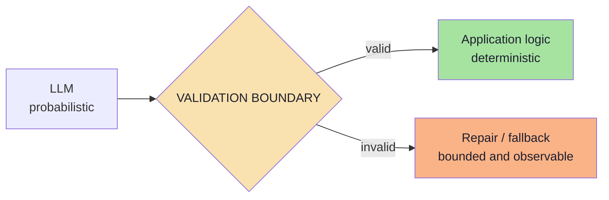

Three corollaries:

1. **The validator is not optional.** Even with strict-mode decoding, validation catches the things the grammar does
   not enforce (§05.4.3).
2. **The boundary is a single place.** One `parse()` call at the edge, not scattered `if (!x)` checks deep in the
   code.
3. **Failure is a designed path.** "It threw an exception" is not a design.

### 06.1.1 Where the boundary belongs in a service *(beyond the source)*

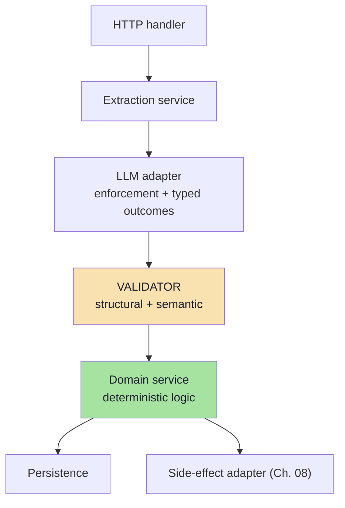

| Layer | May it see raw model output? | May it see a validated object? |
|---|---|---|
| HTTP handler | ❌ | ✅ |
| Extraction service | ✅ (it owns the call) | ✅ |
| **Validator** | ✅ (it is the only place that does) | — |
| Domain service | ❌ | ✅ |
| Persistence | ❌ | ✅ |
| Side-effect adapter | ❌ | ✅ |

> **Why a single boundary matters more than it sounds:** if three services each parse the raw string, you have
> three validation policies, three logging formats and three sets of bugs. One boundary means one place to fix.

---

## 06.2 The reliability loop

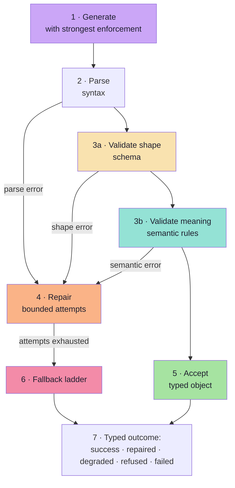

The loop has exactly **one** non-terminating risk — the repair loop — and it is bounded by an attempt count.
Everything else is a straight line.

| Step | Input | Output | Bounded by |
|---|---|---|---|
| 1 · Generate | Prompt + schema | Raw text or tool args | Token budget, timeout |
| 2 · Parse | Raw text | JSON value or parse error | — |
| 3a · Shape | JSON value | Typed object or issues | — |
| 3b · Meaning | Typed object | Issues with severities | — |
| 4 · Repair | Issues + previous output | A new candidate | **Max attempts** |
| 5 · Accept | Valid object | Typed outcome | — |
| 6 · Fallback | Exhausted attempts | A degraded but usable outcome | The ladder's rungs |
| 7 · Report | Any of the above | A discriminated result | — |

> **Design note:** the loop's *shape* is more important than its tuning. A reader of your code should be able to see
> that there is exactly one cycle and exactly one bound.

---

## 06.3 The error taxonomy

Not all failures are equal, and treating them alike is a design error. Each class has a different correct response.

| # | Class | Example | Retryable? | Correct response |
|---|---|---|---|---|
| 1 | **Transport** | Timeout, 429, 5xx | ✅ Yes | Retry with exponential backoff + jitter |
| 2 | **Parse** | Prose around the JSON, truncation | ✅ Yes | Retry, then repair with the error |
| 3 | **Shape** | Missing field, wrong type, enum drift | ✅ Yes | Repair with the validation error |
| 4 | **Semantic** | Impossible date, negative duration, inconsistent totals | ✅ Sometimes | Repair, or escalate to a human |
| 5 | **Refusal** | Model declines, empty output | ❌ No | Surface a typed refusal; do not retry blindly |
| 6 | **Capacity** | `finish_reason: length`, context overflow | ⚠️ Only with changes | Raise the budget or shrink the schema |
| 7 | **Policy** | Content filter triggered | ❌ No | Surface as a blocked outcome |
| 8 | **Schema/configuration** | Provider rejects the schema | ❌ No | Fix the schema; fail the deploy, not the request |

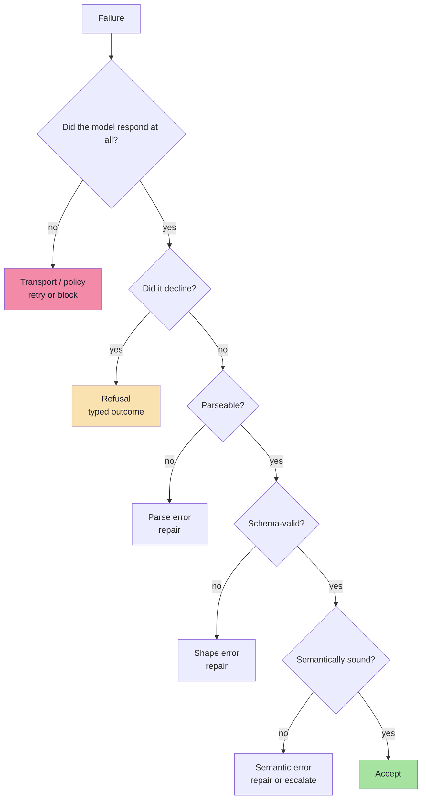

> **Engineering rule:** distinguish **retryable** from **non-retryable** failures *before* writing retry logic.
> Retrying a refusal or a bad schema wastes money and never succeeds.

### 06.3.1 The retry policy per class *(beyond the source)*

| Class | Attempts | Backoff | Escalate to human? | Notes |
|---|---|---|---|---|
| Transport | 3 | Exponential + jitter, capped | No | Standard client-side retry |
| Parse | 2 (1 retry, 1 repair) | None needed | No | Retry with a slightly different prompt, then repair |
| Shape | 1 repair (2 max) | None | No | The repair prompt carries the issues |
| Semantic (`review`) | 0 | — | Yes (queue) | Accept and flag; do not burn calls |
| Semantic (`block`) | 1 repair | None | If still failing | A blocked value may be genuinely unextractable |
| Refusal | 0 | — | Maybe | A refusal is an answer; surface it |
| Capacity | 1, **with a change** | — | No | Raise `max_tokens` or shrink the schema |
| Policy | 0 | — | No | Surface as blocked; never work around it |
| Configuration | 0 | — | No | Fail the deploy, not the request |

---

## 06.4 Two kinds of validation

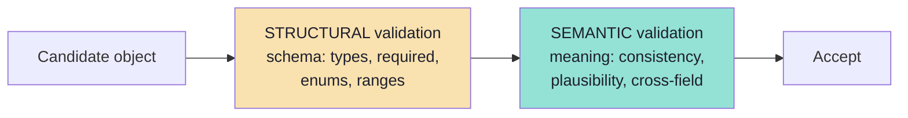

| Kind | Answers | Tooling | Example failure |
|---|---|---|---|
| **Structural** | "Does it match the schema?" | Zod, JSON Schema validator, generated validators | `durationMinutes` is `"30"` |
| **Semantic** | "Is it internally consistent and plausible?" | Hand-written rules, business logic, cross-checks | `startIso` is in the past, `durationMinutes` is 900 |

Structural validation is **automatic and cheap**. Semantic validation is **domain-specific** and is where the real
value lives, because it catches the errors that a schema cannot express.

### 06.4.1 Why the schema cannot do semantic validation *(beyond the source)*

Three reasons, and each one is worth being able to state:

1. **The schema has no clock.** `startIso` is a valid date-time whether it is yesterday or next year. "Must be in the
   future" is a *comparison against now*.
2. **The schema has no other system.** `attendee` is a valid string whether or not that person exists. "Must exist in
   the directory" is a *referential* check.
3. **The schema has no cross-field logic.** `type: INTERVIEW` and `durationMinutes: 15` are both individually valid;
   their *combination* is the error.

> **The rule:** the schema validates the **shape of one object in isolation**. Everything that requires the world —
> time, other systems, other fields — is semantic validation, and it is *your* job.

---

## 06.5 Structural validation in practice

```ts
// pseudo-code — validate at the boundary, once
import { z } from "zod";

const MeetingSchema = z.object({
  title: z.string().min(1).max(120),
  attendee: z.string().min(1),
  startIso: z.string().datetime(),
  durationMinutes: z.number().int().min(1).max(480),
  type: z.enum(["ONE_ON_ONE", "INTERVIEW", "TEAM", "OTHER"]),
  location: z.string().nullable(),
}).strict();

function parseCandidate(raw: string) {
  let json: unknown;
  try {
    json = JSON.parse(raw);
  } catch (e) {
    return { kind: "parse_error" as const, detail: String(e), raw };
  }

  const result = MeetingSchema.safeParse(json);
  if (!result.success) {
    return {
      kind: "shape_error" as const,
      // issues give a machine-readable list of path + message
      issues: result.error.issues.map(i => ({ path: i.path.join("."), message: i.message })),
      raw,
    };
  }

  return { kind: "ok" as const, value: result.data };
}
```

Two design points worth copying:

1. **Return a discriminated result, not throw.** Errors are data; they will be logged, counted and turned into
   repair prompts.
2. **Keep the issue list machine-readable.** `path + message` is exactly what a repair prompt needs, and what a
   metric can aggregate.

### 06.5.1 Validation-failure output shape

```json
{
  "kind": "shape_error",
  "issues": [
    { "path": "durationMinutes", "message": "Expected number, received string" },
    { "path": "type", "message": "Invalid enum value. Expected ONE_ON_ONE | INTERVIEW | TEAM | OTHER, received 'one-to-one'" }
  ]
}
```

This is a *much* better repair input than the raw model output alone.

### 06.5.2 The validator's contract *(beyond the source)*

| Property | Requirement | Why |
|---|---|---|
| **Deterministic** | Same input → same verdict | Otherwise your metrics are meaningless |
| **Total** | Never throws on arbitrary input | It runs on untrusted model output |
| **Cheap** | Milliseconds, no network | It runs on every call |
| **Explainable** | Returns paths and reasons | Repairs and dashboards depend on it |
| **Versioned** | Tied to a schema version | Old objects must be interpretable (Ch. 09) |
| **Side-effect free** | It never writes, calls or mutates | Validation must not be able to cause damage |

> **Anti-pattern to avoid:** a validator that "cleans up" data — trimming strings, coercing `"30"` to `30`, filling
> defaults. That converts a detectable failure into silent data mutation. Either accept it (and log it explicitly) or
> reject it; never quietly rewrite.

---

## 06.6 Semantic validation: the domain layer

Structural validation is the same in every project. Semantic validation is unique to each, and this is where a
Forward Deployed Engineer earns their salary.

| Check | Example rule | Catches |
|---|---|---|
| **Temporal** | `startIso` is in the future; not on a weekend if policy forbids | "tomorrow" resolved to yesterday |
| **Numeric plausibility** | `durationMinutes` between 5 and 480 | The 1440-minute meeting |
| **Cross-field consistency** | `type === "INTERVIEW"` implies `durationMinutes >= 30` | Internally contradictory objects |
| **Referential** | `attendee` exists in the directory | Hallucinated people |
| **Domain invariants** | `endIso > startIso`; currency matches the account | Money and time bugs |
| **Cardinality** | Sum of line items equals the stated total | Silent extraction errors |
| **Provenance** | Every extracted value appears in the source text (high-stakes fields) | Fabrication |
| **Confidence gating** | Low-confidence fields route to human review | Overconfident wrong answers |

```ts
// pseudo-code — semantic layer on top of the schema
type SemanticIssue = { path: string; message: string; severity: "block" | "review" };

function semanticChecks(m: Meeting, ctx: { now: Date; directory: Set<string> }): SemanticIssue[] {
  const issues: SemanticIssue[] = [];

  if (new Date(m.startIso) <= ctx.now)
    issues.push({ path: "startIso", message: "Meeting start is not in the future", severity: "block" });

  if (m.durationMinutes > 240)
    issues.push({ path: "durationMinutes", message: "Duration exceeds the 4-hour policy", severity: "review" });

  if (!ctx.directory.has(m.attendee))
    issues.push({ path: "attendee", message: "Attendee not found in the directory", severity: "review" });

  if (m.type === "INTERVIEW" && m.durationMinutes < 30)
    issues.push({ path: "durationMinutes", message: "Interviews must be at least 30 minutes", severity: "block" });

  return issues;
}
```

**The two severities matter:**

| Severity | Meaning | Action |
|---|---|---|
| `block` | The object is unusable or unsafe | Repair, then fall back |
| `review` | Plausible but needs a human | Accept, flag, and route to a queue |

Collapsing everything into "invalid" means either over-rejecting good data or under-rejecting bad data. Two
severities solve both.

### 06.6.1 Choosing a severity *(beyond the source)*

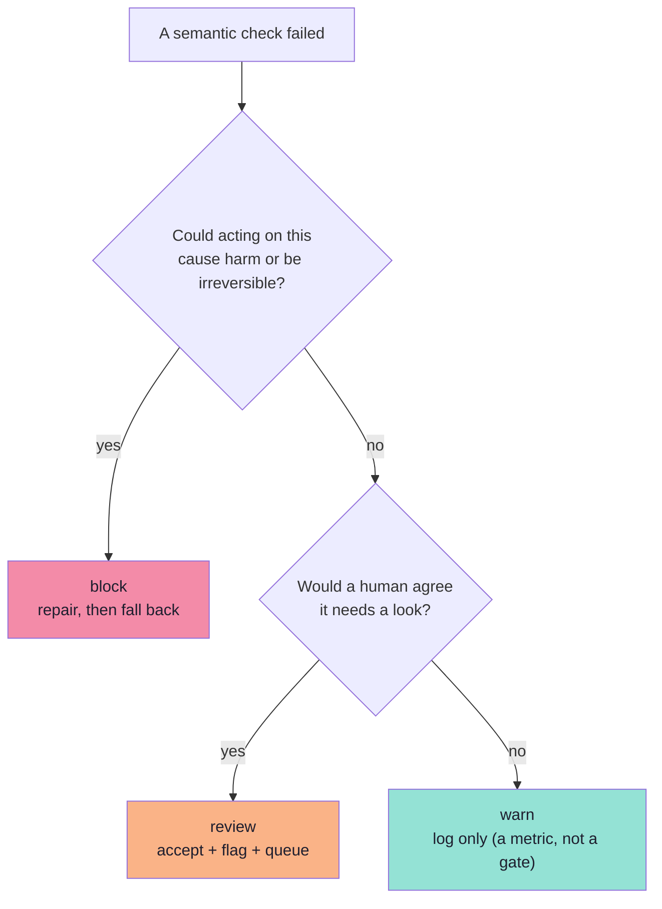

| Severity | Blocks the action? | Blocks acceptance? | Where it goes |
|---|---|---|---|
| `block` | ✅ | ✅ | Repair → fallback ladder |
| `review` | ✅ (for tier-3 actions) | ❌ | Human review queue |
| `warn` | ❌ | ❌ | Metrics only |

> **A useful discipline:** every semantic rule must name *who owns the consequence*. "Duration over 4 hours" is a
> `review` because a human can decide; "start time in the past" is a `block` because the calendar API will reject it
> anyway — and doing so after you have created a partial event is worse.

### 06.6.2 The provenance check *(beyond the source)*

For high-stakes fields, verify that the value you received actually appears in the input.

```ts
// pseudo-code — a cheap, high-value anti-hallucination check
function provenanceCheck(value: string, source: string): boolean {
  const normalise = (s: string) => s.toLowerCase().replace(/\s+/g, " ").trim();
  return normalise(source).includes(normalise(value));
}
```

| Field type | Provenance checkable? | Why it matters |
|---|---|---|
| A person's name | ✅ Usually | Catches invented attendees |
| An invoice number | ✅ Usually | Catches digit hallucination |
| A **resolved** date (`2026-10-02`) | ❌ (the source said "tomorrow") | Needs a *derivation* check instead |
| A **normalised** duration (`30`) | ❌ (the source said "half an hour") | Needs a semantic range check |
| A **classification label** | ❌ (the source has no label) | Needs the golden set (Ch. 09) |

> **The lesson:** provenance works for *extracted* values and fails for *derived* ones. Know which you have — the
> check is only valid for the first kind.

---

## 06.7 The repair loop

A repair is a **second call that includes what went wrong**. It is not a blind retry.

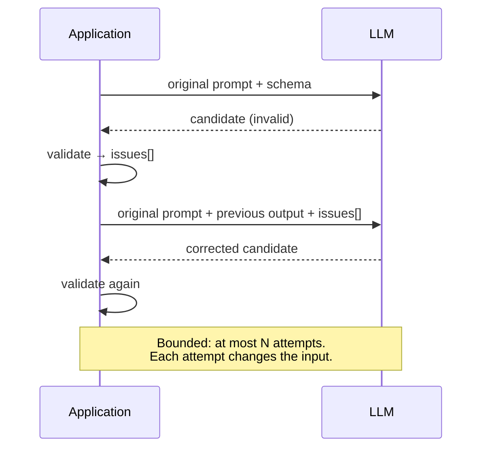

```ts
// pseudo-code — bounded repair with a targeted error message
async function extractWithRepair<T>(
  schema: ZodType<T>,
  input: string,
  maxRepairs = 2
): Promise<{ value: T; attempts: number } | { failed: true; lastError: unknown }> {
  let prompt = buildExtractionPrompt(input, schema);
  let lastError: unknown = null;

  for (let attempt = 0; attempt <= maxRepairs; attempt++) {
    const raw = await callModel(prompt, { temperature: attempt === 0 ? 0.2 : 0, schema });
    const parsed = schema.safeParse(safeJsonParse(raw));

    if (parsed.success) return { value: parsed.data, attempts: attempt + 1 };

    lastError = parsed.error;
    prompt = buildRepairPrompt({ input, previous: raw, issues: flatten(parsed.error) });
  }

  return { failed: true, lastError };
}
```

### 06.7.1 Design rules for the repair loop

| Rule | Why |
|---|---|
| **Bound the attempts** (1–2 is usually enough) | Unbounded loops cost money and delay the failure |
| **Change the input every attempt** | A blind retry samples the same distribution |
| **Include the validation error, not just "try again"** | The error tells the model *which* field and *why* |
| **Lower the temperature on repair** | You want determinism, not creativity |
| **Include the previous output** | So the model edits rather than regenerates |
| **Do not include the schema twice** | It is already in the system prompt; duplication wastes tokens |
| **Log every attempt** | Repair rate is a production metric (Ch. 09) |
| **Never repair a refusal** | A refusal is an answer, not a bug |

### 06.7.2 When a repair is the wrong tool *(beyond the source)*

Repair is a *fix for slips*, not a fix for misunderstanding. Choose differently when:

| Situation | Repair is wrong because | Do instead |
|---|---|---|
| The model consistently misreads a word | It is not a slip; it is a comprehension gap | Improve the prompt with an example, or the schema with an enum |
| The information is genuinely absent | The model will invent something to satisfy the repair | Add `null` handling and `needsHuman` (§04.14.1) |
| The failure is a refusal | It will refuse again | Surface the refusal |
| The failure is truncation | The repair hits the same limit | Raise the budget or shrink the schema |
| The failure is a provider schema rejection | Nothing about the request is wrong at the model level | Fix the schema; fail the deploy |
| The whole object is wrong (not one field) | A targeted edit cannot fix a structural misreading | Re-run with a different prompt/model, or escalate |

> **The repair-rate signal:** if repairs succeed 95% of the time, your failures are slips and the loop is working. If
> they succeed 30% of the time, you have a *task* problem wearing a *format* problem's clothes — and no amount of
> looping will fix it.

---

## 06.8 Designing the repair prompt

The repair prompt is a small, high-leverage artifact. Compare:

**Weak (do not do this):**

```text
That was not valid JSON. Try again.
```

**Strong:**

```text
Your previous output failed validation against the required schema.

Validation errors:
- durationMinutes: Expected number, received string ("30")
- type: Invalid enum value. Received "one-to-one".
        Expected one of: ONE_ON_ONE, INTERVIEW, TEAM, OTHER

Previous output:
{ "title": "...", "attendee": "Rahul", "durationMinutes": "30", "type": "one-to-one" }

Fix ONLY the fields listed above. Do not add, remove or rename any fields.
Return the corrected object only.
```

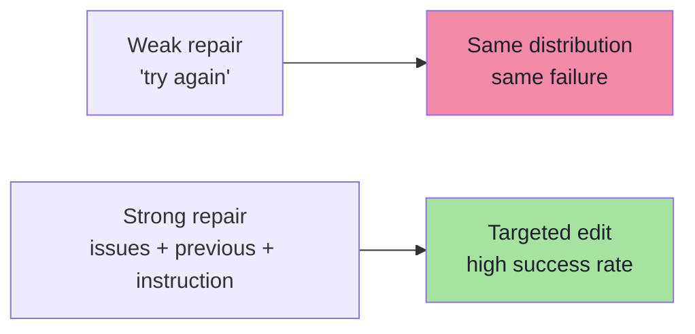

Four ingredients of an effective repair prompt:

1. **The machine-readable issues** (path + expected vs received).
2. **The previous output** so the model edits rather than regenerates.
3. **A scoping instruction** ("fix only these fields").
4. **A format instruction** ("return the object only").

> **Anti-pattern:** sending the *original input text* again in full. It is already in the conversation; repeating it
> dilutes attention and doubles the cost. Reference it, do not restate it.

### 06.8.1 A repair-prompt template *(beyond the source)*

```text
// pseudo-code — a reusable repair-prompt builder
function buildRepairPrompt(args: {
  previousOutput: string;
  issues: { path: string; message: string; received?: string }[];
}): string {
  return [
    "Your previous output failed validation against the required schema.",
    "",
    "Validation errors:",
    ...args.issues.map(i =>
      `- ${i.path}: ${i.message}${i.received ? ` (received: ${i.received})` : ""}`
    ),
    "",
    "Previous output:",
    args.previousOutput,
    "",
    "Fix ONLY the fields listed above. Do not add, remove or rename any fields.",
    "Return the corrected object only.",
  ].join("\n");
}
```

| Design choice | Reason |
|---|---|
| Issues come *before* the previous output | The model reads the problem statement first |
| The previous output is included verbatim | Enables a surgical edit rather than a rewrite |
| "Fix ONLY the fields listed above" | Prevents collateral changes that break other fields |
| "Do not add, remove or rename any fields" | Protects the closed-object contract |
| The schema is **not** repeated | It is already in the system prompt |

---

## 06.9 The fallback ladder

When repair is exhausted, the system must still behave sensibly. Each rung trades quality for availability.

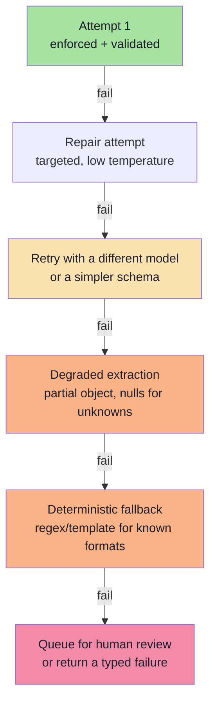

| Rung | Mechanism | When it is right |
|---|---|---|
| 1 · Repair | Second call with the error | The failure looks like a slip (types, enum casing) |
| 2 · Different model / simpler schema | A stronger model, or fewer fields | The task is near the model's capability edge |
| 3 · Degraded object | Fill unknowns with `null`, mark `confidence: "low"` | Downstream can tolerate partial data |
| 4 · Deterministic fallback | A regex/template path for a known input format | The input has structure the LLM was overkill for |
| 5 · Human queue / typed failure | Route to review, or return an explicit error | The action is high-stakes and unverified data is unacceptable |

**Which rung to use is a product decision, not a technical one.** Extracting a meeting title can degrade;
transferring money cannot.

### 06.9.1 The degraded object *(beyond the source)*

The most under-used rung, and often the best one. A degraded object is **a valid object with explicit unknowns**.

```ts
// pseudo-code — the degraded object
const degraded: Meeting = {
  schemaVersion: "meeting.v1",
  title: extracted.title ?? null,                 // maybe we got this
  attendeeName: extracted.attendeeName ?? "Unknown",
  attendeeEmail: null,                            // we could not find it
  startIso: extracted.startIso ?? null,           // unusable without this
  durationMinutes: extracted.durationMinutes ?? 30,
  type: "OTHER",
  location: null,
  needsHuman: true,                               // the honest flag
  degraded: true,                                 // the loud flag
  degradedReason: "attendeeEmail missing; startIso unresolved",
};
```

| Property | Why it matters |
|---|---|
| The **shape** is still valid | Downstream code needs no special case |
| Unknowns are explicit `null`s, not guesses | No silent fabrication |
| `needsHuman: true` | The workflow routes it |
| `degraded: true` + reason | Metrics can count it; reviewers know why |
| It is **not** persisted as if it were verified | Avoids polluting stored data |

> **Two design rules for degraded objects:** (1) never let a degraded object trigger an irreversible action; (2) always
> make degradation *visible* in the same object, not only in logs.

### 06.9.2 Choosing the rung by stakes *(beyond the source)*

| Stakes | Example | Acceptable lowest rung |
|---|---|---|
| **Low** | A meeting title for a draft | 3 · degraded object |
| **Medium** | A support-ticket category | 3 · degraded object (routed to `review`) |
| **High** | A calendar invite sent to a customer | 4 · deterministic fallback, else 5 · human |
| **Critical** | A payment, a deletion, a permission change | **5 only** — never degrade, never guess |

---

## 06.10 Refusals, truncation and empty output

These are **outcomes**, not exceptions. Model them explicitly.

| Outcome | Signal | Handling |
|---|---|---|
| **Refusal** | Empty content, a refusal field, "I can't help with that" | Return `refused`; do **not** retry; surface to the user or queue |
| **Truncation** | `finish_reason` indicates length; unparseable tail | Raise the budget or shrink the schema; never silently accept a partial object |
| **Empty content** | Zero-length response | Treat as a failure; log; retry once with a smaller schema |
| **Policy block** | Content filter triggered | Surface as blocked; do not attempt workarounds |
| **Malformed but complete** | Parse error with a full response | Repair path |

```ts
// pseudo-code — model outcomes explicitly
type Outcome<T> =
  | { kind: "ok";        value: T }
  | { kind: "refused";   reason: string }
  | { kind: "truncated"; raw: string }
  | { kind: "invalid";   issues: Issue[] }
  | { kind: "failed";    error: string };
```

> **Why this matters:** a system that only has "success" and "exception" cannot report *why* it failed, cannot route
> failures differently, and cannot measure anything except a single error rate. Typed outcomes are what make Chapter
> 09's metrics possible.

### 06.10.1 Why a refusal must not be retried *(beyond the source)*

| If you retry a refusal… | What actually happens |
|---|---|
| You spend money | Each attempt is a billed call |
| You add latency | The user waits for a decision the model already made |
| You may get a *worse* outcome | The model may comply under pressure and produce a confident wrong answer |
| You lose the signal | Refusal rate is a metric; retries hide it |

**The correct response to a refusal is a product decision**, and it has three shapes:

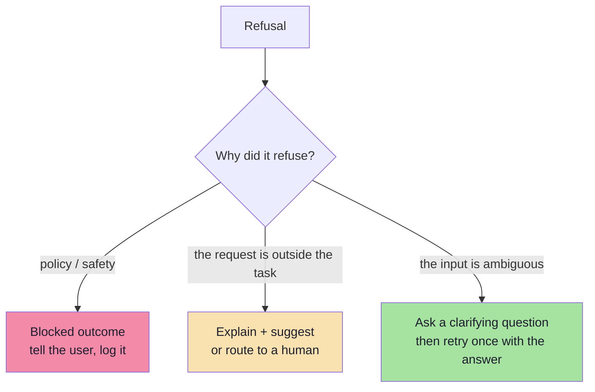

> **Rule:** you may retry a refusal **once** only if the retry *changes the input* — for example, after a clarifying
> question has been answered. Retrying the identical prompt after a refusal is the definition of wasted spend.

---

## 06.11 Idempotency and side effects

The most dangerous bug in a structured-output pipeline is a **side effect that happens before validation**, or one
that happens twice after a retry.

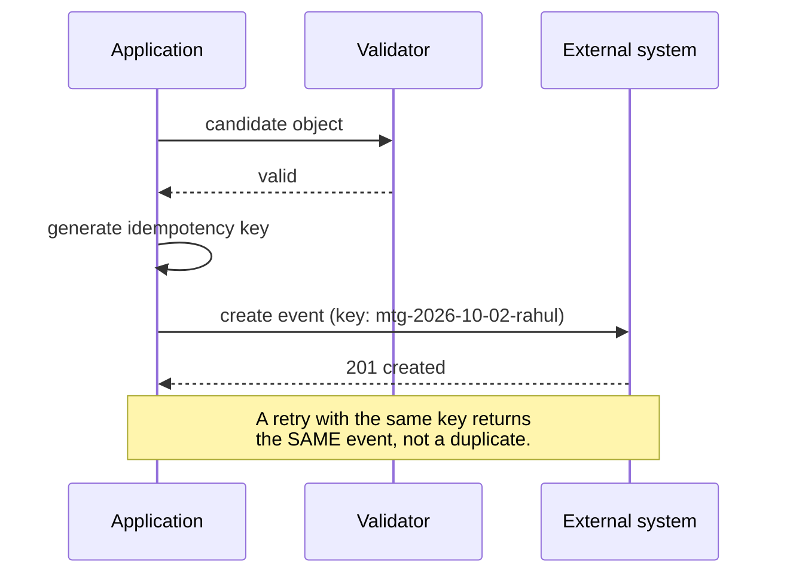

Three rules:

1. **Validate first, act second.** Always. No exceptions.
2. **Use an idempotency key** derived from the object's semantics (attendee + start + title hash), so a retry after a
   timeout does not duplicate the action.
3. **Make the action resumable** — if the process dies between validation and action, a queue should be able to
   complete it exactly once.

> This is where structured output stops being a data problem and becomes a **distributed systems** problem — which is
> precisely what Chapter 08 is about.

### 06.11.1 Why the key must be semantic, not random *(beyond the source)*

| Key strategy | Retry after timeout | Duplicate risk |
|---|---|---|
| **Random UUID per attempt** | A new key → a new event | ❌ Duplicates every time |
| **UUID per request** (generated before the call) | Same key → same event | ✅ Safe, if it survives the retry |
| **Semantic hash of the object** | Same key → same event | ✅ Safest, and survives process restarts |
| **Semantic hash + user id** | Same key per user → same event | ✅ Also prevents cross-user collisions |

```ts
// pseudo-code — a deterministic, semantic idempotency key
function idempotencyKey(m: Meeting, actorId: string): string {
  return sha256([
    actorId,
    m.attendeeName.toLowerCase(),
    m.startIso,
    String(m.durationMinutes),
    m.title.toLowerCase(),
  ].join("|"));
}
```

| Property | Why |
|---|---|
| Deterministic | The same logical action always produces the same key |
| Derived from the object | It does not depend on the request id, the attempt number or the clock |
| Scoped to the actor | Two users booking the same slot are different actions |
| Stable across deploys | A key generated yesterday still deduplicates today |

> **The failure this prevents:** the user clicks "schedule", the network times out, your retry succeeds, and the
> calendar now has two identical meetings. That bug has shipped in every generation of software, and it is always the
> same missing key.

---

## 06.12 Metrics for this stage

| Metric | Definition | Why it matters |
|---|---|---|
| **First-pass validity rate** | Valid on attempt 1 / total calls | Measures the schema + prompt + enforcement combination |
| **Repair rate** | Calls requiring at least one repair / total | If high, fix the schema or prompt, not the loop |
| **Final failure rate** | Calls failing after all attempts / total | The number your users actually experience |
| **Refusal rate** | Refusals / total | Detects over-strict prompts or policy conflicts |
| **Truncation rate** | Length-limited responses / total | Detects an undersized budget or an oversized schema |
| **Issue distribution** | Counts per `path` and error type | Points directly at the worst-designed field |
| **Repair latency p95** | Added latency from repairs | The cost of reliability |
| **Semantic flag rate** | Objects flagged `review` / total | Domain-quality signal, separate from schema validity |

> **The most useful single chart** is the issue distribution: it turns "the model is unreliable" into
> "`durationMinutes` is a string 4% of the time" — a fixable problem.

### 06.12.1 Reading the metrics together *(beyond the source)*

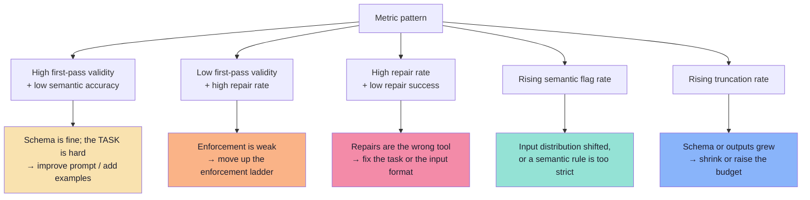

---

## 06.13 Common mistakes at this stage

| Mistake | Why it hurts | Correct habit |
|---|---|---|
| No validator at all | Bad objects reach business logic | Validate once, at the boundary |
| Retrying the identical prompt | Same distribution, same failure | Change the input: add the error |
| Unbounded repair loops | Cost and latency blow up | Cap attempts at 1–2 |
| Treating all failures as retryable | Wasted calls on refusals and bad schemas | Classify before retrying |
| Only structural validation | Semantically impossible objects pass | Add domain rules with two severities |
| Throwing exceptions instead of typed outcomes | Cannot measure or route failures | Return discriminated results |
| Acting before validating | Corrupted external state | Validate → key → act |
| Repairing a refusal | It will never succeed | Model refusal as a terminal outcome |
| Not logging the raw output on failure | You cannot debug what you did not keep | Log raw + issues + attempt count (mind PII) |
| A validator that "cleans" data | Silent mutation instead of a detectable error | Accept or reject; never quietly rewrite |
| Severity collapse (everything is "invalid") | Over-rejecting good data or under-rejecting bad | Use `block` / `review` / `warn` |
| A random idempotency key | Duplicate side effects on retry | Derive the key from the object's semantics |
| Repairs with no metrics | You cannot tell whether the loop earns its cost | Track repair rate and repair success rate |

---

## 06.14 Key takeaways

| Idea | Statement |
|---|---|
| The boundary rule | Nothing unvalidated crosses into application logic. |
| Two validations | **Structural** (schema) is cheap and automatic; **semantic** (domain rules) is where value lives. |
| Error taxonomy | Transport, parse, shape, semantic, refusal, capacity, policy, configuration — each with its own response. |
| Repair | A bounded, error-informed second call with the previous output and the machine-readable issues. |
| Severities | `block` vs `review` (plus `warn`) prevents over- and under-rejection. |
| Fallback ladder | Repair → model/schema change → degraded object → deterministic path → human. |
| Refusals and truncation | First-class typed outcomes, never exceptions — and never blind-retried. |
| Side effects | Validate first, use deterministic idempotency keys, act exactly once. |
| Metrics | First-pass validity, repair rate, final failure rate, issue distribution. |

> **Final mental model:** enforcement makes malformed output unlikely; validation makes it *harmless*. A production
> structured-output system is judged by its **failure path**, not its happy path.

---

## Where this goes next

- **[Chapter 07](./07_Structured_Output_vs_Tool_Calling.md)** — what changes when the validated object is allowed to
  trigger an action.
- **[Chapter 08](./08_From_Data_to_Action_Integrations_and_MCP.md)** — the integration layer: adapters,
  authorisation, idempotency in practice, and MCP.
- **[Chapter 09](./09_Production_Playbook_Evaluation_and_Go_Live.md)** — turning these metrics into a monitoring and
  evaluation plan.
- Related: Lecture 09, Ch. 07 for the HITL approval state machine that consumes these typed outcomes.

---

**Back to:** [Lecture 10 — Chapter Index](../index.md) · [Complete Notes](./Lecture_10_Complete_Notes.md)


