# Chapter 09 — Production Playbook: Evaluation, Versioning and Go-Live

> **Lecture 10 · Chapter 09 of 09** · Level: 🟠 Advanced · Phase 3 — Agency & Contracts
> **Source:** `Forward-Deployed-Engineer/Lecture 13/notes/09_Production_Playbook_Evaluation_And_Checklist.md` ·
> `gen-ai-cohort/week02/learning/day03/notes/04-structured-output-and-function-calling.md`
> (§5 *AI Slop* · §6 *Model Collapse* · §*Continuous Evaluation*)
> **Roadmap topics:** production playbook — **first-pass validity**, **repair rate**, **per-field accuracy**,
> **issue distribution** · schema versioning & safe rollout · the go-live checklist.
> **Prerequisites:** Chapters 05–08 (enforcement, validation, action safety, integrations) · Lecture 12
> (evaluation discipline and stage-local upgrades) · Lecture 30 (evals and testing).

---

## 09.0 What this chapter is for

Everything so far has been about making **one** call correct. This chapter is about making **a million calls**
correct, and about proving it.

It defines the metrics that matter, how to build a golden set for structured output, how to control cost and latency,
how to version schemas safely, and what to check before shipping.

By the end of this chapter you should be able to:

1. State the **production promise** in one sentence and map each part of it to a control.
2. Name the twelve metrics and, more importantly, **read them together** to diagnose a problem.
3. Build a golden set with the five case categories, per-field scoring and "must be null / must refuse" assertions.
4. Describe a trustworthy evaluation harness and its non-negotiable properties.
5. Compute the **expected cost per request** including schema tokens and the repair multiplier.
6. Emit one structured trace per call — without leaking PII.
7. Roll out a schema change safely (shadow → canary → full) and define the rollback.
8. Work the runbook when production misbehaves.

---

## 09.1 What "production" means here

A production structured-output system makes a specific promise:

> **Every object that reaches business logic satisfies the schema, and the rate at which it also satisfies the
> semantics is known, measured and acceptable.**

That sentence has three parts, and each maps to a control:

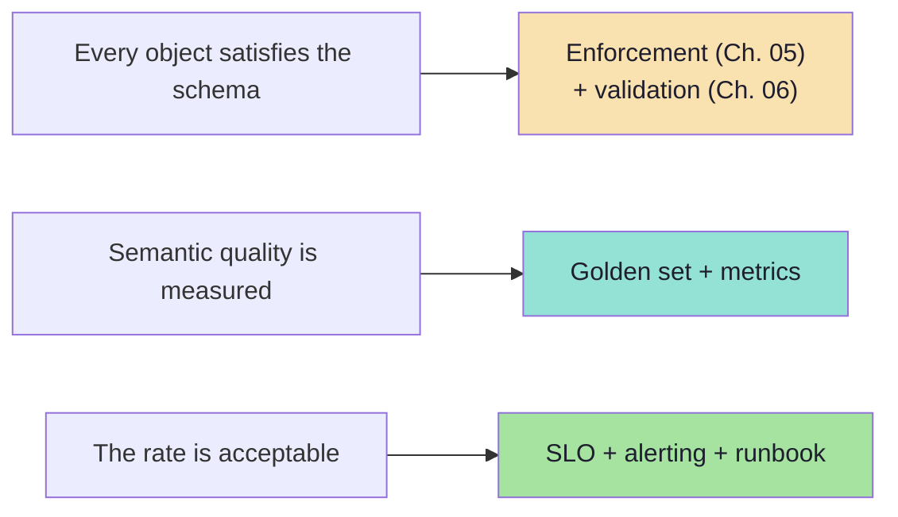

Note what is **absent**: "the model is good". Model quality is not an SLO. *Outcome rates* are SLOs.

### 09.1.1 Writing the SLO *(beyond the source)*

| SLO candidate | Good | Bad |
|---|---|---|
| Validity | "≥ 98% of requests produce a schema-valid object on the first attempt" | "The model is accurate" |
| Availability | "≥ 99.5% of requests return a typed outcome (including `degraded`) within 6 s" | "The LLM is fast" |
| Quality | "≥ 95% per-field accuracy on the golden set, measured per field" | "The answers are good" |
| Safety | "100% of tier-3 actions require approval; 0 unapproved executions" | "The agent is safe" |

> **The rule:** an SLO must be measurable from your own logs, without a human judgement call. If you cannot compute
> it from a trace, it is not an SLO.

---

## 09.2 The metrics that matter

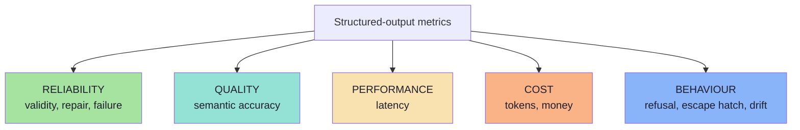

| # | Metric | Definition | Illustrative target |
|---|---|---|---|
| 1 | **First-pass validity rate** | Valid on attempt 1 ÷ total | ≥ 98% with strict enforcement |
| 2 | **Repair rate** | Calls needing at least one repair ÷ total | ≤ 5% |
| 3 | **Final failure rate** | Failing after all attempts ÷ total | ≤ 0.5%, and falling |
| 4 | **Semantic accuracy** | Objects matching the golden label ÷ total | Task-dependent; measured per field |
| 5 | **Semantic flag rate** | Objects routed to `review` ÷ total | Business-defined |
| 6 | **Refusal rate** | Refusals ÷ total | Investigate any increase |
| 7 | **Escape-hatch rate** | `OTHER` / `UNKNOWN` chosen ÷ total | Investigate above roughly 10% |
| 8 | **Truncation rate** | Length-limited responses ÷ total | ≈ 0 |
| 9 | **p50 / p95 / p99 latency** | End-to-end, including repairs | p95 within the UX budget |
| 10 | **Cost per extraction** | Input + output tokens × price, including repairs | Budgeted per feature |
| 11 | **Schema-drift alarms** | Count of unknown-key or type errors | Should be zero |
| 12 | **Issue distribution** | Errors grouped by field path and type | Drives the next fix |

**How to read them together:**

| Pattern | Diagnosis |
|---|---|
| High first-pass validity, low semantic accuracy | The schema is fine; the **prompt/task** is hard — improve instructions or add examples |
| Low first-pass validity, high repair rate, low final failure | Enforcement is weak — move to Layer 2 (Ch. 05) |
| High refusal rate after a prompt change | The prompt became over-restrictive or the policy conflicts |
| Rising truncation rate | Schema or outputs grew; the token budget did not |
| Rising cost with stable volume | Repairs increased, or the schema grew |
| Sudden escape-hatch spike | Input distribution changed — a new category exists |

> **The single most valuable practice:** track the **issue distribution**. It converts an unfalsifiable complaint
> ("the model is unreliable") into a ranked list of specific, fixable defects.

### 09.2.1 A dashboard layout that works *(beyond the source)*

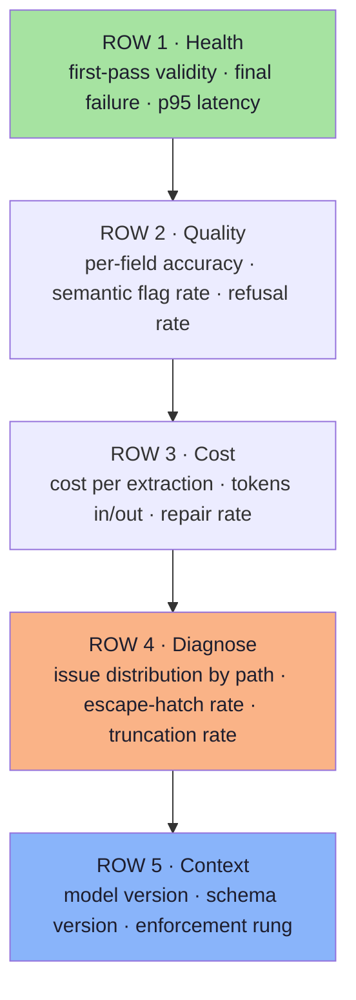

| Why this order | Reason |
|---|---|
| Health first | Answers "is it broken right now?" in one glance |
| Quality second | Answers "is it *right*?" — the metric business owners care about |
| Cost third | Answers "can we afford the current quality?" |
| Diagnose fourth | Answers "what do we fix next?" |
| Context last | Answers "what changed?" — the version stamps make regressions attributable |

> **Always dimension every metric by `schemaVersion` and `model`.** Without those two dimensions you cannot tell a
> regression from a rollout.

---

## 09.3 Building a golden set for structured output

The evaluation set for structured output is different from a RAG evaluation set. It needs **inputs with known correct
objects**, including adversarial ones.

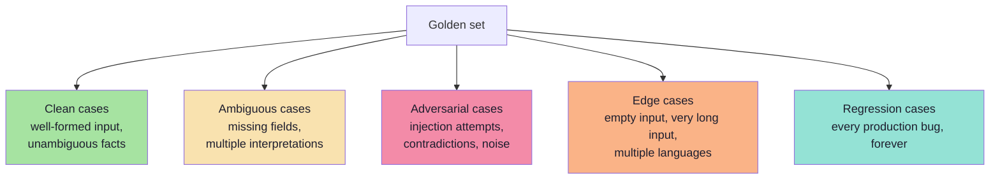

| Size | Purpose |
|---|---|
| **20–30 cases** | Smoke test during development; fast enough to run on every commit |
| **100–300 cases** | Release gate; statistical signal on validity and semantic accuracy |
| **Every production failure** | Regression case, permanently — this is how the set earns its keep |

**What each case stores:**

```ts
// pseudo-code — a golden case for a structured-output task
type GoldenCase = {
  id: string;
  input: string;                       // the raw user/document text
  expected: Partial<Meeting> & {       // partial = field-level scoring
    __mustBeNull?: (keyof Meeting)[];
    __mustRefuse?: boolean;
  };
  tags: ("clean" | "ambiguous" | "adversarial" | "edge" | "regression")[];
  notes?: string;
};
```

Two design details that matter:

1. **Score per field, not just per object.** A case that gets 5 of 6 fields right is not the same as one that gets 0
   right.
2. **Allow "must be null" and "must refuse" assertions.** Modelling absence and refusal as first-class expectations
   is how you catch a model that invents values.

### 09.3.1 What makes a good case *(beyond the source)*

| Property | Why |
|---|---|
| **One fact per case** (or a small, labelled set) | Localises the failure to a field |
| **Realistic noise** | Production inputs have typos, emoji, mixed languages |
| **A stated expected absence** | `__mustBeNull: ["attendeeEmail"]` catches invention |
| **A stated expected refusal** | Catches over-compliance on out-of-scope input |
| **A regression tag** | Links the case to the incident that produced it |
| **No PII** | Redact or synthesise; the set lives in the repository |

> **Anti-pattern:** a golden set made only of clean, well-formed inputs. It will pass on every model and tell you
> nothing about the tail — which is where production lives.

---

## 09.4 The evaluation harness

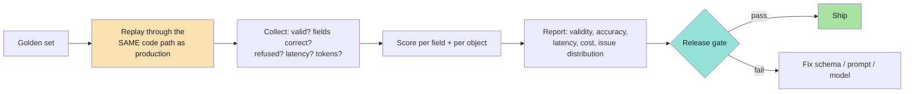

```ts
// pseudo-code — the harness must call the real path, not a simplified one
async function evaluate(cases: GoldenCase[]) {
  const rows = [];

  for (const c of cases) {
    const started = Date.now();
    const outcome = await structuredCall(MeetingSchema, buildPrompt(c.input), { model: MODEL });
    const ms = Date.now() - started;

    if (!outcome.ok) {
      rows.push({ id: c.id, valid: false, reason: outcome.reason, ms });
      continue;
    }

    const fieldScores = scoreFields(outcome.value, c.expected);
    rows.push({
      id: c.id,
      valid: true,
      attempts: outcome.attempts,
      fieldScores,
      accuracy: mean(Object.values(fieldScores)),
      ms,
    });
  }

  return summarise(rows);   // validity, per-field accuracy, p50/p95 ms, repair rate
}
```

**Non-negotiable properties of a trustworthy harness:**

| Property | Why |
|---|---|
| **Uses the production code path** | A harness with a simplified prompt measures nothing real |
| **Reports per-field accuracy** | Object-level accuracy hides which field is broken |
| **Records attempts and latency** | Reliability has a cost; you must see it |
| **Runs on every prompt/schema/model change** | Any of the three can regress quality |
| **Is reproducible** | Pin the model version; record the schema version |
| **Costs little to run** | A 200-case set on a cheap model should cost pennies |

---

## 09.5 Cost and latency budget

Structured output changes the cost model in four specific ways.

| Cost driver | Mechanism | Control |
|---|---|---|
| **Schema tokens** | The schema is sent on every call | Shrink descriptions; cache the prefix |
| **Reasoning-field tokens** | A rationale adds output tokens | Cap its length ("under 40 words") |
| **Repairs** | A repair doubles or triples the call cost | Improve first-pass validity; cap attempts at 1–2 |
| **Grammar compilation** | One-off, but per schema version and per cache miss | Compile at boot; keep schemas stable |

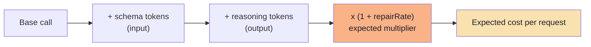

**Worked illustration (not a real price list):**

```text
input tokens  = 1,200 (prompt 900 + schema 300)
output tokens =   150 (object 90 + reasoning 60)
repair rate   =     5%  ->  expected multiplier 1.05

expected tokens/request = (1,200 + 150) x 1.05 = about 1,418
```

Two practical consequences:

1. **A 300-token schema is a 25% input overhead** on a 900-token prompt. Trim it.
2. **A 20% repair rate is a 20% cost increase** *and* a latency increase, on top of a worse user experience. Repair
   rate is a cost metric, not just a quality metric.

### 09.5.1 Latency budget

| Stage | Typical share | Notes |
|---|---|---|
| Network + queue | small | Fixed overhead |
| Prefill (input + schema) | moderate | Grows with schema size |
| Decode (output tokens) | large | Grows with reasoning fields and list lengths |
| Repair (when triggered) | large | A whole second call |
| Validation | negligible | Milliseconds |

> **Latency rule:** the p95 is what users feel. If p95 is dominated by repairs, the fix is *first-pass validity*, not
> a faster model.

### 09.5.2 Cost levers that actually move the number *(beyond the source)*

| Lever | Typical effect | Cost of the lever |
|---|---|---|
| Prompt caching for the schema-bearing prefix | Large input-token reduction | Cache misses on every schema change |
| Shrinking the schema | Proportional input reduction | Fewer hints for the model |
| Raising first-pass validity | Removes the repair multiplier | Engineering time on the schema and prompt |
| Capping the reasoning field | Output-token reduction | Less auditability |
| Model routing (cheap first, escalate on failure) | Large average reduction | Two code paths; escalation latency on failures |
| Batching non-urgent extractions | Large discount on many providers | Hours of latency; not suitable for interactive flows |

> **Do not optimise the schema before measuring.** The cheapest 20% usually comes from prompt caching and from
> eliminating repairs — not from deleting a `description` that was doing real work.

---

## 09.6 Observability: what to log

Every structured call should emit one structured log event — the same discipline as the per-stage trace in
Lecture 12, Ch. 01.

```ts
// pseudo-code — one trace object per structured call
type StructuredTrace = {
  traceId: string;
  task: "meeting_extraction";
  schemaVersion: "meeting.v2";
  model: string;
  attempt: number;                     // 1, 2, ...
  enforcement: "native_schema" | "tool_use" | "json_mode" | "instruction";
  outcome: "ok" | "refused" | "invalid" | "truncated" | "timeout" | "failed";
  issues?: { path: string; type: string }[];   // paths and types, never values
  inputTokens: number;
  outputTokens: number;
  latencyMs: number;
  semanticFlags?: string[];
};
```

| Log this | Why |
|---|---|
| `traceId` | Correlates the extraction with the downstream action |
| `schemaVersion` + `model` | Reproducibility; regression attribution |
| `attempt` | Repair-rate measurement |
| `enforcement` | Confirms the expected enforcement level was actually used |
| `outcome` + `issues` (paths and types, not values) | Issue distribution without leaking PII |
| Token counts and latency | Cost and performance budgets |
| Semantic flags | Domain-quality signal |

**Privacy caution:** the raw model output often contains personal data. Log **paths and error types**, not values;
store raw output only in a short-retention, access-controlled debug store, and never in general application logs.

### 09.6.1 The two-store pattern *(beyond the source)*

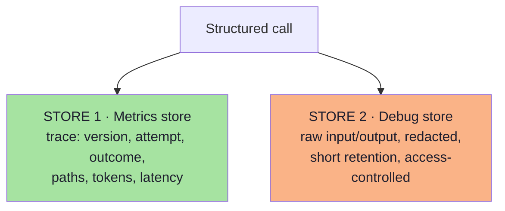

| Store | Retention | Access | Contains |
|---|---|---|---|
| **Metrics** | Long (quarters) | Broad (engineering, product) | No PII, no values |
| **Debug** | Short (days) | Narrow (on-call, with audit) | Redacted raw text |

| Rule | Why |
|---|---|
| Never write raw model output to the general log | Compliance exposure, and it is noise |
| Redact before storing, not before logging | Redaction bugs are silent otherwise |
| Correlate the two stores by `traceId` | Debug without widening the metrics store's access |
| Delete the debug record on a schedule | Retention is a control, not an afterthought |

---

## 09.7 Schema versioning and safe rollout

Because a schema change is an API change, treat it like one.

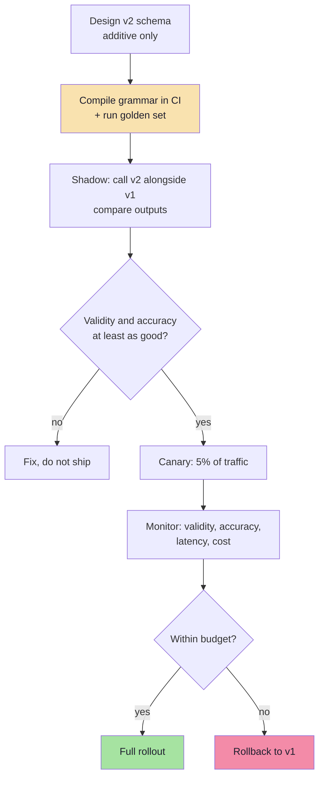

| Practice | Detail |
|---|---|
| **Additive changes only** | New nullable fields, new enum members; never rename or repurpose |
| **`schemaVersion` in the object** | Every stored object declares which contract it satisfies |
| **Dual-write during migration** | Populate both fields for one release |
| **Deprecate, then remove** | One full release cycle between marking deprecated and deleting |
| **Consumers tolerate unknown enums** | Otherwise adding a member is a breaking change |
| **Rollback plan** | Reverting the schema must be a config change, not a hotfix |

### 09.7.1 The model-migration playbook

Changing the model is a schema-level risk, even when the schema is unchanged.

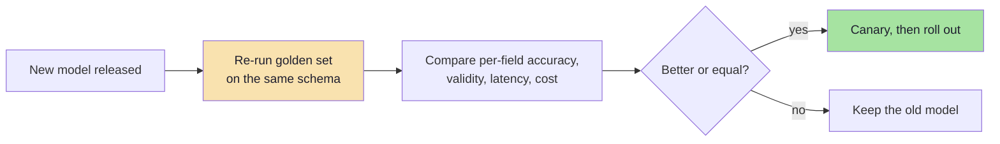

> **Never** migrate a model on the strength of a handful of manual tests. The golden set exists precisely so that a
> model swap is a *measurement*, not a gamble.

### 09.7.2 Breaking-change detection in CI *(beyond the source)*

| Check | Method | Blocks the merge? |
|---|---|---|
| Schema diff is additive | Compare the generated JSON Schema against the previous snapshot | ✅ |
| No field renamed or removed | Compare property names | ✅ |
| No constraint narrowed | Compare `maxLength`/`maximum`/enum members | ✅ |
| Grammar still compiles | Compile in CI | ✅ |
| Golden set still passes | Run the harness | ✅ |
| Provider still accepts the schema | Conformance probe | ✅ (or warn, for non-prod providers) |

> **Why CI and not review:** a schema diff is easy to miss by eye, and its consequences appear in *stored data*, not in
> the pull request.

---

## 09.8 Failure modes at scale and the runbook

| Symptom in production | Likely cause | First action |
|---|---|---|
| Sudden spike in shape errors | Provider changed model behaviour, or a schema was edited | Compare `schemaVersion` and model version with yesterday's baseline |
| Spike in one specific field's errors | A new input format, or a prompt edit | Inspect 20 raw failures for that path |
| Validity fine, accuracy dropped | Prompt regression, or an input-distribution shift | Run the golden set; diff the failing cases |
| p95 latency doubled | Repairs increased, or the schema grew | Check repair rate and schema token count |
| Cost per call rose with flat volume | Repairs, or longer reasoning fields | Check the attempts distribution and output tokens |
| Refusals appeared from nowhere | A policy filter or an over-restrictive prompt | Read the refusal text; check the prompt diff |
| Escape-hatch rate rising | A new category the enum does not cover | Extend the enum (additively) or split the task |
| Duplicate side effects | Missing or non-deterministic idempotency key | Make the key a pure function of the object |
| Silent wrong data | No semantic validation for that field | Add a semantic rule; review recent objects |

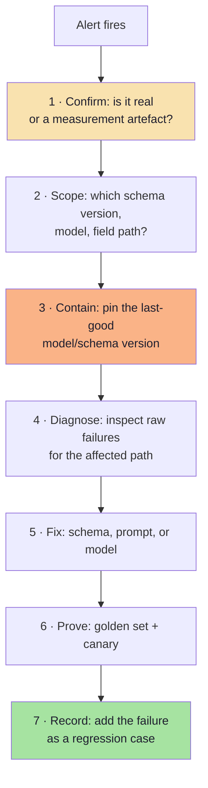

### 09.8.1 The three fastest triage questions *(beyond the source)*

| Question | Where to look | What it distinguishes |
|---|---|---|
| **Did the schema change?** | `schemaVersion` in the traces | A self-inflicted regression |
| **Did the model change?** | `model` in the traces | A provider-side regression |
| **Did the input change?** | Sample the failing inputs | A distribution shift |

If the answer to all three is "no", the fourth suspect is your own prompt or your own validator — and the fifth is the
provider's infrastructure.

> **The habit that makes all of this possible:** every trace carries `schemaVersion` and `model`. Without them, triage
> becomes archaeology.

---

## 09.9 The go-live checklist

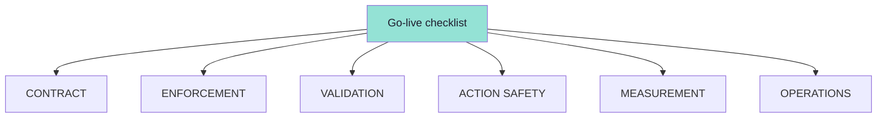

### Contract
- [ ] A machine-readable schema exists, owned by the application.
- [ ] The schema is versioned (`schemaVersion`), and additive-evolution rules are documented.
- [ ] Every field has a `description`; closed sets are `enum`; objects are closed.
- [ ] The schema is provider-neutral, with a generated provider variant.

### Enforcement
- [ ] The strongest available enforcement is used (native schema > tool-use > JSON mode > instruction).
- [ ] The compiled grammar is built in CI and warmed at boot.
- [ ] Schema conformance is tested against every provider you might switch to.

### Validation
- [ ] Structural validation runs at the boundary on every path.
- [ ] Semantic rules exist for the fields that matter, with `block` / `review` severities.
- [ ] Refusal, truncation and empty output are typed outcomes.
- [ ] The repair loop is bounded and includes the machine-readable issues.
- [ ] The fallback ladder is defined, and someone owns each rung.

### Action safety
- [ ] Authorisation happens in code, after validation — never in the prompt.
- [ ] Side effects use deterministic idempotency keys.
- [ ] Tier-3 actions require human approval.
- [ ] Tool arguments are validated as untrusted input.
- [ ] An audit trail records actor, tool, arguments and outcome.

### Measurement
- [ ] A golden set exists (clean, ambiguous, adversarial, edge, regression).
- [ ] First-pass validity, repair rate, final failure rate and per-field accuracy are tracked.
- [ ] Issue distribution is dashboarded.
- [ ] Latency (p95) and cost per extraction are budgeted and alerted.
- [ ] The model version and schema version are recorded on every trace.

### Operations
- [ ] A runbook exists for each failure mode in §09.8.
- [ ] Rollback is a config change.
- [ ] Raw outputs are stored only in an access-controlled, short-retention store.
- [ ] PII is not written to general logs.

---

## 09.10 Interview-ready self-check

1. **Why is "return JSON" in a prompt not a guarantee?** Because generation samples tokens from a distribution;
   nothing validates the result. It is a preference, not a constraint.
2. **What does constrained decoding guarantee, and what does it not?** Shape, by construction. Never semantic
   correctness.
3. **What is the difference between JSON mode and structured outputs?** JSON mode guarantees a *parseable object*;
   structured outputs guarantee *your schema*.
4. **What is the difference between structured output and tool calling?** The object is the final result versus the
   arguments for an action someone else executes.
5. **How would you design a schema for a model?** Start from the consumer, flatten, enum closed sets, required +
   nullable, constrain ranges, normalise strings, describe every field, version it.
6. **How do you handle a validation failure?** Typed error, bounded repair including the issue list, then a defined
   fallback ladder.
7. **Why are tool arguments dangerous?** They are untrusted input produced by a model that may have read untrusted
   content; they must be validated and authorised like a request body.
8. **What is your single most useful production metric?** Issue distribution by field path and error type — it turns
   "the model is unreliable" into a fixable list.
9. **How do you migrate to a new model?** Re-run the golden set, compare per-field accuracy, validity, latency and
   cost, then canary.
10. **What is the risk of a schema change?** It is an API change: renaming, removing or narrowing breaks stored
    objects and consumers. Additive and versioned only.

### 09.10.1 Three more questions this lecture earns *(beyond the source)*

11. **What is the silent limit of strict mode, and what does it force you to do?** Value keywords (`minimum`,
    `pattern`, `format`, `default`, cross-field rules) may be accepted and ignored by the grammar — so a runtime
    validator remains mandatory.
12. **What makes a repair loop a *repair* rather than a retry?** The input changes: the machine-readable issues and
    the previous output are included, and the temperature drops.
13. **When is a degraded object the right answer?** When the stakes are low or medium, the shape can stay valid with
    explicit `null`s, and the object carries `needsHuman`/`degraded` flags so the degradation is visible.

---

## 09.11 Anti-patterns: the complete list

| Anti-pattern | Consequence |
|---|---|
| Prompt-only JSON in production | Silent, unbounded failure |
| No validator at the boundary | Corrupt data reaches business logic |
| Assuming strict mode validates `format` / `pattern` / `minimum` | Impossible values pass |
| Deeply nested schemas | Compounded failure probability |
| Optional fields everywhere | Tri-state logic across the codebase |
| Regex "repairs" of model output | Latent correctness bugs |
| Unbounded repair loops | Cost and latency blow-up |
| Retrying refusals | Wasted spend, no success |
| Acting before validating | Real-world damage |
| Non-deterministic idempotency keys | Duplicate side effects |
| Authorising in the prompt | No security boundary |
| Editing schemas in place | Broken stored data and consumers |
| Migrating models without evaluation | Unmeasured quality regression |
| Logging raw outputs with PII | Compliance exposure |
| Judging quality from one good demo | Invisible regressions |
| A golden set of only clean inputs | The tail is never tested |
| Metrics without `schemaVersion` / `model` dimensions | Regressions are unattributable |
| A single forced tool as your extraction API | Unnecessary cost, semantics and parsing |

---

## 09.12 Why evaluation matters beyond your product *(beyond the source)*

The `gen-ai-cohort` source closes with two ideas that are usually presented as "internet culture" but are actually
**data-quality arguments** — and they explain why Chapter 09's discipline matters at a scale larger than one product.

### 09.12.1 AI slop

**AI slop** is the flood of low-quality, repetitive, unverified AI-generated content published on the internet —
fake blogs, spam articles, clickbait, generated reviews, low-quality tutorials.

| Problem | Consequence for builders |
|---|---|
| Misinformation | Users distrust everything, including your correct output |
| Duplicate content | Search and retrieval quality degrades — which degrades RAG inputs |
| Poor search results | Your retrieval layer inherits the noise |
| Lower trust | The "AI said it" heuristic stops being persuasive |

### 09.12.2 Model collapse

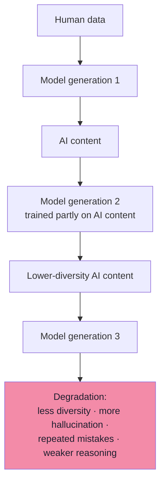

**Model collapse** is the gradual degradation of model quality when newer models are trained primarily on
AI-generated content instead of high-quality human-created data.

| Mitigation | What it means in practice |
|---|---|
| **Human review** | A human checks before publication — which is exactly the `review` severity from Chapter 06 |
| **High-quality source data** | Books, research papers, official documentation, verified educational content, expert-written articles |
| **Guardrails** | Validate inputs, outputs, tool usage and safety rules |
| **Continuous evaluation** | Test regularly with benchmark datasets to detect hallucinations, formatting failures and reasoning regressions *before* deploying updates |

> **The connection to this lecture:** a structured-output pipeline is a *data-production* pipeline. Your validated
> objects, your golden set and your review queue are exactly the mechanisms that keep the corpus clean. The discipline
> is not only for your product's reliability — it is for the health of the data everything else learns from.

---

## 09.13 Common mistakes at this stage

| Mistake | Why it hurts | Correct habit |
|---|---|---|
| No golden set | Every change is a gamble | Build 20–30 cases today; grow to 200 for the release gate |
| Object-level accuracy only | You cannot see which field is broken | Score per field |
| Harness with a simplified prompt | It measures a system you do not ship | Replay the production path |
| No version stamps on traces | Regressions are unattributable | Log `schemaVersion` + `model` on every call |
| Raw outputs in general logs | PII exposure | Two-store pattern; log paths and types only |
| Schema edits without a rollout plan | Stored data breaks silently | Shadow → canary → full, with rollback as config |
| Model migration by vibes | Unmeasured regression | Re-run the golden set; compare per field |
| No dead-letter path for actions | Failures vanish | Queue exhausted retries for review |
| Optimising cost before measuring | You delete `description`s that were doing work | Measure tokens with and without the schema first |
| Treating SLOs as model-quality claims | Unmeasurable and unfalsifiable | Define SLOs as outcome rates from your logs |

---

## 09.14 Key takeaways

| Idea | Statement |
|---|---|
| The production promise | Schema validity is guaranteed; semantic accuracy is **measured** and acceptable. |
| Metrics | First-pass validity, repair rate, final failure rate, per-field accuracy, latency, cost, issue distribution. |
| Golden set | Clean, ambiguous, adversarial, edge and regression cases — with per-field scoring and "must be null / refuse" assertions. |
| Harness | Replays the **production code path**, on every prompt, schema or model change. |
| Cost | Schema tokens + reasoning tokens, multiplied by `1 + repairRate`. |
| Observability | One trace per call: schema version, model, attempt, enforcement, outcome, tokens, latency — and no PII values. |
| Versioning | Additive, versioned, dual-written, deprecate-then-remove; rollback is a config change. |
| Model migration | A measurement, not a gamble. |
| Runbook | Confirm → scope → contain → diagnose → fix → prove → record. |
| Checklist | Contract, enforcement, validation, action safety, measurement, operations. |
| Data quality | Validated objects and human review are what keep the wider corpus from collapsing. |

> **Final mental model:** a structured-output system in production is a **chain of narrow guarantees** — the schema
> defines the shape, the decoder enforces it, the validator bounds the damage, the semantics catch the impossible,
> and the metrics tell you which link is weakest this week.

---

## Where this goes next

- Back to the beginning: **[Chapter 01](./01_Why_Plain_Text_Is_Not_Enough.md)** — the integration gap this whole
  lecture exists to close.
- The condensed version: **[Lecture 10 — Complete Notes](./Lecture_10_Complete_Notes.md)**.
- Foundations: Lecture 12 (evaluation discipline), Lecture 30 (evals and testing), Lecture 31 (guardrails).

---

**Back to:** [Lecture 10 — Chapter Index](../index.md) · [Complete Notes](./Lecture_10_Complete_Notes.md)


