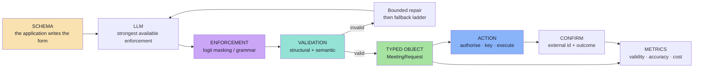
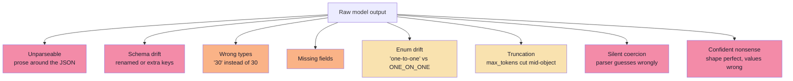
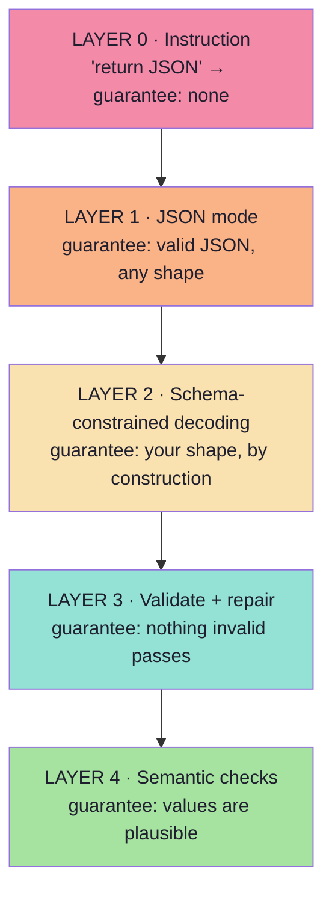
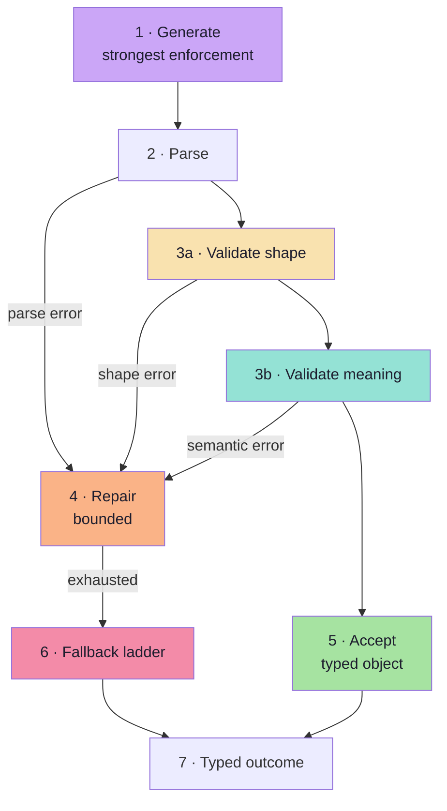

# Lecture 10 — Complete Notes

## Structured Outputs: Schema, Enforcement, Validation & Repair

> **Phase:** 3 · Agency & Contracts · **Level:** 🟡 Intermediate → 🟠 Advanced
> **Source:** `Forward-Deployed-Engineer/Lecture 13/notes/01…09` ·
> `gen-ai-cohort/week02/learning/day03/notes/04-structured-output-and-function-calling.md`
> **Goal (roadmap):** make a model's output something a program can *trust* — a typed object, never "JSON-ish text".
> **Gate (roadmap):** you can prove — with a table — that your system never emits a malformed object, and you know
> what it does when the *content* is wrong.

> **How to use this document.** It is a **map, not a replacement**. It keeps the load-bearing ideas, numbers,
> decision tables and checklists; every section links to the chapter that carries the full reasoning, the
> diagrams and the pseudo-code.

---

## 1. Executive summary

### 1.1 The thesis

> **An LLM cannot reliably feed a program prose, and it will not reliably obey a schema it was merely asked to
> follow — so define the contract, enforce it at the decoder, verify it at the boundary, and never let unverified
> model output touch the outside world.**

### 1.2 The seven sentences that carry the most weight

1. **Humans prefer meaning; software prefers structure.** A program *dereferences fields* — a `string` has none.
2. **A schema is a form the application writes and the model fills.** The shape is decided *before* the request, by
   you, never by the model.
3. **"Return JSON" is a preference over a probability distribution.** It shifts probabilities; it removes nothing.
4. **Constrained decoding guarantees shape, never meaning.** A perfectly shaped object can still be wrong.
5. **Enforcement and validation are complements.** Enforcement makes malformed output unlikely; validation makes it
   harmless.
6. **Structured output is the result; tool calling is the request.** The model may propose; the application
   disposes.
7. **A production system is judged by its failure path**, and by a chain of narrow, measured guarantees.

### 1.3 The one-line mental model

> **Read it left to right:** the model proposes, the decoder constrains, the validator decides, the application acts.

### 1.4 What each chapter contributes

| # | Chapter | The one thing it adds | Detail |
|:--:|:---|:---|:---|
| 01 | Why Plain Text Is Not Enough | The **integration gap** — the problem this lecture exists to solve | [Ch. 01](./01_Why_Plain_Text_Is_Not_Enough.md) |
| 02 | What Structured Output Is | The **form analogy** and **one declaration → three artefacts** | [Ch. 02](./02_What_Structured_Output_Is.md) |
| 03 | Why "Just Ask for JSON" Fails | **Instruction vs contract**, the failure taxonomy and the four enforcement layers | [Ch. 03](./03_Why_Just_Ask_For_JSON_Fails.md) |
| 04 | JSON Schema Design for LLMs | The **twelve rules** and the four decisions per field | [Ch. 04](./04_JSON_Schema_Design_for_LLMs.md) |
| 05 | Enforcement & the Strict-Mode Reality | Logit masking, grammars, and the **silent limits** of strict mode | [Ch. 05](./05_Enforcement_Mechanisms_and_the_Strict_Mode_Reality.md) |
| 06 | Validation, Repair & Failure Handling | The **boundary rule**, the error taxonomy and the **fallback ladder** | [Ch. 06](./06_Validation_Repair_and_Failure_Handling.md) |
| 07 | Structured Output vs Tool Calling | **Result vs request**, and why arguments are untrusted input | [Ch. 07](./07_Structured_Output_vs_Tool_Calling.md) |
| 08 | From Data to Action | The **action pipeline**, adapters, idempotency and MCP | [Ch. 08](./08_From_Data_to_Action_Integrations_and_MCP.md) |
| 09 | Production Playbook | The **metrics, golden set, versioning** and go-live discipline | [Ch. 09](./09_Production_Playbook_Evaluation_and_Go_Live.md) |

**Chapter count: 9** (within the 5–10 limit for this lecture).

---

## 2. The five levels of integration (Ch. 01)

| Level | Input | Output | Consumer | Guarantee |
|:---|:---|:---|:---|:---|
| L0 Raw model | text | text | nobody | none |
| L1 Text feature | text | text | a human | readability |
| **L2 Structured extraction** | text | **typed object** | **the application** | **schema validity** |
| L3 Tool calling | text | typed arguments + effect | an external system | + authorisation |
| L4 Agent | goal | sequence of actions | the environment | + loop bounds |

**Most enterprise GenAI work is L2.** L3 and L4 are L2 plus permission to act.

**The failure taxonomy of free-form output** (all of them *your* bugs, not the model's):

→ Full detail: [Chapter 01](./01_Why_Plain_Text_Is_Not_Enough.md)

---

## 3. Cheat sheet

### 3.1 Definitions (Ch. 01–02)

| Term | Meaning |
|---|---|
| **Structured output** | The model produces information in a **predefined structure** the application can reliably consume |
| **Schema** | The declaration of that structure: a form the application writes and the model fills |
| **Contract** | The schema as an executable interface with an owner (you), a producer (the model) and consumers (your code) |
| **Three artefacts** | From one declaration: the TS **type**, the runtime **validator**, the wire **JSON Schema** |
| **Three layers** | **Syntax** (parseable) → **shape** (schema-valid) → **meaning** (true) |
| **Boundary rule** | No unvalidated model output may cross into application logic |

### 3.2 The four enforcement layers (Ch. 03, 05)

### 3.3 The twelve schema rules (Ch. 04)

| # | Rule | Because |
|:--:|:---|:---|
| 1 | One schema per task | Mixing tasks confuses all of them |
| 2 | Design from the consumer | You extract what the caller needs |
| 3 | Flatten by default | Depth compounds failure probability |
| 4 | Enum every closed set | Removes an unbounded vocabulary |
| 5 | Required + nullable over optional | One rule instead of three states |
| 6 | Close every object (`additionalProperties: false`) | The model cannot add "helpful" fields |
| 7 | Constrain numbers and lists | Nonsense becomes a validation error |
| 8 | Normalise strings (dates, money, phones, IDs) | Most extraction bugs are format bugs |
| 9 | Describe every field | `description` is the highest-value keyword |
| 10 | Avoid unions (`oneOf`/`anyOf`) | Poorly supported and hard to discriminate |
| 11 | Bound the output size | Cost and latency are yours to control |
| 12 | Version the schema | Stored objects stay interpretable |

### 3.4 The strict-mode silent limits (Ch. 05)

| Enforced by the decoder | **Not** reliably enforced — validate yourself |
|---|---|
| `type`, `properties`, `required` | `minimum` / `maximum` |
| `additionalProperties: false` | `minLength` / `maxLength` |
| `enum`, `const` (usually) | `pattern` |
| `items` (usually) | `format` (`email`, `date-time`, `uri`) |
| | `minItems` / `maxItems` (sometimes) |
| | `default` — never applied |
| | Cross-field rules (`if/then`, `dependentRequired`) |
| | `oneOf` / `anyOf` — often rejected outright |

### 3.5 The reliability loop (Ch. 06)

### 3.6 The fallback ladder (Ch. 06)

`Repair` → `different model / simpler schema` → **`degraded object`** → `deterministic fallback` → `human queue / typed failure`.

### 3.7 Structured output vs tool calling (Ch. 07)

| | Structured output | Tool calling |
|---|---|---|
| Purpose | Describe a result | Request an action |
| Who executes | Nobody | Your runtime |
| Failure risk | Wrong data | Wrong data **and** wrong action |
| Safety concern | Data quality | Authorisation and blast radius |

---

## 4. Decision tables

### 4.1 Which enforcement level? (Ch. 05)

| Available capability | Use | Then |
|---|---|---|
| Native schema + strict flag | It | Validate the silent limits |
| Tool-use schemas only | Forced single tool call | Parse the argument string; validate |
| Self-hosted guided decoding | Compile + cache the grammar | Validate the silent limits |
| JSON mode only | JSON mode | Full validator + repair loop |
| Instruction only | Instruction | Full validator + repair + expect a higher repair rate |

### 4.2 Which response to a failure? (Ch. 06)

| Class | Retryable? | Response |
|---|---|---|
| Transport (timeout, 429, 5xx) | ✅ | Retry with backoff + jitter |
| Parse | ✅ | Retry, then repair with the error |
| Shape | ✅ | Repair with the validation issues |
| Semantic | ⚠️ Sometimes | Repair, or escalate to a human |
| Refusal | ❌ | Typed outcome; do **not** retry |
| Capacity (`finish_reason: length`) | ⚠️ Only with a change | Raise the budget or shrink the schema |
| Policy | ❌ | Surface as blocked |
| Schema / configuration | ❌ | Fix the schema; fail the deploy |

### 4.3 Structured output or tool calling? (Ch. 07)

| Situation | Use |
|---|---|
| Extract fields, classify, route, score | **Structured output** |
| Always the same single action with the same fields | **Structured output**, then act in code |
| The model must choose *which* action | **Tool calling** |
| The action needs live data | **Tool calling** |
| High-impact or irreversible | **Tool calling + human-in-the-loop** |
| You need an auditable rationale | **Structured output with a reasoning field** |

### 4.4 How much autonomy for the action? (Ch. 07, 08)

| Tier | Examples | Policy |
|---|---|---|
| 1 — Read-only | Search, lookup, compute | Auto-execute |
| 2 — Scoped mutation | Book for yourself, add a tag | Auto-execute + audit log |
| 3 — Critical | Payment, deletion, customer email, permission change | **Explicit human approval** |

### 4.5 MCP or a plain adapter? (Ch. 08)

| Situation | Recommendation |
|---|---|
| One app, one internal system | Plain adapter |
| One fixed action | Structured output + a direct call |
| Sub-100 ms hot path | In-process code |
| Reused by several hosts / third-party capabilities | **MCP** |

### 4.6 Is this schema change safe? (Ch. 04, 09)

| Change | Safe? |
|---|---|
| Add a nullable field / an enum member / widen a constraint | ✅ |
| Narrow a constraint, rename a field, remove a field | ❌ |
| Repurpose a field's meaning | ❌❌ (the worst kind of bug) |

---

## 5. Twenty misconceptions

1. **"Structured output is just JSON."** JSON is the encoding; the target is a typed application object.
2. **"It makes the model correct."** It makes output *consumable*. Truth is a separate problem.
3. **"Strict mode validates everything."** `minimum`, `pattern`, `format` and `default` are often accepted and ignored.
4. **"JSON mode is enough."** It guarantees parseability, not shape.
5. **"Temperature 0 makes it deterministic."** Greedy decoding reduces variance; it is not a contract.
6. **"I'll just parse harder."** Every regex is a silent correctness risk on the inputs you have not seen.
7. **"Per-field accuracy is system accuracy."** Object validity is the product of per-field validity.
8. **"Retrying will fix it."** A blind retry samples the same distribution.
9. **"Repairing a refusal will work."** A refusal is an answer, not a bug.
10. **"The model can decide whether the user is allowed."** Authorisation belongs in code.
11. **"Structured output and tool calling are the same."** Result vs request.
12. **"If the object is valid, the data is fine."** Semantic errors pass every schema.
13. **"Deep nesting is tidier."** Depth compounds the failure rate.
14. **"Optional fields are safer."** They create tri-state fields everywhere.
15. **"More fields is more value."** More fields is more ways to fail, and more tokens per call.
16. **"A bigger model removes the need for a validator."** Better models fail less often, not never.
17. **"One good demo means it works."** A demo is one sample from a distribution.
18. **"The schema is documentation."** A schema that is not executed drifts from reality.
19. **"Framework X handles this for me."** Frameworks reduce plumbing, not responsibility.
20. **"Structured output is a prompt trick."** It is an interface with an owner, a version and tests.

---

## 6. Glossary

### 6.1 Contracts & schema

| Term | Meaning |
|---|---|
| **Schema** | The declared structure of the model's output; a form the application writes |
| **JSON Schema** | The industry-standard vocabulary for describing JSON structure; also used for tool parameters |
| **Wire contract** | The provider-specific JSON Schema actually sent to the model |
| **`additionalProperties: false`** | Closes an object: no keys beyond those declared |
| **`required`** | Which properties must be present |
| **nullable** | `"type": ["string", "null"]` — the key is present, the value may be `null` |
| **optional** | The key may be absent entirely (avoid: creates tri-state fields) |
| **enum** | A closed set of allowed values |
| **`const`** | Exactly one allowed value (used for `schemaVersion`) |
| **`description`** | Field-level instruction to the model; the highest-value keyword |
| **reasoning field** | A short rationale placed *first* in the schema to condition the answers |
| **`schemaVersion`** | A version stamp inside every object |
| **OpenAPI** | The HTTP API description format whose 3.1 revision aligns with JSON Schema 2020-12 |
| **Anti-corruption layer** | An adapter that prevents a vendor's model from leaking into your domain |

### 6.2 Enforcement & decoding

| Term | Meaning |
|---|---|
| **Logit** | The raw score the model assigns to each vocabulary token |
| **Logit mask** | A vector setting disallowed tokens to negative infinity |
| **Constrained decoding** | Masking invalid tokens before sampling (also: guided / structured decoding) |
| **Grammar / FSM** | A state machine describing all valid token sequences |
| **Grammar compilation** | Schema → grammar; often expensive, so cache it |
| **GBNF** | A grammar file format used by llama.cpp-family runtimes |
| **Outlines** | A library that compiles schemas/regex into masks for self-hosted stacks |
| **Guidance** | A framework for interleaving generation with control flow |
| **XGrammar / llguidance** | High-performance grammar engines used inside serving stacks |
| **Strict mode** | A provider's *supported subset* of JSON Schema, enforced at decoding |
| **JSON mode** | A flag guaranteeing a valid JSON object of *any* shape |
| **Tool-use workaround** | Enforcing a schema by forcing a single tool call with that schema as its parameters |
| **Silent limit** | A keyword the provider accepts but does not enforce |

### 6.3 Validation & repair

| Term | Meaning |
|---|---|
| **Structural validation** | Does the object match the schema? |
| **Semantic validation** | Is the object true, consistent and plausible? |
| **Issue** | A machine-readable validation failure: `{ path, message, received }` |
| **`block`** | Severity: the object is unusable or unsafe |
| **`review`** | Severity: plausible but needs a human |
| **Repair** | A bounded second call that includes the previous output and the issues |
| **Fallback ladder** | Repair → model/schema change → degraded object → deterministic path → human |
| **Degraded object** | A valid object with explicit `null`s and `degraded: true` |
| **Typed outcome** | A discriminated result (`ok` / `refused` / `invalid` / `truncated` / `failed`) |
| **Refusal** | The model declines; an outcome, not an exception |
| **Truncation** | Output cut at the token limit; detected via `finish_reason` |
| **Idempotency key** | A deterministic key derived from the object, making retries safe |
| **Reconciliation** | Looking up whether an ambiguous action actually happened |

### 6.4 Actions & operations

| Term | Meaning |
|---|---|
| **Tool calling** | The model emits arguments so your runtime can execute a function |
| **`tool_choice`** | `auto` / `none` / `required` / a specific tool |
| **Adapter** | One module per external system that absorbs its contract |
| **MCP** | Model Context Protocol — a standard host/client/server protocol for tools, resources and prompts |
| **MCP host / client / server** | The AI app / its per-server connector / the capability provider |
| **Resource** | Application-controlled context exposed by an MCP server |
| **Prompt (MCP)** | A user-invoked template exposed by an MCP server |
| **Tier 3** | Critical action requiring explicit human approval |
| **Golden set** | Inputs with known correct objects, including adversarial ones |
| **First-pass validity** | Fraction of calls valid on the first attempt |
| **Repair rate** | Fraction of calls needing at least one repair |
| **Issue distribution** | Error counts grouped by field path and type — the most useful single chart |
| **Escape-hatch rate** | How often `OTHER` / `UNKNOWN` is chosen |

---

## 7. Twenty self-check questions

1. Why does a chatbot that works perfectly in a demo fail the moment it becomes a feature?
2. State the lecture's thesis in one sentence, and give the mechanical reason behind it.
3. Place these on the L0–L4 ladder: a summariser, a ticket classifier, a weather assistant, an autonomous researcher.
4. What are the three load-bearing words in the definition of structured output, and what does each exclude?
5. Why is a schema a *contract*? Name its owner, producer and consumers.
6. What are the **three artefacts** derived from one declaration, and what breaks if they drift?
7. Name eight failure modes of prompt-only JSON.
8. Why is "return JSON" a preference over a distribution rather than a constraint?
9. Given 97% per-field accuracy over 6 fields, what is the object-level validity, and what follows from it?
10. What does JSON mode guarantee, and what does it not?
11. Give the twelve schema rules from memory, and the reason for rules 3, 5 and 10.
12. Why is `enum` the highest-leverage constraint, and why does an enum need an escape hatch?
13. Distinguish nullability from optionality, and say which you should default to.
14. What does the reasoning-field pattern do, and what are its four costs?
15. Explain logit masking in two sentences, and state precisely what it guarantees.
16. Which JSON Schema keywords are typically **accepted but ignored** by strict mode?
17. What are the four enforcement layers, and what does each one guarantee?
18. Why is the tool-use workaround a workaround rather than a solution?
19. Distinguish structural from semantic validation, and give one check that only semantics can catch.
20. What are the four ingredients of an effective repair prompt, and why must the loop be bounded?
21. Name the five rungs of the fallback ladder, and say which rung is *never* acceptable for a payment.
22. State the difference between structured output and tool calling in terms of **who executes**.
23. Why are tool arguments untrusted input? List four controls that follow.
24. What is the complete action pipeline, in order, and where does authorisation happen?
25. What does MCP standardise, and what does "N × M becomes N + M" mean concretely?
26. What are the five categories of a golden set, and why is a clean-only set useless?
27. Name six production metrics and say what a *rising repair rate with a stable volume* suggests.
28. Why must every trace carry `schemaVersion` and `model`?
29. Which schema changes are safe, and which are breaking? Why is "repurpose" the worst?
30. What does the go-live checklist's **action safety** section require, and why is "authorise in the prompt" not one of the answers?

> **Answers** are the content of the chapters; use the reading paths below to navigate.

---

## 8. Reading paths & closing notes

### 8.1 Pick a path

| Situation | Read |
|:---|:---|
| First pass, start to finish | [01](./01_Why_Plain_Text_Is_Not_Enough.md) → [09](./09_Production_Playbook_Evaluation_and_Go_Live.md) |
| "Why can't I just ask for JSON?" | [Ch. 03](./03_Why_Just_Ask_For_JSON_Fails.md) §03.3–§03.6, §03.9 |
| "My schema keeps failing validation" | [Ch. 04](./04_JSON_Schema_Design_for_LLMs.md) §04.3–§04.10, §04.12 |
| "Strict mode isn't enforcing my `minimum`" | [Ch. 05](./05_Enforcement_Mechanisms_and_the_Strict_Mode_Reality.md) §05.4 |
| "Which enforcement should I use for this model?" | [Ch. 05](./05_Enforcement_Mechanisms_and_the_Strict_Mode_Reality.md) §05.5, §05.7 |
| "The model returns garbage 4% of the time" | [Ch. 06](./06_Validation_Repair_and_Failure_Handling.md) §06.3, §06.7–§06.8 |
| "Do I need a tool or a schema?" | [Ch. 07](./07_Structured_Output_vs_Tool_Calling.md) §07.10 |
| "How do I actually book the meeting?" | [Ch. 08](./08_From_Data_to_Action_Integrations_and_MCP.md) §08.4–§08.5 |
| "Is this safe to ship?" | [Ch. 09](./09_Production_Playbook_Evaluation_and_Go_Live.md) §09.9 · [Ch. 08](./08_From_Data_to_Action_Integrations_and_MCP.md) §08.10 |
| "How do I prove it works?" | [Ch. 09](./09_Production_Playbook_Evaluation_and_Go_Live.md) §09.2–§09.4 |
| Preparing for an interview | [Ch. 09](./09_Production_Playbook_Evaluation_and_Go_Live.md) §09.10, plus §3–§5 of this document |

### 8.2 The lecture's build task, as a checklist

Roadmap **Build:** *a validated extraction service (e.g. `MeetingDetails`) with Zod, a repair loop and a metrics
table showing validity per enforcement rung.*

- [ ] A single schema declaration that yields the type, the validator and the wire contract.
- [ ] Structural validation at one boundary, returning machine-readable issues.
- [ ] At least three semantic rules, with `block` / `review` severities.
- [ ] A bounded repair loop that includes the previous output and the issues.
- [ ] A fallback ladder, including a degraded object.
- [ ] Typed outcomes for `ok` / `refused` / `truncated` / `invalid` / `failed`.
- [ ] A metrics table comparing first-pass validity across at least two enforcement rungs.
- [ ] One trace per call, carrying `schemaVersion` and `model`.

### 8.3 The gate, restated

> **You can prove — with a table — that your system never emits a malformed object, and you know what it does when
> the *content* is wrong.**

The table is the *evidence*; the fallback ladder is the *answer to the second half*. If you cannot produce both, the
lecture is not finished.

### 8.4 The three ideas to carry forward

1. **A schema is a form the application writes** — and the model fills. Everything else follows from taking that
   ownership seriously.
2. **Enforcement guarantees shape; validation bounds damage.** Neither substitutes for the other, and both are
   required.
3. **Measure the failure path.** Issue distribution, repair rate and per-field accuracy are what turn "the model is
   unreliable" into a ranked, fixable list.

### 8.5 Cross-links to adjacent lectures

| Lecture | Connection |
|:---|:---|
| Lecture 04 | The application→LLM call itself; one request, one response |
| Lecture 06 | Statelessness, roles and context — why the schema must travel on every call |
| Lecture 08 | Tool calling: the wire protocol, tool taxonomy, routing and tool security |
| Lecture 09 | Agents, sandboxing, HITL and the tool authorization tiers this lecture's actions plug into |
| Lecture 11 | Structured output *inside* an agent loop: schema-enforced reasoning steps |
| Lecture 12 | Evaluation discipline and stage-local upgrades |
| Lecture 21–22 | MCP in depth: core, resources, prompts and gateways |
| Lecture 30 | Evals and testing — the harness discipline in full |
| Lecture 31 | Guardrails — input/output safety controls that sit around this pipeline |

---

## 🔗 Related workspace links

| Item | Link | Status |
|:---|:---|:---:|
| Lecture workspace / checklist | [📄 README.md](../README.md) | ✅ |
| Chapter index | [📄 index.md](../index.md) | ✅ |
| Generation prompt (git-ignored) | [📄 prompt.md](../prompt.md) | ✅ |
| Chapter notes | [📂 notes/](./) | ✅ 9 chapters + complete notes |
| Basic Code | [📂 code/Basic Code](../code/Basic%20Code/) | 🔜 to build |
| Production Code | [📂 code/Production Code](../code/Production%20Code/) | 🔜 to build |
| Lecture assignment | [📝 Assignment/task.md](../Assignment/task.md) | 🔜 to build |
| Roadmap — Lecture 10 topics, build & gate | [🗺️ ../roadmap.md](../roadmap.md) | ✅ |
| Repository chapter index (all lectures) | [📚 ../index.md](../index.md) | ✅ |

---

## 🔗 Source references

- `Forward-Deployed-Engineer/Lecture 13/notes/01_Why_Plain_Text_Is_Not_Enough.md`
- `Forward-Deployed-Engineer/Lecture 13/notes/02_What_Structured_Output_Is_Schema_Contract_And_Types.md`
- `Forward-Deployed-Engineer/Lecture 13/notes/03_Why_Just_Ask_For_JSON_Fails.md`
- `Forward-Deployed-Engineer/Lecture 13/notes/04_JSON_Schema_And_Schema_Design_For_LLMs.md`
- `Forward-Deployed-Engineer/Lecture 13/notes/05_Enforcement_Mechanisms_And_Provider_Landscape.md`
- `Forward-Deployed-Engineer/Lecture 13/notes/06_Validation_Repair_And_Failure_Handling.md`
- `Forward-Deployed-Engineer/Lecture 13/notes/07_Structured_Output_vs_Tool_Calling.md`
- `Forward-Deployed-Engineer/Lecture 13/notes/08_From_Data_To_Action_Tools_Integrations_And_MCP.md`
- `Forward-Deployed-Engineer/Lecture 13/notes/09_Production_Playbook_Evaluation_And_Checklist.md`
- `Forward-Deployed-Engineer/Lecture 13/notes/Lecture_13_Complete_Notes.md`
- `Forward-Deployed-Engineer/Lecture 13/notes/README.md`
- `gen-ai-cohort/week02/learning/day03/notes/04-structured-output-and-function-calling.md`

---

### Navigation

- **Previous lecture:** [Lecture 09 — AI Agents & HITL](../Lecture%2009%20-%20AI%20Agents%20and%20HITL/index.md)
- **Next lecture:** [Lecture 11 — Agent SDK from Scratch](../Lecture%2011%20-%20Agent%20SDK%20from%20Scratch/index.md)
- **Chapter index for this lecture:** [index.md](../index.md)

