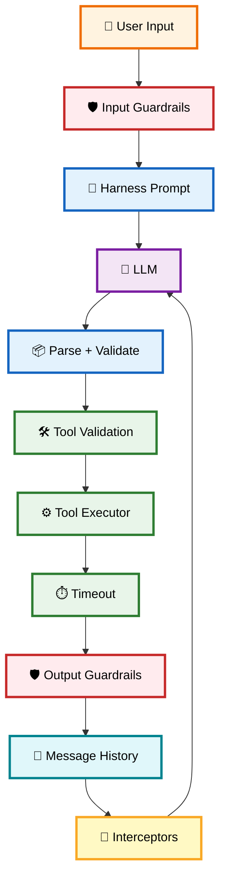
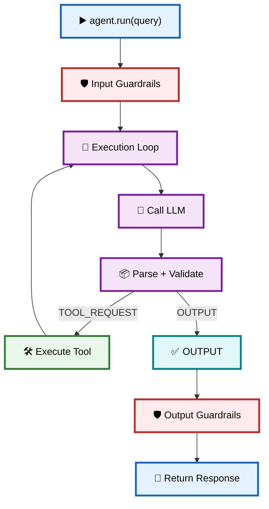

# 🛡️ 07 — Guardrails, Safety & Production Hardening

> **Goal:** Understand how to harden an Agent SDK for production use: input/output guardrails, tool safety, loop limits, token budgets, prompt-injection defense, retries, circuit breaking, observability, and testing strategy.

---

# 1. 🔒 Why Production Matters

Your simple Agent from Chapters 01–06 works for demos, but it lets the LLM **execute arbitrary shell commands** and **trust all LLM output**.

Production concerns:

* 🧠 LLM can be tricked (prompt injection)
* 🛠️ Tools can be dangerous (CLI, network)
* 💬 LLM output can be malformed
* 🔄 Loop can run forever
* 💰 Cost can explode
* 📊 You cannot debug at scale without observability

So production agents need **defense in depth**.

---

# 2. 🛡️ Defense in Depth Layers



---

# 3. 🧠 What Are Guardrails?

A **guardrail** is a policy function that inspects either input or output and returns:

```ts
interface GuardrailResult {
  passed: boolean;
  reason?: string;
  modifiedContent?: string;
}

interface IInputGuardrail {
  name: string;
  validate: (input: string, agentName: string) => Promise<GuardrailResult> | GuardrailResult;
}

interface IOutputGuardrail {
  name: string;
  validate: (output: string, agentName: string) => Promise<GuardrailResult> | GuardrailResult;
}
```

The Agent runs them at the boundaries:

```ts
// Input guardrails before execution
for (const guardrail of this.inputGuardrails) {
  const result = await guardrail.validate(query, this.name);
  if (!result.passed) {
    throw new Error(`[GUARDRAIL REJECTED] ...`);
  }
}

// Output guardrails after generation
for (const guardrail of this.outputGuardrails) {
  const result = await guardrail.validate(finalOutputText, this.name);
  if (!result.passed) {
    throw new Error(`[GUARDRAIL REJECTED] ...`);
  }
  if (result.modifiedContent) {
    finalOutputText = result.modifiedContent;
  }
}
```

---

# 4. 🛡️ Types of Guardrails

## 4.1 🔒 Security Guardrail (prompt injection)

Blocks obvious override attempts:

```ts
const PROMPT_INJECTION_PATTERNS = [
  /ignore\s+(all\s+)?previous\s+instructions/i,
  /bypass\s+(all\s+)?guardrails/i,
  /you\s+are\s+now\s+DAN/i,
  /system\s+prompt\s+override/i,
  /forget\s+your\s+rules/i,
];
```

## 4.2 💻 CLI Safety Guardrail

Blocks destructive commands:

```ts
const DANGEROUS_COMMAND_PATTERNS = [
  /\brm\s+-[rf]{1,2}\b/i,
  /\bsudo\b/i,
  /\bmkfs\b/i,
  /\bdd\b/i,
  /\bchmod\s+777\b/i,
  /\bshutdown\b/i,
  /\breboot\b/i,
  /:()\{\s*:\|:&\s*\};:/, // Fork bomb
];
```

## 4.3 📝 Content Safety Guardrail

Blocks harmful content in agent outputs.

## 4.4 🧹 PII Redaction Guardrail

Sanitizes sensitive data from responses:

* API keys (`sk-...`)
* Emails
* Credit cards
* Phone numbers (optional)

## 4.5 🎯 Topic Guardrail (factory pattern)

Restricts the Agent to a domain:

```ts
const mathAgent: Agent = Agent.builder("MathAgent")
  .addInputGuardrail(
    createTopicGuardrail("Mathematics", ["math", "add", "calculate", "+", "*"])
  )
  .build();
```

---

# 5. 🔗 Guardrail Placement in the Execution Loop



---

# 6. 🛠️ Tool-Level Safety

Even if guardrails exist, tools themselves should be safe.

### 6.1 Timeouts

```ts
executor(cmd) {
    return new Promise((resolve) => {
        exec(cmd, { timeout: 10000 }, (err, out) => {
            // timeout after 10s
        });
    });
}
```

### 6.2 Sandboxing / Allowlists

For CLI tools, restrict operations:

```text
Allowed commands:
ls, cat, git diff, npm test, ...

Never allowed:
rm -rf, sudo, chmod 777, ...
```

### 6.3 No Shell Interpolation

```ts
// ❌ Dangerous
const dangerous = `rm -rf ${userInput}`;

// ✅ Safe (validate first)
const safeInput = sanitize(userInput);
execFile("rm", ["-rf", safeInput]);
```

> **Note:** The provided `execCli` tool allows arbitrary commands. In production, you should add an allowlist or restrict shell usage entirely.

---

# 7. 🛡️ MAX_LOOP Safety

Agents can enter infinite feedback loops:

```text
THINK
  ↓
TOOL
  ↓
ANALYSE
  ↓
THINK
  ↓
...
```

That causes:

```text
💰 More LLM calls
💰 More tokens
💰 More API calls
💥 Potential runaway execution
```

Your `MAX_LOOP` prevents this:

```ts
private MAX_LOOP = 30;

for (let i = 0; i < this.maxLoop; i++) {
    // ...
}
```

---

# 8. 🔄 Retry & Circuit Breaking

Network/transient failures need handling.

```ts
// Retry with exponential backoff
async function retry(fn, retries = 3) {
  for (let attempt = 0; attempt < retries; attempt++) {
    try {
      return await fn();
    } catch (e) {
      if (attempt === retries - 1) throw e;
      await sleep(2 ** attempt * 1000); // 1s, 2s, 4s
    }
  }
}
```

### Circuit breaker state:

```text
CLOSED → (failures exceed threshold) → OPEN → (timeout) → HALF-OPEN → (test succeeds) → CLOSED
                                              → (test fails)  → OPEN
```

---

# 9. 🧠 Token Budget & Cost Management

Track tokens and costs via interceptors:

```ts
const metricsInterceptor: Interceptor = (message) => {
  // Estimate or fetch token usage from provider response
  totalTokens += estimateTokens(message.content);
};
```

Enforce budgets:

```ts
const MAX_TOKENS = 100_000;
if (totalTokens > MAX_TOKENS) {
  throw new Error("Token budget exceeded");
}
```

---

# 10. 📊 Observability & Audit Logging

Your interceptor system supports:

```text
📝 Logging
📊 Metrics
🔍 Tracing
🛡️ Audit
```

Example: attach multiple interceptors.

```ts
agent
  .attachInterceptor(consoleLoggerInterceptor)
  .attachInterceptor(metrics.getHandler())
  .attachInterceptor(tracingInterceptor);
```

All three receive the same message.

---

# 11. 🧪 Testing & Evaluation Strategy

| Test type        | What it verifies                  |
| ----------------- | --------------------------------- |
| Unit tests        | Tool executors, parsing, guardrails |
| Integration tests | Full agent loop with mocks        |
| Evals             | Correctness across many queries   |
| Adversarial tests | Prompt injection attempts         |
| Property tests    | Guardrails always reject dangerous inputs |

Example: adversarial test for CLI safety.

```ts
expect(() => cliAgent.run("rm -rf /")).toThrow(/Guardrail/i);
```

---

# 12. 🔗 Connection: Chapter 06 → Chapter 07

Chapter 06 ensured the LLM output is valid.

Chapter 07 ensures the whole system stays safe under attack.

```text
🧠 LLM output (trusted)
    ↓
📦 Parse + Validate (Chapter 06)
    ↓
🛡️ Guardrails (Chapter 07)
    ↓
🛠️ Safe Execution
    ↓
📡 Monitoring
```

---

# 13. 🧠 Final Mental Model

```text
                👤 User
                   │
                   ▼
           🛡️ Input Guardrails
                   │
                   ▼
         🎯 Harness + Instructions
                   │
                   ▼
               🧠 LLM
                   │
                   ▼
             📦 Parse + Validate
                   │
                   ▼
           🔄 Loop Limit (MAX_LOOP)
                   │
                   ▼
      ┌────────────┼────────────┐
      ▼            ▼            ▼
  🛠️ Tools   🛡️ Output Guards   🧹 PII Redaction
      │            │            │
      ▼            ▼            ▼
   ⚙️ Executor → ⏱️ Timeout → 💬 Message History
                                          │
                                          ▼
                                📡 Interceptors
                                  (Logs, Metrics,
                                   Tracing, Cost)
                                          │
                                          ▼
                                 ✅ Final Output
```

## ⭐ Key Production Guardrails

| Guardrail           | Purpose                              |
| ------------------- | ------------------------------------ |
| Input validation   | Reject prompt injection              |
| CLI allowlist      | Block dangerous commands             |
| Timeout            | Prevent hanging tools                |
| MAX_LOOP           | Prevent infinite agent loops         |
| Token budget       | Cap cost per run                     |
| Output redaction   | Strip PII/API keys from responses    |
| Output safety      | Block harmful content generation     |

---

# 📚 Common Mistakes

❌ Relying only on LLM compliance — always validate LLM output.
❌ Letting tools execute arbitrary shell commands — always sandbox or allowlist.
❌ No timeout on external tool calls — tools can hang indefinitely.
❌ Not capping MAX_LOOP — agents can spin forever and rack up costs.
❌ Ignoring prompt injection — guardrails must inspect raw user input.
❌ No observability — you cannot debug or audit without interceptors.
❌ No retry/circuit-breaker — transient failures break the agent.
❌ Putting PII in raw logs — redact before recording.

---

# 🔑 Key Takeaways

### 1. 🛡️ Guardrails are policy checks

They validate input before execution and output before returning.

### 2. 🧠 LLM output is untrusted

Always parse + validate before acting on it.

### 3. 🛠️ Tools are dangerous

CLI tools allow shell access; always use timeouts, allowlists, and ideally sandboxing.

### 4. 🔄 MAX_LOOP prevents runaway execution

It caps iterations regardless of task complexity.

### 5. 📊 Interceptors enable production observability

Logging, metrics, tracing, and audit all depend on the event stream.

### 6. 🔒 Production agents require defense in depth

No single guardrail is sufficient; layers compose a safety net.

---

# 🌐 Production Hardening Checklist

```text
✅ Input guardrails (security, topic, safety)
✅ Output guardrails (content safety, PII redaction)
✅ Tool timeouts
✅ MAX_LOOP enforced
✅ Token budget limits
✅ Retry + circuit breaker
✅ Structured logging
✅ Tracing / correlation IDs
✅ Audit log of all tool calls
✅ Prompt-injection test suite
✅ Cost monitoring alerts
```