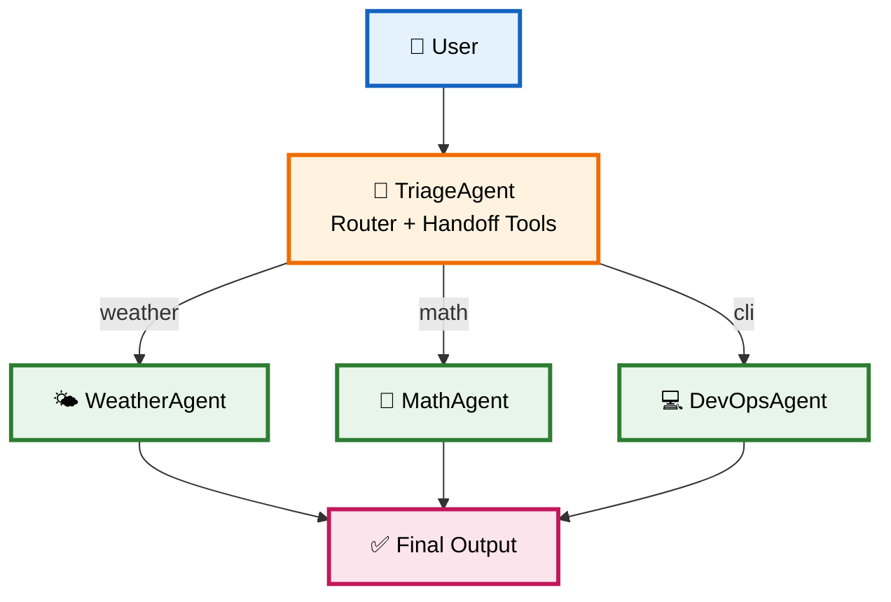
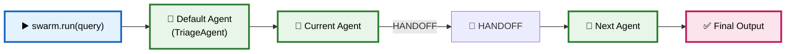
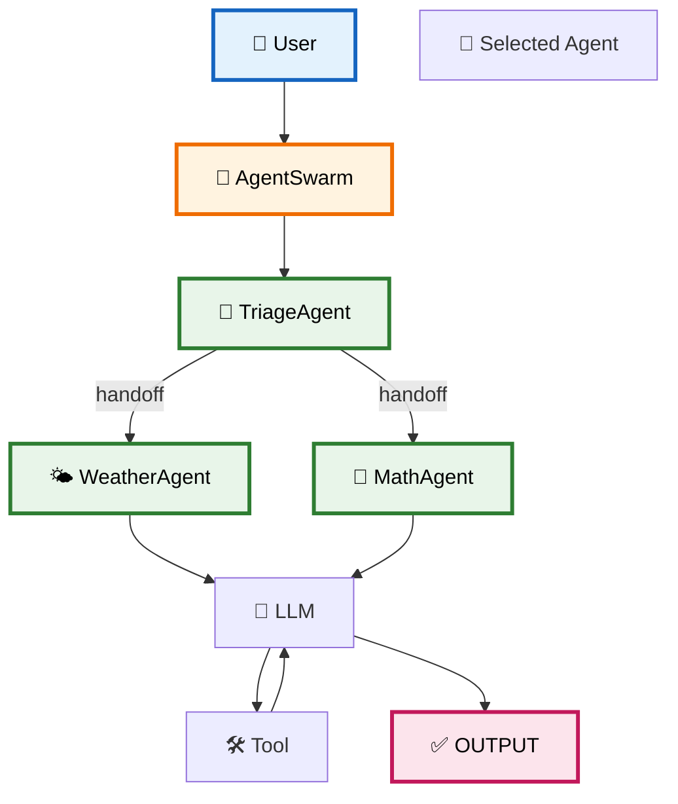

# 08 — Multi-Agent Swarms, Handoffs & Provider Packaging

> **Goal:** Understand how to scale a custom Agent SDK beyond a single Agent into multi-agent systems, while keeping the core loop intact.

---

# 1. 🌐 Why Multi-Agent?

Single Agent can become overloaded when tasks are broad.

Multi-Agent helps by **specialization** and **context isolation**.

Examples:

* Weather specialist
* Math specialist
* DevOps specialist
* Triage router



---

# 2. 🤝 Handoff Pattern

A `HANDOFF` is a special structured step that transfers control from one Agent to another.

```json
{
  "step": "HANDOFF",
  "targetAgent": "WeatherAgent",
  "reason": "Query requires weather specialist."
}
```

A transfer tool can also trigger handoff:

```ts
const transferTool: ITool = {
  name: `transferTo_${targetAgentName}`,
  description: `Transfers control to the specialized agent '${targetAgentName}'.`,
  doc: `transferTo_${targetAgentName}(reason: string): HandoffResult`,
  executor: (input) => {
    return JSON.stringify({
      status: "HANDOFF_TRIGGERED",
      targetAgent: targetAgentName,
      reason: input || `Transfer requested to ${targetAgentName}`,
    });
  },
};
```

---

# 3. 🔀 Swarm Orchestrator

The `AgentSwarm` manages multiple Agents.



Key behaviors:

* `AgentSwarm` has a registry of agents.
* `setDefaultAgent()` selects initial Agent.
* `run()` loops until `OUTPUT`.
* `HANDOFF` moves to another Agent.
* History is passed forward.

---

# 4. 🧩 Fan-Out / Fan-In

For parallel tasks, you may run multiple specialists on the same query and merge results.

Design considerations:

* Run specialists in parallel.
* Use aggregation step to combine answers.
* Handle failures per branch.
* Maintain global `MAX_LOOP` across branches.
* Avoid shared mutable state between branches.

```text
User
  ↓
Router
  ↓
├─ WeatherAgent → [result]
├─ MathAgent   → [result]
└─ DevOpsAgent → [result]
  ↓
Aggregator → Final Answer
```

---

# 5. 🌐 Provider Abstraction

Your core loop should not depend on OpenAI vs Gemini directly.

Create an abstraction:

```ts
interface LLMProvider {
  callAgent(prompt: string, history: IMessage[]): Promise<string>;
}
```

### OpenAI implementation:

```ts
openai.chat.completions.create({
  model: this.modelName,
  messages: [
    { role: "system", content: this.instructions },
    ...this.messageHistory.map((m) => ({ role: m.role, content: m.content })),
  ],
});
```

### Gemini implementation:

```ts
genAI.getGenerativeModel({
  model: this.modelName,
  systemInstruction: this.instructions,
});
```

Key differences:

* OpenAI uses `system` + messages.
* Gemini uses `systemInstruction` + contents.
* Role mapping may differ.

This keeps the **core loop provider-agnostic.

---

# 6. 📦 Production Packaging

A custom Agent SDK should be published as a package.

Recommended structure:

```text
agent-sdk/
├── src/
│   ├── index.ts
│   ├── agent.ts
│   ├── builder.ts
│   ├── config.ts
│   ├── types.ts
│   └── swarm.ts
├── dist/
├── implementation guides/
├── README.md
└── package.json
```

Key package properties:

* `main: dist/index.js`
* `type: module`
* exports public API

---

# 7. 🔁 Adding a New Provider Without Editing the Core Loop

The goal is:

> **You can add a new tool, a new interceptor, and a second provider without editing the core loop.**

Design principles:

* Keep core execution loop independent of provider SDK.
* Provider adapters implement `LLMProvider`.
* Tools return strings and are provider-agnostic.
* Interceptors are provider-agnostic.

This is the **Open/Closed Principle** in action.

---

# 8. 🧠 Final Mental Model



## ⭐ Core Formula

$$
\boxed{
\text{MultiAgent}
=
\text{Base Agent}
+
\text{Registry}
+
\text{Router/Handoff}
+
\text{Swarm Orchestrator}
+
\text{Provider Adapter}
}
$$

---

# 📚 Key Takeaways

1. **Multi-agent** uses specialization via delegation.
2. **Handoff** uses structured `HANDOFF` steps or transfer tools.
3. **Swarm** orchestrates routing and state.
4. **Provider abstraction** keeps core loop clean.
5. **Packaging** exposes the SDK to consumers.

---

# 🧠 Common Mistakes

- Making swarm aware of execution internals.
- Not passing history forward during handoffs.
- Not bounding `MAX_HANDOFFS`.
- Letting agent call itself without a router.
- Tying provider SDK directly into core loop.

## 🔑 Key Takeaways

### 1. Multi-agent extends single Agent

### 2. Handoff is a structured loop concept

### 3. Swarm is orchestration

### 4. Provider abstraction prevents tight coupling

### 5. Packaging makes the SDK reusable

---

# 🎯 Final Formula

$$
\boxed{
\text{Agent Swarm}
=
\text{Agents}
+
\text{Registry}
+
\text{Handoff Protocol}
+
\text{Orchestrator}
+
\text{Execution Context}
}
$$

**Remember:** The core loop remains the same; multi-agent only changes who owns the conversation turn.

---

# 📚 Interview Q&A for Chapter 08

### Q1. What is a handoff?

**A:** A structured `HANDOFF` step that transfers control to a specialized Agent.

### Q2. How does swarm know which Agent to call?

**A:** Through a default agent or a router that decides.

### Q3. Why use multi-agent instead of one big agent?

**A:** To benefit from specialization, context isolation, and easier debugging.

### Q4. How do you add a new provider without changing core loop?

**A:** Use an LLM provider adapter interface.

---

# 🌐 Production Notes

| Component            | Implementation details                             |
| --------------------- | --------------------------------------------------- |
| Handoff protocol     | Structured JSON step + optional transfer tool      |
| Swarm registry       | Map of agents + default selection                  |
| Provider adapter     | Abstraction over OpenAI / Gemini                   |
| Fan-out/fan-in       | Parallel branch execution + aggregation           |
| Packaging            | Public exports, build config, versioned API        |

> **Safety note:** Multi-agent does not remove the need for guardrails. Each agent should still have its own tool permissions and safety policies.

---

# 📦 Code Snippets Summary

```ts
// Provider interface (pseudo)
interface LLMProvider {
  callAgent(prompt: string, history: IMessage[]): Promise<string>;
}
```

```ts
// OpenAI adapter
class OpenAIAdapter implements LLMProvider {
  async callAgent(prompt: string, history: IMessage[]) {
    const response = await openai.chat.completions.create({
      model: this.modelName,
      messages: [
        { role: "system", content: prompt },
        ...history.map((m) => ({ role: m.role, content: m.content })),
      ],
    });
    return response.choices[0]?.message?.content ?? "";
  }
}
```

```ts
// Gemini adapter
class GeminiAdapter implements LLMProvider {
  async callAgent(prompt: string, history: IMessage[]) {
    const model = genAI.getGenerativeModel({
      model: this.modelName,
      systemInstruction: prompt,
    });
    const result = await model.generateContent(history);
    return result.response.text();
  }
}
```
